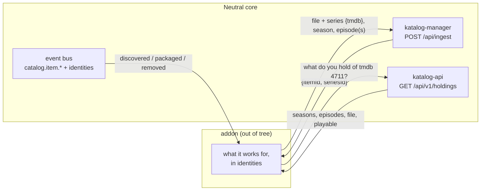

# ADR-0012: Addons hand over and look up by identity

**Status:** Proposed · 2026-10-15 · extends the ingest seam of [ADR-0001](./0001-neutral-core-and-addon-seams.md) and the event contracts of [ADR-0005](./0005-kafka-event-bus-and-schema-contracts.md). §1 and §2 are built, on `main` since 2026-10-15 ([ingest](../extending/ingest.md#by-identity), [holdings](../extending/holdings.md)); §3 is not built yet.

## Context

An addon that works with series has to do two things the seams of ADR-0001 do not yet let it do cleanly.

**Hand over an episode.** The ingest seam takes an episode only with its series' catalog id (`parentId`), its season and its episode. An addon holds no catalog ids: they are the catalog's own rows, and the series they point at may not exist yet. Only the catalog may create it ([ADR-0003](./0003-catalog-cqrs-sole-writer.md)). An addon then either cannot hand the episode over at all, or it starts keeping catalog ids and finding series itself, which couples it to one catalog's rows. One file that covers several episodes in a row, which the catalog models since 2026-10 (the first episode holds the file, the others are covered by it), cannot be handed over at all.

**Know what the library holds.** An addon thinks in the identities titles have outside any one library, such as a TMDB, TVDB or IMDb id. The catalog keeps those identities for most titles, from enrichment, but shows them nowhere: the read side's items carry no external ids, and the pipeline events carry catalog ids only. An addon cannot tell what is held from what is not. It either treats the whole library as absent or keeps a copy of the catalog of its own, and both go wrong quietly.

**Its topics.** An addon's scheduled and event work runs on topics of the event bus. Today they must exist before the addon starts, made by hand; until someone makes them, that work does not run, and nothing says so.

## Decision

Three contracts, each in the core's own vocabulary: titles, series, seasons, episodes, files and the identities they carry. None of them says how a file came to exist, and none holds what anyone wants.

**1. Ingest by identity.** `POST /api/ingest` takes a title by its identity instead of a catalog id.

- For an episode: `series: {tmdb | tvdb | imdb}` (one is enough), `seasonNumber`, `episodeNumber`, and, for one file that covers several episodes in a row, `episodeEnd`. The catalog finds the series by that identity (the first source that finds one decides; of a show it holds twice, the series made first), or creates it from the identity and the title given, as the scanner creates one it finds on disk. It then links the episode, and the covered ones, to it.
- For a movie: `identity: {tmdb | imdb}`, so it arrives matched rather than by title alone.
- The answer is the catalog's ids: `{itemId, created, seriesId?, covered?: [itemId…]}`. Identity goes in, catalog ids come out.
- `parentId` stays accepted for the scanner and for callers that already hold one. No addon needs a catalog id to hand a file over.
- Ingest stays idempotent on the path. An identity that contradicts what the catalog holds for that path is refused (409), never quietly relinked.

**2. Holdings by identity.** The read side (katalog-api) says what the library holds, by identity.

- `GET /api/v1/holdings?type=series&tmdb=<id>` (or `tvdb`, `imdb`): the series' catalog id and, season by season, each episode it holds, with its item id, whether it has a file and whether it is playable (packaged). An episode covered by another's file is listed as held, with the item that holds the file.
- `type=movie` likewise, for one movie.
- `GET /api/v1/holdings?type=series` or `type=movie`, paged: every title with its identities, so an addon can follow the whole library without copying it.
- Items' external ids become part of the item JSON the read side already serves: `externalIds: {tmdb, tvdb, imdb, …}`.
- The pipeline events an addon may already consume (`catalog.item.discovered`, `catalog.item.packaged`, `catalog.item.removed`) carry the item's identities next to its catalog id, as optional fields of their envelope, so a consumer can reconcile without a lookup. (ADR-0005 makes that envelope a published schema; none is published for these events yet.)
- Read access is the read side's usual: a signed-in person, or an addon's service account whose tokens carry the instance's audience. The holdings are the library's, not a viewer's: no rating cap filters them, so a request capped at an age is refused them.

**3. Topics from the manifest.** An addon's manifest declares the topics it produces and consumes, named as ADR-0005 names them under the instance's tenant prefix. The operator creates them when it installs the addon ([ADR-0011](./0011-addon-charts-installed-by-the-operator.md)) and removes them with it. An addon's topics are never made by hand.

## Consequences

- An addon can follow every title in the library and tell what is held from what is not, without its own copy of the catalog and without keeping catalog ids. It hands over an episode, or several in one file, by the identity it already works with.
- The catalog remains the only writer (ADR-0003). Finding or creating a series from an identity is the catalog doing what its scanner already does.
- Matching is only as good as the catalog's identities. A title enrichment has not given an identity is invisible to these lookups until it has one, so enrichment becomes something addons rely on.
- The new ingest fields, the holdings answer and the identity fields on the events become public API, kept stable as ADR-0001 says of the seams.
- An installed addon's work no longer depends on someone having made its topics.

### What this rules out

- No wanted or missing state in the core. Holdings say what the library holds and never what anyone wants; deciding what is missing is the addon's.
- No addon creating series, episodes or any other catalog row itself, and no addon holding catalog ids in order to hand files over.
- No matching a file to a title by its name alone at the ingest seam, when the caller knows the title's identity.
- No topic of an addon's made by hand, and none left behind when the addon is removed.
