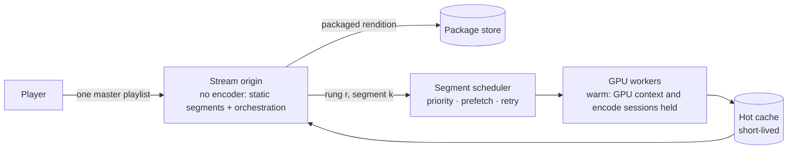

# ADR-0013: Live rungs beside the package, as a supervised safety net

**Status:** Accepted · 2026-10-20 (proposed 2026-10-17) · amends the fallback of [ADR-0002](./0002-prepackaged-playback.md). A spike validated the worker first ([Validation](#validation), [what it found](#what-the-spike-found)).

## Context

[ADR-0002](./0002-prepackaged-playback.md) packages every title once and serves static segments; on-demand transcoding is a narrow codec fallback. That stays right. But a package holds **one video rendition**, and what it holds is whatever the transcoder kept: a source that already is HEVC passes through, so a title can be packaged at 19 Mbit/s on average with 40 Mbit/s peaks, or as HDR10. Two things then fail in front of the viewer, and neither is a codec problem:

- **Delivery.** Over a long link — 250 ms round trip, 10–30 Mbit/s — one 8-second segment of 35 MB takes 10–30 s to arrive. The player has nothing smaller to switch to; it times out before its first frame, reconnects, and fetches the same segment again.
- **Range.** A device that decodes HEVC but not HEVC Main 10 with PQ gets a package it cannot show, and nothing smaller or SDR to fall back on.

Storing more renditions for every title would fix both, at a permanent storage cost for something most views never need. The on-demand path that exists today cannot be the answer either:

- **It shares the blast radius of static playback.** The encoder runs as a child process inside the stream origin, the same container that serves every packaged stream. One encoder that runs away or is killed for memory takes static playback down with it.
- **It is too slow.** It runs on the CPU there; a software encode reaches roughly real time at 1080p and no further.
- **Its switches are reloads.** Each quality is a separate playlist the player reloads and seeks into, so a fallback can never be invisible.
- **It holds long windows.** One encoder serves a long window, so a crash breaks the stream rather than one segment.
- **The encoder command line hides what matters.** A process per job pays for a cold GPU context every time, reports progress as text, and gives little control over memory and encode sessions.

## Decision

The package stays the primary path. Beside it, every title gets **live rungs**: lower, SDR renditions produced segment by segment by a supervised pool of GPU workers, offered in the same master playlist, and never stored beyond a short-lived cache.

1. **One ladder, partly virtual.** The master playlist lists the packaged rendition as the top variant and the live rungs below it (about 1080p at 6 Mbit/s, 720p at 3 Mbit/s and 480p at 1.4 Mbit/s; SDR, H.264, labelled with their true codecs and `VIDEO-RANGE`). The rungs' segments have **exactly the package's boundaries**, so the player's own bitrate adaptation switches between rungs without a reload, a seek or an error. Which rung plays is the player's choice, as it is for any ladder; the platform never stores the live rungs.
2. **Segments are stateless jobs.** "Rung *r*, segment *k* of title *t*" is deterministic: any worker can produce it, a failed one is produced again on another worker, and the scheduler produces the segments ahead of the play head before they are asked for. A crash costs one retry the viewer does not see. The order of work is the play head first, prefetch second.
3. **Encoding leaves the stream origin.** A pool of GPU workers does every live encode; the stream origin never starts an encoder. Each worker is a long-lived process per GPU slot that keeps its GPU context and a fixed number of hardware encode sessions open and reuses its decoders. It decodes on the GPU, scales on the GPU, tone-maps HDR10 and Dolby Vision to SDR on the GPU, and encodes on the GPU, with frames staying in GPU memory. It is written in Go against the media libraries (libavformat, libavcodec, libavfilter — the encoder command line's own libraries, without the command line) through a maintained binding. Live work has priority on the GPU; batch packaging yields to it.
4. **Isolation and supervision, not trust.** The process boundary is what makes a crash harmless: a worker that crashes is restarted by its supervisor and its segment is produced elsewhere. Each job runs under explicit memory and thread limits; a progress watchdog and a per-segment deadline end a job that stalls; admission control counts free encode sessions (consumer GPUs allow a fixed number at once, 8 on current drivers); a circuit breaker stops retrying a source that keeps failing; when GPUs are saturated, the lowest rung may encode on the CPU.
5. **The platform owns the media plumbing in Go.** Segmenting into CMAF fragments, timestamps, playlists, the cache and the scheduler are Go code. The media libraries do only the transform: decode, filter, encode. Remuxing and serving a source by byte ranges need no encoder at all.
6. **The player watches progress, not the clock.** Its startup watchdog fires when nothing arrives, not after a fixed time; it starts on the rung a remembered bandwidth estimate fits; playlists are served compressed; and it reports startup time, stalls and rung switches, the measure of whether this works.

### Validation

Before any of this is built, a spike compares a minimal warm worker on the media libraries with the encoder command line, on the same ten titles (SDR, HDR10, Dolby Vision profile 5), over an emulated long link (250 ms round trip, 10–30 Mbit/s). It is decided on:

- time to the first live segment and the live throughput per GPU;
- GPU memory and encode sessions under load;
- behaviour when a worker is killed mid-segment or runs out of memory.

The design holds if a title that cannot start today starts within about 3 seconds over that link and does not stall, and a worker killed mid-play goes unnoticed by the player.

### What the spike found

On one slice of a consumer GPU (24 GB, eight hardware encode sessions), ten library titles (SDR, HDR10, Dolby Vision 7 and 8 up to 2160p at 80 Mbit/s), three rungs each, the warm worker against one encoder command per segment, the same 1,960 segments for both, every one checked frame by frame against the package's boundaries:

| | warm worker | command per segment |
|---|---:|---:|
| HDR source, one 10-s segment of a rung (tone-mapped on the GPU) | 0.7–1.7 s | 2.7–3.8 s |
| SDR source, one 10-s segment of a rung | 0.3–1.6 s | 0.8–1.8 s |
| a title's first segment, cold | 0.8–2.4 s | 1.4–4.2 s |
| HDR throughput of the slice, eight in flight | 14× real time | 3.9× real time |
| SDR throughput of the slice, eight in flight | 22.6× real time | 17.7× real time |

- The worker keeps the frames in GPU memory from decode to encode; the command line cannot hand GPU frames to the tone mapper in this media-library release and sends them through system memory, which is most of the difference.
- A crash in the library, a `kill -9`, a kill at the memory limit and two kinds of stall were recovered 25 times out of 25, each with the same fragment byte for byte, the segment back about 1.7 s after a crash: inside the play time of one segment, which is what keeps a killed worker unnoticed.
- A corrupt source is refused in under a second and its circuit opens after three; the command line returned a fragment of 133 of 259 frames as a success.
- Packages start their presentation with an edit list; rungs must keep it, or their segments are two frames short of the package's.
- Not measured yet: the emulated long link and a real player switching rungs. Both come with the virtual ladder (phase 2).

## Consequences

- A title that fits the network and the device plays from its package, as before. One that does not plays from a live rung the player switched to on its own; the viewer sees a softer picture, not an error.
- Storage does not grow: live rungs live only in a short-lived cache. The cost moves to GPU time per view that needs it, bounded by admission control. That is the trade ADR-0002 declined as a primary path and now accepts as a supervised fallback.
- A crash or a stall in an encoder no longer reaches static playback, and inside the live path it costs a retry, not a stream.
- The stream origin becomes simpler and safer: static segments and orchestration, no child processes.
- HDR10 and Dolby Vision profile 5 titles reach SDR-only devices through tone-mapped live rungs, without a stored SDR copy.
- The fallback rate stays a dashboard metric, as ADR-0002 asks: a title that falls back on every view is a packaging problem to fix offline.

### What this rules out

- **No encoder in the stream origin.** It never starts one, for any reason.
- **No encoder linked into a serving process.** The media libraries run only in the worker processes, where a crash is contained; never in the stream origin or another service that serves viewers.
- **No reload to change quality.** A fallback is a rung switch inside one master playlist, or it is not transparent.
- **No stored renditions for delivery's sake.** Lower rungs are produced when a view needs them, not kept for every title.
- **No own codecs.** Encoding is the GPU's hardware encoder (or a software encoder for the lowest rung under load), driven through the media libraries.
