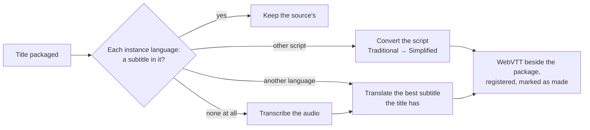

# ADR-0014: Subtitles in the instance's languages for every title, made on the platform where a title has none

**Status:** Proposed · 2026-10-20. Design ahead of the code: a spike measures it first (see [Validation](#validation)).

## Context

A title plays with the subtitles its source brings, nothing more. The source decides:

- In one library of about 2,000 movies, **55 % bring no subtitle at all**, 37 % an English one and 10 % a German one. A viewer who does not follow the audio's language cannot watch most of it.
- An instance already names its languages: the packager's language whitelist (`packager.language_whitelist`, for example `en, de, zh`) decides which audio and subtitle tracks a player shows. The other tracks are packaged but hidden. Nothing makes sure those languages exist.
- Fetching subtitles from outside providers depends on third parties, accounts, rate limits and on matching the exact release, or the timing is off. It may come as an addon; the platform should not depend on it.

Speech recognition and translation models that run on one consumer GPU are now good enough to close the gap: a subtitle can be made from the title itself.

## Decision

Every title gets a subtitle in each of the instance's languages, made by the platform where the title lacks one.

1. **The languages are the instance's.** A setting (`subtitles.languages`, default the packager's whitelist) names them with their script where it matters, for example `en, de, zh-Hans`. A new pipeline step, `subtitles`, runs after a title is packaged and makes sure each one exists.
2. **The order of sources, per language:**
   1. a subtitle the source brings in that language, as today;
   2. the same language in another script: Traditional Chinese becomes Simplified by a dictionary conversion, no model involved;
   3. a translation of the best subtitle the title has, its original language first, then English: by a language model, in batches of cues with the surrounding cues as context. Cue timing is kept, and lines are re-wrapped to the target language's limits;
   4. when the title has no subtitle at all, a transcription of its main audio (speech recognition, in the audio's language), then 3 from it.
3. **Made subtitles say so.** Their label says how they were made ("German · AI"). The catalog records their origin (`transcribed`, `translated` or `converted`), the model and its version. They are listed after the source's own, never replace one, and a viewer can report one as wrong. A report puts the title back in the queue with the next candidate.
4. **On the platform's GPUs, as batch work.** It runs under ADR-0013's priorities, so live encodes come first. The models run in their own worker processes, like the live worker, never in a service that serves viewers. They are open-weight models whose licences allow this use (for speech, a Whisper-class model; for translation, an openly licensed instruction model). The spike picks the two.
5. **Files beside the package.** The output is WebVTT, written into the version's `subs/` and registered as the title's subtitle assets. No video is encoded or packaged again, and a subtitle costs kilobytes.
6. **A paced backlog.** New arrivals get theirs after packaging. The existing library is worked through at a pace, most-watched and newest first, and every title's step can be restarted.

### Validation

Before any of it is built, a spike measures, on one GPU and about twenty library titles (movies and episodes, several audio languages):

- **Speech recognition:** speed (× real time) and, where the source brings a subtitle in the audio's language, the word error rate against it.
- **Translation:** speed, and quality against a human subtitle where the title has both languages (automatic scores plus samples for a person to read), for German and Simplified Chinese.
- **Resources:** GPU memory and time beside a running live worker.

The design holds if a two-hour film without subtitles gets all three languages in under 15 minutes of GPU time, and if a reader finds the translated subtitles fit to watch with.

## Consequences

- Every title becomes watchable in the instance's languages, without anyone asking and without an outside service.
- The cost is GPU time per title, bounded and paced, and kilobytes of storage.
- A made subtitle can be wrong: timing from a transcription, a mistranslated idiom. The label says so, the source's own subtitles stay first, and a report makes it again.
- The languages an instance shows and the languages it makes are one setting.

### What this rules out

- **No fixed languages.** The instance names them.
- **No outside subtitle sources by default.** An addon may bring them; the platform does not depend on them.
- **No replacing a source's subtitle.** A made one is added beside it.
- **No burning subtitles into the picture.** They stay a track a viewer turns on or off.
- **No model in a serving process.** The models run in worker processes only.
