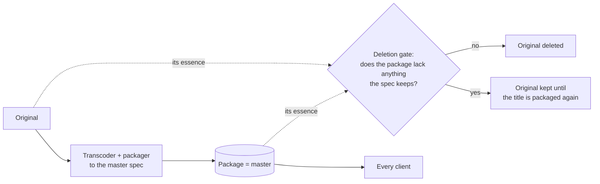

# ADR-0015: The package is the master; the original is deleted once its package meets the spec

**Status:** Accepted · 2026-11-02, the caps with no target bit rate confirmed the same day. The spec is what the pipeline makes today, except where it says *ahead of the code*.

## Context

ADR-0002 transcodes once and serves the package. Until now the source file stayed beside it, so every title was stored twice. Re-packaged under today's rules, the packages take about half the space of the originals.

- Every client plays the package and never the original. The original is used only to package a title again, or as a backup.
- What the clients play least is what makes an original large: surround and lossless audio, Dolby Vision, bit rates far above what a stream needs.
- Deleting an original is final: what its package doesn't carry is gone. So what a package carries has to be decided once, for every title, and checked for each title before its original goes.

## Decision

The package is the master for every title. An original is deleted once its package meets the master spec. No group of titles keeps its original, rare releases and 4K HDR above the cap included. A title that needs a better master is acquired again.

1. **The spec is the pipeline's rules.** The master is whatever the transcoder and the packager make. Each reports its rules to the catalog, which keeps the latest report. An instance sets the rules before it deletes any original. The defaults:

   | | The master |
   |---|---|
   | Video | HEVC at the source's size, never upscaled, 4:2:0. A source that every HEVC device decodes, and that is within its cap, is copied as it is. Any other source is encoded once, with the cap as its maxrate |
   | Caps, Mbit/s of video | Movies: 8 up to 1080p, 14 up to 2160p. Episodes: 6 and 8. A movie file above 15 GiB is encoded |
   | Rate | No target bit rate. An encode runs at constant quality (CQ 23 on NVENC) with the cap as its maxrate, so a package's size follows its source under one ceiling for the whole library |
   | Bit depth | The source's: Main 10 above 8 bits |
   | HDR | HDR10 and HLG as they are. Dolby Vision as HDR10: profile 8 keeps its base layer, profile 7 its HDR10 base layer, profile 5 is reshaped to HDR10 |
   | 3D, interlacing | 2D (the base view), progressive |
   | Closed captions | In the video, as they are |
   | Audio | Every track, commentaries and audio descriptions included, as AAC stereo at 192 kbit/s, quiet mixes lifted and surround folded down. A 5.1 companion is made only where an instance turns it on (`pipeline.surroundAudio`, off by default) |
   | Subtitles | Every track as it is. Text as WebVTT. Pictures (PGS, VobSub) as pictures. Forced and SDH flags as the source's. *Ahead of the code:* styled subtitles (ASS/SSA) as ASS with their fonts, and a WebVTT copy for clients that can't draw ASS |
   | Chapters | In the catalog, read from the original when it is analysed, not in the package |
   | Made subtitles | Beside the source's own (ADR-0014) |

   What a master weighs, with one stereo track (each further audio language adds about 0.09 GB an hour). The measured medians come from one library's first 219 packages made under the caps:

   | | At the cap, per hour | A 2 h film or a 45 min episode at the cap | Measured median |
   |---|---|---|---|
   | Movie 1080p | 3.6 GB | 7.4 GB | 5.3 GB for 2 h 10 min; most sources are copied, at 4.2 Mbit/s |
   | Movie 2160p | 6.3 GB | 12.8 GB | 6.6 GB copied; 13.7 GB encoded, at 12.6 Mbit/s: at 2160p the cap, not the quality, sets an encode's size |
   | Episode 1080p | 2.7 GB | 2.1 GB | 0.3 GB copied, 1.0 GB encoded, for about 24 min |
   | Episode 2160p | 3.6 GB | 2.8 GB | 3.0 GB for 49 min |

   The whole library is made to the one spec: a title whose package was made under older rules is processed again, so every package ends up within the same caps.

2. **The deletion gate.** For each title, the catalog compares what the original carries with what its package carries:
   - its tracks and their languages, channels and kinds (commentary, audio description);
   - its HDR, bit depth and height;
   - its subtitles: their languages, kinds, forced and SDH flags, styles and fonts;
   - its closed captions.

   It names what the package lacks. A retire run deletes an original only when that list holds nothing but what the spec drops by design:
   - surround, and channels above the package's;
   - lossless and object-based audio;
   - Dolby Vision, where the package keeps HDR10;
   - 3D.

   Any other difference keeps the original until the title is packaged again. That includes a missing language, subtitle track or flag, a lost style or font, or a lower bit depth. So does an original whose chapters the catalog lacks.
3. **The players play everything the master carries.** The subtitles stay as they are, so each client draws pictures and styled subtitles itself. A subtitle is never turned into text to suit a client: no text recognition.

   | Client | WebVTT | PGS | VobSub | ASS |
   |---|---|---|---|---|
   | Web | yes | yes | ahead of the code | ahead of the code |
   | Android, Android TV | yes | yes, in testing | ahead of the code | ahead of the code |
   | iOS | yes | ahead of the code | ahead of the code | ahead of the code |
   | Cast receiver | yes | ahead of the code | ahead of the code | ahead of the code |

4. **A later spec can't add back what deleted originals had.** Raising a cap or turning surround on changes new packages only. For a title whose original is gone, it means acquiring the title again. A new codec re-encodes the master, not the source, and pays a generation of loss.

## Consequences

- One copy per title, the size of its package. A library's storage falls to about a third of the original and package together.
- Deleting is final. Surround and lossless audio, Dolby Vision's enhancement and bit rates above the cap go with the original. A viewer with a surround system hears stereo.
- The pipeline's rules become a contract: changing them changes every future master. They are reported, versioned and compared with each title's record.
- The subtitle formats are the players' work. Every client needs PGS, VobSub and ASS renderers. Until a client has one, its viewers see the WebVTT copy of a styled subtitle, and nothing of a picture subtitle.
- Lower renditions are made from the master as it plays (ADR-0013), never stored.

### What this rules out

- **Keeping originals for some titles.** There is one spec for all; a better master means acquiring the title again.
- **Text recognition of picture subtitles.** The pictures are kept, and the players draw them.
- **A styled subtitle kept only as plain text.** Its WebVTT copy sits beside the ASS, never instead of it.
- **Lossless, object-based or Dolby Vision tracks in the master.** The master is AAC stereo (a 5.1 companion where an instance turns it on) and HDR10.
