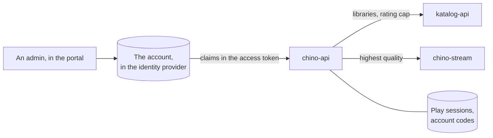

# ADR-0018: One account per person; rights travel in the token, a code guards an account on a shared device, and the identity provider keeps passwords

**Status:** Proposed · 2026-11-15, for the owner's review. Design ahead of the code: nothing of it is built.

## Context

A household is several people. Today the platform tells them apart by one account each, kept in the identity provider, and knows two things about an account: a role, admin or user, and an optional rating cap.

- **The cap is the one right, and it already has a path.** It is a value on the account (the user attribute `max_rating`), which the identity provider puts into the access token as a claim. chino-api reads the claim, hands it to katalog-api with every catalog request, and serves no title above it. No service asks another what a person may do, and none keeps a table of rights.
- **An admin cannot say more.** Not which libraries a person sees, not whether they may download, not how sharp or how many streams they may play. Downloads are one switch for the whole server.
- **A cap ends at the account chooser.** The phone app and the TV apps keep several accounts on one device, each with its tokens, and switching asks for nothing. So a child on a shared TV reaches a parent's account.
- **Nobody sees who is watching.** No server keeps a session for a stream: chino-api proxies the stream and logs what the players report, and chino-stream reads nothing from a request but its signature.
- **A forgotten password needs an admin.** The sign-in page offers “Forgot password?”, and the realm has no mail server, so nothing is sent. An admin makes a new invite link by hand.
- **Passwords, second factors and sign-ins exist, out of reach.** The bundled identity provider has an account page for them, and it is on the public host. Nothing leads to it.

The constraints:

- [ADR-0007](./0007-identity-modes.md) lets an installation bring its own identity provider. Whatever is decided has to work when the platform manages no accounts at all.
- Every service checks a token by itself. That is why a cap costs no lookup, and why a new right should cost none.
- A stream's address carries no bearer but a stream pass, which lasts 6 hours.
- The platform sends no mail today. [ADR-0019](./0019-mail-and-alerts.md) proposes that it can, through a mail server the admin names.
- The catalog keeps one set of titles today. [ADR-0021](./0021-libraries-folders-and-scans.md) proposes libraries, each with an id a token can name, and keeps no list of a library's people.

ADR-0007 decided that the identity provider owns sign-in and the platform owns what a person may do, and it sketched a table of grants, per-library access among them, kept by the platform. None of that table is built, and the one right that is built is a value on the account. This record says how rights are kept and carried, and keeps to what is built: with the account, not in a table of the platform's.

## Decision

1. **One account per person, and no profiles inside an account.** A person's place in a title, their lists and their history are kept by the account's id, and stay so. Whoever shares an account shares all of it.
2. **A right is a value on the account that travels in the token.** Five of them: the libraries a person sees (`libraries`), the rating cap (`max_rating`, as built), whether they may download (`downloads`), the highest quality they may play (`max_height`) and how many streams they may play at once (`max_streams`). Without a claim there is no limit. An admin sets them on the person's page in the portal, which writes them to the account as it writes the cap today. With an outside identity provider the admin maps the same claims there. A claim a service cannot read counts as the strictest value: a claim gone wrong shows less, never more. The stream pass, which stands in for the token on a stream's address, carries the rights too, as it carries the cap today.
3. **Each right is enforced where the thing it limits is served.** katalog-api leaves out the titles of other libraries, as it leaves out the titles above a cap, and they answer as titles that are not there. chino-stream serves nothing taller than the highest quality. chino-api refuses a download and counts streams. A person is told what limits them only where telling gives nothing away: never that a title exists.
4. **A change applies when the person's token is next renewed**, 5 minutes at most with the bundled identity provider. A title that is playing plays on; an admin who wants it to end stops it.
5. **chino-api keeps a play session for every stream.** A player opens one before it asks for a stream, says every 30 seconds that it is alive, and closes it when it leaves. The session carries who plays what, on which device, at which quality, since when. Three things rest on it: a page for admins of who is watching now; **stop**, which ends one stream and tells its player who ended it; and the limit of streams, checked when a session opens, where the person over the limit sees which of their devices are playing and may stop one. The stream pass of a session names it, so a stream ends when its session does. Once every app opens sessions, a stream needs one.
6. **A code guards an account on a shared device.** A person may set a code of 4 to 8 digits. Where a device holds several accounts, choosing one that has a code asks for it. chino-api keeps the code as a salted hash and checks it: 5 wrong tries, then 15 minutes of waiting, for that account on that device. Where an account with a rating cap shares a device with one that has neither a cap nor a code, the uncapped person is asked once to set one. An admin can clear a code, and a person who signs in afresh with their password may choose a new one without the old.
7. **Passwords, second factors and sign-ins stay the identity provider's.** The platform builds no page for them. The portal and chino get one entry, sign-in and security, that opens the identity provider's own account page; an installation with an outside provider names that page's address, or has no entry. The TV apps have none. An admin can remove a person's second factor, for the person who lost it.
8. **A forgotten password is the person's own to replace where mail is set up**, through the identity provider's “Forgot password?”. Where it is not, that link is not shown, and an admin makes a new invite link on the person's page, as today. Setting up mail, the mails themselves and the switch of that link are [ADR-0019](./0019-mail-and-alerts.md)'s.

The screens, the routes and the words are in [People and what they may do](../../spec/portal/people.md).

## Consequences

- A parent can rely on a cap. On a shared TV the uncapped account is behind a code, and the app goes back to the account chooser when it was away for a while. The way around a cap that the goals name is closed.
- An admin limits a person in one place, and every app and every service follows without a release of its own for each new right: the path is the cap's.
- An installation with its own identity provider gets every right by mapping five claims. It gets none it does not map.
- Someone who forgot a password is back in without an admin where mail is set up, and with one press of an admin where it is not. Someone who lost a second factor needs an admin, once.
- **It costs a wait.** A right changes within minutes, not at once, because it travels in a token. What plays, plays on until it is stopped.
- **It costs chino-api a table and the apps a habit.** Every player has to open, keep alive and close a session, in four apps. Until all four do, the page of who is watching is incomplete, and it says so.
- **It costs an encode.** A person held to a height below a title's package is served renditions made as the title plays, on the server's processor, or on its graphics card where the live encoder runs, for every such view.
- **The code is as strong as the app.** It keeps a person out of another account in the apps. It does not protect the sign-ins a device holds from someone who takes the device apart. And without the server an account with a code cannot be chosen at all, because only the server checks it.
- **The account page looks like the identity provider, not like zaentrum**, and with an outside provider it is whatever that provider offers.

### What this rules out

- **Profiles inside an account.** They would need a second identity under the one every service checks, in every table that is kept by account today, and the identity provider could cap none of them. A person is an account.
- **A table of rights in the platform, asked by each service.** It would be a second place to keep in step with the accounts, a lookup on every request, and one more thing an installation with its own identity provider has to fill. The token already carries what a person may do.
- **A code checked by the device.** It would be as weak as the device's storage, and a second copy to keep in step. The price is that switching to an account with a code needs the server.
- **The platform's own pages for passwords and second factors.** The identity provider has them, tested and kept up to date, and with an outside provider the platform could not offer them at all.
- **Counting streams from the requests for segments.** The server cannot tell a paused player from one that is gone, nor a player warming the next episode from one that plays it, and no request names its device. A stream is a session the player opens.
- **A limit by bit rate.** The qualities a title is served in are named and chosen by height; a person's limit is one of those heights.
- **A code on the web.** A browser keeps one account. Whoever shares a browser signs out, as on every site.

## To prove first

Short trials, before the changes that depend on them are built.

1. **The claims.** That the bundled identity provider puts a user attribute with several values into the token as a list, and a value `false` as a boolean, and keeps the four new attributes once the realm's user profile declares them. If a list cannot be had, `libraries` travels as one string of ids joined by commas, and the services split it.
2. **The account page.** That on a running installation the page opens on the public host as the person signed in, and offers a new password, an authenticator app and the list of devices, in the version the platform ships. And what that list shows of a TV or a phone, whose sign-in outlives the browser's: if it shows none, or signs them out only all at once, the capability of signing one device out from afar stays partly met, and the chapter's words for the entry stay as they are.
3. **A fresh sign-in.** That the access tokens of the bundled identity provider carry the time of the sign-in (`auth_time`), and that the web and the phone app can ask for a sign-in with the password again. If not, a forgotten code is cleared by an admin alone, and an installation with an outside provider has no way but the server's own route.
4. **A capped height.** That a title packaged at 2160p starts within a few seconds, and plays without stalling, for a person held to 1080p on a machine without a graphics card. If it does not, the highest quality is offered only where the platform's live encoder runs.
