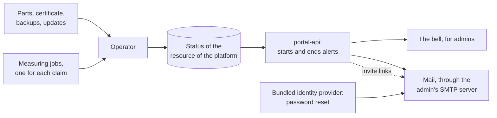

# ADR-0019: Mail is the platform's one way out; portal-api sends it, and five alerts reach the admins in the bell and by mail

**Status:** Accepted · 2026-11-15 by the owner, with the recommendations of the changes that rest on it. Design ahead of the code: nothing of it is built; what the section To prove first names is shown before the changes that depend on it are built.

## Context

Whoever runs zaentrum learns of a failure only by looking at the portal, and the platform reaches nobody outside its apps.

- **Nothing sends mail.** No repository holds code that talks to a mail server, and the platform's resource has no field for one. An admin adds a person on the People page and hands over the invite link the page shows once. The bundled identity provider's realm allows a password reset and its sign-in page shows “Forgot password?”, but the realm has no mail server, so the link cannot be sent: a forgotten password needs an admin.
- **Failures are written down, and nobody is told.** The operator writes into the status of the platform's resource whether each part is ready, why a rollout gave up, how the self-check went, how the backups went, and the date the platform's own certificate ends on. The portal's operator page shows the parts and the self-check. Nothing compares any of it with a limit, and nothing is sent.
- **A notice is an addon's.** portal-api keeps notices: plain text from an installed addon to one person, shown in the bell of every app ([ADR-0001](./0001-neutral-core-and-addon-seams.md) made notices a seam for addons). The platform itself cannot post one, and a notice cannot be addressed to the admins.
- **portal-api already holds what a sender needs.** It makes the invite links and keeps their hashes. It manages the realm's people through a client that may view and manage users and nothing else. It reads and changes the platform's resource as itself. It keeps tables of its own. It reaches the catalog's writer only with the sign-in of the admin whose request it serves.
- **The operator sees claims, not what is in them.** Its role lets it read claims, Secrets, Deployments, Jobs and pods. It knows the size a claim asks for and reads the certificate's Secret on every pass. It holds no permission on nodes, and only a node knows how full a volume is. On the one-container install every claim is a folder of one disk.
- **The repository `notifications` is an idle scaffold.** Its README describes a service that would take events from the bus and hand pushes to Apple's and Google's push services and to browsers, with each server holding those services' credentials. Its server answers a health check and a metrics route; every sender in it returns “not implemented”; the operator's chart does not hold it and nothing calls it.

The forces: one person runs the platform, often on one machine, and should not have to run and watch a second system to learn that the first one fails. A household has a mail account. An open-source server cannot carry keys that belong to whoever publishes an app.

## Decision

1. **Mail is the one way out of the platform, in the core.** It goes through an SMTP server the admin names in the platform's resource: `spec.mail` with the host, the port, the encryption, the sender's address and name, and a Secret with the user and the password. Without it nothing is sent, everything else works as today, and each screen that would have sent a mail says so. Mail was chosen because every household has it, every provider speaks SMTP, and it needs no account with anybody but the provider the household already has.
2. **Three kinds of mail are sent, and a test.** An invite, with the link, to the address the admin typed for the person. The identity provider's password reset link. An alert to the admins, when it starts and when it ends. Nothing else in this round: what an addon tells a person stays in the bell.
3. **No new service: portal-api sends the platform's mail.** It makes the invite link, which exists only at that moment; it knows the people and their addresses; it reads the status as itself; it serves the bell. The bundled identity provider sends its own password reset, as it is built to. The operator hands both the same settings: environment variables for portal-api, the realm's mail settings through the realm job, which also switches the realm's password reset on with mail and off without. Recommended for the repository `notifications`: it is archived. It is not where mail or alerts go, and its premise, that each server holds the push services' credentials, is the question a later record on push has to answer; the other choice is to leave it idle until then.
4. **Alerts are a short fixed list.** A part of the platform not ready for 10 minutes. A volume at least 90 % full. The platform's certificate within 14 days of its end. The last backup failed, or the newest good one older than 2 days. An update that failed: a rollout that gave up, the self-check after an update that failed, or, on one machine, an update its updater undid or could not start ([ADR-0017](./0017-the-household-machine.md)). Each threshold is a setting of the resource with that default (`spec.alerts`). The list is fixed so that each alert can have its own words and its own page to lead to, and so that an admin is never asked to write a rule.
5. **Every fact comes from the status of the platform's resource.** portal-api reads it every 60 seconds, as itself, and asks no other service, because an alert is checked while nobody is signed in. On a one-machine install it reads the updater's report the same way. The operator already writes the parts' readiness, the backups and the self-check there. It adds three things: since when a part is not ready; the time the platform's certificate ends, where the platform has one of its own; and what each volume holds. That last fact the operator cannot see, so it is measured from inside: one short job for each claim mounts it read-only, every hour and on request, and reports the filesystem's size, what is free and the filesystem's id; the library's job also asks the bundled Postgres for its databases' sizes and for its own volume. Two volumes with one filesystem id are one disk.
6. **An alert is shown in the portal's bell to admins and mailed when it starts and when it ends.** The mail goes to every admin who has an address, and to further addresses the resource may name (`spec.mail.alertsTo`), which is all there is with an external identity provider, whose people the platform cannot list. For the same alert a start mail is sent at most once in 24 hours; one that starts again sooner shows in the bell and is not mailed, and neither is its end. So an alert that comes and goes sends two mails a day at most.
7. **An alert is a record of portal-api's own, not a notice.** A notice is one addon's word to one person, which that person deletes. An alert is about the platform, is for every admin, including one made an admin tomorrow, starts and ends by itself, and cannot be deleted while it holds. The bell shows both; the chino apps' bells show notices alone.
8. **A one-machine install sees itself, and says what it does not see.** It sees its parts, its own certificate, its backups, its updates and its one disk, counted once. It does not see the machine's other disks and folders, the disk's health, a certificate served by a proxy in front of it, or the machine being off. The alerts page names what is not watched.

The chapter [Running the platform](../../spec/portal/operations.md) sets out the fields, the routes, the pages and every word ([Mail](../../spec/portal/operations.md#mail), [Alerts](../../spec/portal/operations.md#alerts)).

## Consequences

- An admin learns of the five failures that most often go unseen in a household's server without opening anything, and learns when each is over.
- A person gets their invite in their mailbox, and somebody who forgot a password is back in without an admin.
- The household needs an account with a mail provider and gives the platform its password. The password is in a Secret of the platform, and the bundled identity provider keeps a copy in its realm, so a backup of the identity database holds it.
- An invite link in a mailbox is a credential in a mailbox. It works once, for 7 days, as today.
- portal-api grows: a mail client, a check that runs every minute, and two tables. It sends as itself, so its log names the kind of each mail and never an address or a text.
- A short job runs for each claim every hour. It is the price of not giving the operator a permission on the cluster's nodes.
- Alerts need the operator's status. A platform installed from the chart alone can send invites and password resets, and raises no alert.
- Nothing watches the watchers: while portal-api, the operator or the whole machine is down, no alert is raised. Whoever needs to know that the machine is off has to look at it from outside.
- The mails and the alerts are in English, as the platform is.

### What this rules out

- **Calling an address outside when something happens** (`send-webhooks`), in the core. Events are on the bus for addons ([ADR-0005](./0005-kafka-event-bus-and-schema-contracts.md)); an addon that reads the bus and calls addresses outside the platform can be written today, and the core then needs no list of addresses, no retries and no secrets for services it does not know.
- **A push to a phone while the app is closed** (`get-push-notification`), in this round. A push to a phone app goes through Apple's or Google's push service, which takes the keys of whoever publishes that app. An open-source server cannot carry those keys, so a push needs a relay that somebody runs, and a decision about who. That is a record of its own.
- **Mailing what addons tell people**, or a digest of new titles. A notice stays in the bell. Mail from the platform is rare and is about the account or about a failure, so that it is read.
- **A notification service beside portal-api.** It would be one more part to run, to watch and to alert about, for three kinds of mail.
- **A bundled monitoring stack**: a metrics store, dashboards, an alert manager with rules. The parts keep their metrics routes for whoever runs such a stack; a household gets five alerts it never has to configure.
- **Reading how full a volume is from the cluster's nodes.** It needs a permission on every node of the cluster, and it leaves out a volume that is a folder of the node, which is what a one-machine install has.
- **Chat services and text messages** as ways out. Each needs an account with one company; mail does not.
- **Mail through a provider's own web interface** instead of SMTP. It would tie the platform to one provider.
- **Mail with pictures and markup.** Plain text is read by every mail program and by a screen reader, and it carries nothing that reports whether it was opened.
- **Reminders, and an alert for each admin to choose.** An alert that lasts stays in the bell; one start and one end is all the mail it sends.

## To prove first

- **The measuring jobs**, before change R.C7 and the changes that read its figures. On the one-container install the three claims report one filesystem id. On a cluster whose claims are bound to different nodes each job runs where its volume is. Under the chart's security settings, on OpenShift as well, the bundled Postgres reads the size and the free space of its own data volume for its superuser (PostgreSQL's `COPY … FROM PROGRAM`, running the system's own `df`). If that last step does not hold, the databases' volume is shown as the databases' sizes against the size its claim asks for, and no volume alert is raised for it.
- **A measuring job's report fits its channel.** The operator reads a job's result from 4 KiB the cluster keeps of it. The backups' job reports 30 sets with their size and version; if that does not fit, it reports fewer and the chapter's number changes.
- **The realm takes the mail settings** through the interface the realm job already uses, and the chart's theme can give the reset mail the words of the chapter. If the words cannot be set that way, the provider's own words stay and the chapter says so.
