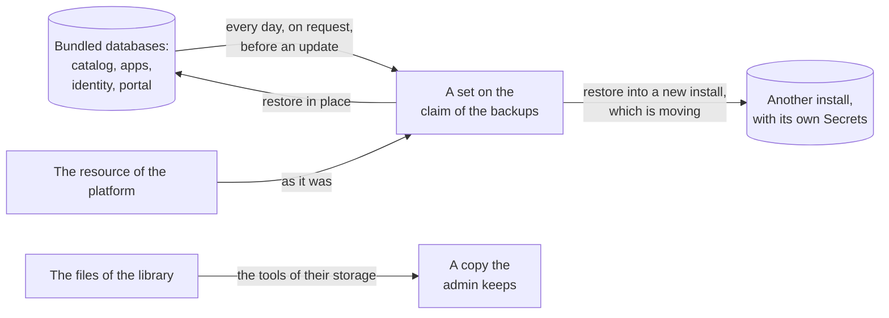

# ADR-0020: A backup is one set that restores into any install of its version or a newer one; the library's files stay with their storage

**Status:** Accepted · 2026-11-15 by the owner, with the recommendations of the changes that rest on it. Design ahead of the code: nothing of it is built; what the section To prove first names is shown before the changes that depend on it are built.

## Context

The platform backs up its bundled databases every day, and only somebody with `kubectl` can use what it keeps.

- **What a backup is today.** Where the bundled Postgres keeps its data on a claim, a scheduled job dumps the four platform databases each night into a directory of its own on the claim `backups`: the catalog's, the apps' (watch progress, history, watchlists, likes), the identity provider's (accounts, password hashes, roles, clients) and the portal's (registry, invites, notices). A dump holds the database's roles, one file for each database and a checksum of each file. The newest 7 stay. Nothing in a dump names the platform or the version that made it.
- **How one is restored.** An annotation on the platform's resource names a dump. The operator stops every part that uses the database, portal-api and the identity provider among them, a job checks the dump and recreates each database, and the parts start again. The restore refuses a dump that holds any file besides those it expects.
- **Into another install, by hand.** A dump does not hold the platform's Secrets, and the restored identity database holds two things that have to match them: the password of the identity provider's own admin, which the operator's jobs sign in with, and the secret of the `zaentrum-manager` client. So the operator's README has the admin keep the six generated Secrets as a file and apply them before the new install is made. Nothing in the portal or the CLI has a part in it.
- **One machine.** The one-container install keeps the databases, the backups and the library in one Docker volume. Its documentation tells the admin to copy the dumps and the Secrets off the machine by hand, and a container that is replaced starts an empty platform unless it was started on a named volume under a fixed host name.
- **The portal and the CLI.** portal-api reads nothing of the backups from the status. No page shows where the dumps are, when the last one was made or how large it is, and no command lists or restores one.
- **Newer versions.** Each part that owns a database brings it up to its own version when it starts: the catalog's writer, chino-api and portal-api apply their migrations at start. Nothing says what an older part does with a newer database.
- **The library's files.** [ADR-0015](./0015-the-package-is-the-master.md) makes the package the master of every title. A library is in one of two layouts, by a setting of the catalog; the default is the older one. Only in the newer layout does each title's folder carry its record, with checksums, complete enough to rebuild the catalog ([the record](../library/record.md)). A scan does not read it: it takes media files in one folder as new titles. The rebuild is a tool of the schemas repository, which nothing in the platform starts. The record holds no account, no watch history and no list, and of the catalog it leaves out a title's age rating, the single fields a person locked, a hold on an original, track languages set by hand, a chosen subtitle default, the catalog's settings and rules, and the log of what was deleted.
- **Room.** The catalog keeps each title's and each extra's sizes; nothing adds them up, and nothing shows what is free on a volume.

The forces: after a dead disk a household wants its accounts, its history and its catalog back on whatever machine it has next, without having kept a file of secrets. A backup that only its maker can read is of no use then. A library is hundreds of gigabytes to terabytes, on storage the household chose.

## Decision

1. **A backup is one set.** A directory on the backups' claim with the roles, the four databases as they are dumped today, and one file more, `backup.json`: the platform's name, id and version, the operator's version, the databases, the `spec` of the platform's resource as it was, the names of the Secrets it refers to, and the addons. The checksums cover it. The resource is in the set as a record: a restore reads the version from it and changes no setting of the install.
2. **Secrets are not in the set.** A set is sensitive as it is: it holds every password's hash. The Secrets would add the passwords of the database's superuser and of the identity provider's own admin, in the clear, to every copy on every disk. So a restore keeps the Secrets of the install it runs in. After every restore, with the bundled identity provider, the operator brings the provider in step with them: the provider's own admin signs in with this install's Secret again, the `zaentrum-manager` client and the people client have this install's secrets, and the sign-in addresses are this install's name. New Secrets do not by themselves sign anybody out: what a sign-in rests on is in the identity database and comes back with it. Whoever signed in after the set was made signs in again, and everyone does when the platform's name changes.
3. **A set restores into the same version or a newer one.** Each part brings its database forward when it starts, as after an update. The operator refuses a set of a newer release before it stops anything. Where the two versions cannot be compared, because a set has no `backup.json` or one side runs a build between releases, it refuses unless it is asked to go on.
4. **The sets are on the claim the resource names, as today.** The backups page shows where they are, what is free there, when the last one was made and how large it is. It warns when the last backup failed or no good one is newer than 2 days, the threshold of the alert in [ADR-0019](./0019-mail-and-alerts.md), and when the backups and the databases are on one disk. The documentation tells admins to put the claim on storage apart from the databases, and on one machine to copy the sets off it.
5. **The portal and the CLI drive what the annotation does today.** The backups page and `zae backup` list the sets, change the schedule and how many are kept, make a backup now, and restore one: the admin picks a set and types the platform's name. Recommended: in a cluster a backup is also made before every update, so that an update can be undone with the state just before it; the other choice leaves that backup to the admin. On one machine the updater of [ADR-0017](./0017-the-household-machine.md) keeps its own copy and goes back by itself. A restore stops portal-api with the other parts, so the page and the command say that the platform is down, wait, and ask for a new sign-in.
6. **A platform moves by a restore into a new install.** The new install is made as any install; the sets are brought to it, on the claim that holds them or copied into its own; the first run offers “restore from a backup”, on the first-run page before anybody has an account and on the setup checklist after, and so does the CLI; on one machine a command copies the sets from a folder and restores; afterwards the accounts are the old platform's. The library's files, the certificate, the mail server's password and the addons are brought by the admin, and `backup.json` names what the resource referred to.
7. **The library's files are not in a backup.** The platform backs up what only it can restore. The files are large, they are on storage that has its own tools, and a copy made with any file tool is complete; in the newer layout each folder carries the checksums to prove it. What comes back from where:

   | | From the library's files, in the newer layout | From a set |
   |---|---|---|
   | Titles with their texts, images and credits as last written; people; sources, versions, packages, extras | yes | yes |
   | Accounts, passwords, roles, rating caps | no | yes |
   | Watch progress, history, watchlists, likes | no | yes |
   | The portal's registry, invites, notices | no | yes |
   | An age rating, single locked fields, a hold on an original, track languages set by hand, a chosen subtitle default | no | yes |
   | The catalog's settings and rules, the log of what was deleted | no | yes |

   A library in the older layout carries no record, so nothing of its catalog comes back from its files.
8. **An admin sees what takes the room.** A storage page shows each volume's size and what is free, from the measuring jobs of [ADR-0019](./0019-mail-and-alerts.md); what the packages, the originals kept and the extras take, which the catalog's writer adds up from the sizes it keeps; the databases' sizes; and the titles that take the most, the largest first.

The chapter [Running the platform](../../spec/portal/operations.md) sets out the files, the fields, the routes, the pages and every word ([Backups](../../spec/portal/operations.md#backups), [Restoring](../../spec/portal/operations.md#restoring), [Moving to another machine](../../spec/portal/operations.md#moving-to-another-machine), [Storage](../../spec/portal/operations.md#storage)).

## Consequences

- After a dead disk, a household with its sets on other storage is back on any machine with its accounts, its history, its lists and its catalog as of the last backup: a day old at most.
- Nobody has to keep a file of Secrets. A set still holds every password's hash and whatever else the identity provider keeps in its database, the mail server's password included where mail is set up: it is kept as carefully as the databases.
- An admin sees on one page whether the backups are any good: how old, how large, where, and whether a dead disk would take them with the databases.
- A restore takes the platform down for a few minutes, the page that started it included. It is asked for with the platform's name typed.
- A restore sets the databases back and leaves the library as it is. A title added, packaged again or deleted since the set was made is on the volume as it is now and in the catalog as it was then. The catalog console's check of a title's files finds one; nothing in the platform puts the two in step yet.
- A move does not carry the resource's own settings over by itself: the pipeline's rules, the schedule and the thresholds are set again from `backup.json`.
- In a cluster an update waits for a backup, 30 minutes at most.
- The reason for leaving the library's files to their storage rests in part on the newer layout: a library in the older one has no record in its files, and the rebuild from the record is a tool outside the platform.

### What this rules out

- **Backing up the library's files with the databases** (`back-up-library`). A second copy of a library on the platform's own claim would double the largest thing a household stores, and a copy the platform makes is no better than one the storage makes: snapshots, a second disk, the storage's own replication. The documentation says what to copy and what a set brings back that the files do not.
- **Secrets in the set**, sealed or not. In the clear they would hand the database's superuser and the identity provider's admin to whoever reads the backups' storage; sealed, they would have the admin keep a passphrase somewhere else, which is the file of Secrets under another name.
- **Restoring a set into an older version.** No part is built to read a database newer than itself.
- **Saving a set, or bringing one in, through the browser.** A set holds every password's hash; the claim on other storage is the way off the machine.
- **A backup tool of the platform's own**: snapshots of volumes, changes only, a point in time between two backups. One dump a day, one before each update and one on request cover a household.
- **Restoring one database, or one person's data.** The four databases refer to each other by the accounts' ids; a set is restored whole.
- **Backups of external databases.** They are backed up where they run.
- **A scan that rebuilds the catalog.** The record is read on purpose, by a rebuild, never by a walk of the tree on the side ([the record](../library/record.md)).
- **A restore that applies the saved resource by itself.** Which of its settings belong to the machine and which to the household is the admin's to say.

## To prove first

- **The identity provider in step after a restore into an install with other Secrets**, before changes R.C13, R.C16, R.C17 and R.C19. With the bundled provider at the chart's version: its own recovery makes an admin from the database's credentials alone, while the provider is stopped; with it the operator sets the password of the provider's admin and the `zaentrum-manager` client's secret to this install's; what the recovery made is removed; then the realm job and the self-check pass, and a person signs in with the password they had. If it does not hold, the choice not taken comes back to the owner: the six Secrets in the set, sealed with a passphrase the admin types at the restore; until then moving stays as the operator's README has it.
- **A set of the release before restores into the current one**: every part starts and brings its database forward, the identity provider included, and the self-check passes.
- **On the one-container install**, sets copied into the new container's claim are listed after “look again” and restore.
- **A restore of an older set over a library that changed since**: what the catalog console's check reports for a title packaged again and for one deleted, so that the documentation can say what an admin does then.

### Shown on 15 November 2026

With the identity provider alone, Keycloak 26.0.7: the database of one install, started under another install's Secrets, refuses that install's admin password and client secret and takes the first install's. The provider's own recovery command makes a temporary admin from the database alone. With it the admin's password and the client's secret were set to the second install's and the temporary admin deleted; the second install's Secrets then worked, the first one's were refused, and people's passwords held.

Not shown yet: the platform's own jobs and its check after such a restore, a set of the release before, the copy on a one-machine install, and an older set over a library that has changed since.
