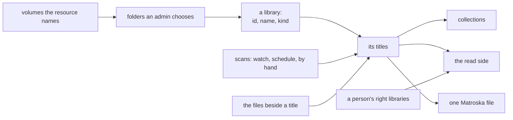

# ADR-0021: The catalog keeps several libraries with their own folders, scans them by itself, reads what lies beside a title, keeps collections, and gives a title back as one file

**Status:** Accepted · 2026-11-15 by the owner, with the recommendations of the changes that rest on it. Design ahead of the code: nothing of it is built; what the section To prove first names is shown before the changes that depend on it are built.

## Context

To watch a film, the platform has to know the film. Today the catalog comes to know what a household owns in one way, and gives nothing back.

- **One folder.** katalog-manager scans one folder, the scan root its environment names. The operator's chart mounts one claim, `media`, and the platform's resource has no field for a second volume or for a folder. Every other path the catalog takes, a file handed over, a title's new file, the files a removal deletes, is held to that one root.
- **Only when asked.** A scan runs when an admin, the portal's first-run checklist, the command line or a deployment's job starts one. Nothing in katalog-manager starts a scan by itself, and nothing watches the folder. A scan keeps three counts and the names of the disc images and unlinked episodes it passed over; it does not say what started it or which files it added, and it does not notice a file that is gone.
- **One library.** No table says that a title belongs to a part of the catalog. The read side leaves out for a person only what is above their rating cap.
- **Nothing beside a title but its subtitles.** A scan takes in the subtitle files that lie beside a video. It reads no file of details and no picture, though a household that kept its library with another media server usually has both beside every title.
- **No collection.** Enrichment reads a film's details from the reference database (TMDB) and takes nothing from them about the series of films the film belongs to. The lists in chino are each person's own.
- **A package is not a file.** [ADR-0015](./0015-the-package-is-the-master.md) decided that the package is the master and the original goes once its package meets the spec. A package is an init section and segments for each rendition, with its subtitles as files beside them. The original can be read whole only while it exists; after that, nothing gives the title as one file. This record says how a title is had back from its master.

Two layouts of the library exist side by side, and they treat a file differently. With `library.layout` at `legacy`, the default, a file stays where it is found and the job that deletes originals does nothing. With `v2` a file arrives in one arrivals folder and leaves it: with its first package the packager renames the original into the library's record, which fails across file systems, and the catalog's setting then keeps it there or deletes it.

It fails the household that already has its library in folders of its own, perhaps on a second disk; that wants the children's films apart from the rest; that expects a file it copies in to appear; that keeps details and covers beside its files; that wants the films of a series together; and that needs a film back as a file after its original is gone.

The constraints:

- [ADR-0003](./0003-catalog-cqrs-sole-writer.md): katalog-manager alone writes the catalog, and katalog-api reads it. Whatever scans, watches or keeps a collection is katalog-manager's.
- [ADR-0015](./0015-the-package-is-the-master.md) and the library's record: with `v2` an original leaves its folder, and nothing brings back what its package does not carry. The record's rule that nothing walks it on a schedule ([the record](../library/record.md)) is about the record; this record is about the folders files arrive in.
- [ADR-0001](./0001-neutral-core-and-addon-seams.md) and [ADR-0012](./0012-catalog-identity-for-addons.md): the catalog knows nothing of how a file got there, and an addon hands its files over itself, into the same folders.
- [ADR-0013](./0013-live-rungs-safety-net.md): no media tool runs in a service that serves viewers.
- [ADR-0018](./0018-people-rights-and-safety.md) gives each person the right `libraries`: the libraries they see, named by their ids in the person's token.
- A network share reports no changes to whoever watches it, and katalog-manager may run in several instances.

## Decision

The rules, the interfaces and the words are in [the library](../../spec/catalog/library.md); the parts below say what is decided and why.

1. **A library is a named part of the catalog.** It has an id, a name, a kind, movies or shows, and folders. A title belongs to one library, of its kind; an episode is in its series' library. A title gets its library when it is made, from the folder its file lies in, and changes it only by an admin's hand, never by a scan: with `v2` a file leaves its folder, so a title's library cannot follow its file. Who sees a library is not kept in the catalog. It follows from each person's right `libraries` (ADR-0018). The catalog carries what that right needs: an id for each library that is short, readable and never changed or given again, because a token names it; each title's library, so that one condition in each query leaves a library out; and the list of libraries.

2. **The default folder keeps today's installs as they are.** Every install has one: the folder the catalog scans today. In it a file's name and path say whether it is a movie or an episode, as today, and two libraries may have it at once, one of each kind: the first libraries. The catalog makes a first library by itself when it first needs one. An existing catalog gets them at its first start with this change, each only for a kind it holds titles of, and every title keeps its id, its file, its package and everything people did with it. Those libraries start with scans by hand alone, as the install was run until then. A new install has no library until its first file arrives; the catalog looks after the default folder itself until then, so the first run stays: copy files in, and they appear.

3. **Folders are places in mounted volumes, and the layout says where a file ends up.** The platform's resource lists the volumes the catalog sees: the media claim, as today, and further claims the admin brings, each under a name. An admin adds a folder to a library by choosing it inside a volume. A folder belongs to one library; two folders an admin added never contain one another; a folder may lie inside the default folder, and then takes the files under it out of the default folder's reach. A folder is never one of the platform's own places. With `legacy` a file stays where it is: the catalog writes nothing into a library's folder. With `v2` a file arrives and leaves, as today, so there a folder has to lie inside the arrivals folder, on the library's own volume.

4. **A library's kind says what a file is.** Outside the default folder, every video in a movies library's folder is a movie, and every video in a shows library's folder is an episode of the show its path names. A household that files a show under a movies library gets movies; the folder it chose says what it meant, and no rule about names overrides it.

5. **The catalog scans by itself.** Each library says when: `watch`, the default, takes a file in when the file system reports it, and scans the library in full every night and once whenever the service starts, because a network share reports nothing and nothing watches while the service is down; `schedule` scans it in full at an interval, an hour by default; `manual` scans it only when asked. A file is taken in once it has not changed for a set time, 60 seconds by default, so a file still being copied is left alone. One scan of a library runs at a time, and libraries are scanned independently of each other.

6. **A scan lists what it did, and removes nothing.** A scan says its library, what started it and who, and lists every file it added, found changed, found gone or passed over, each passed-over file with its reason in a sentence. A title whose file is gone is marked, never removed: a share that is away for a night must not empty a catalog. A folder that cannot be reached, or that is empty though the catalog knows files in it, is left alone and nothing in it is marked.

7. **What lies beside a title is read, in an order, and never written.** The catalog reads the details file of the common sidecar format and the pictures named in the usual way: a title's name, original name, year, description, genres, rating and ids, its poster, backdrop and logo. A hand's edit wins over a file, a file over enrichment, and enrichment over what the file's name said. An id in a details file makes the match certain: enrichment takes it and never searches by name for such a title. The age rating is never taken from a file, because it decides what a child sees. The catalog never makes, changes, moves or deletes such a file.

8. **Collections are the catalog's.** A collection has a name, a description, pictures and titles in an order. The catalog makes one when two or more of its films belong to one series of films, as the reference database says, and keeps it in step. An admin makes, changes and deletes collections; one an admin made or changed is never changed by enrichment, and the catalog makes no second one for the same series. The read side gives the apps the collections, a collection's titles in order, and on a title the collections it is in; a person is given a collection only when they may see two or more of its titles.

9. **A title comes back as one Matroska file, joined and not encoded.** An admin takes a movie or an episode out as one file: the package's best picture, every audio track, every subtitle, the chapters from the catalog and the poster as the cover, copied into one Matroska file. Matroska holds every kind of subtitle the master keeps, pictures and styled ones with their fonts, which MP4 does not. The file is the master, so it lacks what ADR-0015 drops: surround where no 5.1 companion was made, lossless and object-based sound, Dolby Vision, 3D, a bit rate above the cap. While the original exists, an admin may take that instead. katalog-manager serves the file, with the media tool the pipeline already uses, to admins alone: it copies and never encodes, and it serves no viewer. The file is sent as it is joined.

## Consequences

- A household points the platform at the folders it has, on the volumes it has, and with the default layout its files stay where they are.
- A file that arrives is found without anyone starting a scan, which is the first half of the quality “a new file is ready to watch without work”; the pipeline is the other half.
- A title that brings its own id is matched without a search, and a title that brings its own details needs no key at all.
- The films of a series stand together without anyone's work, and an admin can put any titles together.
- Deleting originals stops being a one-way door for the title itself: the master comes back as a file any player opens. What ADR-0015 drops stays dropped.

What it costs:

- **With `v2`, libraries have less to offer.** A folder has to lie inside the arrivals folder, a second volume cannot hold one, and a title whose original has left the arrivals changes its library only by an admin's hand. “Files stay where they are” holds for `legacy` alone.
- **Watching depends on the storage.** A local disk reports arrivals; a network share reports none, and then the nightly scan is all there is. Watching a large tree takes one watch for each folder, and the system has a limit.
- **Scans cost reads.** A full scan reads every folder of a library. On a share that is slow to list, an hourly scan is felt.
- **An addon has a minute.** An addon that puts a file into a library's folder and hands it over later than the settle time finds a title already made from the file's name. The libraries of an existing install therefore start with scans by hand, and an admin turns watching on knowingly.
- **A first scan may change titles.** Where details files lie beside existing titles, the first scan after this change takes their values in place of enrichment's. A setting turns the reading off.
- **The file made from a package has no index.** A file sent as it is joined says how long it runs and holds everything, but a player finds a place in it by reading through it, the answer has no length, and a download that breaks off starts again.
- **katalog-manager's image grows** by the media tool, and an export reads a whole package from the library's storage while people may be watching from it. Two run at a time.
- **The library's record does not know a file's part.** The record's projection goes on writing where a title's fields come from as it does today; a catalog rebuilt from the record does not know which fields a file gave.

What it rules out:

- **Removing a title because its file is gone.** A scan marks; an admin removes.
- **Folders inside one another, each for another library**, beyond the one case of a folder inside the default folder. The deepest folder winning everywhere would let a title's library depend on the order folders were added in.
- **A folder on a second volume with `v2`.** The packager moves an original into the record by a rename. Copying it across volumes instead would need room for every original a second time, on the volume that holds the packages.
- **Watching without the nightly scan**, and **checking the folders every few seconds instead of watching**: the first misses every network share, the second reads a large library without pause.
- **Writing details files or pictures back**, renaming or moving a household's files. The folders are the household's; with `legacy` the catalog only reads them.
- **The age rating from a file.** A wrong reading shows a child what it should not see.
- **A collection as a person's list.** A list is a person's own and stays so; a collection is everyone's and is the catalog's.
- **Collections made by rules**, such as every film of a genre. Not in this step.
- **Collections from the name a details file gives a film's series.** Enrichment gives the same series for a title that is matched, and a second source for one collection would need an order of its own.
- **The file encoded again, or as MP4.** Encoding costs time and a generation of loss for nothing; MP4 holds neither the picture subtitles nor the styled ones the master keeps.
- **The join in the stream origin.** ADR-0013 keeps media tools out of the services that serve viewers.
- **An audience kept with each library in the catalog**, if the owner follows ADR-0018: one right on the person then decides, and the catalog keeps no list of people. The other way round, the catalog would keep the people of each library and the read side would ask it by the person's id.
- **Kinds of library other than movies and shows.** Music, audiobooks and podcasts are another product's.

## To prove first

- **Watching.** On the kinds of storage a library lies on, the appliance's own claim, a folder of the machine, and a network share: which of them report a file that arrives, and how many folders can be watched before the system refuses. The changes for `watch` are built once the first two report reliably. If the appliance's own claim does not, the default mode becomes `schedule`, and `watch` is offered where the catalog found that it works.
- **The join.** On real packages, a two-hour film copied from an HDR10 source with a 5.1 companion, picture subtitles and a styled subtitle with fonts, and an episode: picture and sound stay in step to the frame over the whole length, every track arrives with its name and flags, and the file opens and seeks in the players a household would use, a computer's and a TV's among them. Known already, from a trial with the pipeline's media tool on a one-minute test title cut into segments as a package is: joined into a file on disk, the result has an index and its length; joined into a stream, it has no index, and says how long it runs only when the join is told beforehand; tracks, names, chapters and the cover arrive either way. If a player households use cannot seek in the streamed file, the join writes into the library's work folder first and the route serves the finished file, with its length and byte ranges; the route and what it takes stay.
- **Details files as households have them.** A sample written by the tools people use: that the rules of the chapter read them, also with a byte order mark, with text after the first element, and with ids in the older elements. If a common form is not read, the chapter's table of what is read is changed before the change is built.
- **The first libraries on a copy of a real catalog.** Every title lands in one library, no id changes, and the apps list what they listed before. If a title lands in none, or a list differs, the rule of part 2 is corrected before it is built.

## Not decided here: details without a key of the admin's own

A new install fills no title's details until an admin sets a key for the reference database; a file scanned before that is listed under its file's name. This record leaves that as it is. The ways out, for a record of its own:

- **A key of the project's, built into the published images.** The code has the place: katalog-manager takes a default key for each of its three sources at build time, empty in the source, and an admin's own key wins over it. It needs an account of the project's with the source, and the source's leave to ship a key in a public image, where anyone can read it out. Every install would share its limits, and if the source withdrew the key, every install without a key of its own would stop until an update.
- **Sources that need no key.** The details files of this record already describe a title with no key at all, for a household that has them. Beyond them it needs a source whose data may be read or carried freely, with the coverage and the pictures a household expects; none is named here.
- **A service of the project's that holds the key**, which every install asks. It needs someone to run and pay for it, makes every install depend on it, and tells the project what each household holds.
- **As today.** The first-run checklist asks for a key, and says what is missing without one.
