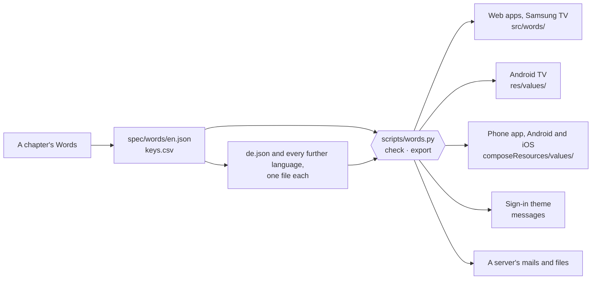

# ADR-0023: Every text comes from one message catalogue, in the person's language; every screen meets WCAG 2.2 at level AA, checked with every change

**Status:** Proposed · 2026-11-15, for the owner's review. Design ahead of the code: nothing of it is built.

## Context

Two qualities of the goal "Watch films and shows" are open ([goals](../../spec/goals/README.md)): the platform speaks the household's languages, and people who see or hear less can use it. Today every app and console is in English alone, no accessibility level is stated, and no app has been tried with a screen reader. What follows is the code at each repository's main branch on 15 November 2026.

**Words.**

- No app has a message catalogue. The texts are typed into the screens' code and into constants beside it. A count of each repository's own texts finds about 2,000 in all, and it misses some:

  | | Texts, about | Where they are | Plurals, numbers and dates |
  |---|---|---|---|
  | Web (chino-web) | 350 | the screens' code and constants of its library | plurals by hand; a person's dates by the browser's rules; short dates from an English list of months |
  | Phone app (chino-mobile) | 370 | the shared code; one string resource | the same, by the phone's rules; a sentence put together from parts, the device's word among them |
  | Android TV (chino-androidtv) | 300 | 24 string resources, the rest in the code | the same, by the TV's rules |
  | Samsung TV (chino-tizen) | 240 | the screens' code | the same, by the TV's rules |
  | Portal (zaentrum-portal), with the consoles it holds | 480 | the screens' code | a helper for one and many, written three times; dates fixed to British English |
  | Catalog console (katalog-manager-ui) | 290 | the screens' code | numbers fixed to US English; dates by the browser's rules |

- Every web page declares English (`lang="en"`), whatever the browser's language. Three chino apps each carry their own English names for languages, in files of over 1,000 lines. The phone app's Android build keeps English resources alone, so that the Cast screens Google supplies do not show in another language beside it.
- **Servers write sentences that screens show as they come.** chino-api answers a request to delete an account with a sentence for the person (`message`: five of its own, and the ones portal-api hands it), and all four apps show it. Its other failures are a line of English text. The phone app reads two of those lines for a word, “name” and “audience”, to tell cases apart, although [chapter 17](../../spec/chino/errors.md) has the apps decide by the status alone. The status cannot always decide: a list's name that is taken and a list too many both answer 409. portal-api words about 100 refusals and failures as sentences, and the portal shows the text it gets. katalog-manager writes each finding of its compliance check as an English sentence, some 850 lines of wording, and the catalog console shows those and the messages of its GraphQL errors as they come.
- **The catalog keeps names as words.** A genre is a name in the one language the catalog reads its reference database in (English unless set otherwise), and a title's own texts are in that language too. Languages and countries are codes, which each app names. A person's biography is the exception: katalog-api picks it by the request's `Accept-Language`, and the apps send the device's languages.
- **The sign-in pages are the identity provider's.** In the bundled mode ([ADR-0007](./0007-identity-modes.md)) the chart's theme draws the sign-in page, with its words typed into the template. Every other page of a sign-in (the code a TV shows, a forgotten password, an error) is the provider's own. The realm has no languages switched on, so all of them are English. The platform sends no mail.
- **No server keeps anything of a person's settings.** chino-api keeps progress, watch history, lists and likes, and `GET /api/v1/me` answers the account's subject and nothing else. Each app keeps its settings on the device ([chapter 16](../../spec/chino/settings.md)).

**Accessibility.**

- The design system sets [WCAG 2.2 at level AA](https://nalet.github.io/design-system/foundations/accessibility/) as its baseline and tests its components for it. The portal (design system 0.3.0) and the catalog console (0.1.0) are built from those components. The chino apps draw their own controls until they take them (change 2.C11).
- What the apps have and lack, as read in their code:

  | | There | Missing |
  |---|---|---|
  | Web | names on icon buttons; loading and some messages announced; the delete-account dialog keeps the focus; less motion honoured in four places | a poster card opens its title by pointer alone: it is neither a link nor a button; the search field has no name but its placeholder; the window's title is “chino” on every screen; the report dialog is no dialog to a screen reader and does not keep the focus |
  | Phone app | names on its controls, a kind and a state on some; changes announced in three places; a test of what TalkBack reads of the player's buttons; on Android the phone's caption style | the avatar has no name; its code reads no setting for less motion; on iOS it draws subtitles itself and reads no caption style |
  | Android TV | names on the rail and the bar; tests of where the focus goes; the TV's caption style and text scale | the avatar has no name; shows are named “Series” |
  | Samsung TV | names on a few controls | the app keeps its own focus as a mark on the page, never gives a control the browser's focus, and draws its controls as plain blocks: the TV's voice guide has nothing to follow |

- No web repository draws a page in a test: each runs tests of functions. The portal and the catalog console have a harness that draws their views against recorded answers, started by hand. This repository's end-to-end suite opens the deployed pages in a browser and checks no accessibility rule.

**What the design has to live with.**

- The apps and the servers are updated apart, so an app meets servers older and newer than itself.
- The Samsung TV app installs on TVs from 2018, with the browser engine of that year. The app's code already allows for an engine without the function that names languages; whether the function for plural rules is there has to be proved.
- An addon writes its own words ([ADR-0001](./0001-neutral-core-and-addon-seams.md)): its tile, its notices, its rows.
- With an identity provider the platform does not run ([ADR-0007](./0007-identity-modes.md)), the sign-in pages are not the platform's to change.

## Decision

Every text a person meets comes from one message catalogue, in that person's language. Every screen meets WCAG 2.2 at level AA, and a check that runs with every change keeps it so.



### Languages

1. **Every text comes from a message catalogue.** Every text a person reads or hears in an app, a console, a sign-in page or a mail of the platform has a key and comes from a message catalogue: one file a language, each key with its text. That covers labels, sentences, the names a screen reader says, tooltips, a window's title, and what an app posts on the device. No text is typed into a screen's code, and a test in each repository fails when one is.

   English is the source. German ships with it, complete. A further language is one file added to the catalogue, with no change to code. The specification stays the source of the English: a text is written first in its chapter's Words section or in [chapter 18](../../spec/chino/words.md), the catalogue's English file holds it under its key, and a check fails when the two differ.

   Not in the catalogue, because it is content: a title's name and description, a person's name and biography, a list's name, what an admin typed, an addon's words, and the line a server sends for **details**.

2. **One catalogue, in the specification's repository.** A key names the same text in every app, so a text is translated once. The catalogue lives beside the Words it comes from, in the folder `spec/words/` of the specification's repository. A repository of its own was the other choice; in one repository a chapter's words and their keys change in one pull request, under one check.

   | File | Holds |
   |---|---|
   | `en.json`, `de.json`, one more for each language | the language's texts: `{"key": "text"}`, in UTF-8 |
   | `keys.csv` | one row a key: its voice (`chrome` or `sentence`), the apps that take it, the section of the specification it comes from, example values, the names in it that keep their capitals, its greatest length where a place has one, a note for the translator |
   | `languages.csv` | one row a language: its tag (BCP 47), its own name (“Deutsch”), and whether it ships or is in work |
   | `glossary.csv` | the words of chapter 18, each with its one translation in every language |

   - **A key** is lowercase words joined by dots and hyphens. It names the place and the meaning, never the English: `errors.cause.unreachable`, `frame.view.movies`.
   - **A text** is written in a small part of the ICU MessageFormat: `{name}` stands for a value, and `{count, plural, one {…} other {…}}` chooses by a number, with the forms the language has. A text is one whole sentence or label. It holds at most one count, and no text of the catalogue is put into another. Where a sentence differs by device, each variant has a key of its own (`….phone`, `….tablet`, `….tv`). The count under a list's name, for one, is `{count, plural, one {# title} other {# titles}}`, which reads “1 title” and “4 titles”.
   - **The check**, `python3 scripts/words.py check`, fails when a shipped language lacks a key or has one too many; when a text's values differ from the English text's; when a text is longer than its key allows; when a `chrome` text has a capital outside its names; and when the English text, filled with its example values, is not in the section its key names. It lists the texts that use another word than the glossary's, for a person to look at. A language in work is not built into any app, so a half-made language never shows.
   - **The export**, `python3 scripts/words.py export --src <a folder of clones>`, writes each repository its part of the catalogue in the form its platform reads. Those files are generated. They are kept in the repository, so a pull request shows every changed word, and they are never edited there.

   | Takes the catalogue | As | Reads a text with | Plurals |
   |---|---|---|---|
   | chino-web, zaentrum-portal, katalog-manager-ui | `src/words/<language>.json`; the build compiles each text into a function (`@messageformat/core`), English with the page, any other language loaded when it is needed | one function, `t(key, values)` | the language's rule, compiled into the text's function |
   | chino-tizen | the same | the same | the same, so a TV from 2018 needs nothing its engine lacks |
   | chino-androidtv | `res/values/strings.xml` and `res/values-<language>/strings.xml` | `stringResource`, `pluralStringResource` | Android's quantity strings |
   | chino-mobile | `composeResources/values/strings.xml` and `values-<language>/strings.xml`, read on Android and on iOS alike; Android's `res/` for what the system itself shows; the languages named in the iOS app's property list | Compose Multiplatform's `stringResource`, `pluralStringResource` | its quantity strings |
   | The operator's chart | `messages_<language>.properties` in the sign-in theme | the identity provider's templates | none: a sign-in page counts nothing |
   | A server that writes a mail or a file | `<language>.json`, built into the program | a function of its own | `golang.org/x/text` |

   A number, a date, a size or a duration is never written into a text. The app formats it by the rules of the language it speaks and hands it in as a value:

   | | Numbers | Dates and times | Names of languages, scripts and countries |
   |---|---|---|---|
   | Web apps, Samsung TV | `Intl.NumberFormat` | `Intl.DateTimeFormat` | `Intl.DisplayNames`; on a TV whose engine has none, names the build brings along |
   | Android TV, the phone app on Android | `java.text.NumberFormat` | `java.text.DateFormat` | `java.util.Locale` |
   | The phone app on iOS | `NSNumberFormatter` | `NSDateFormatter` | `NSLocale` |

   A size or a duration is such a number with its unit, and the unit is a text of the catalogue: “12.4 GB” in English, “12,4 GB” in German. How long ago something was is a text with a count. The design system's own formats for a count and a date are English's today; its components have to follow the page's language before the portal and the catalog console ship a second one.

3. **The language is the person's.** An app speaks, in this order:

   1. the language the person chose, where the app has it;
   2. else the first of the device's languages the app has, on the web the browser's;
   3. else English.

   An app has a language when its build holds that language's file. A tag with a region falls back to its language, `de-CH` to `de`.

   - **The choice** is one setting, **App language**, in chino's settings ([chapter 16](../../spec/chino/settings.md)): the device's language, or one of the languages the app has, each by its own name. It applies at once.
   - **It is kept with the account.** chino-api keeps it by the account's subject and gives it to every app the person signs in on (`GET` and `PATCH /api/v1/me/settings`, `{"language": "de"}`). It is the first setting a server keeps; the others stay on the device. chino-api keeps any well-formed language tag, also one no app has yet: each app takes the nearest language it has, so a new language needs no change to the server.
   - **Before anyone is signed in**, an app speaks the device's language. On a TV with several accounts, each account's language holds while that account is watching.
   - **The portal and its consoles** speak the same language. portal-api reads the account's choice from chino-api and gives it with the account (`GET /api/portal/me`, `language`), and the shell hands it to each console it hosts. Without a choice they follow the browser. The portal has no language setting of its own.
   - **An app tells the servers the language it speaks**, first in `Accept-Language`, so that what a server picks by language, a person's biography or a file it writes, matches the screen.

   The languages of the interface are the catalogue's, the same on every installation. The languages an installation makes subtitles in ([ADR-0014](./0014-subtitles-in-every-language.md)) are a setting of its own and have nothing to do with them.

4. **A server sends a code and its values, never a sentence.** What a server of the platform tells an app is data. Where its answer has to say which case it is, it names the case and gives the values the sentence needs, and the app holds the sentence:

   ```json
   { "error": "list_name_taken", "values": { "name": "Sunday nights" }, "detail": "name exists" }
   ```

   - `error` is the code: lowercase words joined by underscores. It is part of the route's contract and is listed where the server describes its interface. A GraphQL error carries it as `extensions.code`, with `extensions.values`.
   - `values` are numbers and names.
   - `detail` is a line of English for the log and for **details**. It is never the message.

   An app shows the catalogue's text for a code it knows, under the key `error.` and the code. A code it does not know reads as the cause of its HTTP status ([chapter 17](../../spec/chino/errors.md)), so an app older than its server still says something true. No app reads the words of an answer, to show them or to tell cases apart. A code is needed only where the status leaves two cases open, or where a screen has a sentence of its own for the case; every other failure stays a status and a line of detail.

   Three kinds of text a server still writes:

   | What | Who writes it | In which language |
   |---|---|---|
   | What stands under **details**: a status and its phrase, a tool's output, a condition's message in the platform's resource | the server, as it is | English |
   | What a server itself puts before a person: the bundled identity provider's sign-in pages and mails, a mail of the platform, a file a server writes for a person to read | the server, from the same catalogue | the language the request names (`ui_locales` for a sign-in page, `Accept-Language` for a file); for a mail the language of the person it goes to; English where none is known |
   | Content: the library's texts, an addon's words | the catalog, as it has them; the addon | theirs |

   - **Names from the catalog** are shown in the app's language where they are codes: a language, a script and a country by the device's own names for them; a title's kind and a credit's role by the message catalogue. A genre becomes a code too: the catalog keeps a key beside each genre's name, and an app names the keys it knows from the message catalogue and shows the stored name for any other. A title's own texts stay in the language the catalog has them in.
   - **The sign-in pages.** An app names its language when it sends a person to sign in (`ui_locales`). In the bundled mode the realm has the shipped languages switched on, and the page the theme draws takes its words from the catalogue. The pages the theme does not draw are the identity provider's own, in its own words for the same language. With an identity provider the platform does not run, the app passes `ui_locales` and the platform does nothing more.
   - **An addon's words** are the addon's, and are shown as it wrote them. The shell hands its console the language, so the console can speak it.

5. **Two voices in every language.** The design system's [two voices](https://nalet.github.io/design-system/foundations/content-voice/) hold in every language.

   - The monospace voice (buttons, tabs, headings, table headers, menus, and a control's name for a screen reader) is lowercase in every language, German included: “einstellungen speichern”. A name inside it keeps its capitals: a title, a person, a language, the Watchlist.
   - The body face follows the language's own rules: sentence case, and in German a capital for every noun.

   The catalogue holds each text as it is to be read, so nothing changes a text's case on its way to the screen, and `keys.csv` tells the translator which voice a key has. A language written from right to left needs every screen mirrored, which neither the apps nor the design system can do. Such a language is more than a file, and this record does not cover it.

### Accessibility

6. **WCAG 2.2 at level AA, on the screens everybody gets.** The web app, the portal and the consoles meet WCAG 2.2 at level AA, as the design system's baseline has it. The phone and TV apps meet the same criteria as far as they apply to an app that is not a web page. For every screen, in every state:

   | What holds | Web, portal and consoles | Phone app | Android TV, Samsung TV |
   |---|---|---|---|
   | Every control has a name, says what kind it is and what state it is in | the design system's components; an icon alone gets the name its chapter's Words give it | the same, told to TalkBack and VoiceOver | the same, told to TalkBack and to the Samsung TV's voice guide |
   | The order of focus is the order of reading; the focus always shows; a layer that closes gives it back | the Tab key, and the design system's outline | the screen reader's own order | the arrow keys, and the design system's [TV focus](https://nalet.github.io/design-system/patterns/tv-focus/) |
   | Every action can be done with the device's screen reader | a screen reader in the browser; and every action with a keyboard alone | TalkBack on Android, VoiceOver on iOS | TalkBack on Android TV, the voice guide on a Samsung TV |
   | What changes away from the focus is said | loading, a count of results, a toast, a banner | the same | the same |
   | Text follows the device's text size up to 200 %, and none is lost | the browser's zoom, down to a window 320 px wide | the phone's text size | the TV's text size, where the TV has one |
   | Contrast is the design system's: 4.5 to 1 for text, 3 to 1 for a control's edge and the focus | its [colours](https://nalet.github.io/design-system/styles/colour/#contrast) | the same colours | the same colours |
   | Colour is never the only sign | a mark or a word beside it | the same | the same |
   | Motion stops where the device asks for less | the browser's setting | the phone's setting | the TV's setting, where it has one |
   | Subtitles take the look set on the device | a web page cannot read it | as built on Android; still to come on iOS ([chapter 12](../../spec/chino/subtitles.md)) | as built on Android TV; on a Samsung TV change 12.C6 |
   | The screen reader knows which language it reads | `lang` on the page | from the system | from the system on Android TV; `lang` on the Samsung TV's page |

   The design system's sizes are set in pixels, so on the web the text size is met by zooming, not by the browser's own text size: a gap its typography page names, and one this record leaves to it.

   The level is for the apps' own screens and controls. What a title carries is the library's: the apps offer the subtitles and the audio description a title has ([chapter 12](../../spec/chino/subtitles.md)), and [ADR-0014](./0014-subtitles-in-every-language.md) makes subtitles where a title has none.

7. **Checked with every change.** Three checks, each part of a change from the day it is in place.

   - **A program, on every web page.** Each web repository (chino-web, chino-tizen, zaentrum-portal, katalog-manager-ui) gets a test that opens every page in a browser, in each state its chapter lists, against recorded answers of its server, in English and in German, at a computer's width and a phone's. It runs an accessibility checker with the rules for WCAG 2.2 at levels A and AA, and it presses keys: Tab reaches every control in the order of reading and is never held, and Esc closes the layer on top and gives the focus back. Any finding fails the test, and the change with it.
   - **A program, on what it can read of the phone and TV apps.** A test reads each screen as TalkBack is given it: every control that can be pressed has a name, a kind and its state. The phone app has such a test for the player's buttons, and Android TV tests where the focus goes; the tests grow to every screen.
   - **A person, with the device's screen reader.** For each app a change names, every screen of the changed chapter is walked with that app's screen reader: every control is reached in order and says its name, kind and state; every action is done; every state is announced as it appears; the screen is whole at the largest text size; nothing moves with less motion on. The walk is recorded in the change's review, screen by screen. A change is not verified without it.

## Consequences

- Both qualities get a target that can be checked: the languages are the files of the catalogue, and the level is what the tests and the walks pass.
- A text is translated once for six apps, the sign-in page and the mails. A new language is a file, a person who knows the language, and a release.
- Apps and servers can differ in version without a screen showing the wrong language or a line of English: a code the app does not know reads as its cause.
- About 2,000 texts get a key. Each app's screens are touched once for it, before the chapters' changes, so that each of those writes its words into the catalogue and nowhere else. The texts move as they are: a chapter's change brings its new words.
- Three servers change what they answer. chino-api's part is small: one setting and fewer than ten codes. portal-api's is about 100 sentences. katalog-manager's compliance wording is the largest piece, and moves to the console as codes and values.
- The portal asks chino-api for a person's language. When chino-api does not answer, the portal follows the browser.
- Every change costs more than before: its words in two languages, a browser in the web repositories' tests, and a person with a phone and a TV in front of them for the walk.
- The apps' own English tables of language names stay as the fallback for a name the device does not have.
- Known limits, which the screens do not hide: an addon's notices and tiles are in the language their addon wrote them in; a title's description is in the catalog's one language; with an identity provider the platform does not run, the sign-in pages are that provider's.

### What this rules out

- **Translating by machine while the app runs.** The text would differ from one run to the next, nobody would have read it before a person does, and no check could hold it to the rule that every sentence is true. It would also send what is on the screen to a translation service, or need a model beside every server. A model may draft a language's file; a person who knows the language approves it before it ships.
- **A language the server picks for everyone.** A household speaks several languages, a TV is shared, and each device already knows what its person reads. An installation has no setting for the interface's language.
- **An accessibility mode apart from the app.** A second set of screens falls behind the first, and a person has to find it before it helps. The settings people already made on their device are followed instead: the screen reader, the text size, less motion, the caption style.
- **A catalogue for each app.** The same sentence would be translated once for each app, and drift as many ways.
- **A server that answers in the request's language.** Every server would carry the catalogue and its rules, and an app and a server of different versions would mix two wordings on one screen. A server writes sentences only where no app stands between it and the person.
- **Keeping the language with the identity provider**, as a claim in the sign-in. The platform cannot write it with a provider it does not run, and a change would reach a device only with its next sign-in renewal.
- **Text inside a picture.** It cannot be translated, read aloud or made larger.

## To prove first

- **On the oldest Samsung TV the app installs on:** the compiled texts and their plurals run, and the voice guide reads a control once that control has the browser's focus, a kind and a name. If the voice guide follows only on newer TVs, chapter 2 says from which year the Samsung TV meets part 6, and nothing is promised for the older ones.
- **In the phone app:** Compose Multiplatform's texts change language while the app runs, on Android and on iOS. If they do not on one of them, the choice applies there at the app's next start, and chapter 16 says so.
- **In the bundled identity provider:** with the languages switched on, the sign-in page follows `ui_locales` and then the browser, and the pages the theme does not draw follow too. If `ui_locales` is not followed, the page goes by the browser's language alone.
- **At a text size of 200 %:** each app's densest screens, the player's controls and settings on a phone held sideways among them. A screen that cannot hold its text gets its own arrangement in its chapter before the change for text size is built there.
