# 13 Downloads and offline

This chapter specifies downloads: the download control on a title's page, the
downloads screen, and what the phone app shows while the server can't be
reached. The title page around the control is specified in
[chapter 6](./title-actions.md), and the downloads tab in
[chapter 2](./frame.md).

## 13.1 Purpose

On a phone or a tablet, people can download a title and watch it without a
connection: on a train, on a plane, wherever the signal drops. A download is a
copy on the device, with its subtitles, kept for the account that made it, and
it plays even when the server can't be reached.

Downloads exist only in the phone app, on phones and tablets. The web and the
TV apps have none, so the screens of this chapter are drawn at the phone's size
only. The **downloads** tab opens the downloads screen (section 13.3), and
while the server can't be reached the app opens there by itself (section 13.5).

This chapter says “phone” throughout. On a tablet, a device 600 dp or more on
its shorter side, the app says “tablet”: “18 GB free on this tablet”.

## 13.2 The download control

The download control sits last in a title's row of actions, after **liked**
([chapter 6](./title-actions.md)). It shows the title's download status and
offers the one thing that makes sense in it. Figure 13.1 shows the control in
each status.

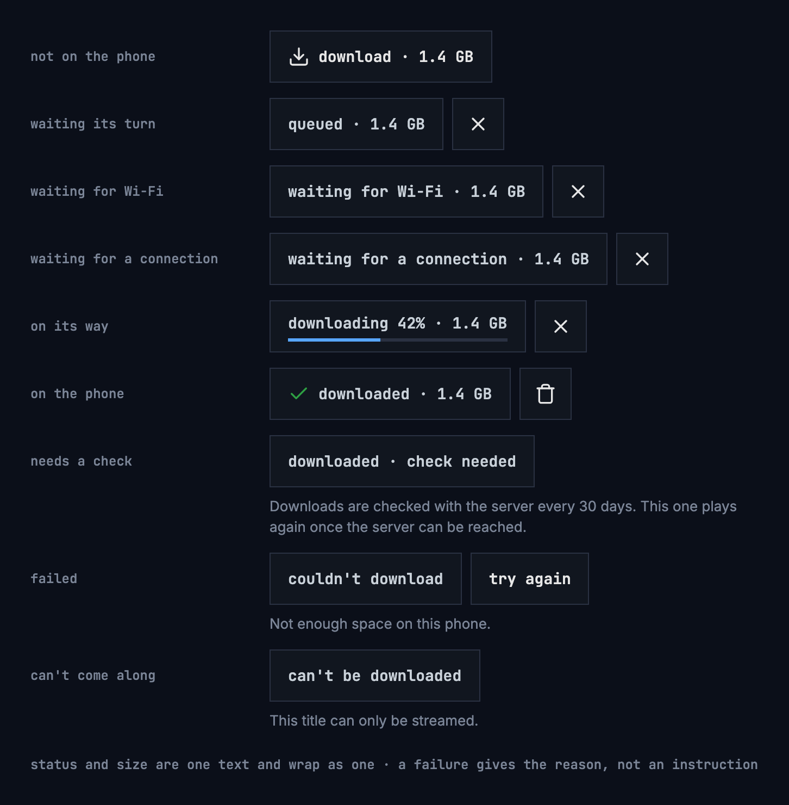

Figure 13.1: The download control in each status.

| Status | The control says | What people can do |
|---|---|---|
| Not on the phone | **download · 1.4 GB** | Download it |
| Waiting its turn | **queued · 1.4 GB** | Cancel |
| Waiting for Wi-Fi | **waiting for Wi-Fi · 1.4 GB** | Cancel; it starts by itself on Wi-Fi |
| Waiting for a connection | **waiting for a connection · 1.4 GB** | Cancel; it starts by itself once the phone is online |
| On its way | **downloading 42% · 1.4 GB**, with a thin bar | Cancel |
| On the phone | **downloaded · 1.4 GB** | Play it, delete it |
| Needs a check | **downloaded · check needed**, and “Downloads are checked with the server every 30 days. This one plays again once the server can be reached.” | Nothing until the server can be reached |
| Failed | **couldn't download**, and the reason in a sentence | **try again**, or remove it from the list |
| Can't come along | **can't be downloaded**, and “This title can only be streamed.” | Nothing |

- The size is the size of exactly what will be downloaded at the chosen
  quality, as the server reports it: the same number before and after. When it
  isn't known, it is left out, **download** alone, rather than guessed.
- Sizes have one decimal without a trailing zero, “18 GB”, and are given in MB
  below 1 GB.
- Status and size are one text, and wrap as one; “check needed” stays together.
- The percentage changes at most once a second.
- A failure's sentence is a reason, never an instruction, because the control
  already offers **try again**. The reasons:
  - “Not enough space on this phone.”
  - “Can't reach the server.”
  - “This title isn't available to this account anymore.”
  - “The server has turned downloads off.”
  - “The server ran into a problem.”
  - “The server didn't accept the download.”
  - “The download stopped before it was done.”
- **try again** is there only where it can help: not when the server has turned
  downloads off, and not when the title isn't available to the account anymore.
- When the server has turned downloads off, a title's page offers no download.
  What is on the phone already stays, with its control.
- Downloads wait only for the network, and for Wi-Fi while that setting is on
  (section 13.6). They never wait for a charger: that would keep the download's
  work running in the background for hours.

Figure 13.2 shows how a download moves between the statuses.

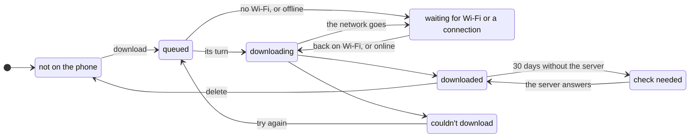

Figure 13.2: How a download moves between its statuses.

Cancelling a queued, waiting or downloading title, or removing a failed one,
takes it back to not on the phone. A failed download frees what it had
downloaded so far.

### 13.2.1 On a show

Each episode has its own control, in its row on the show's page, and the show's
own row of actions has none ([chapter 6](./title-actions.md)). A season offers
its episodes at once, at the head of the season. Figure 13.3 shows a season
with nothing of it on the phone yet.

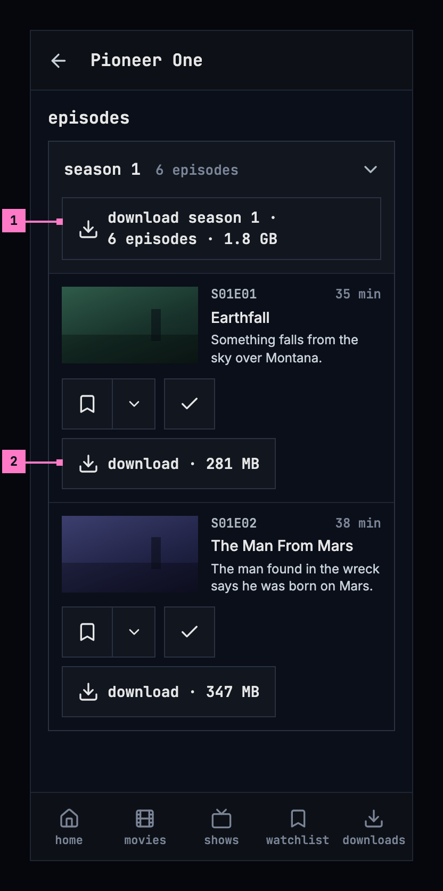

Figure 13.3: A season with nothing on the phone yet, on a phone.

1. **The season's control** downloads every episode of it that isn't on the
   phone or on its way, one after the other, in their order. Leaving the page
   stops none of them.
2. **An episode's own control**, as in figure 13.1, after add to list and
   watched.

The season's control says what it downloads:

- **download season 1 · 6 episodes · 1.8 GB**, only when every episode of the
  season can be downloaded and none is on the phone or on its way yet;
- **download 5 episodes · 1.5 GB**, when some can only be streamed;
- **download 3 more episodes · 940 MB** (**download 1 more episode · 323 MB**),
  once some are on the phone or on their way.

A file that holds two episodes counts as both. The size is given once every
episode's size is known, and left out until then.

A show that is partly on the phone says how far, under its row of actions and
beside its season's control: “1 of 6 downloaded”. It counts only the episodes
that can be downloaded, and a green check stands before it once all of them are
on the phone. While the server can't be reached, the show's page says only
what is on the phone, “1 episode on this phone” (figure 13.8), with the check
mark, or the information mark in its place while one of the episodes waits for
its check.

## 13.3 The downloads screen

Figure 13.4 shows the downloads screen: everything on the phone, newest first,
grouped by show and season, with the movies in a group of their own.

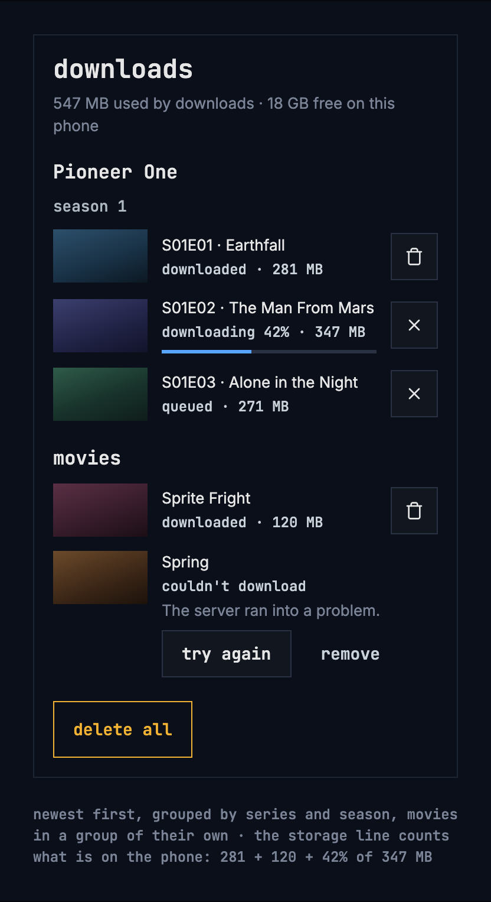

Figure 13.4: The downloads screen on a phone: a show's season, movies, a failed
title and delete all.

Each title shows its status and size as its control does, and plays from here
once it is on the phone. A failed title shows its reason, with **try again** and
**remove** under it, and no size: a failed download frees what it had
downloaded so far.

At the top, one line says how much room the downloads take and how much is
left: “547 MB used by downloads · 18 GB free on this phone”. With nothing
downloaded, it says only “18 GB free on this phone”. The line counts what is on
the phone, as the questions of section 13.4 do: in figure 13.4, the 281 MB and
the 120 MB of the two titles downloaded, and the 42 % of 347 MB already there.
The line and the questions compute one total, from the bytes, rounded once.

- **Delete one** with the button on its row, or with its control on the
  title's page. It asks nothing.
- **delete all**, at the end of the list, asks once, in the dialog of figure
  13.5 on the left: “This removes 3 downloads, 547 MB, from this phone.”, with
  **cancel** and **delete all**. Both **delete all** buttons are the design
  system's danger button. It counts only what is on the phone: a title partly
  downloaded counts, a queued one doesn't. With only failed or queued titles
  left, it says “This clears the list of downloads.”

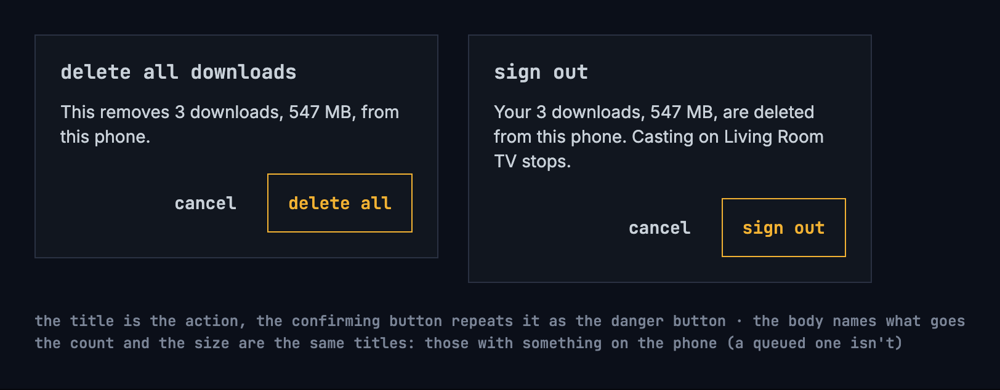

Figure 13.5: The questions before deleting all downloads and before signing
out.

The screen with nothing on it is drawn in section 13.7.

## 13.4 Whose downloads they are

A download belongs to the account that made it. Another account on the same
phone doesn't see it, so a child's account never plays a movie meant for a
parent. When a sign-in expires, nothing is hidden: signing in again as the same
account brings everything back. With several accounts on the phone and no
server to ask, the app opens on who's watching first
([chapter 3](./start.md)), then on that account's downloads.

Signing out and removing an account delete that account's downloads, and
changing the server signs out every account on the phone and deletes all their
downloads, so the app asks first. The title is the action, the confirming
button repeats it and is the danger button, and the body names what goes.
Figure 13.5 on the right shows the question before signing out;
[chapter 16](./settings.md) specifies the three actions and their questions.

| Action | Title | It says |
|---|---|---|
| Sign out | **sign out** | “Your 3 downloads, 547 MB, are deleted from this phone.” |
| Remove an account | **remove account** | “The 2 downloads of Anna, 1.1 GB, are deleted from this phone.” |
| Change the server | **change server** | “All 3 accounts on this phone are signed out, and their 7 downloads, 2.2 GB, are deleted.” |

The number and the size count the same titles, those with something on the
phone, as **delete all** does. With one download: “Your download, 281 MB, is
deleted from this phone.” and “The download of Anna, 281 MB, is deleted from
this phone.” Without downloads, each action asks only where chapter 16 says it
does, unless something is casting: while it is, the question is asked anyway
and adds “Casting on Living Room TV stops.” ([chapter 14](./casting.md)).

A download also goes when the server says the account may no longer watch the
title, because it left the library or the account's limit changed, after two
such answers at least an hour apart. The app says so once, on the downloads
screen. For one title: “This title isn't available to this account anymore, so
it was deleted from this phone.” For several, figure 13.6 shows the banner.

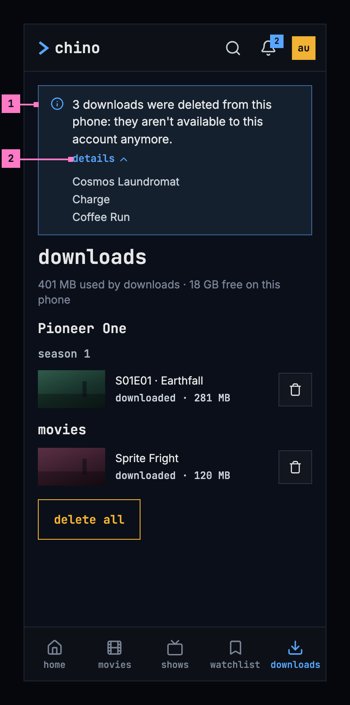

Figure 13.6: Downloads the server took off the phone, on a phone.

1. **The banner** says how many went and why. It shows once: the next visit to
   the downloads screen, or the app started again, doesn't show it again.
2. **details** opens the titles that went.

## 13.5 When the server can't be reached

Figure 13.7 shows the downloads screen while the server can't be reached. The
app opens on it, with an information banner on top: “Can't reach the server.
Your downloads still play.”, or only “Can't reach the server.” when nothing is
downloaded. The banner has no close button while the server can't be reached,
and the bell is hidden ([chapter 15](./notifications.md)). While the screen
shows, the app asks the server again every 15 seconds; once it answers, the
banner goes.

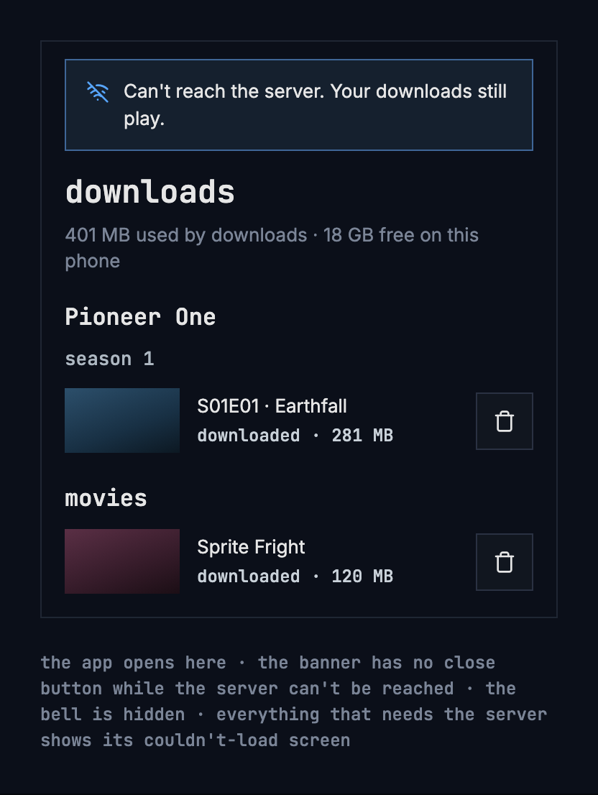

Figure 13.7: The downloads screen while the server can't be reached.

A downloaded title's page is built from what is on the phone, with the banner
on top, under the bar. What needs the server is left out: the watchlist and the
other lists, the watched and liked marks, the trailer and the people. Figure
13.8 shows a show's page from the phone.

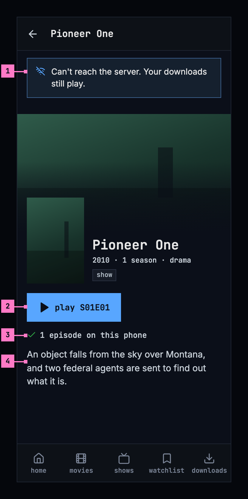

Figure 13.8: A show's page from the phone, while the server can't be reached.

1. **The banner**, as on the downloads screen. It says “Your downloads still
   play.” only where this title plays: a movie on the phone, or one of the
   show's episodes.
2. **play S01E01** plays the episode from the phone. The row holds nothing else:
   add to list, watched, liked and the trailer need the server.
3. **How far**, from the phone alone: “1 episode on this phone”. Further down,
   the page lists only the episodes on the phone, each with its control.
4. **The description**, as the download kept it. The people, who come from the
   server, are left out.

A title whose download waits for its check shows **play** or **resume**
dimmed, and its control says why, as figure 13.9 shows. A download not checked
with the server for 30 days asks for the server before it plays. While the
server can be reached, the check runs without anything on screen.

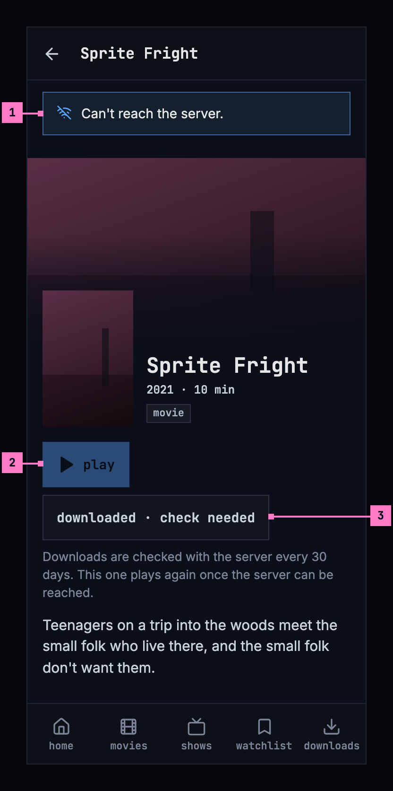

Figure 13.9: A movie whose download waits for its check, on a phone.

1. **The banner** says only “Can't reach the server.”: nothing on this page
   plays.
2. **play**, dimmed: the title doesn't play until the server has checked the
   download.
3. **The control** says **downloaded · check needed**, and the sentence under
   it says why.

The rest of the app while the server can't be reached:

- **The player** offers the subtitles that came with the download, named as
  online ([chapter 12](./subtitles.md)): a download takes all of the title's
  subtitle tracks with it. A title without subtitles offers only **off**.
- **The other screens** that need the server show the banner as well. What the
  phone loaded of them earlier stays under it, as it was; a screen it never
  loaded shows its couldn't-load screen ([chapter 17](./errors.md)), without
  the sentence, which the banner already says.
- **Watch progress** made offline is kept and sent once the server can be
  reached, with nothing for people to do. Queued downloads then carry on.
- **Casting**: a downloaded title plays on the phone, even while a TV is
  connected ([chapter 14](./casting.md)).

## 13.6 Settings

The phone app's settings ([chapter 16](./settings.md)) hold two settings for
downloads:

- **Download quality**: named as in the player's quality menu
  ([chapter 11](./playback.md)), with the size of an hour of video as the server
  reports it: “Medium (720p) · about 932 MB an hour”. Where too few titles have a
  quality to tell its size reliably, the size is left out.
- **Download over Wi-Fi only**: on by default. While it is on, a download waits
  for Wi-Fi.

## 13.7 States

The downloads screen shows at once, because everything on it is on the phone;
the storage line follows as soon as the phone has counted. Figures 13.10 and
13.11 show the screen with nothing downloaded.

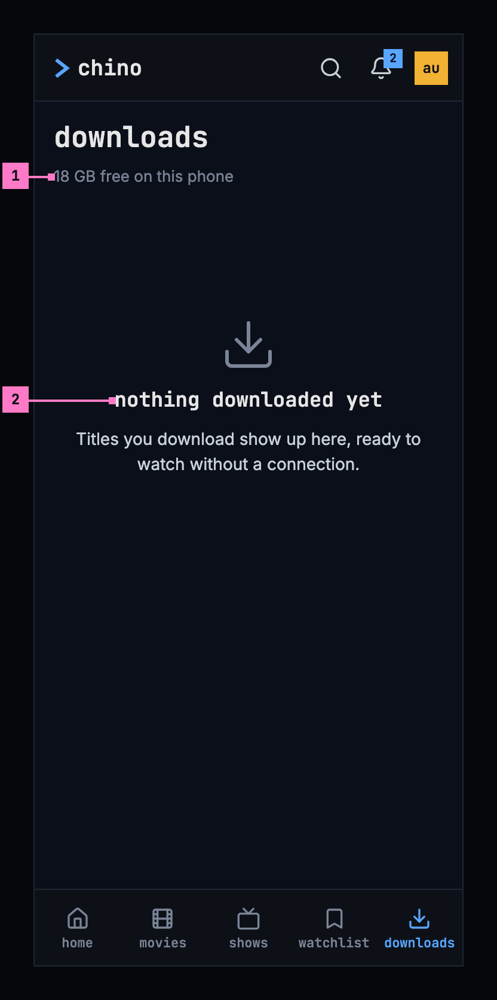

Figure 13.10: Nothing downloaded yet, on a phone.

1. **The storage line** says only what is free.
2. **The empty state** says what is true, and what will be here: “Titles you
   download show up here, ready to watch without a connection.” It offers no
   button, because titles are downloaded from their pages, and **delete all**
   is left out.

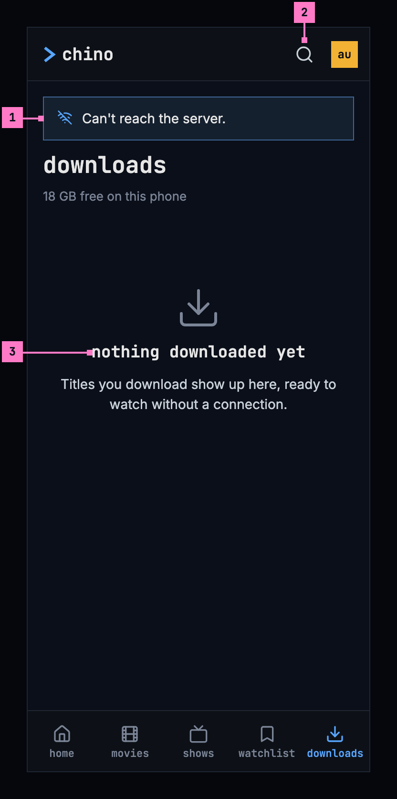

Figure 13.11: The server can't be reached and nothing is downloaded, on a
phone.

1. **The banner** says only “Can't reach the server.”: nothing would play.
2. **The top bar** has no bell while the server can't be reached.
3. **The empty state**, as in figure 13.10.

| State | What the phone shows |
|---|---|
| Titles on the phone | Figure 13.4 |
| Nothing downloaded | Figure 13.10 |
| Only failed or queued titles | The list and **delete all**, whose question says “This clears the list of downloads.” |
| Titles the server took off the phone | Figure 13.6, once |
| The server can't be reached | Figure 13.7; a title's page as in figure 13.8 |
| The server can't be reached, nothing downloaded | Figure 13.11 |
| A download waits for its check | Figure 13.9 |
| The server has turned downloads off | No download control on a title's page; what is on the phone stays, with its control |

## 13.8 Words

| Where | Text |
|---|---|
| The download control | “download · 1.4 GB”, “queued · 1.4 GB”, “waiting for Wi-Fi · 1.4 GB”, “waiting for a connection · 1.4 GB”, “downloading 42% · 1.4 GB”, “downloaded · 1.4 GB”, “downloaded · check needed”, couldn't download, can't be downloaded, try again |
| The control's buttons, for screen readers | cancel download · delete download |
| The control's sentences | Downloads are checked with the server every 30 days. This one plays again once the server can be reached. · This title can only be streamed. |
| A failure's reason | Not enough space on this phone. · Can't reach the server. · This title isn't available to this account anymore. · The server has turned downloads off. · The server ran into a problem. · The server didn't accept the download. · The download stopped before it was done. |
| A season's control | “download season 1 · 6 episodes · 1.8 GB”, “download 5 episodes · 1.5 GB”, “download 3 more episodes · 940 MB”, “download 1 more episode · 323 MB” |
| How far a show is | 1 of 6 downloaded · 1 episode on this phone |
| The downloads screen | downloads · “547 MB used by downloads · 18 GB free on this phone”, “18 GB free on this phone” · movies · season 1 · try again · remove · delete all |
| Nothing downloaded | nothing downloaded yet · Titles you download show up here, ready to watch without a connection. |
| Delete all | delete all downloads · This removes 3 downloads, 547 MB, from this phone. · This clears the list of downloads. · cancel · delete all |
| The questions | sign out · remove account · change server · Your 3 downloads, 547 MB, are deleted from this phone. · The 2 downloads of Anna, 1.1 GB, are deleted from this phone. · All 3 accounts on this phone are signed out, and their 7 downloads, 2.2 GB, are deleted. · Your download, 281 MB, is deleted from this phone. · The download of Anna, 281 MB, is deleted from this phone. · Casting on Living Room TV stops. |
| Downloads the server took off the phone | This title isn't available to this account anymore, so it was deleted from this phone. · 3 downloads were deleted from this phone: they aren't available to this account anymore. · details |
| While the server can't be reached | Can't reach the server. Your downloads still play. · Can't reach the server. |
| Settings | Download quality · “Medium (720p) · about 932 MB an hour” · Download over Wi-Fi only |

## 13.9 Today's apps

| App | What differs from this chapter |
|---|---|
| Web | No downloads, as this chapter has it. |
| Phone app | Only the Android app downloads; the iOS app has no downloads yet. On the downloads screen the status is coloured, green for downloaded, blue for downloading, and red for a failure and its sentence, and the banners come under the heading **downloads**, not above it. Change server's question reads as signing out's does, “Your 3 downloads, 547 MB, are deleted from this phone.” While the server can't be reached, the banner shows on home, movies, shows, a title's page and the downloads screen; search, the watchlist and the other screens show none. |
| Android TV | No downloads, as this chapter has it. |
| Samsung TV | No downloads, as this chapter has it. |
