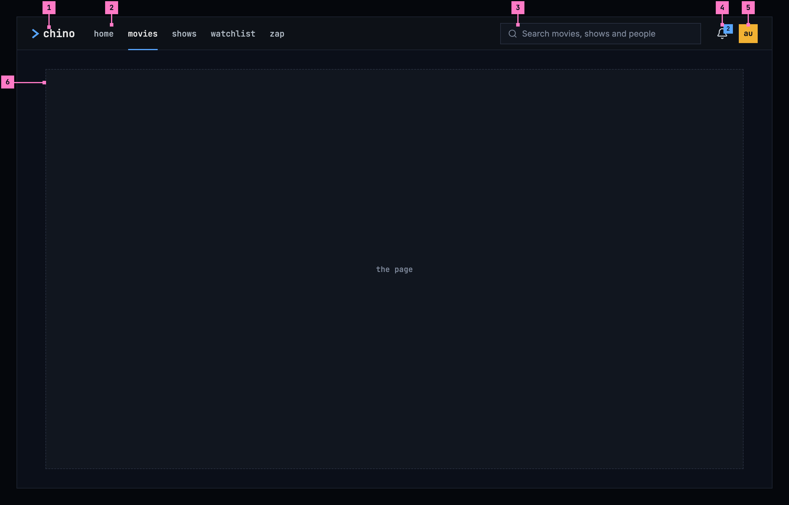
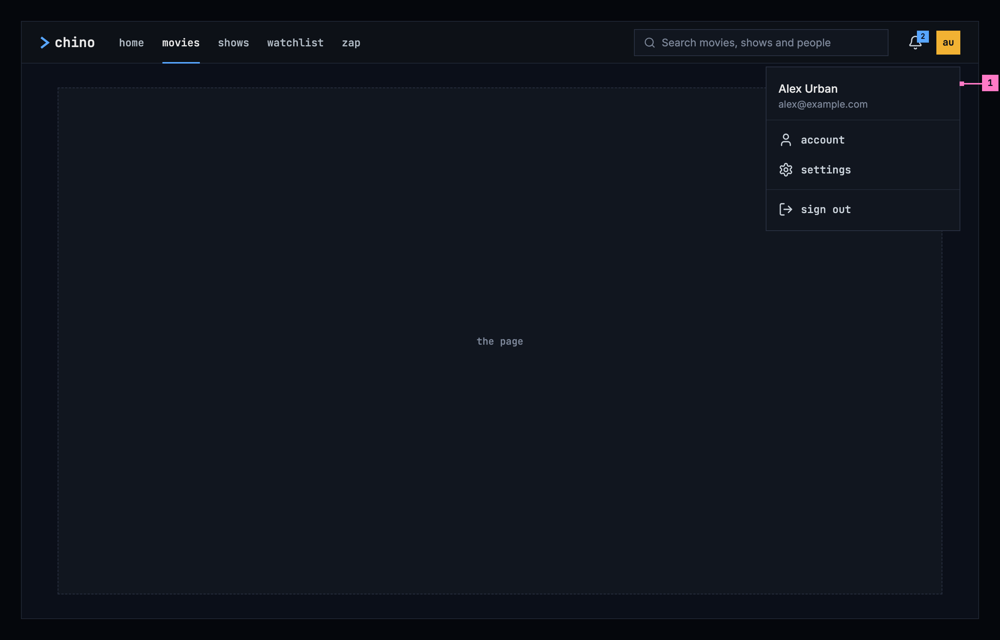
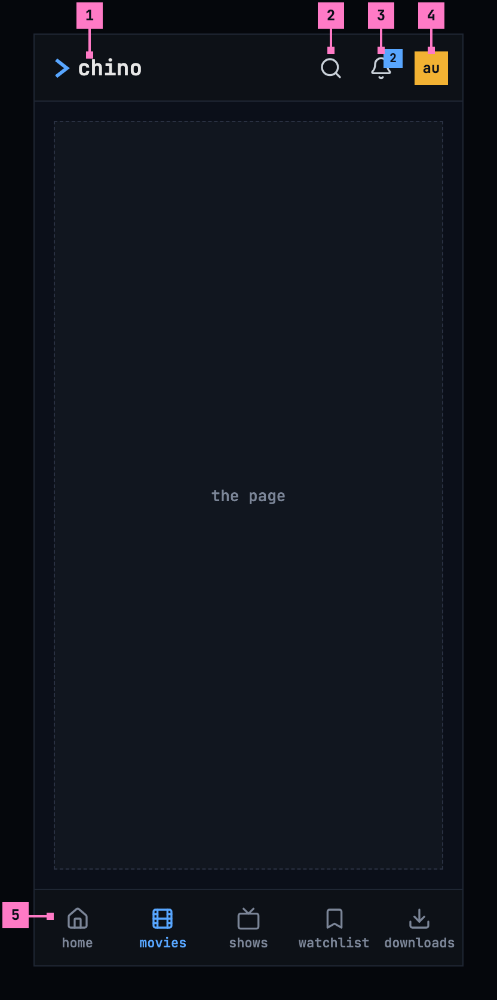
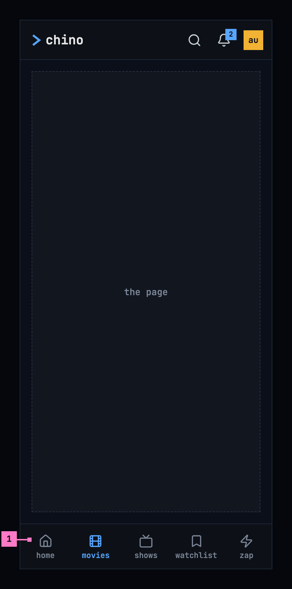
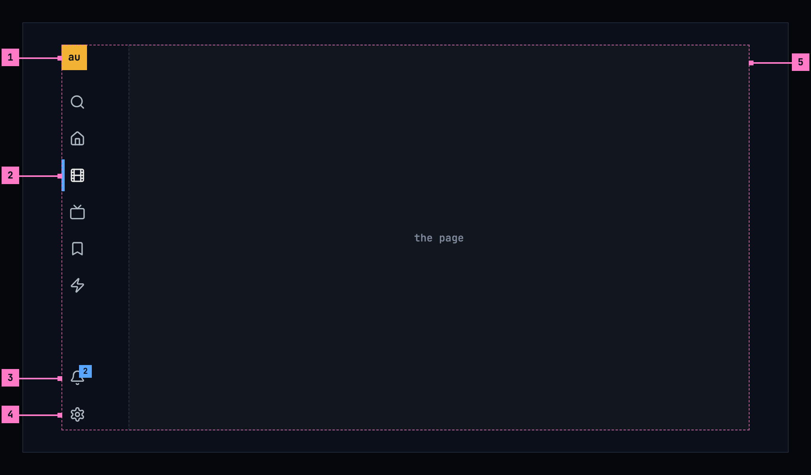
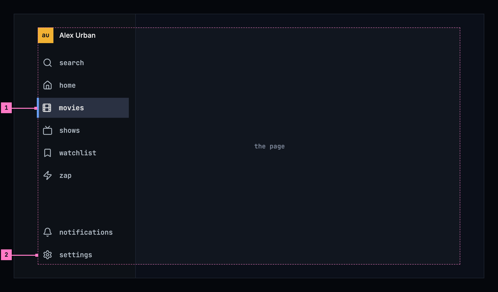

# 2 The frame

This chapter specifies the frame around every chino screen: the top bar on a
computer and a phone, the phone's tabs, the TV's rail, and the avatar's menu.
The screens in the chapters after this one are drawn inside it. A few screens
leave it out to give the picture the whole screen: the player
([chapter 11](./playback.md)), and zap in the phone app and on a TV
([chapter 10](./zap.md)); zap on a computer keeps the top bar, so the way out
is never covered.

## 2.1 Purpose

The frame answers the same questions on every screen: which product this is,
where the person is, how to get to the other views, how to search, what's new
for them, and who is signed in. It looks and works the same everywhere, so
people learn it once. It follows the design system's
[top bar](https://nalet.github.io/design-system/patterns/top-bar/), which lets
a product for people watching keep its own views in the bar.

## 2.2 The frame on a computer

Figure 2.1 shows the frame on a computer, with movies as the current view.

Figure 2.1: The frame on a computer, at 1280 × 800.

1. **The product's name**, chino, with the chevron. It leads to home.
2. **The five views**: home, movies, shows, watchlist and zap. The current one
   is in the brighter colour with a blue line under it. Settings is not a
   view: it's in the avatar's menu (part 5).
3. **The search**, the only one in the product. Its placeholder says what it
   finds: “Search movies, shows and people”. Typing in it shows the results
   ([chapter 9](./search.md)).
4. **The bell.** Its number counts the notifications the person hasn't read;
   with none unread, the number goes. The bell opens the notifications
   ([chapter 15](./notifications.md)).
5. **The avatar**: a square with the person's initials, dark on one of twelve
   colours. It opens the menu of figure 2.2.
6. **The page**, everything under the bar. There's no side navigation: the
   views are all in the bar.

Figure 2.2 shows the avatar's menu open.

Figure 2.2: The avatar's menu, on a computer.

1. **The menu** starts with the person's name and, quieter, their email
   address, then holds **account**, **settings** and **sign out**. account and
   settings open the screens of [chapter 16](./settings.md); sign out signs out
   of this server, as chapter 16 describes. The menu closes with Esc, a click
   outside it, or a second click on the avatar, and the focus goes back to the
   avatar.

## 2.3 The frame on a phone

Figure 2.3 shows the frame on a phone. The bar keeps what every screen needs,
and the views move to tabs at the bottom, in reach of a thumb.

Figure 2.3: The frame on a phone, at 360 dp.

1. **The product's name**, as on a computer.
2. **The search** is an icon. It opens a field across the whole width of the
   bar, with the keyboard ([chapter 9](./search.md)).
3. **The bell**, as on a computer. On a phone it opens a screen of its own.
4. **The avatar**, as on a computer. Its menu opens from the bottom of the
   screen, with the same items as figure 2.2.
5. **The tabs**: home, movies, shows, watchlist and downloads, each an icon
   with its name. The current tab is blue. Zap, the computer's fifth view,
   starts from home on a phone ([chapter 4](./home.md)), and downloads take its
   place, because the phone keeps titles to watch offline
   ([chapter 13](./downloads.md)).

A screen opened from a view, such as settings, shows a back arrow and its name
in place of the bar. The tabs stay.

Figure 2.4 shows the web on a phone. It has no downloads, so zap stays the
fifth tab.

Figure 2.4: The web on a phone, at 360 dp.

1. **The tabs** of the web on a phone: home, movies, shows, watchlist and zap.
   The rest of the frame is as in figure 2.3.

## 2.4 The frame on a TV

A TV has no top bar. Figure 2.5 shows the rail on the left, which holds the
same things as the bar, one under the other.

Figure 2.5: The frame on a TV, at 960 × 540 dp.

1. **The avatar**, at the top. It opens who's watching, to switch to another
   account on this TV ([chapter 3](./start.md)).
2. **The views**, under the search: home, movies, shows, watchlist and zap.
   When the focus is on the page, the current view keeps a blue bar on its
   left, so the person always knows where they came from.
3. **The bell**, at the foot. Its count works as on a computer.
4. **settings**, the last item. On a TV, settings sit in the rail, because
   the avatar opens the account there.
5. **The page**, right of the rail. Everything that matters on it stays inside
   the TV's safe area, the dashed outline: 48 dp from the left and right edges
   and 27 dp from the top and bottom, as the design system's
   [TV focus](https://nalet.github.io/design-system/patterns/tv-focus/) sets
   out. Artwork may run to the edge.

Moving the focus into the rail opens it, with the names beside the icons, as
figure 2.6 shows.

Figure 2.6: The rail opened, on a TV.

1. **The focused item** fills its row in the focus colour, with the ring
   inside it, and grows by 2 %. Up and down move between the items, and OK
   opens one. Right, or Back, closes the rail and puts the focus back on the
   page.
2. **The items** keep their order: search, the five views, then notifications
   and settings at the foot. The avatar sits at the top with the person's name.

## 2.5 Words

| Where | Text |
|---|---|
| The product's name | chino |
| The views | home · movies · shows · watchlist · zap |
| The phone's tabs | home · movies · shows · watchlist · downloads |
| The web's tabs on a phone | home · movies · shows · watchlist · zap |
| The search's placeholder on a computer | Search movies, shows and people |
| The search on a phone | the icon, named “search” for screen readers; the field it opens says “Search” |
| The bell, for screen readers | notifications, 2 unread |
| The avatar, for screen readers | Alex Urban, user menu |
| The avatar's menu | account · settings · sign out |
| The TV's rail | search · home · movies · shows · watchlist · zap · notifications · settings |

## 2.6 Today's apps

| App | What differs from this chapter |
|---|---|
| Web | The views are in a side navigation, with a settings button at its foot, and the top bar holds the search, the bell and the avatar. The search field has rounded corners and the placeholder “Search movies, shows…”. On a phone, six tabs: home, movies, shows, watchlist, zap and settings. |
| Phone app | Seven tabs: home, movies, shows, watchlist, zap, downloads and settings. The top bar holds an open search field instead of the search icon. |
| Android TV | The rail has the views; how it opens is compared at the app's next review. |
| Samsung TV | It has a top bar of its own; compared when the app is next worked on. |

### Open

- **help in the avatar's menu.** The design system's top bar puts help between
  settings and sign out. chino leaves it out until there is a guide for the
  people watching, so the menu never offers something with nothing behind it.
  Recommendation: add it with the first guide.
