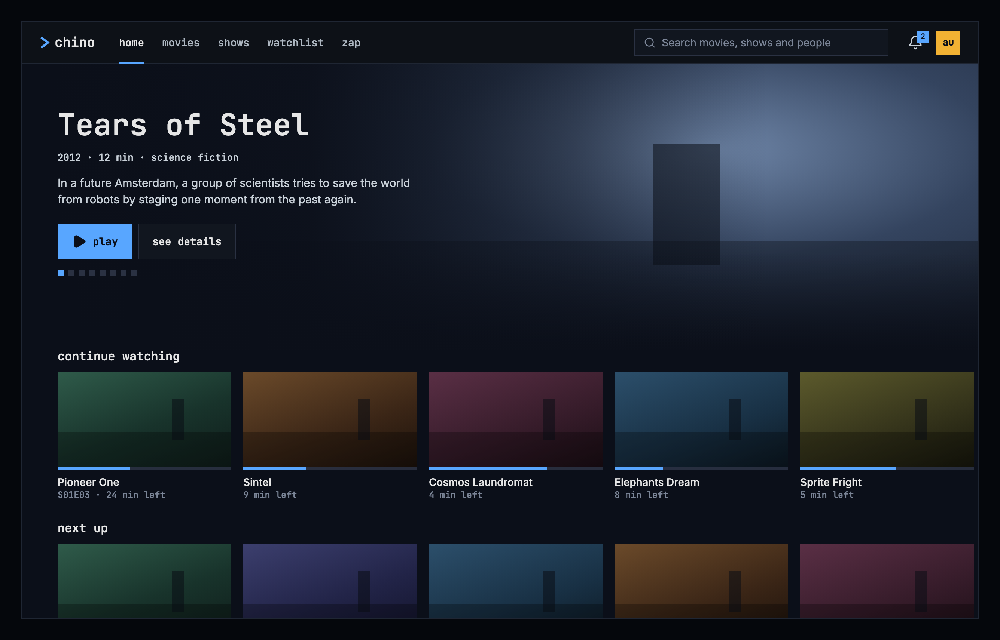
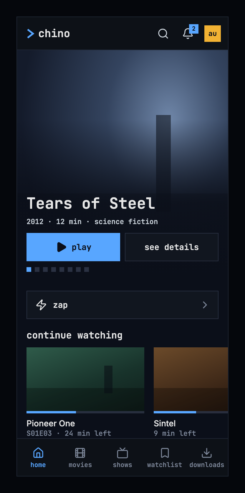
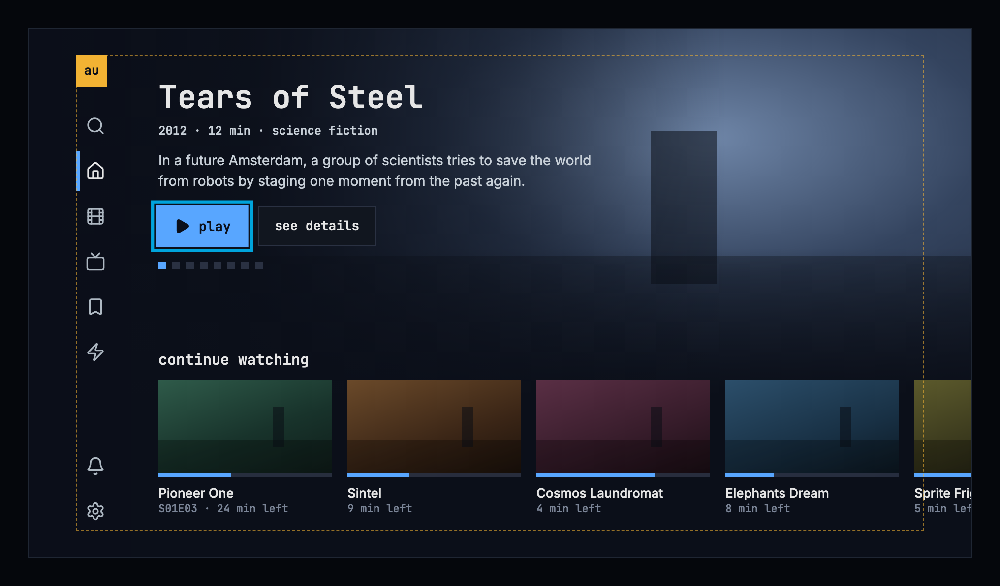

# Home

> **Draft, under review.** The first screen drawn whole at all three sizes, as
> the pattern for the others; see [screens](./screens.md).

The first screen after signing in. It offers one title to start right away,
then what the person is in the middle of, then what's new in the library.

## What's on it

From the top:

1. **The hero.** One of the newest titles the person hasn't watched, over its
   artwork: its name, year, length and genre, a short description, and
   **play** and **see details**. Eight titles take turns. The squares under the
   buttons show which one is showing, and a square, a swipe or an arrow key
   brings another.
2. **continue watching.** What the person stopped in the middle of, latest
   first. A card shows how far they got and the time left, and an episode
   shows its code. The card's menu takes it off the row.
3. **next up.** The next episode of a show whose last episode the person
   finished.
4. **recently added movies**, then **recently added shows**: the newest titles
   the person hasn't watched.
5. **top rated.**

A row holds up to 20 titles and ends with **see all**, which opens movies or
shows. A row with nothing in it is left out. Row names are chrome, so they are
lowercase in the monospace face.

## On a computer

The top bar holds everything around the page: the product's name, the five
views (home, movies, shows, watchlist and zap), the one search, the bell and the
square avatar. The avatar's menu has account, settings, help and sign out, so
settings isn't a view of its own. There's no side navigation: a product for
people watching keeps its views in the bar, as the design system's
[top bar](https://nalet.github.io/design-system/patterns/top-bar/) describes.

## On a phone

The top bar keeps the name, the bell and the avatar. The search is an icon
there, and it opens a field across the width. The views move to five tabs at
the bottom: home, movies, shows, watchlist and downloads. Zap starts from home,
under the hero. The web on a phone has the same layout, with zap as its fifth
tab, because the web has no downloads. The hero leaves out the description; the
title page has it.

## On a TV

A rail on the left holds the avatar, the search, the five views, the bell and
settings. When the focus is on the page, the view the person came from keeps a
blue bar in the rail. Home opens with the focus on **play**. Everything that
matters sits inside the safe area, and artwork may run to the edge, so a row
shows that it goes on.

## States

| State | What home shows |
|---|---|
| Loading | Nothing for the first 0.4 seconds, then grey blocks in the shape of the hero and the rows, as the design system's [loading and progress](https://nalet.github.io/design-system/patterns/loading-and-progress/) describes |
| Nothing could load | The page's couldn't-load state in place of everything, with the reason and **try again**; see [when a page couldn't load](./playback.md#when-a-page-couldnt-load) |
| One row couldn't load | That row says so in its place, with **try again**, and the rest of home shows |
| The library is empty | “The library has no movies or shows yet.”, with no button, because there's nothing the person can do about it here |
| The phone app can't reach the server | Home isn't shown: the app opens on downloads; see [when the server can't be reached](./downloads.md#when-the-server-cant-be-reached) |

## Not built like this yet

| App | What differs |
|---|---|
| Web | The views are in a side navigation, with settings as a button of their own. The row names are in mixed case: “Continue watching”, “Next Up”, “Recently added — Movies”, “Recently added — Shows”, “Top rated”. |
| Phone app | Seven tabs: home, movies, shows, watchlist, zap, downloads and settings. The row names are in mixed case, as on the web. |
| Android TV | The row names already follow the spec. The rest is compared at the app's next review. |
| Samsung TV | Compared when the app is next worked on. |
