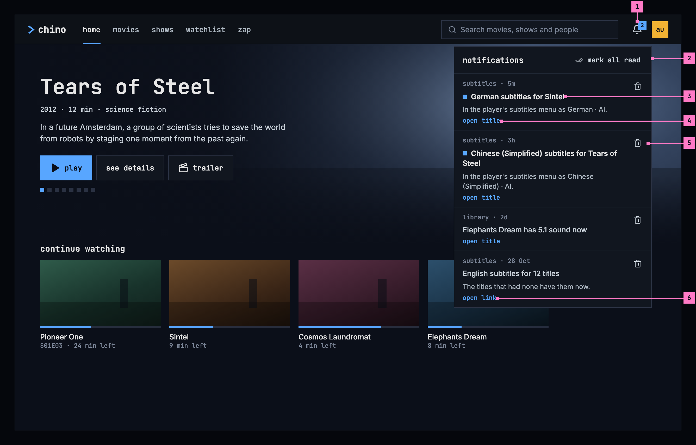
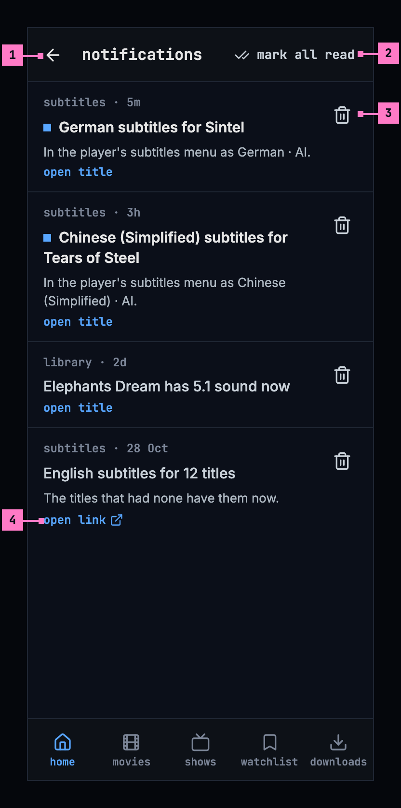
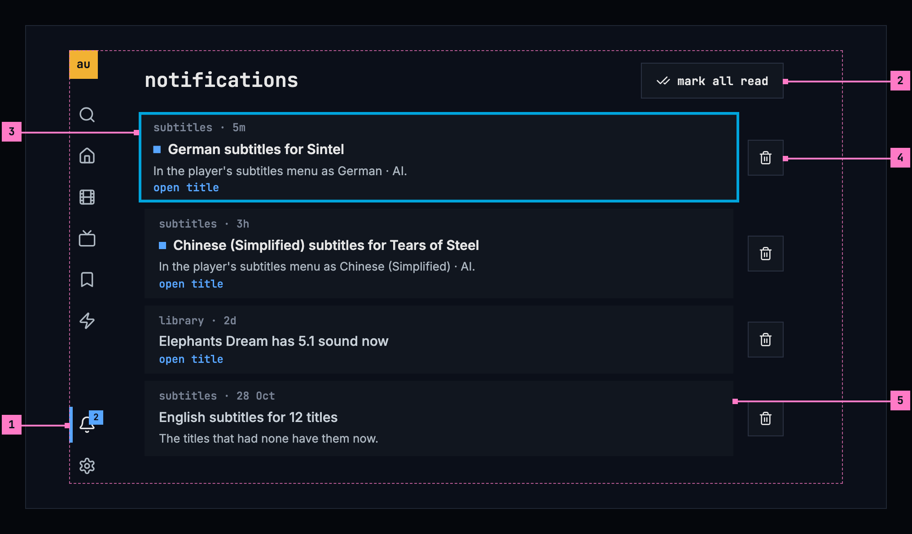
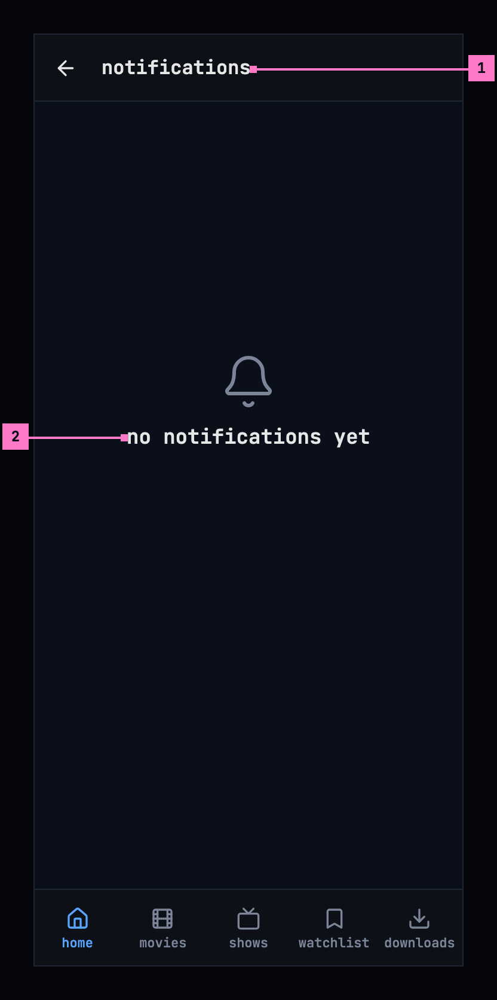
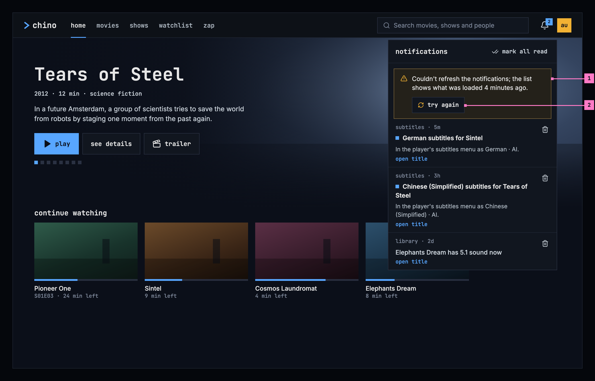
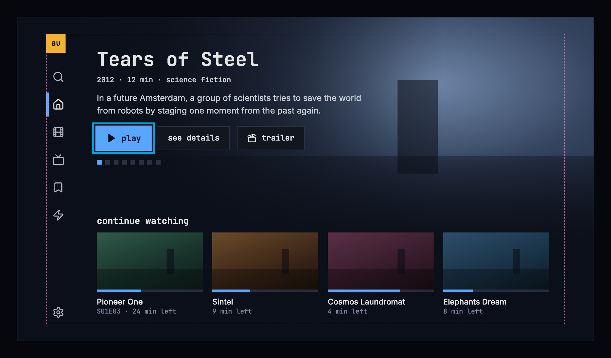

# 15 Notifications

This chapter specifies the notifications: the bell in the frame, and the list
it opens. The frame itself, with the bell in the top bar and in the TV's rail,
is specified in [chapter 2](./frame.md).

## 15.1 Purpose

The apps on a server can tell the person something there, for example that
subtitles were made for a title. The bell collects these notifications for the
account signed in: it counts the unread ones, and it opens the list, newest
first. Each notification says whom it is from and how long ago it came, and
opening it leads to what it is about, most often a title's page; one about an
episode opens its show's page at that episode ([chapter 6](./title-actions.md)).

Every app has the bell. On a computer it opens a panel under it, on a phone a
screen of its own, and on a TV, where it sits in the rail, a screen of its own
as well. A server
that has no notifications to offer has no bell at all (section 15.6).

## 15.2 Notifications on a computer

Figure 15.1 shows the panel on a computer, opened over home.

Figure 15.1: The notifications on a computer, at 1280 × 800.

1. **The bell** counts the unread notifications, “2”, and “99+” past 99; with
   none unread, the number goes. For screen readers it is “notifications, 2
   unread”, or “notifications”. A click opens the panel under it, and the app
   asks the server for the list again as it opens.
2. **The panel's head**: the heading **notifications** and, while any is
   unread, **mark all read**, which marks every one read at once.
3. **A notification**: whom it is from, the app's name, and how long ago it
   came, then its title and its text. While it is unread, a small blue square
   stands before its title and the title is brighter; screen readers hear
   “unread” before it.
4. **open title** says where it leads. A click anywhere on the notification
   marks it read and opens the title's page ([chapter 6](./title-actions.md)).
5. **Delete** takes the notification away, without opening it. After a delete
   or **mark all read**, the focus stays in the panel.
6. **open link**: a notification about no title leads to a page of this server,
   which opens in the same tab. One that leads nowhere shows no label, and
   opening it only marks it read.

The panel scrolls when the list is longer than it, and closes with Esc, which
puts the focus back on the bell, with a click outside it, or with a second
click on the bell.

## 15.3 Notifications on a phone

Figure 15.2 shows the notifications on a phone. The parts are those of figure
15.1; the numbers mark where the phone differs.

Figure 15.2: The notifications on a phone, at 360 dp.

1. **A screen of its own**, with the back arrow and the heading in its bar. The
   tabs stay ([chapter 2](./frame.md)).
2. **mark all read** sits at the right of the bar.
3. **Delete** is a 48 dp button, beside each notification.
4. **open link** opens the page in the phone's browser.

## 15.4 Notifications on a TV

Figure 15.3 shows the notifications on a TV. The parts are those of figure
15.1; the numbers mark where the TV differs.

Figure 15.3: The notifications on a TV, at 960 × 540 dp.

1. **The bell**, at the foot of the rail, with its count. OK on it opens the
   notifications, and the rail marks them as the current view.
2. **mark all read**, right of the heading. Up from the first notification
   reaches it.
3. **The focus** starts on the newest notification or, back from a title, on
   the one that opened it. Up and down move between the notifications, and OK
   opens one.
4. **Delete**, right of each notification: right moves the focus to it. After
   a delete the focus moves to the notification now in its place, and after
   **mark all read** to the newest.
5. **A notification that leads to a page** shows no label: a TV shows no web
   pages, so OK only marks it read.

## 15.5 What notifications do

### 15.5.1 What a notification says

What a notification says is its app's own text, which the server passes on.
The app shows it as plain text, never as markup, with its line breaks kept, and
whatever a notification holds, the worst it can do is not show: it never takes
the top bar or the page down. How long ago it came reads “now”, “5m”, “3h” and
“2d”, and from a week on the day it came, “28 Oct”, with the year when it came
in another year: “12 Sep 2025”. The ages move on while the list is open: “now”
becomes “1m”.

### 15.5.2 Where it leads

- **The title it is about**, first: the title's page opens, as it opens
  anywhere in chino. The server holds an account to its limit there, so a title
  above the account's limit opens as one that isn't in the library
  ([chapter 17](./errors.md)).
- **Else its link**, while the link stays on this server: the web opens it in
  the same tab, the phone app in the phone's browser. A link anywhere else is
  never followed, and the notification shows no label then.
- **On a TV**, only the title: a TV follows no link.
- **Neither**: opening the notification only marks it read.

### 15.5.3 Asking the server

The apps ask the server for the list when they start, every minute while they
are shown, as soon as they are shown again, and when the panel or the screen
opens. A read, a delete or **mark all read** shows at once and is sent to the
server. When the server doesn't make the change, the app asks for the list
again and shows it as the server has it.

The notifications belong to the account signed in. Switching to another
account or signing out forgets them at once, so the next person never sees the
last one's.

### Open

- **A notification with a title and a link.** The web and the TVs open the
  title, the phone app offers the link as well. Recommendation: one place per
  notification, the title, as this chapter has it.

## 15.6 States

Figures 15.1 to 15.3 show notifications with two of them unread. Figures 15.4
to 15.6 show the other states.

Figure 15.4: No notifications yet, on a phone.

1. **The bar** holds no **mark all read**: nothing is unread.
2. **“no notifications yet”**, and nothing under it: there is nothing to do
   about it.

Figure 15.5: The notifications couldn't be refreshed, on a computer.

1. **The banner** says that asking again failed and how old the list is:
   “Couldn't refresh the notifications; the list shows what was loaded 4
   minutes ago.” The list under it stays as it was, and the bell keeps its
   count. The banner goes as soon as a refresh works.
2. **try again** asks the server again.

While the panel is closed, a refresh that fails changes nothing on screen, and
the next one follows a minute later.

When the server has no notifications to offer, because none are set up on it,
they don't answer it, or it is older than notifications, there is no bell.
Figure 15.6 shows home on a TV then: settings stays alone at the rail's foot.
On a computer and a phone the top bar holds no bell either, and nothing says
why, because there is nothing the person can do about it.

Figure 15.6: A server without notifications, on a TV.

| State | What the bell and the list show |
|---|---|
| Notifications, some unread | Figures 15.1 to 15.3 |
| None unread | The bell without a number; no **mark all read** |
| No notifications yet | Figure 15.4 |
| Loading | No loading state: the bell appears with the server's first answer, so the list is there when it opens, and asking again updates it in place |
| Couldn't refresh | Figure 15.5 |
| The server has no notifications | Figure 15.6 |
| The phone app can't reach the server | No bell, as [chapter 13](./downloads.md) describes |

## 15.7 Words

| Where | Text |
|---|---|
| The bell | its count, “2”, “99+” |
| The bell, for screen readers | notifications, 2 unread · notifications |
| The panel and the screen | notifications · mark all read |
| A notification | “subtitles · 5m” (whom from · how long ago) · open title · open link |
| How long ago | now · 5m · 3h · 2d · 28 Oct · 12 Sep 2025 |
| An unread notification, for screen readers | unread, before its title |
| Delete, for screen readers | delete notification: German subtitles for Sintel |
| None yet | no notifications yet |
| Couldn't refresh | Couldn't refresh the notifications; the list shows what was loaded 4 minutes ago. · try again |

## 15.8 Today's apps

| App | What differs from this chapter |
|---|---|
| Web | The bell is called “Notices”, with a count “Notices, 2 unread”; the panel's heading is “Notices” and its button “Mark All Read”, the empty list says “No notices yet.”, and a notification's way on is “Open Title” or “Open”. An unread notification has a blue line down its left edge, and delete is an X. Ages from a week on read “Sep 12”. On a phone the panel opens across the screen, under the top bar, rather than as a screen. A refresh that fails keeps the list without a word. |
| Phone app | The screen's heading is “Notices”, its button “Mark All Read”, and the empty list says “No notices. An addon you use can tell you something here.” A notification with a title and a link offers “Open Title” and “Open Link”. An unread notification has a blue line down its left edge, and delete is an X named “Delete Notice”. A refresh that fails keeps the list without a word. |
| Android TV | The bell sits in a top bar of its own, not in the rail. The heading is “notices”, the empty list says what the phone app's does, “Open” stands in a notification's first line, and delete is a trash can named “Delete notice: …”. Ages from a week on read “Sep 12”. A refresh that fails keeps the list without a word. |
| Samsung TV | The bell sits in its top bar, not in the rail. The heading is “Notices”, the button “Mark All Read”, and a red “Delete” with a trash can sits beside each notification, both with rounded corners; “Open ›” stands under the text, and an unread notification has a blue line down its left edge. While the screen asks the server for the first time it shows “Loading notices…” with a spinner, and the empty list says what the phone app's does. After a delete the focus moves to the next notification's delete. A refresh that fails keeps the list without a word. |
