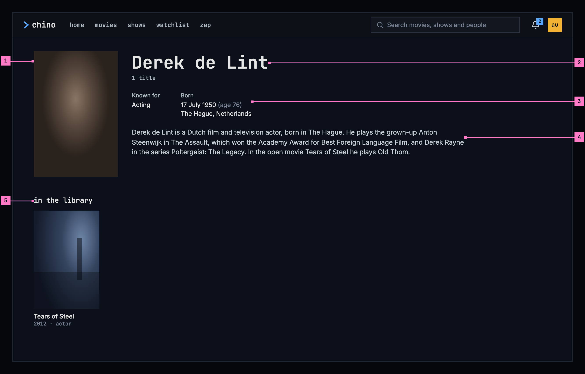
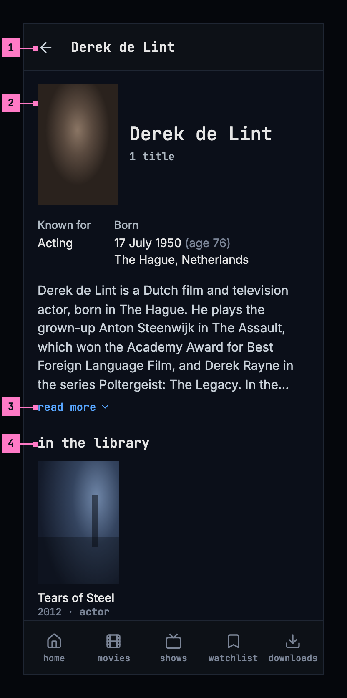
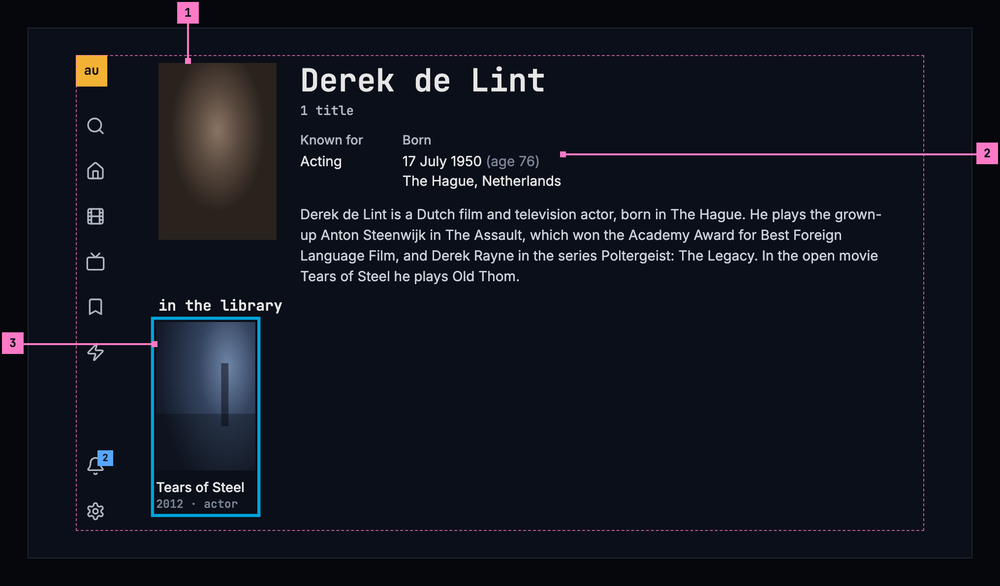
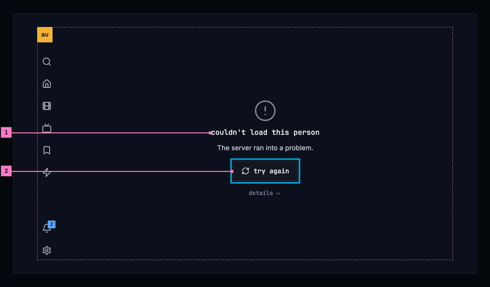
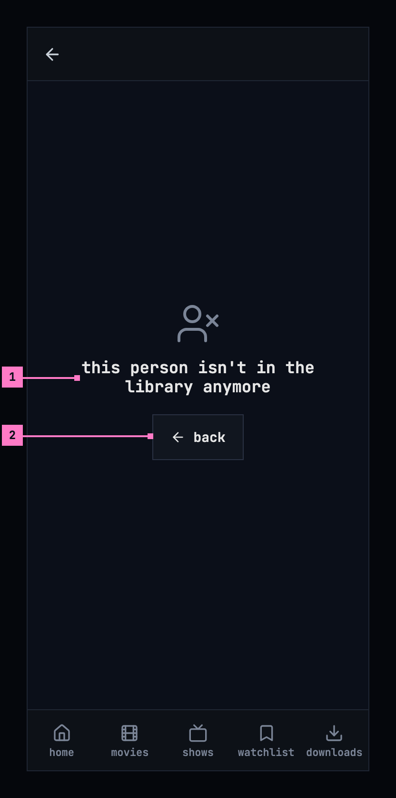

# 7 People

This chapter specifies a person's page: someone who acted in or made the
library's titles, and what of theirs the library has. The frame around it is
specified in [chapter 2](./frame.md).

## 7.1 Purpose

A person's page says who someone is and what else of theirs there is to
watch. It opens from the cast and crew on a title's page
([chapter 6](./title-actions.md)) and from the people that search finds
([chapter 9](./search.md)). Like a title's page, it isn't one of the views: the
frame marks no view as current, and back returns to where it was opened from.

## 7.2 A person's page on a computer

Figure 7.1 shows the page of an actor in Tears of Steel. The photo and what the
catalog knows about him take the top of the page, and his titles follow.

Figure 7.1: A person's page on a computer, at 1280 × 800.

1. **The photo**, in a 2:3 frame like the posters below it. Where the catalog
   has no photo, the initials stand in a square in its place (section 7.5.1).
2. **The name**, and how many of their titles the library has: “1 title”,
   “12 titles”.
3. **The facts**: what they are known for, and when and where they were born.
   Section 7.5.2 lists the facts and how each is written.
4. **The biography.** A long one is cut after six lines, and **read more**
   shows the rest (figure 7.2).
5. **in the library**: their titles, as posters, each with its year and what
   they did on it: “2012 · actor”. Choosing one opens its page
   ([chapter 6](./title-actions.md)).

## 7.3 A person's page on a phone

Figure 7.2 shows the same page on a phone. The parts are those of figure 7.1;
the numbers mark where the phone differs.

Figure 7.2: A person's page on a phone, at 360 dp.

1. **The bar** shows a back arrow and the name in place of the top bar, and the
   tabs stay, as on every screen opened from a view ([chapter 2](./frame.md)).
2. **The photo** is smaller and stands beside the name. The facts and the
   biography run the full width under them, the facts two to a line.
3. **read more.** The biography is cut after six lines and ends in “…”.
   **read more** opens the rest in place, and **show less** cuts it again.
   Neither shows when the whole text fits.
4. **in the library**: the posters three to a line, the size of a poster in
   movies and shows ([chapter 5](./browse.md)).

## 7.4 A person's page on a TV

Figure 7.3 shows the page on a TV. The rail stays on the left with no view
current, and the page keeps to the safe area.

Figure 7.3: A person's page on a TV, at 960 × 540 dp.

1. **The photo and the name**, as on a computer.
2. **The facts** stand side by side, and the biography under them shows five
   lines at most. Where it's cut, **read more** follows it and opens the whole
   text over the page: up and down scroll the text, and back closes it and
   puts the focus back on **read more**.
3. **The focus** starts on the first title, with the page at its top so the
   name and the facts show. The titles stand six to a line. Left and right move
   along a line, down to the next, and up from the first line to **read
   more**, where there is one.

## 7.5 What the page shows

### 7.5.1 The photo

The catalog's photo, framed 2:3 with the face in its upper part. While it loads,
and where the catalog has none, the initials of the name stand in a square
instead, so the page never shows an empty frame.

### 7.5.2 The facts

| Fact | Written as |
|---|---|
| Known for | The work the catalog knows them best for, in its words: “Acting”, “Directing”, “Writing” |
| Born | The date in the device's language, with the age beside it: “17 July 1950 (age 76)”, and the place on the next line: “The Hague, Netherlands” |
| Died | The date, with the age they reached: “3 March 2020 (aged 69)”. Born then leaves out the age |

- A date the catalog has only in part is written as far as it goes: “July
  1950”, “1950”, and without an age.
- A fact the catalog doesn't have is left out. Someone the catalog knows
  nothing about beyond the name has a page with the photo or the initials, the
  name and the titles.

### 7.5.3 The biography

- It is in the language of the device where the catalog has it in that
  language, and in English otherwise.
- A long biography is cut after six lines on a computer and a phone, and after
  five on a TV, and ends in “…”. **read more** shows the rest: in place on a
  computer and a phone, over the page on a TV (section 7.4). It is there only
  when the text is cut.

### 7.5.4 In the library

- **in the library** holds every title of theirs the library has, in the
  order the server gives them, as posters with their status marks
  ([chapter 6](./title-actions.md)).
- Under each poster: the year, then what they did on that title, each role
  once: “2012 · actor”, “2012 · director · writer”. The roles are actor,
  creator, director, writer, producer, composer, cinematographer and editor,
  and any other role by its own name.
- The count under the name counts the same titles.
- With nothing of theirs in the library, the count is left out, and in the
  titles' place the page says “nothing of theirs in the library”.

## 7.6 States

The page is drawn in figures 7.1 to 7.3 with everything loaded. Figures 7.4 to
7.6 show the states in between.

Figure 7.4: A person's page loading, on a computer.

While the page loads, it shows nothing for the first 0.4 seconds, and after
that grey blocks in the shape of the photo, the name, the facts, the biography
and a line of posters, as the design system's
[loading and progress](https://nalet.github.io/design-system/patterns/loading-and-progress/)
describes. A phone and a TV show the same blocks in their own layout.

Figure 7.5: A person's page when it couldn't load, on a TV.

1. **What couldn't load, and why.** “couldn't load this person”, and under it
   the reason as far as the app can tell. Figure 7.5 shows the case where the
   server ran into a problem; [chapter 17](./errors.md) lists every cause and
   its sentence.
2. **try again** loads the page again. It has the focus, so OK is all it
   takes. **details** under it opens the server's answer, for the people who
   fix things.

Figure 7.6: A person who isn't in the library anymore, on a phone.

1. **What is true**: “this person isn't in the library anymore”. Trying again
   can't bring them back, so the page offers no try again and gives no reason.
2. **back** returns to where the page was opened from, or to home when it was
   opened from a link.

| State | What the page shows |
|---|---|
| Loading | Figure 7.4 |
| Couldn't load | Figure 7.5, with the sentence for the cause |
| The person was removed | Figure 7.6 |
| The viewer may not see the page | “you don't have access to this”, with **back** |
| The sign-in has expired | Nothing of its own: the app renews the sign-in and loads the page; only a refused sign-in leads to signing in, and back to the page |
| No photo | The initials (section 7.5.1) |
| Nothing known beyond the name | The photo or the initials, the name and the titles |
| Nothing of theirs in the library | “nothing of theirs in the library” in the titles' place |
| The phone app can't reach the server | Figure 7.5's state, with “Can't reach the server.”: a person's page always needs the server ([chapter 13](./downloads.md)) |

## 7.7 Words

| Where | Text |
|---|---|
| Under the name | 1 title · 12 titles |
| The facts | Known for · Born · Died · (age 76) · (aged 69) |
| The biography | read more · show less |
| The whole biography, open on a TV | Press up or down to scroll, and back to close. |
| The titles | in the library |
| What they did on a title | actor · creator · director · writer · producer · composer · cinematographer · editor |
| Nothing of theirs in the library | nothing of theirs in the library |
| Couldn't load | couldn't load this person · The server ran into a problem. · try again · details |
| Removed | this person isn't in the library anymore · back |
| No access | you don't have access to this · back |

## 7.8 Today's apps

| App | What differs from this chapter |
|---|---|
| Web | The page has no top bar: a back button floats over it, on a see-through black. While it loads, a spinner turns in the middle. The titles are headed “Filmography”, and a card puts the roles in capitals (“Actor”, “Director · Writer”) under the year and the rating. “Read more” and “Show less” are capitalised. A person with no titles says “No titles available for this person.” Couldn't load adds a quiet **back** beside **try again**. |
| Phone app | The page has no bar and no tabs: a back button floats over it alone. While it loads, a spinner turns. “Filmography”, “Read more”, “Show less” and “No titles available for this person.” are as on the web. |
| Android TV | While the page loads, “Loading…” stands in the middle. The titles are headed “filmography”, and a person with none says “No titles for Derek de Lint.” The open biography says “▲▼ to scroll · BACK to close”. No access says “you don't have access to this person”. |
| Samsung TV | A page that couldn't load says “Couldn’t load person” in red, with the error's own message, and offers no **try again**; a removed person has no case of their own. While it loads, a spinner turns with “Loading…”. The titles are headed “Filmography”, and a person with none says “No titles for Derek de Lint.” “Read more” opens the whole text with “Up / Down to scroll”. |
