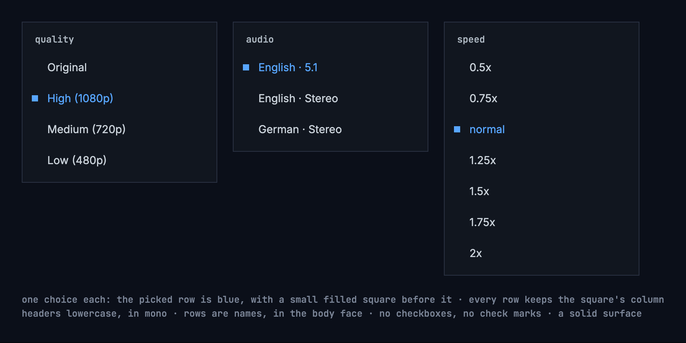

# Playback

What a title offers when people come back to it, when it counts as finished,
what the player says when it changes the quality by itself, and what a page
says when it couldn't load. Every app follows the same rules, so a title
resumes and finishes the same way everywhere.

## Play, resume and a finished title

- A title people stopped part way shows **resume 1:43**, with **start over**
  beside it.
- A title stopped within its last 5% or its last 2 minutes, whichever is
  longer, counts as **finished**: it shows **play**, from the start, and the
  watched mark. For a short title, finished never starts before its second
  half.
- The server decides finished, once, so every app agrees. Continue watching
  drops a finished movie and moves a finished episode on to the next one.
- Removing a title from continue watching doesn't mark it as watched.

## Quality names

The server names every quality, by one fixed table of heights, so a name means
the same picture size on every title and every installation. The apps show the
name as the server gives it.

A frame's height for naming is its step: its own height, or the height its width
stands for at 16:9, whichever is larger. A scope film of 1920 × 818 is 1080p,
like a 16:9 film of 1920 × 1080, because both are full HD.

| Height | Name |
|---|---|
| 2160p and up | “Ultra (2160p)” |
| 1080p | “High (1080p)” |
| 720p | “Medium (720p)” |
| 480p | “Low (480p)” |
| below 480p | “Lowest (360p)” |
| the original, played as it is | “Original” |

A step up to 10% above a standard height, in a frame no taller than it, or up
to 3% below it, counts as that height. The standard heights are 240, 360, 480,
540, 576, 720, 1080, 1440, 2160 and 4320. So frames cut a little wider or
narrower keep their name: 1916 × 800 and 2048 × 858 are “High (1080p)”. Any
other step takes the name of the table's next lower height, with its own number:
1024 × 576 is “Low (576p)”, 2560 × 1072 is “High (1440p)”, 1666 × 900 is “Medium
(937p)”, and a scope film's 720-line encode, 1728 × 720, is “Medium (972p)”. A
re-encode at the original's size is named by its step like any other.

## The player's menus

- Subtitles, audio, quality and speed are menus of one choice each. They show
  no checkboxes and no check marks: the picked row is in the accent blue, with a
  small filled square before it, square like every shape in the design system.
  Every row keeps the square's column, so the names line up whether picked or
  not.
- An audio track names its channels in words: “Stereo”, “5.1”, “7.1”, “Mono”,
  never “2ch”.
- Their headers are lowercase: “subtitles”, “audio”, “quality”, “speed”, and
  “timing” for the subtitles' timing, whose button is “reset”.
- Controls over the picture, such as a chip, sit on a solid surface, never on a
  see-through one.

## The picture

The player shows a title's picture, not its frame. Many files keep a whole 16:9
frame with the picture inside it and black bars baked in: above and below a
2.39:1 film, at the sides of a 4:3 show. On a screen of another shape the
picture would float in black on all four sides. The server says where the
picture is: the play info's `pictureArea`, the part of the frame the picture
takes over the whole title, as fractions of the frame's width and height, so
the same for every quality. It leaves it out where it doesn't know, or where
the picture is the whole frame.

- **Fit**, unless the person zooms: the picture as large as the screen allows,
  in its middle. The bars are cropped where they would show; the picture
  never is. Without a `pictureArea`, the whole frame fits, as before.
- **The camera's cutout**: held sideways, a phone's cutout or notch takes a
  band at one side. The fitted picture keeps out of a band as wide on both
  sides, so it stays in the middle; only the sides count, so upright, with the
  cutout over the bars at the top, the picture keeps its place. Fill covers
  the band where the app draws there (Android 15 and later; the web where the
  page reaches under the notch). The subtitles keep out of it either way.
- **Fill**: the picture covers the whole screen, its edges cropped. Only on a
  screen wider than tall, and only where it is larger than fit; upright, the
  picture always fits. The web offers it only for a title with a
  `pictureArea`; on Android a pinch fills any title.
- **Zooming**: in the Android app, two fingers spread apart fill the screen
  and brought together fit it again; the picture follows them and settles at
  one or the other when they lift, and TalkBack has the same as an action on
  the picture, “zoom to fill” or “zoom to fit”. On the web, the button “Zoom
  to fill” beside fullscreen, shown only where fill changes the picture of a
  title with a `pictureArea`. The iOS app and the TV fit the whole frame, as
  before: on a 16:9 TV that is the same picture for a letterboxed or a
  pillarboxed title, and a windowboxed one keeps its bars there.
- **Remembered** on the device, for the titles it suits: a fill chosen on one
  title starts the next one filled only where that title has a `pictureArea`
  and fill crops at most a tenth of its picture's width and of its height - a
  scope film on a phone held sideways or on a 21:9 screen. Any other title
  starts fitted, and a fill chosen on it is for that title alone.

Subtitles go with the picture ([the look](./subtitles.md#the-look)): nothing of
them is ever cropped.

## When the quality changes by itself

When playback has to step down, the player says what it did and why. {label}
is the quality's name from the table above: “Medium (720p)”, “Low (480p)”.

- From the original, when the connection is too slow: “Switched to {label}
  quality: the connection can't keep up with the original.”
- When the original can't be streamed: “Switched to {label} quality: the
  original couldn't be streamed.”
- One step down between qualities: “Switched to {label} quality: the
  connection can't keep up.”
- When a quality between can't be streamed: “Switched to {label} quality:
  {previous} couldn't be streamed.”, {previous} named from the same table:
  “Switched to Low (480p) quality: Medium (720p) couldn't be streamed.”

It keeps the position. Status codes go into the playback report, never into
the line.

## The audio setting

Settings has one audio language, “Original” or a language, with this text under
it, the same in every app:

> Titles play with audio in the language you pick here, where they have it.
> With Original, each title plays in the language it was made in. A choice in
> the player applies only to what's playing now.

## When a page couldn't load

The apps follow the design system's [cases by
cause](https://nalet.github.io/design-system/patterns/empty-states/#when-it-couldnt-load-say-why).
For chino:

- A removed title or person: “this title isn't in the library anymore” or “this
  person isn't in the library anymore”, with **back**.
- A list screen that gets “not found” means the app and the server don't match:
  “The server didn't accept the request. Check for an app update.”
- A sign-in that expired renews itself; only a refused one leads to sign-in.
