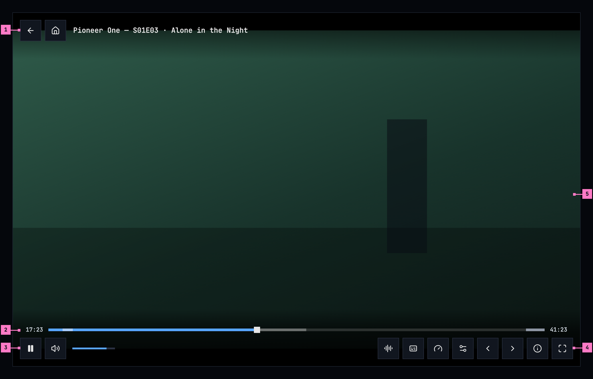
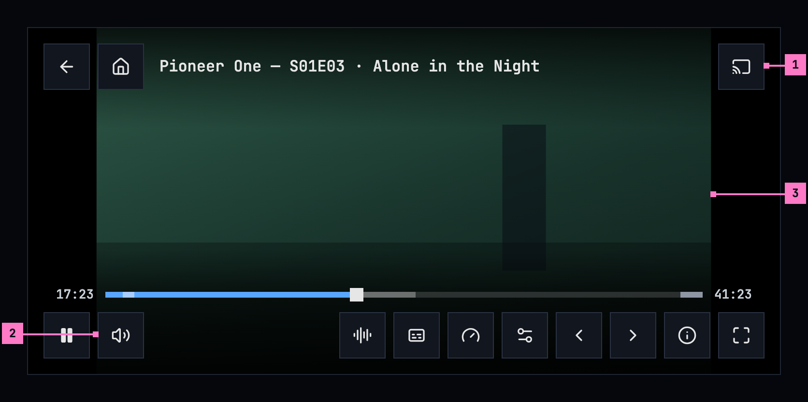
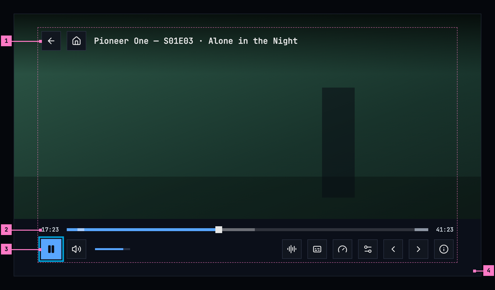
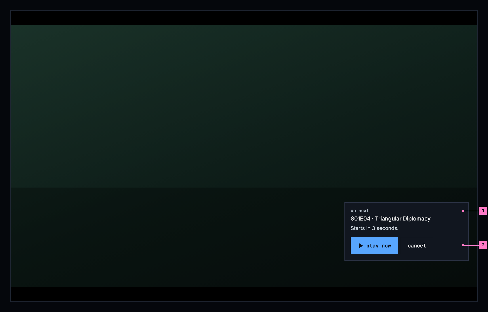
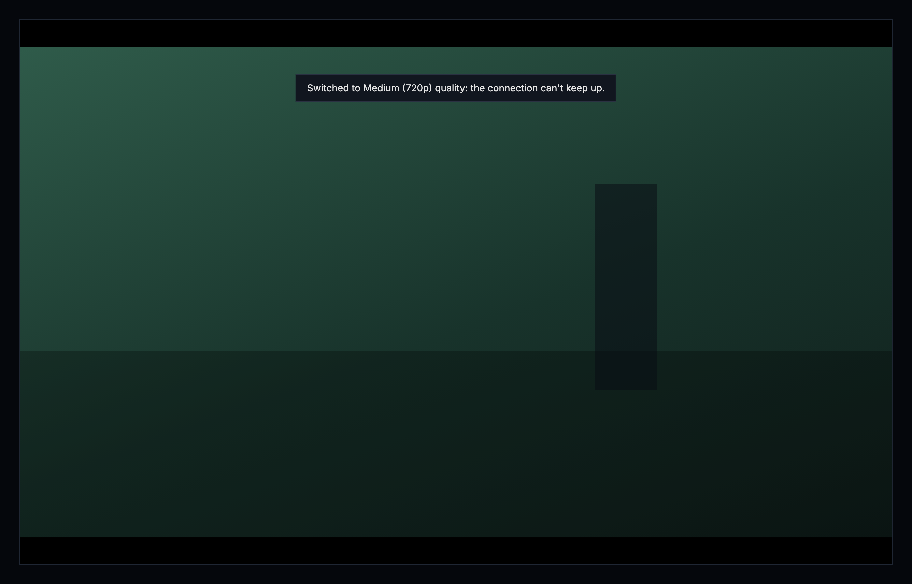
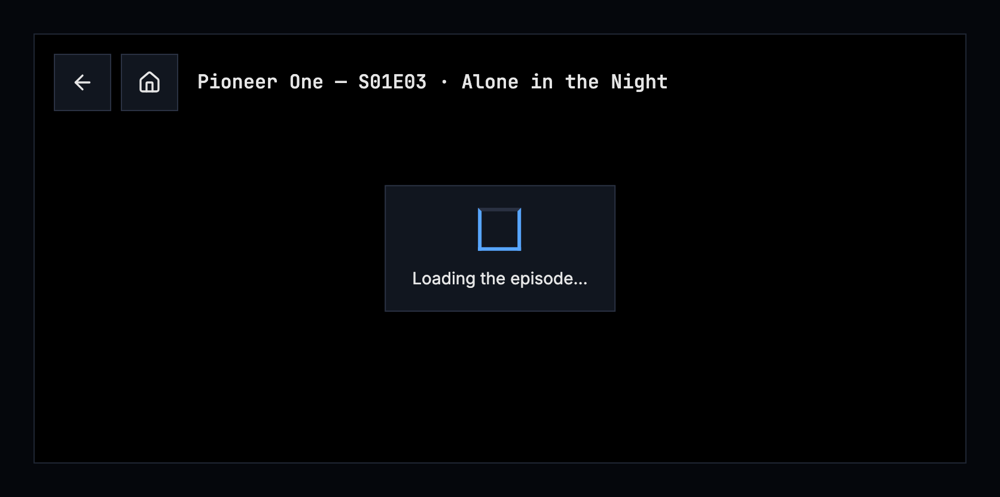
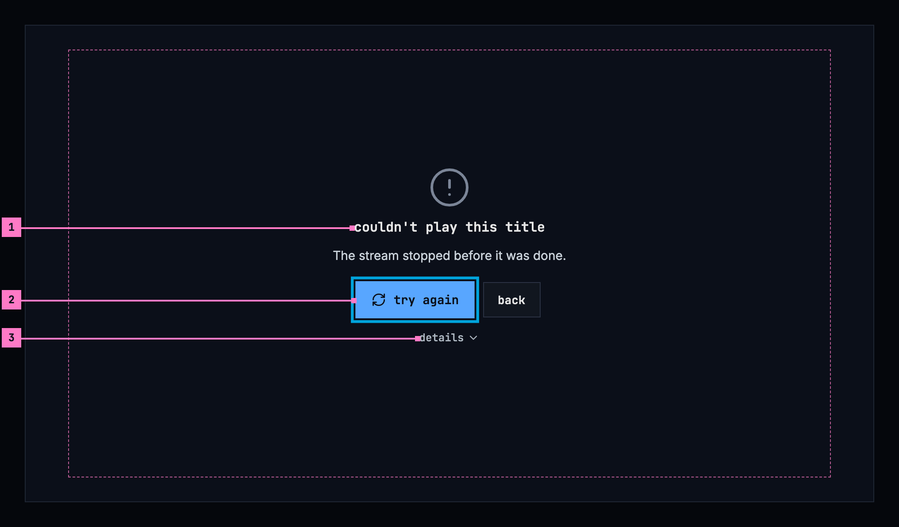

# 11 The player

This chapter specifies the player: what it shows and how its controls work, how
a title resumes and when it counts as finished, the qualities and their names,
the player's menus, the picture, and what the player says when it changes the
quality by itself. Subtitles have [chapter 12](./subtitles.md), and what a
screen says when something couldn't load or play, by cause, is in
[chapter 17](./errors.md). Every app follows the same rules, so a title resumes
and finishes the same way everywhere.

## 11.1 Purpose

The player plays a movie, an episode or a trailer. It shows the picture as
large as the screen allows and keeps its controls out of the way until they are
wanted. It opens from **play**, **resume** and **start over** on a title's page
([chapter 6](./title-actions.md)), from home ([chapter 4](./home.md)), and from
zap's **watch**, at the scene zap showed ([chapter 10](./zap.md)).

The player has no frame around it: no top bar, no tabs and no rail. Its own
top holds the way back.

## 11.2 The player on a computer

Figure 11.1 shows the player on a computer, with its controls showing. The
player fills the window; the frame's top bar isn't there.

Figure 11.1: The player on a computer, at 1280 × 800, with its controls
showing.

1. **The top: back, home and the title.** back returns to where the player
   was opened from, and home goes to home. The title names what plays: a movie
   by its name, an episode by its show, its code and its name, “Pioneer One —
   S01E03 · Alone in the Night”.
2. **The seek bar.** The time played is on its left and the title's length on
   its right. The bar shows what has played in blue, what is loaded ahead in a
   lighter grey, and the intro, a recap and the credits, where the server knows
   them, as stretches in a lighter tone of the bar under them; where the title
   has chapters, a thin tick marks where each one starts. Pointing at the bar
   shows a still of that moment above it, with its time and the part's or the
   chapter's name, “intro · 1:30”; a click or a drag seeks there.
3. **play or pause, and the volume.** The first button pauses while the title
   plays and plays while it doesn't. The speaker turns the sound off and on
   again, and the slider beside it sets how loud.
4. **The other buttons**, in this order: **audio**, where the title has more
   than one audio track; **subtitles** ([chapter 12](./subtitles.md)), blue
   while subtitles are on; **speed**; **quality**, where there are two or more
   qualities to choose from; **previous episode** and **next episode**, for an
   episode with one before or after it; **playback info**, what plays and how it
   reaches the screen; and **fullscreen**. Section 11.9 sets out the menus.
5. **The picture**, as large as the window allows, in its middle
   (section 11.10). Where the title has a picture area and filling the window
   would change the picture, **zoom to fill** comes before **fullscreen**.

The buttons are 48 × 48 squares on a solid surface, their icons alone. Each
one's name shows over it as a tooltip and is what a screen reader says;
section 11.14 lists them. Behind the top and the bottom, the picture darkens
towards the edge, so no time and no title stands on the bare picture.

The keyboard works without the controls: space or k plays and pauses, ← and →
go back and forward 10 seconds, ↑ and ↓ set the volume, m turns the sound off
and on, and f is fullscreen. Esc closes an open menu.

## 11.3 The player on a phone

Figure 11.2 shows the player on a phone held sideways, as most people watch.
The parts are those of figure 11.1; the numbers mark where the phone differs.

Figure 11.2: The player on a phone held sideways, at 780 × 360 dp.

1. **The cast button**, at the right of the top, where a device that can play
   is on the network ([chapter 14](./casting.md)).
2. **The volume.** The speaker opens a slider beside it and closes it again,
   so the bar has room for its buttons; the phone's own buttons set the volume
   as well.
3. **The picture.** A tap on it shows the controls, and a tap on the picture
   while they show hides them. Two fingers spread apart fill the screen with
   the picture and brought together fit it again (section 11.10).

The phone plays upright and sideways. Held sideways, the player hides the
phone's status and navigation bars, and a swipe from the edge brings them back
for a moment; **fullscreen** hides them upright too. On the seek bar, a touch
shows the still of that moment, and the seek happens where the finger lets go.

The web on a phone has the layout of figure 11.2 without **cast** and without
the slider: there, the speaker turns the sound off and on, and the phone's own
buttons set the volume.

## 11.4 The player on a TV

Figure 11.3 shows the player on a TV, with its controls showing. It fills the
screen, without the rail.

Figure 11.3: The player on a TV, at 960 × 540 dp, with its controls showing.

1. **The top**: back, home and the title, as on a computer.
2. **The seek bar.** With the focus on it, left and right go back or forward
   10 seconds at a time, with the still of that moment above the bar, and the
   title goes on from there.
3. **The focus.** Whenever the controls come back, the focus is on play or
   pause. Left and right move along the row, up and down between the row and
   the seek bar. A menu that closes gives the focus back to its button.
4. **The band**: one solid surface under the seek bar and the buttons, out to
   the screen's edges. The controls stay inside the safe area, with room for
   the focus ring. The TV has no fullscreen button: it is always full screen.

The remote works with the controls hidden too. Any key brings them back, and
some keys do more:

| Key | With the controls hidden | With the controls showing |
|---|---|---|
| OK | Pauses or plays | Presses the focused button |
| ← → | Back or forward 10 seconds | Moves the focus; on the seek bar, 10 seconds |
| ↑ ↓ | Only shows the controls | Moves between the seek bar and the row |
| back | Leaves the player | Closes an open menu first; then leaves the player |
| play, pause | Plays or pauses | The same |
| fast forward, rewind | Forward or back 10 seconds | The same |
| The remote's subtitles key, its audio key | Opens the subtitles menu, the audio menu | The same |

## 11.5 Showing and hiding the controls

The controls show when a title starts, and whenever the person moves the
mouse, touches the screen or presses a key. They hide again after 3 seconds
while the title plays and after 8 seconds while it is paused. They stay while
a menu is open, while the person drags the seek bar or the volume, and while a
screen reader's focus is on one of them, so it never loses the control it is
on. They come and go with a short fade; the subtitles rise above them while
they show and come back down when they hide ([chapter 12](./subtitles.md)).

## 11.6 Play, resume and a finished title

- A title people stopped part way shows **resume 1:43**, with **start over**
  beside it.
- A title stopped within its last 5% or its last 2 minutes, whichever is
  longer, counts as **finished**: it shows **play**, from the start, and the
  watched mark. For a short title, finished never starts before its second
  half.
- The server decides finished, once, so every app agrees. Continue watching
  drops a finished movie and moves a finished episode on to the next one.
- Removing a title from continue watching doesn't mark it as watched.

A trailer plays in the same player, with the same controls, from its start and
with its sound. It keeps no place, counts as nothing watched, has no subtitles,
no marked parts and no next episode, and at its end the player goes back to the
title.

## 11.7 Skip and up next

Where the server knows a title's intro, its recap and its credits, the player
helps past them.

- **skip intro**, **skip recap** and **skip credits**: while the title plays in
  one of those parts, a button at the bottom right, above the controls' place,
  jumps to its end. It is there whether the controls show or not.
- **Auto-skip intros**, a setting ([chapter 16](./settings.md)): on, the
  player skips the intro and a recap by itself on every episode after the first
  one watched in a row; the first keeps its intro.
- **up next**: in the credits of an episode that has another after it, a card
  takes the place of **skip credits**, as figure 11.4 shows.

Figure 11.4: Up next, in the credits of an episode, on a computer.

1. **The next episode**, by its code and its name, under the card's heading
   **up next**. With **Auto-play next episode** on ([chapter 16](./settings.md)),
   a line counts down, “Starts in 3 seconds.”, from the **Countdown** setting
   (3 seconds unless it was changed), and the next episode starts at its end.
   With the setting off, the card has no line and waits.
2. **play now** starts the next episode at once; **cancel** lets the credits
   play on and takes the card away. On a TV the card's buttons are focus stops
   like the controls' ones, and back is **cancel**.

### 11.7.1 Open

- **What auto-skip shows.** The web counts down in a card with “Skip now” and
  “Watch intro”, and Android TV skips at once and says “Skipped intro” with
  “Press BACK to watch from the start”. Recommendation: skip at once and say
  “Skipped the intro.” for a few seconds with **watch the intro**, because a
  count makes the person wait for what they asked to skip.

## 11.8 Quality names

The server names every quality, by one fixed table of heights, so a name means
the same picture size on every title and every installation. The apps show the
name as the server gives it.

A frame's height for naming is its step: its own height, or the height its width
stands for at 16:9, whichever is larger. A scope film of 1920 × 818 is 1080p,
like a 16:9 film of 1920 × 1080, because both are full HD.

| Height | Name |
|---|---|
| 2160p and up | “Ultra (2160p)” |
| 1080p | “High (1080p)” |
| 720p | “Medium (720p)” |
| 480p | “Low (480p)” |
| below 480p | “Lowest (360p)” |
| the original, played as it is | “Original” |

A step up to 10% above a standard height, in a frame no taller than it, or up
to 3% below it, counts as that height. The standard heights are 240, 360, 480,
540, 576, 720, 1080, 1440, 2160 and 4320. So frames cut a little wider or
narrower keep their name: 1916 × 800 and 2048 × 858 are “High (1080p)”. Any
other step takes the name of the table's next lower height, with its own number:
1024 × 576 is “Low (576p)”, 2560 × 1072 is “High (1440p)”, 1666 × 900 is “Medium
(937p)”, and a scope film's 720-line encode, 1728 × 720, is “Medium (972p)”. A
re-encode at the original's size is named by its step like any other.

## 11.9 The player's menus

Figure 11.5 shows three of the player's menus; the subtitles menu is in
[chapter 12](./subtitles.md).

- Subtitles, audio, quality and speed are menus of one choice each. They show
  no checkboxes and no check marks: the picked row is in the accent blue, with a
  small filled square before it, square like every shape in the design system.
  Every row keeps the square's column, so the names line up whether picked or
  not.
- An audio track names its channels in words: “Stereo”, “5.1”, “7.1”, “Mono”,
  never “2ch”.
- Their headers are lowercase: “subtitles”, “audio”, “quality”, “speed”, and
  “timing” for the subtitles' timing, whose button is “reset”.
- Controls over the picture, such as a chip, sit on a solid surface, never on a
  see-through one.

Figure 11.5: The quality, audio and speed menus, each with its picked row in
blue.

A title that plays from the server's ready-made qualities starts its quality
menu with **Auto**, which picks the quality by the connection and names the
one playing: “Auto · Medium (720p)”. The speed menu offers 0.5x, 0.75x,
**normal**, 1.25x, 1.5x, 1.75x and 2x. One menu is open at a time. It opens
above the whole control bar, at the end where its button is, so it never covers
the seek bar, and a pick, a press outside it or Esc closes it. On a TV the focus
goes into the open menu, and back closes it.

## 11.10 The picture

The player shows a title's picture, not its frame. Many files keep a whole 16:9
frame with the picture inside it and black bars baked in: above and below a
2.39:1 film, at the sides of a 4:3 show. On a screen of another shape the
picture would float in black on all four sides. The server says where the
picture is: the play info's picture area (`pictureArea`), the part of the frame
the picture takes over the whole title, as fractions of the frame's width and
height, so the same for every quality. It leaves it out where it doesn't know,
or where the picture is the whole frame.

- **Fit**, unless the person zooms: the picture as large as the screen allows,
  in its middle. The bars are cropped where they would show; the picture
  never is. Without a picture area, the whole frame fits, as before.
- **The camera's cutout**: held sideways, a phone's cutout or notch takes a
  band at one side. The fitted picture keeps out of a band as wide on both
  sides, so it stays in the middle; only the sides count, so upright, with the
  cutout over the bars at the top, the picture keeps its place. Fill covers
  the band where the app draws there (Android 15 and later; the web where the
  page reaches under the notch). The subtitles keep out of it either way.
- **Fill**: the picture covers the whole screen, its edges cropped. Only on a
  screen wider than tall, and only where it is larger than fit; upright, the
  picture always fits. The web offers it only for a title with a picture area;
  on Android a pinch fills any title.
- **Zooming**: in the Android app, two fingers spread apart fill the screen
  and brought together fit it again; the picture follows them and settles at
  one or the other when they lift, and TalkBack has the same as an action on
  the picture, “zoom to fill” or “zoom to fit”. On the web, the button **zoom
  to fill** beside fullscreen, shown only where fill changes the picture of a
  title with a picture area. The iOS app and the TV fit the whole frame, as
  before: on a 16:9 TV that is the same picture for a letterboxed or a
  pillarboxed title, and a windowboxed one keeps its bars there.
- **Remembered** on the device, for the titles it suits: a fill chosen on one
  title starts the next one filled only where that title has a picture area
  and fill crops at most a tenth of its picture's width and of its height - a
  scope film on a phone held sideways or on a 21:9 screen. Any other title
  starts fitted, and a fill chosen on it is for that title alone.

Subtitles go with the picture ([chapter 12](./subtitles.md)): nothing of them
is ever cropped.

## 11.11 When the quality changes by itself

When playback has to step down, the player says what it did and why, at the top
of the picture, on a solid surface, as figure 11.6 shows. {label} is the
quality's name from the table in section 11.8: “Medium (720p)”, “Low (480p)”.

Figure 11.6: The player stepped down, on a computer.

- From the original, when the connection is too slow: “Switched to {label}
  quality: the connection can't keep up with the original.”
- When the original can't be streamed: “Switched to {label} quality: the
  original couldn't be streamed.”
- One step down between qualities: “Switched to {label} quality: the
  connection can't keep up.”
- When a quality between can't be streamed: “Switched to {label} quality:
  {previous} couldn't be streamed.”, {previous} named from the same table:
  “Switched to Low (480p) quality: Medium (720p) couldn't be streamed.”

It keeps the position. Status codes go into the playback report, never into
the line.

## 11.12 The audio setting

Settings has one audio language, “Original” or a language, with this text under
it, the same in every app:

> Titles play with audio in the language you pick here, where they have it.
> With Original, each title plays in the language it was made in. A choice in
> the player applies only to what's playing now.

## 11.13 States

The player is drawn in figures 11.1 to 11.3 while a title plays. Figures 11.7
and 11.8 show the states in between.

Figure 11.7: A title starting, on a phone.

While a title starts, the player shows nothing for the first 0.4 seconds, and
after that the design system's loader in the middle, on a solid surface, with
one line that says what is loading: “Loading the episode…”, “Loading the
movie…” or “Loading the trailer…”. The top is there from the start, so back
works while it loads. Later waits use the same panel, with a line for what the
player does: “Reconnecting…”, “Switching to Medium (720p)…”, “Switching
audio…”, “Skipping a part that couldn't be played…”, “Trying again…”. The
picture under the panel isn't dimmed.

Figure 11.8: A title that couldn't be played, on a TV.

1. **What couldn't happen, and why.** “couldn't play this title”, with the
   reason by cause under it, here that the stream stopped before the title was
   done. Where the request for the stream fails, the sentence is the one
   [chapter 17](./errors.md) gives for its cause; what only playback has, as
   here, is listed in this chapter's states.
2. **try again** has the focus and starts the title again where it stopped;
   where trying again can't help, as for a title the server doesn't let the
   account play, **back** is the only button.
3. **details** opens the code that tells the cases apart, for the people who
   fix things.

| State | What the player shows |
|---|---|
| Starting | Figure 11.7 |
| Waiting while it plays | The panel of figure 11.7 with the line for what it does, over the picture |
| The quality changed by itself | Figure 11.6, with the line of section 11.11 |
| Couldn't play | Figure 11.8, with the sentence for the cause |
| The title isn't in the library anymore | “this title isn't in the library anymore”, with **back** ([chapter 17](./errors.md)) |
| A trailer that isn't there | “trailer not available”, with a link to the title's trailer online where it has one |
| The browser wouldn't start the title by itself (the web) | **play** in the middle, which starts it with its sound |
| The browser started it without sound (the web) | **unmute** at the top, until it is pressed |

### 11.13.1 Open

- **A line while a title starts.** The web shows the loader alone while a
  title starts; the design system gives a player's loader one line that says
  what is loading. Recommendation: the line, as in figure 11.7, because it
  tells a title starting from a player that hangs.
- **report a bug on the failure screen.** The web and the phone app add
  **report a bug** as a third button beside **try again** and **back**, where
  the design system allows one quiet button beside the emphasized one.
  Recommendation: put **report a bug** under **details**, where the code it
  sends is.

## 11.14 Words

| Where | Text |
|---|---|
| The top | the buttons back · home; the title “Tears of Steel”, an episode “Pioneer One — S01E03 · Alone in the Night” |
| The buttons' names, over them and for a screen reader | play · pause · volume · audio · subtitles · speed · quality · previous episode · next episode · playback info · zoom to fill · zoom to fit · fullscreen · exit fullscreen; the cast button's are Google's ([chapter 14](./casting.md)) |
| The seek bar | “17:23” and “41:23”; over the still “intro · 1:30”, “recap · 0:40”, “credits · 39:50”; for a screen reader “seek”, “17:23 of 41:23” |
| The menus' headers | subtitles · audio · quality · speed · timing |
| The menus' rows | Original · Auto · “Auto · Medium (720p)” · the names of section 11.8 · “English · 5.1”, “English · Stereo” · 0.5x · 0.75x · normal · 1.25x · 1.5x · 1.75x · 2x · reset |
| Skip and up next | skip intro · skip recap · skip credits · up next · “S01E04 · Triangular Diplomacy” · Starts in 3 seconds. · play now · cancel |
| The quality notices | the four lines of section 11.11 |
| Waiting | Loading the episode… · Loading the movie… · Loading the trailer… · Reconnecting… · Switching to Medium (720p)… · Switching audio… · Skipping a part that couldn't be played… · Trying again… |
| Couldn't play | couldn't play this title · the sentence for the cause · try again · back · details |
| A trailer that isn't there | trailer not available |
| The web only | play · unmute |
| The audio setting | the text of section 11.12 |

## 11.15 Today's apps

| App | What differs from this chapter |
|---|---|
| Web | The buttons are 36 × 36 px. Their tooltips are capitalised, and some say more: “Back”, “Home”, “Pause”, “Mute”, “Subtitles”, “Quality (High (1080p))”, “Playback speed (normal)”, “Next episode: S01E04 — Triangular Diplomacy”, “Playback info”, “Zoom to fill”, “Fullscreen”. audio is a chip with the playing language's code, “ENG”; quality is a gear and comes before speed. The seek bar's parts are coloured: the intro blue, the credits amber, a recap green, a sponsor red; over the still they are capitalised, “Intro · 1:30”. The audio, quality and speed menus have rounded corners and open right above their buttons, over the seek bar. The skip buttons are white and read “Skip Intro”, “Skip Recap”, “Skip Credits”; up next reads “UP NEXT”, “Play now (8)” and “Cancel”, and after the credits' preview “NEXT EPISODE” and “Next episode in 8s”. A title starting shows the loader alone. Couldn't play is titled “playback failed”, with **report a bug** beside **try again** and **back**. |
| Phone app | The controls hide after 4 seconds while the title plays. audio is a chip with the language's code, there for a title with a single track too. cast sits in a circle. The skip buttons read “Skip Intro”, “Skip Recap”, “Skip Credits”; up next reads “Up next”, “Playing next episode in 8s”, “Play now” and “Cancel”, and after the credits' preview “Next episode” and “Dismiss”. A title starting shows a spinner alone. Couldn't play has a third button, **Report a bug**, where the server takes reports. The iOS app adds picture in picture and AirPlay to the bar. |
| Android TV | The seek bar's parts are coloured: the intro amber, a recap grey, the credits red. A title starting says “Preparing…”. Auto-skip and up next are a corner note instead of buttons: “Skipping intro in 5s” or “Up next in 5s” over “Press BACK to cancel”, “Next episode ▶ in 5s” after the credits' preview, and “Skipped intro” over “Press BACK to watch from the start”. A title that can't be played shows the player's error in red, with **report this problem**, and no **try again**. |
| Samsung TV | All controls are at the bottom: the title with its episode code above the seek bar, then back, back 10 seconds, play or pause, forward 10 seconds and next episode, and audio, subtitles and quality at the right, quality with the gauge. It has no home, volume, speed, previous episode or playback info. A title starting says “Preparing your title…” or “Preparing the trailer…”, and “Buffering…” while it waits. Auto-skip counts down, “Skipping intro in 5…”, with “Press any key to cancel”. Fast forward and rewind move 30 seconds. It shows none of the quality notices of section 11.11. |
