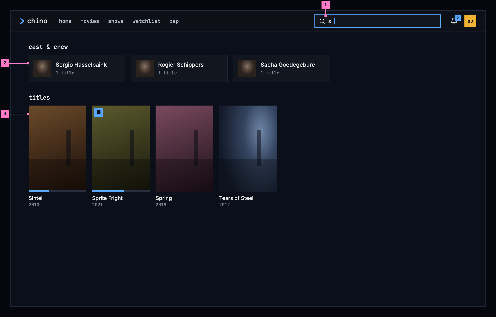
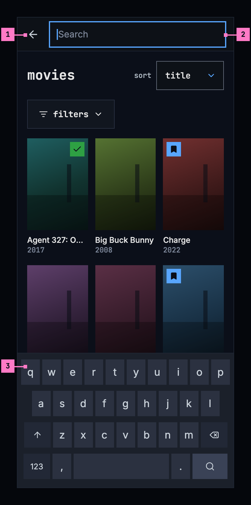
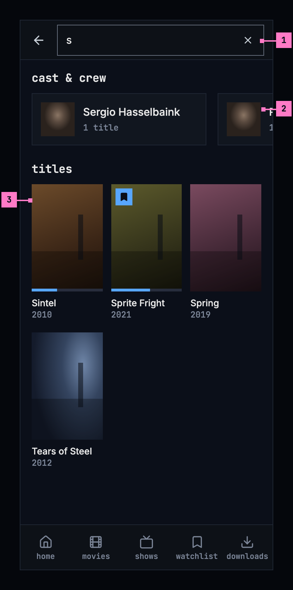
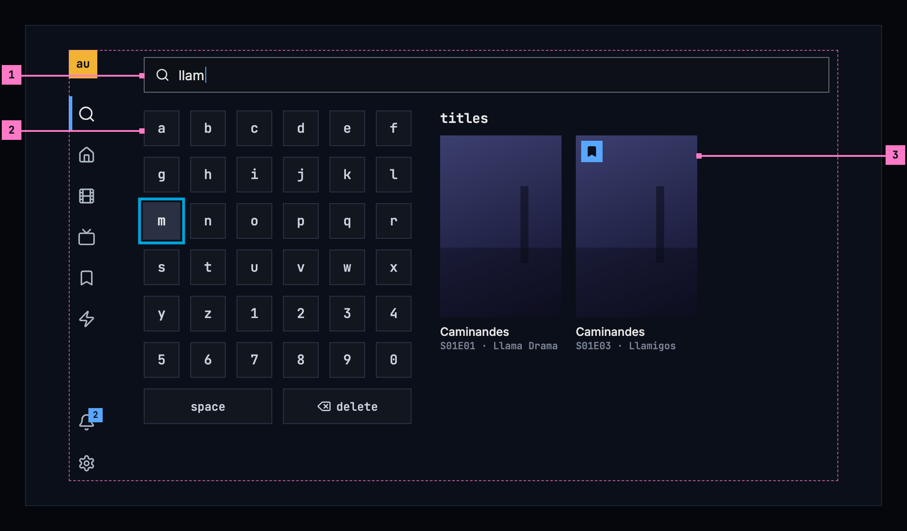
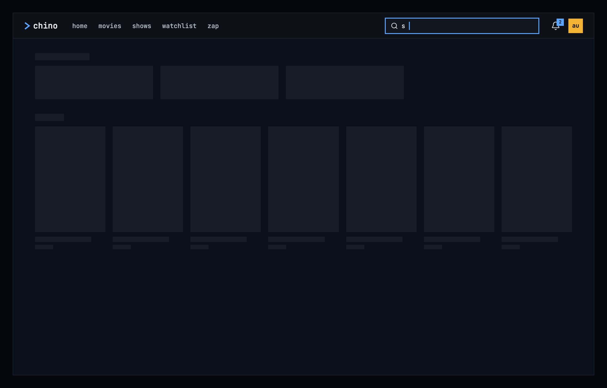
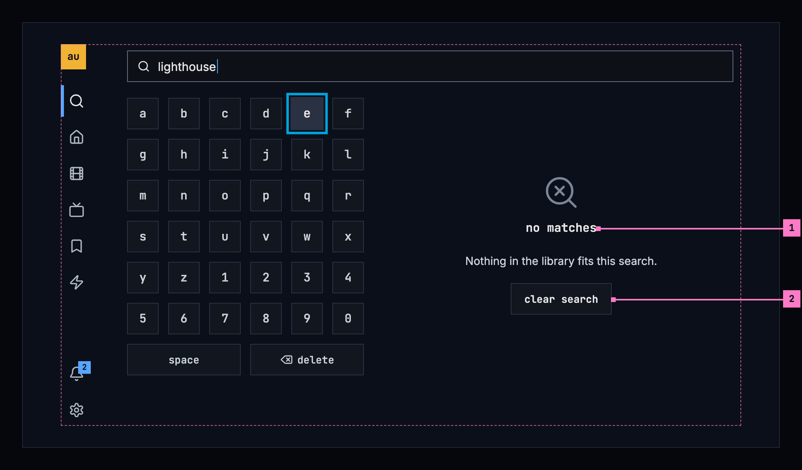

# 9 Search

This chapter specifies search: the one search of the library, in the frame,
and what it finds. The frame that holds it is specified in
[chapter 2](./frame.md).

## 9.1 Purpose

Search finds a title or a person by name, from anywhere in the app. There is
one search, always in the same place: the field in the top bar on a computer,
an icon in the top bar on a phone, and the search view at the top of the rail
on a TV. The results show as people type, with no key to press, and lead to a
title's page ([chapter 6](./title-actions.md)) or a person's
([chapter 7](./person.md)).

## 9.2 Search on a computer

Figure 9.1 shows search on a computer, after the person typed one letter.

Figure 9.1: Search on a computer, at 1280 × 800.

1. **The field** in the top bar. Its placeholder says what it finds, “Search
   movies, shows and people”, and the / key puts the focus in it from
   anywhere, except while the person is typing in another field. As soon as it
   holds a letter, the results take the page's place, and no view in the bar
   is current.
2. **cast & crew**: the people whose names match, in one line of cards. A card
   shows the photo, or the initials where the catalog has no photo, the name,
   and how many of their titles the library has: “1 title”. It opens the
   person's page ([chapter 7](./person.md)).
3. **titles**: the movies, shows and episodes that match, in one grid, the best
   match first, whatever its kind. The cards are those of movies and shows
   ([chapter 5](./browse.md)), with their status marks.

Esc in the field empties it and brings back the page the person was on, and so
does choosing a view in the bar. The address holds the words, so a reload, or
back from a result, brings the same results back.

## 9.3 Search on a phone

Figure 9.2 shows what the search icon in the top bar opens
([chapter 2](./frame.md)), before the person types.

Figure 9.2: The search opened on a phone, at 360 dp.

1. **The back arrow** closes the search and gives the bar back, with the page
   as it was.
2. **The field** takes the whole width of the bar, and the focus. Its
   placeholder is “Search”: at 320 dp, the narrowest phone, the computer's
   “Search movies, shows and people” would be cut off.
3. **The phone's own keyboard** comes up with the field. Until the first
   letter, the page under the field stays as it was.

Figure 9.3 shows the results. The keyboard's search key has closed the
keyboard, and the results stay.

Figure 9.3: Search on a phone, at 360 dp.

1. **×** empties the field and brings the page back. The field stays open,
   with the keyboard, for other words.
2. **cast & crew** is one line that scrolls sideways, with a card and a part of
   the next in view, so the people never push the titles far down.
3. **titles**, three to a line, as in movies and shows.

The tabs stay under the results, with none of them current, and a tab closes
the search and opens its view. The web on a phone works as figures 9.2 and
9.3 show, with its own tabs.

## 9.4 Search on a TV

Figure 9.4 shows the search view, opened from the rail, after the person typed
“llam”.

Figure 9.4: Search on a TV, at 960 × 540 dp.

1. **The field** shows what is typed. It takes no focus of its own: the
   keyboard types into it.
2. **The keyboard**: the letters a to z and the digits 0 to 9 in six columns,
   then **space** and **delete**. The view opens with an empty field and the
   focus on **a**; OK on a key types it. Right from the keyboard's last column
   goes into the results, left from their first column back to the keyboard,
   and left from the keyboard's first column opens the rail.
3. **An episode that matches** shows as its show's card, with the episode
   under the name: “S01E03 · Llamigos”. OK opens the show's page on that
   episode ([chapter 6](./title-actions.md)). Two episodes of one show make two
   cards, as here.

The results sit beside the keyboard, so they change in view as the person
types. Back leaves the search for the view the person came from. The same
keyboard types a list's name on a TV ([chapter 8](./watchlist.md)).

### Open

- **The TV's keyboard.** Android TV brings up the system's keyboard over the
  page, which hides the results while people type, and the Samsung TV has none
  for an app. Recommendation: the app's own keyboard in the page on both TVs,
  as drawn, so the results show beside it.

## 9.5 What search finds

### 9.5.1 Matching and order

- Search looks at the names of movies, shows and episodes, and at people's
  names, from the first letter. A quarter of a second after the last key it
  searches again, and the results change in place.
- The titles are one list, ranked together by how well they match: a name
  that is the words typed, then one that begins with them, then one that holds
  them, then one spelled close to them. A title's description counts only when
  no name matches. People are ranked apart, the same way.
- Up to 60 titles and 12 people show, the best first.
- An episode shows as its show's card, with its code and name under the
  show's name, “S01E01 · Llama Drama”. When the show's own name matches as
  well, its card and the episode's are one.
- As the results change, a screen reader says how many there are:
  “3 people, 4 titles”, or “no matches”.

### 9.5.2 Opening a result, and leaving

- A result opens its page: a movie's or a show's page, a show's page on the
  episode that matched, or a person's page. Back returns to the results as
  they were, with the words in the field.
- Search closes with Esc or a view in the bar on a computer, with the back
  arrow or a tab on a phone, and with back on a TV.

### Open

- **The results in the page, or under the field.** The design system's
  [top bar](https://nalet.github.io/design-system/patterns/top-bar/) shows a
  short list under the field as people type, and so does the web today, with
  Enter opening all the results. Recommendation: one place for the results at
  every size, the page, as drawn, because posters and people need the room,
  and the phone and the TV have no other place for them.

## 9.6 States

Figures 9.1 to 9.4 show search with results. Figures 9.5 and 9.6 show the
states in between.

Figure 9.5: Search loading, on a computer.

The first results for new words show nothing for the first 0.4 seconds, and
after that grey blocks in the shape of a line of people and a line of posters,
as the design system's
[loading and progress](https://nalet.github.io/design-system/patterns/loading-and-progress/)
describes. Typing on, the results that are there stay at full strength, with a
thin blue line running along their top until the new ones are in, so the page
doesn't flicker with every key.

Figure 9.6: A search that matches nothing, on a TV.

1. **no matches**: the design system's no-match state, with “Nothing in the
   library fits this search.” under it, in the results' place. The words stay
   in the field, so the person can change a letter instead of starting over.
2. **clear search** empties the field, the state's one way out. On a TV it
   spares deleting the words key by key, and the focus goes to **a**; on a
   computer and a phone the focus goes to the field.

| State | What search shows |
|---|---|
| Nothing typed | On a computer and a phone, the page as it was (figure 9.2); on a TV, the keyboard with nothing beside it |
| Loading | Figure 9.5 |
| Typing on | The results stay, with a thin blue line running along their top |
| Only people, or only titles, match | That group alone, without the other's heading |
| No matches | Figure 9.6. Where an addon on the server adds buttons for a search that found nothing, they follow under it |
| Couldn't search | “couldn't search the library”, the reason and **try again** in the results' place; the words stay in the field. [Chapter 17](./errors.md) lists every cause and its sentence |
| The phone app can't reach the server | The banner of [chapter 13](./downloads.md), and under it “couldn't search the library” with **try again**, without the sentence, which the banner already says |

## 9.7 Words

| Where | Text |
|---|---|
| The field's placeholder on a computer and a TV | Search movies, shows and people |
| The field's placeholder on a phone | Search |
| The phone's buttons, for screen readers | search · close search · clear search |
| The groups | cast & crew · titles |
| A person's card | Sergio Hasselbaink · 1 title · 4 titles |
| A title's card | the name, and the year: 2010 |
| An episode's card | the show's name, and “S01E01 · Llama Drama” |
| The TV's keyboard | a–z · 0–9 · space · delete |
| What a screen reader says as the results change | 3 people, 4 titles · no matches |
| No matches | no matches · Nothing in the library fits this search. · clear search |
| Couldn't search | couldn't search the library · Can't reach the server. · try again |

## 9.8 Today's apps

No app shows episodes yet: they ask the server for movies and shows only.

| App | What differs from this chapter |
|---|---|
| Web | The field's placeholder is “Search movies, shows…”. From the second letter it opens a list under the field of up to eight movies and shows, without people, and Enter opens the results page, headed “5 results for "s"” with people and titles counted together, “Searching for "s"…” while it loads and “No results for "s"” when nothing matched. The people are headed “CAST & CREW”, as cards in a grid of up to three columns, each saying “· 1 title”. With nothing typed, the page says “Search the library” and “Type a movie or show title in the search bar to look it up.” A failed search is headed “couldn't search for "s"”, with the reason and **try again**. |
| Phone app | The field is always open in the top bar, in the place of the product's name and the search icon, with the placeholder “Search movies, shows…”. The results replace the page, headed “4 results for "s"”, counting the titles only, or “No results for "s"”; choosing a tab keeps them until the field is emptied. “Cast & crew” lists the people one under the other, each with “· 1 title”, and up to 40 titles follow. A failed search says “couldn't load the results”. |
| Android TV | The field sits in the top bar of the search view and is typed with the system's keyboard. With nothing typed, the view says “Search the library” and “Type a movie or show title to look it up.”; while it searches, “Searching for “s”…”. The titles are headed “4 results for “s””, “No matching titles.” when only people matched, and nothing at all is “No results for “s””. A failed search says “Search failed” with the error's own message, and offers no **try again**. |
| Samsung TV | The field is a button that opens a keyboard over the whole screen, which hides the results while people type: rows from 1 to 0, q to p, a to l with @, z to m with . - /, a row of signs, then wide keys for space, delete and done, drawn as icons. With nothing typed, it says “Search the library” and “Open the keyboard to look up a movie or show title.” The people are headed “Cast & crew”. A failed search says “Search failed” with the error's own message, and offers no **try again**. |
