# 16 Settings and account

This chapter specifies settings and the account: what can be set, who is signed
in, signing out, removing an account from a device, deleting it, and reporting
a bug. The frame around these screens is in [chapter 2](./frame.md); connecting
to a server and signing in are in [chapter 3](./start.md).

## 16.1 Purpose

Settings hold what a person sets once and then forgets: the languages titles
play in, how episodes follow one another, and on a phone how titles download.
The account page says who is signed in, and it is where the person signs out
or deletes the account.

Neither is a view of its own. On a computer and a phone, both open from the
avatar's menu ([chapter 2](./frame.md)); on a phone they open as screens with a
back arrow and their name in place of the bar. On a TV, settings is the last
item of the rail, and the account page is the first row of settings.

A setting applies the moment it changes, as the design system's
[forms and settings](https://nalet.github.io/design-system/patterns/forms-and-settings/)
has it for switches: there is no save button. Settings are kept on the device,
for everyone who watches on it.

## 16.2 Settings

### 16.2.1 On a computer

Figure 16.1 shows settings on a computer: the heading, then the groups in two
columns, each a heading over a card.

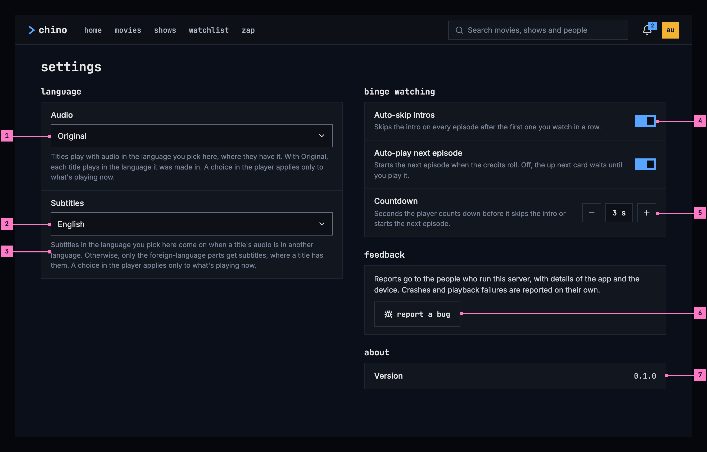

Figure 16.1: Settings on a computer, at 1280 × 800.

1. **Audio**, the language titles play in: “Original” or a language (section
   16.3.1).
2. **Subtitles**, the language subtitles come on in: “off” or one of the
   server's subtitle languages (section 16.3.1).
3. **The text under a setting** says what it does. The two language settings
   have the same text in every app, the audio's from
   [chapter 11](./playback.md) and the subtitles' from
   [chapter 12](./subtitles.md).
4. **A switch** applies at once, with nothing to save, and says what it does in
   the line under its name (section 16.3.2).
5. **The countdown**, in seconds, with − and + on either side.
6. **report a bug**, only where the server takes reports (section 16.3.5).
7. **Version**, the app's version (section 16.3.6).

### 16.2.2 On a phone

Figure 16.2 shows settings on a phone, where they open as a screen of their
own. The groups of figure 16.1 come one under the other; the numbers mark what
differs.

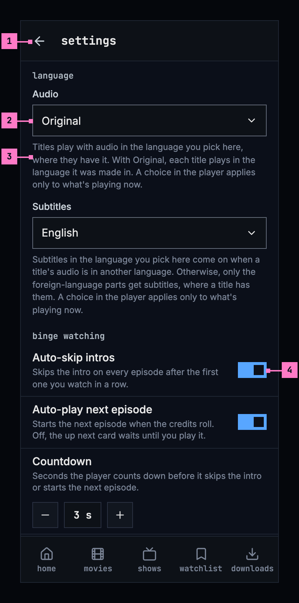

Figure 16.2: Settings on a phone, at 360 dp.

1. **The back arrow** goes back to the screen settings were opened from. The
   tabs stay, as [chapter 2](./frame.md) describes.
2. **A language field** opens a menu of one choice under it, inside the page and
   as wide as the field. The chosen language is in the accent blue, with a
   small filled square before it, as in the player's menus
   ([chapter 11](./playback.md)). A long menu scrolls within itself.
3. **The text** under the field, as on a computer.
4. **The switches** sit at the end of their rows, and a tap anywhere on the row
   flips them.

Figure 16.3 shows the end of the page, which on a phone holds two groups more.

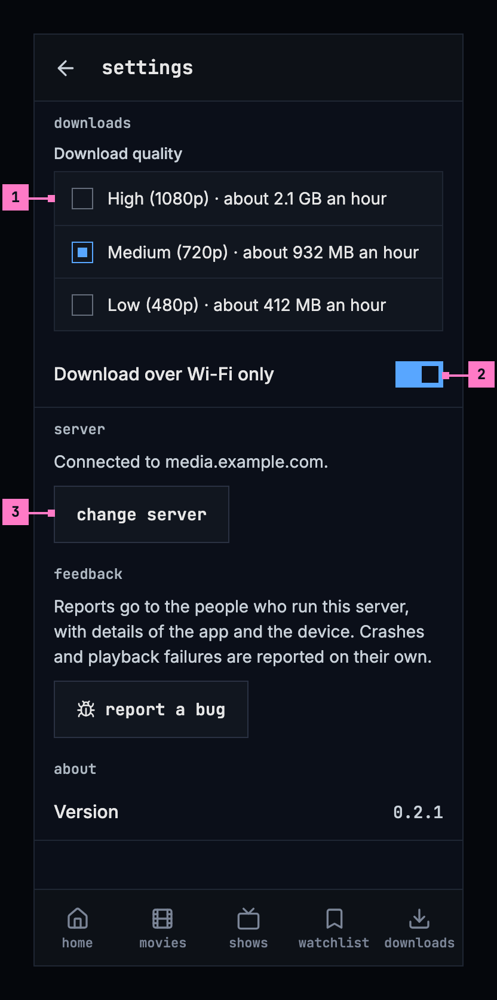

Figure 16.3: Settings on a phone, further down.

1. **downloads**: the quality titles download in, each with what an hour takes
   at it, as [chapter 13](./downloads.md) specifies. The group shows only where
   the phone keeps downloads and the server offers them.
2. **Download over Wi-Fi only**, on until it is switched off
   ([chapter 13](./downloads.md)).
3. **server**: the server the app is connected to, and **change server**
   (section 16.3.4).

The groups **feedback** and **about** follow, as on a computer. The web on a
phone has the layout of figure 16.2, without downloads and server.

### 16.2.3 On a TV

Figure 16.4 shows settings on a TV, opened from the rail. Right moves the focus
onto the page, and up and down go from row to row.

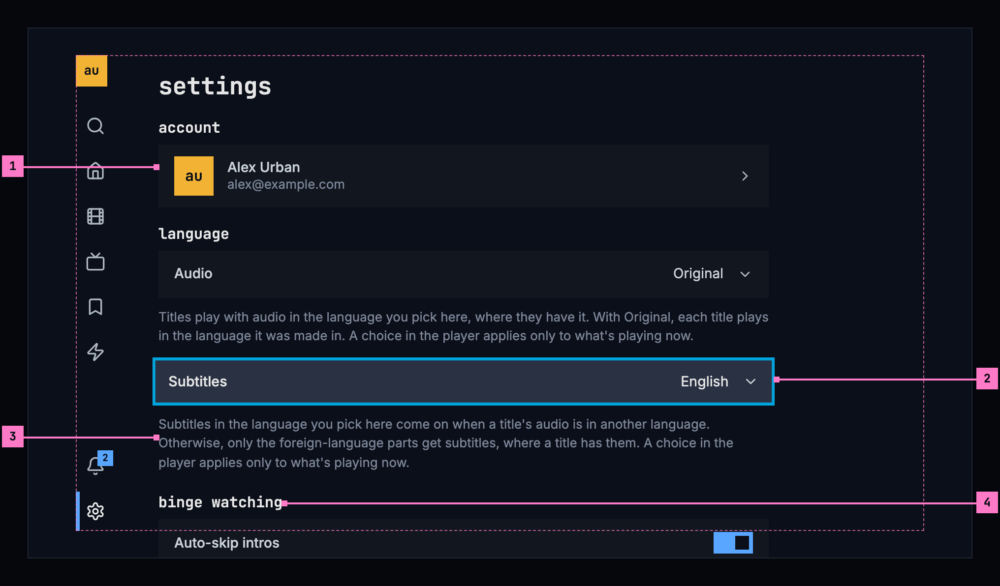

Figure 16.4: Settings on a TV, at 960 × 540 dp.

1. **account**: who is signed in. OK opens the account page (section 16.4.3).
   A TV has no avatar's menu, so this row is its way to the account.
2. **A row with a language** shows what is set. OK opens its menu of one choice
   over the page, in the look of the player's menus, with the setting's
   language focused; picking one closes it, and so does Back.
3. **The text** under the row, as on a computer.
4. **binge watching** and the groups after it follow below. The page scrolls as
   the focus goes down, and OK flips a switch.

A TV has no downloads: server, feedback and about follow binge watching, as on
a phone.

## 16.3 What settings holds

### 16.3.1 Language

Two settings, one for the audio and one for the subtitles. Each has a text
under it that is the same in every app.

**Audio** offers “Original”, then every language by name, as no server names
the languages of its audio. With “Original”, each title plays in the language
it was made in. Its text, from [chapter 11](./playback.md):

> Titles play with audio in the language you pick here, where they have it.
> With Original, each title plays in the language it was made in. A choice in
> the player applies only to what's playing now.

**Subtitles** offers “off”, then the server's subtitle languages, read from its
configuration as the player's subtitles menu reads them
([chapter 12](./subtitles.md)); a server that names none offers every language
by name. Its text, from [chapter 12](./subtitles.md):

> Subtitles in the language you pick here come on when a title's audio is in
> another language. Otherwise, only the foreign-language parts get subtitles,
> where a title has them. A choice in the player applies only to what's playing
> now.

Where every language is offered, the person's own come first: the one set, and
the language of the device or the browser. All the others follow in
alphabetical order. Each language has the name the player's menus give it,
“German”, “Chinese (Simplified)”, and a language set before that the list no
longer has stays in it, so the setting always shows what is set.

While the server's subtitle languages load, the subtitles field is a grey
block; when they couldn't load, the reason and **try again** take its place
(figure 16.13).

### 16.3.2 Binge watching

| Setting | The line under it | At first |
|---|---|---|
| Auto-skip intros | Skips the intro on every episode after the first one you watch in a row. | on |
| Auto-play next episode | Starts the next episode when the credits roll. Off, the up next card waits until you play it. | on |
| Countdown | Seconds the player counts down before it skips the intro or starts the next episode. | 3 seconds, from 1 to 15 |

What the player skips, its countdown and its up next card are specified in
[chapter 11](./playback.md).

### 16.3.3 Downloads

On a phone, settings hold the download quality and **Download over Wi-Fi
only**, as [chapter 13](./downloads.md) specifies; figure 16.3 shows them. The
group shows only where the phone keeps downloads and the server offers them.

### 16.3.4 Server

The phone and TV apps say which server they are connected to: “Connected to
media.example.com.” **change server** opens the screen of
[chapter 3](./start.md) headed **change server**, with the address of the server
connected now in its field, and **cancel**. Once the new server has answered,
the app asks first where something would be lost (section 16.4.4), then signs
every account on the device out and opens sign in on the new server. The web
has no server group: it belongs to the server it comes from.

### 16.3.5 Report a bug

The group **feedback** shows only when the server takes reports, which its
configuration says. Without it, the group isn't there at all, so the app never
offers a report that goes nowhere. Its text says who receives the reports and
what goes with them: “Reports go to the people who run this server, with
details of the app and the device. Crashes and playback failures are reported
on their own.”

**report a bug** opens the dialog of figure 16.5.

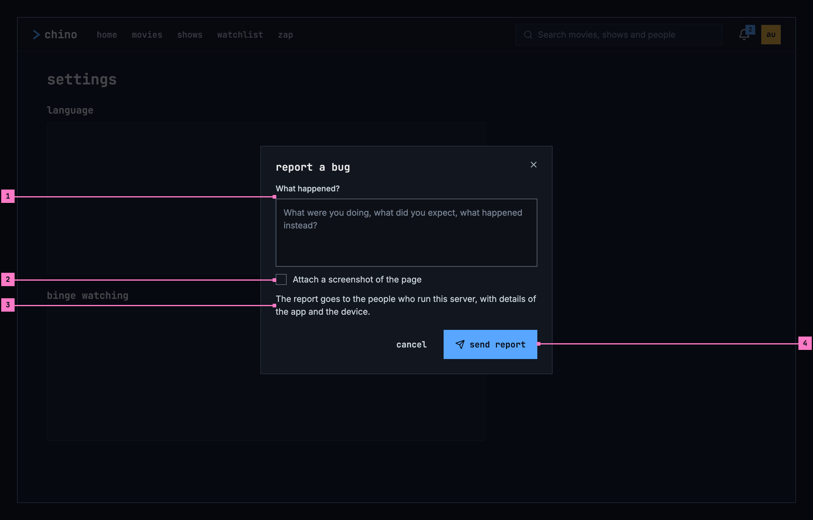

Figure 16.5: Report a bug, on a computer.

1. **What happened?** holds the person's own words, and the report needs them:
   sent without any, the field says “Describe what happened to send the
   report.” It opens empty.
2. **Attach a screenshot of the page** is off until it is ticked, and only the
   tick takes the screenshot: of the screen under the dialog, without the
   dialog. A small preview then shows under the box, with **retake**. On a
   phone it says “Attach a screenshot of the screen”.
3. **Who receives the report**, and what goes with it.
4. **send report** is busy while the report goes, and then the dialog says it
   went (figure 16.15).

When the report couldn't be sent, an error banner over the buttons says why, by
cause, and the words stay: “Couldn't send the report. Can't reach the server.”
A server that has stopped taking reports since says “Bug reporting is switched
off on this server, so this report can't be sent.”

The same dialog opens from the player when a title won't play
([chapter 17](./errors.md)). What the player knows of the failure is then under
**details** in the dialog: it goes with the report, but never into the box the
person types in.

On a TV, typing with a remote is slow, so the dialog asks for no words. Under
its heading, “What's going wrong? Pick the closest match.”, it lists **playback
won't start**, **video stutters or freezes**, **audio out of sync**,
**subtitles wrong or missing**, **the app is slow** and **something else**; OK
on one sends the report, with that as its title.

### 16.3.6 About

**about** holds the app's version, so the person can tell the people who run
the server which one they have when something goes wrong.

### Open

- **The long language list on a TV.** Where every language is offered, the
  audio always and the subtitles on a server that names none, a TV's language
  menu holds every language the platform has a name for, scrolled with a
  remote; the proposal, not approved, is the person's languages first and the
  rest under **more languages**, as the player's subtitles menu has it
  ([chapter 12](./subtitles.md)). Recommendation: take it, on every device, so
  the settings and the player's menus work alike.

## 16.4 The account

The account page says who is signed in, holds what ends a sign-in, and lists
what the person has watched. On a computer and a phone, **account** in the
avatar's menu opens it; on a TV, the first row of settings.

### 16.4.1 On a computer

Figure 16.6 shows the account page on a computer.

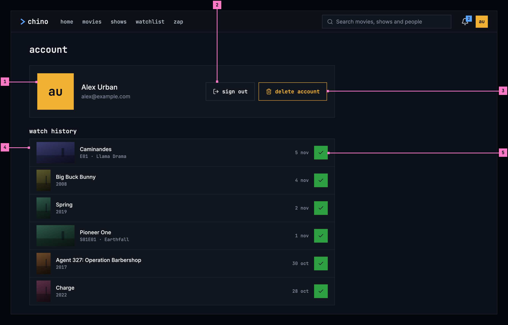

Figure 16.6: The account, on a computer, at 1280 × 800.

1. **Who is signed in**: the avatar ([chapter 3](./start.md)), the name and the
   email address, as the server's sign-in gives them.
2. **sign out** signs out of this server (section 16.4.4). On the web it also
   ends the sign-in on the server's sign-in page, where the web then goes.
3. **delete account** is the design system's amber-outline danger button, as
   it deletes what can't be brought back (section 16.4.5).
4. **watch history**: what the person has finished, newest first, up to 60
   titles. A movie shows its year, an episode its show, its code and its name,
   and each row the day it was finished. A row opens the title page
   ([chapter 6](./title-actions.md)).
5. **The watched mark**, the title actions' dark check on green
   ([chapter 6](./title-actions.md)), takes a title off the history: it marks
   it as not watched, and the row goes.

### 16.4.2 On a phone

Figure 16.7 shows the account page on a phone. It has the parts of figure 16.6;
the numbers mark what differs.

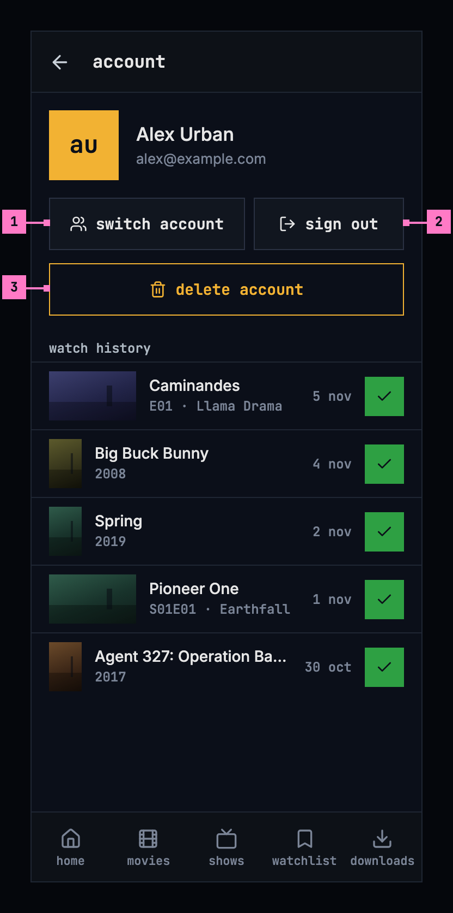

Figure 16.7: The account, on a phone, at 360 dp.

1. **switch account** opens who's watching ([chapter 3](./start.md)), where the
   phone's other accounts are and another one is added.
2. **sign out**, as on a computer, except that on a phone it asks first when
   downloads would go (section 16.4.4).
3. **delete account**, across the width.

### 16.4.3 On a TV

Figure 16.8 shows the account page on a TV, opened from settings.

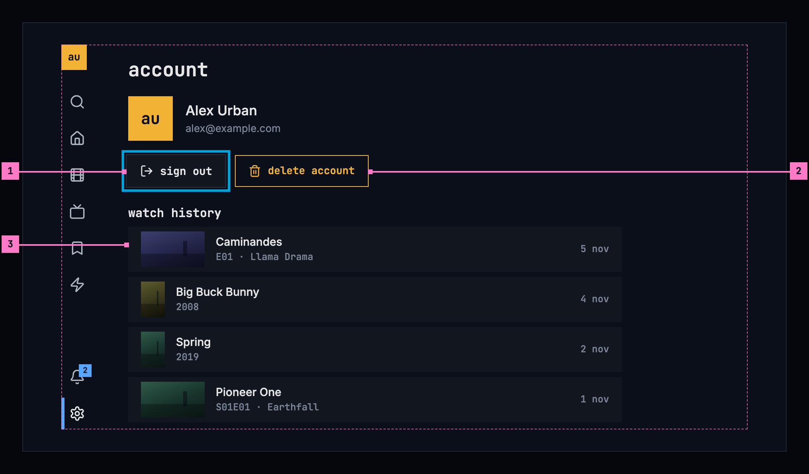

Figure 16.8: The account, on a TV, at 960 × 540 dp.

1. **sign out** has the focus when the page opens.
2. **delete account**, right of it.
3. **The rows of the history** take the focus one by one, and OK opens the
   title page. On a TV, a title leaves the history on its title page, where its
   watched mark is ([chapter 6](./title-actions.md)).

On a TV, the avatar at the top of the rail opens who's watching
([chapter 2](./frame.md)), so the page has no switch account.

### 16.4.4 Sign out, remove account and change server

Three actions take accounts off a device. **sign out** takes the account
signed in now; **remove account**, on who's watching, any account on a phone or
a TV ([chapter 3](./start.md)); **change server** every account. On a phone or
a TV, signing out removes the account from the device just as remove account
does, and signing in again brings it back.

What signing in again doesn't bring back is lost: downloads, a cast that is
running, and the sign-in of another person's account. So each action asks
first when it would lose one of them. The dialog's title is the action, its
sentence says what is lost, and its confirming button repeats the title as the
amber-outline danger button, with **cancel** before it, as the design system's
[modal](https://nalet.github.io/design-system/components/modal/) has it.

| Action | Asks first when | Its sentence |
|---|---|---|
| sign out | it deletes downloads, or stops a cast | “Your 23 downloads, 12.4 GB, are deleted from this phone.” |
| remove account | always, as the account may be someone else's | “The 8 downloads of Anna, 2.6 GB, are deleted from this phone.”; without downloads, “This removes Anna from this phone. Signing in again brings the account back.” |
| change server | it deletes downloads, stops a cast, or signs out another account than the one signed in now | “All 3 accounts on this phone are signed out, and their 31 downloads, 15 GB, are deleted.”; on a TV, “All 3 accounts on this TV are signed out.” |

The downloads are counted as [chapter 13](./downloads.md) counts them, one
download in the singular: “Your download, 281 MB, is deleted from this phone.”
While a cast is running, the sentence adds “Casting on Living Room TV stops.”
([chapter 14](./casting.md)). On a tablet, the sentences say “tablet”.

Figure 16.9 shows the question before a sign-out on a phone.

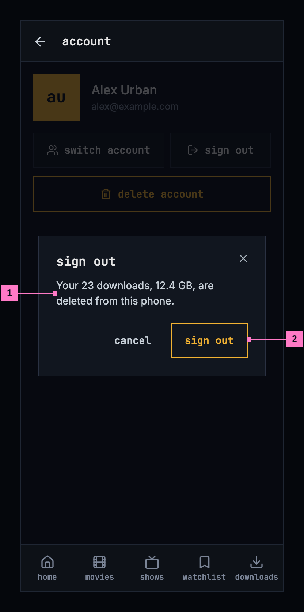

Figure 16.9: Sign out, on a phone.

1. **What is lost**: the account's downloads on this phone.
2. **sign out**, the danger button, repeats the title. While it runs it is busy
   and the dialog stays: a cast stops first, with its position written for the
   account.

After a sign-out, the app opens who's watching when other accounts remain on
the device, and sign in when none does ([chapter 3](./start.md)). The web goes
to the server's sign-in page.

Figure 16.10 shows the question before an account is removed on a TV.

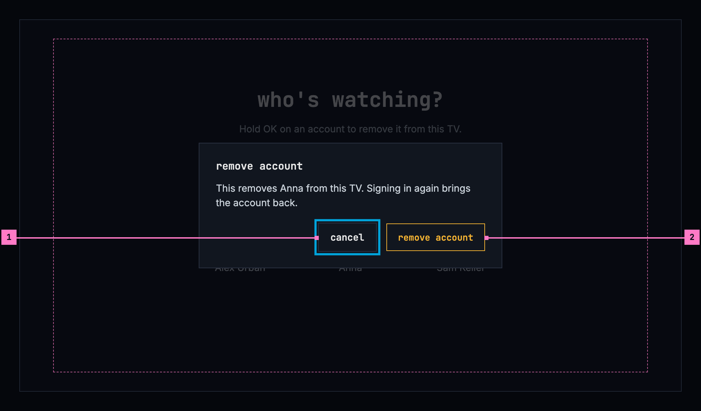

Figure 16.10: Remove account, on a TV.

1. **The focus starts on cancel**, so a stray OK keeps the account.
2. **remove account** takes the account off who's watching at once.

Figure 16.11 shows the question before a change of server on a phone.

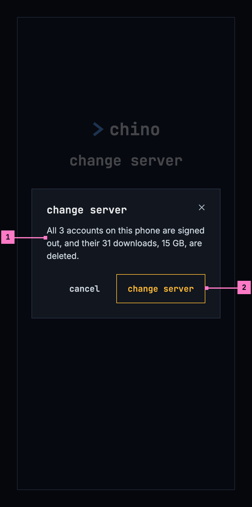

Figure 16.11: Change server, on a phone.

1. **It is asked once the new server has answered**, so a mistyped address
   changes nothing. What goes is every account on this phone and their
   downloads.
2. **change server** signs them out, deletes the downloads, and opens sign in on
   the new server.

### 16.4.5 Delete account

**delete account** deletes the account on the server: the person's watch progress,
lists, likes and watch history there, and the sign-in itself. It can't be
undone, so it always asks first, in the dialog of figure 16.12.

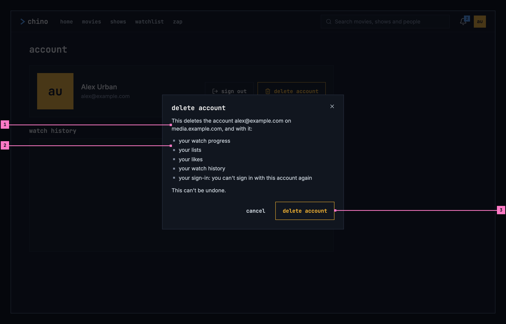

Figure 16.12: Delete account, on a computer.

1. **The account and the server, by name**, so nobody deletes the wrong one.
2. **What goes**, one line each.
3. **delete account**, the danger button, repeats the title, and is busy while
   the server deletes.

On a phone with downloads, the dialog adds “Your 23 downloads, 12.4 GB, are
deleted from this phone.” before “This can't be undone.” On a TV, the focus
starts on cancel. The server's answer decides what follows:

| The server | The dialog |
|---|---|
| Deleted the account | It closes, and the account is signed out. The web says so on a screen of its own, “account deleted”, with **sign in**; the phone and TV apps open who's watching or sign in, with the toast “Account deleted”. |
| Refused, with its reason | The reason in an error banner. **delete account** goes, and **cancel** becomes **close**. |
| Doesn't delete accounts from the apps | Figure 16.14, with **close**. |
| Didn't answer, or failed | “Couldn't delete the account, so nothing was deleted.” and the reason in an error banner, with **delete account** to try again. |

### Open

- **Whether the server deletes accounts.** The server says whether it deletes
  accounts from the apps only when it is asked to delete one, so delete account
  is offered on every server, and on one that doesn't, the person learns it
  from the answer (figure 16.14). Recommendation: the server says it in its
  configuration, as it says whether it takes reports, and the apps offer delete
  account only where it does.

## 16.5 States

Settings and the account are drawn in figures 16.1 to 16.12 with everything
loaded. Figures 16.13 to 16.15 show the states that matter most.

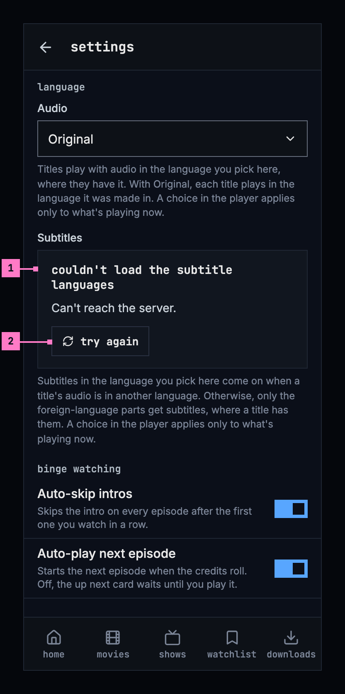

Figure 16.13: The subtitle languages couldn't load, on a phone.

1. **What couldn't load, and why**, in the field's place, by cause
   ([chapter 17](./errors.md)). The rest of settings works, as it is kept on
   the phone.
2. **try again** asks the server again.

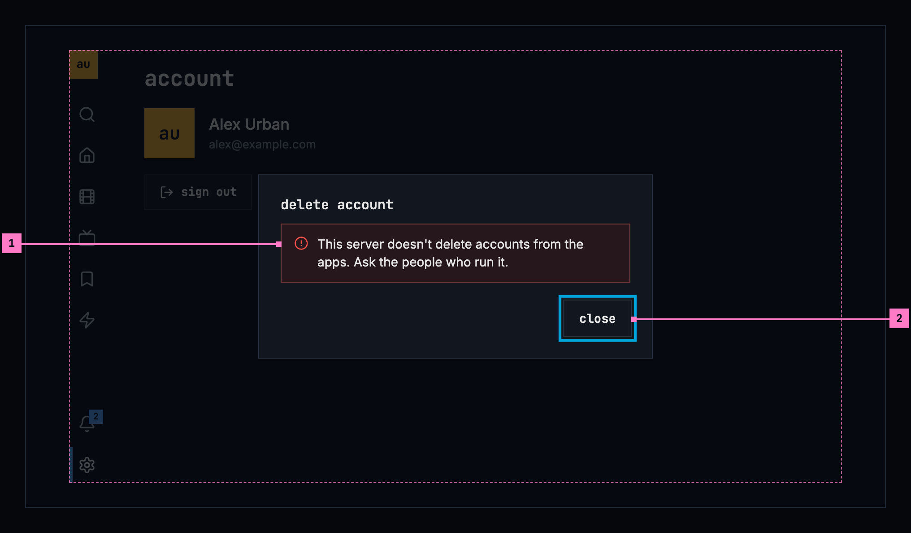

Figure 16.14: The server doesn't delete accounts, on a TV.

1. **Why the account is still there**, in an error banner inside the dialog.
2. **close** has the focus. Asking again would change nothing, so delete
   account is gone.

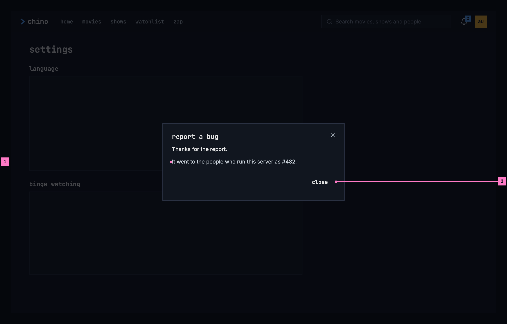

Figure 16.15: The report was sent, on a computer.

1. **The report's number**, as the people who run the server file it. When they
   already have the same report, the sentence says “The people who run this
   server already have this one. Your details were added to #482.”
2. **close** closes the dialog.

| State | What the screen shows |
|---|---|
| The subtitle languages load | A grey block in the field's shape |
| They couldn't load | Figure 16.13 |
| The watch history loads | Grey rows in the shape of the history |
| Nothing watched yet | “nothing watched yet”, and “A movie or an episode shows here once you finish it, or mark it as watched.” |
| The watch history couldn't load | “couldn't load your watch history”, the reason and **try again** |
| A question's action runs | Its danger button is busy, and the dialog stays until it is done |
| A report is being sent | **send report** is busy |
| The report was sent | Figure 16.15 |
| A report without words | The field's error: “Describe what happened to send the report.” |
| A report couldn't be sent | “Couldn't send the report.” and the reason in an error banner; the words stay |
| The server stopped taking reports | “Bug reporting is switched off on this server, so this report can't be sent.” |
| The account is deleted | Section 16.4.5: “account deleted” on the web, the toast “Account deleted” in the phone and TV apps |
| The server refused to delete it | Its reason in an error banner, and **close** |
| The server doesn't delete accounts | Figure 16.14 |
| Deleting failed | “Couldn't delete the account, so nothing was deleted.” and the reason, with **delete account** |

## 16.6 Words

| Where | Text |
|---|---|
| Settings | settings · account (TV) · language · binge watching · downloads · server · feedback · about |
| Language | Audio · Original · Subtitles · off · the two texts in section 16.3.1 |
| Binge watching | Auto-skip intros · Skips the intro on every episode after the first one you watch in a row. · Auto-play next episode · Starts the next episode when the credits roll. Off, the up next card waits until you play it. · Countdown · Seconds the player counts down before it skips the intro or starts the next episode. · 3 s |
| Downloads | Download quality · Medium (720p) · about 932 MB an hour · Download over Wi-Fi only ([chapter 13](./downloads.md)) |
| Server | Connected to media.example.com. · change server |
| Feedback | Reports go to the people who run this server, with details of the app and the device. Crashes and playback failures are reported on their own. · report a bug |
| About | Version · 0.1.0 |
| The subtitle languages couldn't load | couldn't load the subtitle languages · Can't reach the server. · try again |
| The account | account · switch account · sign out · delete account · watch history · 5 nov |
| An empty history | nothing watched yet · A movie or an episode shows here once you finish it, or mark it as watched. |
| The history couldn't load | couldn't load your watch history · try again |
| Report a bug | report a bug · What happened? · What were you doing, what did you expect, what happened instead? · Attach a screenshot of the page · Attach a screenshot of the screen (phone) · retake · The report goes to the people who run this server, with details of the app and the device. · details · cancel · send report · Describe what happened to send the report. |
| A report sent | Thanks for the report. · It went to the people who run this server as #482. · The people who run this server already have this one. Your details were added to #482. · close |
| A report not sent | Couldn't send the report. · Bug reporting is switched off on this server, so this report can't be sent. |
| Report a bug on a TV | What's going wrong? Pick the closest match. · playback won't start · video stutters or freezes · audio out of sync · subtitles wrong or missing · the app is slow · something else |
| The questions | sign out · remove account · change server · cancel · the sentences in section 16.4.4 · Casting on Living Room TV stops. |
| Delete account | delete account · This deletes the account alex@example.com on media.example.com, and with it: · your watch progress · your lists · your likes · your watch history · your sign-in: you can't sign in with this account again · This can't be undone. · close |
| Its answers | This server doesn't delete accounts from the apps. Ask the people who run it. · Couldn't delete the account, so nothing was deleted. · Account deleted · account deleted · Your account is deleted, with everything this server kept of you, and you're signed out. · sign in |

## 16.7 Today's apps

| App | What differs from this chapter |
|---|---|
| Web | Settings is a view of its own, behind the settings button of the side navigation and a tab on a phone; the avatar's menu holds account and sign out. Its groups are “binge watching”, “audio”, “subtitles” and “feedback”, then “reset to defaults”; there is no version. The language settings are labelled “Preferred language”, a server's few subtitle languages are a row of buttons, binge watching has a description of its own, and the countdown is a slider named “Countdown before auto-skip”, over “Seconds between the countdown appearing and the player skipping.” The feedback row reads “Opens a short form. Crashes and playback failures are also reported automatically, without a screenshot.” The account page is headed “Account”, with a back arrow, “Sign out” and “Delete Account” in a red outline, and dates such as “Jun 12”. Delete account asks to type DELETE; its title and its filled red button say “Delete Account”, and its answers sit under “Not Deleted”, “Not Available” or “Try Again Later”. A report that couldn't be sent says “Couldn't file the report.” and the reason. |
| Phone app | Settings is a tab, and the avatar opens the account page. Settings starts with an “Account” group (“Your account”, “Switch account”, “Sign out”, “Delete Account” in red); then “Binge watching” with “Auto-skip intros & recaps” and “Auto-skip credits”, two switches the player doesn't read, and no countdown; then “Downloads”, “Server” (“Change server”), “Support” (“Report a bug”), and “Audio” and “Subtitles” last. The headings are in mixed case, and there is no version. The audio setting offers eight languages, not every one. The chosen download quality has a check mark. The account page has “Sign out” beside the name, and no delete account. Report a bug takes the screenshot before it opens and attaches it unless switched off, puts the player's error into the box, and sends with “Submit”; then it says “Filed bug #482” or “Added to existing bug #482”, and “Thanks — the report reached the people who run this server.” Remove account, without downloads, says “You'll need to sign in again to use the account.” Change server asks only where downloads go or a cast stops, and calls the server's downloads “Your …”. Delete account's answers sit under “Not Deleted”, “Not Available” and “Try Again Later”, and a deleted account goes without a toast. |
| Android TV | Settings has “binge watching” (with “Auto-skip intros & recaps” and “Auto-skip credits”, on and off buttons instead of switches, and the countdown named “Countdown before auto-skip”), “audio” and “subtitles”, whose rows are named “Language”, “account” (“see your account”, “switch account”, “delete account”), “server” and “feedback”, whose button says “report a problem”; there is no version. Nothing signs out: an account leaves the TV by its long press on who's watching, by delete account, or by a change of server. Delete account is a screen of its own, ending in “Press BACK to keep your account.” Report a problem lists its choices in sentence case (“Playback won't start”), and ends in “Filed bug #482” and “Sent to the people who run this server.” Change server asks nothing. |
| Samsung TV | Settings opens from the rail and from the avatar. Its headings are in mixed case; binge watching has “Auto-skip intros & recaps”, “Auto-skip credits” and “Countdown before auto-skip”, with ON and OFF buttons; its languages are eight buttons, each named in its own language (“Deutsch”, “Français”, “日本語”), and the texts under audio and subtitles are its own. Its account group shows the name and the email address, with “Switch account”, “Sign out”, which asks nothing, and “Delete Account”; there is no account page and no watch history. “Change server” signs every account out at once, before a new address is typed, and asks nothing. The feedback group shows whether or not the server takes reports, says “File a bug straight to the dev backlog”, and after a report, “Thanks — the report landed on the dev backlog.” There is no version. |
