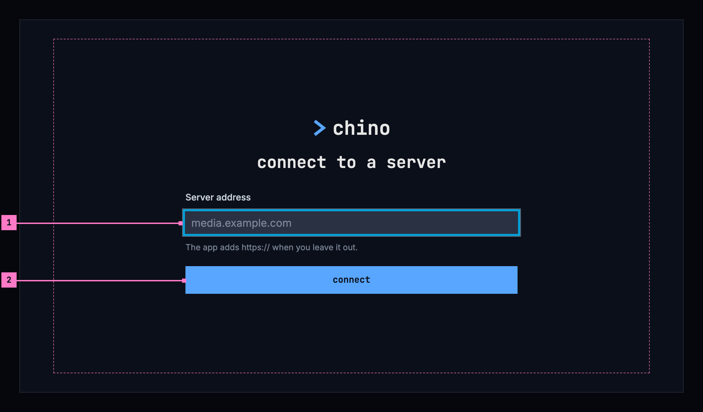
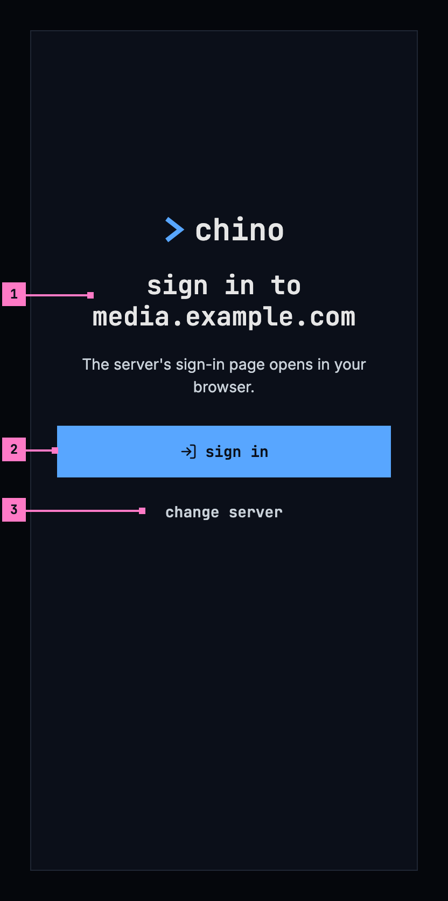
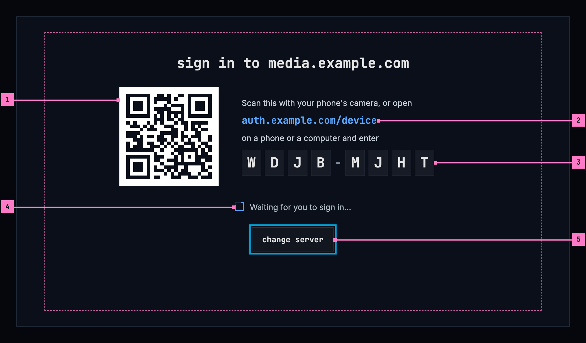
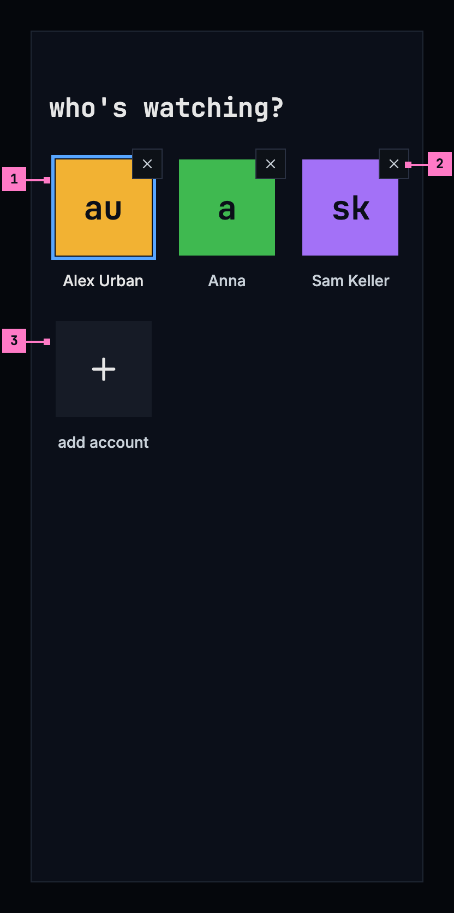
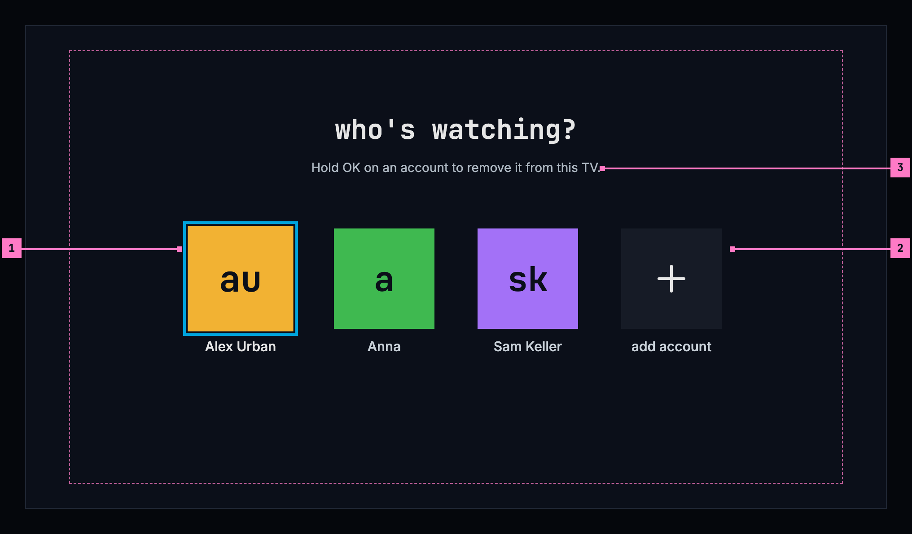
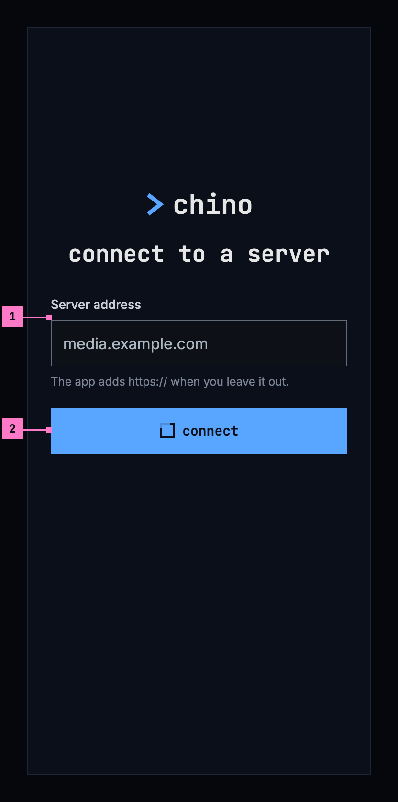
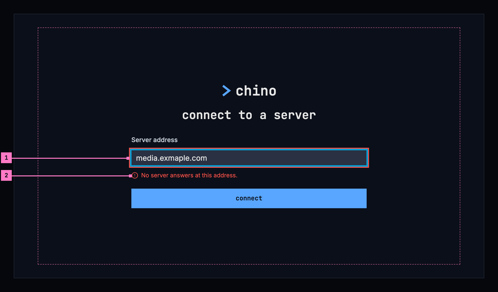
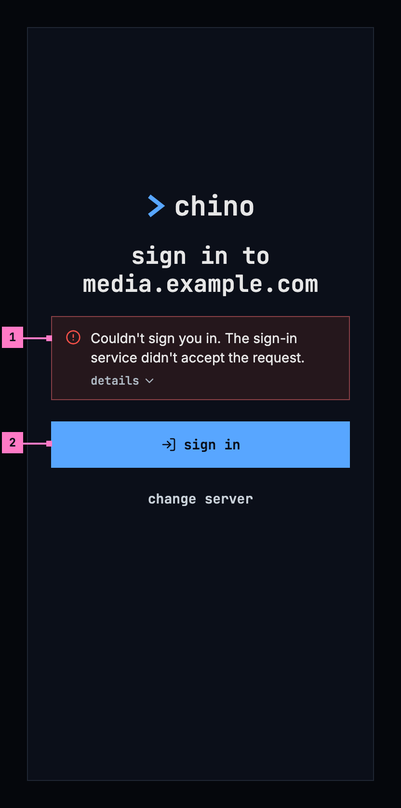

# 3 Getting started

This chapter specifies the screens before the first title: connecting to a
server, signing in, and choosing who's watching. They come before the frame of
[chapter 2](./frame.md), so they have no top bar, no tabs and no rail.

## 3.1 Purpose

The phone and TV apps work with any chino server, so a newly installed app
knows none. It asks for the server's address, checks it, and signs in there. On
a phone or a TV that several people share, each of them signs in once, and the
app asks who's watching when it starts.

The web needs no “add a server”: it comes from its own server, the one at its
address. It signs in on that server's own sign-in page, which chino doesn't
draw, and opens on home. A computer therefore has none of the screens in this
chapter, and the figures show the phone app and the TV apps.

Where an app opens depends on what the device has:

| The device has | The app opens on |
|---|---|
| No server | connect to a server (section 3.2) |
| A server, and no account | sign in (section 3.3) |
| One account | home ([chapter 4](./home.md)) |
| Two accounts or more | who's watching (section 3.4) |
| A server that doesn't answer (phone app) | downloads ([chapter 13](./downloads.md)), after who's watching when the phone has several accounts |

## 3.2 Connect to a server

### 3.2.1 On a phone

Figure 3.1 shows the first screen of a newly installed phone app: one field,
one button.

Figure 3.1: Connect to a server, on a phone, at 360 dp.

1. **Server address.** The address of the server, as the people who run it
   gave it out: “media.example.com”. https:// can be left out, and the hint
   under the field says so. The field has the focus when the screen opens, so
   the keyboard comes up at once (the figure leaves it out), and the keyboard's
   go key works like connect.
2. **connect** checks the address (section 3.2.3). When a chino server answers
   there, the app keeps it and goes on to sign in (section 3.3).

Under **connect**, a list headed **recent** offers the servers this device was
connected to before, one press each; a newly installed app has none. Changing
the server later, from settings ([chapter 16](./settings.md)), opens this
screen headed **change server**, with the server connected now in the field and
**cancel** under connect.

### 3.2.2 On a TV

Figure 3.2 shows the same screen on a TV. It has the parts of figure 3.1; the
numbers mark what differs.

Figure 3.2: Connect to a server, on a TV, at 960 × 540 dp.

1. **The field has the focus** when the screen opens. OK opens the TV's
   keyboard, and its enter key works like connect. Until something is typed,
   the field shows “media.example.com” in the dim colour of a placeholder, as an
   example.
2. **connect**, down from the field. The column keeps to the middle of the
   screen, well inside the safe area.

### 3.2.3 The check

**connect** asks the address three questions, in order: does a chino server answer
there; does it say how to sign in; and does its sign-in answer. On a TV the
last question is whether its sign-in offers signing in with a code (section
3.3.2). While the check runs, connect is busy and the field waits, as figure
3.7 shows. Until the check passes, nothing changes: on a change of server, the
old one stays.

When the check fails, the field says why in place of its hint and keeps the
address, so a typing mistake is fixed in place, and connect tries again (figure
3.8). On a TV the focus goes back to the field. The reasons:

| What the check finds | The field says |
|---|---|
| Nothing answers at the address | No server answers at this address. |
| Something answers, but it isn't a chino server | This address answers, but it isn't a chino server. |
| The server's certificate isn't trusted, where the app can tell | The server's certificate isn't trusted, so the app won't connect to it. |
| The server doesn't say how to sign in | The server answered, but didn't say how to sign in. |
| The server's sign-in doesn't answer | The server's sign-in can't be reached. |
| On a TV, the server's sign-in offers no code | This server's sign-in doesn't offer signing in on a TV. |

When the check passes, the app keeps the server, adds it to recent, and opens
sign in: figure 3.3 on a phone, figure 3.4 on a TV. A change of server first
asks what [chapter 16](./settings.md) describes, where accounts or downloads
would go.

## 3.3 Sign in

### 3.3.1 On a phone

Figure 3.3 shows sign in on a phone. The app doesn't ask for a password itself:
it hands over to the server's own sign-in page in the browser, so the person
signs in the way that server is set up for.

Figure 3.3: Sign in, on a phone, at 360 dp.

1. **The server's name** is in the heading, so the person sees where they sign
   in before a page opens. The sentence under it says what happens next.
2. **sign in** opens the server's sign-in page in the browser, and is busy
   while the page is open. When the person has signed in, the browser hands
   back to the app, which opens home ([chapter 4](./home.md)) as the new
   account. When they close the page without signing in, the screen is as it
   was.
3. **change server** opens figure 3.1 again, for an address that turned out to
   be the wrong one. It asks nothing, as nobody is signed in yet.

Before it offers **sign in**, the app asks the server for its sign-in once
more, so that a server whose sign-in changed since it was added is followed.
Meanwhile the button is busy, for 4 seconds at most; a server that doesn't
answer in that time doesn't hold the sign-in up.

### 3.3.2 On a TV

A TV has no browser to sign in with, and typing a password with a remote is
slow. So the TV shows a code, and the person signs in on their phone or a
computer. Figure 3.4 shows it.

Figure 3.4: Sign in with a code, on a TV, at 960 × 540 dp.

1. **The picture code.** A phone's camera reads it and opens the server's
   sign-in page with the code already filled in. It is dark on white, as
   cameras read it best, with a white margin round it.
2. **The address**, for typing on another device: the page of the server's
   sign-in that takes codes, without its https://.
3. **The code**, each letter in a box of its own, large enough to read from
   across the room.
4. **Waiting.** The screen moves on by itself once the sign-in is done, to home
   as the new account. Nothing needs pressing on the TV.
5. **change server** is the only thing to focus, so it has the focus. When the
   screen opens from who's watching to add an account (section 3.4), it has no
   change server, and Back goes back to who's watching.

A code holds as long as the server's sign-in allows. When it runs out, the
screen says “The code expired.”, with **try again**, which asks for a new one.

### 3.3.3 On the web

The web signs in on the server's own sign-in page, which chino doesn't draw.
When nobody is signed in, the web goes there by itself, showing only “Signing
you in…” on the way, and comes back to the page it left. When the sign-in
fails, the web says “couldn't sign you in”, the reason from section 3.5, and
offers **sign in**.

A sign-in that has expired renews itself on every device, without a screen.
Only when the server refuses it does the app open sign in again, for the same
account, and return to where the person was afterwards
([chapter 17](./errors.md)).

## 3.4 Who's watching

A phone or a TV that several people share keeps an account for each of them, so
each signs in once. The app asks who's watching when it starts with two
accounts or more. On a phone, the account page's **switch account** opens it
too ([chapter 16](./settings.md)); on a TV, the avatar at the top of the rail
([chapter 2](./frame.md)). What an account sees is its own: its continue
watching, its watchlist, and on a phone its downloads
([chapter 13](./downloads.md)).

### 3.4.1 On a phone

Figure 3.5 shows who's watching on a phone with three accounts.

Figure 3.5: Who's watching, on a phone, at 360 dp.

1. **An account**: its avatar and its name. A tap opens home as that account.
   The accounts come in the order they were last used, and the one used last
   has a blue frame round its avatar.
2. **✕** removes the account from this phone, after asking, as
   [chapter 16](./settings.md) describes. It reacts to a touch anywhere in the
   48 dp square round it, larger than the square it draws.
3. **add account** opens the server's sign-in page, as sign in does in figure
   3.3. Once the person has signed in, the new account opens home.

A switch asks nothing. When the account switched from is casting, the cast
stops and a toast says so ([chapter 14](./casting.md)).

### 3.4.2 On a TV

Figure 3.6 shows who's watching on a TV. It has the parts of figure 3.5; the
numbers mark what differs.

Figure 3.6: Who's watching, on a TV, at 960 × 540 dp.

1. **The focus starts on the account used last**, so the most common choice is
   one press of OK. Left and right move between the accounts.
2. **add account** opens sign in with a code, as in figure 3.4.
3. **The line under the heading** says how to remove an account, because
   holding OK can't be seen. It opens the same question as the phone's ✕.

### 3.4.3 The avatar

An account is shown by its avatar everywhere: in the top bar, in the rail, in
the avatar's menu and on who's watching. It is a square with the account's
initials, the first letters of the first two words of its name, lowercase in
the monospace face, dark on one of twelve colours: “Alex Urban” is **au**,
“Anna” is **a**. The colour comes from the account's email address, or from its
name when it has none, the same way in every app, so an account keeps its
colour on every device.

### Open

- **A picture in the avatar.** The web shows the picture the sign-in gives an
  account, and the phone and Android TV apps look one up from an outside
  service by the email address; this chapter specifies initials only.
  Recommendation: initials only, so that no app tells an outside service which
  accounts it has.

## 3.5 States

Figures 3.1 to 3.6 show the screens at rest. Figures 3.7 to 3.9 show the
states in between that matter most.

Figure 3.7: Checking the address, on a phone.

1. **The field waits** while the check runs, its address dimmed.
2. **connect is busy**: the design system's square loader before its name,
   which stays, as
   [loading and progress](https://nalet.github.io/design-system/patterns/loading-and-progress/)
   has it. For the first 0.4 seconds nothing changes; a second press does
   nothing.

Figure 3.8: No server answers at the address, on a TV.

1. **The field keeps the address**, with a red edge, and has the focus again,
   so the typing mistake, here “exmaple”, is fixed in place.
2. **The reason**, in place of the hint, from the table in section 3.2.3.
   connect tries again.

Figure 3.9: The sign-in was refused, on a phone.

1. **What went wrong**, in an error banner over the buttons: “Couldn't sign you
   in.” and the reason. **details** opens the sign-in service's own error, for
   the people who run the server.
2. **sign in** tries again. Nothing else on the screen changes.

A sign-in that fails says why, by cause, in every app:

| Why the sign-in failed | The reason |
|---|---|
| The sign-in service doesn't answer | Can't reach the sign-in service. |
| The sign-in service refused the sign-in | The sign-in service didn't accept the request. |
| The sign-in didn't come back whole | The sign-in didn't finish. |
| The server refused the sign-in just made | The server didn't accept your sign-in. |
| The server ran into a problem (TV) | The server ran into a problem. |
| The code ran out (TV) | The code expired. |
| The sign-in was turned down on the other device (TV) | Sign-in was cancelled. |

| State | What the screen shows |
|---|---|
| Checking the address | Figure 3.7 |
| The check fails | Figure 3.8, with the reason from section 3.2.3 |
| Asking the server for its sign-in, before sign in | sign in is busy, for 4 seconds at most |
| The browser's sign-in page is open (phone) | sign in is busy |
| Asking for a code (TV) | Grey blocks in the shape of the picture code and the code |
| Waiting for the other device (TV) | Figure 3.4: the loader and “Waiting for you to sign in…” |
| The sign-in failed | Figure 3.9 on a phone. On a TV, “couldn't sign you in”, the reason and **try again** in place of the codes, with the focus on try again. On the web, “couldn't sign you in”, the reason and **sign in** |
| Switching to another account | The account's tile is busy until the switch is done |
| The phone app can't reach the server | Who's watching works without it, and opens the account's downloads ([chapter 13](./downloads.md)) |

## 3.6 Words

| Where | Text |
|---|---|
| Connect to a server | connect to a server · Server address · The app adds https:// when you leave it out. · connect · recent |
| The same screen, from settings | change server · cancel |
| The check | the six reasons in section 3.2.3 |
| Sign in on a phone | sign in to media.example.com · The server's sign-in page opens in your browser. · sign in · change server |
| Sign in on a TV | sign in to media.example.com · Scan this with your phone's camera, or open · auth.example.com/device · on a phone or a computer and enter · Waiting for you to sign in… · change server · try again |
| A failed sign-in | Couldn't sign you in. · couldn't sign you in (TV and web) · the seven reasons in section 3.5 · details · sign in · try again (TV) |
| The web on its way to sign in | Signing you in… |
| Who's watching | who's watching? · add account · Hold OK on an account to remove it from this TV. |
| The ✕ on a phone, for screen readers | remove account |
| An account's tile, for screen readers | its name: Alex Urban |

## 3.7 Today's apps

| App | What differs from this chapter |
|---|---|
| Web | A failed sign-in shows “couldn't sign you in” with **sign in again** and **home**. The avatar is the sign-in's picture, or the initials in capitals, blue on grey. |
| Phone app | Connect to a server is headed “Connect to your server” (“Change server”), with “Enter the address of your Chino server.” under it; the field has no label and the placeholder “https://media.example.com”; the buttons say “Connect” and “Connecting…”, with a spinner under them; “Cancel” is a link; a build with a server built in offers “Use …”. The check's reasons are other sentences, such as “Couldn't reach that server. Check the address and that it's online.” and “Server reachable, but it didn't return its configuration (/api/config).”, and an untrusted certificate reads as no answer. Sign in is headed “Chino” in blue, with “Movies and series — sign in to media.example.com.”, “Sign in” and “Change server”; it shows a spinner instead of a busy button, and a failure shows the sign-in service's own error text with “Try again”. Who's watching is headed “Who's watching?”, with “Tap to switch. Tap ✕ to remove an account from this phone.”; the ✕ is a 28 dp target; “Add account” turns into “Signing in…”. Initials are in capitals, and the avatar shows a picture looked up by the email address. |
| Android TV | Connect to a server has the phone app's sentences in lowercase headings and buttons (“connect to your server”, “connecting…”), and the TV's own reason “This server's login provider doesn't support TV sign-in (device flow).” Sign in is headed “Connect your Chino account”, with “Scan with your phone — or visit:”, the address with https://, “and enter this code:” and “Waiting for confirmation…”; it has no change server. Its failures say “The code expired.”, “Sign-in was cancelled.”, “The server didn't accept the sign-in.”, “Can't reach the server.”, “The server's answer couldn't be read.” or “Sign-in failed.”, with **try again** and details. Who's watching says “Long-press an account to remove it.”; its avatars are round, with initials in capitals and a picture looked up by the email address. |
| Samsung TV | Connect to a server is as on the phone app, its field opening a keyboard of the app's own, titled “Server address”; a reason it doesn't know reads “Something went wrong connecting to that server.” Sign in is headed “Sign in” and has no picture code: “On your phone or computer, open”, the address, “and enter this code:”, “Waiting for you to sign in…”; failures say “The code expired. Please try again.”, “Sign-in was cancelled.” or “Sign-in failed:” with the error's code, and **Try again**. Who's watching is in the code but nothing opens it: settings switches accounts in a list over the page, whose “Add account” goes to home without signing in. The avatar is round, one capital letter on blue. |
