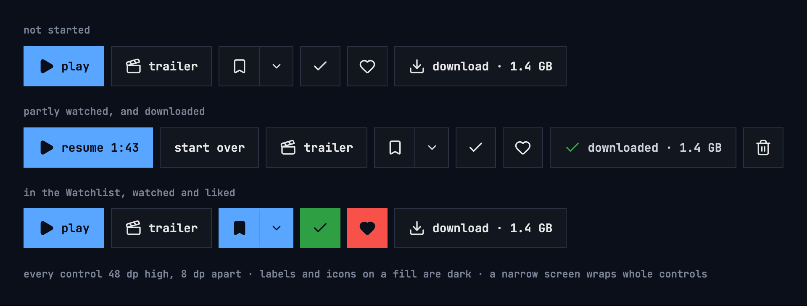
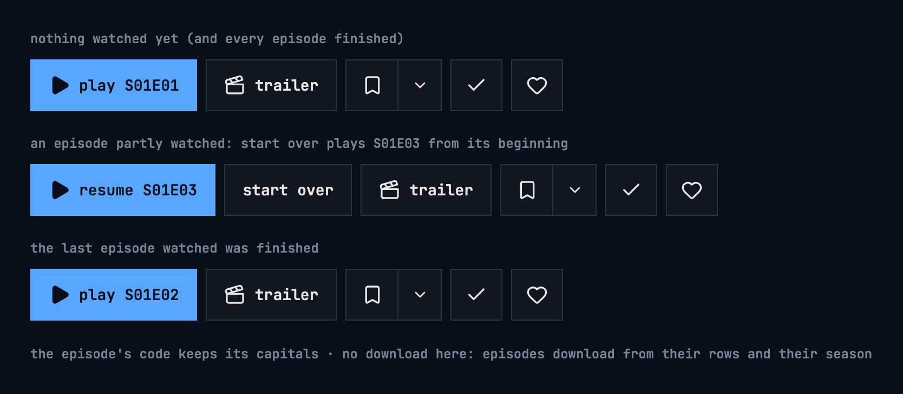
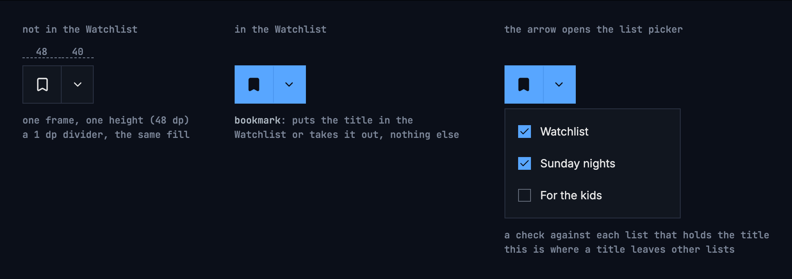
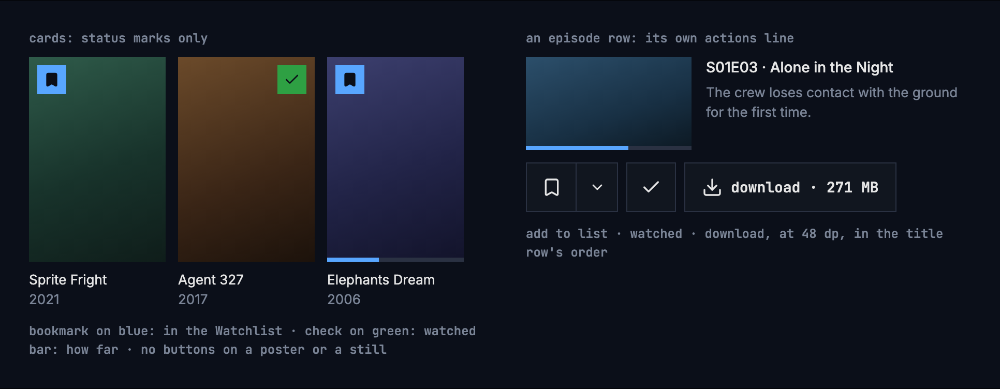

# Title actions

A title's page offers what people can do with it: play it, add it to a list,
mark it as watched, like it, download it. These actions look and behave the
same on every screen and in every app, so people never wonder whether a smaller
button does something else.

## The row

On a title's page, in this order:

**play**, or **resume 1:43** and **start over** · **trailer** · **add to list** ·
**watched** · **liked** · **download**

- Every control in the row has one height: 48 dp on a phone or a tablet. Icon
  buttons are 48 × 48 dp, with 8 dp between controls.
- The TV keeps its own control height and its [focus style](https://nalet.github.io/design-system/patterns/tv-focus/),
  with the same controls in the same order.
- When the row wraps, a control wraps as a whole.

### On a series

A series' page plays an episode, and the first button names it by its code,
which keeps its capitals:

| The series | The first button |
|---|---|
| Nothing watched yet | **play S01E01** |
| An episode partly watched | **resume S01E03** and **start over**, which plays S01E03 from its beginning |
| The last episode watched was finished | **play S01E02**, the next one |
| Every episode finished | **play S01E01** |

The episode's position shows in its row below, not in the button. The rest of
the row is the same as on a movie, without download: episodes download from
their rows and their season.

## Add to list

One control in two parts, in one frame and at one height:

- **The main part** shows and toggles the Watchlist: an outlined bookmark when
  the title isn't in it, a filled one when it is. It never touches other lists.
- **“⌄”** opens the list picker, with a check against each list that holds the
  title. That's where a title leaves other lists.
- The two parts touch, with a 1 dp divider and the same fill. The “⌄” part is
  drawn 40 dp wide at the full height; its touch target is 48 × 48 dp. On a TV
  they are two focus stops, each with its own ring, drawn inside the part as on a
  row, so the other part stays whole and the divider stays visible.

## States

Labels and icons on a filled colour are dark.

| Control | Off | On |
|---|---|---|
| Add to list | an outlined bookmark on the plain surface | a dark bookmark on blue: in the Watchlist |
| Watched | an outlined check on the plain surface | a dark check on green |
| Liked | an outlined heart on the plain surface | a dark heart on the design system's red |

Each meaning has one icon and one colour, on buttons and on cards alike: the
bookmark on blue for the Watchlist, the check on green for watched, the heart
on red for liked.

The names screen readers announce say the state: “add to Watchlist” and “in
your Watchlist”, “choose lists”, “mark as watched” and “watched”, “like” and
“liked”.

## Nothing on artwork

No button is drawn over a poster or a still. Over a picture, a button's contrast
depends on the picture, and a smaller variant would look like a different
button.

- **Episode rows** carry their actions in the row's own actions line, at the
  same 48 dp and in the title row's order: add to list, watched, download.
- **Cards** in a grid show only status marks, drawn as in the states table:
  the Watchlist bookmark on blue, the watched check on green, and the progress
  bar. Actions live on the title's page, or in a card's menu where it has one.

