# 6 The title page

This chapter specifies a title's page: what it shows of a movie and of a show,
and what people can do there. The frame around it is specified in
[chapter 2](./frame.md), and the player it starts in [chapter 11](./playback.md).

## 6.1 Purpose

A title's page tells people what a title is and lets them act on it: play it,
add it to a list, mark it as watched, like it, and on a phone download it. It
opens from every card of a title: on home ([chapter 4](./home.md)), in movies
and shows ([chapter 5](./browse.md)), in the watchlist
([chapter 8](./watchlist.md)) and in search ([chapter 9](./search.md)), from a
notification about it ([chapter 15](./notifications.md)), and from the similar
titles at the foot of another title's page. Its people lead on to their own
pages ([chapter 7](./person.md)).

The page isn't one of the views, so the frame marks no view as current. Back
returns to where the person came from.

## 6.2 A movie's page

### 6.2.1 On a computer

Figure 6.1 shows a movie's page on a computer, for a movie the person hasn't
started. The page scrolls as a whole; the figure shows its top.

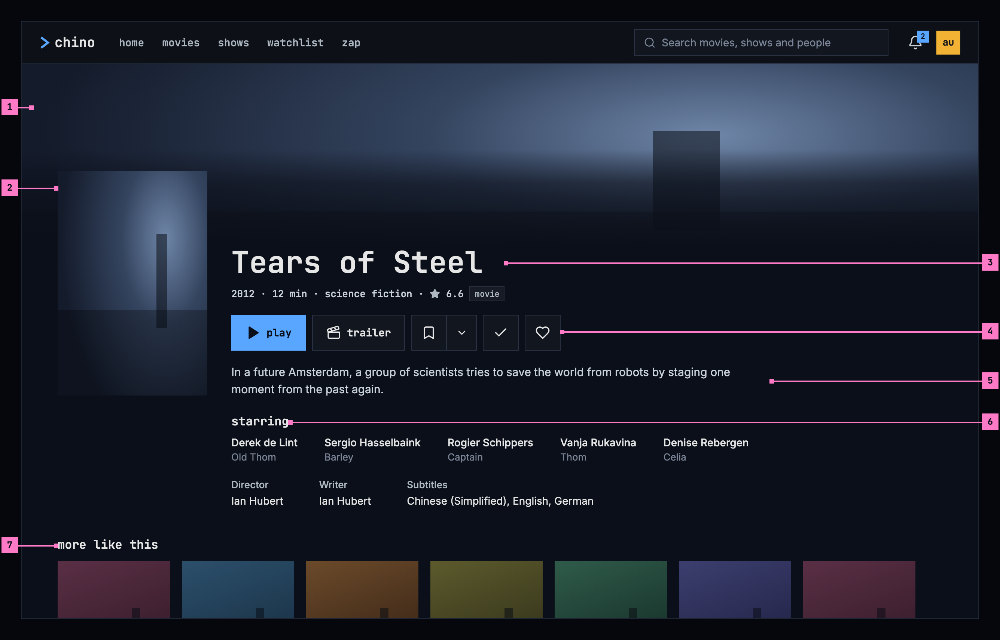

Figure 6.1: A movie's page on a computer, at 1280 × 800.

1. **The still.** A picture from the title fills the width under the top bar
   and fades into the page's colour before the first words, so nothing is
   ever written on the picture.
2. **The poster**, beside the name, reaching up into the still.
3. **The name and its facts**: the year, the length, the genres, the rating
   and the kind, movie or show. A tagline, where the catalog has one, goes
   under the name. Section 6.7.1 lists the facts.
4. **The title row**: **play**, **trailer**, add to list, watched and liked,
   specified in section 6.4. **trailer** is there only when the title has a
   trailer.
5. **The description.** A title without one goes straight on to the people;
   no sentence says that it's missing.
6. **The people**: **starring**, the actors with the parts they play, then the
   crew by role and the languages of the subtitles. A name opens that
   person's page. Section 6.7.2 has the rules.
7. **more like this**: titles that share genres and people with this one, as
   posters (section 6.7.3). Choosing one opens its page.

### 6.2.2 On a phone

Figure 6.2 shows the same page on a phone. The parts are those of figure 6.1;
the numbers mark where the phone differs.

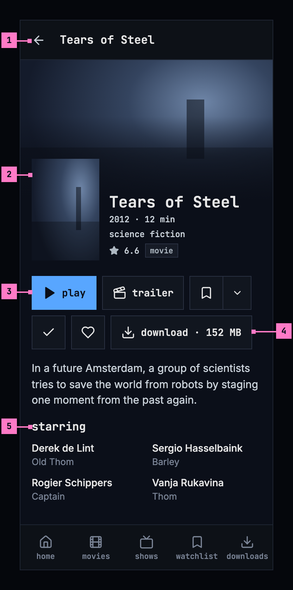

Figure 6.2: A movie's page on a phone, at 360 dp.

1. **The bar** shows a back arrow and the title's name in place of the top
   bar, as every screen opened from a view does ([chapter 2](./frame.md)), and
   the tabs stay. While a TV to cast to is on the network, the cast button
   joins the bar on the right ([chapter 14](./casting.md)).
2. **The poster** is smaller and stands beside the name, so the title row is
   in view without scrolling. The facts wrap onto three lines here, in their
   order, and a fact is never split between two.
3. **The title row** wraps where the phone is too narrow for it, a control as
   a whole.
4. **download** comes last in the row, with the size the download will take:
   “download · 152 MB”. Once it starts, the control shows how the download
   stands ([chapter 13](./downloads.md)).
5. **The people** stand two to a line.

The web on a phone has the layout of figure 6.2 with its own tabs
([chapter 2](./frame.md)) and without download.

### 6.2.3 On a TV

Figure 6.3 shows the page on a TV, as it opens. The rail stays on the left with
no view current, and the page keeps to the safe area.

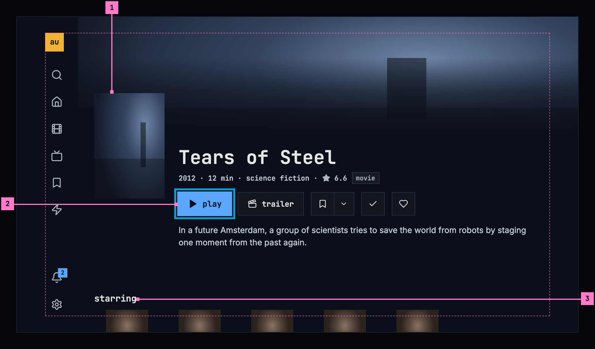

Figure 6.3: A movie's page on a TV, at 960 × 540 dp.

1. **The poster and the name** sit low enough for the still to show above
   them. The words stand on the page's colour, as on a computer.
2. **The focus** starts on **play**, or on **resume** for a title stopped part
   way. The row's controls are 40 dp high and 12 dp apart, so a focused
   control can grow and show its ring without touching the next. Left and
   right move along the row; down moves to the people, then to a show's
   episodes and to more like this; up from there brings the top of the page
   back.
3. **starring** is a row of cards, one per actor: the photo, or the initials
   where the catalog has no photo, then the name and the part. The row runs on
   past the safe area to the screen's edge, as home's rows do. The crew
   follows, a line per role, and every name takes the focus.

The description shows four lines at most and ends in “…” where it's cut. The
subtitle languages take three lines at most and count the rest: “Arabic,
Chinese, English, +12 more”. Back from a person's page or from another title's
page puts the focus on the card or the name that opened it, with the page
scrolled as it was.

## 6.3 A show's page

A show's page has the parts of a movie's page, and under the people, its
episodes, season by season. Its first button plays an episode and names it
(section 6.5), and its row has no download: episodes download from their rows
and their season. Figures 6.4 to 6.6 show the page scrolled down to the
episodes, for a show the person is in the middle of: the first two episodes
finished, the third stopped part way.

### 6.3.1 On a computer

Figure 6.4 shows the episodes on a computer.

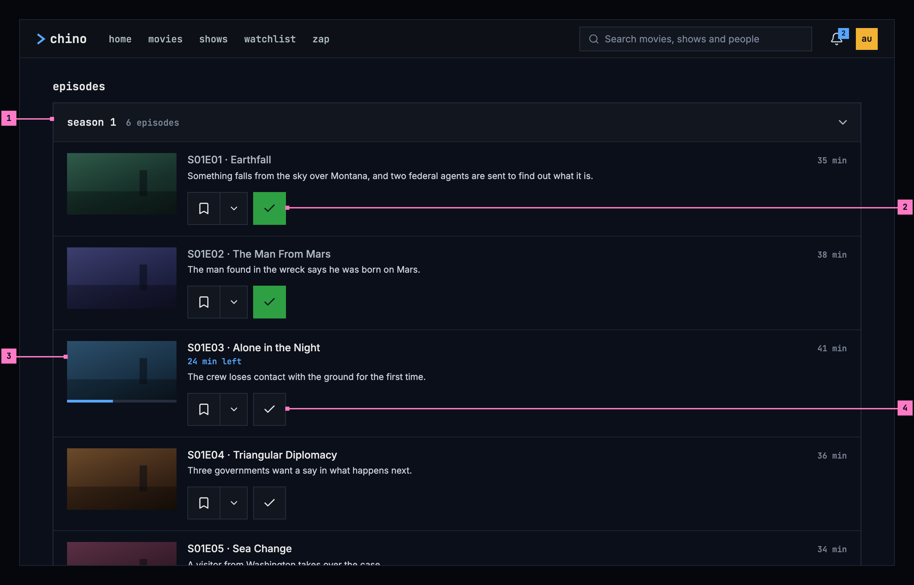

Figure 6.4: A show's page on a computer, scrolled to its episodes, at 1280 × 800.

1. **The season**, under **episodes**: its name and how many episodes it
   holds. The header opens and closes the season; section 6.6.1 says which
   seasons start open.
2. **A finished episode.** Its name is dimmed, and its watched toggle is on,
   the check dark on green.
3. **The episode the person is in.** The bar on its still shows how far they
   got, and “24 min left” under the name says how much is left.
4. **The episode's actions**: add to list and watched, in the title row's
   order and at its height, under the description. Nothing is drawn on the
   still (section 6.4.4). The rest of the row plays the episode, from where
   the person stopped.

### 6.3.2 On a phone

Figure 6.5 shows the same part of the page on a phone. It differs from
figure 6.4 in what a phone keeps to watch offline.

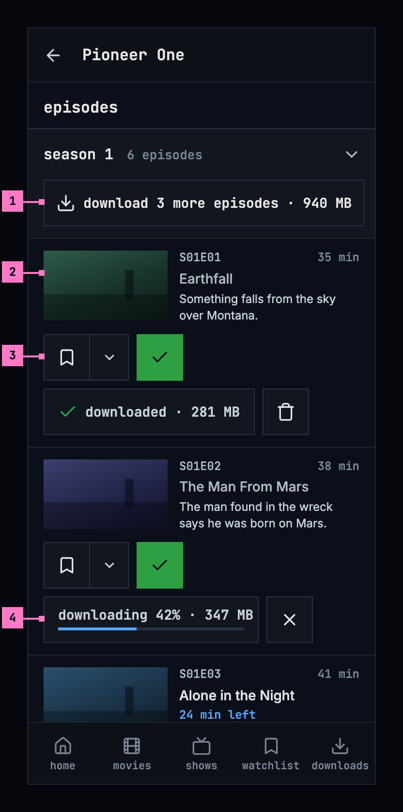

Figure 6.5: A show's page on a phone, scrolled to its episodes, at 360 dp.

1. **The season's download**, under its header, takes the season's episodes
   that aren't on the phone or on their way yet, all at once: here “download 3
   more episodes · 940 MB”, in the words of [chapter 13](./downloads.md).
2. **The episode row.** The still, then the episode's code and length on one
   line, and its name with the column to itself, on up to two lines, so it's
   never cut to a word.
3. **The actions line** runs under the still and the text: add to list,
   watched, and the episode's own download, wrapping between controls, never
   inside one.
4. **A download on its way** shows how far it is, with a button to cancel it;
   a downloaded episode shows its size, with a button to delete it.

Under the title row, a show that is partly on the phone says how far:
“1 of 6 downloaded” ([chapter 13](./downloads.md)).

### 6.3.3 On a TV

Figure 6.6 shows the episodes on a TV, with the focus on the episode the
person is in.

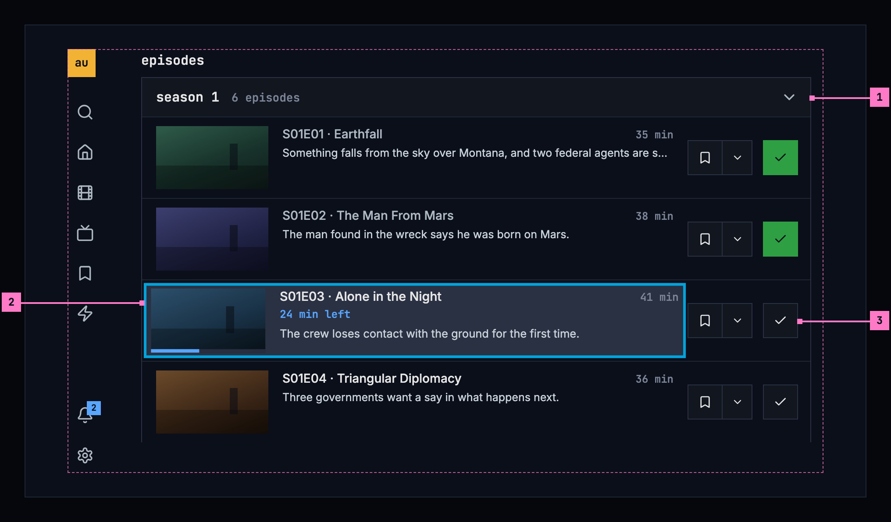

Figure 6.6: A show's page on a TV, the focus on an episode, at 960 × 540 dp.

1. **The season's header** is a row the focus can take; OK opens and closes
   the season.
2. **The focused episode.** The episode is one focus stop, a row with the
   ring inside its edge, 2 % larger. OK plays it, from where the person
   stopped.
3. **The actions** sit at the row's end, each a focus stop of its own: right
   from the row reaches add to list, then watched.

## 6.4 The actions

A title's page offers what people can do with it: play it, add it to a list,
mark it as watched, like it, download it. These actions look and behave the
same on every screen and in every app, so people never wonder whether a
smaller button does something else.

### 6.4.1 The row

On a title's page, in this order:

**play**, or **resume 1:43** and **start over** · **trailer** · add to list ·
watched · liked · **download**

Figure 6.7 shows the row on a movie in three states.

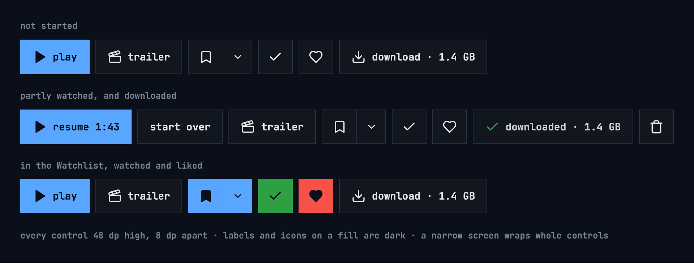

Figure 6.7: The row on a movie: not started; partly watched and downloaded; in
the Watchlist, watched and liked.

- Every control in the row has one height: 48 dp on a computer, a phone or a
  tablet. Icon buttons are 48 × 48 dp, with 8 dp between controls.
- The TV keeps its own control height, 40 dp, and its
  [focus style](https://nalet.github.io/design-system/patterns/tv-focus/), with
  the same controls in the same order and 12 dp between them.
- When the row wraps, a control wraps as a whole.
- **resume 1:43** says where the title picks up, and **start over** plays it
  from its beginning. A title stopped within its last minutes is finished
  and shows **play** again ([chapter 11](./playback.md)).
- **trailer** plays the trailer this server has, in the app's player; a title
  whose trailer is only online opens it outside the app.
- **download** is in the phone app only, and not when the server has turned
  downloads off ([chapter 13](./downloads.md)).

### 6.4.2 Add to list

One control in two parts, in one frame and at one height:

- **The main part** shows and toggles the Watchlist: an outlined bookmark when
  the title isn't in it, a filled one when it is. It never touches other lists.
- **“⌄”** opens the list picker, with a check against each list that holds the
  title. That's where a title leaves other lists; its last row, **create list**,
  opens the dialog that starts a new list with the title in it
  ([chapter 8](./watchlist.md)).
- The two parts touch, with a 1 dp divider and the same fill. The “⌄” part is
  drawn 40 dp wide at the full height; its touch target is 48 × 48 dp. On a TV
  they are two focus stops, each with its own ring, drawn inside the part as on
  a row, so the other part stays whole and the divider stays visible.

Figure 6.8 shows the control off and on, and the picker it opens.

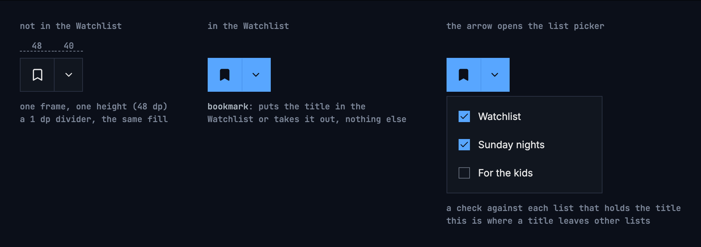

Figure 6.8: The add-to-list control off and on, and the list picker the arrow
opens.

The picker opens under the control on a computer, from the bottom of the
screen on a phone, and over the page on a TV, where back closes it.

### 6.4.3 On and off

Labels and icons on a filled colour are dark.

| Control | Off | On |
|---|---|---|
| Add to list | an outlined bookmark on the plain surface | a dark bookmark on blue: in the Watchlist |
| Watched | an outlined check on the plain surface | a dark check on green |
| Liked | an outlined heart on the plain surface | a dark heart on the design system's red |

Each meaning has one icon and one colour, on buttons and on cards alike: the
bookmark on blue for the Watchlist, the check on green for watched, the heart
on red for liked.

The names screen readers announce say the state: “add to Watchlist” and “in
your Watchlist”, “choose lists”, “mark as watched” and “watched”, “like” and
“liked”.

### 6.4.4 Nothing on artwork

No button is drawn over a poster or a still. Over a picture, a button's
contrast depends on the picture, and a smaller variant would look like a
different button. Figure 6.9 shows the two places where this matters most.

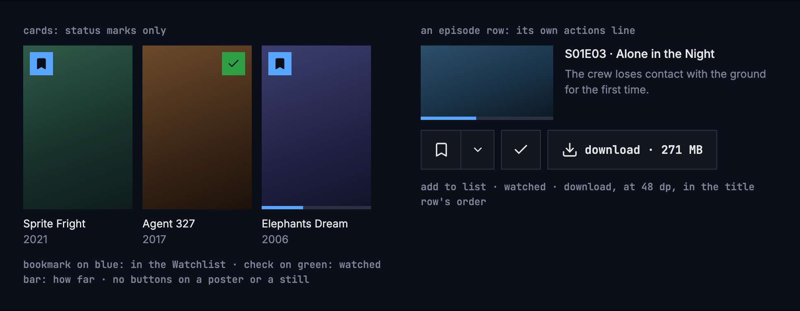

Figure 6.9: Cards with their status marks, and an episode row with its own
actions line.

- **Episode rows** carry their actions in the row's own actions line, at the
  same 48 dp and in the title row's order: add to list, watched, download.
- **Cards** in a grid show only status marks, drawn as in the table of
  section 6.4.3: the Watchlist bookmark on blue, the watched check on green,
  and the progress bar. Actions live on the title's page, or in a card's menu
  where it has one.
- **A card's menu** has its button beside the name, under the poster, and on
  a TV opens when OK is held on the card. It offers **play**, or **resume**
  for a title the person is in, and **mark as watched**, or **watched** while
  the mark is on, which takes it off. On home's continue watching it also
  offers **remove from continue watching** ([chapter 4](./home.md)).

## 6.5 Play on a show

A show isn't played itself: its episodes are. So a show's first button plays
an episode, and names it by its code, which keeps its capitals:

| The show | The first button |
|---|---|
| Nothing watched yet | **play S01E01** |
| An episode partly watched | **resume S01E03** and **start over**, which plays S01E03 from its beginning |
| The last episode watched was finished | **play S01E02**, the next one |
| Every episode finished | **play S01E01** |

Figure 6.10 shows the row in the first three cases.

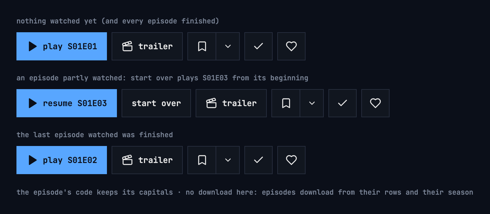

Figure 6.10: The row on a show: nothing watched yet; an episode partly watched;
the last episode watched finished.

- The episode's position shows in its row below (figure 6.4), not in the
  button. The rest of the row is the same as on a movie, without download.
- S01E01 is the first episode of the first numbered season; the specials count
  only when a show has nothing else.
- A file that holds several episodes is named for all of them:
  **play S03E18–19** (section 6.6.3).
- A page opened on one of its episodes (section 6.6.4) names that episode
  until the person plays on: **resume S01E03** where it was stopped part way,
  else **play S01E05**. After that, the table above applies again.

## 6.6 Seasons and episodes

### 6.6.1 The seasons

- The numbered seasons come first, in order. Season 0 comes last, under
  **specials**: the specials, and any episode the catalog has no season number
  for.
- The first numbered season starts open, or the specials when they are all
  there is; a page opened on an episode opens that episode's season instead
  (section 6.6.4). The others start closed, and each stays open or closed
  while the person is on the page, also back from the player.
- A season's header gives its name and how many episodes it holds:
  **season 1** and “6 episodes”, or “1 episode”.

### 6.6.2 The episode row

- An episode row shows, in this order: the still, with a bar where the person
  stopped; the code and the name, “S01E03 · Alone in the Night”; the length,
  “41 min”; “24 min left” for an episode stopped part way; the description, in
  two lines at most; and the actions line.
- The time left is rounded up, so the last half minute is “1 min left”.
- A finished episode's name is dimmed, and its watched toggle is on.
- The row plays the episode, from where the person stopped, else from its
  beginning. The actions line is apart from it: none of its controls plays.
- The actions line has the title row's order: add to list · watched ·
  download. It runs under the description on a computer, under the still and
  the text on a phone, and at the row's end on a TV.

### 6.6.3 A file that holds several episodes

A file that holds several episodes is one thing to play, so it is one entry: a
box around the episodes it holds, named for them, “S03E18–21”, and as long as
the file. Under the name it says “4 episodes · one file” and lists each
episode by its number and name. None of them plays on its own, because the
file doesn't say where one ends. The bar, the watched mark, add to list and the
download are the file's.

### 6.6.4 Opened on an episode

An episode has no page of its own. Opening one, from a card in continue
watching or next up, from a notification or from search, opens its show's
page with that episode's season open and the page scrolled to its row. The
row is marked as where the person came from: with a blue outline on a
computer and a phone, and on a TV with a blue bar along its left edge, as the
design system's
[TV focus](https://nalet.github.io/design-system/patterns/tv-focus/) marks it.
On a TV the focus starts on that row.

### Open

- **The specials.** The web hides season 0 when a show has numbered seasons,
  because the episodes without a season number usually repeat ones the
  seasons hold; the Samsung TV app lists it last and closed, as “Specials”.
  Recommendation: list it last and closed, so nothing in the library is out
  of reach, and fix the repeats in the catalog.

## 6.7 What the page shows

### 6.7.1 The facts

The facts follow the name, in one line where it fits, in this order:

- **the year**: “2012”;
- **the length**: “12 min”, “1 h 32 min”; a show has none;
- **the genres**: “science fiction”, “drama”;
- **the rating** with a star, as the catalog has it, with one decimal: “6.6”;
- **the age rating**, where the catalog has one, as a badge in the words of
  the board that gave it: “FSK 12”, “PG-13”, an age alone as “12+”;
- **the kind**, as a badge: “movie” or “show”.

A fact the catalog doesn't have is left out, with its dot.

### 6.7.2 The people

- **starring** lists the actors in the order the catalog bills them, each with
  the part they play. An actor credited for two parts is listed once, with
  both: “Old Thom / Narrator”.
- On a computer and a phone the first six actors show, and
  **full cast (12)** shows the rest; **show less** hides them again. A cast at
  most two longer than six shows whole: a button that hides two names saves
  nothing. A TV has the row of cards of figure 6.3 instead.
- **The crew** follows, a role at a time, each under its label: Created by,
  Director (Directors for several), Writer, Producer, Music, Cinematography,
  Editor, then any other role by its name.
- **Subtitles** names the languages the title has subtitles in, each once, in
  alphabetical order: “Chinese (Simplified), English, German”.
- A name opens the person's page ([chapter 7](./person.md)) when the catalog
  has a page for them; a name without one is plain text. On a TV it still
  takes the focus, so a row can be walked from end to end.

### 6.7.3 More like this

**more like this** holds up to 12 titles that share genres and people with
this one, as the server ranks them, as posters with their status marks
(section 6.4.4). A title with nothing like it has no such row.

### 6.7.4 Back from the player

Back on the page from the player, the page doesn't load again. It keeps what
it shows and quietly brings up to date what playing changed: the first
button, the bars and the watched marks.

## 6.8 States

The title page is drawn in figures 6.1 to 6.6 with everything loaded.
Figures 6.11 to 6.13 show the states in between.

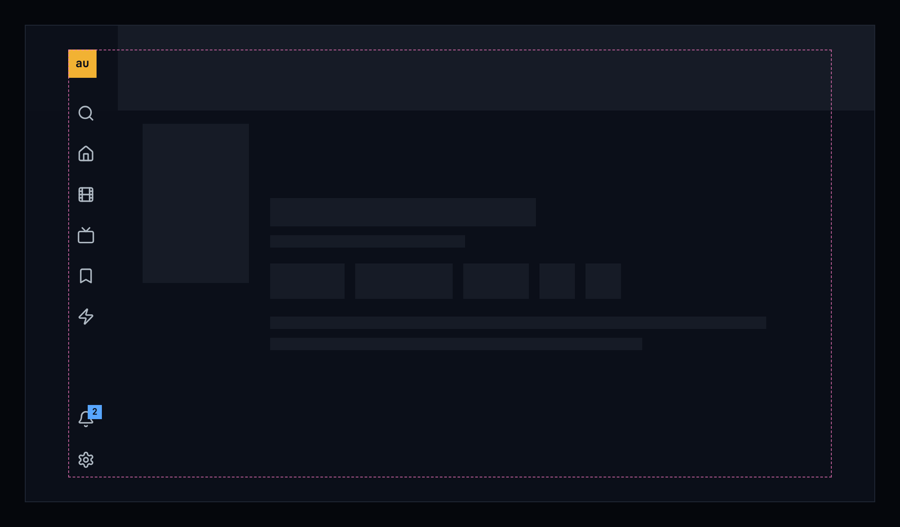

Figure 6.11: The title page loading, on a TV.

While the page loads, it shows nothing for the first 0.4 seconds, and after
that grey blocks in the shape of the still, the poster, the name, the facts,
the row and the description, as the design system's
[loading and progress](https://nalet.github.io/design-system/patterns/loading-and-progress/)
describes. Figure 6.11 shows them on a TV; a computer and a phone show the same
blocks in their own layout.

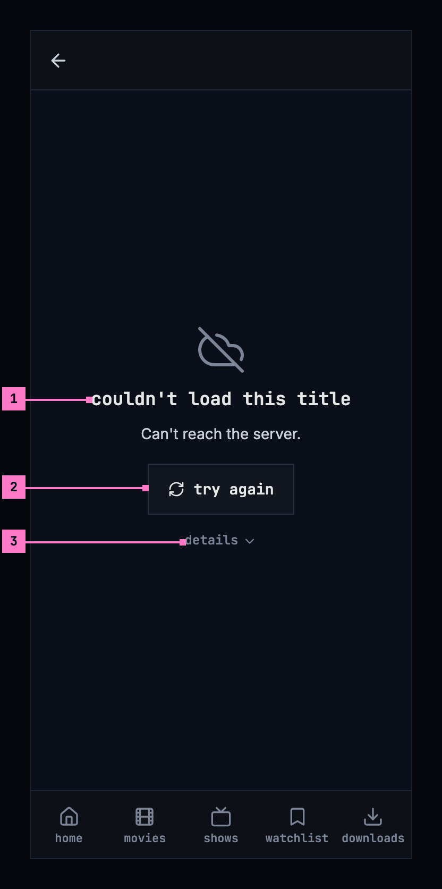

Figure 6.12: The title page when it couldn't load, on a phone.

1. **What couldn't load, and why.** “couldn't load this title”, and under it
   the reason as far as the app can tell. Figure 6.12 shows the case where the
   server didn't answer; [chapter 17](./errors.md) lists every cause and its
   sentence.
2. **try again** loads the page again. It takes the focus first.
3. **details** opens the server's answer, such as “HTTP 503 Service
   Unavailable”, for the people who fix things.

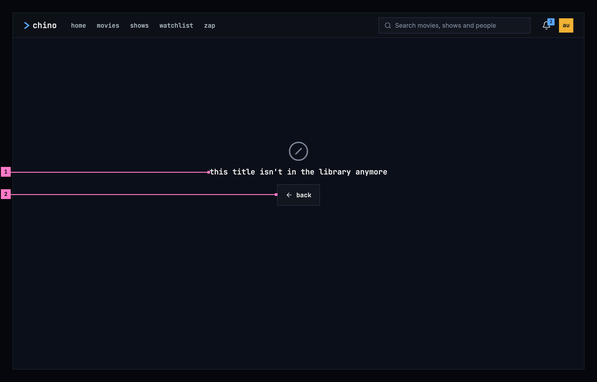

Figure 6.13: A title that isn't in the library anymore, on a computer.

1. **What is true**: “this title isn't in the library anymore”. Trying again
   can't bring it back, so the page offers no try again and gives no reason.
2. **back** returns to where the person came from, or to home when they came
   straight to the page, from a link.

| State | What the page shows |
|---|---|
| Loading | Figure 6.11 |
| Couldn't load | Figure 6.12, with the sentence for the cause |
| The title was removed | Figure 6.13 |
| The person may not see it | “you don't have access to this”, with **back** |
| The sign-in has expired | Nothing of its own: the app renews the sign-in and loads the page; only a refused sign-in leads to signing in, and back to the page |
| A show's episodes couldn't load | The rest of the page; in the episodes' place, “couldn't load the episodes”, the reason and **try again** |
| No description, no people, nothing like it | Each part is left out, and nothing says it's missing |
| The phone app can't reach the server | A downloaded title's page is built from what is on the phone, with the banner on top ([chapter 13](./downloads.md)); any other title's page is figure 6.12 |

## 6.9 Words

| Where | Text |
|---|---|
| The title row | play · resume 1:43 · start over · trailer · download · 152 MB |
| A show's first button | play S01E01 · resume S01E03 · start over · play S03E18–19 |
| The row's icon buttons, for screen readers | add to Watchlist · in your Watchlist · choose lists · mark as watched · watched · like · liked |
| The list picker | add to list |
| A card's menu | play · resume · mark as watched · watched · remove from continue watching |
| The facts | 2012 · 12 min · 1 h 32 min · science fiction · 6.6 · FSK 12 · 12+ · movie · show |
| The people | starring · full cast (12) · show less · Created by · Director · Directors · Writer · Writers · Producer · Producers · Music · Cinematography · Editor · Editors · Subtitles |
| Subtitle languages on a TV, when they don't fit | “Arabic, Chinese, English, +12 more” |
| The episodes | episodes · season 1 · specials · 6 episodes · 1 episode |
| An episode row | S01E03 · Alone in the Night · 41 min · 24 min left |
| A file of several episodes | S03E18–21 · 4 episodes · one file |
| Similar titles | more like this |
| The phone's downloads | download · 152 MB · download 3 more episodes · 940 MB · 1 of 6 downloaded, and the statuses of [chapter 13](./downloads.md) |
| Couldn't load | couldn't load this title · Can't reach the server. · try again · details |
| The episodes couldn't load | couldn't load the episodes |
| Removed | this title isn't in the library anymore · back |
| No access | you don't have access to this · back |

## 6.10 Today's apps

| App | What differs from this chapter |
|---|---|
| Web | The page has no top bar: back and home float over the still, on a see-through black. While it loads, a spinner turns in the middle. On a phone the poster stands above the name, 192 px wide. The length is “12m” or “1h 32m”, and the genres are chips under the facts. A title without a description says “No description available.” The labels are capitalised (“Starring”, “Directors”, “Full cast (12)”, “Show less”), the subtitle languages come in the order of the tracks, and an “Analyzed” fact lists “Intro · Credits · Recap”. The specials are hidden while there are numbered seasons, a season of one says “1 episodes”, an episode's actions line has watched before add to list, and its time left reads “Resume · 24m left”. A page opened on an episode names in its first button the episode of the table in section 6.5, not the one it was opened on. A trailer that opens outside the app shows that site's logo instead of the clapperboard. Couldn't load adds a quiet **back** beside **try again**, and where the server didn't accept the request, the sentence leaves out “Check for an app update.” |
| Phone app | The page has a bar of its own, with back and home side by side and the cast button, and no tabs. While it loads, a spinner turns. The poster stands above the name, 192 dp wide. The length is “12m”, the kind badge is in capitals (“MOVIE”, “SERIES”), and the genres are chips. The labels are capitalised as on the web, with “Analyzed”, and the subtitles list every kind (“English · for deaf and hard of hearing”). The seasons come in the server's order, the specials first as “Season 0”, and all start closed; an episode's time left reads “Resume · 24m left”. A page opened on an episode names in its first button the episode of the table in section 6.5, not the one it was opened on. |
| Android TV | The page has no rail. While it loads, “Loading…” stands in the middle. The row's controls are 44 dp high. The length is “12m”, the kind badge says “series” for a show, and the genres are chips. The starring cards show initials only, never a photo, and the crew's and the subtitles' labels are lowercase in the mono face (“director”, “subtitles”). The specials come first, as “Season 0”, and are the season that opens; a season of one says “1 episodes”; an episode's actions are watched, then add to list; its time left reads “Resume · 24m left”. No access says “you don't have access to this title”. A trailer that opens outside the app shows that site's logo. |
| Samsung TV | The page has no rail. The labels are capitalised (“Play”, “Resume 1:43”, “Start over”, “Trailer”), the buttons are round, a focused plain button turns white, and the focus ring is the accent's blue, not the focus colour. The Watchlist is a “+” that turns into a check (“Add to watchlist”, “Remove from watchlist”), with no list picker; there is no liked, and watched is an eye (“Mark as watched”, “Mark as unwatched”). While it loads, a spinner turns with “Loading…”. A page that couldn't load says “Could not load this title:” and the error's own message, in red, with no **try again** and no removed case. A title without a description says “No description available.”; “Subtitles” and “Analyzed” follow it. The starring cards show initials, a season of one says “1 episodes”, and an episode row has its watched toggle only (“Mark episode as watched”). |
