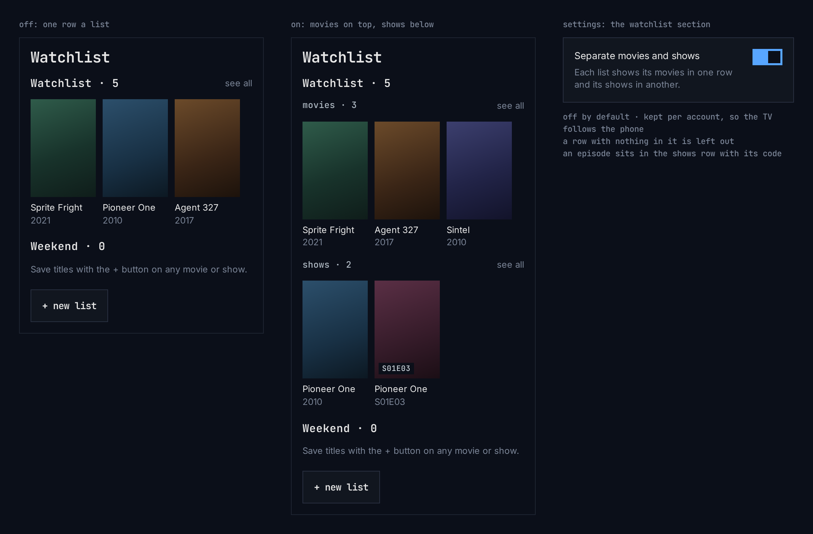

# Watchlist

The watchlist screen holds every list people keep: the Watchlist, which every
account has, and the lists they made themselves. Each list is a row of cards
on one page. Some people save movies and shows to the same list and want to
see them apart, so a setting splits every list into two rows: movies on top,
shows below.

This page covers the Android TV app and the phone and tablet app. The web and
Samsung TV apps follow it later.

**Status: designed, not built yet.** Neither app nor chino-api has it today.

## The setting

In settings, in its own **watchlist** section:

- **Separate movies and shows**: off by default.
- The line under it: “Each list shows its movies in one row and its shows in
  another.”

The setting belongs to the account, not to the device: turned on on the
phone, it is on on the TV too, the next time the watchlist opens there. A
server that doesn't keep the setting doesn't offer it, and the section is
left out ([for the builders](#for-the-builders)).

When the setting couldn't be saved, the switch goes back to where it was and
the section says “Couldn't save this. Check the connection and try again.”
until the switch is used again.

## Off

The watchlist screen stays as it is today: each list is one row named
“Watchlist · 7”, newest added first, then **new list**.

## On

Each list keeps its name and its count as its heading, and gets two rows
under it:

1. **movies · 4**: the list's movies.
2. **shows · 3**: the list's shows, and the episodes saved on their own. An
   episode keeps its code on its card (“S01E03”).

- **The order** is the same in every list: movies on top, shows below. Within
  a row, newest added first, as today.
- **A row with nothing in it is left out.** A list of only movies shows only
  its movies row, under the list's heading. A list with nothing in it shows
  the same hint as it does with the setting off.
- **The heading** opens the whole list, as today. Each row's **see all**
  opens the list too, scrolled to that row's section.
- **The counts** are the list's own: the heading's count is the sum of its
  rows' counts.

### A whole list

Opened from the hub, a list's grid is split the same way: a **movies · 4**
heading over its movies, then a **shows · 3** heading over its shows, with
nothing between them but the heading. Rename and delete stay where they are.

### On a TV

- Up and down move between rows, a list's two rows included; each row keeps
  the card it was left on, as other rows of cards do.
- The row labels are not focus stops. The list's heading is, as today.
- **see all** is the card at the end of each row, as on today's rows, not a
  link beside the label.

## Words

| Use | For | Not |
|---|---|---|
| “movies”, “shows” | The two rows, as the app's tabs say | “films”, “series”, “TV” |
| “Separate movies and shows” | The setting | “split”, “group by type”, “media type” |

## For the builders

- **Kind.** The movies row holds items of kind `movie`; the shows row holds
  `series` and `episode`. Only these three can be added to a list today; an
  item of any other kind goes in the shows row so it never disappears.
- **The setting** is stored by chino-api per account:
  `GET /v1/me/preferences` and `PATCH /v1/me/preferences` with
  `{"watchlist_by_kind": true}`. A server that offers it says so in
  `/api/config` as `features.preferences`, and offers the filter below as
  `features.watchlist_kinds`. Without both, the apps don't show the section
  and draw the watchlist as with the setting off. The apps read the
  setting when the watchlist screen opens, so a change made on another device
  shows without signing in again.
- **Filling the rows.** A list's row shows at most 12 cards, as today. A list
  gives only its items' ids, so each row asks the server for its own:
  `GET /v1/me/watchlists/{id}?kind=movie` or `?kind=series`, the latter with
  episodes and any other kind. Each list's counts come from
  `GET /v1/me/watchlists` as `counts: {"movie": 4, "series": 3}`, counted the
  same way, so they always add up to the list's count. A whole list's grid
  loads all its items, as today, and sorts them itself.
- **Offline**, on a phone, the watchlist screen says it couldn't load, as
  today; the setting doesn't change that.
