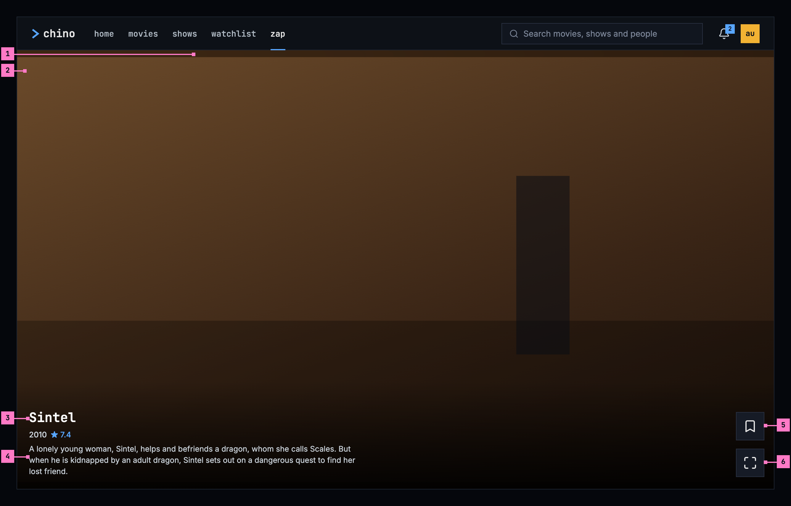
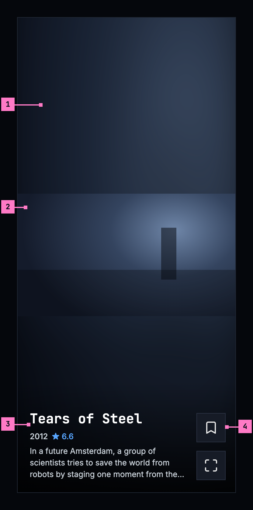
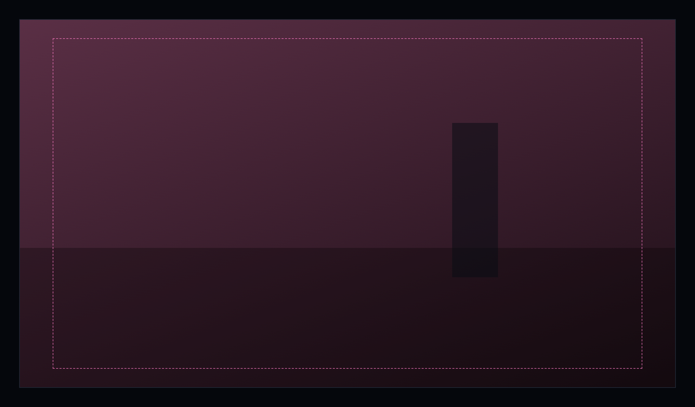
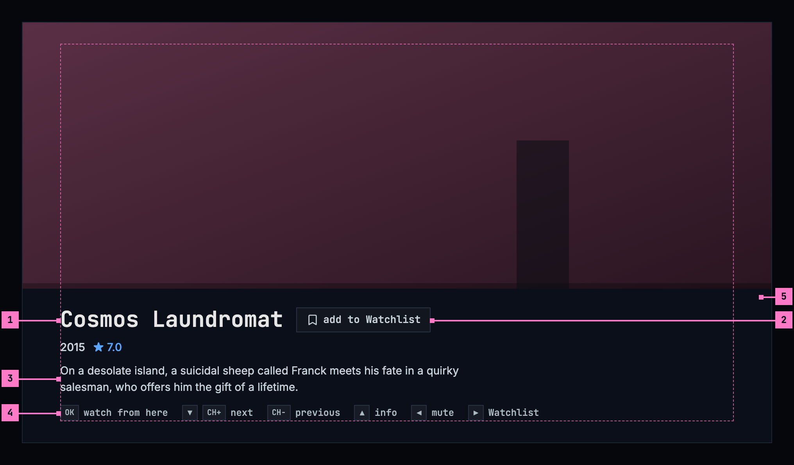
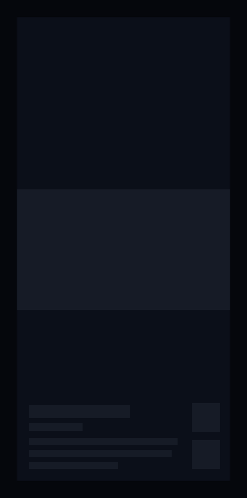
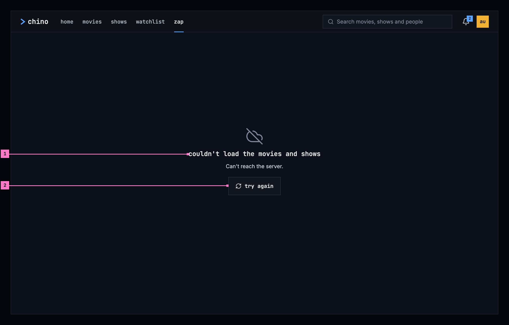
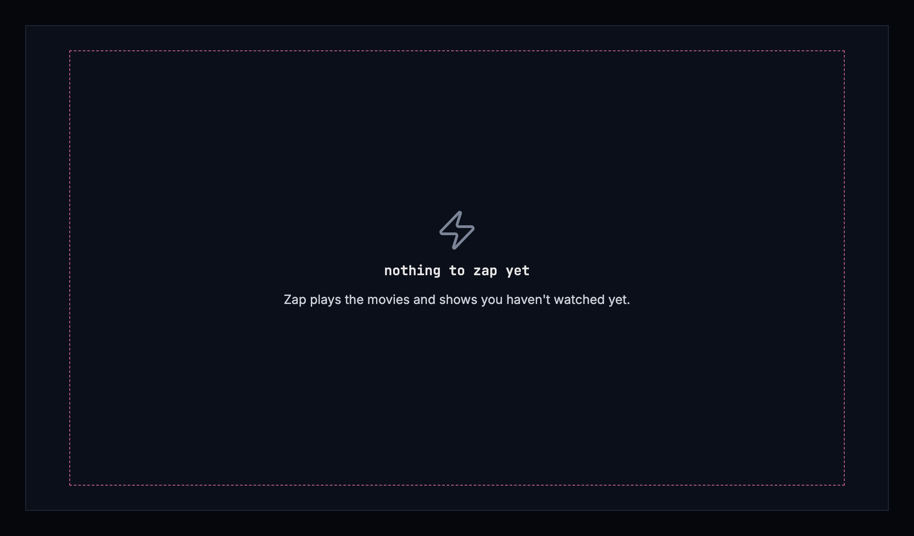

# 10 Zap

This chapter specifies zap, the screen that zaps through the library like
channels on a television. The frame around it is specified in
[chapter 2](./frame.md), and the player that **watch** opens in
[chapter 11](./playback.md).

## 10.1 Purpose

Zap is for the evening when nobody knows what to watch. Each card drops the
person into a random scene of a movie or a show they haven't watched, with its
sound, and the next card comes with a swipe, a scroll or a key. When a scene
catches them, **watch** goes on from that very moment in the player.

Zap opens from the **zap** view: in the top bar on a computer, as the web's
fifth tab on a phone, from the entry under the hero on the phone app's home
(section 4.3), and from the rail on a TV.

## 10.2 Zap on a computer

Figure 10.1 shows zap on a computer. One card fills the page under the top
bar, and the next card waits below it.

Figure 10.1: Zap on a computer, at 1280 × 800.

1. **The light.** The card's background is the clip's own light: a small copy
   of its picture, blown up, blurred and dimmed, so the card reads as full
   screen while the clip plays whole. At 1280 × 800 the clip takes almost the
   whole card, and the light shows as a strip above and below it; in a wider
   window it fills the sides. Section 10.6 says how it moves.
2. **The clip.** The scene plays whole, at 16:9, in the middle of the card: as
   wide as the card where the card is taller than 16:9, as high as the card
   where it is wider. It plays with sound.
3. **The title, the year and the rating**, small and close together. An
   episode's code comes before the year: “S01E03”.
4. **Three lines of the overview**, cut short at the end of the third.
5. **Save, the bookmark.** It adds the title to the Watchlist or takes it out
   again, as the main part of add to list does on a title's page
   ([chapter 6](./title-actions.md)): an outlined bookmark on the plain
   surface, and a dark, filled one on blue while the title is in the
   Watchlist. It touches no other list.
6. **watch**, the maximize icon. It opens the player at the scene that plays,
   at the second it has reached.

The two buttons are 48 × 48 squares on a solid surface, their icons alone,
one over the other at the card's right edge, and the foot of the column sits
on the text's bottom line. Their names, for a screen reader and as a tooltip,
are **add to Watchlist** or **in your Watchlist**, and **watch**. A click
anywhere else on the card is **watch** as well.

The mouse wheel, or a swipe on the touchpad, brings the next card; scrolling
back brings the card before again, at the scene it showed. Nothing else is on
the card: no zap wordmark, no hint such as “tap to watch · swipe up”, no
genres and no mute button. Zap plays with sound, and the device's own volume
is its mute.

A browser may refuse a page's sound until the person has pressed something on
it. Zap then plays the card without sound and shows **unmute**, with the
muted speaker, in the middle of the card, on a solid surface. One press brings
the sound back for every card after it. While the browser allows the sound,
**unmute** never shows.

## 10.3 Zap on a phone

Figure 10.2 shows zap on a phone. The parts are those of figure 10.1; the
numbers mark where the phone differs.

Figure 10.2: Zap on a phone, at 360 dp.

1. **The light** fills most of the card. The phone is upright, so the clip
   takes the card's width, and the light the room above and below it.
2. **The clip**, the phone's full width, in the middle of the card.
3. **The foot**, as on a computer: the title, the year and the rating, and
   three lines of the overview, on the light.
4. **Save over watch**, at the right edge, the foot of the column on the
   text's bottom line.

In the phone app, zap is a screen of its own: it covers the top bar and the
tabs, and the phone's back returns to home, where its entry is. A swipe up
brings the next card and a swipe down the card before, at the scene it showed.
A tap anywhere is **watch**. Zap stays upright while it shows, so the foot
keeps its room; the phone turns freely again once zap closes.

The web on a phone shows the same card inside its frame: the top bar above it,
and the tabs below it with **zap** current ([chapter 2](./frame.md)). Where the
browser blocks the sound, it shows **unmute** as in section 10.2.

## 10.4 Zap on a TV

Figure 10.3 shows zap on a TV. Zap fills the screen, without the rail. On a
16:9 TV the clip fills the screen, so there is no card around it and no light,
only the scene.

Figure 10.3: Zap on a TV, the scene alone, at 960 × 540 dp.

When a channel starts, and whenever the person presses up, the info shows at
the foot of the screen, as in figure 10.4. It fades after about a minute; the
next channel starts without it.

Figure 10.4: The TV's info, at 960 × 540 dp.

1. **The title, the year and the rating.** An episode's code comes before the
   year, as on a computer.
2. **The Watchlist chip**: **add to Watchlist** with an outlined bookmark, or
   **in your Watchlist** with a dark one on blue. Right on the remote adds the
   title or takes it out, and shows the info, so the change is seen. The chip
   only shows the state; it takes no focus.
3. **The overview**, three lines at most.
4. **The keys**, each by its name on the remote, then what it does. While the
   sound is off, the left key says **unmute**.
5. **The band**: one solid surface under the info, out to the screen's edges,
   so no word stands on the picture. The info itself keeps inside the safe
   area.

Nothing on the TV takes the focus, so the remote's keys work at once:

| Key | What it does |
|---|---|
| ▼ or CH+ | The next channel. The info hides. |
| CH− | The channel before, at the scene it showed. The info hides. |
| ▲ | Shows the info. |
| ◀ | Turns the sound off, and on again. |
| ▶ | Adds the title to the Watchlist, or takes it out. |
| OK | **watch from here**: the player, at this scene. |
| back | Home. |

A title that can't be played is skipped, and the next channel starts by
itself. Zap skips at most six in a row, so a run of titles that won't play
can't spin through the library; after the sixth it stays where it is until the
person moves on.

## 10.5 What zap plays

### 10.5.1 The titles

Zap takes the movies and shows the person hasn't watched, and only those that
start at once, without waiting for the server to convert them. A title comes
at most once in a session, and a file that holds several episodes comes once,
as its first episode.

Zap learns from what the person does in a session. Watching or saving a
title counts for its kind, its genres and its cast; staying on a card for a
while counts a little; passing a card within a couple of seconds counts
against. More than half of the cards are still picked at random, so the feed
never settles on one kind of title.

### 10.5.2 The scene

Every card starts at a new place, picked at random: never in the first minute,
never in the last minute and a half, and between the end of the intro and the
start of the credits where the server knows them. Within that stretch it lands
between a tenth and four fifths of the way through, so the scene is neither the
opening nor the end. A card visited again keeps its scene. A title of two and
a half minutes or less has no such stretch and is left out.

### 10.5.3 What zap leaves alone

Zapping changes nothing about what the person watched. A card doesn't count as
watched, doesn't go into continue watching ([chapter 4](./home.md)) and doesn't
move where a title resumes. Only **watch** does, because it opens the player,
and the player keeps the place from there ([chapter 11](./playback.md)).

A card shows no subtitles, not even those that would come on by themselves in
the player ([chapter 12](./subtitles.md)): it is a glimpse of a scene. **watch**
brings them, as the player picks them.

## 10.6 The light

The light follows the clip calmly, like a room lit by a television. The clip
is sampled at most once a second and averaged to a coarse grid of 16 × 9
colours, so no detail of the picture is left in it, and the light eases towards
each sample over about 1.8 seconds. A cut in the clip is a slow drift on the
card, never a flicker. The light's layers are opaque, so a fade never lets the
black behind them through, and one veil dims them all, so the clip stays the
brightest thing on the card.

A new card comes with a 0.6-second crossfade. Until the clip's first frame,
the title's backdrop stands in the clip's place and is the light, so a card
that is starting never shows a black box; the scene fades in over it.

## 10.7 States

Zap is drawn in figures 10.1 to 10.4 with a card playing. Figures 10.5 to 10.7
show the states in between.

Figure 10.5: Zap loading, on a phone.

While zap picks its first cards, it shows nothing for the first 0.4 seconds,
and after that grey blocks in the shape of a card: the clip in the middle, the
title, the year and the overview at the foot, and the two squares beside them.
A computer and a TV show the same blocks in their own layout.

Figure 10.6: Zap when the titles couldn't load, on a computer.

1. **What couldn't load, and why.** Zap builds its cards from the library's
   movies and shows, so the title names those, and the sentence under it gives
   the reason as far as the app can tell. Figure 10.6 shows the case where the
   server didn't answer; [chapter 17](./errors.md) lists every cause and its
   sentence.
2. **try again** asks for the titles again.

Figure 10.7: Nothing to zap, on a TV.

When the library has no title zap can play, zap says so and says what it
plays, so the person can tell why. It offers nothing to press; back returns
home. Figure 10.7 shows it on a TV.

| State | What zap shows |
|---|---|
| Loading | Figure 10.5 |
| A card starting | The title's backdrop in the clip's place, as its light (section 10.6) |
| The titles couldn't load | Figure 10.6, with the sentence for the cause |
| Nothing to zap | Figure 10.7 |
| A title that can't be played | On a computer and a phone, the card keeps its backdrop and the next swipe moves on; on a TV, zap skips it (section 10.4) |
| The browser blocked the sound | **unmute** in the middle of the card (section 10.2) |
| The phone app can't reach the server | Zap isn't offered: the app opens on downloads, and home with its zap entry isn't shown ([chapter 13](./downloads.md)) |

## 10.8 Words

| Where | Text |
|---|---|
| The view | zap |
| The card's buttons, for a screen reader and as a tooltip | add to Watchlist · in your Watchlist · watch |
| The card's foot | “2010 ★ 7.4”, an episode “S01E03 2010 ★ 7.1” |
| Where the browser blocked the sound | unmute |
| The TV's Watchlist chip | add to Watchlist · in your Watchlist |
| The TV's keys | OK watch from here · ▼ CH+ next · CH− previous · ▲ info · ◀ mute, while muted unmute · ▶ Watchlist |
| The titles couldn't load | couldn't load the movies and shows · Can't reach the server. · try again |
| Nothing to zap | nothing to zap yet · Zap plays the movies and shows you haven't watched yet. |

## 10.9 Today's apps

| App | What differs from this chapter |
|---|---|
| Web | While a card waits for its first frame, “TUNING…” pulses in the middle of it. A card that was left is dropped from the queue, so scrolling back doesn't bring it back. A new card's light fades in over 0.7 seconds. Loading shows a spinner alone, not grey blocks. The watch button's tooltip and name are “Watch”. Signed out, zap says “sign in to start zapping”. It also takes single episodes, from the newest. A title of two and a half minutes or less stays on its backdrop with “TUNING…” instead of being left out. |
| Phone app | Zap is a tab between watchlist and downloads, inside the top bar and the tabs. Loading shows a spinner with “Tuning in…”. When the titles couldn't load, it says “Nothing to zap right now”, as it does when there is nothing to zap. The watch button's name is “Watch”. |
| Android TV | The info shows up to three genres after the rating, and its keys read “OK · watch from here”, “▼ / CH+ next”, “CH- back”, “▲ info”, “◀ mute”, “▶ Watchlist”. Loading says “Loading…”. When the titles couldn't load, and when there is nothing to zap, it says “Nothing left to zap. Come back later.” |
| Samsung TV | Loading says “Tuning in…”, and “TUNING…” shows while a channel starts. The info shows the genres; its chip says “Save” or “Saved”, rounded and green when saved; its keys read “OK Watch from here ▼ / CH+ Next CH- Back ▲ Info ◀ Mute ▶ Save”. When the titles couldn't load, and when there is nothing to zap, it says “Nothing left to zap. Come back later.” |
