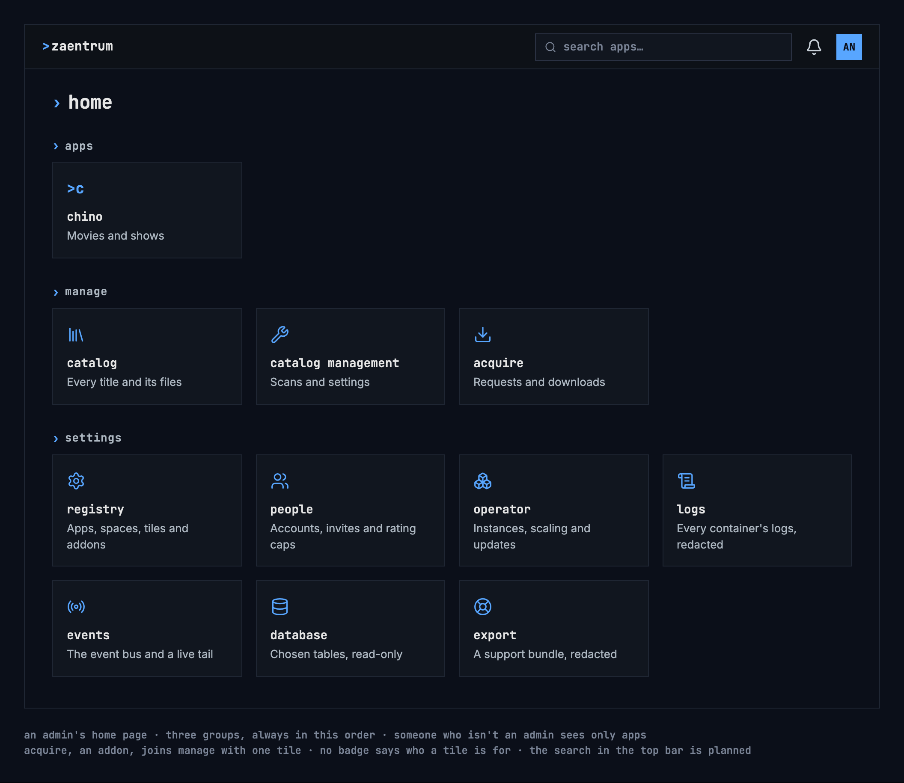

# Home page

The home page is the first page after signing in. It follows the design
system's [home & tiles](https://nalet.github.io/design-system/patterns/home-and-tiles/)
pattern; this page says what zaentrum puts on it.

## Groups

Three groups, always in this order, on every installation:

| Group | For | Its tiles |
|---|---|---|
| apps | everyone signed in | chino, and every product installed next to it |
| manage | the people who look after the library: admins | catalog, catalog management, and addons such as acquire |
| settings | the people who may change the platform: admins | registry, people, operator, logs, events, database, export |

- A group with nothing a person may open is hidden, so someone who isn't an
  admin sees only apps.
- An addon joins a group; it never brings one of its own. acquire joins manage
  with one tile, “acquire”, “Requests and downloads”. Its views (requests,
  downloads, search, search sources, clients, quality profiles) are in its own
  navigation, not on the home page.
- A product that isn't installed has no tile, and nothing says it is coming.
- No badge says who a tile is for: only the people a tile is for see it.

## Words

- The page's title is “home”, with no greeting and no line under it.
- Tile names and descriptions as in the picture. A description says what the
  app is for, in sentence case.

## Planned

- A “my apps” group on top, once people can pin the apps they use most.
- The search in the [top bar](https://nalet.github.io/design-system/patterns/top-bar/),
  “search apps…”, which narrows the tiles as people type.

## Not built like this yet

Today's portal differs here; it changes with the UI rework, after the design
system's review:

- The heading says “welcome back”, with “your spaces and apps” under it.
- acquire brings a group of its own, with six tiles for its views.
- tv and musig show as faded tiles with the badge “soon”.
- The manage and settings tiles carry the badge “admin”.
- Descriptions are lowercase, with “&” and “·”: “movies & shows”, “accounts ·
  invites · rating caps”.
- A home page that couldn't load shows the raw error after “couldn’t load your
  launchpad:”, not a reason in words.
