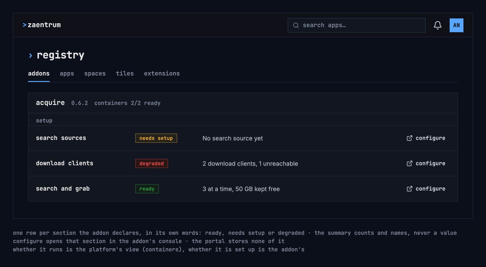

# Settings and setup

Where each kind of setting lives in zaentrum. It follows the design system's
[settings and setup](https://nalet.github.io/design-system/patterns/settings-and-setup/)
pattern: every setting has exactly one place where it is changed.

| Kind | Where | Who changes it |
|---|---|---|
| A person's preferences, such as language | Each app's own settings today; one place in the account menu is planned | Each person |
| The platform: apps, spaces, tiles, people | Settings: **registry** and **people** | Admins |
| How an addon is installed | Settings → registry → **addons**: the values of its chart. The operator applies them and may restart the addon ([ADR-0011](../adr/0011-addon-charts-installed-by-the-operator.md)) | Admins |
| An addon's own setup | Inside the addon, reached from its setup checklist ([ADR-0010](../adr/0010-addon-component-groups-and-setup.md)) | Admins |

## An addon's setup checklist

- One row for each setup section the addon declares, with its state in the
  addon's own words: ready, needs setup or degraded.
- The summary counts and names; it never shows a value or a password: “2
  download clients, 1 unreachable”.
- “configure” opens that section inside the addon's own console, the only
  place it is changed.
- The portal stores none of it: the checklist asks the addon each time it is
  shown, with the admin's own sign-in ([ADR-0010](../adr/0010-addon-component-groups-and-setup.md)).
- Whether the addon runs is the platform's view, its containers; whether it is
  set up is the addon's. A section isn't “ready” while the part it needs is
  down.

## First run

Until an admin marks the platform as set up, the home page shows a first-run
checklist above the tiles, to admins only.
