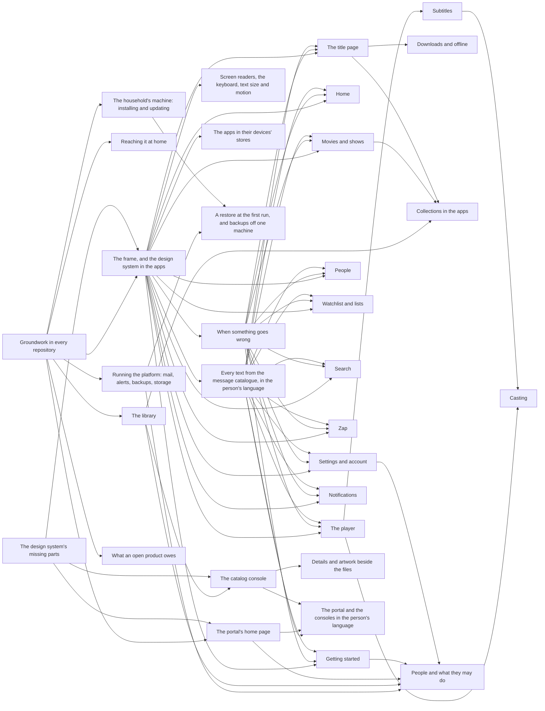

# Work packages

The order of the work. The chapters say what is built, as numbered changes;
[scope](./scope.md) says what is left out. This page puts the changes into
packages that are built together, and says which package has to be built
before which.

> **Written by hand, counted by a program.** The packages are
> [packages.csv](./packages.csv): each names its changes, one by one or as a
> whole chapter, and the packages it comes after. A check fails when a change
> that is not withdrawn is in no package or in two, or when a package waits
> for itself.

## How to read it

A **package** is a set of changes that belong together: one chapter's screens,
or one thing that crosses chapters, such as an account's code, which is asked
when an account is chosen (chapter 3) and set in the settings (chapter 16).
A package with no numbered change is work that has to be there before the
changes are built.

**After** names the packages that have to be built first. Inside a package the
changes are built in the order of their numbers, the server's part of a change
before the apps'. A package can be started once every package it comes after
is built; packages that do not wait for each other can be built side by side.

Being in a package does not approve a change. Only a change the owner has
approved is built; a package is done when each of its approved changes is
verified.

## The order

<!-- generated: order -->

<!-- end: order -->

<!-- generated: packages -->
|  | Package | After | Changes | proposed | approved | built | verified |
|---|---|---|---|---|---|---|---|
| 1 | [Groundwork in every repository](#groundwork-in-every-repository) | — | 4 | 4 | 0 | 0 | 0 |
| 2 | [The design system's missing parts](#the-design-systems-missing-parts) | — | — | — | — | — | — |
| 3 | [The frame, and the design system in the apps](#the-frame-and-the-design-system-in-the-apps) | Groundwork in every repository, The design system's missing parts | 11 | 11 | 0 | 0 | 0 |
| 4 | [Every text from the message catalogue, in the person's language](#every-text-from-the-message-catalogue-in-the-persons-language) | The frame, and the design system in the apps | 5 | 5 | 0 | 0 | 0 |
| 5 | [Screen readers, the keyboard, text size and motion](#screen-readers-the-keyboard-text-size-and-motion) | The frame, and the design system in the apps | 2 | 2 | 0 | 0 | 0 |
| 6 | [When something goes wrong](#when-something-goes-wrong) | The frame, and the design system in the apps | 15 | 15 | 0 | 0 | 0 |
| 7 | [Getting started](#getting-started) | The frame, and the design system in the apps, When something goes wrong, Every text from the message catalogue, in the person's language | 13 | 13 | 0 | 0 | 0 |
| 8 | [Home](#home) | The frame, and the design system in the apps, When something goes wrong, Every text from the message catalogue, in the person's language | 22 | 22 | 0 | 0 | 0 |
| 9 | [Movies and shows](#movies-and-shows) | The frame, and the design system in the apps, When something goes wrong, Every text from the message catalogue, in the person's language | 20 | 20 | 0 | 0 | 0 |
| 10 | [The title page](#the-title-page) | The frame, and the design system in the apps, When something goes wrong, Every text from the message catalogue, in the person's language | 25 | 25 | 0 | 0 | 0 |
| 11 | [People](#people) | The frame, and the design system in the apps, When something goes wrong, Every text from the message catalogue, in the person's language | 11 | 11 | 0 | 0 | 0 |
| 12 | [Watchlist and lists](#watchlist-and-lists) | The frame, and the design system in the apps, When something goes wrong, Every text from the message catalogue, in the person's language | 17 | 17 | 0 | 0 | 0 |
| 13 | [Search](#search) | The frame, and the design system in the apps, When something goes wrong, Every text from the message catalogue, in the person's language | 15 | 15 | 0 | 0 | 0 |
| 14 | [Zap](#zap) | The frame, and the design system in the apps, When something goes wrong, Every text from the message catalogue, in the person's language | 21 | 21 | 0 | 0 | 0 |
| 15 | [The player](#the-player) | The frame, and the design system in the apps, When something goes wrong, Every text from the message catalogue, in the person's language | 52 | 52 | 0 | 0 | 0 |
| 16 | [Subtitles](#subtitles) | The player | 11 | 11 | 0 | 0 | 0 |
| 17 | [Downloads and offline](#downloads-and-offline) | The title page | 6 | 6 | 0 | 0 | 0 |
| 18 | [Casting](#casting) | The player, Subtitles | 9 | 9 | 0 | 0 | 0 |
| 19 | [Notifications](#notifications) | The frame, and the design system in the apps, When something goes wrong, Every text from the message catalogue, in the person's language | 13 | 13 | 0 | 0 | 0 |
| 20 | [Settings and account](#settings-and-account) | The frame, and the design system in the apps, When something goes wrong, Every text from the message catalogue, in the person's language | 20 | 20 | 0 | 0 | 0 |
| 21 | [The apps in their devices' stores](#the-apps-in-their-devices-stores) | The frame, and the design system in the apps | 1 | 1 | 0 | 0 | 0 |
| 22 | [The portal's home page](#the-portals-home-page) | Groundwork in every repository, The design system's missing parts | 17 | 15 | 2 | 0 | 0 |
| 23 | [Reaching it at home](#reaching-it-at-home) | Groundwork in every repository | 16 | 16 | 0 | 0 | 0 |
| 24 | [The household's machine: installing and updating](#the-households-machine-installing-and-updating) | Groundwork in every repository | 22 | 22 | 0 | 0 | 0 |
| 25 | [Running the platform: mail, alerts, backups, storage](#running-the-platform-mail-alerts-backups-storage) | Groundwork in every repository | 21 | 21 | 0 | 0 | 0 |
| 26 | [A restore at the first run, and backups off one machine](#a-restore-at-the-first-run-and-backups-off-one-machine) | Running the platform: mail, alerts, backups, storage, The household's machine: installing and updating | 2 | 2 | 0 | 0 | 0 |
| 27 | [The library](#the-library) | Groundwork in every repository | 14 | 14 | 0 | 0 | 0 |
| 28 | [The catalog console](#the-catalog-console) | The library, The design system's missing parts | 25 | 25 | 0 | 0 | 0 |
| 29 | [Details and artwork beside the files](#details-and-artwork-beside-the-files) | The catalog console | 3 | 3 | 0 | 0 | 0 |
| 30 | [Collections in the apps](#collections-in-the-apps) | The library, Movies and shows, The title page | 5 | 5 | 0 | 0 | 0 |
| 31 | [People and what they may do](#people-and-what-they-may-do) | Running the platform: mail, alerts, backups, storage, The library, The portal's home page, Getting started, Settings and account | 21 | 21 | 0 | 0 | 0 |
| 32 | [The portal and the consoles in the person's language](#the-portal-and-the-consoles-in-the-persons-language) | Every text from the message catalogue, in the person's language, The portal's home page, The catalog console | 3 | 3 | 0 | 0 | 0 |
| 33 | [What an open product owes](#what-an-open-product-owes) | Groundwork in every repository | 2 | 2 | 0 | 0 | 0 |
<!-- end: packages -->

<!-- generated: by-package -->
## Groundwork in every repository

Each repository says how it is built, tested and changed, runs its tests on every change, and signs what it releases; the message catalogue and its check, and a browser in each web repository's tests, come with it. Nothing is built before it.

| No. | Change | Where | Status |
|---|---|---|---|
| [T.C1](../platform/trust.md#changes) | A security policy in every repository | Docs | proposed |
| [T.C2](../platform/trust.md#changes) | A guide to contributing, and each repository's own | Docs | proposed |
| [T.C3](../platform/trust.md#changes) | Every repository's tests on every change | Images | proposed |
| [T.C4](../platform/trust.md#changes) | Images signed, with the record of their build and a list of what they hold | Images, Docs | proposed |

## The design system's missing parts

The parts the target screens draw and the design system lacks (chino, chapter 1, section 1.5), and a count and a date that follow the page's language, are added to the design system and released, so that every app takes them from one place.

No numbered change: work that comes before the changes.

## The frame, and the design system in the apps

The rail, the bar, the tabs and the avatar's menu at every size, and the apps taking the design system's components. Every screen sits in it. After: [Groundwork in every repository](#groundwork-in-every-repository), [The design system's missing parts](#the-design-systems-missing-parts).

| No. | Change | Where | Status |
|---|---|---|---|
| [2.C1](../chino/frame.md#27-changes) | The avatar's menu, with settings in it | Web, Phone app | proposed |
| [2.C2](../chino/frame.md#27-changes) | The computer's rail: the current view's bar, and the names lowercase | Web | proposed |
| [2.C3](../chino/frame.md#27-changes) | The phone's frame held upright: the bar and five tabs | Web, Phone app | proposed |
| [2.C4](../chino/frame.md#27-changes) | The phone's frame held sideways | Web, Phone app | proposed |
| [2.C5](../chino/frame.md#27-changes) | Every screen in the frame, but the player and zap | Web, Phone app, Android TV, Samsung TV | proposed |
| [2.C6](../chino/frame.md#27-changes) | Web: an address for every view | Web | proposed |
| [2.C7](../chino/frame.md#27-changes) | The TV's rail holds the frame, and opens | Android TV, Samsung TV | proposed |
| [2.C8](../chino/frame.md#27-changes) | The TV keeps to the safe area | Android TV, Samsung TV | proposed |
| [2.C9](../chino/frame.md#27-changes) | The avatar's name for a screen reader | Web, Phone app, Android TV, Samsung TV | proposed |
| [2.C10](../chino/frame.md#27-changes) | help in the avatar's menu | Web, Phone app | proposed |
| [2.C11](../chino/frame.md#27-changes) | The apps take the design system's components | Web, Phone app, Android TV, Samsung TV | proposed |

## Every text from the message catalogue, in the person's language

The message catalogue in chino's apps, the app's language kept with the account, the server answering with codes, and the sign-in pages in the person's language. It comes before the pages, so their new words go straight into the catalogue. After: [The frame, and the design system in the apps](#the-frame-and-the-design-system-in-the-apps).

| No. | Change | Where | Status |
|---|---|---|---|
| [2.C13](../chino/frame.md#27-changes) | Every text from the message catalogue | Web, Phone app, Android TV, Samsung TV | proposed |
| [16.C23](../chino/settings.md#167-changes) | The app's language | Web, Phone app, Android TV, Samsung TV | proposed |
| [16.C24](../chino/settings.md#167-changes) | chino-api keeps the app's language and answers with codes | Server | proposed |
| [17.C17](../chino/errors.md#1715-changes) | A failure's sentence by the server's code | Web, Phone app, Android TV, Samsung TV | proposed |
| [N.C15](../platform/home.md#changes) | The sign-in pages and the mails in the person's language | Operator | proposed |

## Screen readers, the keyboard, text size and motion

Every screen of chino works with the device's screen reader and, on the web, a keyboard; text follows the device's size and motion its setting. Each repository gets the check that keeps it so. After: [The frame, and the design system in the apps](#the-frame-and-the-design-system-in-the-apps).

| No. | Change | Where | Status |
|---|---|---|---|
| [2.C14](../chino/frame.md#27-changes) | Every screen works with the device's screen reader, and on the web with a keyboard | Web, Phone app, Android TV, Samsung TV | proposed |
| [2.C15](../chino/frame.md#27-changes) | Text follows the device's text size, and motion the device's setting | Web, Phone app, Android TV, Samsung TV | proposed |

## When something goes wrong

What a screen says when it can't do its job, by cause. Every page uses it. After: [The frame, and the design system in the apps](#the-frame-and-the-design-system-in-the-apps).

| No. | Change | Where | Status |
|---|---|---|---|
| [17.C1](../chino/errors.md#1715-changes) | The causes, by the server's answer | Phone app, Samsung TV | proposed |
| [17.C2](../chino/errors.md#1715-changes) | The Samsung TV's requests give up | Samsung TV | proposed |
| [17.C3](../chino/errors.md#1715-changes) | The way on: one standard button | Web, Phone app, Android TV, Samsung TV | proposed |
| [17.C4](../chino/errors.md#1715-changes) | The design system's empty state, with its drawing | Web, Phone app, Android TV, Samsung TV | proposed |
| [17.C5](../chino/errors.md#1715-changes) | The message in the page's place, centred | Web, Android TV, Samsung TV | proposed |
| [17.C6](../chino/errors.md#1715-changes) | Details: the status and its reason phrase | Web, Phone app, Android TV, Samsung TV | proposed |
| [17.C7](../chino/errors.md#1715-changes) | The headings, in the screen's own words | Web, Phone app, Android TV, Samsung TV | proposed |
| [17.C8](../chino/errors.md#1715-changes) | A part of a page in the error banner | Web, Phone app, Android TV, Samsung TV | proposed |
| [17.C9](../chino/errors.md#1715-changes) | A failure never reads as empty | Android TV, Samsung TV | proposed |
| [17.C10](../chino/errors.md#1715-changes) | No access, in one sentence | Web, Phone app, Android TV | proposed |
| [17.C11](../chino/errors.md#1715-changes) | A sign-in that no longer holds | Phone app, Android TV, Samsung TV | proposed |
| [17.C12](../chino/errors.md#1715-changes) | Android TV: movies and shows say why instead of closing | Android TV | proposed |
| [17.C13](../chino/errors.md#1715-changes) | A refresh that fails keeps the screen, under a warning | Web, Phone app, Android TV, Samsung TV | proposed |
| [17.C14](../chino/errors.md#1715-changes) | A failed action in an error banner, by cause | Web, Phone app, Android TV, Samsung TV | proposed |
| [17.C15](../chino/errors.md#1715-changes) | The web's not-accepted sentence | Web | proposed |

## Getting started

Adding a server, signing in, who's watching. After: [The frame, and the design system in the apps](#the-frame-and-the-design-system-in-the-apps), [When something goes wrong](#when-something-goes-wrong), [Every text from the message catalogue, in the person's language](#every-text-from-the-message-catalogue-in-the-persons-language).

| No. | Change | Where | Status |
|---|---|---|---|
| [3.C1](../chino/start.md#37-changes) | Connect to a server: its words and the field | Phone app, Android TV, Samsung TV | proposed |
| [3.C2](../chino/start.md#37-changes) | connect busy while the check runs | Phone app, Android TV, Samsung TV | proposed |
| [3.C3](../chino/start.md#37-changes) | The check's reasons | Phone app, Android TV, Samsung TV | proposed |
| [3.C4](../chino/start.md#37-changes) | The phone held sideways | Phone app | proposed |
| [3.C5](../chino/start.md#37-changes) | Samsung TV: recent servers | Samsung TV | proposed |
| [3.C6](../chino/start.md#37-changes) | Sign in on a phone | Phone app | proposed |
| [3.C7](../chino/start.md#37-changes) | Sign in on a TV | Android TV, Samsung TV | proposed |
| [3.C8](../chino/start.md#37-changes) | A failed sign-in says why, by cause | Web, Phone app, Android TV, Samsung TV | proposed |
| [3.C9](../chino/start.md#37-changes) | Web: back to the page the address named | Web | proposed |
| [3.C10](../chino/start.md#37-changes) | Who's watching: its words and the ✕ | Phone app, Android TV | proposed |
| [3.C11](../chino/start.md#37-changes) | Samsung TV: who's watching | Samsung TV | proposed |
| [3.C12](../chino/start.md#37-changes) | The avatar's look | Web, Phone app, Android TV, Samsung TV | proposed |
| [3.C13](../chino/start.md#37-changes) | No picture in the avatar | Web, Phone app, Android TV | proposed |

## Home

The first screen after signing in. After: [The frame, and the design system in the apps](#the-frame-and-the-design-system-in-the-apps), [When something goes wrong](#when-something-goes-wrong), [Every text from the message catalogue, in the person's language](#every-text-from-the-message-catalogue-in-the-persons-language).

| No. | Change | Where | Status |
|---|---|---|---|
| [4.C1](../chino/home.md#47-changes) | The hero leaves out what was watched | Web, Phone app | proposed |
| [4.C2](../chino/home.md#47-changes) | The TVs' hero: the newest titles with a trailer | Android TV, Samsung TV | proposed |
| [4.C3](../chino/home.md#47-changes) | 20 seconds a title, held while in use | Phone app, Android TV, Samsung TV | proposed |
| [4.C4](../chino/home.md#47-changes) | The hero's line: year, length and genre | Web, Phone app, Android TV, Samsung TV | proposed |
| [4.C5](../chino/home.md#47-changes) | The current square in blue | Web, Phone app, Android TV, Samsung TV | proposed |
| [4.C6](../chino/home.md#47-changes) | Web: the hero's buttons, one trailer icon, no empty description | Web | proposed |
| [4.C7](../chino/home.md#47-changes) | The TVs' hero buttons | Android TV, Samsung TV | proposed |
| [4.C8](../chino/home.md#47-changes) | Phone app: play alone on the hero | Phone app | proposed |
| [4.C9](../chino/home.md#47-changes) | Phone app: a hero without a trailer | Phone app | proposed |
| [4.C10](../chino/home.md#47-changes) | The rows' names | Web, Phone app, Samsung TV | proposed |
| [4.C11](../chino/home.md#47-changes) | continue watching and next up: stills with the time left | Web, Phone app, Android TV, Samsung TV | proposed |
| [4.C12](../chino/home.md#47-changes) | Samsung TV: no genre rows | Samsung TV | proposed |
| [4.C13](../chino/home.md#47-changes) | Samsung TV: see all, the card's menu and the Watchlist mark | Samsung TV | proposed |
| [4.C14](../chino/home.md#47-changes) | see all opens the row's order | Web, Phone app, Android TV | proposed |
| [4.C15](../chino/home.md#47-changes) | Web: see all as the row's last card alone | Web | proposed |
| [4.C16](../chino/home.md#47-changes) | Phone app: zap under the hero | Phone app | proposed |
| [4.C17](../chino/home.md#47-changes) | A phone held sideways: the hero keeps to the screen | Web, Phone app | proposed |
| [4.C18](../chino/home.md#47-changes) | Samsung TV: back on home keeps it | Samsung TV | proposed |
| [4.C19](../chino/home.md#47-changes) | Loading: grey blocks | Web, Phone app, Android TV, Samsung TV | proposed |
| [4.C20](../chino/home.md#47-changes) | Couldn't load the library | Web, Samsung TV | proposed |
| [4.C21](../chino/home.md#47-changes) | A row that couldn't load says so | Web, Phone app, Android TV, Samsung TV | proposed |
| [4.C22](../chino/home.md#47-changes) | An empty library says so | Web, Phone app, Android TV, Samsung TV | proposed |

## Movies and shows

The library by kind, with its filters. After: [The frame, and the design system in the apps](#the-frame-and-the-design-system-in-the-apps), [When something goes wrong](#when-something-goes-wrong), [Every text from the message catalogue, in the person's language](#every-text-from-the-message-catalogue-in-the-persons-language).

| No. | Change | Where | Status |
|---|---|---|---|
| [5.C1](../chino/browse.md#59-changes) | The filter bar | Web, Phone app, Android TV, Samsung TV | proposed |
| [5.C2](../chino/browse.md#59-changes) | all in decade; before 1980 | Web, Phone app, Android TV | proposed |
| [5.C3](../chino/browse.md#59-changes) | The genres of the view's own titles | Web, Phone app, Android TV, Samsung TV, the server | proposed |
| [5.C4](../chino/browse.md#59-changes) | clear all leaves the sort | Web, Phone app, Android TV | proposed |
| [5.C5](../chino/browse.md#59-changes) | Samsung TV: decade, clear all and the sorts | Samsung TV | proposed |
| [5.C6](../chino/browse.md#59-changes) | The views' names | Web, Samsung TV | proposed |
| [5.C7](../chino/browse.md#59-changes) | The card: the name and the year | Web, Phone app, Android TV, Samsung TV | proposed |
| [5.C8](../chino/browse.md#59-changes) | The bar on the grid's cards | Web, Phone app, Android TV, Samsung TV | proposed |
| [5.C9](../chino/browse.md#59-changes) | The card's menu: its button and resume | Web, Phone app, Android TV, Samsung TV | proposed |
| [5.C10](../chino/browse.md#59-changes) | The grid's posters | Web, Phone app | proposed |
| [5.C11](../chino/browse.md#59-changes) | A phone held sideways | Web | proposed |
| [5.C12](../chino/browse.md#59-changes) | Back from a title's page | Web, Samsung TV | proposed |
| [5.C13](../chino/browse.md#59-changes) | The search, the filters and the sort kept while the app runs | Web, Android TV, Samsung TV | proposed |
| [5.C14](../chino/browse.md#59-changes) | Loading: grey blocks | Web, Phone app, Android TV, Samsung TV | proposed |
| [5.C15](../chino/browse.md#59-changes) | Samsung TV: no load more button | Samsung TV | proposed |
| [5.C16](../chino/browse.md#59-changes) | No match | Web, Phone app, Android TV, Samsung TV | proposed |
| [5.C17](../chino/browse.md#59-changes) | No movies in the library | Web, Phone app, Android TV, Samsung TV | proposed |
| [5.C18](../chino/browse.md#59-changes) | Couldn't load, under the view's name | Android TV, Samsung TV | proposed |
| [5.C19](../chino/browse.md#59-changes) | More couldn't load | Phone app, Android TV, Samsung TV | proposed |
| [5.C20](../chino/browse.md#59-changes) | The count in the filter bar | Web, Phone app, Android TV, Samsung TV | proposed |

## The title page

A film or a show, and what can be done with it. After: [The frame, and the design system in the apps](#the-frame-and-the-design-system-in-the-apps), [When something goes wrong](#when-something-goes-wrong), [Every text from the message catalogue, in the person's language](#every-text-from-the-message-catalogue-in-the-persons-language).

| No. | Change | Where | Status |
|---|---|---|---|
| [6.C1](../chino/title-actions.md#69-changes) | The frame on the title page | Web, Phone app, Android TV, Samsung TV | proposed |
| [6.C2](../chino/title-actions.md#69-changes) | Loading: grey blocks | Web, Phone app, Android TV, Samsung TV | proposed |
| [6.C3](../chino/title-actions.md#69-changes) | No words on the still | Web, Phone app, Samsung TV | proposed |
| [6.C4](../chino/title-actions.md#69-changes) | Upright: the poster beside the name | Web, Phone app | proposed |
| [6.C5](../chino/title-actions.md#69-changes) | Sideways: the computer's layout at the phone's size | Web, Phone app | proposed |
| [6.C6](../chino/title-actions.md#69-changes) | The facts line | Web, Phone app, Android TV, Samsung TV | proposed |
| [6.C7](../chino/title-actions.md#69-changes) | trailer with the clapperboard | Web, Android TV, Samsung TV | proposed |
| [6.C8](../chino/title-actions.md#69-changes) | Android TV: the row at 42 dp | Android TV | proposed |
| [6.C9](../chino/title-actions.md#69-changes) | Samsung TV: the title row | Samsung TV | proposed |
| [6.C10](../chino/title-actions.md#69-changes) | The list picker: the design system's multi select, and its way to a new list | Web, Phone app, Android TV | proposed |
| [6.C11](../chino/title-actions.md#69-changes) | The description | Web, Samsung TV | proposed |
| [6.C12](../chino/title-actions.md#69-changes) | starring, the crew and the subtitles | Web, Phone app, Android TV, Samsung TV | proposed |
| [6.C13](../chino/title-actions.md#69-changes) | TV: the starring cards with photos | Android TV, Samsung TV | proposed |
| [6.C14](../chino/title-actions.md#69-changes) | No Analyzed fact | Web, Phone app, Samsung TV | proposed |
| [6.C15](../chino/title-actions.md#69-changes) | The headings and the season's words | Web, Phone app, Android TV, Samsung TV | proposed |
| [6.C16](../chino/title-actions.md#69-changes) | The seasons: specials last, the first numbered season open | Web, Phone app, Android TV | proposed |
| [6.C17](../chino/title-actions.md#69-changes) | More like this with the status marks | Phone app, Samsung TV | proposed |
| [6.C18](../chino/title-actions.md#69-changes) | The episode row's words and look | Web, Phone app, Android TV, Samsung TV | proposed |
| [6.C19](../chino/title-actions.md#69-changes) | The actions line in the title row's order | Web, Android TV | proposed |
| [6.C20](../chino/title-actions.md#69-changes) | Samsung TV: the episode row's actions and files | Samsung TV | proposed |
| [6.C21](../chino/title-actions.md#69-changes) | Opened on an episode, the first button names it | Web, Phone app | proposed |
| [6.C22](../chino/title-actions.md#69-changes) | Samsung TV: an episode opens its show's page | Samsung TV | proposed |
| [6.C23](../chino/title-actions.md#69-changes) | TV: where the focus starts and where it comes back | Android TV, Samsung TV | proposed |
| [6.C24](../chino/title-actions.md#69-changes) | Couldn't load, removed and no access, by cause | Web, Android TV, Samsung TV | proposed |
| [6.C25](../chino/title-actions.md#69-changes) | The episodes that couldn't load say so | Phone app, Android TV, Samsung TV | proposed |

## People

A person and what of theirs the library has. After: [The frame, and the design system in the apps](#the-frame-and-the-design-system-in-the-apps), [When something goes wrong](#when-something-goes-wrong), [Every text from the message catalogue, in the person's language](#every-text-from-the-message-catalogue-in-the-persons-language).

| No. | Change | Where | Status |
|---|---|---|---|
| [7.C1](../chino/person.md#77-changes) | The frame on the person page | Web, Phone app | proposed |
| [7.C2](../chino/person.md#77-changes) | Loading: grey blocks | Web, Phone app, Android TV, Samsung TV | proposed |
| [7.C3](../chino/person.md#77-changes) | The initials in a square | Web | proposed |
| [7.C4](../chino/person.md#77-changes) | read more and show less | Web, Phone app, Samsung TV | proposed |
| [7.C5](../chino/person.md#77-changes) | The TV's open biography | Android TV, Samsung TV | proposed |
| [7.C6](../chino/person.md#77-changes) | in the library | Web, Phone app, Android TV, Samsung TV | proposed |
| [7.C7](../chino/person.md#77-changes) | A title's line: the year and the roles | Web, Phone app, Android TV, Samsung TV | proposed |
| [7.C8](../chino/person.md#77-changes) | The posters' size | Web, Phone app | proposed |
| [7.C9](../chino/person.md#77-changes) | Nothing of theirs in the library | Web, Phone app, Android TV, Samsung TV | proposed |
| [7.C10](../chino/person.md#77-changes) | Couldn't load, removed and no access, by cause | Web, Android TV, Samsung TV | proposed |
| [7.C11](../chino/person.md#77-changes) | Android TV: the focus on the first title | Android TV | proposed |

## Watchlist and lists

The watchlist and named lists. After: [The frame, and the design system in the apps](#the-frame-and-the-design-system-in-the-apps), [When something goes wrong](#when-something-goes-wrong), [Every text from the message catalogue, in the person's language](#every-text-from-the-message-catalogue-in-the-persons-language).

| No. | Change | Where | Status |
|---|---|---|---|
| [8.C1](../chino/watchlist.md#89-changes) | The view's heading | Phone app, Android TV, Samsung TV | proposed |
| [8.C2](../chino/watchlist.md#89-changes) | The row's name | Web, Samsung TV | proposed |
| [8.C3](../chino/watchlist.md#89-changes) | see all, the row's last card | Web, Phone app, Samsung TV | proposed |
| [8.C4](../chino/watchlist.md#89-changes) | create list, and its dialog | Web, Phone app, Android TV, Samsung TV | proposed |
| [8.C5](../chino/watchlist.md#89-changes) | A name the dialog can't take | Web, Phone app, Android TV, Samsung TV | proposed |
| [8.C6](../chino/watchlist.md#89-changes) | Renaming in the same dialog | Web, Phone app, Android TV, Samsung TV | proposed |
| [8.C7](../chino/watchlist.md#89-changes) | The Watchlist keeps its name | Web, Android TV, Samsung TV, the server | proposed |
| [8.C8](../chino/watchlist.md#89-changes) | Deleting asks in plain words | Web, Phone app, Android TV, Samsung TV | proposed |
| [8.C9](../chino/watchlist.md#89-changes) | An opened list: its count and its buttons | Web, Phone app, Android TV, Samsung TV | proposed |
| [8.C10](../chino/watchlist.md#89-changes) | Where titles come from | Web, Phone app, Android TV, Samsung TV | proposed |
| [8.C11](../chino/watchlist.md#89-changes) | An empty watchlist | Web, Phone app, Android TV, Samsung TV | proposed |
| [8.C12](../chino/watchlist.md#89-changes) | A saved episode: its show's card | Web, Phone app, Android TV, Samsung TV | proposed |
| [8.C13](../chino/watchlist.md#89-changes) | The card's menu in the lists | Phone app, Android TV, Samsung TV | proposed |
| [8.C14](../chino/watchlist.md#89-changes) | An opened list's own address | Web, Samsung TV | proposed |
| [8.C15](../chino/watchlist.md#89-changes) | Loading: grey blocks | Web, Phone app, Android TV, Samsung TV | proposed |
| [8.C16](../chino/watchlist.md#89-changes) | Couldn't load: the lists, or one row | Phone app, Android TV, Samsung TV | proposed |
| [8.C17](../chino/watchlist.md#89-changes) | The server counts characters | the server | proposed |

## Search

The one search and its results. After: [The frame, and the design system in the apps](#the-frame-and-the-design-system-in-the-apps), [When something goes wrong](#when-something-goes-wrong), [Every text from the message catalogue, in the person's language](#every-text-from-the-message-catalogue-in-the-persons-language).

| No. | Change | Where | Status |
|---|---|---|---|
| [9.C1](../chino/search.md#97-changes) | The results in the page, as people type | Web | proposed |
| [9.C2](../chino/search.md#97-changes) | Two groups, cast & crew and titles | Web, Phone app, Android TV, Samsung TV | proposed |
| [9.C3](../chino/search.md#97-changes) | The people in one line | Web, Phone app, Android TV, Samsung TV | proposed |
| [9.C4](../chino/search.md#97-changes) | The titles' size and number | Web, Phone app | proposed |
| [9.C5](../chino/search.md#97-changes) | Episodes in search | Web, Phone app, Android TV, Samsung TV | proposed |
| [9.C6](../chino/search.md#97-changes) | Loading | Web, Phone app, Android TV, Samsung TV | proposed |
| [9.C7](../chino/search.md#97-changes) | No matches, and only one group | Web, Phone app, Android TV, Samsung TV | proposed |
| [9.C8](../chino/search.md#97-changes) | Couldn't search | Web, Phone app, Android TV, Samsung TV | proposed |
| [9.C9](../chino/search.md#97-changes) | Nothing typed | Web, Android TV, Samsung TV | proposed |
| [9.C10](../chino/search.md#97-changes) | Web: Esc and the / key | Web | proposed |
| [9.C11](../chino/search.md#97-changes) | Phone app: a tab closes the search | Phone app | proposed |
| [9.C12](../chino/search.md#97-changes) | Back from a result | Phone app, Android TV, Samsung TV | proposed |
| [9.C13](../chino/search.md#97-changes) | The TV's own keyboard beside the results | Android TV, Samsung TV | proposed |
| [9.C14](../chino/search.md#97-changes) | A screen reader hears the count | Web, Phone app, Android TV, Samsung TV | proposed |
| [9.C15](../chino/search.md#97-changes) | The field's placeholder | Web, Phone app, Android TV, Samsung TV | proposed |

## Zap

Zapping through scenes of the library. After: [The frame, and the design system in the apps](#the-frame-and-the-design-system-in-the-apps), [When something goes wrong](#when-something-goes-wrong), [Every text from the message catalogue, in the person's language](#every-text-from-the-message-catalogue-in-the-persons-language).

| No. | Change | Where | Status |
|---|---|---|---|
| [10.C1](../chino/zap.md#108-changes) | The phone app: zap a screen of its own, opened from home | Phone app | proposed |
| [10.C2](../chino/zap.md#108-changes) | Zap turns with the phone | Phone app (Android) | proposed |
| [10.C3](../chino/zap.md#108-changes) | iOS: the cards play | Phone app (iOS) | proposed |
| [10.C4](../chino/zap.md#108-changes) | Web: a short card leaves out the overview | Web | proposed |
| [10.C5](../chino/zap.md#108-changes) | Going back brings the card before | Web, Phone app | proposed |
| [10.C6](../chino/zap.md#108-changes) | Save and watch, and the rating | Web, Phone app, Android TV | proposed |
| [10.C7](../chino/zap.md#108-changes) | Web: every card has its backdrop and its rating | Web | proposed |
| [10.C8](../chino/zap.md#108-changes) | Web: only titles the person hasn't watched | Web | proposed |
| [10.C9](../chino/zap.md#108-changes) | Movies and episodes | Phone app, Android TV, Samsung TV | proposed |
| [10.C10](../chino/zap.md#108-changes) | Short titles left out | Web, Android TV, Samsung TV | proposed |
| [10.C11](../chino/zap.md#108-changes) | The scene between the intro and the credits | Phone app, Android TV, Samsung TV | proposed |
| [10.C12](../chino/zap.md#108-changes) | The first card at random | Web, Phone app, Android TV | proposed |
| [10.C13](../chino/zap.md#108-changes) | The pick follows what zap learned | Web, Phone app, Android TV, Samsung TV | proposed |
| [10.C14](../chino/zap.md#108-changes) | Back from the player returns to the session | Web, Phone app, Samsung TV | proposed |
| [10.C15](../chino/zap.md#108-changes) | Phone app: no subtitles on a card | Phone app (Android) | proposed |
| [10.C16](../chino/zap.md#108-changes) | A starting card: the backdrop, without a word | Web, Samsung TV | proposed |
| [10.C17](../chino/zap.md#108-changes) | The TV's info and keys | Android TV, Samsung TV | proposed |
| [10.C18](../chino/zap.md#108-changes) | Samsung TV: back, the mute, and a channel that can't be played | Samsung TV | proposed |
| [10.C19](../chino/zap.md#108-changes) | Loading: grey blocks | Web, Phone app, Android TV, Samsung TV | proposed |
| [10.C20](../chino/zap.md#108-changes) | Couldn't load, apart from nothing to zap | Phone app, Android TV, Samsung TV | proposed |
| [10.C21](../chino/zap.md#108-changes) | Phone app without a connection | Phone app | proposed |

## The player

Watching, and the player's controls and menus; what the player tells the server; a title's 5.1 track. After: [The frame, and the design system in the apps](#the-frame-and-the-design-system-in-the-apps), [When something goes wrong](#when-something-goes-wrong), [Every text from the message catalogue, in the person's language](#every-text-from-the-message-catalogue-in-the-persons-language).

| No. | Change | Where | Status |
|---|---|---|---|
| [11.C1](../chino/playback.md#1116-changes) | The buttons' look and names | Web, Phone app, Android TV, Samsung TV | proposed |
| [11.C2](../chino/playback.md#1116-changes) | One audio and subtitles button | Web, Phone app, Android TV, Samsung TV | proposed |
| [11.C3](../chino/playback.md#1116-changes) | settings in place of quality, with the subtitles' timing | Web, Phone app, Android TV, Samsung TV | proposed |
| [11.C4](../chino/playback.md#1116-changes) | audio and subtitles only where there is something to pick | Web, Phone app, Android TV, Samsung TV | proposed |
| [11.C5](../chino/playback.md#1116-changes) | Android TV: previous and next only where there is one | Android TV | proposed |
| [11.C6](../chino/playback.md#1116-changes) | Web on a phone: no volume slider | Web | proposed |
| [11.C7](../chino/playback.md#1116-changes) | Upright: two rows and the title on a line of its own | Web, Phone app (Android) | proposed |
| [11.C8](../chino/playback.md#1116-changes) | The phone app's fullscreen turns the player | Phone app | proposed |
| [11.C9](../chino/playback.md#1116-changes) | Web: turning a phone back upright leaves full screen | Web | proposed |
| [11.C10](../chino/playback.md#1116-changes) | iOS: AirPlay at the top | Phone app (iOS) | proposed |
| [11.C11](../chino/playback.md#1116-changes) | Samsung TV: the top and the row | Samsung TV | proposed |
| [11.C12](../chino/playback.md#1116-changes) | Samsung TV: no buttons for 10 seconds back and forward | Samsung TV | proposed |
| [11.C13](../chino/playback.md#1116-changes) | Samsung TV: the remote's keys | Samsung TV | proposed |
| [11.C14](../chino/playback.md#1116-changes) | Showing and hiding the controls | Web, Phone app, Android TV, Samsung TV | proposed |
| [11.C15](../chino/playback.md#1116-changes) | The seek bar's look | Web, Phone app, Android TV, Samsung TV | proposed |
| [11.C16](../chino/playback.md#1116-changes) | The still over the seek bar | Web, Phone app, Android TV, Samsung TV | proposed |
| [11.C17](../chino/playback.md#1116-changes) | Web on a phone: seeking by touch | Web | proposed |
| [11.C18](../chino/playback.md#1116-changes) | The seek bar for a screen reader | Web, Android TV, Samsung TV | proposed |
| [11.C19](../chino/playback.md#1116-changes) | The skip buttons | Web, Phone app, Samsung TV | proposed |
| [11.C20](../chino/playback.md#1116-changes) | Auto-skip counts down, on the episodes in a row | Web, Phone app, Android TV, Samsung TV | proposed |
| [11.C21](../chino/playback.md#1116-changes) | An episode that starts with its intro | Web, Phone app, Android TV, Samsung TV | proposed |
| [11.C22](../chino/playback.md#1116-changes) | Up next: one card | Web, Phone app, Android TV, Samsung TV | proposed |
| [11.C23](../chino/playback.md#1116-changes) | Up next without credits | Web, Android TV, Samsung TV | proposed |
| [11.C24](../chino/playback.md#1116-changes) | The teaser after the credits | Web, Phone app, Android TV, Samsung TV | proposed |
| [11.C25](../chino/playback.md#1116-changes) | Going on only after a picture and 10 seconds | Web, Phone app, Samsung TV | proposed |
| [11.C26](../chino/playback.md#1116-changes) | The next episode warmed 30 seconds ahead | Web, Samsung TV | proposed |
| [11.C27](../chino/playback.md#1116-changes) | No auto-skip of the credits | Android TV, Samsung TV | proposed |
| [11.C28](../chino/playback.md#1116-changes) | Nothing starts after a movie | Android TV | proposed |
| [11.C29](../chino/playback.md#1116-changes) | Where the menus open, and their look | Web, Phone app, Android TV, Samsung TV | proposed |
| [11.C30](../chino/playback.md#1116-changes) | The audio rows | Web, Phone app, Android TV, Samsung TV, the server | proposed |
| [11.C31](../chino/playback.md#1116-changes) | The quality menu's Auto | Phone app, Samsung TV | proposed |
| [11.C32](../chino/playback.md#1116-changes) | A quality picked keeps the picture and the speed | Phone app, Android TV, Samsung TV | proposed |
| [11.C33](../chino/playback.md#1116-changes) | The subtitle line keeps clear of an open menu | Web, Phone app, Samsung TV | proposed |
| [11.C34](../chino/playback.md#1116-changes) | The quality notices: a toast at the top | Web, Phone app, Android TV, Samsung TV | proposed |
| [11.C35](../chino/playback.md#1116-changes) | Getting the stream going again, by one rule | Phone app, Android TV, Samsung TV | proposed |
| [11.C36](../chino/playback.md#1116-changes) | Back after a long pause | Android TV, Samsung TV | proposed |
| [11.C37](../chino/playback.md#1116-changes) | Android: picture in picture and the lock screen | Phone app (Android) | proposed |
| [11.C38](../chino/playback.md#1116-changes) | Samsung TV: no screen saver while the player shows | Samsung TV | proposed |
| [11.C39](../chino/playback.md#1116-changes) | Finished by the server alone, from the credits | Web, Phone app, Android TV, Samsung TV, the server | proposed |
| [11.C40](../chino/playback.md#1116-changes) | Saving the place | Web, Android TV, Samsung TV | proposed |
| [11.C41](../chino/playback.md#1116-changes) | Phone app: a trailer without subtitles | Phone app | proposed |
| [11.C42](../chino/playback.md#1116-changes) | A title starting: the loader with its line | Web, Phone app, Android TV, Samsung TV | proposed |
| [11.C43](../chino/playback.md#1116-changes) | Waiting while it plays | Web, Phone app, Android TV, Samsung TV | proposed |
| [11.C44](../chino/playback.md#1116-changes) | A start that hangs gives up after 20 seconds | Web, Phone app, Android TV, Samsung TV | proposed |
| [11.C45](../chino/playback.md#1116-changes) | Couldn't play: one screen, report a bug under details | Web, Phone app, Android TV, Samsung TV | proposed |
| [11.C46](../chino/playback.md#1116-changes) | The automatic report, with its number | Phone app, Android TV, Samsung TV | proposed |
| [11.C47](../chino/playback.md#1116-changes) | A title that isn't there anymore | Phone app, Android TV, Samsung TV | proposed |
| [11.C48](../chino/playback.md#1116-changes) | Playback info | Web, Phone app, Android TV, Samsung TV | proposed |
| [11.C49](../chino/playback.md#1116-changes) | Samsung TV: how playback went, to the server | Samsung TV | proposed |
| [11.C50](../chino/playback.md#1116-changes) | A 5.1 track: where it is listed and where it starts | Phone app (Android), Android TV | proposed |
| [11.C51](../chino/playback.md#1116-changes) | A 5.1 track checked on real devices | Web, Phone app, Android TV, Samsung TV | proposed |
| [11.C52](../chino/playback.md#1116-changes) | Phone app: how playback went, to the server | Phone app | proposed |

## Subtitles

The audio and subtitles panel, how subtitles look, and what switches on by itself. After: [The player](#the-player).

| No. | Change | Where | Status |
|---|---|---|---|
| [12.C1](../chino/subtitles.md#1212-changes) | One panel for the audio and the subtitles | Web, Phone app, Android TV, Samsung TV | proposed |
| [12.C2](../chino/subtitles.md#1212-changes) | The subtitles column: one list, the person's languages first | Web, Phone app, Android TV, Samsung TV | proposed |
| [12.C3](../chino/subtitles.md#1212-changes) | Short tags for the subtitles' kinds | Web, Phone app, Android TV, Samsung TV | proposed |
| [12.C4](../chino/subtitles.md#1212-changes) | The foreign-language parts: not listed, and on with off | Web, Phone app, Android TV, Samsung TV | proposed |
| [12.C5](../chino/subtitles.md#1212-changes) | iOS: a subtitle it can't draw is left out | Phone app (iOS) | proposed |
| [12.C6](../chino/subtitles.md#1212-changes) | Samsung TV: the one look | Samsung TV | proposed |
| [12.C7](../chino/subtitles.md#1212-changes) | PGS drawn on iOS and Samsung TV | Phone app (iOS), Samsung TV | proposed |
| [12.C8](../chino/subtitles.md#1212-changes) | Styled subtitles drawn as they were made | Web, Phone app, Android TV, Samsung TV | proposed |
| [12.C9](../chino/subtitles.md#1212-changes) | VobSub drawn on every app | Web, Phone app, Android TV, Samsung TV | proposed |
| [12.C10](../chino/subtitles.md#1212-changes) | An original language for every title | the server | proposed |
| [12.C11](../chino/subtitles.md#1212-changes) | The phone app on iOS follows the phone's caption style | Phone app | proposed |

## Downloads and offline

Taking titles along on a phone or a tablet. After: [The title page](#the-title-page).

| No. | Change | Where | Status |
|---|---|---|---|
| [13.C1](../chino/downloads.md#138-changes) | The control and its actions as the design system's buttons | Phone app | proposed |
| [13.C2](../chino/downloads.md#138-changes) | The status as the design system's status | Phone app | proposed |
| [13.C3](../chino/downloads.md#138-changes) | The downloads screen's layout | Phone app | proposed |
| [13.C4](../chino/downloads.md#138-changes) | The banner on every screen that needs the server | Phone app | proposed |
| [13.C5](../chino/downloads.md#138-changes) | The questions before removing an account and changing the server | Phone app | proposed |
| [13.C6](../chino/downloads.md#138-changes) | Downloads in the iOS app | Phone app (iOS) | proposed |

## Casting

Watching on a TV from the phone: the receiver page, the TV app started by a cast, the other senders. After: [The player](#the-player), [Subtitles](#subtitles).

| No. | Change | Where | Status |
|---|---|---|---|
| [14.C1](../chino/casting.md#147-changes) | The cast button with a 48 dp touch area on a title's page | Phone app (Android) | proposed |
| [14.C2](../chino/casting.md#147-changes) | The audio tracks named as the player names them on the TV | Phone app (Android) | proposed |
| [14.C3](../chino/casting.md#147-changes) | When the TV can't play: the design system's error banner | Phone app (Android) | proposed |
| [14.C4](../chino/casting.md#147-changes) | Subtitles on the TV as the apps draw them | Phone app (Android) | proposed |
| [14.C5](../chino/casting.md#147-changes) | A cast pass, used once | Server | proposed |
| [14.C6](../chino/casting.md#147-changes) | The Android TV app is started by a cast, and plays as the sender | Android TV | proposed |
| [14.C7](../chino/casting.md#147-changes) | The phone asks for chino on the TV | Phone app (Android) | proposed |
| [14.C8](../chino/casting.md#147-changes) | The cast button in the iOS app | Phone app (iOS) | proposed |
| [14.C9](../chino/casting.md#147-changes) | The cast button on the web | Web, Server | proposed |

## Notifications

The bell and what it holds. After: [The frame, and the design system in the apps](#the-frame-and-the-design-system-in-the-apps), [When something goes wrong](#when-something-goes-wrong), [Every text from the message catalogue, in the person's language](#every-text-from-the-message-catalogue-in-the-persons-language).

| No. | Change | Where | Status |
|---|---|---|---|
| [15.C1](../chino/notifications.md#157-changes) | The words | Web, Phone app, Android TV, Samsung TV | proposed |
| [15.C2](../chino/notifications.md#157-changes) | No notifications yet | Web, Phone app, Android TV, Samsung TV | proposed |
| [15.C3](../chino/notifications.md#157-changes) | A notification's row | Web, Phone app, Android TV, Samsung TV | proposed |
| [15.C4](../chino/notifications.md#157-changes) | One place per notification | Phone app | proposed |
| [15.C5](../chino/notifications.md#157-changes) | Phone app: the screen inside the frame | Phone app | proposed |
| [15.C6](../chino/notifications.md#157-changes) | The web on a phone: a screen of its own | Web | proposed |
| [15.C7](../chino/notifications.md#157-changes) | The TV: the bell in the rail | Android TV, Samsung TV | proposed |
| [15.C8](../chino/notifications.md#157-changes) | Android TV: changes at once, and the screen asks as it opens | Android TV | proposed |
| [15.C9](../chino/notifications.md#157-changes) | The ages from a week on | Web, Phone app, Android TV | proposed |
| [15.C10](../chino/notifications.md#157-changes) | Couldn't refresh: the banner | Web, Phone app, Android TV, Samsung TV | proposed |
| [15.C11](../chino/notifications.md#157-changes) | Samsung TV: the focus | Samsung TV | proposed |
| [15.C12](../chino/notifications.md#157-changes) | Samsung TV: an episode opens its show | Samsung TV | proposed |
| [15.C13](../chino/notifications.md#157-changes) | Samsung TV: no loading state | Samsung TV | proposed |

## Settings and account

Settings, the account, signing out, reporting a bug. After: [The frame, and the design system in the apps](#the-frame-and-the-design-system-in-the-apps), [When something goes wrong](#when-something-goes-wrong), [Every text from the message catalogue, in the person's language](#every-text-from-the-message-catalogue-in-the-persons-language).

| No. | Change | Where | Status |
|---|---|---|---|
| [16.C1](../chino/settings.md#167-changes) | The groups, their order and their headings | Web, Phone app, Android TV, Samsung TV | proposed |
| [16.C2](../chino/settings.md#167-changes) | The language settings: their names, texts and menus | Web, Phone app, Android TV, Samsung TV | proposed |
| [16.C3](../chino/settings.md#167-changes) | The languages offered, and their order | Web, Phone app, Samsung TV | proposed |
| [16.C4](../chino/settings.md#167-changes) | Binge watching: three settings with their lines | Web, Phone app, Android TV, Samsung TV | proposed |
| [16.C5](../chino/settings.md#167-changes) | Downloads: the picked quality | Phone app | proposed |
| [16.C6](../chino/settings.md#167-changes) | The server group | Phone app, Samsung TV | proposed |
| [16.C7](../chino/settings.md#167-changes) | The feedback group | Web, Phone app, Android TV, Samsung TV | proposed |
| [16.C8](../chino/settings.md#167-changes) | about, with the version | Web, Phone app, Android TV, Samsung TV | proposed |
| [16.C9](../chino/settings.md#167-changes) | Web: no reset to defaults | Web | proposed |
| [16.C10](../chino/settings.md#167-changes) | Report a bug: the dialog | Web, Phone app | proposed |
| [16.C11](../chino/settings.md#167-changes) | Report a bug on a TV | Android TV, Samsung TV | proposed |
| [16.C12](../chino/settings.md#167-changes) | The account page on a computer and a phone | Web, Phone app | proposed |
| [16.C13](../chino/settings.md#167-changes) | The account on a TV | Android TV, Samsung TV | proposed |
| [16.C14](../chino/settings.md#167-changes) | The questions before an account leaves a device | Phone app, Android TV, Samsung TV | proposed |
| [16.C15](../chino/settings.md#167-changes) | Delete account: one dialog, by name, with nothing to type | Web, Phone app, Android TV, Samsung TV | proposed |
| [16.C16](../chino/settings.md#167-changes) | Delete account's answers | Web, Phone app, Android TV, Samsung TV | proposed |
| [16.C17](../chino/settings.md#167-changes) | delete account only where the server deletes accounts | Web, Phone app, Android TV, Samsung TV, the server | proposed |
| [16.C18](../chino/settings.md#167-changes) | The settings' first values | Web, Phone app, Android TV, Samsung TV, the server | proposed |
| [16.C19](../chino/settings.md#167-changes) | Loading and couldn't load | Web, Phone app, Android TV | proposed |
| [16.C20](../chino/settings.md#167-changes) | iOS: a crash files a report | Phone app (iOS) | proposed |

## The apps in their devices' stores

Each app from its device's own public store. The store accounts, the signing keys and the reviewers' account are the owner's, so every step needs the owner. After: [The frame, and the design system in the apps](#the-frame-and-the-design-system-in-the-apps).

| No. | Change | Where | Status |
|---|---|---|---|
| [3.C18](../chino/start.md#37-changes) | The apps in their devices' stores (needs the owner) | Phone app, Android TV, Samsung TV | proposed |

## The portal's home page

The spaces bar, the spaces and their tiles, the search across spaces, and what the server answers for them. After: [Groundwork in every repository](#groundwork-in-every-repository), [The design system's missing parts](#the-design-systems-missing-parts).

| No. | Change | Where | Status |
|---|---|---|---|
| [H.C1](../portal/home.md#changes) | The design system 0.4.0 | Web | proposed |
| [H.C2](../portal/home.md#changes) | The design system's top bar | Web | proposed |
| [H.C3](../portal/home.md#changes) | Spaces, under the top bar | Web | proposed |
| [H.C4](../portal/home.md#changes) | settings in the server's answer | Server, Web | proposed |
| [H.C5](../portal/home.md#changes) | No greeting and no foot | Web | proposed |
| [H.C6](../portal/home.md#changes) | settings in three groups | Server, Web | proposed |
| [H.C7](../portal/home.md#changes) | The tiles' words | Server, Web | proposed |
| [H.C8](../portal/home.md#changes) | catalog admin, a name that fits | Server; catalog management's own heading | approved |
| [H.C9](../portal/home.md#changes) | No badge or square the portal doesn't check | Server, Web | proposed |
| [H.C10](../portal/home.md#changes) | A tile that can't be opened isn't shown | Server | proposed |
| [H.C11](../portal/home.md#changes) | The search across spaces | Web | proposed |
| [H.C12](../portal/home.md#changes) | Five spaces at most | Server | proposed |
| [H.C13](../portal/home.md#changes) | An addon joins a space | Server | approved |
| [H.C14](../portal/home.md#changes) | Loading: grey blocks | Web | proposed |
| [H.C15](../portal/home.md#changes) | Couldn't load: say why | Web | proposed |
| [H.C16](../portal/home.md#changes) | Nothing to open | Server, Web | proposed |
| [H.C17](../portal/home.md#changes) | An addon's setup in the settings space | Server, Web | proposed |

## Reaching it at home

A phone and a TV on the home network reach the platform and sign in with no name and no certificate of one's own, and the apps find it by themselves. The trial of ADR-0016 comes first. After: [Groundwork in every repository](#groundwork-in-every-repository).

| No. | Change | Where | Status |
|---|---|---|---|
| [3.C14](../chino/start.md#37-changes) | Servers found on the network | Phone app | proposed |
| [3.C15](../chino/start.md#37-changes) | Android TV: servers found on the network | Android TV | proposed |
| [N.C1](../platform/home.md#changes) | An address as the platform's host | Operator | proposed |
| [N.C2](../platform/home.md#changes) | A sign-in over plain http is refused from outside, in the platform's words | Operator | proposed |
| [N.C3](../platform/home.md#changes) | chino on the web on plain http | Web | proposed |
| [N.C4](../platform/home.md#changes) | The portal on plain http | Portal | proposed |
| [N.C5](../platform/home.md#changes) | The catalog consoles on plain http | Catalog console | proposed |
| [N.C6](../platform/home.md#changes) | The platform's origin with its scheme, and the devices step | Server, Portal | proposed |
| [N.C7](../platform/home.md#changes) | The phone app on Android reaches a home address | Phone app | proposed |
| [N.C8](../platform/home.md#changes) | The phone app on iOS reaches a home address | Phone app | proposed |
| [N.C9](../platform/home.md#changes) | Android TV reaches a home address | Android TV | proposed |
| [N.C10](../platform/home.md#changes) | The Samsung TV app keeps plain http to home addresses | Samsung TV | proposed |
| [N.C11](../platform/home.md#changes) | The one-machine install answers at the machine's address | Images | proposed |
| [N.C12](../platform/home.md#changes) | The one-machine install announces itself | Images | proposed |
| [N.C13](../platform/home.md#changes) | The doctor's words for a home address | CLI | proposed |
| [N.C14](../platform/home.md#changes) | The documentation says how a home is reached | Docs | proposed |

## The household's machine: installing and updating

Images for both processors, encoders for Intel and AMD chips, the smallest machine, the first administrator made in the browser, and an install on one machine that updates itself. The trials of ADR-0017 come first. After: [Groundwork in every repository](#groundwork-in-every-repository).

| No. | Change | Where | Status |
|---|---|---|---|
| [I.C1](../platform/install.md#changes) | The images without media programs, for amd64 and arm64 | Images | proposed |
| [I.C2](../platform/install.md#changes) | The worker images, for amd64 and arm64 | Images | proposed |
| [I.C3](../platform/install.md#changes) | The one-machine image for both processors, started on both | Images | proposed |
| [I.C4](../platform/install.md#changes) | The encoder setting takes auto, nvenc, vaapi and cpu | Operator | proposed |
| [I.C5](../platform/install.md#changes) | The transcoder encodes through VA-API | Server, Images | proposed |
| [I.C6](../platform/install.md#changes) | The live worker encodes through VA-API | Server, Images | proposed |
| [I.C7](../platform/install.md#changes) | A graphics device reaches the one-machine install | Images, Operator | proposed |
| [I.C8](../platform/install.md#changes) | The setup checklist reads the encoder | Server, Portal, CLI | proposed |
| [I.C9](../platform/install.md#changes) | The install command | CLI | proposed |
| [I.C10](../platform/install.md#changes) | The platform's own check plays what it finds | CLI | proposed |
| [I.C11](../platform/install.md#changes) | The smallest machine is a release check | Images, Docs | proposed |
| [I.C12](../platform/install.md#changes) | A setup code, and a realm without a first account | Operator | proposed |
| [I.C13](../platform/install.md#changes) | The first-run routes | Server | proposed |
| [I.C14](../platform/install.md#changes) | The first-run page | Portal | proposed |
| [I.C15](../platform/install.md#changes) | The one-machine image keeps the install's own resource | Images | proposed |
| [I.C16](../platform/install.md#changes) | The updater | CLI | proposed |
| [I.C17](../platform/install.md#changes) | The update request and the updater's report | Server, Operator | proposed |
| [I.C18](../platform/install.md#changes) | Updates on the operator console of one machine | Portal, CLI | proposed |
| [I.C19](../platform/install.md#changes) | A release waits for its operator | Operator, Server, Portal | proposed |
| [I.C20](../platform/install.md#changes) | The database mode single goes | Operator, Docs | proposed |
| [I.C21](../platform/install.md#changes) | The setting identity.loginTheme goes | Operator, Docs | proposed |
| [I.C22](../platform/install.md#changes) | The documentation names every field of spec.pipeline | Docs | proposed |

## Running the platform: mail, alerts, backups, storage

Mail through a server the admin names, alerts to the admins, backups and restores from the portal and the command line, and how much room the library takes. After: [Groundwork in every repository](#groundwork-in-every-repository).

| No. | Change | Where | Status |
|---|---|---|---|
| [H.C19](../portal/home.md#changes) | Tiles for mail, alerts, backups and storage | Server | proposed |
| [R.C1](../portal/operations.md#changes) | Mail settings in the platform's resource | Operator | proposed |
| [R.C2](../portal/operations.md#changes) | portal-api sends mail | Server | proposed |
| [R.C3](../portal/operations.md#changes) | The mail page | Portal | proposed |
| [R.C4](../portal/operations.md#changes) | An address, and the invite by mail | Server, Portal | proposed |
| [R.C5](../portal/operations.md#changes) | “Forgot password?” only where mail is ready | Operator | proposed |
| [R.C6](../portal/operations.md#changes) | The status says since when, and until when | Operator | proposed |
| [R.C7](../portal/operations.md#changes) | The volumes are measured | Operator | proposed |
| [R.C8](../portal/operations.md#changes) | Alerts are raised | Server | proposed |
| [R.C9](../portal/operations.md#changes) | Alerts in the bell and on a page | Portal | proposed |
| [R.C10](../portal/operations.md#changes) | A backup says what made it, and a restore checks it | Operator | proposed |
| [R.C11](../portal/operations.md#changes) | A backup on request | Operator | proposed |
| [R.C12](../portal/operations.md#changes) | A backup before an update | Operator | proposed |
| [R.C13](../portal/operations.md#changes) | A restore brings the identity provider in step | Operator | proposed |
| [R.C14](../portal/operations.md#changes) | Backups through portal-api | Server | proposed |
| [R.C15](../portal/operations.md#changes) | The backups page | Portal | proposed |
| [R.C16](../portal/operations.md#changes) | The setup checklist offers a restore | Portal | proposed |
| [R.C18](../portal/operations.md#changes) | Backups and storage from the CLI | CLI | proposed |
| [R.C20](../portal/operations.md#changes) | The catalog adds up what the library takes | Server | proposed |
| [R.C21](../portal/operations.md#changes) | The storage page | Server, Portal | proposed |
| [R.C22](../portal/operations.md#changes) | The documentation of running the platform | Docs | proposed |

## A restore at the first run, and backups off one machine

The first-run page offers a restore from a backup, and a one-machine install copies its backups to a folder outside it: how a platform moves to another machine. After: [Running the platform: mail, alerts, backups, storage](#running-the-platform-mail-alerts-backups-storage), [The household's machine: installing and updating](#the-households-machine-installing-and-updating).

| No. | Change | Where | Status |
|---|---|---|---|
| [R.C17](../portal/operations.md#changes) | The first-run page offers a restore | Server, Portal | proposed |
| [R.C19](../portal/operations.md#changes) | Sets onto and off one machine | CLI | proposed |

## The library

Several libraries with their folders, scans that run by themselves, collections kept by the catalog, a title back as one file, the command line and the documentation. After: [Groundwork in every repository](#groundwork-in-every-repository).

| No. | Change | Where | Status |
|---|---|---|---|
| [L.C1](../catalog/library.md#changes) | Libraries in the catalog | Server | proposed |
| [L.C2](../catalog/library.md#changes) | A library's kind says what a file is | Server | proposed |
| [L.C3](../catalog/library.md#changes) | Operations on libraries | Server | proposed |
| [L.C4](../catalog/library.md#changes) | Further volumes | Operator, Server | proposed |
| [L.C5](../catalog/library.md#changes) | Folders of a library | Server | proposed |
| [L.C6](../catalog/library.md#changes) | A scan of a library, and the files it lists | Server | proposed |
| [L.C7](../catalog/library.md#changes) | Scans on a schedule | Server | proposed |
| [L.C8](../catalog/library.md#changes) | Scans as files arrive | Server | proposed |
| [L.C12](../catalog/library.md#changes) | Collections kept by the catalog | Server | proposed |
| [L.C13](../catalog/library.md#changes) | Collections made from enrichment | Server | proposed |
| [L.C16](../catalog/library.md#changes) | The media tool in the catalog's image | Images | proposed |
| [L.C17](../catalog/library.md#changes) | A title as one file | Server | proposed |
| [L.C18](../catalog/library.md#changes) | `zae library` | CLI | proposed |
| [L.C19](../catalog/library.md#changes) | The documentation | Docs | proposed |

## The catalog console

The console's screens: titles and a title's page, collections, libraries, scans, settings, and what the catalog has to offer for them. After: [The library](#the-library), [The design system's missing parts](#the-design-systems-missing-parts).

| No. | Change | Where | Status |
|---|---|---|---|
| [K.C1](../catalog/console.md#changes) | The design system 0.4.0 | Catalog console | proposed |
| [K.C2](../catalog/console.md#changes) | Two apps, each with its views | Catalog console | proposed |
| [K.C3](../catalog/console.md#changes) | A page of titles, counted and sorted | Server | proposed |
| [K.C4](../catalog/console.md#changes) | titles: every title, 50 at a time | Catalog console | proposed |
| [K.C5](../catalog/console.md#changes) | A title's page: its tabs | Catalog console | proposed |
| [K.C6](../catalog/console.md#changes) | A title's fields: a source each, kept by hand one by one | Server | proposed |
| [K.C7](../catalog/console.md#changes) | details: every field, by hand | Catalog console | proposed |
| [K.C8](../catalog/console.md#changes) | Matches to choose from, and a title described by hand | Server | proposed |
| [K.C9](../catalog/console.md#changes) | match by hand, and describe by hand | Catalog console | proposed |
| [K.C10](../catalog/console.md#changes) | A title's pictures: the choices, one by hand, an upload | Server | proposed |
| [K.C11](../catalog/console.md#changes) | artwork | Catalog console | proposed |
| [K.C12](../catalog/console.md#changes) | A failed verification is kept | Server | proposed |
| [K.C13](../catalog/console.md#changes) | files: the originals, the versions and the hold | Catalog console | proposed |
| [K.C14](../catalog/console.md#changes) | export as one file | Catalog console | proposed |
| [K.C15](../catalog/console.md#changes) | A subtitle file from an admin | Server | proposed |
| [K.C16](../catalog/console.md#changes) | subtitles | Catalog console | proposed |
| [K.C17](../catalog/console.md#changes) | The files an extra can be taken in from | Server | proposed |
| [K.C18](../catalog/console.md#changes) | extras | Catalog console | proposed |
| [K.C19](../catalog/console.md#changes) | collections | Catalog console | proposed |
| [K.C20](../catalog/console.md#changes) | libraries | Catalog console | proposed |
| [K.C21](../catalog/console.md#changes) | scans: every scan, by library | Catalog console | proposed |
| [K.C22](../catalog/console.md#changes) | A scan's page | Catalog console | proposed |
| [K.C23](../catalog/console.md#changes) | The catalog's settings, named | Server | proposed |
| [K.C24](../catalog/console.md#changes) | settings: one form | Catalog console, Docs | proposed |
| [K.C25](../catalog/console.md#changes) | Loading and couldn't load, said by cause | Catalog console | proposed |

## Details and artwork beside the files

The catalog reads the details and pictures kept beside a title; it rests on the source each field and picture has in the console's part. After: [The catalog console](#the-catalog-console).

| No. | Change | Where | Status |
|---|---|---|---|
| [L.C9](../catalog/library.md#changes) | Details read from the files beside a title | Server | proposed |
| [L.C10](../catalog/library.md#changes) | Pictures read from beside a title | Server | proposed |
| [L.C11](../catalog/library.md#changes) | An id in a details file settles the match | Server | proposed |

## Collections in the apps

Collections on the read side and in chino: a view under movies, a collection's page, and a title's collections on its page. After: [The library](#the-library), [Movies and shows](#movies-and-shows), [The title page](#the-title-page).

| No. | Change | Where | Status |
|---|---|---|---|
| [5.C21](../chino/browse.md#59-changes) | Collections, from movies | Web, Phone app, Android TV, Samsung TV | proposed |
| [5.C22](../chino/browse.md#59-changes) | A collection's page | Web, Phone app, Android TV, Samsung TV | proposed |
| [6.C26](../chino/title-actions.md#69-changes) | The collections a title is part of | Web, Phone app, Android TV, Samsung TV | proposed |
| [L.C14](../catalog/library.md#changes) | Collections on the read side | Server | proposed |
| [L.C15](../catalog/library.md#changes) | Collections for the apps | Server | proposed |

## People and what they may do

Rights for each person, the account's code on a shared device, sign-in and security, who is watching now, and streams at once. P.C16 mends a leak that is there today and waits for nothing. After: [Running the platform: mail, alerts, backups, storage](#running-the-platform-mail-alerts-backups-storage), [The library](#the-library), [The portal's home page](#the-portals-home-page), [Getting started](#getting-started), [Settings and account](#settings-and-account).

| No. | Change | Where | Status |
|---|---|---|---|
| [3.C16](../chino/start.md#37-changes) | A code before an account opens | Phone app, Android TV, Samsung TV | proposed |
| [3.C17](../chino/start.md#37-changes) | A request to set a code where a capped account shares the device | Phone app, Android TV, Samsung TV | proposed |
| [16.C21](../chino/settings.md#167-changes) | Account lock: setting, changing and removing one's code | Web, Phone app, Android TV, Samsung TV | proposed |
| [16.C22](../chino/settings.md#167-changes) | sign-in and security | Web, Phone app | proposed |
| [17.C16](../chino/errors.md#1715-changes) | What the apps say when an account's limits refuse | Web, Phone app, Android TV, Samsung TV | proposed |
| [P.C1](../portal/people.md#changes) | The rights as values on the account and claims in the token | Operator, Docs | proposed |
| [P.C2](../portal/people.md#changes) | A person's rights through portal-api | Server | proposed |
| [P.C3](../portal/people.md#changes) | The people worklist and the person's page | Portal | proposed |
| [P.C4](../portal/people.md#changes) | chino-api reads the rights and says them | Server | proposed |
| [P.C5](../portal/people.md#changes) | A person sees their libraries only | Server | proposed |
| [P.C6](../portal/people.md#changes) | The highest quality | Server | proposed |
| [P.C7](../portal/people.md#changes) | Play sessions | Server | proposed |
| [P.C8](../portal/people.md#changes) | Streams at once | Server | proposed |
| [P.C9](../portal/people.md#changes) | The players open a play session | Web, Phone app, Android TV, Samsung TV | proposed |
| [P.C10](../portal/people.md#changes) | The streams playing now, and stopping one | Server | proposed |
| [P.C11](../portal/people.md#changes) | The page watching now | Portal | proposed |
| [P.C12](../portal/people.md#changes) | A stream needs a session | Server | proposed |
| [P.C13](../portal/people.md#changes) | The account lock on the server | Server | proposed |
| [P.C14](../portal/people.md#changes) | The security tab: clearing a code, removing a second factor | Server, Portal | proposed |
| [P.C15](../portal/people.md#changes) | Sign-in and security: one address, one entry | Operator, Server, Portal | proposed |
| [P.C16](../portal/people.md#changes) | A new stream pass when the account changes | Web, Android TV | proposed |

## The portal and the consoles in the person's language

Every text of the portal and the catalog console from the message catalogue, their servers answering with codes, a key for every genre, and both to WCAG 2.2 AA. After: [Every text from the message catalogue, in the person's language](#every-text-from-the-message-catalogue-in-the-persons-language), [The portal's home page](#the-portals-home-page), [The catalog console](#the-catalog-console).

| No. | Change | Where | Status |
|---|---|---|---|
| [H.C18](../portal/home.md#changes) | The portal in the person's language, and to WCAG 2.2 AA | Portal, Server | proposed |
| [K.C26](../catalog/console.md#changes) | The catalog console in the person's language, and to WCAG 2.2 AA | Catalog console, Server | proposed |
| [K.C27](../catalog/console.md#changes) | A key for every genre | Server | proposed |

## What an open product owes

The typefaces in the apps' own bundles, and the addon interfaces listed with a version each. After: [Groundwork in every repository](#groundwork-in-every-repository).

| No. | Change | Where | Status |
|---|---|---|---|
| [T.C5](../platform/trust.md#changes) | The typefaces in the apps' own bundles | Web, Samsung TV, Portal, Catalog console | proposed |
| [T.C6](../platform/trust.md#changes) | The addon interfaces, each with a version | Docs | proposed |
<!-- end: by-package -->
