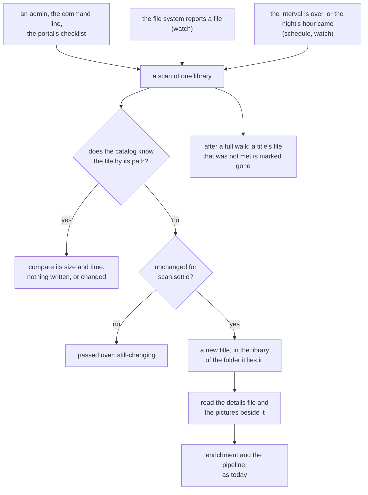

# The library

This page specifies how the catalog keeps what a household owns: several
libraries, each with its folders and the people who see it; scans that start by
themselves; the details and pictures kept in files beside a title;
collections; and a title given back as one ordinary file. It is the server's
side of all five: the data, the rules, and every operation the catalog console
and the apps call. The screens an admin does this with are in
[the catalog console](./console.md), which points here for what a library, a
folder, a scan, a collection and an export are.

The section As built describes what the platform does today. The sections
after it are the target, and the section Changes lists every difference
between the two as a numbered change. Only a change the owner has approved is
built, one change at a time; anything no change names stays as it is built.

## Purpose

To watch a film, the platform has to know the film. This chapter is about how
it comes to know what a household owns, and how the household gets it back.
“The library” is everything the catalog holds. “A library” is one named part
of it: a set of folders that hold movies or shows, with the people who may see
it.

It is for three kinds of reader:

- **Whoever runs the household's zaentrum.** They say which folders the
  library is made of and who sees which part. New files appear without a scan
  started by hand, the details and pictures they already keep beside their
  files are used, and a title can be had back as a file once its original is
  gone.
- **The people who watch.** They see the libraries they may see, and
  collections: the films of a series of films, or a theme an admin put
  together.
- **Whoever builds it.** Every rule and every interface is named here, so
  that the console, the apps and the command line can be built against them.

It serves the goal [Keep the library](../goals/README.md#keep-the-library),
and two of its qualities: a new file is ready to watch without work
(`ready-without-work`), and a title is recognised for what it is
(`known-rightly`). Of [what people expect of it](../capabilities/expectations.md#keep-the-library)
it meets six: the folders that already hold the library are used; several
libraries, each with its folders and its audience; new files appear by
themselves; details and artwork kept beside the files are used; collections
everyone sees; and a title comes back as an ordinary file once its original is
gone. The capabilities are `keep-several-libraries`, `add-library-folder`,
`scan-by-itself`, `scan-library`, `read-local-metadata`, `curate-collections`,
`see-collections` and `export-title`.

The decisions behind it are in
[ADR-0021](../../docs/adr/0021-libraries-folders-and-scans.md). Who the people
of a household are, and what each may do, is decided by
[ADR-0018](../../docs/adr/0018-people-rights-and-safety.md) and set out in
[people](../portal/people.md); this chapter says only what the catalog has to
carry for the right that names a person's libraries.

## As built

This section says what the platform does as of 15 November 2026, as the code
of `katalog-manager`, `katalog-manager-ui`, `katalog-api`, `chino-api`,
`chino-stream`, `packager`, `zaentrum-portal`, `zae` and the operator's chart
has it at their main branches.

### One folder, one library

- **The catalog scans one folder.** katalog-manager walks the scan root its
  environment names (`SCANNER_NFS_ROOT`, else `NFS_ROOT`; `/var/lib/katalog/media`
  when neither is set). The operator's chart sets `NFS_ROOT` to
  `/var/lib/katalog/media` and mounts one claim, `media`, at `/var/lib/katalog`
  in katalog-manager, in the pipeline's workers, and read-only in chino-stream
  and the live worker.
- **The resource names one volume.** `spec.storage` sizes that claim
  (`mediaSize`, `mediaAccessMode`, `className`) or leaves it to a volume the
  admin brings (`provisionMedia: false`). It has no field for a second volume
  and none for a folder.
- **Every other path is held to that root.** A file an addon hands over
  (`POST /api/ingest`) has to lie under the media root or the package store; a
  title's new file (`replaceSource`) under the media root; a removal deletes a
  title's files only under the media root. With the layout `v2` these are held
  to the arrivals folder instead. chino-stream opens an original only under
  its one `MEDIA_ROOT`.
- **There is one library.** No table and no field says that a title belongs to
  a part of the catalog. katalog-api serves every signed-in person every
  title; the one thing it leaves out for a person is a title above their
  rating cap.

### Where a file ends up

What becomes of a file after a scan depends on the catalog's setting
`library.layout`:

| `library.layout` | The scan root | A title's file |
|---|---|---|
| `legacy`, the default | the media root | stays where it is. The catalog knows a title by its file's path, puts nothing into the scan root, and writes the package into the package store beside it. The job that deletes originals does nothing in this layout, whatever `library.originals` says |
| `v2` | the arrivals folder (`ARRIVALS_ROOT`, by default `.work/incoming` on the same volume) | leaves the arrivals: with its first package the packager renames the original into its version's folder in the library's record, which fails when the two are not on one file system. `library.originals` then decides: `keep`, the default, keeps it there; `delete-after-package` deletes it once its package is verified |

### A scan

- **A scan starts only when someone asks.** GraphQL `triggerScan` starts one,
  for an admin or the platform's service account. Three things call it: the
  console's button **trigger scan**, the portal's first-run checklist
  (`POST /api/portal/setup/library/scan`) and `zae setup scan`. Nothing in
  katalog-manager starts a scan by itself, and nothing watches the folder.
- **It runs in the process that started it**, as a scan job that is `running`,
  then `done` or `failed`. A job a restart cut short is failed when the service
  starts again, and one whose scanner has said nothing for 15 minutes is
  failed by the sweep. katalog-manager starts a second scan beside a running
  one when asked.
- **A scan job keeps** its source (`nfs`), its status, when it started and
  ended, its error, and three counts: the files seen (`filesSeen`), the titles
  made (`itemsInserted`) and the known files met again (`itemsUpdated`). Its
  report names at most 1000 files of two kinds: `unsupported`, a disc image,
  and `not-linked`, an episode that a file of several episodes covers by its
  name and that the scan left alone. The log names every one. A job does not
  say who or what started it, and keeps no list of the files it added.
- **A known file.** The scan refreshes the size it recorded for the file. With
  the layout `legacy` it also marks the title of every known file as changed
  (`modifiedat`), at every scan; with `v2` it leaves that mark alone.
- **A file that is gone** is not noticed: no title is marked, and none is
  removed. With `v2`, a file found in another place with the size and the
  quick hash of a known original is followed there.
- **The console** lists the last 25 scans with the three counts. It shows
  neither a scan's error nor its report.

### What a scan takes in

- **Video files** with the extensions `.mkv`, `.mp4`, `.avi`, `.mov`, `.m4v`
  and `.webm`. A subtitle file beside a video and named like it (`.srt`,
  `.vtt`, `.ass`, `.ssa`, with a language before the extension or without) is
  taken in as that title's subtitle. An audio file becomes an item of the type
  `track`, which nothing plays.
- **A movie or an episode.** A file under a folder named `series`, `tv`,
  `shows` or `tvshows`, or whose name numbers an episode (`S01E02`), is an
  episode; any other video is a movie. A show is named by the folder after
  such a folder, else by the file's name before the episode's number, and the
  catalog keeps one series for a name.
- **The name.** The title is the file's name with dots and underscores as
  spaces and the year taken out; the year is the one in brackets, else the
  first from 1900 to 2099.
- **Nothing else beside a title is read**: no file of details and no picture.
  With the setting `extras.scan` on, files named or filed as a title's
  trailers and other extras are taken in as its extras.

### Details, and who may change them

- **Enrichment fills a title** from the reference database the admin gave a
  key for (TMDB): its title, plot, tagline, year, runtime, rating, genres,
  credits, trailers, age rating, a poster and a backdrop. It searches by the
  title's cleaned name and its year, unless the title already has that
  database's id. Two more sources fill gaps where their keys are set, and a
  frame of the video fills a missing poster or backdrop.
- **Where it is kept.** The texts and the rating (a score from 0 to 10) are
  columns of the item. The catalog keeps no original title. Genres are a list
  of names every title shares, with a row for each title and genre; tags are
  rows of a title, set by hand alone; the age rating has columns of its own;
  the ids are rows of a source and an id (`tmdb`, `imdb`, `tvdb`, an episode's
  `tmdb-episode`). A title has one picture of each kind, `poster` and
  `backdrop`.
- **One lock keeps a hand's edit.** The console sets `metadataLocked` when an
  admin saves an edit. Enrichment then leaves the title, the year, the plot,
  the tagline, the rating, the runtime and the credits. It still adds genres
  and still replaces the poster and the backdrop. A second column,
  `lockedfields`, names single fields to keep, and is honoured for the
  credits alone.

### No collection

The catalog has no table for a collection. Enrichment reads a film's details
from the reference database and takes nothing from them about the series of
films it belongs to; the library's record writes a movie's `collection` as
empty. katalog-api and chino-api have no route for one. The lists a person
keeps in chino are that person's own.

### A title as a file

- **A package is not a file.** The packager writes each rendition as an init
  section and segments: the picture (`hls/v0`, more rungs where a ladder is
  on), a stereo AAC rendition for every audio track of the original
  (`hls/a0`, `a1` …), and a 5.1 companion where the instance turns them on.
  Subtitles lie beside them as files (`subs/`): text as WebVTT, pictures as
  PGS or VobSub files, a styled subtitle's script with the original's fonts.
  A package carries none of the original's own title, tags or chapters; the
  chapters are in the catalog.
- **The original can be read whole only while it exists.** katalog-manager
  serves a title's original by byte range at `/api/play/{itemId}`, a route no
  app calls and the platform does not publish. Once the original is retired,
  nothing gives the title as one file: chino-stream answers its own
  whole-file route with “progressive playback needs the original”.
- **katalog-manager's image** holds its one program, on a base without a media
  tool.

## Libraries

A library has an id, a name, a kind, folders, an audience, and a setting that
says when it is scanned.

| Field | Values | Default |
|---|---|---|
| `id` | 1 to 32 lowercase letters, digits and hyphens, starting with a letter: `kids-movies`. It is given when the library is made and never changes, also when the library is renamed. The catalog never gives a deleted library's id to another | made from the name: “Kids movies” gives `kids-movies`; a number is added when that is taken, `kids-movies-2` |
| `name` | 1 to 60 characters. No two libraries have the same name, whatever the case of its letters | none |
| `kind` | `movies` or `shows`. It is chosen when the library is made and never changes | none |
| folders | none, or up to 20 (section Folders) | none |
| the audience | everyone, or the people an admin names. It is not a field of the catalog: it follows from each person's right `libraries` (below, Who sees a library) | everyone |
| `scanMode` | `watch`, `schedule` or `manual` (section Scans) | `watch` |
| `scanInterval` | a whole number of minutes from 1 to 10,080, which is 7 days; used with `schedule` | 60 |

The catalog keeps at most 50 libraries. Kinds other than movies and shows are
not specified here.

These are the rules:

1. **A title belongs to one library.** A movie belongs to a movies library. A
   series, its seasons and its episodes belong to one shows library: an
   episode is always in its series' library. An item of another type (a
   `track`, an `album`) belongs to none and stays as it is.
2. **A title gets its library when it is made**: the library whose folder
   holds its file. A title an addon hands over or an admin makes by hand, whose
   file lies in no library's folder, goes into the first library of its kind
   (below), which the catalog makes if there is none.
3. **A scan never moves a title to another library.** Only an admin does, with
   `moveTitles`: a movie into a movies library, a series with its seasons and
   episodes into a shows library. An episode cannot be moved alone.
4. **A series is found by its name within its library.** Two shows libraries
   may each hold a show of the same name; they are two series.
5. **A library is deleted only when it is empty**, or with the library its
   titles move to. Deleting it frees its folders and deletes no file.

### The default folder and the first libraries

Every install has a default folder: the folder the catalog scans today. It is
the scan root the environment names; with the layout `v2` it is the arrivals
folder. It keeps today's installs and today's first run as they are, by three
rules that hold for it alone:

1. **In the default folder a file's name and path say what it is**, as today:
   an episode when a folder on its path is named `series`, `tv`, `shows` or
   `tvshows` or its name numbers an episode, a movie otherwise.
2. **Two libraries may have the default folder at once**, one of each kind.
   They are the first libraries: the first movies library takes the default
   folder's movies, the first shows library its episodes.
3. **The catalog makes a first library by itself.** When a scan meets a file
   of a kind in the default folder, or a title of a kind is handed over or
   made by hand without a library's folder around its file, and no library of
   that kind has the default folder, the catalog makes one and scans it:
   “Movies”, with the id `movies`, or “Shows”, with the id `shows`, and with
   the scan mode and interval of the other first library, if there is one. If
   the name or the id is taken, it adds the next free number: “Movies 2”,
   `movies-2`.

The first library of a kind is whichever library of that kind has the default
folder. An admin may give the default folder to a library of a kind that has
none; that library is then the first of its kind.

This is how today's one folder becomes the first libraries. At its first start
with this change, on a catalog that has no library, katalog-manager does this
in one transaction:

1. If the catalog holds an item of the type `movie`, it makes “Movies”, of the
   kind `movies`, with the default folder, and puts every movie into it.
2. If the catalog holds an item of the type `series`, `season` or `episode`,
   it makes “Shows”, of the kind `shows`, with the default folder, and puts
   every series, season and episode into it.
3. A library made this way has the scan mode `manual`: until now this install
   was scanned only when asked, and an addon may hand its files over itself.
4. Nothing else of a title changes: not its id, its file, its package, nor
   anyone's progress, lists or ratings of it.

A catalog that holds no title gets no library at that start. The default
folder is then looked after by the catalog itself: it is watched, and scanned
every night and whenever `triggerScan` is called. Such a scan belongs to no
library and takes nothing in; for each kind it finds a file of, it makes the
first library of that kind, with the scan mode `watch`, and starts that
library's scan. So the first run stays what the documentation says: copy files
into the default folder, and they appear.

### Who sees a library

Who sees a library is decided by a right of the person, not by a field of the
library. ADR-0018 gives each person the right `libraries`, and
[people](../portal/people.md) sets it out (section Rights, and change P.C5):

- **A person without the right sees every library**, and each one added
  later.
- **A person with the right sees the libraries it names**, by their ids, and
  no other.
- **The rating cap applies in every library**, as today.

So a library's audience is everyone while no person's right leaves it out, and
otherwise the people who have no such right and those whose right names it.
To a person who may not see a library, its titles are titles there are not, as
a title above their rating cap is today.

The right is kept on the person's account and travels in their token; the
people chapter says how katalog-api, katalog-manager and chino-api hold a
person to it. For that the catalog carries three things, and nothing about the
people themselves:

1. **An id for each library that a token can name**: short, readable, and
   never changed or given again, because with an outside identity provider an
   admin types it there.
2. **Each title's library**, in the catalog's own tables, so that one
   condition in each query of the read side leaves a library out.
3. **The list of libraries**, with their ids, names and kinds, for whoever
   sets a person's right (`libraries`, section What the server offers). It
   also lets portal-api refuse an id the catalog does not name.

The catalog keeps no list of the people of a library. A screen that shows or
sets them reads and writes the people's rights. A title moved to another
library is seen by that library's people from the next request.

## Folders

A library's folders are where the catalog looks for its files.

### Volumes

- **The resource says which volumes the catalog sees.** The first is the media
  claim, as today, mounted at `/var/lib/katalog`; its name is `media`.
  `spec.storage.libraryVolumes` lists further ones, up to 8, each with a `name` and
  the `claimName` of a claim that exists in the platform's namespace. The chart
  makes no claim for them.
- **A volume's name** is 1 to 30 lowercase letters, digits and hyphens, starts
  with a letter, and is not `media`.
- **Each further volume is mounted at `/var/lib/katalog-volumes/<name>`**, in
  every workload that mounts the media claim, and read-only where the media
  claim is read-only. katalog-manager is told the volumes and their paths in
  `LIBRARY_VOLUMES`. chino-stream and the live worker are told every mount as
  a root they may read an original under.
- **A claim that is not there is left out.** The operator mounts the others,
  and the condition `LibraryVolumes` on the resource names the missing claim.
  A library's folder on a volume that is not mounted is unavailable (section
  States).

### The rules of a folder

A folder is a volume's name and a path inside that volume. It is written
`media:/media` or `archive:/films`.

1. **It is a folder that exists inside a mounted volume.** A path that leads
   out of its volume through a link is refused.
2. **It is not one of the platform's own places**, and holds none: the
   package store, the folder of the extras the API took in, the library's
   record and its work folder. By default these are `packages`, `extras`,
   `library` (with `v2`: `movies`, `series` and `people`) and `.work`, at the
   top of the first volume, so the top of the first volume cannot be a folder.
   The arrivals folder is the one exception: it lies inside the work folder,
   and with `v2` it is the default folder.
3. **A folder an admin adds belongs to one library.** The default folder alone
   may belong to two, one of each kind.
4. **Two added folders never contain one another.** A folder that is, holds or
   lies inside another added folder is refused.
5. **An added folder may lie inside the default folder.** The files under it
   are then that folder's, not the default folder's: a scan of a first library
   passes over them.
6. **With the layout `v2`, a folder lies inside the arrivals folder**, on the
   library's own volume: there a file leaves its folder for the record, and
   the packager moves it by a rename, which does not cross volumes.
7. **Adding a folder changes no title.** A title already made from a file
   under it keeps its library, unless the admin asks for those titles to move
   with it (`addLibraryFolder` with `moveTitles`).
8. **Taking a folder out changes no title either.** The catalog stops looking
   there; the titles it took in from it stay in their library. The default
   folder is not taken out of a first library; the library is deleted instead,
   once it is empty.

### What a file is

| Where the file lies | A video file is |
|---|---|
| in the default folder | as today: an episode by a folder named `series`, `tv`, `shows` or `tvshows` on its path or by an episode's number in its name, else a movie |
| in another folder of a movies library | a movie, whatever its name |
| in another folder of a shows library | an episode. Its show is named by the folder after a folder named `series`, `tv`, `shows` or `tvshows` on its path, as today; else by the first folder under the library's folder; else, for a file directly in the library's folder, by its name before the episode's number. Its season and number are the `S01E02` in its name; a file whose name numbers no episode is passed over, with the reason `no-episode-number` |

Everything else a scan does with a file stays as it is built: the title and
the year read from the name, a file of several episodes, the subtitle files
beside a video, the extras, disc images, and audio files.

### Where files stay

| `library.layout` | A file in a library's folder |
|---|---|
| `legacy` | stays where it is, as today. The catalog writes nothing into a library's folder |
| `v2` | arrives there and leaves, as today: with its first package it is moved into the library's record, and `library.originals` says whether it is kept there or deleted once its package is verified. Files beside it other than subtitle files stay behind |

Wherever the catalog today takes a path only under the media root, it takes
one in any library's folder: a file handed over with `POST /api/ingest`, a
title's new file with `replaceSource`, an extra's file with `addExtra`, and
the files a removal deletes. With `v2` these stay held to the arrivals folder,
as today.

A change of `library.layout` to `v2` is refused while a library has a folder
outside the default folder (`LAYOUT_FOLDERS`). At the change, the libraries
that had the old default folder have the arrivals folder, and a folder inside
the old default folder becomes the folder of the same path inside the arrivals
folder, where the library's migration puts its files.

## Scans

A scan reads a library's folders and takes in what changed. Each library is
scanned on its own; a scan of one library never waits for another's.

### When a library is scanned

| `scanMode` | The library is scanned |
|---|---|
| `watch`, the default | when the file system reports that a file arrived, changed or went; in full every night at the hour `scan.nightly` says, because a network share reports nothing; and in full once whenever the service starts, because nothing was watching while it was down |
| `schedule` | in full, `scanInterval` after its last full scan ended |
| `manual` | only when someone starts a scan |

A scan can always be started by hand, whatever the mode. One scan of a library
runs at a time: a scan asked for while the library is being scanned answers
the running one.

Three settings of the catalog apply to every library. They are settings of the
catalog's table, as `extras.scan` is. `knownSettings`
([the catalog console](./console.md), change K.C23) answers them in its group
scanning, so the console's form shows them:

| Key | Name | Control | Values | Default | The sentence under the name |
|---|---|---|---|---|---|
| `scan.settle` | Wait before taking a file in | number and unit | a duration from 0 to 1 hour; 0 takes a file in at once | 60 seconds | A file is taken in once it has not changed for this long, so that a file still being copied is left alone. |
| `scan.nightly` | Nightly scan | a time of day | a time such as 03:00, in the server's local time | 03:00 | When a library that is scanned as its files change is scanned in full each night. |
| `scan.sidecars` | Details and pictures beside the files | checkbox | on, off; stored `on`, `off` | on | A scan reads a title's details file and the pictures that lie beside it. |

### Watching

- With `watch`, katalog-manager asks the file system to report what happens in
  every folder under the library's folders: a file written and closed, a file
  or a folder moved in, moved out, made or deleted.
- It waits until a reported file has been quiet for `scan.settle`, then scans
  the reported paths together, as one scan with the scope `changes`. A new
  folder is watched and scanned as soon as it is reported.
- If the file system loses reports, the library is scanned in full.
- Where a folder cannot be watched, or the system's limit of watches is
  reached, the library says so (`watching: unavailable`, with the reason) and
  is scanned in full every hour instead, until it can be watched again or its
  mode is changed.
- The watch runs in one instance of katalog-manager at a time.

### What a scan does

1. **A folder that cannot be reached is left alone.** A folder that is not
   there, cannot be read, or holds no file at all while the catalog knows files
   in it, is listed as passed over (`folder-unavailable`), and nothing in it is
   marked gone. The other folders are scanned.
2. **A file the catalog knows by its path** is compared with what it recorded:
   its size and when it was last modified. The same, and the scan writes
   nothing for it. Different, and it is listed as changed; the catalog records
   the new size and time, and does not process the title again by itself.
3. **A new file is taken in once it is settled**: its last modification is at
   least `scan.settle` old. A younger file is looked at once more at the end
   of the walk, after a wait of 2 minutes at most; still young, it is passed
   over (`still-changing`), and the next scan takes it.
4. **A new title** is made as today, in the library the section Folders
   names. In the default folder a scan takes in the files of its own
   library's kind and leaves the others to the other first library. The scan
   reads the files beside a new title (section Details beside the files)
   before enrichment is asked.
5. **After a full walk, a file that was not met is gone**: a file of one of
   the library's titles that the catalog holds at a path in a folder the scan
   walked. It is marked with the time (`missingSince`) and listed as gone. The
   title stays, with its package and everything people did with it. When the
   file is met again the mark goes, and it is listed as changed. A scan of
   reported changes does the same for a path reported as gone.
6. **With `v2`** a file found with the size and quick hash of a known original
   is handled as today: followed when it moved (listed as changed), passed
   over when it is a copy, or an original the library retired or replaced.

A scan never removes a title and never deletes, moves or writes a file in a
library's folder.

### What a scan keeps

A scan job keeps what it keeps today, and this:

| Field | Holds |
|---|---|
| its library | the library scanned; none for the scan that makes the first libraries |
| `scope` | `full`: the library's folders were walked; `changes`: the paths the file system reported |
| `trigger` | what started it: `admin`, `schedule`, `watch`, `nightly`, `service` (the platform's service account), `startup` (the scan after the service started) or `folder` (the scan after a folder was added) |
| `startedBy` | for `admin`, the person's name as their sign-in gives it; else the words of the section Words |
| the counts | `added`, `changed`, `gone` and `passedOver`, beside today's `filesSeen` |
| its files | one entry for each file it added, found changed, found gone or passed over: the path, what happened, for a file passed over the kind and the reason, and the title it belongs to, if any |

- **The files are written while the scan runs**, at least every 10 seconds, so
  a page that shows a running scan can list what it has found so far.
- **A scan lists up to 100,000 files.** Beyond that it counts them and says
  how many it did not list.
- **Scans are kept for 90 days**, and the last 20 of each library for as long
  as the library is there.
- `itemsInserted`, `itemsUpdated` and `report` stay as they are today, for
  what reads them.

The kinds of a file passed over, and the sentence for each, are in the section
Words.

## Details beside the files

A household that kept its library with another media server often has, beside
each title, a small file of details and a few pictures, in the common sidecar
format. The catalog reads them. It never writes one.

### Which files

For a movie whose file is `Big Buck Bunny (2008).mkv`:

| What | The files, the first found wins |
|---|---|
| details | `Big Buck Bunny (2008).nfo`; else `movie.nfo`, when the folder holds no other title's video |
| poster | `Big Buck Bunny (2008)-poster`; else, when the folder holds no other title's video, `poster`, then `folder` |
| backdrop | `Big Buck Bunny (2008)-fanart`, then `-backdrop`; else, in such a folder, `fanart`, then `backdrop` |
| logo | `Big Buck Bunny (2008)-logo`; else, in such a folder, `logo` |

A picture has the extension `.jpg`, `.jpeg` or `.png`, looked for in that
order. Names are compared whatever the case of their letters.

- **A show** takes `tvshow.nfo`, `poster` or `folder`, `fanart` or `backdrop`,
  and `logo` from the folder that names it. A show without a folder of its own
  takes none.
- **An episode** takes its details file alone, named like its video. Its
  picture stays the one enrichment or the pipeline gives it.
- **A picture** has to be a JPEG or a PNG by its content, of at most 25 MiB.
- **A details file** is XML of at most 1 MiB. Its first element has to be
  `<movie>` for a movie, `<tvshow>` for a show or `<episodedetails>` for an
  episode; what follows that element is ignored.

A file that breaks these rules is passed over, with the reason
`details-unreadable` or `picture-unreadable`, and gives nothing.

### What a details file gives

| The title's field | Read from | Rule |
|---|---|---|
| title | `<title>` | 1 to 255 characters |
| original title | `<originaltitle>` | 1 to 255 characters |
| year | `<year>`; else the first four digits of `<premiered>`, for an episode of `<aired>` | 1888 to 2100 |
| description | `<plot>` | |
| genres | each `<genre>` | up to 20, each 1 to 80 characters; they are the title's genres, in place of any others |
| rating | `<rating>`, when it holds a number; else under `<ratings>` the `<rating>` marked `default="true"`, else the first, its `<value>` brought to a scale of 10 by its `max` | 0 to 10, one decimal |
| ids | each `<uniqueid>` whose `type` is `tmdb`, `imdb` or `tvdb`; else `<tmdbid>`, `<imdbid>`, `<tvdbid>`, and `<id>` when it holds `tt` and digits | digits; for `imdb`, `tt` and digits |

A value that breaks its rule is left out; the others are taken. Nothing else
of the file is read. In particular the catalog does not take from a file: the
age rating, which decides what a child sees and comes from enrichment or an
admin alone; the cast; the name of a film's series; an episode's season and
number, which its file's name gives; and addresses of pictures.

### Who wins

Each of a title's fields has a source, as the console shows it
([the catalog console](./console.md), section A title's fields). The order is,
highest first:

| Source | Is | Wins over |
|---|---|---|
| `MANUAL` | an admin's edit by hand | everything |
| `FILES` | the files beside the title | enrichment, the file's name |
| `ENRICHMENT` | the reference database | the file's name |
| `FILE_NAME` | what the scan read from the file's name | nothing |

- **A source writes a field only when no higher source holds it.** A file
  never changes a field kept by hand; enrichment never changes a field a file
  gave.
- **The pictures follow the same order**: a picture chosen or uploaded by
  hand, then the file's, then enrichment's, then a frame of the video.
- **The rating and the ids** have sources too. A rating is a file's or
  enrichment's. A title's ids are kept by hand once an admin matched it by
  hand.
- **The catalog keeps what each file gave**, so that a field an admin gives
  back takes the file's value again, also where the file has since left its
  folder.

### When they are read

- **At a scan**, for a new title before enrichment is asked, and for a known
  title when a file beside it appeared, changed or went. A file's size and its
  last modification say whether it changed.
- **Only while the title's video lies in a library's folder.** With `v2` the
  video leaves the arrivals; from then on the title keeps what its files gave.
- **When a file that gave something is gone** while the video is still there,
  the fields it gave are enrichment's again: the catalog asks enrichment for
  the title.
- **With `scan.sidecars` off** no file is read. A field a file gave keeps its
  value, and enrichment may replace it at its next refresh of the title.

### Ids

An id in a details file makes the match certain.

- The catalog writes the file's ids as the title's ids, with the source
  `FILES`.
- Enrichment takes a `tmdb` id as the match. With an `imdb` or a `tvdb` id
  alone, it asks the reference database which title has that id, and takes the
  answer as the match. It never searches by name for a title whose file gave
  an id.
- Where the reference database knows no title for the id, the title keeps the
  file's details and counts as not found.
- A file's id that differs from the title's match replaces it, and the title
  is matched again, as a match by hand does today. Not so when an admin
  matched the title by hand: then the file's ids are left out.

### Never written

The catalog never makes, changes, renames, moves or deletes a details file or
a picture in a library's folder.

## Collections

A collection is a set of titles that belong together, in an order: the films
of a series of films, or a theme an admin put together. It is the catalog's,
and everyone sees it; it is not a person's list.

| Field | Values |
|---|---|
| name | 1 to 120 characters; no two collections have the same name, whatever the case of its letters |
| description | up to 2,000 characters, or none |
| a poster and a backdrop | a picture each, or none |
| made by | `catalog` or `hand` |
| titles | up to 500 movies and series, in an order. An episode is not put into a collection |

A title may be in several collections.

### The collections the catalog makes

- Enrichment keeps, for a film, the id of the series of films the reference
  database says it belongs to, with the film's other ids, as `tmdb-collection`.
- **When two or more films of the catalog share one**, the catalog makes the
  collection, made by `catalog`: its name, its description and its pictures
  are the reference database's for that series; its films stand in the order
  of their release, a film without a year last, by title.
- **A film that joins later is added** at its place in that order.
- **When fewer than two of its films are left**, the collection is deleted.
- Films count across every library.

### The collections an admin makes or changes

- An admin makes a collection, names and describes it, gives it pictures,
  adds movies and series, takes them out, puts them in an order, and deletes
  it.
- **A collection made by hand is never changed by enrichment.**
- **A collection the catalog made becomes one made by hand at an admin's first
  change of it**: its name, its description, its titles or their order. From
  then on enrichment leaves it as it is and adds no film to it, and makes no
  second collection for the same series of films.
- **An admin can hand such a collection back** (`releaseCollection`): it is
  made by `catalog` again, and enrichment sets its name, its description and
  its films anew.
- A picture chosen or uploaded by hand is kept by hand like a title's
  ([the catalog console](./console.md), section Pictures); it does not make
  the collection one made by hand.

### What the apps are given

The read side gives the apps three things:

1. **The collections**: for each its id, its name, how many titles it holds,
   and whether it has a poster and a backdrop; by name, 50 at a time, 200 at
   most.
2. **A collection's titles**, in its order, with its description.
3. **On a title, the collections it is in**: for each its id, its name, how
   many titles it holds and the title's place in it.

A person is given a collection only when they may see two or more of its
titles, by their libraries and their rating cap. The count and the titles are
those they may see.

## Getting a title back as a file

An admin takes any movie, or one episode, out of the library as one ordinary
file. It works whether or not the original is still there.

### The file made from the package

The file is a Matroska file (`.mkv`), joined from the package the title
plays. Nothing is encoded again: picture and sound are copied as the package
holds them.

| In the file | Taken from | As |
|---|---|---|
| the picture | the package's first video rendition, its best | copied; with the HDR10 metadata the package carries |
| every audio track | each stereo rendition, in the package's order, also one in a language the apps hide; then each 5.1 companion the package has | copied; named and flagged as the package names and flags them |
| every subtitle | each subtitle of the package, in its order, and each one attached to the title since | text as SubRip text; a styled subtitle as its script, with the package's fonts attached; a picture subtitle (PGS, VobSub) as it is; language, name, and the forced and hearing-impaired flags as the package has them; a subtitle the platform made is named as made |
| the chapters | the catalog's chapters of the title | Matroska chapters |
| the cover | the title's poster | an attachment named `cover.jpg` or `cover.png` |
| its title | the catalog | “Big Buck Bunny (2008)”; for an episode “Pioneer One S01E01 Earthfall” |

- **Not in the file**: the scrub thumbnails; the WebVTT copy of a styled
  subtitle; the lower rungs of a ladder; the title's extras.
- **The file is sent as it is joined.** Its header says how long it runs. It
  has no index of its own, so a player finds a place in it by reading through
  it. The answer has no length and cannot be resumed.
- **An episode whose file holds several episodes** gives that whole file,
  whichever of its episodes was asked for.
- **A series or a season** is not one file; the export is refused, and its
  episodes are taken one by one.

### The file's name

A movie is named `Big Buck Bunny (2008).mkv`; without a year, `Big Buck
Bunny.mkv`. An episode is named `Pioneer One - S01E01 - Earthfall.mkv`; a file
of several, `Pioneer One - S01E01-E02.mkv`. The characters `/ \ : * ? " < > |`
and control characters become a space, runs of spaces one space, and the name
is cut to 200 bytes before the extension.

### What is lost against the original

The file holds the master of
[ADR-0015](../../docs/adr/0015-the-package-is-the-master.md), not the
original. Against the original it lacks what that record drops by design:

| Of the original | In the file |
|---|---|
| surround sound | stereo; a 5.1 only where the instance makes 5.1 companions |
| lossless and object-based sound | AAC |
| Dolby Vision | the HDR10 or HLG picture it carried |
| 3D | the 2D picture |
| a picture above the cap | the encoded master; a source within the cap was copied and is the original's picture bit for bit |
| text subtitles as they were written | the same lines as SubRip text, without the position of a line |
| a subtitle track the packager could not take, such as a DVB one | missing |
| the original's own tags, its attachments other than fonts, its name | missing |

Where the library keeps a record of the title, `exportOptions` names what the
package lacks, in the deletion gate's words.

### The original instead

While a title's original is still there, an admin may take it instead
(`source=original`): the file as it is, with byte ranges, under the name the
export gives the title and the original's own extension.

### Limits

- Two joins run at a time in one instance. A third is refused
  (`EXPORT_BUSY`).
- A join whose reader takes nothing for 5 minutes is ended.
- **A join that fails after its first byte breaks the connection.** The answer
  is never ended as if it were whole, so no client takes a part for the file.
- Exports are for admins. Each is written to the service's log: who, which
  title, from what, how many bytes, and how it ended.

## What the server offers

The operations of katalog-manager named here are for admins alone, unless a
row says otherwise, and are reached under `/api/manage`, the one path of
katalog-manager the platform publishes: GraphQL at `/api/manage/query`. A name
that katalog-manager has today is as it is; a new one is this chapter's
proposal.

- **Values** are written here in lowercase, as the database and the routes
  hold them; GraphQL names them in capitals, as an enum (`WATCH`).
- **A list that is paged** is paged as the console's list of titles is
  ([the catalog console](./console.md), section Titles, paged): `first`, 1 to
  200 rows and 50 when left out, after the cursor `after`; it answers `rows`,
  the `total` that match, and `nextCursor`, none on the last page.
- **A refusal** is a GraphQL error whose `extensions.code` is the code named;
  its message is the sentence of the section Words.

### What the catalog keeps

| Table | Holds |
|---|---|
| `com_nalet_katalog_libraries` | a library: `id`, `name`, `kind`, `scanmode`, `scaninterval`, who made and changed it and when, and when it was deleted, so that its id is not given again |
| `com_nalet_katalog_libraryfolders` | a folder of a library: `id`, `library_id`, `volume`, `path`, whether it is the default folder, whether it could be reached at the last scan, since when and why not, who added it and when |
| `com_nalet_katalog_items` | for a movie, a series, a season and an episode: `library_id` |
| `com_nalet_katalog_playbackassets` | for a title's file: `filemodifiedat`, when the file was last modified as the scan read it, and `missingsince` |
| `com_nalet_katalog_scanjobs` | for a scan: `library_id`, `scope`, `trigger`, `startedby`, `added`, `changed`, `gone`, `passedover`, `unlisted` |
| `com_nalet_katalog_scanfiles` | a file of a scan: `scanjob_id`, `path`, `outcome`, `kind`, `reason`, `item_id` |
| `com_nalet_katalog_sidecarfiles` | a file beside a title: `item_id`, its role (`details`, `poster`, `backdrop`, `logo`), `path`, its size and last modification, whether it could be read, and what it gave |
| `com_nalet_katalog_collections` | a collection: `id`, `name`, `description`, `madeby`, the id of its series of films, who made and changed it and when |
| `com_nalet_katalog_collectionitems` | a title of a collection: `collection_id`, `item_id`, `position` |
| `com_nalet_katalog_itemexternalids` | as today, with one more source: `tmdb-collection`, a film's series of films |

katalog-api reads the new tables; where an install gives it a database role of
its own, that role is granted them.

### Libraries and folders

| Operation | Takes | Answers | Refuses with |
|---|---|---|---|
| `libraries` | nothing | every library, by name: its id, name, kind, folders, the number of its titles and of its titles whose file is gone, its scan mode and interval, whether it is watched and, if not, why, the scan that runs, its last scan, when its next scan is due, whether it is a first library | |
| `library` | `id` | that library, or none | |
| `createLibrary` | `name`, `kind`; optional `id`, `scanMode`, `scanInterval`, and a first folder as `volume` and `path` | the library; with a folder, its first scan has started | `LIBRARY_NAME`, `LIBRARY_NAME_TAKEN`, `LIBRARY_ID`, `LIBRARY_ID_TAKEN`, `LIBRARY_LIMIT`, `SCAN_INTERVAL`, and a folder's refusals |
| `updateLibrary` | `id`, and any of `name`, `scanMode`, `scanInterval` | the library | `NOT_FOUND`, `LIBRARY_NAME`, `LIBRARY_NAME_TAKEN`, `SCAN_INTERVAL` |
| `deleteLibrary` | `id`; optional `moveTitlesTo`, a library's id | true | `NOT_FOUND`, `LIBRARY_NOT_EMPTY`, `LIBRARY_KIND` |
| `moveTitles` | `itemIds`, up to 500, and `library` | how many titles moved, a series with its seasons and episodes counted once | `NOT_FOUND`, `LIBRARY_KIND`, `TITLE_NOT_MOVABLE` |
| `folderChoices` | optional `volume` and `path`, and `forLibrary` | without a volume, the volumes by name. With one, that folder's folders by name, at most 500, how many more there are, and the way back as the folders above it. Each folder says whether `addLibraryFolder` would take it for that library, and if not, the code and the sentence. A hidden folder and a link that leads out of the volume are never answered | `VOLUME_UNKNOWN`, `FOLDER_NOT_FOUND` |
| `addLibraryFolder` | `library`, `volume`, `path`; optional `moveTitles` | the library; a scan of it has started, with the trigger `folder` | `NOT_FOUND`, `VOLUME_UNKNOWN`, `FOLDER_NOT_FOUND`, `FOLDER_TAKEN`, `FOLDER_NESTED`, `FOLDER_RESERVED`, `FOLDER_OUTSIDE`, `FOLDER_ARRIVALS`, `FOLDER_LIMIT` |
| `removeLibraryFolder` | `library`, `folder` | the library | `NOT_FOUND`, `FOLDER_DEFAULT` |
| `Item.inLibrary` | | the library a title belongs to: its id and its name; none for an item of another type | |

A folder answers its id, its name as the catalog writes it (`archive:/films`),
its volume and path, whether it is the default folder, how many of the
library's titles have their file in it, and whether it could be reached at the
last scan.

### Scans

| Operation | Takes | Answers | Refuses with |
|---|---|---|---|
| `scanLibrary` | `id` | the scan of that library that has started, with the scope `full`; or the one that was running | `NOT_FOUND` |
| `scanLibraries` | optional `ids`; without them every library | the scans, one for each library, as `scanLibrary` answers them | `NOT_FOUND` |
| `triggerScan` | as today | as today, one scan job: it starts a scan of every library and answers the first by the libraries' names; on an install without a library, the scan that makes the first libraries | as today |
| `scans` | optional `library`; `by`: `admin`, `schedule`, `watch`; `state`: `running`, `done`, `failed`; `changes`, true for the scans that added, changed, lost or passed over a file; `sort`: `when`, `added`, `changed`, `gone`, `passed`, `took`; `descending`; `first`, `after` | a page of scans, the newest first when no sort is given | |
| `scanJob` | `id` | as today, with the scan's library, scope, trigger, `startedBy`, the four counts and how many files it did not list | |
| `scanFiles` | `scan`; optional `show`: `added`, `changed`, `gone`, `passed`; `search`, words in a file's path; `first`, `after` | a page of the scan's files by path: the path inside its library's folder, what happened, the kind and the reason of a file passed over, and the title it belongs to | `NOT_FOUND` |
| `GET /api/manage/scans/{id}/files.csv` | `show` and `search`, as `scanFiles` | every file they match, as CSV in UTF-8 with a header row: `file`, `what_happened`, `kind`, `reason`, `title`, `id`; named after when it was made, `scan-2026-11-15T1343Z.csv` | 404 |
| `scanJobs` | as today | as today | |

A title's file answers `missingSince`. `items`, and the console's paged list
of titles, take `missing`, true for the titles whose file is gone.

### Details beside the files

| Operation | Answers |
|---|---|
| `Item.sidecarFiles` | the files beside a title that the catalog read: for each its role, its path, when it was read, and, for one that could not be read, why |
| a field's source | `FILES` for a field a file gave, among the sources the console's chapter sets out |
| a picture's source | `FILES` for a picture a file gave, among the choices the console's chapter sets out |

### Collections

| Operation | Takes | Answers | Refuses with |
|---|---|---|---|
| `collections` | optional `search`, words in a name; `by`: `catalog`, `hand`; `sort`: `name`, `titles`, `changed`; `descending`; `first`, `after` | a page of collections, by name when no sort is given: id, name, description, made by, the number of its titles, when it last changed | |
| `collection` | `id` | the collection with its titles in order, or none | |
| `createCollection` | `name`; optional `description` | the collection, made by `hand` | `COLLECTION_NAME`, `COLLECTION_NAME_TAKEN` |
| `updateCollection` | `id`, and `name` or `description` | the collection | `NOT_FOUND`, `COLLECTION_NAME`, `COLLECTION_NAME_TAKEN`, `COLLECTION_DESCRIPTION` |
| `addToCollection` | `id`, `itemIds` | the collection, the titles at the end of its order; one that is in it already stays where it is | `NOT_FOUND`, `COLLECTION_TITLE_KIND`, `COLLECTION_LIMIT` |
| `removeFromCollection` | `id`, `itemId` | the collection | `NOT_FOUND` |
| `moveInCollection` | `id`, `itemId`, `position`, 1 for the first | the collection, the title at that place | `NOT_FOUND` |
| `releaseCollection` | `id` | the collection, made by `catalog` again | `NOT_FOUND`, `COLLECTION_NO_SERIES` |
| `deleteCollection` | `id` | true; its titles stay | `NOT_FOUND` |
| `Item.collections` | | the collections a title is in | |
| `GET /api/artwork/collection/{collectionId}/{kind}` | `kind`: `poster` or `backdrop`; a bearer or a stream token, as a title's artwork | the picture, cached as a title's is; 404 without one | |

A collection's pictures are chosen, uploaded and given back as a title's are
([the catalog console](./console.md), section Pictures).

### A title as one file

| Operation | Takes | Answers | Refuses with |
|---|---|---|---|
| `exportOptions` | `itemId`, a movie's or an episode's | the title the file is of (for an episode another's file covers, that file's first episode); the file's name without its extension; for the package and for the original, whether it can be had, if not why, and its size; for the package also its picture, as “1920 × 800 HEVC HDR10”, and how many audio tracks, subtitles and chapters go into the file; and what the package lacks against the original, in the deletion gate's names, or none where the library keeps no record of the title | `NOT_FOUND`, `EXPORT_NOT_ONE_FILE` |
| `requestExport` | `itemId`; optional `source`: `package`, the default, or `original` | a link to the route below with a ticket, and when the ticket ends: it starts one download, within 60 seconds | as the route |
| `GET /api/manage/export/{itemId}` | an admin's bearer, or `ticket`; optional `source` | for `package`: 200, `Content-Type: video/x-matroska`, `Content-Disposition: attachment` with the file's name, no length, no ranges, `Cache-Control: no-store`. For `original`: the file with its length and byte ranges | 401 without a bearer or a good ticket; 403 for someone who is no admin; 404 `NOT_FOUND`; 400 `EXPORT_NOT_ONE_FILE`; 409 `EXPORT_NO_PACKAGE`, `EXPORT_NO_ORIGINAL`, `EXPORT_PACKAGE_INCOMPLETE`; 429 `EXPORT_BUSY`, with `Retry-After: 60`; 503 `EXPORT_UNAVAILABLE` |

A refusal of the route is JSON: `{"error": "…", "code": "…"}`, the sentence
and the code.

### The read side

katalog-api, behind the bearer, under `/api/v1`:

| Route | Takes | Answers |
|---|---|---|
| `GET /api/v1/collections` | `limit`, 50 when left out and 200 at most; `offset` | `collections`, by name, each with `id`, `name`, `count`, `has_poster`, `has_backdrop`; `total`, `limit`, `offset` |
| `GET /api/v1/collections/{id}` | | `id`, `name`, `description`, `count`, `has_poster`, `has_backdrop`, and `items`, its titles in order, each as a list answers a title; 404 for a collection the person may not see two titles of |
| `GET /api/v1/items/{id}` with `include=collections` | | `collections`: for each `id`, `name`, `count`, `position` |

Each answers for the person who asks: what their libraries and their rating
cap leave out is left out, and counted out. How the read side learns a
person's libraries, the claim `libraries` and the parameter of the same name,
and how every route there is today is held to them, is the people chapter's
([people](../portal/people.md), change P.C5); it rests on each title's library,
which this chapter gives the catalog.

chino-api, for the apps:

| Route | Answers |
|---|---|
| `GET /api/v1/collections` | as katalog-api answers it for the signed-in person, each collection with `poster_url` and `backdrop_url` where it has the picture |
| `GET /api/v1/collections/{id}` | as katalog-api answers it; its titles carry what a list's titles carry today, the poster's address and when the person watched them |
| `GET /api/v1/collections/{id}/poster`, `/backdrop` | the picture, beside a title's artwork routes and with the same sign-in |
| `GET /api/v1/items/{id}` | as today, with `collections` |

### The resource

| Field | Type | Default | Meaning |
|---|---|---|---|
| `spec.storage.libraryVolumes` | a list, 8 at most | empty | further volumes the catalog may keep folders on |
| `spec.storage.libraryVolumes[].name` | string | none | the volume's name, as a folder is written with it: `archive:/films` |
| `spec.storage.libraryVolumes[].claimName` | string | none | a claim in the platform's namespace; the chart makes none |

The chart's value is `storage.libraryVolumes`. The status condition
`LibraryVolumes` is true with the reason `Mounted` when every volume named is
mounted, and false with the reason `ClaimNotFound`, naming the claims, when
one is not there.

### The CLI

`zae library` is a static group of commands, as `zae setup` is. It calls
katalog-manager's GraphQL at `/api/manage/query` and its export route with the
admin's bearer.

| Command | Does |
|---|---|
| `zae library list --url …` | lists the libraries: name, id, kind, the number of titles, when it is scanned, its last scan, and its folders. `--json` prints the server's answer |
| `zae library find <words> --url …` | lists the titles whose name holds the words, 50 at most: id, type, year, title, library |
| `zae library add-folder <library> <volume> <path> --url …` | says what it will add, asks, then adds the folder to the library, which is named by its id or its name. `--move-titles` moves the titles already taken in from it. Without a terminal it needs `--yes` |
| `zae library export <id> --url …` | writes a movie or an episode as one file. `--output` names the file, or a folder to put it in; without it, the current folder. `--original` takes the original. It writes to a name ending `.part` and renames the file when the download ended whole. It never writes over a file unless `--force` says so. For a series' id it writes each episode that has a file into `--output`, which is then a folder, as `Pioneer One/Season 01/Pioneer One - S01E01 - Earthfall.mkv` |

`zae setup scan` stays as it is and scans every library. The exit codes are
the CLI's contract: 0 done; 1 the catalog refused, or a download broke off; 2
usage; 3 this instance's catalog has no such operation; 4 the instance could
not be reached; 5 the bearer is missing or is no admin's.

## Changes

Every difference between the section As built and the target is one change in
the table. A change names where it is built, what is there today and the
target, with the section that sets it out; it is built as its row says, and
nothing else changes with it. Each change starts as proposed. A target that
starts with “Recommended” holds a choice that is the owner's, and names the
other choice last.

| No. | Change | Where | Today | Target | Status |
|---|---|---|---|---|---|
| L.C1 | Libraries in the catalog | Server | the catalog keeps one set of titles: nothing says that a title belongs to a part of it | katalog-manager keeps libraries and their folders, and each movie, series, season and episode its library (sections Libraries and What the catalog keeps). A library has an id a token can name, which never changes. At its first start on a catalog that holds titles it makes the first libraries, “Movies” (`movies`) and “Shows” (`shows`), on the default folder, each only if the catalog holds a title of its kind, with the scan mode `manual`, and puts every title into the one of its kind; nothing else of a title changes. From then on it makes the first library of a kind when a scan meets a file of that kind in the default folder and no library of that kind has it. katalog-api's database role may read the new tables | proposed |
| L.C2 | A library's kind says what a file is | Server | everywhere under the one scan root, a file under a folder named `series`, `tv`, `shows` or `tvshows`, or whose name numbers an episode, is an episode, and any other video a movie; a series is found by its name in the whole catalog | in the default folder as today; in any other folder the library's kind decides (section Folders, What a file is): every video in a movies library's folder is a movie; every video in a shows library's folder is an episode of the show its path names, and one whose name numbers no episode is passed over with `no-episode-number`. A series is found by its name within its library | proposed |
| L.C3 | Operations on libraries | Server | GraphQL has nothing for a library | katalog-manager offers admins `libraries`, `library`, `createLibrary`, `updateLibrary`, `deleteLibrary`, `moveTitles` and `Item.inLibrary`, as the section What the server offers sets them out, with the refusals of the section Words | proposed |
| L.C4 | Further volumes | Operator, Server | the chart mounts one claim, `media`, at `/var/lib/katalog`; the resource has no field for another; chino-stream opens an original only under one root | the resource's `spec.storage.libraryVolumes` lists up to 8 further volumes, each a `name` and the `claimName` of a claim that exists. The chart mounts each at `/var/lib/katalog-volumes/<name>` in every workload that mounts the media claim, read-only where that is read-only, and tells katalog-manager their names and paths in `LIBRARY_VOLUMES`. A claim that is not there is left out and named by the condition `LibraryVolumes`. chino-stream's `MEDIA_ROOT` takes several roots, separated as the live worker's are, and the chart gives both every mount (sections Folders, Volumes, and The resource) | proposed |
| L.C5 | Folders of a library | Server | the catalog scans the one folder its environment names; a file handed over, a title's new file, an extra's file and a removal's files are held to that media root | Recommended: katalog-manager offers `folderChoices`, `addLibraryFolder` and `removeLibraryFolder` (section What the server offers) under the rules of the section Folders. Wherever a path has to lie under the media root today, it has to lie in a library's folder. With the layout `v2` a folder lies inside the arrivals folder; a change of `library.layout` to `v2` is refused with `LAYOUT_FOLDERS` while a library has a folder outside the default folder, and at the change the folders inside the old default folder become the folders of the same paths inside the arrivals folder. The other choice is a folder on any volume with `v2` too, the packager copying an original across volumes, which needs room for it twice | proposed |
| L.C6 | A scan of a library, and the files it lists | Server | `triggerScan` walks the one root; a scan job keeps its status, when it ran and three counts, and names up to 1000 disc images and unlinked episodes once it has ended; nothing says what started it; two scans can run side by side; with the layout `legacy` every known file's title is marked changed at every scan; a file that is gone is not noticed | the sections Scans and What the server offers: `scanLibrary` and `scanLibraries` scan libraries, one scan of a library at a time, and `triggerScan` scans every library. A file is taken in once it has not changed for `scan.settle`. A scan job says its library, its scope, what started it and who, and counts and lists, while it runs, each file it added, found changed, found gone or passed over, with the kind and the sentence of the section Words, up to 100,000. A title whose file is gone is marked `missingSince` and never removed; nothing is marked in a folder that cannot be reached; a file met as it was recorded writes nothing. `scans`, `scanFiles` and the CSV answer them; scans are kept 90 days | proposed |
| L.C7 | Scans on a schedule | Server | a scan starts only when someone asks | Recommended: katalog-manager starts scans by itself, in one instance at a time: of a library with the scan mode `schedule`, `scanInterval` after its last full scan ended, and of one with `watch` every night at `scan.nightly`. A library made from an existing catalog starts with `manual`, any other with `watch`; on an install without a library the catalog scans the default folder itself and makes the first libraries (sections Libraries and Scans). The other choice is `watch` for the libraries of an existing catalog too, which starts scanning an install that nobody asked to | proposed |
| L.C8 | Scans as files arrive | Server | nothing watches a folder | with the scan mode `watch`, katalog-manager has the file system report what arrives, changes and goes under the library's folders, waits until a reported file has been quiet for `scan.settle`, and scans the reported paths together, with the scope `changes`. It scans the library in full once when the service starts, and when reports were lost. Where a folder cannot be watched, or the limit of watches is reached, the library says `watching: unavailable` with the reason and is scanned in full every hour instead (section Scans, Watching; ADR-0021, To prove first) | proposed |
| L.C9 | Details read from the files beside a title | Server | the scanner takes in subtitle files beside a video and reads no other file; enrichment overwrites every field of a title that is not locked | Recommended: at a scan katalog-manager reads the details file of a movie, a show and an episode, as the section Details beside the files names them: title, original title, year, description, genres, rating and ids. A field a file gave has the source `FILES`; a file never changes a field kept by hand, and enrichment never changes a field a file gave. The catalog keeps what each file gave and lists the files in `Item.sidecarFiles`. `scan.sidecars` turns the reading off, and is on. No file beside a title is ever written, moved or deleted. It is built on the sources of a title's fields ([the catalog console](./console.md), change K.C6). The other choice is to start with `scan.sidecars` off on an install that exists, so that no title changes at the first scan until an admin turns it on | proposed |
| L.C10 | Pictures read from beside a title | Server | a title's poster and backdrop come from enrichment, or from a frame of the video; the catalog keeps no logo | katalog-manager takes a movie's and a show's poster and backdrop from the picture files the section Details beside the files names, a JPEG or a PNG of at most 25 MiB. The file's picture is the title's unless one is kept by hand, and enrichment and the pipeline's frame leave it; it has the source `FILES` among the title's choices. A file named `logo` is kept as a third kind, `logo`, read at the artwork route like the others; no app and no console view shows it | proposed |
| L.C11 | An id in a details file settles the match | Server | enrichment searches the reference database by the title's cleaned name and year, unless the title already has its id | a `tmdb`, `imdb` or `tvdb` id a details file gives becomes the title's id. Enrichment takes the `tmdb` id as the match, or asks the reference database which title has the `imdb` or `tvdb` id, and never searches by name for such a title. Where the reference database knows none, the title keeps the file's details and counts as not found. An id that differs from the title's match replaces it and the title is matched again, unless an admin matched it by hand (section Details beside the files, Ids) | proposed |
| L.C12 | Collections kept by the catalog | Server | the catalog keeps no collection | katalog-manager keeps collections (sections Collections and What the catalog keeps): a name, a description, a poster and a backdrop, who made it, and up to 500 movies and series in an order. It offers admins `collections`, `collection`, `createCollection`, `updateCollection`, `addToCollection`, `removeFromCollection`, `moveInCollection`, `releaseCollection`, `deleteCollection` and `Item.collections`, and serves a collection's pictures at `/api/artwork/collection/{collectionId}/{kind}` | proposed |
| L.C13 | Collections made from enrichment | Server | enrichment reads a film's details from the reference database and takes nothing from them about the series of films it belongs to | enrichment keeps the id of a film's series of films with the film's ids, as `tmdb-collection`. When two or more films of the catalog share one, katalog-manager makes the collection, made by `catalog`, with the name, the description and the pictures the reference database gives the series, its films in the order of their release. It adds a film that joins later and deletes the collection when fewer than two of its films are left. One an admin changed is made by `hand` from then on, is never changed by enrichment, and gets no twin (section Collections) | proposed |
| L.C14 | Collections on the read side | Server | katalog-api has no route for a collection, and a title says nothing of one | katalog-api serves `GET /api/v1/collections` and `GET /api/v1/collections/{id}`, and with `include=collections` a title's `collections`, as the section What the server offers sets them out. A person is given a collection only when they may see two or more of its titles; its count and its titles are those they may see | proposed |
| L.C15 | Collections for the apps | Server | chino-api has no route for a collection | chino-api serves `GET /api/v1/collections`, `GET /api/v1/collections/{id}`, and a collection's `poster` and `backdrop` beside a title's artwork routes; a title's detail carries its `collections` (section What the server offers, The read side) | proposed |
| L.C16 | The media tool in the catalog's image | Images | katalog-manager's image holds its one program, on a base without a media tool | katalog-manager's image carries `ffmpeg`, the release the transcoder's and chino-stream's images pin. The service starts without it, and then refuses an export from a package with `EXPORT_UNAVAILABLE` | proposed |
| L.C17 | A title as one file | Server | a title's original can be read whole only while it exists, at a route no app calls and the platform does not publish; once it is retired, the title is its package's segments alone | Recommended: katalog-manager serves `GET /api/manage/export/{itemId}` to admins, by their bearer or by a ticket from `requestExport`. For `source=package` it joins the package into a Matroska file as it sends it, nothing encoded again, holding what the section Getting a title back as a file lists; for `source=original` it sends the original with byte ranges. `exportOptions` says what can be had and what the package lacks. Two joins run at a time, and a join that fails breaks the connection. The other choice is to join into the work folder first and serve the finished file: the file then has an index and the download a length and a resume, and it needs free room of the title's size and a wait before the first byte (ADR-0021, To prove first) | proposed |
| L.C18 | `zae library` | CLI | the CLI starts a scan, `zae setup scan`, and does nothing else with the library | `zae library list`, `find`, `add-folder` and `export`, as the section What the server offers, The CLI sets them out, with the texts of the section Words and the states of the section States | proposed |
| L.C19 | The documentation | Docs | `docs/self-hosting.md` says the catalog reads one folder and is scanned by hand; `docs/operator.md` lists no further volume; `docs/extending/ingest.md` holds a path to the media root | `docs/self-hosting.md` (First run, Getting content in) describes the default folder, libraries and their folders, scans that start by themselves, the files read beside a title and a title had back as a file; `docs/operator.md` lists `storage.libraryVolumes` and the condition `LibraryVolumes`; `docs/extending/ingest.md` says a path lies in a library's folder. Each says only what is built by then | proposed |

## States

No screen is specified here; the console's states are in
[the catalog console](./console.md). These are the states of the things this
chapter adds, as the server answers them, and of the commands.

### A library, a folder, a file

| Of | State | When | What the server answers |
|---|---|---|---|
| a library | not scanned yet | no scan of it has ended | no last scan |
| a library | being scanned | a scan of it runs | the scan that runs; a scan asked for answers it |
| a library | watched | its mode is `watch` and every folder can be watched | `watching` |
| a library | not watched | its mode is `watch` and a folder cannot be watched | `watching: unavailable` and the reason; it is scanned every hour |
| a library | not watched, by its mode | its mode is `schedule` or `manual` | `watching: off` |
| a folder | reachable | the last scan walked it | |
| a folder | unavailable | the last scan could not reach it, or its volume is not mounted | since when, and why; nothing in it is marked gone |
| a title's file | there | the last full scan met it | |
| a title's file | gone | a full scan did not meet it | `missingSince`; the title stays |

### A scan

| State | When | What the scan job says |
|---|---|---|
| `running` | from its start | its counts and its files so far |
| `done` | the walk ended | its counts and its files; a folder it could not reach is among the files passed over |
| `failed` | the service restarted while it ran; its scanner said nothing for 15 minutes; or the walk itself failed | the error, in today's words |
| not kept any more | 90 days after it ended, unless it is among its library's last 20 | `scanJob` answers none |

### A collection

| State | When | What follows |
|---|---|---|
| made by the catalog | two or more films of one series of films are in the catalog | enrichment keeps its name, description, pictures and films |
| made by hand | an admin made it, or changed one the catalog made | enrichment leaves it |
| not given to a person | they may see fewer than two of its titles | the read side leaves it out, and answers 404 for its id |
| gone | made by the catalog, and fewer than two of its films are left; or an admin deleted it | its titles stay |

### An export

| State | When | What the caller gets |
|---|---|---|
| refused | before the first byte | the status, the code and the sentence of the section Words |
| sending | the join runs | the file's bytes, as they are joined |
| ended whole | the join ended | the answer ends |
| broken off | the join failed, the reader took nothing for 5 minutes, or the service stopped | the connection breaks; the answer does not end |
| given up | the caller went away | the join is stopped at once |

### The commands

| Command | State | What it prints | Exit |
|---|---|---|---|
| `zae library list` | no library yet | the line for an install without a library | 0 |
| `zae library find` | nothing matches | the line for no match | 0 |
| `zae library add-folder` | the catalog refuses the folder | “zae: the catalog refused:” and the server's sentence | 1 |
| `zae library add-folder` | no library has that id or name | the line for a library that is not there, with the names there are | 2 |
| `zae library add-folder` | no terminal and no `--yes` | the line that asks for `--yes`; nothing is written | 2 |
| `zae library export` | the catalog refuses | “zae: the catalog refused:” and the server's sentence | 1 |
| `zae library export` | the file is there already | the line that names `--force`; nothing is written | 2 |
| `zae library export` | the download broke off | the line for a download that broke off; the `.part` file is deleted | 1 |
| every command | the instance can't be reached | zae's line for an instance it could not reach, as its other commands print it | 4 |
| every command | the bearer is missing or no admin's | zae's line for a refused bearer | 5 |
| every command | the instance's catalog is older than this chapter | “zae: not offered:” and what the catalog lacks | 3 |

## Words

Every text this chapter adds. The console's words are in
[the catalog console](./console.md). A sentence the server answers is a
sentence with a full stop, true on every installation; what stands in “…”
inside one is filled in.

### Names the catalog gives

| Where | Text |
|---|---|
| The first libraries | “Movies”, with the id `movies` · “Shows”, with the id `shows` · with a number when the name or the id is taken: “Movies 2”, `movies-2` |
| A folder, as the catalog writes it | `media:/media` · `archive:/films` |
| What started a scan, `startedBy` | for `admin` the person's name, “Alex Urban” · `schedule`: “the schedule” · `watch`: “a file change” · `nightly`: “the nightly scan” · `service`: “the platform” · `startup`: “the catalog, after it started” · `folder`: “a new folder” |

### A scan's files

| What happened | Kind | The reason |
|---|---|---|
| added | `added` | “Taken in as “Big Buck Bunny”.” |
| changed | `changed` | “The file changed since it was taken in.” |
| changed | `back` | “The file is back.” |
| changed | `moved` | “The file moved here from “/media/old/Big Buck Bunny (2008).mkv”.” |
| gone | `gone` | “The file is no longer in its folder. The title stays in the catalog.” |
| passed over | `still-changing` | “The file is still being written. The next scan takes it in.” |
| passed over | `unsupported` | “This is a disc image. Convert it to a single video file.” |
| passed over | `not-linked` | “Episode 4 has a file of its own, so this file was not linked to it.” · “Another file covers episode 4 already.” |
| passed over | `no-episode-number` | “The file's name numbers no episode. Name it like “Pioneer One S01E02”.” |
| passed over | `unreadable` | “The file can't be read. Check who may read it.” |
| passed over | `copy` | “This is a copy of a file the library already has.” |
| passed over | `already-held` | “The library already holds this title and no longer keeps this file. To give the title a better file, replace its file.” |
| passed over | `superseded` | “Another file took this one's place as its title's file.” |
| passed over | `extra-unplaced` | “This looks like an extra, but its folder holds more than one title.” |
| passed over | `details-unreadable` | “The details file can't be read. It has to be XML that starts with movie, tvshow or episodedetails.” |
| passed over | `picture-unreadable` | “The picture is not a JPEG or a PNG of 25 MiB or less.” |
| passed over | `folder-unavailable` | “The folder can't be reached. Nothing in it was marked as gone.” |

### Why a library is not watched

| When | `watchingNote` |
|---|---|
| the file system does not report changes | “This folder's storage doesn't report changes. The library is scanned every hour instead.” |
| the limit of watches is reached | “The system can't watch this many folders. The library is scanned every hour instead.” |

### Why a folder is unavailable

| When | The note |
|---|---|
| its volume is not mounted | “The volume “archive” is not mounted.” |
| it is not there or cannot be read | “The folder can't be reached.” |
| it is empty, and the catalog knows files in it | “The folder is empty, but the catalog knows files in it.” |

### Refusals

| Code | The sentence |
|---|---|
| `NOT_FOUND` | as today |
| `LIBRARY_NAME` | “Give the library a name of 1 to 60 characters.” |
| `LIBRARY_NAME_TAKEN` | “A library with this name already exists. Choose another name.” |
| `LIBRARY_ID` | “A library's id has 1 to 32 lowercase letters, digits and hyphens, and starts with a letter.” |
| `LIBRARY_ID_TAKEN` | “This id is in use, or was a deleted library's. Choose another id.” |
| `LIBRARY_LIMIT` | “The catalog keeps 50 libraries at most.” |
| `LIBRARY_NOT_EMPTY` | “This library still holds titles. Move them to another library of its kind first.” |
| `LIBRARY_KIND` | “Movies go into a movies library, and shows into a shows library.” |
| `TITLE_NOT_MOVABLE` | “An episode moves with its series. Move the series.” |
| `SCAN_INTERVAL` | “Use an interval from 1 minute to 7 days.” |
| `VOLUME_UNKNOWN` | “No volume with this name is mounted.” |
| `FOLDER_NOT_FOUND` | “This folder isn't there. Choose another one.” |
| `FOLDER_TAKEN` | “This folder is already in a library.” |
| `FOLDER_NESTED` | “This folder holds, or lies inside, a folder of the library “Kids”. Choose a folder beside it.” |
| `FOLDER_RESERVED` | “The platform keeps its own files here. Choose a folder that holds only movies or shows.” |
| `FOLDER_OUTSIDE` | “This folder leads out of its volume. Choose a folder inside the volume.” |
| `FOLDER_ARRIVALS` | “With the library layout, files arrive in one folder. Choose a folder inside it.” |
| `FOLDER_LIMIT` | “A library has 20 folders at most.” |
| `FOLDER_DEFAULT` | “A first library keeps the default folder. Delete the library instead, once it is empty.” |
| `LAYOUT_FOLDERS` | “The library layout takes files from the arrivals folder alone. Take these folders out of their libraries first: “archive:/films”.” |
| `COLLECTION_NAME` | “Give the collection a name of 1 to 120 characters.” |
| `COLLECTION_NAME_TAKEN` | “A collection with this name already exists. Choose another name.” |
| `COLLECTION_DESCRIPTION` | “A description has 2,000 characters at most.” |
| `COLLECTION_TITLE_KIND` | “A collection holds movies and shows, not single episodes.” |
| `COLLECTION_LIMIT` | “A collection holds 500 titles at most.” |
| `COLLECTION_NO_SERIES` | “Only a collection the catalog made from a series of films can be handed back.” |
| `EXPORT_NOT_ONE_FILE` | “A show is not one file. Export its episodes one by one.” |
| `EXPORT_NO_PACKAGE` | “This title has no package yet. Take its original instead.” |
| `EXPORT_NO_ORIGINAL` | “This title's original is no longer kept. Take the file made from its package.” |
| `EXPORT_PACKAGE_INCOMPLETE` | “This title's package is being made or is not whole. Try again once it is ready.” |
| `EXPORT_BUSY` | “Two exports are running. Try again in a minute.” |
| `EXPORT_UNAVAILABLE` | “This installation's catalog can't join a package into a file.” |

### The commands

The commands write in the voice of zae's other commands: the instance first,
then lines of a label and its value. `https://media.example.org` stands for
the address given with `--url`.

| Command | Text |
|---|---|
| `zae library list` | the head “https://media.example.org — 3 libraries” · “https://media.example.org — 1 library” · “https://media.example.org — no library yet; files put into the default folder, media:/media, make the first ones” · a library's line “Movies (movies)   movies · 1,204 titles · when files change · last scan 15 Nov 2026 03:00, nothing changed”, the id in brackets · the kinds “movies” · “shows” · the scans “when files change” · “every 1 hour” · “only by hand” · the last scan “never scanned” · “nothing changed” · “3 added, 1 changed, 0 gone, 2 passed over” · “failed” and the scan's error · a folder's line “media:/media (the default folder)” · “archive:/films” · “archive:/films — can't be reached” |
| `zae library find` | “https://media.example.org — 2 titles match “pioneer”” · “https://media.example.org — 1 title matches “pioneer”” · “https://media.example.org — no title matches “pioneer”” · “https://media.example.org — the first 50 of 212 titles that match “the”; use more words” · a row: the id, “movie” or “series” or “episode”, the year, the title, the library |
| `zae library add-folder` | “https://media.example.org — add a folder to Kids” · “folder       archive:/kids” · “then         the catalog scans it, and the movies it finds join Kids” · for a shows library “the shows it finds” · with `--move-titles` “moves        the titles already taken in from this folder” · the question “add this folder? [y/N]” · “added archive:/kids to Kids — a scan has started; follow it with zae library list --url https://media.example.org” · “nothing added” · “zae: no library is named “Kid”; there are: Kids, Movies, Shows” · “zae: this needs a terminal to ask, or --yes” |
| `zae library export` | “https://media.example.org — export Big Buck Bunny (2008)” · “from         its package” · “from         its original” · “writes       ./Big Buck Bunny (2008).mkv” · “holds        1920 × 1080 HEVC · 2 audio tracks · 3 subtitles · 8 chapters · the cover” · while it writes, on a terminal, “written      3.1 GB” · “exported Big Buck Bunny (2008) to ./Big Buck Bunny (2008).mkv — 3.4 GB” · “zae: ./Big Buck Bunny (2008).mkv is there already; --force writes over it” · “zae: the download broke off after 1.2 GB; nothing was kept. Run the command again.” · for a series “https://media.example.org — export Pioneer One: 6 episodes” · “exported 6 of 6 episodes to ./Pioneer One” · “exported 5 of 6 episodes to ./Pioneer One; 1 failed: S01E03, This title has no package yet. Take its original instead.” |
| every command | “zae: the catalog refused:” and the server's sentence · “zae: not offered: this instance's catalog has no libraries” · “zae: not offered: this instance's catalog has no export” |
