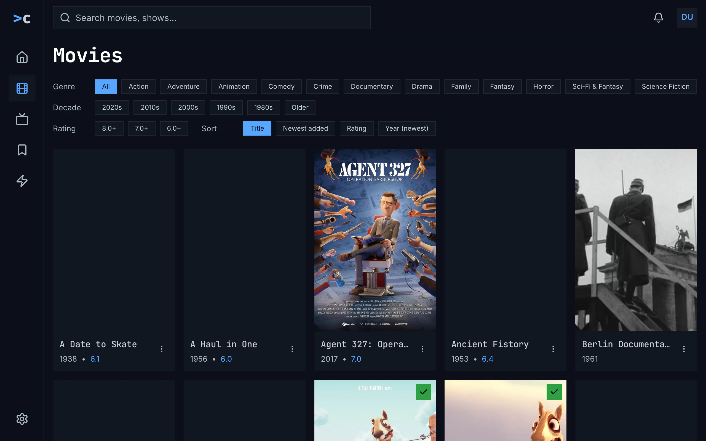
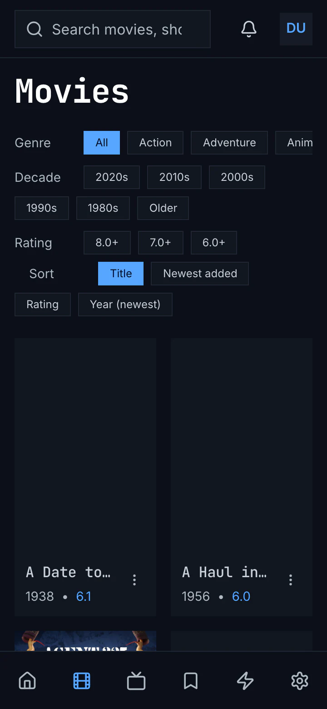
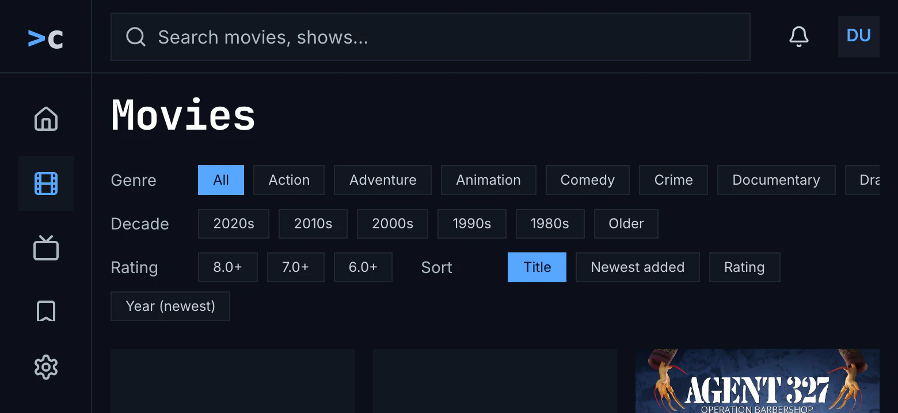
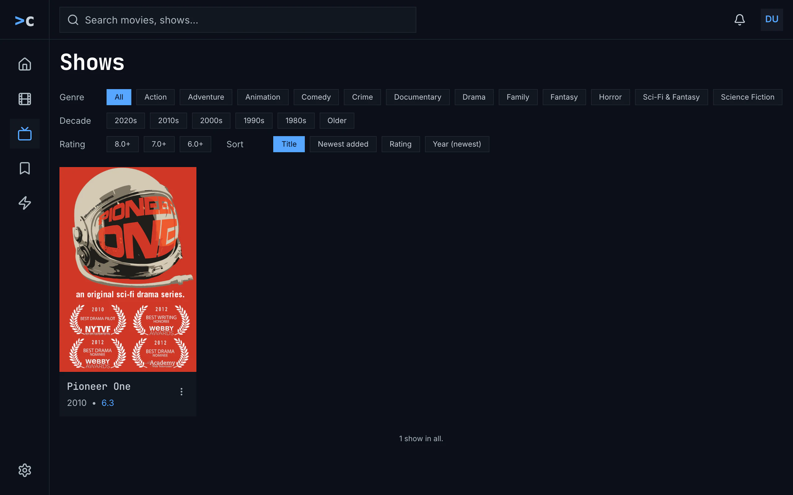
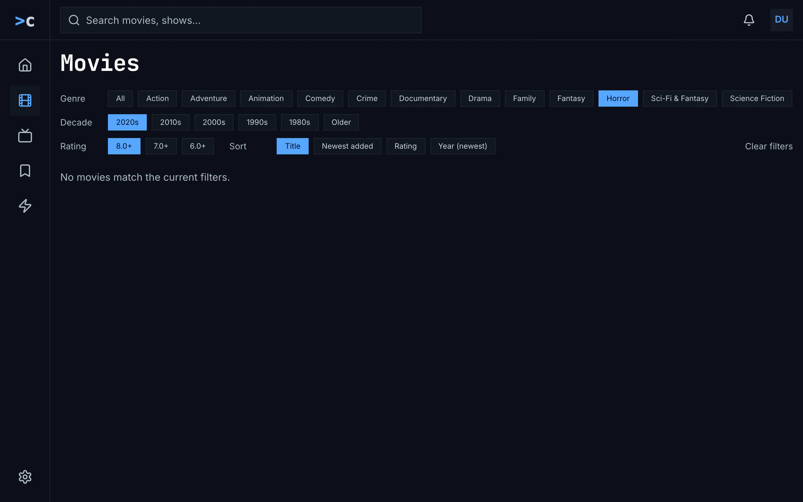
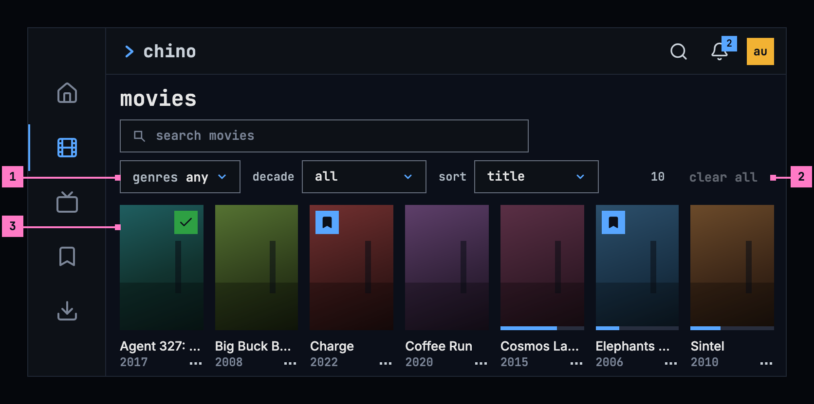
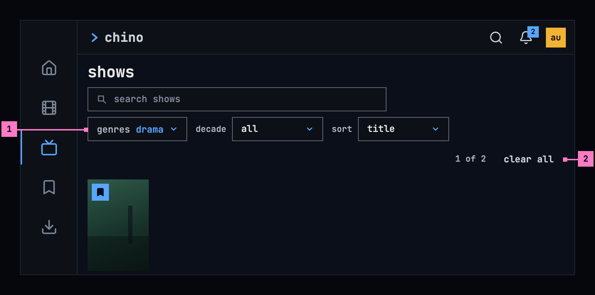

# 5 Movies and shows

Section 5.2 describes movies and shows as they are deployed today. The
sections after it are the target, the two views as they are meant to be, and
section 5.9 lists every difference between the two as a numbered change. Only a
change the owner has approved is built, one change at a time; anything no
change names stays as it is deployed.

This chapter specifies movies and shows, the two views that hold the whole
library, one kind each. They are built alike, so the chapter draws movies at
all three sizes and shows on a phone; what it says about movies holds for
shows. The frame around them is specified in [chapter 2](./frame.md).

## 5.1 Purpose

Movies and shows let people look through everything the library has of one
kind, narrow it down and put it in the order they want. **movies** and
**shows** in the frame open them, and so does the **see all** card at the end
of a row on home ([chapter 4](./home.md)), in that row's order (section 5.7.3).
A card opens its title's page ([chapter 6](./title-actions.md)).

## 5.2 As deployed

This section says what the four apps' movies and shows do as of 6 November
2026: the web as the public demo showed it that day, on the same build as
production, and the apps as their code had them that day. The phone app,
Android TV and the Samsung TV are described from their code until screenshots
of them are taken. The Samsung TV app isn't released yet.

### 5.2.1 The web

Figures 5.1 to 5.5 are screenshots of the web's movies and shows, signed in as
the demo's viewer, whose library holds 26 movies and one show. Figure 5.1
shows movies on a computer.

Figure 5.1: The web's movies as deployed on 6 November 2026, on a computer, at
1280 × 800.

1. **The heading**, “Movies”, with a capital, in the monospace face.
2. **Genre**: “All”, blue while no genre is set, then the server's genres with
   their capitals, on a line that scrolls sideways without a scroll bar:
   “Action”, “Adventure”, “Animation” … “Sci-Fi & Fantasy”, “Science Fiction”,
   and past the window's edge “Short” and “War & Politics”. The list is the
   same for movies and shows, so science fiction is there twice, under the
   movies' name and the shows' one, and “Sci-Fi & Fantasy” and “War & Politics”
   match no movie.
3. **Decade** and **Rating**: “2020s” to “1980s” and “Older”, then “8.0+”,
   “7.0+” and “6.0+”. Neither has a chip for all: a second press on the chip
   that is on takes it off.
4. **Sort**, at the end of the rating's line: “Title”, blue, then “Newest
   added”, “Rating” and “Year (newest)”.
5. **A card**: the poster, then the name in the monospace face, cut with “…”,
   the year with the rating in blue, “2017 • 7.0”, and ⋮ for the card's menu.
   A poster that hasn't come yet is a grey box; the check on green marks a
   watched title.

The chips are 26 px high, in the body face. The grid takes as many posters as
fit at 190 px or more, five at 1280 px, and two on a phone. Figure 5.2 shows
movies on a phone held upright.

Figure 5.2: The web's movies as deployed on 6 November 2026, on a phone held
upright, at 360 × 780.

1. **Genre** keeps to one line and scrolls; “Anim” is cut at the screen's edge.
2. **Decade**, **Rating** and **Sort** wrap onto more lines, **Sort** starting a
   line of its own, indented, so the chips take the screen down to 372 px.
3. **Two posters to a line**, their names cut, “A Date to…”, each with ⋮.

Figure 5.3 shows movies on a phone held sideways.

Figure 5.3: The web's movies as deployed on 6 November 2026, on a phone held
sideways, at 780 × 360.

1. **The computer's layout**, with the side navigation, from 768 px wide
   ([chapter 2](./frame.md)).
2. **The chips** fill the screen, “Year (newest)” on a line of its own, and the
   first posters start at its foot.

Figure 5.4 shows shows, with the same chips.

Figure 5.4: The web's shows as deployed on 6 November 2026, on a computer, at
1280 × 800.

1. **The same genres** as in movies: “Science Fiction” is offered, which no show
   has; the demo's show is under “Sci-Fi & Fantasy”.
2. **The one show**, Pioneer One, “2010 • 6.3”.
3. **The count**, “1 show in all.”, under the grid once all of it is in.

Figure 5.5 shows three filters that match nothing.

Figure 5.5: The web's movies as deployed on 6 November 2026, with filters that
match nothing, on a computer, at 1280 × 800.

1. **Three chips on**, in blue: “Horror”, “2020s” and “8.0+”.
2. **Clear filters**, a quiet text button at the end of the rating's line. It
   is there while a filter is set or the sort isn't Title, and it sets the sort
   back to Title too.
3. **“No movies match the current filters.”**, a line on its own with nothing to
   press: the way out is the chips.

The grid loads 48 titles at a time as the person nears its end, with a spinner
under it, and a page that couldn't load says “couldn't load more movies” under
the cards, with the reason and **try again**. While the grid loads, the
spinner turns alone; a filter or a sort that changes empties the grid, and the
spinner turns again. Couldn't load says “couldn't load the movies” with the
reason, **try again** and **details**. A card's menu has **play**, even for a
title the person is in, and **mark as watched** or **watched**. The grid's
cards have no bar.

The filters and the sort start over whenever the view is left: for another
view, and for a title's page, which is a page of its own. Movies and shows
have no address of their own, so back from a title's page goes to home. see
all on home opens movies or shows in the order by title.

### 5.2.2 The phone app

The phone app's views are “movies” and “shows”, lowercase in the monospace
face, with the web's chips and words: “Genre” with “All” and the server's
genres, “Decade”, “Rating” and “Sort”. “Clear filters” is a grey chip at the
end of the sort's line, there while a filter is set or the sort isn't Title,
and it sets the sort back too. The grid has three posters to a line, four from
600 dp, with the name and the year with the rating in blue, and no bar. A long
press opens a card's menu, with **play**, never **resume**, and the watched
toggle. While the grid loads, a spinner turns alone; no match says “No items
match the current filters.”, also with no filter set; a later page that
couldn't load says “Couldn't load more movies.” with **try again**. The
filters, the sort and the place in the grid stay, for each view, while the app
runs. Without the server, the banner of [chapter 13](./downloads.md) stands
over the last grid the phone had for those filters.

### 5.2.3 Android TV

Android TV has three lines of chips that scroll sideways: “all genres” and the
server's genres; the decades, down to “older”, and the ratings; and the sorts,
“title”, “newest added”, “rating” and “year (newest)”, with “clear filters” at
the end while anything differs. The grid has six posters to a line, without a
bar, and the focused card says “Hold OK for options”. While the grid loads,
“Loading Movies…” stands in the middle, and after a chip “Loading movies…” in
the grid's place. The end of the grid says “You've reached the end — 10
movies.”, also “1 movies” for one, and no match “No movies match the current
filters.” over “You've reached the end — 0 movies.” Back from a title's page,
the focus is on the card that opened it.

### 5.2.4 Samsung TV

The Samsung TV's views are “Movies” and “Series”. They have two lines of
chips: “Genre” with “All” and the server's genres, six of its own while those
haven't come, and “Sort” with “Recommended”, the order by rating it starts
with, “Newest” and “A–Z”. There is no decade or rating, and no way to clear.
It loads 60 titles at a time, with a **Load more** button after the grid as
well. The cards have no menu. Back from a title's page the view starts over,
the focus on the first card.

### 5.2.5 Feature by feature

The table compares the four apps feature by feature. “—” is a feature the app
doesn't have.

| Feature | Web | Phone app | Android TV | Samsung TV |
|---|---|---|---|---|
| The views' names | “Movies”, “Shows” | “movies”, “shows” | “movies”, “shows” | “Movies”, “Series” |
| The filters | lines of chips, 26 px high, in the body face | lines of chips | three lines of chips that scroll sideways | two lines of chips |
| Genre | “All”, then the server's genres, one list for movies and shows, with their capitals, on one line that scrolls | the same | “all genres”, then the same list | “All”, then the same list; six of its own while it comes |
| Decade | “2020s” … “1980s”, “Older” for 1900 to 1979; no all | the same | “2020s” … “older”; no all | — |
| Rating | “8.0+”, “7.0+”, “6.0+”; no all | the same | the same | — |
| Sort | chips: “Title”, “Newest added”, “Rating”, “Year (newest)”; Title first | the same | “title”, “newest added”, “rating”, “year (newest)”; title first | “Recommended” (by rating), “Newest”, “A–Z”; Recommended first |
| Clearing | “Clear filters”, a text button, while a filter or a sort is set; the sort too | “Clear filters”, a chip; the same | “clear filters”, a chip; the same | — |
| The grid | as many as fit at 190 px: five at 1280 px; two on a phone | three, four from 600 dp | six | as many as fit at 242 px |
| Under the poster | the name in the monospace face, “2017 • 7.0”, the rating in blue | the same | the same | the same |
| The bar | — | — | — | — |
| Status marks | the Watchlist's bookmark, the watched check | the same | the same | the watched check alone |
| The card's menu | ⋮ beside the name: play · mark as watched or watched | a long press: play · the watched toggle | holding OK, “Hold OK for options”: play on a movie · the watched toggle | — |
| More titles | 48 at a time, as the end nears, a spinner under the grid | 48 at a time | 48 at a time, “Loading more…” | 60 at a time, and a “Load more” button |
| The end of the grid | “26 movies in all.”, “1 show in all.” | the same | “You've reached the end — 10 movies.”, for one “1 movies” | “You’ve reached the end — 10 movies.” |
| Loading | a spinner alone | a spinner alone | “Loading Movies…” | a spinner, “Loading movies…” |
| A filter changed | the grid empties, the spinner | the grid empties, the spinner | “Loading movies…” in the grid's place | the grid loads again from the top, the focus on the first card |
| Couldn't load | “couldn't load the movies”, the reason, try again, details | the same | the same, over the whole page, the chips too | “Couldn’t load the library” in red and the error's text, “chino-api 500”; no try again |
| More couldn't load | “couldn't load more movies”, the reason, try again | “Couldn't load more movies.”, try again | the grid ends | the grid gives way to couldn't load |
| No match | “No movies match the current filters.” | “No items match the current filters.” | “No movies match the current filters.”, “You've reached the end — 0 movies.” | “No movies to show”, “Nothing tagged “Drama”. Pick “All” to clear the filter.” |
| No movies at all | the no-match line | the no-match line | the no-match line | “No movies to show”, “This library is empty.” |
| Back from a title's page | home: the view has no address | the view as it was | the view as it was, the focus on the card | the view from the start, the focus on the first card |
| Another view, and back | filters and sort from the start | kept, for each view | from the start | kept between movies and shows from the rail |
| see all on home | the view in the order by title | the same | the same | — |
| A phone held sideways | the computer's layout: the chips fill the screen, three posters a line | the rail; four posters a line | — | — |
| Without the server | — | the banner over the last grid for those filters | — | — |

## 5.3 Movies on a computer

Figure 5.6 shows movies on a computer, with **genres** open and animation
chosen. The view's name heads the page, the design system's filter bar follows
on one line, and the grid of posters fills the rest. The posters and their
cards are chino's own; the heading, the filter bar and the card's menu are the
design system's.

Figure 5.6: Movies on a computer, at 1280 × 800.

1. **The search**, the filter bar's search field, “search movies”. The grid
   keeps the movies whose name holds what is typed, with every key, and Esc
   empties the field.
2. **genres**, the design system's multi select. Choosing it opens a panel
   under it, with a tick box for each genre the view's titles have and how
   many of them have it. Ticking a genre keeps its titles, and ticking several
   keeps the titles of any of them. The box says **any** while nothing is
   ticked, the genre in blue while one is, and “2 chosen” while two are;
   **clear genres** at the panel's foot unticks them all.
3. **decade** and **sort**, the design system's selects: each box shows its
   choice, and choosing it opens the device's own list. decade shows its
   choice in blue while it narrows the grid. sort puts the grid in order,
   **title** first (section 5.7.2); it is an order, not a filter, so it never
   turns blue.
4. **The count** and **clear all**, at the bar's end. The count says what the
   filters leave out of the view's titles, “9 of 10”, and how many titles the
   view has, “10”, while nothing filters. clear all, a quiet button, empties
   the search and sets every filter back; it leaves the sort, and it is dimmed
   while there is nothing to clear.
5. **A card**: the poster, then the title's name on one line, cut with “…”
   where it's too long, and its year. Choosing the card opens the title's page.
6. **The status marks** on the poster, as [chapter 6](./title-actions.md)
   draws them: the bookmark on blue for a title in the Watchlist, the check on
   green for a watched one, and the bar along the foot for how far the person
   got. Nothing else is drawn on a poster.
7. **The menu button**, three small squares at the right of the card's lines,
   opens the card's menu, the design system's action menu (section 5.8).

The grid takes as many posters to a line as fit, seven at 1280 wide. The
filter bar stays on one line while it fits, and wraps onto a second when it
doesn't, as the design system's filter bar does; its controls are 34 px high,
the one size it has.

## 5.4 Movies on a phone

The phone shows movies upright and sideways. Figure 5.7 shows them upright and
figure 5.8 sideways. The parts are those of figure 5.6; the numbers mark where
the phone differs, and section 5.4.3 says what happens when the phone is
turned.

### 5.4.1 Held upright

Figure 5.7: Movies on a phone held upright, at 360 × 780 dp.

1. **The search** and **filters** share the first line. The filter bar is
   narrower than 640 dp here, so it folds genres, decade, sort and clear all
   away behind one button, as the design system's filter bar does when it is
   narrow.
2. **filters**, a standard button, opens them in a column under it, as figure
   5.10 shows, and folds them away again. While filters are set, it counts
   them: **filters · 1**. The search and the sort don't count.
3. **The count**, “10”, keeps a line of its own.
4. **The grid** has three posters to a line, each with its name, its year and
   the menu button, which stands beside the year so the name has the card's
   whole width.

The web on a phone held upright has the layout of figure 5.7, with its own tabs
([chapter 2](./frame.md)).

### 5.4.2 Held sideways

Figure 5.8: Movies on a phone held sideways, at 780 × 360 dp.

1. **genres**, **decade** and **sort** stand in a line under the search: the
   bar is 676 dp wide here, more than the 640 dp under which it folds them
   away.
2. **The count** and **clear all** end that line, clear all dimmed while
   nothing filters.
3. **The grid** has seven smaller posters to a line, so a whole line of cards,
   their names and years too, shows under the filter bar.

The tabs run down the left edge as a rail while the phone is sideways
([chapter 2](./frame.md)). The web on a phone held sideways has the layout of
figure 5.8.

### 5.4.3 Turning the phone

Turning the phone keeps the search, the filters, the sort and the place in the
grid: the card at the top of the screen stays in view. The filter bar goes by
its own width, as the design system's
[filter bar](https://nalet.github.io/design-system/components/filter-bar/)
does: narrower than 640 dp, it folds genres, decade, sort and clear all behind
**filters**, and from 640 dp it shows them in a line, which wraps when it has
to. So turned sideways, the filters stand in their line, and turned back
upright they fold again, behind **filters** open or closed as it was. Upright
the grid has three posters to a line and sideways seven smaller ones.

## 5.5 Movies on a TV

Figure 5.9 shows movies on a TV. The page keeps to the safe area at its sides,
and the grid scrolls past its foot.

Figure 5.9: Movies on a TV, at 960 × 540 dp.

1. **genres**, **decade** and **sort**, the filter bar's, each take the focus.
   The TV's bar has no search: the rail's search ([chapter 9](./search.md))
   finds a title by its name. OK on a filter opens the TV's own list, like the
   player's menus in [chapter 11](./playback.md). For decade and sort it is a
   list of one choice, the chosen row in blue with a small square before it,
   and OK picks a row and closes the list. For genres it has a tick box for
   each genre, and OK ticks or clears the genre the focus is on, with the list
   staying open. Up and down move in the list, and back closes it.
2. **The count** and **clear all** end the line. clear all, dimmed here, takes
   the focus once something is set.
3. **The focus** on a card: the ring sits 2 dp outside the poster, and the card
   grows by 5 %, as the design system's
   [TV focus](https://nalet.github.io/design-system/patterns/tv-focus/) sets
   out. Right from the rail lands on the first card. The arrows move from card
   to card, up from the first line reaches the filter bar, and left from the
   first column opens the rail.
4. **The grid** keeps six posters to a line inside the safe area. The next
   line shows under the outline, and the grid scrolls when the focus reaches
   it, so the focus never leaves the safe area.

A TV card has no menu button: holding OK on it opens its menu (section 5.8).

## 5.6 Shows

Figures 5.10 and 5.11 show shows on a phone, with one filter set. Shows look
and work as movies do, at every size, with the shows' own words.

Figure 5.10: Shows on a phone held upright, filtered by genre, at 360 × 780 dp.

1. **filters · 1** counts the filters that are set. Pressed, it opened them in
   a column under the search; pressed again, it folds them away.
2. **genres** with one genre ticked shows it in blue: **drama**.
3. **clear all**, at the end of the column, empties the search and sets the
   filters back. On a narrow bar it folds away with the filters.
4. **The count**, “1 of 2”: one of the two shows fits the filters.
5. **The grid** holds only what fits the filters: here the one drama in the
   library, Pioneer One. A show's year is the year it started.

Figure 5.11: Shows on a phone held sideways, filtered by genre, at 780 × 360
dp.

1. **genres**, in the line of filters, shows its choice in blue: **drama**.
2. **The count**, “1 of 2”, and **clear all**, no longer dimmed, because there
   is something to clear.

## 5.7 The filters and the sort

### 5.7.1 The filters

| Filter | Choices | Keeps |
|---|---|---|
| search | What the person types | Titles whose name holds it, whatever the capitals |
| genres | **any**, or one or more of the genres of the view's own titles, lowercase, each with how many of them have it: **drama**, **science fiction** | Titles of any genre ticked |
| decade | **all** · **2020s** · **2010s** · **2000s** · **1990s** · **1980s** · **before 1980** | Titles from those years; before 1980 is every year before 1980 |

- A filter applies as soon as it changes, with nothing to confirm, and the
  search with every key typed. The filters add up: a title shows when it fits
  all of them. **all** comes first in decade, as the design system's filter
  bar has the choice that filters nothing, and genres says **any** while
  nothing is ticked, so each filter has its way back.
- **clear all** in the filter bar and **clear filters** in an empty grid
  (figure 5.13) both empty the search and set every filter back. Neither
  changes the sort.
- Each view lists the genres its own titles have, each once, with the number
  of its titles of each, so a genre on its own never leads to an empty grid:
  movies the genres of the movies, shows those of the shows. The two can name
  a genre differently, as the catalog does: the demo's science fiction is
  **science fiction** in movies and **sci-fi & fantasy** in shows. A genre
  with a title of this kind leads to the no-match state of section 5.10 only
  together with another filter.
- There is no filter by rating: the sort **rating** puts the highest rated
  first.

### 5.7.2 The sort

**sort**, the design system's select after the filters, puts the grid in
order. It isn't a filter: **filters · 1** doesn't count it, it doesn't turn
blue, and clear all leaves it as it is.

| Sort | Order |
|---|---|
| title | A to Z by the title's name; the order the view starts with |
| newest added | The titles added to the library last come first |
| rating | The highest rated first |
| year (newest) | The latest year first |

### 5.7.3 Where the view starts

- Opened from the frame, the view has the search, the filters and the sort the
  person left it with while the app runs. When the app starts, the search is
  empty, genres at **any**, decade at **all** and the sort **title**.
- Back from a title's page, the grid is where it was, and on a TV the focus is
  on the card that opened the page. On the web, movies and shows have
  addresses of their own that hold the search, the filters and the sort, so
  back from a title's page, a reload and a shared link open the view as it
  was.
- **see all** at the end of a row on home opens the view in the row's order,
  with the search empty and no filter set:

| Row on home | Opens | Sort |
|---|---|---|
| recently added movies | movies | newest added |
| recently added shows | shows | newest added |
| top rated | movies | rating |

The row leaves out what the person has watched; the view doesn't, so watched
titles show among the row's.

## 5.8 The grid

- The grid holds the titles in the sort's order and loads more as the person
  nears its end, with grey cards in the places still loading (section 5.10).
  How many titles it holds is the filter bar's count, from the first page on
  (figure 5.6, part 4), so no line under the last card says it again.
- A card shows the poster with its status marks, the name, the year and the
  menu button. On a TV the focused card's name turns to the brightest text
  colour.
- A card's menu is the design system's action menu, as in
  [chapter 6](./title-actions.md). It offers **play**, or **resume** for a
  title the person is in, and the watched mark: **mark as watched**, or
  **mark as unwatched** while it's on, which takes the mark off (a menu item
  says what it does, as the design system's menus do). A show's **play** plays
  the episode its page's first button names. The menu button opens the menu
  on a computer and a phone, just under the button and lined up with its
  right edge, and in the phone app a long press on the card opens it too.
  Screen readers name the button after the card's title: “actions for
  Sintel”. On a TV, holding OK opens the menu.

## 5.9 Changes

Every difference between section 5.2 and the target is one change in the
table. A change names the apps it is built in, what they do today and the
target, with the figure or the section that sets it out; it is built as its row
says, and nothing else changes with it. Each change starts as proposed; once the
owner approves it, it is built, one change at a time. A target that starts with
“Recommended” was an open decision, or takes away something an app has today.
What a card shows and how its menu opens hold for every card, on home
([chapter 4](./home.md)) and in the watchlist ([chapter 8](./watchlist.md))
too. The order see all opens in is chapter 4's change 4.C14, and the rail and
the tabs are [chapter 2](./frame.md)'s.

| No. | Change | Apps | Today | Target | Status |
|---|---|---|---|---|---|
| 5.C1 | The filter bar | Web, Phone app, Android TV, Samsung TV | lines of chips: “Genre”, “Decade”, “Rating” and “Sort”, the genres on a line that scrolls sideways, one genre at a time, and no search; on Android TV three lines that scroll; on Samsung TV “Genre” and “Sort” | Recommended: the design system's filter bar (figures 5.6 to 5.9): its search, “search movies” or “search shows”, in the design system's words for a search; genres, its multi select, several genres at once, the box saying any while none is ticked; decade, its select; the sort, its select after the filters, not counted as one; the count and clear all at the bar's end; while the bar is narrower than 640 dp, its own width, the filters, the sort and clear all folded behind filters, a standard button that counts the filters set, “filters · 1”; no rating filter, the sort by rating instead; on a TV, the bar without its search | proposed |
| 5.C2 | all in decade; before 1980 | Web, Phone app, Android TV | decade and rating have no all: a second press on the chip that is on takes it off; the oldest decade is “Older” (“older”), 1900 to 1979 | all first in decade, the choice that filters nothing in the design system's select; before 1980, every year before 1980 (section 5.7.1) | proposed |
| 5.C3 | The genres of the view's own titles | Web, Phone app, Android TV, Samsung TV, the server | one list for movies and shows, with its capitals: movies offers “Sci-Fi & Fantasy” and “War & Politics”, which no movie has, and science fiction twice; shows offers “Science Fiction”, which no show has; Samsung TV shows six of its own while the list comes | the server gives each kind its own list of genres, with how many of its titles have each, and each view offers its genres once each, lowercase, with that number, in genres (figure 5.6, part 2; section 5.7.1) | proposed |
| 5.C4 | clear all leaves the sort | Web, Phone app, Android TV | “Clear filters” (“clear filters”), there while a filter is set or the sort isn't title, and it sets the sort back too; a text button on the web, a chip in the apps | the filter bar's clear all, a quiet button at its end, or at the end of the folded filters on a narrow bar, dimmed with nothing to clear; it empties the search and sets the filters back, and leaves the sort (figure 5.6, part 4) | proposed |
| 5.C5 | Samsung TV: decade, clear all and the sorts | Samsung TV | no decade or rating, no way to clear; the sorts “Recommended” (by rating, the one it starts with), “Newest”, “A–Z” | decade, clear all and the four sorts of section 5.7.2, starting with title, in the filter bar of 5.C1 | proposed |
| 5.C6 | The views' names | Web, Samsung TV | Web: “Movies”, “Shows”. Samsung TV: “Movies”, “Series” | movies · shows, the design system's heading (section 5.11) | proposed |
| 5.C7 | The card: the name and the year | Web, Phone app, Android TV, Samsung TV | the name in the monospace face, then the year with the rating in blue, “2017 • 7.0” | Recommended: the name in the body face and the year, without the rating (figure 5.6, part 4) | proposed |
| 5.C8 | The bar on the grid's cards | Web, Phone app, Android TV, Samsung TV | the grid's cards have no bar | the bar along the poster's foot for how far the person got (figure 5.6, part 5) | proposed |
| 5.C9 | The card's menu: its button and resume | Web, Phone app, Android TV, Samsung TV | Web: ⋮ beside the name; play, never resume, in the grid. Phone app: a long press only; play, never resume. Android TV: play on a movie's card alone. Samsung TV: no menu | the design system's action menu: its button, three small squares, at the right of the card's lines, named after the title, “actions for Sintel”, and the phone app's long press too; holding OK on a TV; play or resume, a show's play its episode, and the watched mark (section 5.8) | proposed |
| 5.C10 | The grid's posters | Web, Phone app | Web: five to a line at 1280 px, two on a phone. Phone app: four from 600 dp | seven at 1280 px; on a phone three upright and seven smaller ones sideways (figures 5.6 to 5.8) | proposed |
| 5.C11 | A phone held sideways | Web | the computer's layout: the chips fill the screen (figure 5.3) | figure 5.8: the filter bar, 676 dp wide, its search on the first line, the filters, the count and clear all on the second, and the grid under them | proposed |
| 5.C12 | Back from a title's page | Web, Samsung TV | Web: movies and shows have no address of their own, so back goes to home, the filters and the sort gone. Samsung TV: the view starts over, the focus on the first card | the view as it was, and on a TV the focus on the card that opened the page; on the web, addresses that hold the filters and the sort (section 5.7.3) | proposed |
| 5.C13 | The search, the filters and the sort kept while the app runs | Web, Android TV, Samsung TV | Web: they start over with another view. Android TV: kept for a title's page, not for another view. Samsung TV: kept only between movies and shows from the rail | kept for each view while the app runs (section 5.7.3) | proposed |
| 5.C14 | Loading: grey blocks | Web, Phone app, Android TV, Samsung TV | Web, Phone app: a spinner alone, and a filter that changes empties the grid. Android TV: “Loading Movies…”, and after a chip “Loading movies…” in the grid's place. Samsung TV: a spinner, “Loading movies…”, and a chip loads the grid again from the top | figure 5.12, with the heading and the filter bar there at once; a change keeps the cards under a thin blue line (section 5.10) | proposed |
| 5.C15 | Samsung TV: no load more button | Samsung TV | 60 at a time, and a “Load more” button after the grid | Recommended: more as the focus nears the end, with grey cards, and no button (section 5.8) | proposed |
| 5.C16 | No match | Web, Phone app, Android TV, Samsung TV | Web, Android TV: “No movies match the current filters.”, with nothing to press; Android TV adds “You've reached the end — 0 movies.” Phone app: “No items match the current filters.” Samsung TV: “No movies to show”, “Nothing tagged “Drama”. Pick “All” to clear the filter.” | figure 5.13: the design system's empty state, its no-match kind, under the filter bar: no matches, “Nothing fits these filters.” and clear filters | proposed |
| 5.C17 | No movies in the library | Web, Phone app, Android TV, Samsung TV | the no-match line, with the filters; Samsung TV: “No movies to show”, “This library is empty.” | the design system's empty state, its nothing-yet kind: “no movies yet”, without the filter bar, with nothing to press (section 5.10) | proposed |
| 5.C18 | Couldn't load, under the view's name | Android TV, Samsung TV | Android TV: over the whole page, the chips too. Samsung TV: “Couldn’t load the library” in red and the error's text, no try again | figure 5.14: the design system's empty state, its couldn't-load kind, in the grid's place, the heading and the filter bar staying; the reason by cause, try again and details | proposed |
| 5.C19 | More couldn't load | Phone app, Android TV, Samsung TV | Phone app: “Couldn't load more movies.” with try again. Android TV: the grid ends there. Samsung TV: couldn't load takes the grid's place | under the cards loaded, the design system's empty state at its small size, its couldn't-load kind: “couldn't load more movies”, the reason and try again (section 5.10) | proposed |
| 5.C20 | The count in the filter bar | Web, Phone app, Android TV, Samsung TV | Web, Phone app: “26 movies in all.” under the grid, once all of it is in. Android TV: “You've reached the end — 10 movies.”, “1 movies” for one. Samsung TV: “You’ve reached the end — 10 movies.” | the filter bar's count, in the design system's words: “10” while nothing filters, “9 of 10” while the filters leave nine, from the first page on, with the totals the server gives with it; no line under the last card (figure 5.6, part 4; section 5.8) | proposed |

## 5.10 States

The views are drawn in figures 5.6 to 5.11 with everything loaded. Figures
5.12 to 5.14 show the states in between.

Figure 5.12: Movies loading, on a TV.

While the grid loads, it shows nothing for the first 0.4 seconds, and after
that grey blocks in the shape of the posters and their lines, as the design
system's
[loading and progress](https://nalet.github.io/design-system/patterns/loading-and-progress/)
describes. The heading and the filter bar are there at once, so the focus can
already rest on them, here on **genres**: the ring outside the box, the box
grown by 5 % on the focused surface, as on every plain control on a TV. The
count comes with the first titles. A computer and a phone show the same
blocks in their own grid.

Figure 5.13: Filters that match nothing, on a computer.

1. **The filters that are set** stay as they are, in blue, so the person can
   change one of them instead of starting over, and the count says “0 of 10”.
2. **no matches**: the design system's empty state, its no-match kind, with
   “Nothing fits these filters.” under it, in the grid's place.
3. **clear filters**, a standard button, does what clear all does, where the
   person is looking: it empties the search and sets the filters back, and
   the grid comes back.

Figure 5.14: Movies when they couldn't load, on a phone.

1. **What couldn't load, and why**, in the design system's empty state, its
   couldn't-load kind, in the grid's place: “couldn't load the movies”, or
   “couldn't load the shows”, and under it the reason as far as the app can
   tell. Figure 5.14 shows the case where the server ran into a problem;
   [chapter 17](./errors.md) lists every cause and its sentence. The filter
   bar has no count until the titles are in.
2. **try again**, a standard button at its large size, loads the grid again,
   with the search, the filters and the sort as they were.
3. **details**, under the button: the design system's details toggle, as its
   banner has it (its empty state has none yet, so chino adds it). It holds the
   status the server answered with, for the people who fix things, and stays closed until it is
   tapped, as [chapter 17](./errors.md) sets out.

| State | What the view shows |
|---|---|
| Loading | Figure 5.12 |
| A filter or the sort changed | The cards stay until the new ones are in, with a thin blue line running along the top of the grid |
| More loading | Grey cards in the places still loading, at the end of the grid |
| No match | Figure 5.13 |
| Couldn't load | Figure 5.14, with the sentence for the cause |
| More couldn't load | The cards loaded stay; under them the design system's empty state at its small size, its couldn't-load kind: “couldn't load more movies”, the reason and **try again** |
| No movies in the library | The design system's empty state, its nothing-yet kind, in the grid's place: “no movies yet”, without the filter bar and with nothing to press, as on home ([chapter 4](./home.md)) |
| Asking again failed | The grid stays as it was, under the design system's warning banner, as [chapter 17](./errors.md) has it: “Couldn't refresh the movies; it shows what was loaded 4 minutes ago.”, with **try again** |
| The phone app can't reach the server | The banner of [chapter 13](./downloads.md), with the titles the phone loaded under it as they were; with none, figure 5.14 without the sentence, which the banner already says |

## 5.11 Words

| Where | Text |
|---|---|
| The views' names | movies · shows |
| The search | search movies · search shows |
| The filters | genres · any · 2 chosen · clear genres · decade · all · clear all |
| The genres | the view's own, lowercase, each with its number: drama · science fiction · sci-fi & fantasy |
| The decades | 2020s · 2010s · 2000s · 1990s · 1980s · before 1980 |
| The sort | sort · title · newest added · rating · year (newest) |
| The count | 10 · 9 of 10 · 1 of 2 · 0 of 10 |
| The filters on a narrow bar | filters · filters · 1 |
| A card | the name, the year: 2012, and the menu button |
| A card's menu button, for screen readers | actions for Sintel, after the card's title |
| A card's menu | play · resume · mark as watched · mark as unwatched |
| No match | no matches · Nothing fits these filters. · clear filters |
| Couldn't load | couldn't load the movies · couldn't load the shows · The server ran into a problem. · try again · details |
| More couldn't load | couldn't load more movies · couldn't load more shows |
| Asking again failed | Couldn't refresh the movies; it shows what was loaded 4 minutes ago. · Couldn't refresh the shows; it shows what was loaded 4 minutes ago. · try again |
| No titles of the kind | no movies yet · no shows yet |
