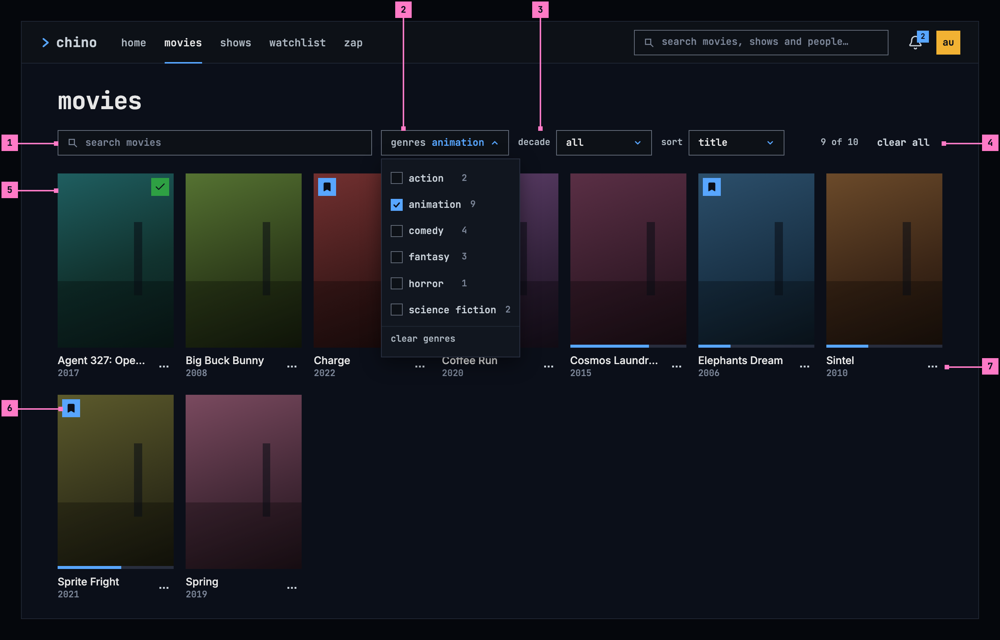
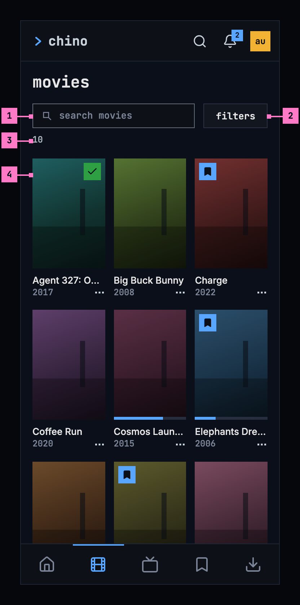
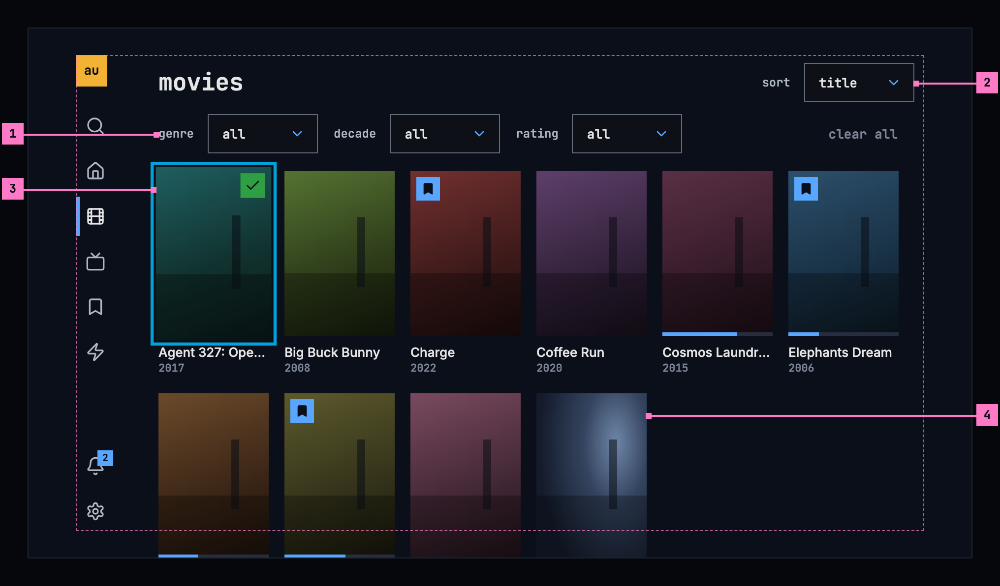
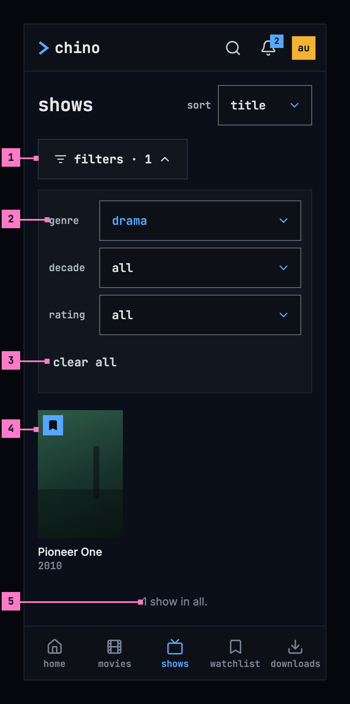
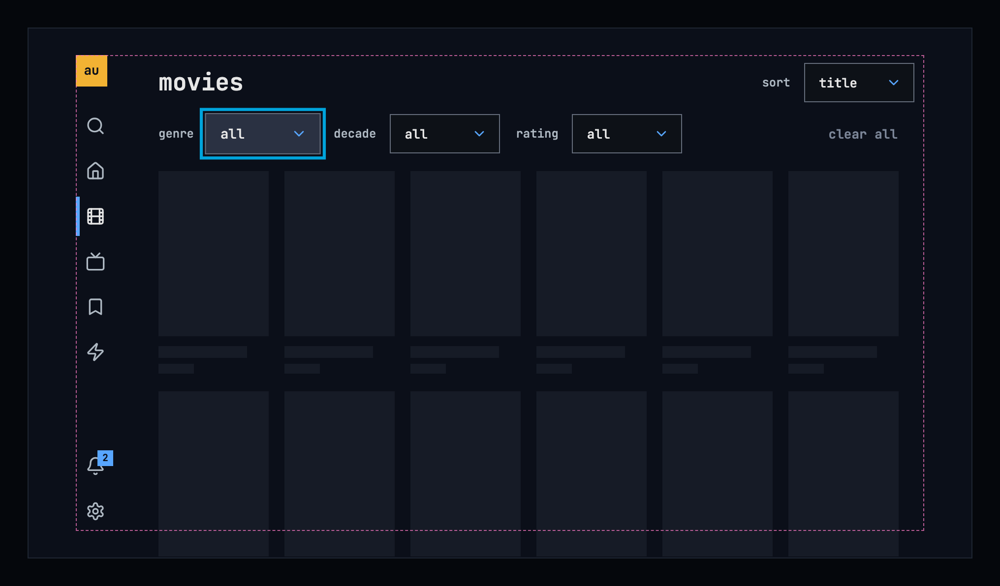
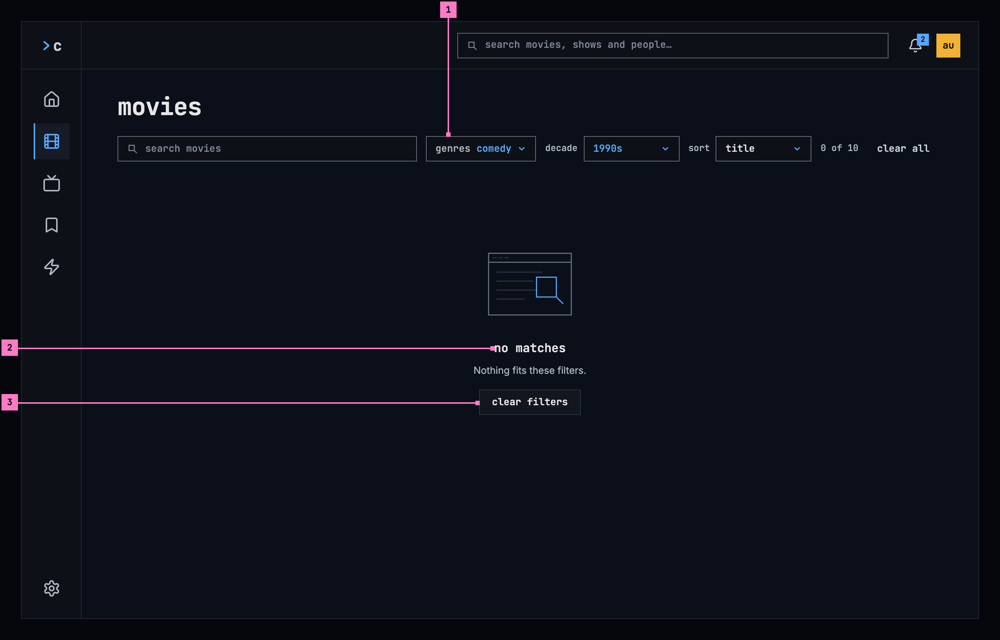
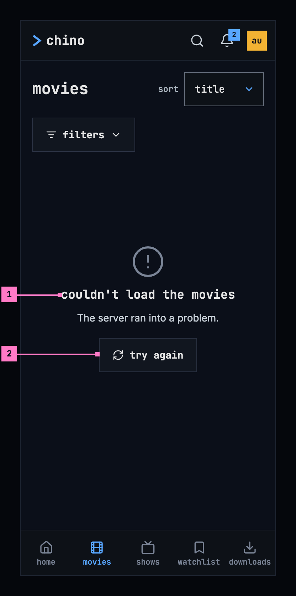

# 5 Movies and shows

> **Not in the new form yet.** This chapter's figures show the target, not
> what is deployed today. Where today's apps differ, its “Today's apps”
> section says so. The screens as deployed and the numbered changes follow,
> as [chapter 11](./playback.md) already has them.

This chapter specifies movies and shows, the two views that hold the whole
library, one kind each. They are built alike, so the chapter draws movies at
all three sizes and shows once; what it says about movies holds for shows. The
frame around them is specified in [chapter 2](./frame.md).

## 5.1 Purpose

Movies and shows let people look through everything the library has of one
kind, narrow it down and put it in the order they want. **movies** and
**shows** in the frame open them, and so does the **see all** card at the end
of a row on home ([chapter 4](./home.md)), in that row's order (section 5.6.3).
A card opens its title's page ([chapter 6](./title-actions.md)).

## 5.2 Movies on a computer

Figure 5.1 shows movies on a computer. The view's name heads the page with the
sort at the end of its line, the filters follow on one line, and the grid of
posters fills the rest.

Figure 5.1: Movies on a computer, at 1280 × 800.

1. **The filters**: **genre**, **decade** and **rating**. Each is its name and
   a box that shows its choice, here **all**; choosing the box opens the list
   of choices. A filter that narrows the grid shows its choice in blue.
   Section 5.6.1 lists the choices.
2. **clear all** sets every filter back to **all**. With nothing to clear, it
   is dimmed, as here.
3. **sort** puts the grid in order: **title**, the order the view starts with,
   **newest added**, **rating** or **year (newest)** (section 5.6.2).
4. **A card**: the poster, then the title's name on one line, cut with “…”
   where it's too long, and its year. Choosing the card opens the title's page.
5. **The status marks** on the poster, as [chapter 6](./title-actions.md)
   draws them: the bookmark on blue for a title in the Watchlist, the check on
   green for a watched one, and the bar along the foot for how far the person
   got. Nothing else is drawn on a poster.

The grid takes as many posters to a line as fit, seven at 1280 wide.

## 5.3 Movies on a phone

Figure 5.2 shows movies on a phone. The parts are those of figure 5.1; the
numbers mark where the phone differs.

Figure 5.2: Movies on a phone, at 360 dp.

1. **sort** stays at the end of the name's line, as on a computer.
2. **filters** folds the three filters away behind one button, which opens
   them in a column under it, as figure 5.4 shows. While filters are set, the
   button counts them: **filters · 1**.
3. **The grid** has three posters to a line, each with its name and year.

The web on a phone has the layout of figure 5.2, with its own tabs
([chapter 2](./frame.md)).

## 5.4 Movies on a TV

Figure 5.3 shows movies on a TV. The page keeps to the safe area at its sides,
and the grid scrolls past its foot.

Figure 5.3: Movies on a TV, at 960 × 540 dp.

1. **The filters** are buttons the focus can take, 40 dp high, as every TV
   control is. OK opens a menu of one choice, like the player's menus in
   [chapter 11](./playback.md): the chosen row in blue with a small square
   before it. Up and down move in the menu, OK picks a row and closes it, and
   back closes it without a change.
2. **sort** works the same way, at the end of the name's line.
3. **The focus** on a card: the ring sits 2 dp outside the poster, and the card
   grows by 5 %, as the design system's
   [TV focus](https://nalet.github.io/design-system/patterns/tv-focus/) sets
   out. Right from the rail lands on the first card. The arrows move from card
   to card, up from the first line reaches the filters, and left from the
   first column opens the rail.
4. **The grid** keeps six posters to a line inside the safe area. The next
   line shows under the outline, and the grid scrolls when the focus reaches
   it, so the focus never leaves the safe area.

## 5.5 Shows

Figure 5.4 shows shows on a phone, with the filters open and one of them set.
Shows look and work as movies do, at every size, with the shows' own words.

Figure 5.4: Shows on a phone, filtered by genre, at 360 dp.

1. **filters · 1** counts the filters that are set. Pressed again, it folds
   them away.
2. **A filter that is set** shows its choice in blue: **drama**.
3. **clear all**, at the end of the column, sets them all back to **all**.
4. **The grid** holds only what fits the filters: here the one drama in the
   library, Pioneer One. A show's year is the year it started.
5. **The count** under the last card says how many the grid holds, once all of
   them are in: “1 show in all.”

## 5.6 The filters and the sort

### 5.6.1 The filters

| Filter | Choices | Keeps |
|---|---|---|
| genre | **all**, then the library's genres, lowercase: **drama**, **science fiction** | Titles of that genre |
| decade | **all** · **2020s** · **2010s** · **2000s** · **1990s** · **1980s** · **before 1980** | Titles from those years |
| rating | **all** · **8.0+** · **7.0+** · **6.0+** | Titles the catalog rates that high or higher |

- A filter holds one choice at a time, and the grid changes as soon as it's
  made, with nothing to confirm. The filters add up: a title shows when it fits
  all of them.
- **clear all** in the filter bar and **clear filters** in an empty grid
  (figure 5.6) both set every filter back to **all**. Neither changes the sort.
- The genres are the library's, the same for movies and shows, so a genre
  with nothing in this view can still be chosen. It leads to the no-match
  state of section 5.8.

### 5.6.2 The sort

| Sort | Order |
|---|---|
| title | A to Z by the title's name; the order the view starts with |
| newest added | The titles added to the library last come first |
| rating | The highest rated first |
| year (newest) | The latest year first |

### 5.6.3 Where the view starts

- Opened from the frame, the view has the filters and the sort the person left
  it with while the app runs. When the app starts, the filters are at **all**
  and the sort is **title**.
- Back from a title's page, the grid is where it was, and on a TV the focus is
  on the card that opened the page.
- **see all** at the end of a row on home opens the view in the row's order,
  with every filter at **all**:

| Row on home | Opens | Sort |
|---|---|---|
| recently added movies | movies | newest added |
| recently added shows | shows | newest added |
| top rated | movies | rating |

The row leaves out what the person has watched; the view doesn't, so watched
titles show among the row's.

### Open

- **Boxes or chips for the filters.** Today every app shows each filter as a
  line of chips, while this chapter takes the design system's
  [filter bar](https://nalet.github.io/design-system/components/filter-bar/),
  a box per filter, which keeps the filters to one line, folds them away on a
  phone and opens on a TV the same menu of one choice as the player.
  Recommendation: the filter bar, as drawn.

## 5.7 The grid

- The grid holds the titles in the sort's order and loads more as the person
  nears its end, with grey cards in the places still loading (section 5.8).
  Once all of them are in, a line under the last card counts them:
  “10 movies in all.”, “1 movie in all.”
- A card shows the poster with its status marks, the name and the year. On a
  TV the focused card's name turns to the brightest text colour.
- A card's menu, as in [chapter 6](./title-actions.md), offers **play**, or
  **resume** for a title the person is in, and the watched mark:
  **mark as watched**, or **watched** while it's on, which takes the mark off.
  On a TV, holding OK opens it.

## 5.8 States

The views are drawn in figures 5.1 to 5.4 with everything loaded. Figures 5.5
to 5.7 show the states in between.

Figure 5.5: Movies loading, on a TV.

While the grid loads, it shows nothing for the first 0.4 seconds, and after
that grey blocks in the shape of the posters and their lines, as the design
system's
[loading and progress](https://nalet.github.io/design-system/patterns/loading-and-progress/)
describes. The name, the sort and the filters are there at once, so the focus
can already rest on them, here on **genre**. A computer and a phone show the
same blocks in their own grid.

Figure 5.6: Filters that match nothing, on a computer.

1. **The filters that are set** stay as they are, in blue, so the person can
   change one of them instead of starting over.
2. **no matches**: the design system's no-match state, with “Nothing fits
   these filters.” under it, in the grid's place.
3. **clear filters** sets the filters back to **all**, and the grid comes
   back. It is the state's one way out.

Figure 5.7: Movies when they couldn't load, on a phone.

1. **What couldn't load, and why.** “couldn't load the movies”, or “couldn't
   load the shows”, and under it the reason as far as the app can tell. Figure
   5.7 shows the case where the server ran into a problem;
   [chapter 17](./errors.md) lists every cause and its sentence.
2. **try again** loads the grid again, with the filters and the sort as they
   were.

| State | What the view shows |
|---|---|
| Loading | Figure 5.5 |
| A filter or the sort changed | The cards stay until the new ones are in, with a thin blue line running along the top of the grid |
| More loading | Grey cards in the places still loading, at the end of the grid |
| No match | Figure 5.6 |
| Couldn't load | Figure 5.7, with the sentence for the cause |
| More couldn't load | The cards loaded stay; under them “couldn't load more movies”, the reason and **try again** |
| No movies in the library | “no movies yet” in the grid's place, without the filters and with nothing to press, as on home ([chapter 4](./home.md)) |
| Asking again failed | The grid stays as it was, under the warning banner of [chapter 17](./errors.md): “Couldn't refresh the movies; it shows what was loaded 4 minutes ago.”, with **try again** |
| The phone app can't reach the server | The banner of [chapter 13](./downloads.md), with the titles the phone loaded under it as they were; with none, figure 5.7 without the sentence, which the banner already says |

## 5.9 Words

| Where | Text |
|---|---|
| The views' names | movies · shows |
| The sort | sort · title · newest added · rating · year (newest) |
| The filters | genre · decade · rating · all · clear all |
| The genres | the library's own, lowercase: drama · science fiction |
| The decades | 2020s · 2010s · 2000s · 1990s · 1980s · before 1980 |
| The ratings | 8.0+ · 7.0+ · 6.0+ |
| The filters on a phone | filters · filters · 1 |
| A card | the name, and the year: 2012 |
| The end of the grid | 10 movies in all. · 1 movie in all. · 2 shows in all. · 1 show in all. |
| A card's menu | play · resume · mark as watched · watched |
| No match | no matches · Nothing fits these filters. · clear filters |
| Couldn't load | couldn't load the movies · couldn't load the shows · The server ran into a problem. · try again |
| More couldn't load | couldn't load more movies · couldn't load more shows |
| Asking again failed | Couldn't refresh the movies; it shows what was loaded 4 minutes ago. · Couldn't refresh the shows; it shows what was loaded 4 minutes ago. · try again |
| No titles of the kind | no movies yet · no shows yet |

## 5.10 Today's apps

| App | What differs from this chapter |
|---|---|
| Web | The heading is capitalised, “Movies” and “Shows”, and not in the mono face. The filters are lines of chips: “Genre” with “All” and the genres in the server's capitals (“Science Fiction”), in a line that scrolls sideways without a scroll bar; “Decade” from “2020s” to “Older”; “Rating”; and “Sort” with “Title”, “Newest added”, “Rating” and “Year (newest)”. “Clear filters” is a text link while anything is set, the sort included. A card adds the rating after the year, in blue, has its menu behind a ⋮ beside the name, and shows no bar. On a phone the grid has two posters to a line. While the grid loads, a spinner turns. No match is the line “No movies match the current filters.”, with no way out but the chips. The filters and the sort start over after a title's page or another view, and **see all** on home opens movies or shows in the title order. |
| Phone app | The filters are lines of chips with the web's words, and “Clear filters” is a chip. A card adds the rating after the year, in blue, opens its menu with a long press, and shows no bar. While the grid loads, a spinner turns. No match says “No items match the current filters.” A later page that couldn't load says “Couldn't load more movies.” with **try again** beside it. **see all** on home opens movies or shows in the title order. |
| Android TV | The filters are lines of chips that scroll sideways: “all genres” and the genres in the server's capitals, the decades down to “older”, the ratings, and the sorts “title”, “newest added”, “rating” and “year (newest)”, with “clear filters” at the end while anything is set. A card adds the rating in blue and shows no bar, and the focused card says “Hold OK for options”. While the grid loads, “Loading movies…” stands in its place, also when a chip changes it. No match says “No movies match the current filters.”, and the end of the grid “You've reached the end — 10 movies.” **see all** on home opens movies or shows in the title order. |
| Samsung TV | The heading says “Movies” or “Series”. Two lines of chips: “Genre” with “All” and the genres, six of its own while the server's haven't come; and “Sort” with “Recommended”, the rating order it starts with, “Newest” and “A–Z”. There is no decade or rating filter and no way to clear. A spinner turns with “Loading movies…”. Couldn't load says “Couldn’t load the library” with the error's own message, and offers no **try again**. No match says “No movies to show” and “Nothing tagged “Drama”. Pick “All” to clear the filter.”, an empty library “This library is empty.” More load with a **Load more** button, and the end of the grid says “You’ve reached the end — 10 movies.” |
