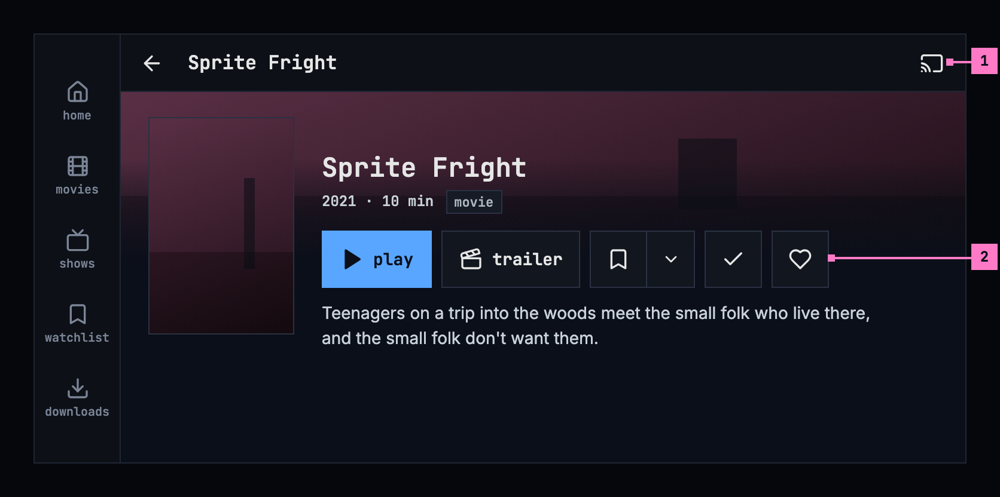
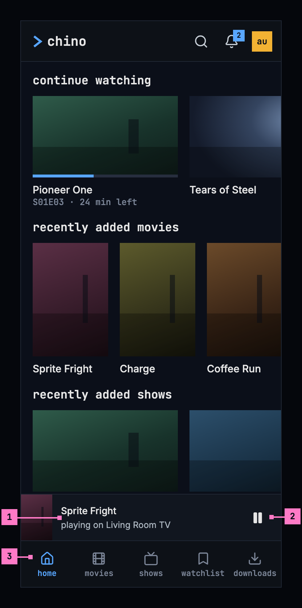
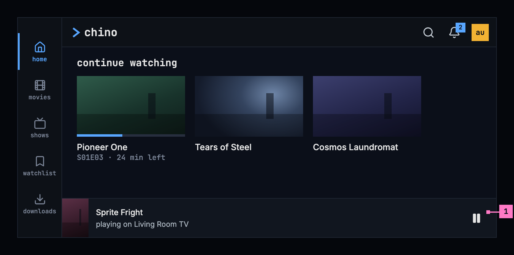
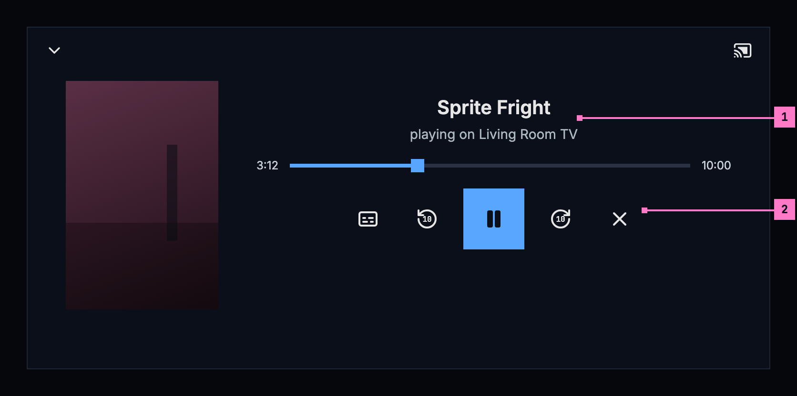
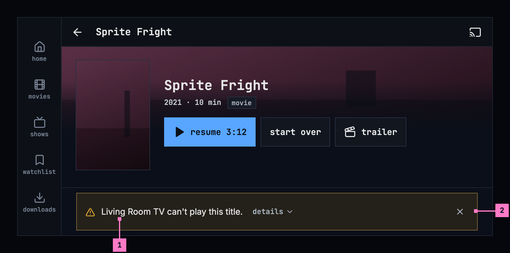

# 14 Casting

Section 14.2 describes casting as it is deployed today. The sections after it
are the target, casting as it is meant to be, and section 14.6 lists every
difference between the two as a numbered change. Only a change the owner has
approved is built, one change at a time; anything no change names stays as it
is deployed.

The chapter covers sending a title from the phone app to a TV or a speaker on
the same network: the cast button, the bar and the full controls while casting,
handing a title over, and what the phone says when the TV can't play it. The
title page and the player, where casting starts, are specified in
[chapter 6](./title-actions.md) and [chapter 11](./playback.md).

## 14.1 Purpose

Casting sends a title from the phone to a TV or a speaker on the same network.
The TV plays it, and the phone becomes the remote. People cast from many apps,
so they expect the same button and the same controls everywhere: chino uses
Google Cast's own widgets, in chino's colours.

Casting exists only in the phone app, on phones and tablets. The web and the TV
apps don't cast, so the screens of this chapter are drawn at the phone's size
only, held upright and sideways. Google Cast is the Android app's; the iOS app
sends a title to a screen with AirPlay, from the player
([chapter 11](./playback.md)), and has no cast button. This chapter calls the
device that plays “the TV”, whatever it is.

Google's Cast library draws the cast button, the device chooser, the bar, the
full controls and the notification, themed with the app's colours: the full
controls on the background colour, the bar on the surface colour, the seek bar
and the active controls in the accent blue. Labels and icons on blue are dark.
The layouts are Google's; the figures show their parts in chino's colours.

## 14.2 As deployed

Casting exists only in the phone app, so this section describes it from the
phone app's code on GitHub main as of 6 November 2026, without screenshots
until screenshots of the phone app are taken; how Google's widgets draw the
button, the bar, the full controls and the notifications hasn't been seen on a
real Cast device yet. The web, Android TV and the Samsung TV don't cast.

### 14.2.1 The phone app

Only the Android app casts, with Google Cast. The iOS app has no cast button;
its player has AirPlay in its row of buttons ([chapter 11](./playback.md)).

**The cast button** is Google's, its icon and its states, in the foreground
colour. It shows only while a device that can play is on the network, while it
connects and while it casts. On a title's page it sits at the right of the
page's own bar, in a 40 dp square on the surface, like back and home beside
it; in the player, in a 36 dp circle at the right of the top
([chapter 11](./playback.md)); and in the toolbar of the full controls. A
screen reader hears Google's names, “Cast” and “Cast. Connected”. It opens
Google's device chooser, on the surface, square, in Inter.

**Starting.** While a TV is connected, **play**, **resume** and an episode's
play start the title on the TV, where the phone would have started it: at the
resume point, or from the start for a finished title. Where the TV already
plays that title for this phone and account, it plays on. A cast started while
the phone plays continues on the TV where the phone was, playing or paused, with
its audio and its subtitles, and the phone's player closes once the TV plays.

**The bar** is Google's mini controller, on the surface with a 1 dp line along
its top: the title's poster, 43 × 64 dp, the title in Inter, “playing on Living
Room TV” under it, quieter, and play or pause. Tapping it opens the full
controls. In the tabs' screens it sits above the tabs at the bottom, or, from
600 dp wide, at the foot of the content beside the rail; on a title's page, a
person's page and the notifications, at their foot. The player has none.

**The full controls** are Google's expanded controller on the background
colour: the title's artwork behind them, fading into the background under the
toolbar and under the controls; the toolbar with Google's arrow to close them,
the title and the cast button; “playing on Living Room TV”; the seek bar in
blue; and the row: subtitles and audio, one button of Google's, there when the
TV offers a choice; back 10 seconds; play or pause; forward 10 seconds; and stop
casting, a cross. A long press shows their names, “back 10 seconds”, “forward
10 seconds” and “stop casting”. The subtitles and audio button opens Google's
chooser, which names the subtitles as the phone's player does and the audio
tracks by the names the stream gives them.

**Outside the app**, Google's media notification and the lock screen show the
title, the device, play or pause and stop. While the TV plays, a quiet
notification of the app's own says “Keeping your place while Living Room TV
plays”. Both are in one channel of the phone's settings, “Casting”.

**Stopping.** When casting stops, the TV's last position is written back, so
playing again continues from there, and the phone's player doesn't start by
itself.

**Changing accounts.** Signing out, removing the account and changing the
server stop casting first, with the position written for the account, and
their questions add “Casting on Living Room TV stops.” A switch to another
account asks nothing and says afterwards, in a toast, “Stopped casting on
Living Room TV.”; so does **Sign in again** on a sign-in the server refuses.

**Without the server.** While the server can't be reached, a downloaded title
plays on the phone, a TV connected or not, with the toast “Playing on this
phone: the server can't be reached.”

**When the TV can't play a title**, the phone sends it once more where the TV
failed at something a second try can mend, such as a part of the stream it
couldn't load, but not for a format the TV can't decode or a device without a
screen. Then the warning takes the bar's place: “Living Room TV can't play this
title.”, or “The device can't play this title.” for a device without a name,
with **details** and a caret after it on the same line where it fits, and a
28 dp close button. **details** opens the reason in the monospace face: “the
server no longer accepts this phone's sign-in (HTTP 401)”, “the server doesn't
let this account play it (HTTP 403)”, “the server ran into a problem (HTTP
503)”, “no answer from media.example.com”, “the device plays sound only, not
video”, “Living Room TV reported: unsupported media (error 104)”. Casting stops,
and the title stays where it was on the phone, paused.

### 14.2.2 Feature by feature

The table compares the apps feature by feature. “—” is a feature the app
doesn't have; only the phone app casts.

| Feature | Web | Phone app | Android TV | Samsung TV |
|---|---|---|---|---|
| Casting | — | the Android app, with Google Cast; the iOS app has no cast button, and AirPlay in the player | — | — |
| The cast button | — | Google's, while a device that can play is on the network; on a title's page a 40 dp square at the right of its bar, in the player a 36 dp circle | — | — |
| The button's names | — | Google's: “Cast”, “Cast. Connected” | — | — |
| The device chooser | — | Google's, on the surface, square, in Inter | — | — |
| Play while a TV is connected | — | starts the title on the TV at the resume point, from the start for a finished title; plays on where the TV plays it already | — | — |
| A cast started in the player | — | the TV continues where the phone was, playing or paused, with its audio and subtitles; the phone's player closes | — | — |
| The bar | — | Google's mini controller on the surface: the poster, 43 × 64 dp, the title, “playing on Living Room TV”, play or pause | — | — |
| Where the bar is | — | above the tabs; from 600 dp wide at the foot of the content; at the foot of a title's page, a person's page and the notifications; none in the player | — | — |
| The full controls | — | Google's expanded controller on the background colour: the artwork, the toolbar with the title and the cast button, the seek bar in blue | — | — |
| Their buttons | — | subtitles and audio in one button, back 10 seconds, play or pause, forward 10 seconds, stop casting as a cross | — | — |
| The TV's tracks | — | Google's chooser: the subtitles named as the phone's player names them, the audio tracks by the stream's names | — | — |
| Outside the app | — | Google's media notification and the lock screen; the quiet “Keeping your place while Living Room TV plays”; one channel, “Casting” | — | — |
| Stopping | — | the TV's last position written back; the phone's player doesn't start | — | — |
| Changing accounts | — | sign out, remove account and change server stop casting, their questions say so; a switch: the toast “Stopped casting on Living Room TV.” | — | — |
| A download without the server | — | plays on the phone: “Playing on this phone: the server can't be reached.” | — | — |
| A second try | — | once, where a second try can mend what the TV failed at | — | — |
| When the TV can't play | — | the warning in the bar's place, **details** after the line, a 28 dp close button; casting stops | — | — |
| The device's name | — | its name on the network, else its model, else “the device” | — | — |
| A TV with Google Cast built in | — | — | plays what the phone casts with Google's own receiver, not with this app | — |
| Checked on a real Cast device | — | not yet | — | — |

## 14.3 The cast button

The cast button appears only when a device that can play is on the network. It
sits in the bar of a title's page and of the player, on the right, in a 48 dp
square like every control. Figure 14.1 shows it on a title's page, on a phone
held upright.

Figure 14.1: The cast button on a title's page, on a phone held upright, at
360 × 780 dp.

1. **The cast button**, Google's icon: outlined while nothing is connected,
   moving while it connects, filled while casting (figure 14.5). It opens
   Google's device chooser, which lists the devices by their own names.
2. **play**: while a TV is connected, play, resume and an episode's play start
   the title on the TV, where they would have started it on the phone: at the
   resume point, or from the start for a finished title. When the TV already
   plays that title for this phone, it plays on.

Figure 14.2 shows the same page on a phone held sideways. The bar is slimmer
and the tabs are a rail on the left ([chapter 2](./frame.md)); the cast button
keeps its place at the bar's right end.

Figure 14.2: The cast button on a title's page, on a phone held sideways, at
780 × 360 dp.

1. **The cast button**, at the right of the bar, as upright.
2. **The title row**, **play** first, beside the poster and in view without
   scrolling.

## 14.4 While casting

### 14.4.1 The bar

The bar sits above the bottom navigation, never over it. It is part of the
screen's layout, so nothing scrolls under it unseen. It shows the title's
poster, the title, “playing on Living Room TV” with the device's own name, and
play or pause. Tapping it opens the full controls. Figure 14.3 shows the bar on
home, on a phone held upright.

Figure 14.3: The casting bar above the tabs, on a phone held upright, at
360 × 780 dp.

1. **The title**, with its poster and, under it, “playing on Living Room TV”.
2. **play or pause** works the TV without opening the full controls.
3. **The tabs** stay under the bar.

Held sideways, as figure 14.4 shows, the tabs are a rail on the left, and the
bar is the last row of the content beside it. A title's page, a person's page
and the notifications have the bar at their foot as well; the player has none:
once the TV plays, the phone's player closes (section 14.4.4).

Figure 14.4: The casting bar on a phone held sideways, at 780 × 360 dp.

1. **The bar**, at the foot of the content, as wide as it.

### 14.4.2 The full controls

Figure 14.5 shows the full controls, which the bar opens, on a phone held
upright.

Figure 14.5: The full controls while casting, on a phone held upright, at
360 × 780 dp.

1. **The cast button**, filled while casting. It opens Google's dialog for the
   TV that is connected.
2. **“playing on Living Room TV”**, under the title and its artwork.
3. **The position**, with a seek bar.
4. **Subtitles and audio**, there when the TV offers a choice. The choice names
   the tracks as the player does: the subtitles as
   [chapter 12](./subtitles.md) names them, the audio as
   [chapter 11](./playback.md) does, “English · 5.1”.
5. **Back and forward 10 seconds**, with play or pause between them.
6. **stop casting**: casting stops, and the phone keeps the TV's position.

Figure 14.6 shows the full controls on a phone held sideways: the same parts,
the artwork at the left and the controls beside it.

Figure 14.6: The full controls while casting, on a phone held sideways, at
780 × 360 dp.

1. **The title and the device**, beside the artwork.
2. **The controls**, in the order of figure 14.5.

### 14.4.3 Outside the app

Google's media notification and the lock screen show the title, the device,
play or pause, and stop. While a TV plays, the phone keeps a quiet
notification of its own, “Keeping your place while Living Room TV plays”, so
that it can save the position. Both are in one channel of the phone's
settings, **Casting**.

### 14.4.4 Handing over

- When casting starts while the phone plays, the TV continues where the phone
  was, playing or paused as it was, with its audio and subtitles, and the
  phone's player closes once the TV plays. While the TV loads, its default
  receiver shows Google's own screen.
- When casting starts from a title's page, the TV starts where the phone would
  have started (section 14.3).
- When people stop casting, the TV's last position is written back, so playing
  again continues from there. The phone's player doesn't start by itself.

### 14.4.5 Changing accounts

Signing out, removing the account, changing the server or switching to another
account saves the position and stops casting, so a title never keeps playing
under the next person. The question before signing out, removing the account or
changing the server says “Casting on Living Room TV stops.”, as figure 13.7
shows in [chapter 13](./downloads.md). A switch asks nothing; after it, a toast
says “Stopped casting on Living Room TV.”

### 14.4.6 Downloads without the server

While the server can't be reached, a downloaded title plays on the phone, even
while a TV is connected, and a toast says why: “Playing on this phone: the
server can't be reached.”

### 14.4.7 Turning the phone

Turning the phone never touches the cast: the TV plays on, the bar keeps its
state, and the full controls stay open, with Google's chooser where it was
open.

## 14.5 When the TV can't play a title

The app sends a version the TV can play whenever there is one. When the TV
fails at something a second try can mend, such as a part of the stream it
couldn't load, the phone sends the title once more before it says anything.
When there is no version the TV can play, a warning banner takes the bar's
place, as figure 14.7 shows. Casting stops, and the title stays where it was on
the phone.

Figure 14.7: When the TV can't play a title, on a phone held upright, at
360 × 780 dp.

1. **resume 3:12**: the title stays where it was on the phone, ready to play
   there.
2. **“Living Room TV can't play this title.”**, with the device's own name. A
   device without a name reads “The device can't play this title.”
3. **details** gives the reason, for example “the server no longer accepts this
   phone's sign-in (HTTP 401)” or “the server doesn't let this account play it
   (HTTP 403)”.
4. **The close button**, a 48 dp square, puts the banner away.

Figure 14.8 shows the warning on a phone held sideways, at the foot of the
content, where the bar was. With the width it has there, **details** follows the
line on the same row.

Figure 14.8: When the TV can't play a title, on a phone held sideways, at
780 × 360 dp.

1. **The line and details**, on one row.
2. **The close button**, at the banner's right end.

## 14.6 Changes

Every difference between section 14.2 and the target is one change in the
table. A change names the apps it is built in, what they do today and the
target, with the figure or the section that sets it out; it is built as its row
says, and nothing else changes with it. Each change starts as proposed; once the
owner approves it, it is built, one change at a time. The title page's bar,
which holds the cast button, belongs to [chapter 6](./title-actions.md), the
cast button in the player to [chapter 11](./playback.md), and AirPlay on iOS to
chapter 11 as well.

| No. | Change | Apps | Today | Target | Status |
|---|---|---|---|---|---|
| 14.C1 | The cast button in a 48 dp square on a title's page | Phone app (Android) | a 40 dp square on the surface, the size of back and home beside it | a 48 dp square at the right of the title page's bar (figure 14.1); in the player, chapter 11's change of its buttons | proposed |
| 14.C2 | The audio tracks named as the player names them on the TV | Phone app (Android) | Google's chooser of the TV's tracks names the subtitles as the phone's player does, and the audio tracks by the names the stream gives them | the audio tracks too as the player names them, “English · 5.1” (figure 14.5, part 4) | proposed |
| 14.C3 | The warning's close button 48 dp | Phone app (Android) | a 28 dp square with a cross | a 48 dp square (figure 14.7, part 4) | proposed |

## 14.7 States

| State | What the phone shows |
|---|---|
| No TV on the network | No cast button |
| A TV on the network | The cast button, outlined (figures 14.1 and 14.2) |
| Connecting | The cast button, moving |
| Casting | The cast button, filled; the bar (figures 14.3 and 14.4); the full controls (figures 14.5 and 14.6); the notifications |
| The TV can't play the title | Figures 14.7 and 14.8; casting stops |
| An account change while casting | The question says “Casting on Living Room TV stops.”; after a switch, the toast |
| The server can't be reached while a TV is connected | A downloaded title plays on the phone, with the toast |

## 14.8 Words

- The device's name comes from the network, as people named it, or else the
  model the device says it is. A device with neither is “the device”, and
  “The device” at the start of a sentence. Never “the TV” as a name, and never a
  product name the device didn't give itself.
- Our words are **playing on …** and **stop casting**; the device chooser's
  words are Google's.
- In the casting messages, the phone is “this phone” or “this tablet”, never
  “this device”: “the device” is the TV.

| Where | Text |
|---|---|
| The bar | the title · playing on Living Room TV |
| The full controls | playing on Living Room TV · back 10 seconds · forward 10 seconds · stop casting |
| Outside the app | Keeping your place while Living Room TV plays · its channel: Casting |
| The questions before signing out, removing an account or changing the server | Casting on Living Room TV stops. |
| After switching accounts | Stopped casting on Living Room TV. |
| A download without the server | Playing on this phone: the server can't be reached. |
| When the TV can't play a title | Living Room TV can't play this title. · The device can't play this title. · details · the server no longer accepts this phone's sign-in (HTTP 401) · the server doesn't let this account play it (HTTP 403) |
