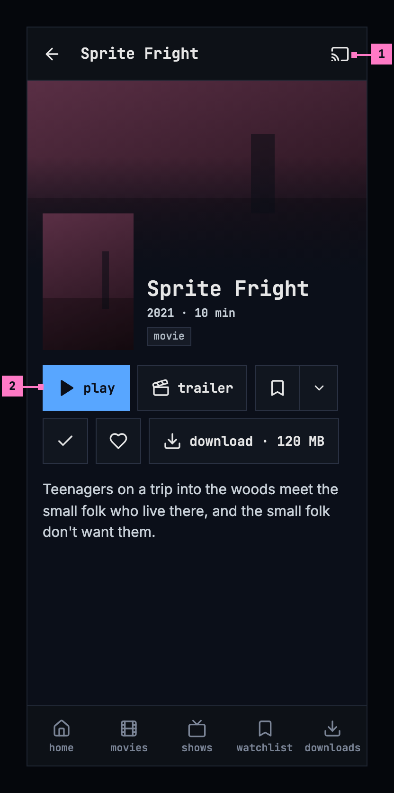
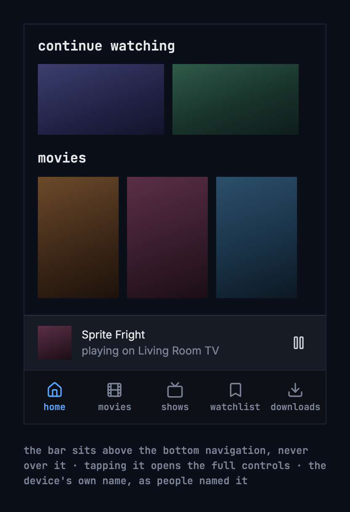
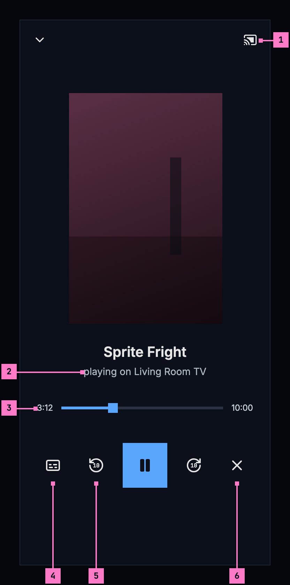
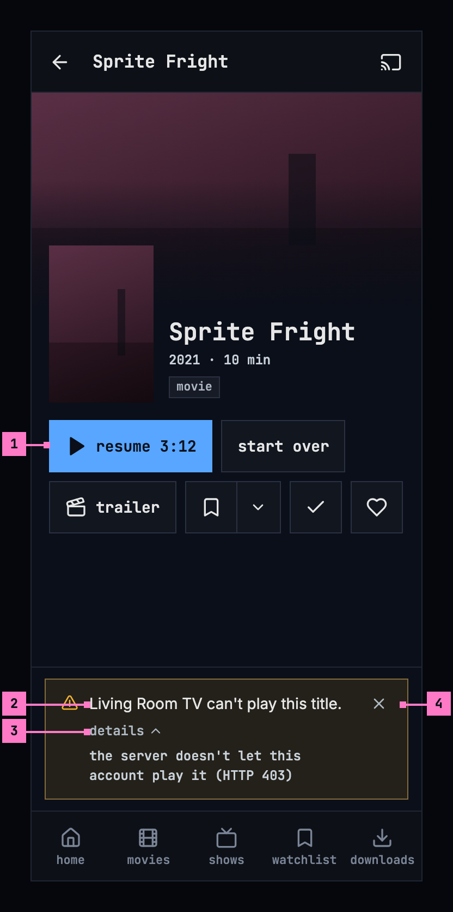

# 14 Casting

> **Not in the new form yet.** This chapter's figures show the target, not
> what is deployed today. Where today's apps differ, its “Today's apps”
> section says so. The screens as deployed and the numbered changes follow,
> as [chapter 11](./playback.md) already has them.

This chapter specifies casting: sending a title from the phone app to a TV or a
speaker on the same network. The title page and the player, where casting
starts, are specified in [chapter 6](./title-actions.md) and
[chapter 11](./playback.md).

## 14.1 Purpose

Casting sends a title from the phone to a TV or a speaker on the same network.
The TV plays it, and the phone becomes the remote. People cast from many apps,
so they expect the same button and the same controls everywhere: chino uses
Google Cast's own widgets, in chino's colours.

Casting exists only in the phone app, on phones and tablets. The web and the TV
apps don't cast, so the screens of this chapter are drawn at the phone's size
only. This chapter calls the device that plays “the TV”, whatever it is.

Google's Cast library draws the cast button, the device chooser, the bar, the
full controls and the notification, themed with the app's colours: the full
controls on the background colour, the bar on the surface colour, the seek bar
and the active controls in the accent blue. Labels and icons on blue are dark.

## 14.2 The cast button

The cast button appears only when a device that can play is on the network. It
sits in the bar of a title's page and of the player, on the right, in a 48 dp
square like every control. Figure 14.1
shows it on a title's page.

Figure 14.1: The cast button on a title's page, on a phone.

1. **The cast button**, Google's icon: outlined while nothing is connected,
   moving while it connects, filled while casting (figure 14.3). It opens
   Google's device chooser, which lists the devices by their own names.
2. **play**: while a TV is connected, play, resume and an episode's play start
   the title on the TV, where they would have started it on the phone: at the
   resume point, or from the start for a finished title. When the TV already
   plays that title for this phone, it plays on.

## 14.3 While casting

### 14.3.1 The bar

The bar sits above the bottom navigation, never over it. It is part of the
screen's layout, so nothing scrolls under it unseen. It shows the title,
“playing on Living Room TV” with the device's own name, and play or pause.
Tapping it opens the full controls. Figure 14.2 shows the bar.

Figure 14.2: The casting bar above the bottom navigation.

### 14.3.2 The full controls

Figure 14.3 shows the full controls, which the bar opens.

Figure 14.3: The full controls while casting, on a phone.

1. **The cast button**, filled while casting. It opens Google's dialog for the
   TV that is connected.
2. **“playing on Living Room TV”**, under the title and its artwork.
3. **The position**, with a seek bar.
4. **Subtitles and audio**, there when the TV offers a choice. The choice names
   the tracks as the player does ([chapter 12](./subtitles.md)).
5. **Back and forward 10 seconds**, with play or pause between them.
6. **stop casting**: casting stops, and the phone keeps the TV's position.

### 14.3.3 Outside the app

Google's media notification and the lock screen show the title, the device,
play or pause, and stop. While a TV plays, the phone keeps a quiet
notification of its own, “Keeping your place while Living Room TV plays”, so
that it can save the position. Both are in one channel of the phone's
settings, **Casting**.

### 14.3.4 Handing over

- When casting starts while the phone plays, the TV continues where the phone
  was, playing or paused as it was, with its audio and subtitles, and the
  phone's player closes once the TV plays. While the TV loads, its default
  receiver shows Google's own screen.
- When casting starts from a title's page, the TV starts where the phone would
  have started (section 14.2).
- When people stop casting, the TV's last position is written back, so playing
  again continues from there. The phone's player doesn't start by itself.

### 14.3.5 Changing accounts

Signing out, removing the account, changing the server or switching to another
account saves the position and stops casting, so a title never keeps playing
under the next person. The question before signing out, removing the account or
changing the server says “Casting on Living Room TV stops.”, as figure 13.5
shows in [chapter 13](./downloads.md). A switch asks nothing; after it, a toast
says “Stopped casting on Living Room TV.”

### 14.3.6 Downloads without the server

While the server can't be reached, a downloaded title plays on the phone, even
while a TV is connected, and a toast says why: “Playing on this phone: the
server can't be reached.”

## 14.4 When the TV can't play a title

The app sends a version the TV can play whenever there is one. When the TV
fails at something a second try can mend, such as a part of the stream it
couldn't load, the phone sends the title once more before it says anything.
When there is no version the TV can play, a warning banner takes the bar's
place, as figure 14.4 shows. Casting stops, and the title stays where it was on
the phone.

Figure 14.4: When the TV can't play a title, on a phone.

1. **resume 3:12**: the title stays where it was on the phone, ready to play
   there.
2. **“Living Room TV can't play this title.”**, with the device's own name. A
   device without a name reads “The device can't play this title.”
3. **details** gives the reason, for example “the server no longer accepts this
   phone's sign-in (HTTP 401)” or “the server doesn't let this account play it
   (HTTP 403)”.
4. **The close button** puts the banner away.

## 14.5 States

| State | What the phone shows |
|---|---|
| No TV on the network | No cast button |
| A TV on the network | The cast button, outlined (figure 14.1) |
| Connecting | The cast button, moving |
| Casting | The cast button, filled; the bar (figure 14.2); the full controls (figure 14.3); the notifications |
| The TV can't play the title | Figure 14.4; casting stops |
| An account change while casting | The question says “Casting on Living Room TV stops.”; after a switch, the toast |
| The server can't be reached while a TV is connected | A downloaded title plays on the phone, with the toast |

## 14.6 Words

- The device's name comes from the network, as people named it, or else the
  model the device says it is. A device with neither is “the device”, and
  “The device” at the start of a sentence. Never “the TV” as a name, and never a
  product name the device didn't give itself.
- Our words are **playing on …** and **stop casting**; the device chooser's
  words are Google's.
- In the casting messages, the phone is “this phone” or “this tablet”, never
  “this device”: “the device” is the TV.

| Where | Text |
|---|---|
| The bar | the title · playing on Living Room TV |
| The full controls | playing on Living Room TV · back 10 seconds · forward 10 seconds · stop casting |
| Outside the app | Keeping your place while Living Room TV plays · its channel: Casting |
| The questions before signing out, removing an account or changing the server | Casting on Living Room TV stops. |
| After switching accounts | Stopped casting on Living Room TV. |
| A download without the server | Playing on this phone: the server can't be reached. |
| When the TV can't play a title | Living Room TV can't play this title. · The device can't play this title. · details · the server no longer accepts this phone's sign-in (HTTP 401) · the server doesn't let this account play it (HTTP 403) |

## 14.7 Today's apps

| App | What differs from this chapter |
|---|---|
| Web | Doesn't cast, as this chapter has it. |
| Phone app | Only the Android app casts; the iOS app shows no cast button. The bar's picture is the title's poster, 2:3, in a bar 64 dp high. While a TV plays, two notifications show, Google's media notification and the quiet one; one in place of both is to be tried on a real Cast device. The states of the button, the bar, the full controls and the notifications as Google's widgets draw them haven't been checked on a real Cast device yet. |
| Android TV | Doesn't cast, as this chapter has it. A TV with Google Cast built in plays what the phone casts with Google's own receiver, not with this app. |
| Samsung TV | Doesn't cast, as this chapter has it. |
