# 13 Downloads and offline

Section 13.2 describes downloads as they are deployed today. The sections
after it are the target, downloads as they are meant to be, and section 13.8
lists every difference between the two as a numbered change. Only a change the
owner has approved is built, one change at a time; anything no change names
stays as it is deployed.

The chapter covers the download control on a title's page, the downloads
screen, whose downloads they are, and what the phone app shows while the server
can't be reached. The title page around the control is specified in
[chapter 6](./title-actions.md), the downloads tab in [chapter 2](./frame.md),
and what a screen says when it couldn't load in [chapter 17](./errors.md).

## 13.1 Purpose

On a phone or a tablet, people can download a title and watch it without a
connection: on a train, on a plane, wherever the signal drops. A download is a
copy on the device, with its subtitles, kept for the account that made it, and
it plays even when the server can't be reached.

Downloads exist only in the phone app, on phones and tablets. The web and the
TV apps have none, so the screens of this chapter are drawn at the phone's size
only, held upright and sideways. The **downloads** tab opens the downloads
screen (section 13.4), and while the server can't be reached the app opens
there by itself (section 13.6).

This chapter says “phone” throughout. On a tablet, a device 600 dp or more on
its shorter side, the app says “tablet”: “18 GB free on this tablet”.

## 13.2 As deployed

Downloads exist only in the phone app, so this section describes them from the
phone app's code on GitHub main as of 6 November 2026, without screenshots
until screenshots of the phone app are taken. The web, Android TV and the
Samsung TV have no downloads.

### 13.2.1 The phone app

Only the Android app downloads; the iOS app has no download control and no
downloads tab. Downloads is one of seven tabs, home, movies, shows, watchlist,
zap, downloads and settings, each an icon without its name: in a bar at the
bottom while the window is less than 600 dp wide, as on a phone held upright,
and in a rail down the left edge from 600 dp, as on a phone held sideways. The
tab is there while the server offers downloads or something is on the phone.

**The control.** A title's page ends its row of actions with the download
control: one status on the surface, 48 dp high and without a border, its words
in the monospace face after an icon. Not on the phone, it says “download ·
1.4 GB”, or “download” where the size isn't known, and pressing it starts the
download. Then it says “queued · 1.4 GB”, “waiting for Wi-Fi · 1.4 GB”,
“waiting for a connection · 1.4 GB”, “downloading 42% · 1.4 GB”, with a 2 dp
blue bar along its foot and the percentage changing once a second, and
“downloaded · 1.4 GB”. The icon is a download arrow, white on the offer, blue
while the title downloads and grey while it waits; a green check once the title
is on the phone; the information mark on “downloaded · check needed”; and a red
warning triangle on “couldn't download”, whose reason stands under it in red.
Beside the status is the one action: a square with a cross, “cancel download”,
while the title waits or downloads; a square with a bin, “delete download”,
once it is on the phone; and for a failure **try again**, where it can help,
and **remove**, both as blue words. A title that only streams shows “can't be
downloaded”, dimmed, over “This title can only be streamed.” The size is the
one the server's playlists give for the chosen quality and the audio the
account's language keeps, the same number before and after.

**A show** has no control in its own row. Each episode has one in its actions,
48 dp high with smaller words. An open season offers its episodes at its head:
“download season 1 · 6 episodes · 1.8 GB”, “download 5 episodes · 1.5 GB” where
some only stream, or “download 3 more episodes · 940 MB”. A closed season asks
the server for no sizes and offers nothing. Once some of it is on the phone, the
season and the show say how far, “1 of 6 downloaded”, counting only the
episodes that can be downloaded, with a green check once all of those are
there.

**The downloads screen** starts with its heading, “downloads”, then a banner
where there is one, then the storage line, “547 MB used by downloads · 18 GB
free on this phone”, counted again every 3 seconds, then the titles, newest
first, by show and season, with the movies in a group of their own headed
“movies”. Each title is a row on the surface: an episode's still, 112 dp wide,
or a movie's poster, 56 dp wide; the name, “S01E01 · Earthfall”; and under it
the status as the control says it, coloured: green for downloaded, blue for
downloading, red for couldn't download and for its reason, grey for the rest. A
failed row offers **try again** and **remove** as blue words; the others end
in the cross or the bin. A row plays its title when tapped, once the title is
on the phone. Deleting one asks nothing. **delete all**, the design system's
danger button at the end of the list, asks first: “delete all downloads”,
“This removes 3 downloads, 547 MB, from this phone.”, with **cancel** and
**delete all**, or “This clears the list of downloads.” where nothing of them
is on the phone. With nothing downloaded, the screen shows a 56 dp square
outline with the download arrow in it, “nothing downloaded yet” and “Titles you
download show up here, ready to watch without a connection.”

**Whose downloads.** A download is the account's: the sign-in's subject on its
server, the same however often the account signs in again, so a sign-in that
expired or was refused hides and deletes nothing. Two accounts that download
the same title share one copy, which goes with the last of them. Signing out
asks first where downloads go or a cast stops: “Your 3 downloads, 547 MB, are
deleted from this phone.” Removing an account always asks: “The 8 downloads of
Anna, 2.6 GB, are deleted from this phone.”, or without downloads, “This removes
Anna from this phone. You'll need to sign in again to use the account.”
Changing the server asks once the new server has answered, and only where the
old server's downloads go or a cast stops, with signing out's sentence for the
downloads of every account: “Your 3 downloads, 547 MB, are deleted from this
phone.” While a TV plays, each question adds “Casting on Living Room TV stops.”

The app asks the server which of the account's downloads it may still watch. A
title the server leaves out twice, at least an hour apart, is deleted, and the
downloads screen says so once, in a banner under its heading: “This title isn't
available to this account anymore, so it was deleted from this phone.”, or for
several, “3 downloads were deleted from this phone: they aren't available to
this account anymore.”, with **details** opening their names. Where the server's
answer leaves out every title and doesn't say that the library holds any for
the account, the two answers have to be a day apart.

**Without the server.** When the server doesn't answer as the app starts, the
app opens on the downloads tab, after who's watching where the phone has
several accounts. Home, movies, shows, a title's page and the downloads screen
then show the information banner, tinted blue with a blue bar down its left
edge and the information mark: “Can't reach the server. Your downloads still
play.”, or “Can't reach the server.” where nothing would play. It has no close
button, and the bell is hidden. Home, movies and shows keep under the banner
what they loaded earlier while the app runs. Search, the watchlist, a person's
page and settings show no banner, only their own couldn't-load. While the app is
in front, it asks the server again every 15 seconds; once the server answers,
the banner goes, the bell comes back and the watch progress made without it is
sent.

A title's page built from the phone keeps the page's own bar, back and home
side by side with cast at the right, shows the banner under it, and leaves out
the lists, watched, liked, the trailer and the people. A show's page lists only
the episodes on the phone and says “1 episode on this phone”, with the green
check, or with the information mark while one of them waits for its check. A
download not checked with the server for 30 days says “downloaded · check
needed”, with “Downloads are checked with the server every 30 days. This one
plays again once the server can be reached.”, and its **play** is dimmed. A
downloaded title plays on the phone while the server can't be reached, whether
a TV is connected or not, with the toast “Playing on this phone: the server
can't be reached.”

**Settings** have a group headed “Downloads”: “Download quality”, with rows
such as “Medium (720p) · about 932 MB an hour”, the picked one blue with a
check mark, and the switch “Download over Wi-Fi only”, on at first. The group
isn't there where the server offers no downloads. Downloads wait for Wi-Fi
while that switch is on, otherwise for any connection, and never for a
charger. When the phone is about to run out of room, the app stops them first:
“Not enough space on this phone.”

**The notification.** The first download asks once whether downloads may show a
notification. While downloads run, a quiet notification names the title on its
way, “Pioneer One · S01E01 · Earthfall”, or “Downloads” for several, over
“Downloading 42% · 2 queued”, “Queued”, “Waiting for Wi-Fi” or “Waiting for a
connection”, with a bar. Tapping it opens the app.

### 13.2.2 Feature by feature

The table compares the apps feature by feature. “—” is a feature the app
doesn't have; only the phone app downloads.

| Feature | Web | Phone app | Android TV | Samsung TV |
|---|---|---|---|---|
| Downloads | — | the Android app; the iOS app has none | — | — |
| The downloads tab | — | an icon among seven tabs, at the bottom upright and in a rail on the left from 600 dp wide; left out while the server offers no downloads and nothing is on the phone | — | — |
| The control's place | — | last in a title's row of actions; an episode's at the end of its actions | — | — |
| The control's look | — | a status on the surface, 48 dp, without a border; its icon tinted by the status: the download arrow white, blue or grey, the green check, the information mark, the red warning triangle | — | — |
| The control's words | — | “download · 1.4 GB”, “queued · 1.4 GB”, “waiting for Wi-Fi · 1.4 GB”, “waiting for a connection · 1.4 GB”, “downloading 42% · 1.4 GB”, “downloaded · 1.4 GB”, “downloaded · check needed”, “couldn't download”, “can't be downloaded” | — | — |
| The control's actions | — | a square with a cross, “cancel download”; a square with a bin, “delete download”; **try again** and **remove** as blue words | — | — |
| A failure's reason | — | in red, under the status; seven reasons, the words of section 13.3 | — | — |
| A season | — | “download season 1 · 6 episodes · 1.8 GB” on an open season only; “1 of 6 downloaded”, with the green check once all that can come are there | — | — |
| The downloads screen | — | the heading, then the banners, then the storage line and the titles by show and season, the movies last | — | — |
| A title's row | — | on the surface; an episode's still 112 dp wide, a movie's poster 56 dp wide; the status coloured: green, blue, red, grey | — | — |
| Deleting | — | one: no question; all: **delete all**, the danger button, after its question | — | — |
| Nothing downloaded | — | a 56 dp square outline with the download arrow, “nothing downloaded yet” and its sentence | — | — |
| Whose | — | the account's, by its sign-in's subject on its server; a title two accounts downloaded is kept once | — | — |
| Sign out's question | — | where downloads go or a cast stops: “Your 3 downloads, 547 MB, are deleted from this phone.” | — | — |
| Remove account's question | — | always; without downloads, “This removes Anna from this phone. You'll need to sign in again to use the account.” | — | — |
| Change server's question | — | only where the old server's downloads go or a cast stops, with sign out's sentence for every account's downloads | — | — |
| Titles the server took off | — | after two answers an hour apart; a banner under the heading, once, with **details** | — | — |
| The server can't be reached | each screen's couldn't-load, “Can't reach the server.” ([chapter 17](./errors.md)) | the app opens on the downloads tab, with the banner | each screen's couldn't-load, “Can't reach the server.” | home says “Your library is empty. Add titles on your server to see them here.”; the other screens the error's own text |
| Where the banner shows | — | home, movies, shows, a title's page, the downloads screen; under the screen's heading or bar | — | — |
| The banner | — | the information banner, a blue bar down its left edge, the information mark; no close button | — | — |
| The other screens | — | search, the watchlist, a person's page and settings: no banner, their own couldn't-load | — | — |
| The bell | — | hidden while the server can't be reached | — | — |
| Asking the server again | — | every 15 seconds while the app is in front; then the banner goes and the progress made offline is sent | — | — |
| A title's page from the phone | — | its own bar: back, home and cast; the banner under it; no lists, watched, liked, trailer or people; “1 episode on this phone” | — | — |
| Check needed | — | after 30 days without a check; **play** dimmed | — | — |
| Settings | — | “Downloads”: “Download quality”, the picked row blue with a check mark; “Download over Wi-Fi only”, on at first | — | — |
| What downloads wait for | — | Wi-Fi while Wi-Fi only is on, else any connection; never a charger | — | — |
| The notification | — | the title or “Downloads”, “Downloading 42% · 2 queued”, “Queued”, “Waiting for Wi-Fi”, with a bar | — | — |
| A downloaded title and a TV | — | plays on the phone while the server can't be reached: “Playing on this phone: the server can't be reached.” | — | — |

## 13.3 The download control

The download control sits last in a title's row of actions, after **liked**
([chapter 6](./title-actions.md)). It shows the title's download status and
offers the one thing that makes sense in it. Figure 13.1 shows the control in
each status.

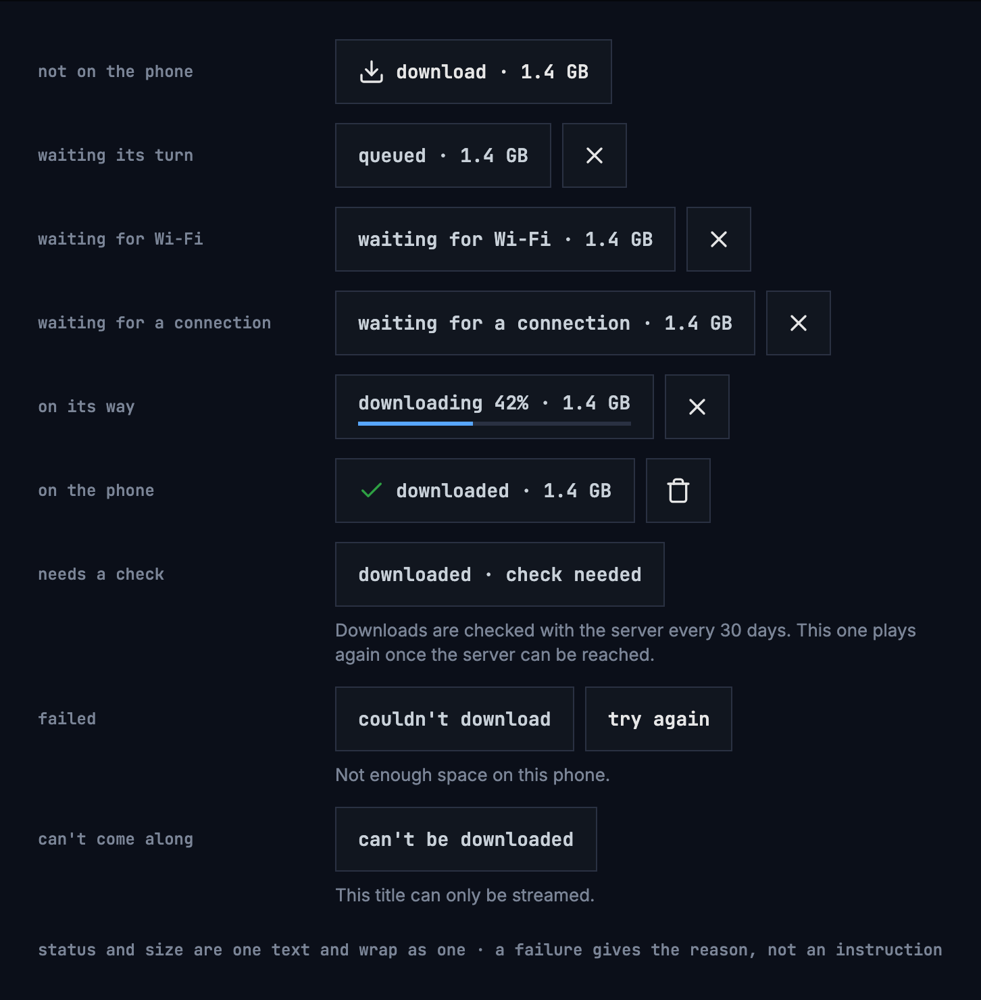

Figure 13.1: The download control in each status.

| Status | The control says | What people can do |
|---|---|---|
| Not on the phone | **download · 1.4 GB** | Download it |
| Waiting its turn | **queued · 1.4 GB** | Cancel |
| Waiting for Wi-Fi | **waiting for Wi-Fi · 1.4 GB** | Cancel; it starts by itself on Wi-Fi |
| Waiting for a connection | **waiting for a connection · 1.4 GB** | Cancel; it starts by itself once the phone is online |
| On its way | **downloading 42% · 1.4 GB**, with a thin bar | Cancel |
| On the phone | **downloaded · 1.4 GB** | Play it, delete it |
| Needs a check | **downloaded · check needed**, and “Downloads are checked with the server every 30 days. This one plays again once the server can be reached.” | Nothing until the server can be reached |
| Failed | **couldn't download**, and the reason in a sentence | **try again**, or remove it from the list |
| Can't come along | **can't be downloaded**, and “This title can only be streamed.” | Nothing |

- The control is 48 dp high, like every control, and its actions are buttons
  of their own: **cancel download** and **delete download**, the cross and the
  bin, and **try again**.
- The size is the size of exactly what will be downloaded at the chosen
  quality, as the server reports it: the same number before and after. When it
  isn't known, it is left out, **download** alone, rather than guessed.
- Sizes have one decimal without a trailing zero, “18 GB”, and are given in MB
  below 1 GB.
- Status and size are one text, and wrap as one; “check needed” stays together.
- The percentage changes at most once a second.
- A failure's sentence is a reason, never an instruction, because the control
  already offers **try again**. The reasons:
  - “Not enough space on this phone.”
  - “Can't reach the server.”
  - “This title isn't available to this account anymore.”
  - “The server has turned downloads off.”
  - “The server ran into a problem.”
  - “The server didn't accept the download.”
  - “The download stopped before it was done.”
- **try again** is there only where it can help: not when the server has turned
  downloads off, and not when the title isn't available to the account anymore.
- When the server has turned downloads off, a title's page offers no download.
  What is on the phone already stays, with its control; with nothing on the
  phone, the downloads tab is left out as well.
- Downloads wait only for the network, and for Wi-Fi while that setting is on
  (section 13.7). They never wait for a charger: that would keep the download's
  work running in the background for hours. When the phone is about to run out
  of room, the app stops them before it is full.

Figure 13.2 shows how a download moves between the statuses.

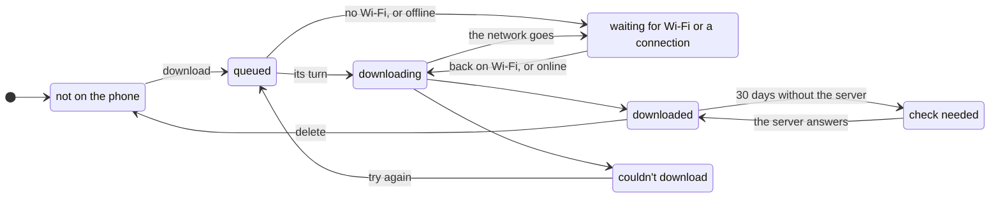

Figure 13.2: How a download moves between its statuses.

Cancelling a queued, waiting or downloading title, or removing a failed one,
takes it back to not on the phone. A failed download frees what it had
downloaded so far.

### 13.3.1 On a show

Each episode has its own control, in its row on the show's page, and the show's
own row of actions has none ([chapter 6](./title-actions.md)). An open season
offers its episodes at once, at its head; a closed season asks for no sizes and
shows only how far it is. Figure 13.3 shows a season with nothing of it on the
phone yet, on a phone held upright.

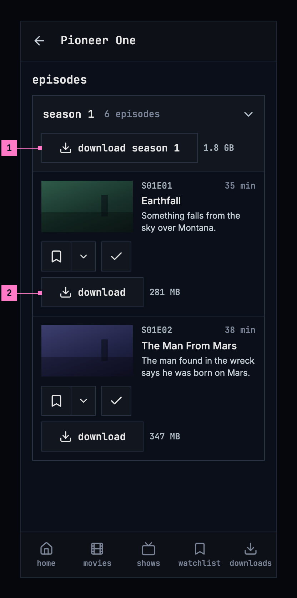

Figure 13.3: A season with nothing on the phone yet, on a phone held upright,
at 360 × 780 dp.

1. **The season's control** downloads every episode of it that isn't on the
   phone or on its way, one after the other, in their order. Leaving the page
   stops none of them.
2. **An episode's own control**, as in figure 13.1, after add to list and
   watched.

Figure 13.4 shows the same season on a phone held sideways. The tabs become a
rail down the left edge and the bar is slimmer ([chapter 2](./frame.md)).

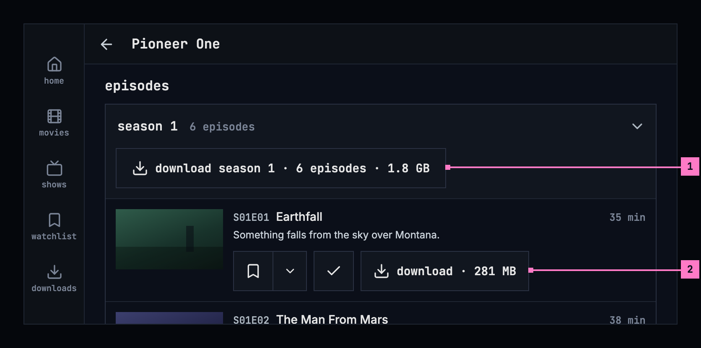

Figure 13.4: The same season on a phone held sideways, at 780 × 360 dp.

1. **The season's control** keeps its place at the season's head, with its
   words on one line.
2. **An episode's actions** stand under its words, beside the still, so a row
   takes less height.

Turning the phone keeps the page where it was: the season open, the page
scrolled to the same episode, and the downloads on their way.

The season's control says what it downloads:

- **download season 1 · 6 episodes · 1.8 GB**, only when every episode of the
  season can be downloaded and none is on the phone or on its way yet;
- **download 5 episodes · 1.5 GB**, when some can only be streamed;
- **download 3 more episodes · 940 MB** (**download 1 more episode · 323 MB**),
  once some are on the phone or on their way.

A file that holds two episodes counts as both. The size is given once every
episode's size is known, and left out until then.

A show that is partly on the phone says how far, under its row of actions and
beside its season's control: “1 of 6 downloaded”. It counts only the episodes
that can be downloaded, and a green check stands before it once all of them are
on the phone. While the server can't be reached, the show's page says only
what is on the phone, “1 episode on this phone” (figure 13.11), with the check
mark, or the information mark in its place while one of the episodes waits for
its check.

### 13.3.2 While downloads run

The downloads go on when people leave the app. While one is on its way, the
phone shows one quiet notification, which tapping opens the app on: the title
on its way, a movie by its name and an episode with its show and code,
“Pioneer One · S01E01 · Earthfall”, or “Downloads” while several run; under it
how far it is, “Downloading 42% · 2 queued”, or what the downloads wait for,
“Queued”, “Waiting for Wi-Fi” or “Waiting for a connection”; and a bar. The
first download asks once whether the app may show it. The notification follows
the phone's own style, so its words are in sentence case.

## 13.4 The downloads screen

The downloads screen shows everything on the phone, newest first, grouped by
show and season, with the movies in a group of their own. Each title shows its
status and size as its control does, and plays from here once it is on the
phone.

### 13.4.1 Held upright

Figure 13.5 shows the downloads screen on a phone held upright: a show's
season, movies, a failed title and **delete all**.

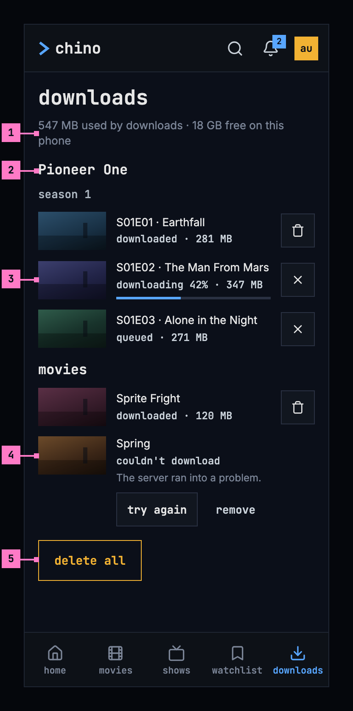

Figure 13.5: The downloads screen on a phone held upright, at 360 × 780 dp.

1. **The storage line** says how much room the downloads take and how much is
   left: “547 MB used by downloads · 18 GB free on this phone”. With nothing
   downloaded, it says only “18 GB free on this phone”.
2. **A show's group**: the show's name, then each season, then its episodes in
   their order. Every title has a picture 80 dp wide at 16:9, an episode its
   still and a movie its backdrop, so the rows line up.
3. **A title on its way**: its status with the bar, and **cancel download**.
   A title on the phone ends in **delete download** instead.
4. **A failed title** shows its reason, with **try again** and **remove** under
   it, and no size: a failed download frees what it had downloaded so far.
5. **delete all**, at the end of the list (section 13.4.4).

The storage line counts what is on the phone, as the questions of section 13.5
do: in figure 13.5, the 281 MB and the 120 MB of the two titles downloaded, and
the 42 % of 347 MB already there. The line and the questions compute one total,
from the bytes, rounded once.

### 13.4.2 Held sideways

Figure 13.6 shows the screen on a phone held sideways.

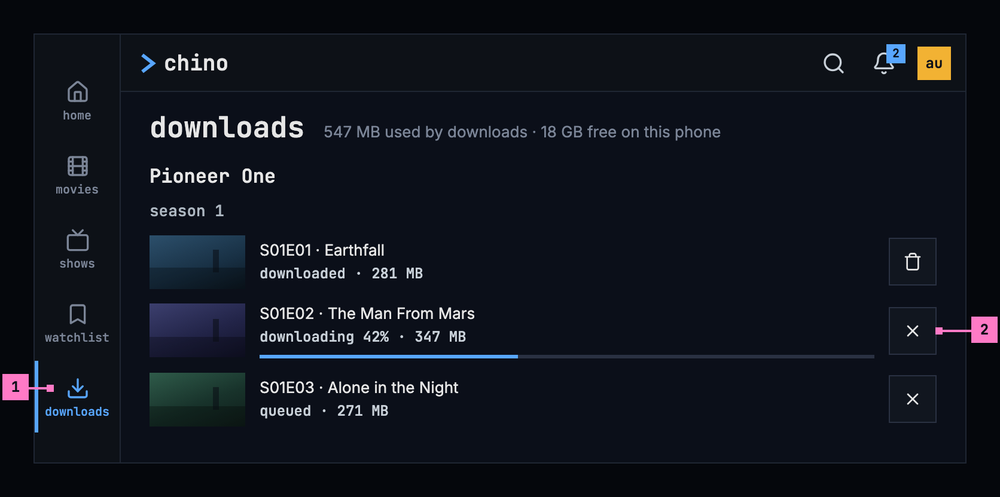

Figure 13.6: The downloads screen on a phone held sideways, at 780 × 360 dp.

1. **The tabs** are a rail down the left edge, with downloads current, and the
   bar above the list is slimmer ([chapter 2](./frame.md)).
2. **A title's row** runs the width of the screen, so its name and its status
   stay on one line each, with its button at the right.

The list keeps its one column and its order; only the frame changes.

### 13.4.3 Turning the phone

Turning the phone keeps the screen as it was: the list scrolled to the same
title, a question that was open still open, and the downloads running.

### 13.4.4 Deleting

- **Delete one** with the button on its row, or with its control on the
  title's page. It asks nothing.
- **delete all**, at the end of the list, asks once, in the dialog of figure
  13.7 on the left: “This removes 3 downloads, 547 MB, from this phone.”, with
  **cancel** and **delete all**. Both **delete all** buttons are the design
  system's danger button. It counts only what is on the phone: a title partly
  downloaded counts, a queued one doesn't. With only failed or queued titles
  left, it says “This clears the list of downloads.”

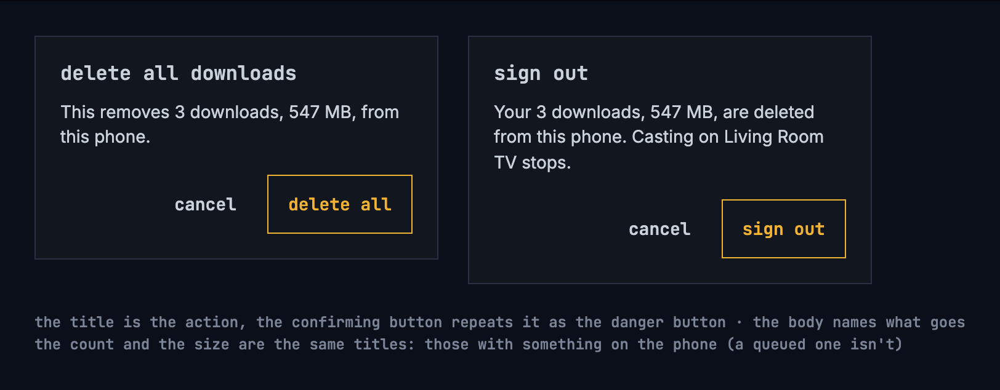

Figure 13.7: The questions before deleting all downloads and before signing
out.

The screen with nothing on it is drawn in section 13.9.

## 13.5 Whose downloads they are

A download belongs to the account that made it. Another account on the same
phone doesn't see it, so a child's account never plays a movie meant for a
parent; two accounts that download the same title share one copy, which goes
with the last of them. When a sign-in expires, nothing is hidden: signing in
again as the same account brings everything back. With several accounts on the
phone and no server to ask, the app opens on who's watching first
([chapter 3](./start.md)), then on that account's downloads.

Signing out and removing an account delete that account's downloads, and
changing the server signs out every account on the phone and deletes all their
downloads, so the app asks first, as [chapter 16](./settings.md) specifies:
signing out where downloads would go or a cast would stop, removing an account
always, and changing the server where downloads would go, a cast would stop or
another account than the one signed in now would be signed out. The title is
the action, the confirming button repeats it and is the danger button, and the
body names what goes. Figure 13.7 on the right shows the question before
signing out.

| Action | Title | It says |
|---|---|---|
| Sign out | **sign out** | “Your 3 downloads, 547 MB, are deleted from this phone.” |
| Remove an account | **remove account** | “The 8 downloads of Anna, 2.6 GB, are deleted from this phone.”; without downloads, “This removes Anna from this phone. Signing in again brings the account back.” |
| Change the server | **change server** | “All 3 accounts on this phone are signed out, and their 31 downloads, 15 GB, are deleted.” |

The number and the size count the same titles, those with something on the
phone, as **delete all** does. With one download: “Your download, 281 MB, is
deleted from this phone.” and “The download of Anna, 281 MB, is deleted from
this phone.” While something is casting, the question adds “Casting on Living
Room TV stops.” ([chapter 14](./casting.md)).

A download also goes when the server says the account may no longer watch the
title, because it left the library or the account's limit changed, after two
such answers at least an hour apart; where an answer leaves out every title and
the server doesn't say that the library holds any for the account, a day apart.
The app says so once, on the downloads screen. For one title: “This title isn't
available to this account anymore, so it was deleted from this phone.” For
several, figure 13.8 shows the banner.

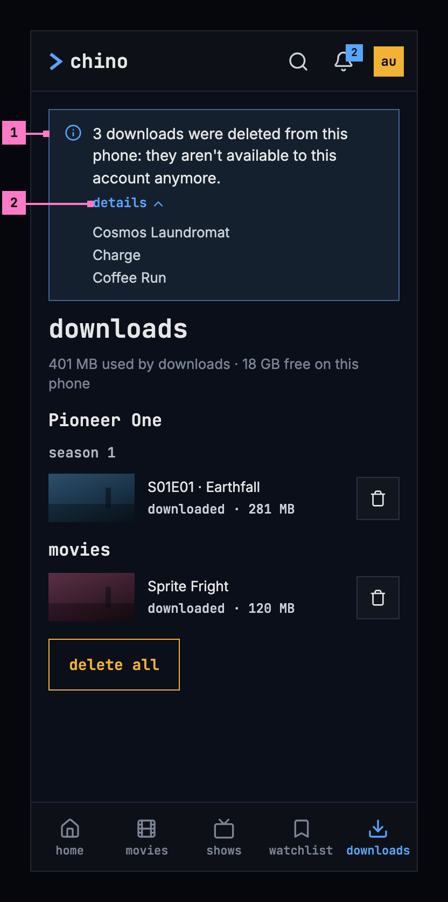

Figure 13.8: Downloads the server took off the phone, on a phone.

1. **The banner** says how many went and why. It shows once: the next visit to
   the downloads screen, or the app started again, doesn't show it again.
2. **details** opens the titles that went.

## 13.6 When the server can't be reached

The app opens on the downloads screen while the server can't be reached, with
an information banner on top: “Can't reach the server. Your downloads still
play.”, or only “Can't reach the server.” when nothing would play. The banner
has the information mark, not a sign of the phone's connection, because the
phone may well be online while the server isn't. It has no close button while
the server can't be reached, and the bell is hidden
([chapter 15](./notifications.md)). While the app is in front, it asks the
server again every 15 seconds; once it answers, the banner goes, the bell comes
back, and what was played meanwhile is sent.

### 13.6.1 The downloads screen

Figure 13.9 shows the downloads screen while the server can't be reached, on a
phone held upright.

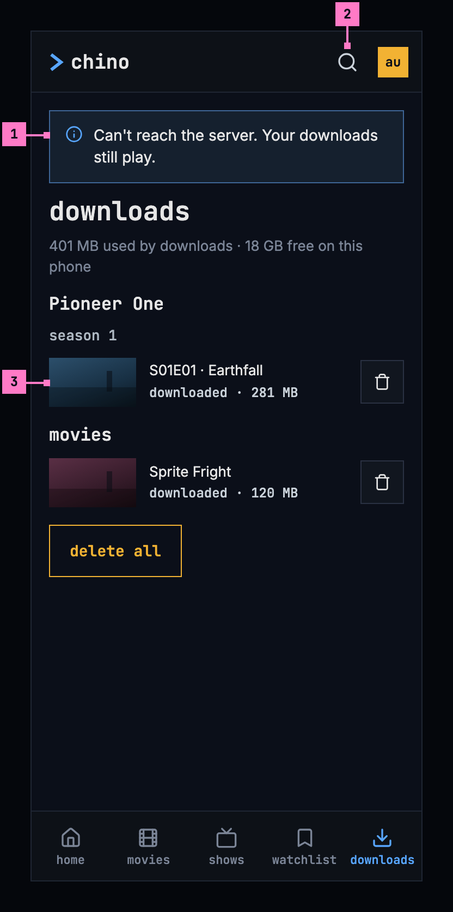

Figure 13.9: The downloads screen while the server can't be reached, on a phone
held upright, at 360 × 780 dp.

1. **The banner**, above the screen's heading. Two of the titles are on the
   phone, so it says that they still play.
2. **The bar** has no bell while the server can't be reached.
3. **The titles on the phone**, as in figure 13.5. They play from here, and
   **delete download** works without the server.

Figure 13.10 shows the same screen on a phone held sideways. The banner keeps
its place above the heading and runs the width of the screen, so it takes one
line.

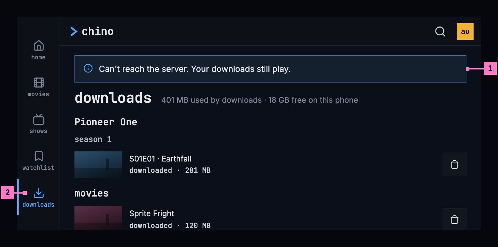

Figure 13.10: The downloads screen while the server can't be reached, on a
phone held sideways, at 780 × 360 dp.

1. **The banner**, on one line.
2. **The rail** holds the tabs; the views that need the server open with the
   banner too (section 13.6.4).

### 13.6.2 A title's page from the phone

A downloaded title's page is built from what is on the phone, with the banner
on top, under the bar. What needs the server is left out: the watchlist and the
other lists, the watched and liked marks, the trailer and the people. Figure
13.11 shows a show's page from the phone, held upright.

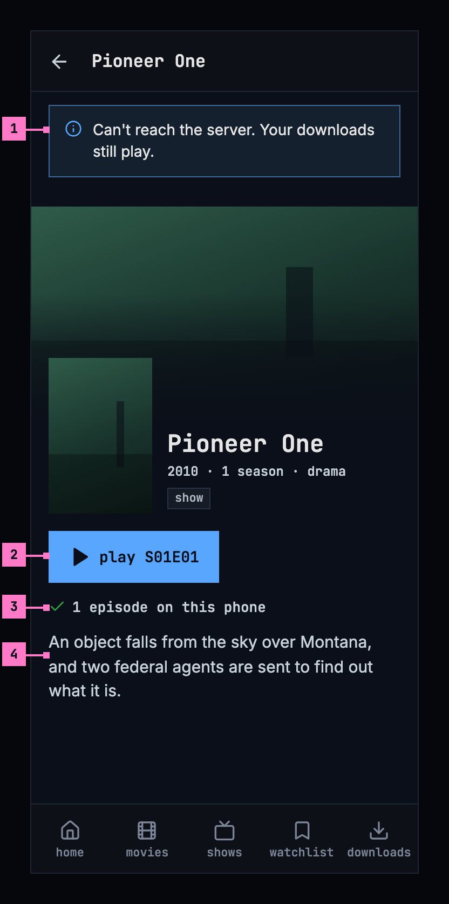

Figure 13.11: A show's page from the phone while the server can't be reached,
on a phone held upright, at 360 × 780 dp.

1. **The banner**, as on the downloads screen. It says “Your downloads still
   play.” only where this title plays: a movie on the phone, or one of the
   show's episodes.
2. **play S01E01** plays the episode from the phone. The row holds nothing else:
   add to list, watched, liked and the trailer need the server.
3. **How far**, from the phone alone: “1 episode on this phone”. Further down,
   the page lists only the episodes on the phone, each with its control.
4. **The description**, as the download kept it. The people, who come from the
   server, are left out.

Figure 13.12 shows the page on a phone held sideways. As on a computer, the
poster stands at the left and the name, the row and the description beside it
([chapter 6](./title-actions.md)), so the play button is in view under the
banner.

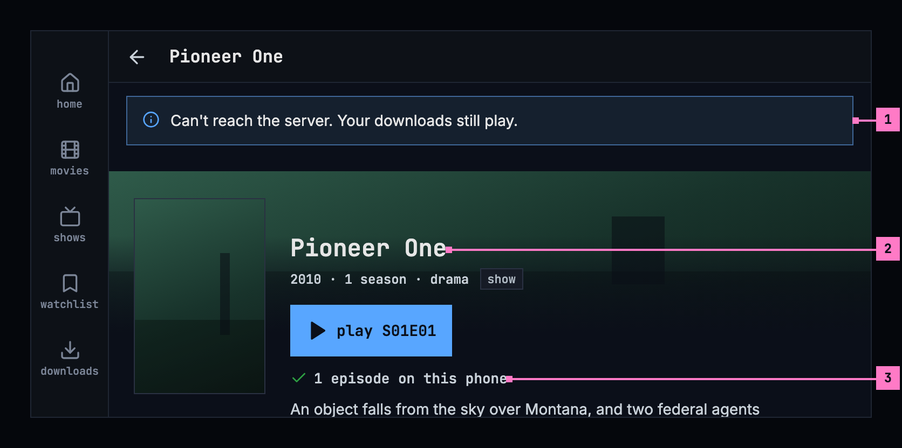

Figure 13.12: A show's page from the phone while the server can't be reached,
on a phone held sideways, at 780 × 360 dp.

1. **The banner**, under the bar, the width of the page.
2. **The poster** at the left, the name and **play S01E01** beside it.
3. **How far**, under the row.

Turning the phone keeps the page and the banner as they were; the banner never
scrolls away with the page.

### 13.6.3 A download that waits for its check

A title whose download waits for its check shows **play** or **resume**
dimmed, and its control says why, as figure 13.13 shows. A download not checked
with the server for 30 days asks for the server before it plays. While the
server can be reached, the check runs without anything on the screen.

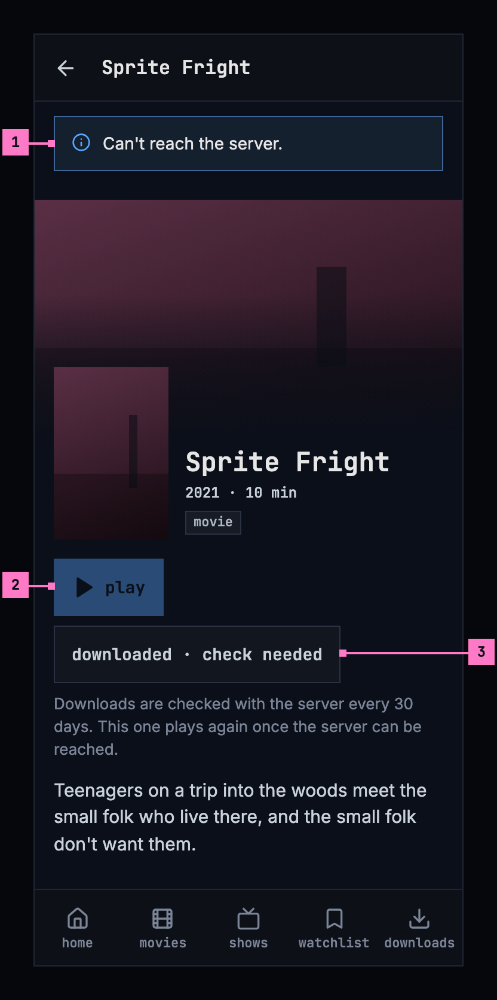

Figure 13.13: A movie whose download waits for its check, on a phone.

1. **The banner** says only “Can't reach the server.”: nothing on this page
   plays.
2. **play**, dimmed: the title doesn't play until the server has checked the
   download.
3. **The control** says **downloaded · check needed**, and the sentence under
   it says why.

### 13.6.4 The rest of the app

- **The player's audio and subtitles panel** offers the subtitles that came
  with the download, named as online ([chapter 12](./subtitles.md)): a download
  takes all of the title's subtitle tracks with it. A title without subtitles
  has only **off** in the panel's subtitles column.
- **The other screens** that need the server, home, movies, shows, search, the
  watchlist and its lists, a person's page and the parts of settings the server
  fills, show the banner as well. What the phone loaded of them earlier stays
  under it, as it was; a screen it never loaded shows its couldn't-load screen
  ([chapter 17](./errors.md)), without the sentence, which the banner already
  says.
- **Watch progress** made offline is kept and sent once the server can be
  reached, with nothing for people to do. Queued downloads then carry on.
- **Casting**: a downloaded title plays on the phone, even while a TV is
  connected, with the toast “Playing on this phone: the server can't be
  reached.” ([chapter 14](./casting.md)).

## 13.7 Settings

The phone app's settings ([chapter 16](./settings.md)) hold two settings for
downloads, shown only where the phone keeps downloads and the server offers
them:

- **Download quality**: named as in the player's quality menu
  ([chapter 11](./playback.md)), with the size of an hour of video as the server
  reports it: “Medium (720p) · about 932 MB an hour”. Where too few titles have a
  quality to tell its size reliably, the size is left out. Medium (720p) is
  picked until it is changed.
- **Download over Wi-Fi only**: on by default. While it is on, a download waits
  for Wi-Fi.

## 13.8 Changes

Every difference between section 13.2 and the target is one change in the
table. A change names the apps it is built in, what they do today and the
target, with the figure or the section that sets it out; it is built as its row
says, and nothing else changes with it. Each change starts as proposed; once the
owner approves it, it is built, one change at a time. A target that starts with
“Recommended” takes away something an app has today. The title page around the
control and its bar belong to [chapter 6](./title-actions.md), the tabs to
[chapter 2](./frame.md), and the settings' own rows, such as the group's
heading and how the picked quality is marked, to [chapter 16](./settings.md).

| No. | Change | Apps | Today | Target | Status |
|---|---|---|---|---|---|
| 13.C1 | The control and its actions as buttons | Phone app | a status on the surface without a border; **try again** and **remove** as blue words; cancel and delete as squares without a border | the status in a 48 dp control with the design system's border; **try again** a button, **remove** a quiet button; **cancel download** and **delete download** icon buttons with the border (figures 13.1 and 13.5) | proposed |
| 13.C2 | The status in one colour | Phone app | on the control, the icon tinted by the status: the download arrow white, blue or grey, the information mark, a red warning triangle, a failure's reason in red; on the downloads screen, the status in green, blue, red or grey, and a failure's reason in red | Recommended: the status and its size in the label's colour, the download arrow on **download** and the green check on **downloaded** the only icons, and a failure's reason in the muted text, as figures 13.1 and 13.5 draw them | proposed |
| 13.C3 | The downloads screen's layout | Phone app | the banners under the heading **downloads**; each title a row on the surface, an episode with its still 112 dp wide, a movie with its poster 56 dp wide; nothing downloaded: a 56 dp square outline round the download arrow | the banners above the heading; the rows on the page, without a surface, every title with a picture 80 dp wide at 16:9, an episode's still or a movie's backdrop; nothing downloaded: the download icon alone, 48 dp, above **nothing downloaded yet** (figures 13.5, 13.8, 13.9 and 13.14) | proposed |
| 13.C4 | The banner on every screen that needs the server | Phone app | the banner on home, movies, shows, a title's page and the downloads screen only; search, the watchlist and its lists, a person's page and settings show their couldn't-load with “Can't reach the server.” | the banner on every screen that needs the server; under it what the phone loaded earlier, or the screen's couldn't-load without the sentence (section 13.6.4) | proposed |
| 13.C5 | The questions before removing an account and changing the server | Phone app | remove account without downloads: “This removes Anna from this phone. You'll need to sign in again to use the account.” Change server: asked only where the old server's downloads go or a cast stops, with “Your 3 downloads, 547 MB, are deleted from this phone.” | “This removes Anna from this phone. Signing in again brings the account back.”; change server also asks where another account would be signed out, “All 3 accounts on this phone are signed out, and their 31 downloads, 15 GB, are deleted.” (section 13.5); one change with chapter 16's for the same questions | proposed |
| 13.C6 | Downloads in the iOS app | Phone app (iOS) | no download control, no downloads tab, no settings for downloads, and nothing plays without the server | the whole of this chapter, as the Android app has it | proposed |

## 13.9 States

The downloads screen shows at once, because everything on it is on the phone;
the storage line follows as soon as the phone has counted. Figures 13.14 and
13.15 show the screen with nothing downloaded, upright and sideways.

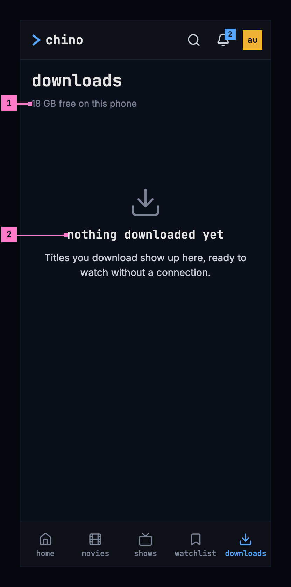

Figure 13.14: Nothing downloaded yet, on a phone held upright.

1. **The storage line** says only what is free.
2. **The empty state** says what is true, and what will be here: “Titles you
   download show up here, ready to watch without a connection.” It offers no
   button, because titles are downloaded from their pages, and **delete all**
   is left out.

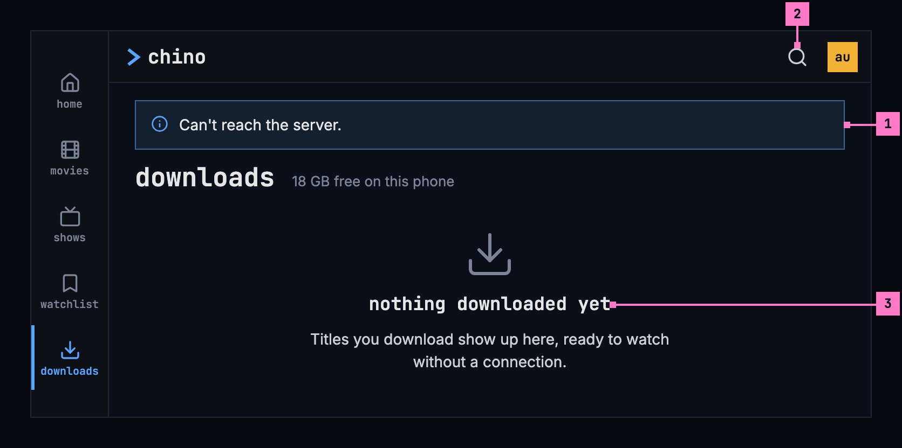

Figure 13.15: The server can't be reached and nothing is downloaded, on a phone
held sideways.

1. **The banner** says only “Can't reach the server.”: nothing would play.
2. **The bar** has no bell while the server can't be reached.
3. **The empty state**, as in figure 13.14.

| State | What the phone shows |
|---|---|
| Titles on the phone | Figure 13.5, sideways figure 13.6 |
| Nothing downloaded | Figure 13.14 |
| Only failed or queued titles | The list and **delete all**, whose question says “This clears the list of downloads.” |
| Titles the server took off the phone | Figure 13.8, once |
| The server can't be reached | Figures 13.9 and 13.10; a title's page as in figures 13.11 and 13.12 |
| The server can't be reached, nothing downloaded | Figure 13.15 |
| A download waits for its check | Figure 13.13 |
| The server has turned downloads off | No download control on a title's page; what is on the phone stays, with its control; with nothing on the phone, no downloads tab |

## 13.10 Words

| Where | Text |
|---|---|
| The download control | “download · 1.4 GB”, “queued · 1.4 GB”, “waiting for Wi-Fi · 1.4 GB”, “waiting for a connection · 1.4 GB”, “downloading 42% · 1.4 GB”, “downloaded · 1.4 GB”, “downloaded · check needed”, couldn't download, can't be downloaded, try again, remove |
| The control's buttons, for screen readers | cancel download · delete download |
| The control's sentences | Downloads are checked with the server every 30 days. This one plays again once the server can be reached. · This title can only be streamed. |
| A failure's reason | Not enough space on this phone. · Can't reach the server. · This title isn't available to this account anymore. · The server has turned downloads off. · The server ran into a problem. · The server didn't accept the download. · The download stopped before it was done. |
| A season's control | “download season 1 · 6 episodes · 1.8 GB”, “download 5 episodes · 1.5 GB”, “download 3 more episodes · 940 MB”, “download 1 more episode · 323 MB” |
| How far a show is | 1 of 6 downloaded · 1 episode on this phone |
| The notification | “Pioneer One · S01E01 · Earthfall” · Downloads · Downloading 42% · 2 queued · Queued · Waiting for Wi-Fi · Waiting for a connection |
| The downloads screen | downloads · “547 MB used by downloads · 18 GB free on this phone”, “18 GB free on this phone” · movies · season 1 · try again · remove · delete all |
| Nothing downloaded | nothing downloaded yet · Titles you download show up here, ready to watch without a connection. |
| Delete all | delete all downloads · This removes 3 downloads, 547 MB, from this phone. · This clears the list of downloads. · cancel · delete all |
| The questions | sign out · remove account · change server · Your 3 downloads, 547 MB, are deleted from this phone. · The 8 downloads of Anna, 2.6 GB, are deleted from this phone. · This removes Anna from this phone. Signing in again brings the account back. · All 3 accounts on this phone are signed out, and their 31 downloads, 15 GB, are deleted. · Your download, 281 MB, is deleted from this phone. · The download of Anna, 281 MB, is deleted from this phone. · Casting on Living Room TV stops. |
| Downloads the server took off the phone | This title isn't available to this account anymore, so it was deleted from this phone. · 3 downloads were deleted from this phone: they aren't available to this account anymore. · details |
| While the server can't be reached | Can't reach the server. Your downloads still play. · Can't reach the server. · Playing on this phone: the server can't be reached. |
| Settings | Download quality · “Medium (720p) · about 932 MB an hour” · Download over Wi-Fi only |
