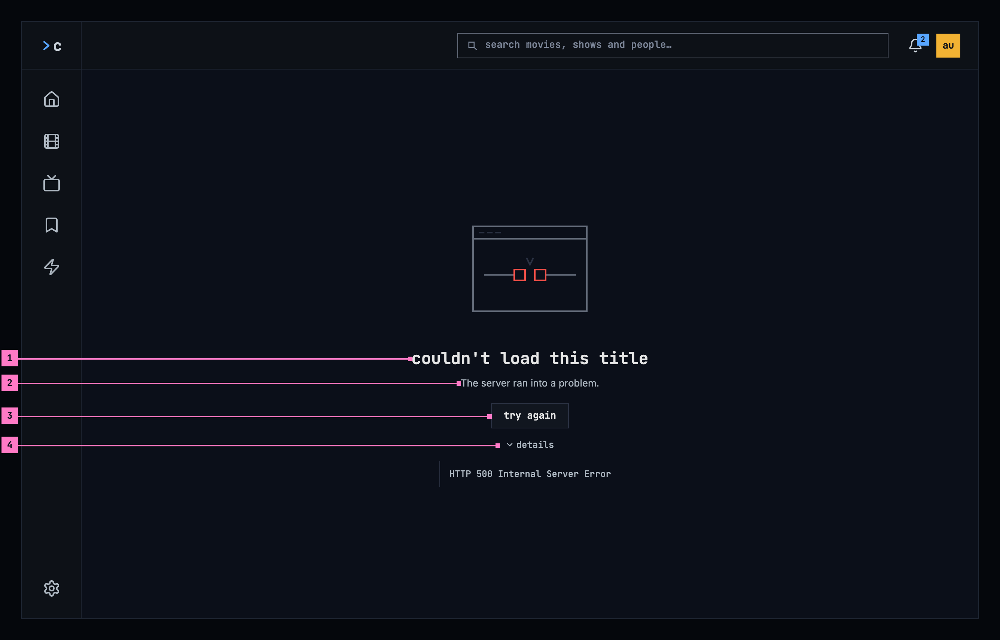
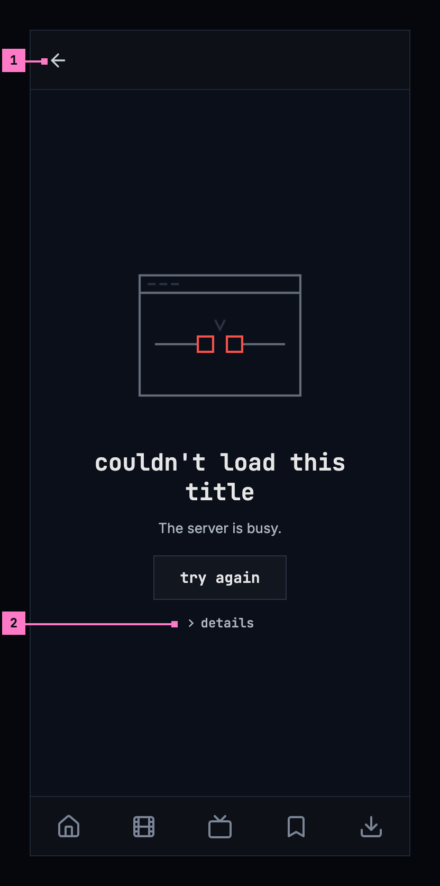
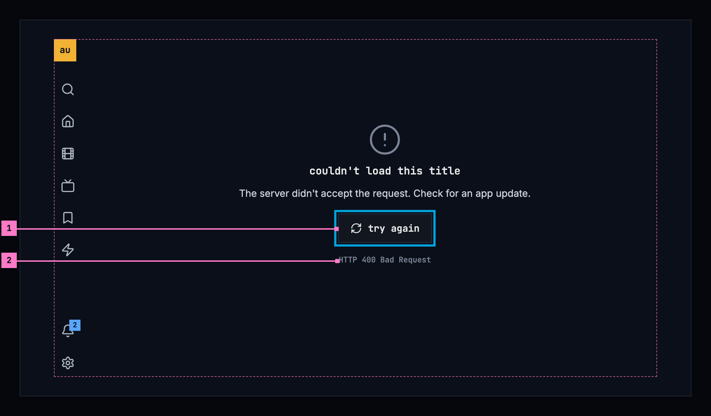
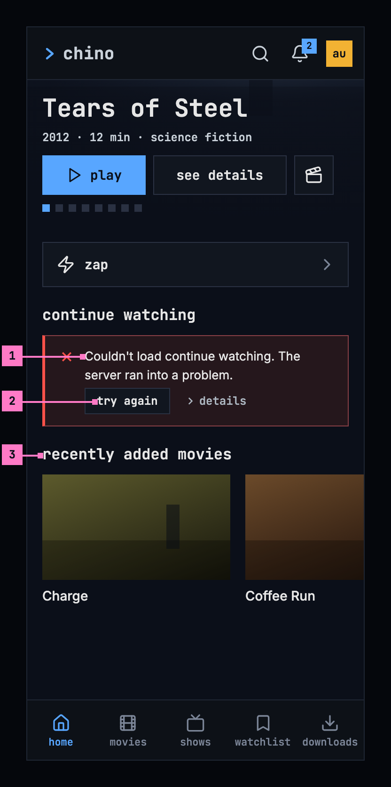
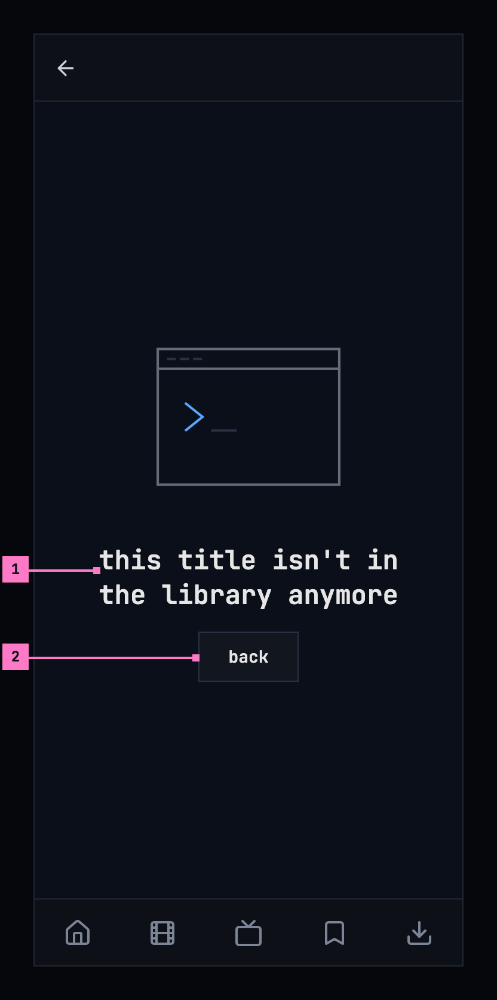
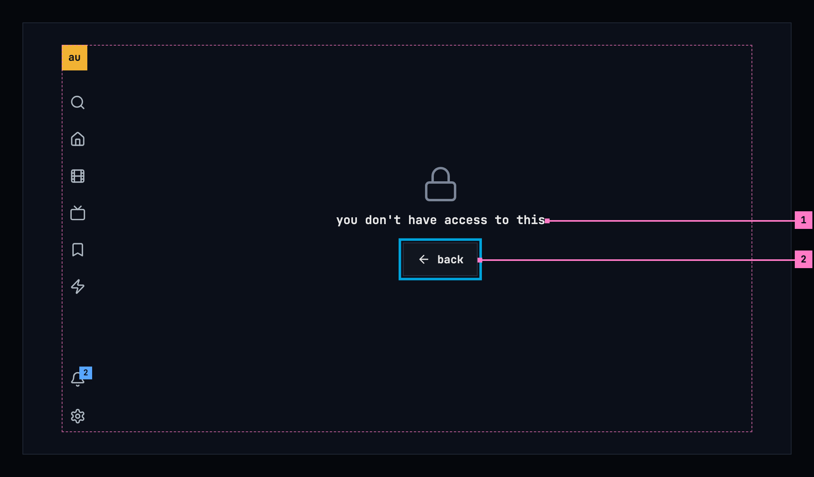

# 17 When something goes wrong

> **Not in the new form yet.** This chapter's figures show the target, not
> what is deployed today. Where today's apps differ, its “Today's apps”
> section says so. The screens as deployed and the numbered changes follow,
> as [chapter 11](./playback.md) already has them.

This chapter specifies what a screen says when it can't show what it is for:
what couldn't load, why, and the one way on. Every chapter's couldn't-load
state follows it. Playback that fails is specified in
[chapter 11](./playback.md), the phone app without a server in
[chapter 13](./downloads.md), and what adding a server and signing in say when
they fail in [chapter 3](./start.md).

## 17.1 Purpose

“Couldn't load” covers several different problems, and each one has a different
way out. A screen that only says something went wrong leaves people guessing
whether to wait, to try again, to update the app or to give up. So a screen
that couldn't load says what couldn't load, in its own words, and why, as far as
the app can tell, and it offers the one thing that can help: **try again**
where trying again can help, **back** where it can't. The cases come from the
design system's [empty
states](https://nalet.github.io/design-system/patterns/empty-states/#when-it-couldnt-load-say-why),
and every app tells them apart the same way, by the server's answer, so the
same problem reads the same everywhere.

## 17.2 A page that couldn't load, on a computer

Figure 17.1 shows a title's page that couldn't load, on a computer. The frame
stays, and the message takes the page's place.

Figure 17.1: A page that couldn't load, on a computer, at 1280 × 800.

1. **What couldn't load**, in the page's own words: “couldn't load this title”.
   It is the page's heading, in the monospace face.
2. **Why**, as far as the app can tell: here “The server ran into a problem.”
   The sentence gives the reason and nothing the button says. Section 17.5
   lists every cause and its sentence.
3. **try again** loads the page again, with the page's loading state while it
   runs. It is the only way on, as a quiet button; the way back is the frame's.
4. **details** opens the server's answer for the people who fix things:
   “HTTP 500 Internal Server Error”. The status is never part of the heading or
   the sentence.

The picture above the heading belongs to the cause, and the words carry the
meaning without it: a cloud crossed out when nothing answered, a circle with an
exclamation mark when the server ran into a problem or didn't accept the
request, an hourglass when it is busy, a circle crossed through for a title
that was removed and a person crossed out for a person, and a lock for no
access.

## 17.3 A page that couldn't load, on a phone

Figure 17.2 shows the same page on a phone, here with another cause, “The
server is busy.” The parts are those of figure 17.1; the numbers mark where the
phone differs.

Figure 17.2: A page that couldn't load, on a phone, at 360 dp.

1. **The back arrow** in the bar is the way back.
2. **details** stays closed until it is tapped.

## 17.4 A page that couldn't load, on a TV

Figure 17.3 shows the page on a TV, with a third cause, “The server didn't
accept the request. Check for an app update.” The parts are those of figure
17.1; the numbers mark where the TV differs.

Figure 17.3: A page that couldn't load, on a TV, at 960 × 540 dp.

1. **The focus** starts on **try again**, the way on. Back on the remote goes
   back.
2. **The details** show under the button without being opened, in the quiet
   text: a disclosure would take the focus from the way on.

## 17.5 The causes

The app tells the cases apart by the server's answer, its HTTP status, never by
the words of an error.

| What went wrong | The server's answer | The sentence |
|---|---|---|
| Nothing answered: the connection dropped, or the server didn't reply in time | No answer, or 408 | “Can't reach the server.” |
| The server ran into a problem | 5xx, or an answer the app couldn't read | “The server ran into a problem.” |
| The server is busy | 429 | “The server is busy.” |
| The server didn't accept the request | Any other 4xx; on a list, 404 and 410 as well | “The server didn't accept the request. Check for an app update.” |
| It was removed | 404 or 410 on a page about one thing | None: the heading says it (section 17.7) |
| No access | 403 | None: the heading says it (section 17.8) |
| The sign-in no longer holds | 401 | None: the app signs in again (section 17.9) |

- The sentence is the reason, and only the reason. **try again** is the button,
  so the sentence never asks people to try again; only what no button offers,
  an app update, is said in words.
- On the web, the not-accepted sentence ends after its first part, “The server
  didn't accept the request.”: a web page updates itself, and offers to reload
  when a new version is out, so there is no app update to check for.
- Said once: while the phone app's banner says the server can't be reached
  ([chapter 13](./downloads.md)), the screens under it leave “Can't reach the
  server.” out.
- **details** hold the status and its reason phrase, “HTTP 503 Service
  Unavailable”, or “an answer that couldn't be read”. Where nothing answered,
  they are left out: the sentence says all there is.
- The player says the same sentences where a request for the stream fails.
  What only playback has, such as a stream that stops before the title is done,
  is in [chapter 11](./playback.md).

### Open

- **The web's not-accepted sentence.** The design system's table ends it with
  “Check for an app update.”, which the web leaves out because a web page has
  no update to check for. Recommendation: leave it out on the web, as this
  chapter has it, so the sentence is true wherever it shows.

## 17.6 A page, a list, a part of a page

A cause reads the same wherever it happens. What differs from one place to the
next is the heading, which names what couldn't load in that screen's own words,
and how the message sits in it.

| Place | The heading | The way on |
|---|---|---|
| A page about one thing: a title, a person | couldn't load this title · couldn't load this person | **try again**, in the page's place; the frame's back goes back |
| A list: home, movies, shows, zap, search, the watchlists, one list, the subtitle languages in settings | couldn't load the library · couldn't load the movies · couldn't load the shows · couldn't load the movies and shows · couldn't search the library · couldn't load your watchlists · couldn't load this list · couldn't load the subtitle languages | **try again**, in the list's place; the view's heading, its tabs and its filters stay, and so do the words in the search field |
| A part of a page: a row of home, a show's episodes, the next page of a grid | couldn't load continue watching · couldn't load the episodes · couldn't load more movies · couldn't load more shows | **try again**, in the part's place, smaller; the rest of the page shows |

Each chapter names its own: search, for one, says “couldn't search the library”
([chapter 9](./search.md)). Figure 4.5 in [chapter 4](./home.md) shows a list
that couldn't load, and figure 17.4 shows a part of a page: home's continue
watching on a phone.

Figure 17.4: A part of a page that couldn't load, on a phone.

1. **The part's own heading**, under the row's name, in the place of its cards.
2. **try again** loads the part again, and the part alone.
3. **The next row** shows as usual: a part that couldn't load never takes the
   page down.

## 17.7 A removed title or person

Trying again can't bring back something that was removed, so the page offers
the way back instead. Figure 17.5 shows a removed title on a phone.

Figure 17.5: A title that was removed, on a phone.

1. **“this title isn't in the library anymore”**, or “this person isn't in the
   library anymore” on a person's page. Nothing stands under it: there is no
   reason to give and nothing to try.
2. **back** goes back to where the person came from, or home when they came
   from nowhere, such as a link.

Removed is only for a page about one thing. A list can't be removed, so on a
list, not found means that the app and the server don't match (section 17.10).
The server answers for a title above an account's limit as for one that isn't
there, so its page reads as removed as well.

## 17.8 No access

When the server answers that the account may not see what a screen shows, the
screen says so and offers the way back. Figure 17.6 shows it on a TV.

Figure 17.6: No access, on a TV.

1. **“you don't have access to this”**, the same on a page, a list and a part of
   a page. It names nothing and gives no reason, and nothing stands under it.
2. **back**, with the focus on it on a TV. A part of a page has no back: the
   heading stands alone in the part's place.

## 17.9 A sign-in that expired

A sign-in doesn't last for ever. When the server no longer accepts it, the app
renews it by itself, without a word, and loads the screen again; meanwhile the
screen shows its loading state. Only a refused renewal leads to signing in: on
the web to the server's sign-in page, on a phone and a TV to the sign-in of
[chapter 3](./start.md) for the same account, and afterwards back to where the
person was. Downloads stay on the phone and come back with the same account
([chapter 13](./downloads.md)).

- A renewal that can't reach the sign-in service is the connection's case:
  “Can't reach the server.”, with **try again**.
- When the server still refuses the sign-in right after the person signed in
  again, the app stops and says so: “The server didn't accept your sign-in.”,
  with **try again**. It never goes round again by itself.

## 17.10 When the app and the server don't match

The apps and the server are updated separately, so for a while one can be newer
than the other.

- **An app newer than its server** asks for things the server doesn't know.
  The server answers not found on a list, or turns the request down as it was
  sent, another 4xx: “The server didn't accept the request. Check for an app
  update.”, or on the web its first part alone (section 17.5).
- **A server older than the app** may lack a part the app asks for. The app
  then leaves the part out, or does it the older way, and says nothing about
  it: a server without notifications has no bell
  ([chapter 15](./notifications.md)).
- **The web app at its start** asks the server for its setup. When that fails,
  it says “couldn't load the app” with the sentence of the cause; when no chino
  server answers at its address at all (404, 410), the sentence is “No chino
  server answers at this address.”

## 17.11 When an action fails

Something the person does can fail as well: saving a list, sending a report,
deleting the account. The screen stays as it was, with what the person typed,
and an error banner says what couldn't be done and why, the action's own
sentence first and then the cause's: “Couldn't create the list. Can't reach the
server.” The banner stays until the person tries again or puts it away, and
the status goes under its **details**, as the design system's [message
handling](https://nalet.github.io/design-system/patterns/message-handling/)
sets out. A toast never carries a failure: it would be gone before it is read.
The chapters name their own actions: [chapter 8](./watchlist.md) the lists,
[chapter 16](./settings.md) a report and the account.

## 17.12 When a screen couldn't refresh

A screen that already shows what it loaded keeps it when asking the server
again fails, and says so in a warning banner above it: what couldn't be
refreshed and how old the screen is, “Couldn't refresh the movies; it shows
what was loaded 4 minutes ago.”, with **try again**. The banner goes as soon as
a refresh works. The notifications do the same in their panel
([chapter 15](./notifications.md)). The phone app without a server says it
once, in the information banner of [chapter 13](./downloads.md), and its
screens keep what the phone has under it.

## 17.13 States

Every case, and what each place shows.

| Case | A page about one thing | A list | A part of a page |
|---|---|---|---|
| Can't reach the server | Heading, “Can't reach the server.”, **try again** | The same, in the list's place | The same, smaller |
| The server ran into a problem | Heading, sentence, **try again**, details (figure 17.1) | The same, in the list's place | The same, smaller (figure 17.4) |
| The server is busy | Heading, sentence, **try again**, details (figure 17.2) | The same, in the list's place | The same, smaller |
| The server didn't accept the request | Heading, sentence, **try again**, details (figure 17.3) | The same; 404 and 410 as well | The same, smaller |
| Removed | Figure 17.5 | Doesn't happen: the not-accepted case | Doesn't happen: the not-accepted case |
| No access | Figure 17.6 | The same, in the list's place | The heading alone |
| The sign-in no longer holds | Renewed without a word, else sign-in and back | The same | The same |
| The sign-in refused right after signing in | “The server didn't accept your sign-in.”, **try again** | The same | The same |
| Asking again failed, the screen still shows what it had | The screen, under the warning banner of section 17.12 | The same | The same |
| An action failed | The screen as it was, under the error banner of section 17.11 | The same | The same |
| The phone app can't reach the server | The banner of [chapter 13](./downloads.md), and what the phone has | The same | The same |

## 17.14 Words

| Where | Text |
|---|---|
| A page about one thing | couldn't load this title · couldn't load this person |
| A list | couldn't load the library · couldn't load the movies · couldn't load the shows · couldn't load the movies and shows · couldn't search the library · couldn't load your watchlists · couldn't load this list · couldn't load the subtitle languages |
| A part of a page | couldn't load continue watching · couldn't load the episodes · couldn't load more movies · couldn't load more shows |
| The sentences | Can't reach the server. · The server ran into a problem. · The server is busy. · The server didn't accept the request. Check for an app update. · The server didn't accept the request. (the web) · The server didn't accept your sign-in. |
| Removed | this title isn't in the library anymore · this person isn't in the library anymore |
| No access | you don't have access to this |
| The buttons | try again · back |
| Details | details · “HTTP 500 Internal Server Error”, the status and its reason phrase · an answer that couldn't be read |
| A refresh that failed | Couldn't refresh the movies; it shows what was loaded 4 minutes ago. · try again |
| An action that failed | its own sentence, “Couldn't create the list.” or “Couldn't rename the list.”, then the cause's · details |
| The web app at its start | couldn't load the app · No chino server answers at this address. |

## 17.15 Today's apps

| App | What differs from this chapter |
|---|---|
| Web | **try again** is the emphasized blue button on a page and on a list, quiet only inside a page, as for a show's episodes, and a page has a quiet **back** beside it; **back** on a removed page and on no access is blue as well. No picture above the heading. Home's heading is “couldn't load the movies and shows”. The details of an answer it couldn't read say “an answer that could not be read”. A title's page that fails to refresh keeps what it shows, without a word. |
| Phone app | 503 counts as busy, and an answer it couldn't read as not accepted. Home answers 401 and 403 with “This server no longer accepts your sign-in. Sign in again.” in red, with **Sign in again** and **Change server**. A refused sign-in goes to sign-in and starts over there, not back where the person was. **try again** is blue, and no access on a list offers no **back**. The end of a grid says “Couldn't load more movies.”, with a capital and a full stop. The details give the status alone, “HTTP 503”, and “no answer” where nothing answered. No picture above the heading. |
| Android TV | No access names what: “you don't have access to this title”. Where the app can't go to sign-in by itself, a screen says “you're signed out”, “Sign in again to keep watching.” and **sign in**. The words stand at the start, not centred, the button is filled, and the details show the error's own message under the heading **details**. No picture above the heading. |
| Samsung TV | No causes. Home says “Couldn’t load your library.” followed by the error's own message, movies and shows “Couldn’t load the library” with the error under it, a person “Couldn’t load person” in red, a title “Could not load this title:” and the error, and the watchlist “Couldn't load your lists.” |
