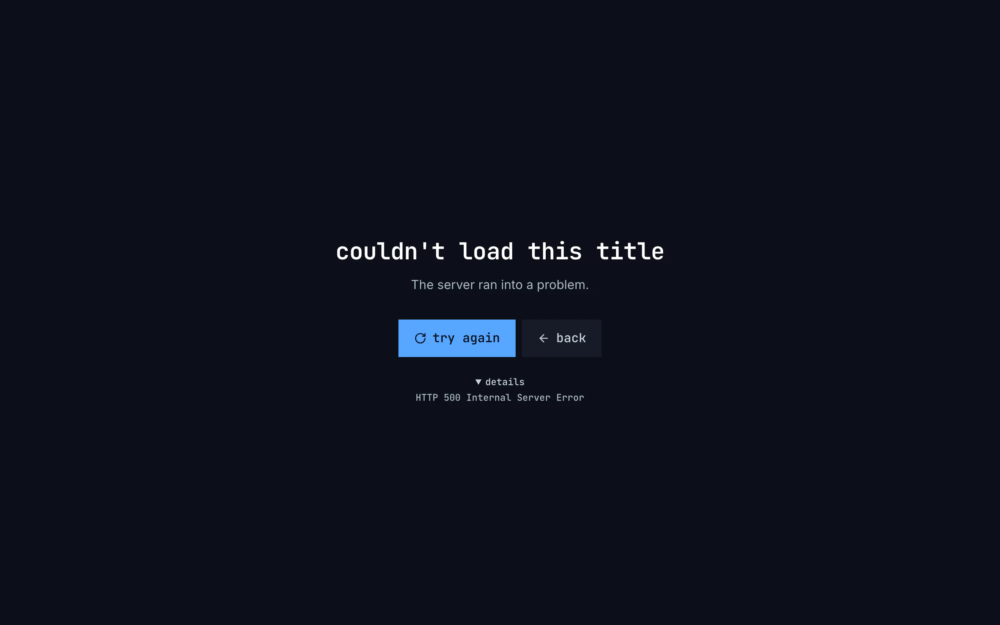
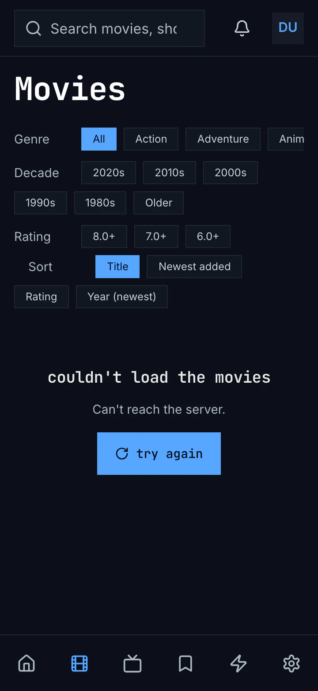
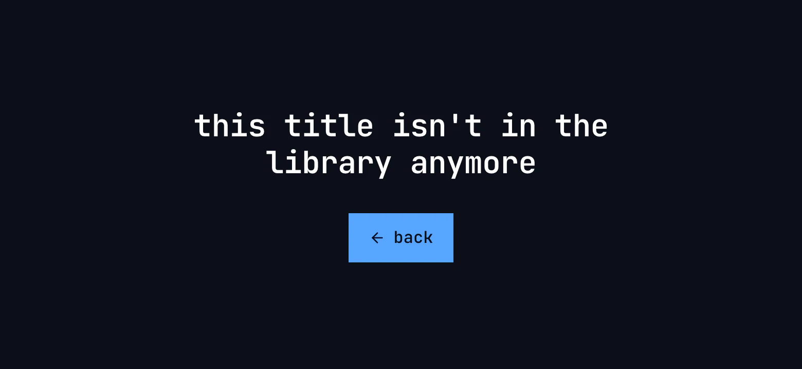
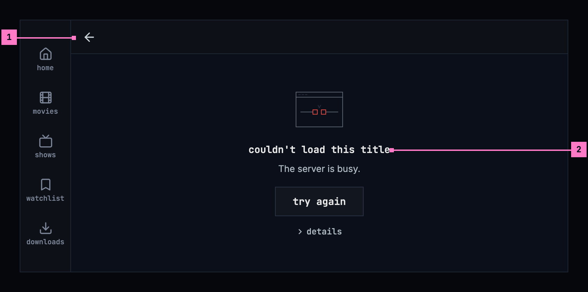
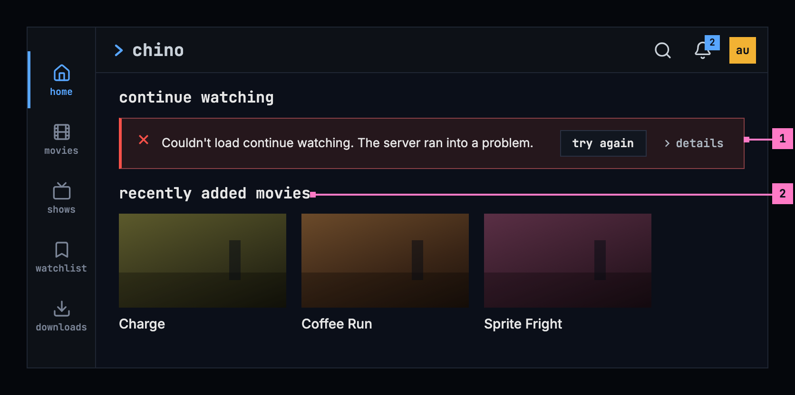
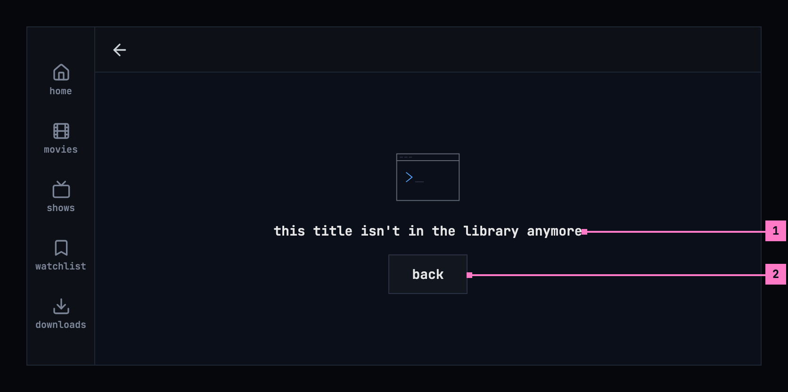

# 17 When something goes wrong

Section 17.2 describes what the apps say today when a screen can't show what
it is for. The sections after it are the target, what they are meant to say,
and section 17.15 lists every difference between the two as a numbered change.
Only a change the owner has approved is built, one change at a time; anything
no change names stays as it is deployed.

The chapter covers what a screen says when it can't show what it is for: what
couldn't load, why, and the one way on. Every chapter's couldn't-load state
follows it. Playback that fails is specified in [chapter 11](./playback.md),
the phone app without a server in [chapter 13](./downloads.md), and what adding
a server and signing in say when they fail in [chapter 3](./start.md).

## 17.1 Purpose

“Couldn't load” covers several different problems, and each one has a different
way out. A screen that only says something went wrong leaves people guessing
whether to wait, to try again, to update the app or to give up. So a screen
that couldn't load says what couldn't load, in its own words, and why, as far as
the app can tell, and it offers the one thing that can help: **try again**
where trying again can help, **back** where it can't. The cases come from the
design system's [empty
states](https://nalet.github.io/design-system/patterns/empty-states/#when-it-couldnt-load-say-why),
and every app tells them apart the same way, by the server's answer, so the
same problem reads the same everywhere. Section 17.3 says which of the design
system's components each case uses, so that it looks the same everywhere too.

## 17.2 As deployed

This section says what the four apps show as of 6 November 2026 when a screen
can't show what it is for: the web as the public demo showed it that day, on
the same build as production, and the apps as their code had them that day.
The phone app, Android TV and the Samsung TV are described from their code
until screenshots of them are taken. The Samsung TV app isn't released yet.

### 17.2.1 The web

Figures 17.1 to 17.3 are screenshots of the web on the demo. Nothing was made
to fail on the demo: for figures 17.1 and 17.2 the browser that took them
answered one request itself, the title's with 500 Internal Server Error and the
movies' with no answer at all, and figure 17.3 is the demo's own answer for a
title that isn't there. Figure 17.1 shows a title's page that couldn't load, on
a computer.

Figure 17.1: A title's page that couldn't load, as deployed on 6 November 2026,
on a computer, at 1280 × 800.

1. **The whole window**: no top bar, no side navigation, and no back or home at
   the top; the message stands alone in the middle.
2. **The heading**, “couldn't load this title”, in the monospace face.
3. **The sentence**, “The server ran into a problem.”, in the quieter text.
4. **try again**, blue, with a turning arrow, and **back** beside it on the
   quiet surface.
5. **details**, opened here, with the status and its reason phrase: “HTTP 500
   Internal Server Error”.

Figure 17.2 shows the movies when they couldn't load, on a phone held upright.

Figure 17.2: The movies when they couldn't load, as deployed on 6 November 2026,
on a phone held upright, at 360 × 780.

1. **The frame stays**: the search field, the bell and the avatar at the top,
   and six tabs as icons at the bottom, movies current.
2. **The view's heading and its filters stay**: “Movies”, and the genre,
   decade, rating and sort chips.
3. **In the grid's place**: “couldn't load the movies”, “Can't reach the
   server.” and a blue **try again**. Nothing answered, so there are no
   details.

Figure 17.3 shows a title that isn't there, on a phone held sideways.

Figure 17.3: A title that isn't in the library, as deployed on 6 November 2026,
on a phone held sideways, at 780 × 360.

1. **“this title isn't in the library anymore”**, on two lines, with nothing
   under it. The server answers 404 for an id it doesn't know, of any form, so
   any such link reads as removed.
2. **back**, blue, with an arrow.

The web tells the cases apart by the server's answer: no answer or 408 is the
connection's, 5xx and an answer it can't read the server's problem, 429 busy,
404 and 410 removed on a page about one thing and not accepted on a list, 403
no access, 401 the sign-in, and any other status not accepted, “The server
didn't accept the request.”, without “Check for an app update.” A page about
one thing, a title, a person or a trailer, takes the whole window as in figure
17.1; a list keeps the frame and its view's heading, as in figure 17.2, with
the heading 18 px high and no **back**; a part inside a page, such as a show's
episodes, “couldn't load the episodes”, has a quiet **try again**. No access
says “you don't have access to this”, with a blue **back**, on a list too. No
screen shows a picture above its heading. The details are behind **details**,
closed at first: the status and its reason phrase, or “an answer that could
not be read”, and nothing where nothing answered.

Home says “couldn't load the movies and shows” at its top only when every row
of titles failed; a row that fails on its own is left out without a word. A
later page of movies or shows that fails says “couldn't load more movies”,
with the reason and **try again**, under the cards. Search says “couldn't search
for "s"”, zap “couldn't load the movies and shows”, the watchlist “couldn't load
your watchlists” and “couldn't load this list”, and settings “couldn't load the
subtitle languages”.

A 401 renews the sign-in once, without a word, and loads again. A refused
renewal goes to the server's sign-in page and afterwards back to the page; a
401 right after that says “The server didn't accept your sign-in.”, with **try
again**, and a renewal that can't reach the sign-in service says “Can't reach
the server.” At its start the web asks the server for its setup and, when that
fails, says “couldn't load the app” with the cause's sentence, or “No chino
server answers at this address.” for 404 and 410. A title's page that fails to
load again keeps what it shows, without a word. A list action that fails shows,
in its dialog, the error's own message or “Could not create list”, “Could not
rename list” or “Could not delete list”.

### 17.2.2 The phone app

The phone app tells the cases apart by the status as well, with two
differences: 503 counts as busy, like 429, and an answer it can't read as not
accepted. Its message is centred in the place of what didn't load, without a
picture: the heading, 18 sp in the heading face, the sentence under it, quieter,
and a filled blue button, **try again**, or **back** for a removed title or
person and for no access on a page. **details**, a word in the monospace face,
opens into “details: HTTP 503”: the status alone, “no answer” where nothing
answered, “an answer the app couldn't read”. No access on a list shows the
heading alone, without **back**.

The headings are “couldn't load the library” on home, “couldn't load continue
watching” in that row's place, “couldn't load the movies”, “couldn't load the
shows”, “couldn't load this title”, “couldn't load this person”, “couldn't load
your watchlists” and, for search, “couldn't load the results”. A later page of
movies that fails says “Couldn't load more movies.”, with a capital and a full
stop, and **try again** beside it. A row of home other than continue watching
that fails keeps what the phone loaded of it before, or is left out.

A 401 that the app's own renewal doesn't mend goes to the sign-in screen,
which starts over there rather than coming back to where the person was. Home
answers a 401 or a 403 with “This server no longer accepts your sign-in. Sign
in again.” in red, with **Sign in again** and **Change server**. While the
server can't be reached, home, movies, shows, a title's page and the downloads
screen show the banner of [chapter 13](./downloads.md) and leave “Can't reach
the server.” out of their own message.

### 17.2.3 Android TV

Android TV tells the cases apart by the status: 401 signed out, 403 no access,
404 and 410 removed on a title's or a person's page and not accepted elsewhere,
408 and no answer the connection's, 429 busy, any other 4xx not accepted, and
everything else, 503 and an answer it can't read too, the server's problem.
Its message has no picture: the heading in the monospace face, the sentence,
one filled blue button with the focus on it, **try again**, **back** or **sign
in**, and under it, always showing, **details** over the error's own message,
“HTTP 503 Service Unavailable”, or where nothing answered the network's own
words, such as “timeout”. The lines start at one edge, in a block centred on
the screen. Home's and a title's page take the whole screen, without the rail;
movies, shows, a person, the watchlists and the watch history keep it.

No access names what: “you don't have access to this title”, “you don't have
access to this person”, and “you don't have access to this” elsewhere. Search
says “Search failed” in red, with the error's text and no button. Zap without
anything to play says “Nothing left to zap. Come back later.”, whatever failed.
A row of home, a show's episodes and a list's titles that fail are left out
without a word; a list that couldn't load shows as empty; a later page of a
grid that fails ends the grid, “You've reached the end — 10 movies.” Movies and
shows, opened while the server gives no stream token and none is kept, close
the app: that first request isn't caught.

The app renews the sign-in before it runs out and once more on a 401. A
refused renewal goes straight to the sign-in, “Connect your Chino account”, and
from there to home, not back where the person was; where a 401 reaches a screen
without that, it says “you're signed out”, “Sign in again to keep watching.”
and **sign in**. A filter changed on home and the watchlists after a change
replace what they show with the couldn't-load when asking again fails; a
title's page keeps what it shows, without a word. Creating, renaming or
deleting a list that fails says nothing, and a report that couldn't be sent
says, in red, “Couldn't send the report. Check your connection and try again.”

### 17.2.4 Samsung TV

The Samsung TV app tells no cases apart. A screen that fails shows the error's
own text, “chino-api 503”, the status alone, and a request has no time limit
of its own. Movies and shows say “Couldn’t load the library” in red, with
that text under it, and a later page that fails replaces the whole grid with
it; a person says “Couldn’t load person” in red; a title's page, without the
rail, a single red line, “Could not load this title: chino-api 404.”; the
watchlist a red “Couldn't load your lists.”, followed by “You don’t have any
lists yet. Create one, then save titles with the + button on any movie or
show.”; search “Search failed”. None offers **try again**: the remote's back
goes back, and on movies and shows a new filter loads again. Removed and no
access have no case of their own.

Home has the line “Couldn’t load your library.”, but every request of home
catches its own failure, so a home that couldn't load reads “Your library is
empty. Add titles on your server to see them here.” Zap says “Nothing left to
zap. Come back later.”, and a row, a show's episodes or a list that fails is
left out or shown as empty. A 401 isn't renewed or followed: every screen shows
“chino-api 401”, and a renewal the sign-in service refuses keeps the account
signed in. A list that couldn't be created, renamed or deleted says so in red
on the watchlist, “Couldn't create that list.”, after the dialog has closed.

### 17.2.5 Feature by feature

The table compares the four apps feature by feature. “—” is a feature the app
doesn't have.

| Feature | Web | Phone app | Android TV | Samsung TV |
|---|---|---|---|---|
| The cases | by the status; 429 busy, 503 the server's problem | by the status; 429 and 503 busy; an answer it can't read not accepted | by the status; 429 busy, 503 the server's problem | none: the error's own text, “chino-api 503” |
| No answer | “Can't reach the server.” | “Can't reach the server.” | “Can't reach the server.”; 10 s to connect, 20 s to read | no time limit of its own |
| Not accepted | “The server didn't accept the request.” | “The server didn't accept the request. Check for an app update.” | the same as the phone app | — |
| A page about one thing | the whole window, without the frame | in the page's place, under the page's bar | the whole screen, without the rail, for a title | a title: one red line, without the rail; a person: inside the rail |
| A list | in the list's place; the frame, the view's heading and its filters stay | in the list's place | in the list's place, the rail stays | in the list's place |
| The look | centred; the heading in the monospace face | centred; the heading in the heading face | the lines at one edge, the block centred | centred, in red |
| A picture above the heading | none | none | none | none |
| try again | blue; quiet for a part inside a page | blue | blue, with the focus | none |
| back | quiet beside **try again** on a page; blue on removed and no access | blue, on removed and on no access on a page | blue, with the focus | the remote's back only |
| Details | behind **details**: “HTTP 500 Internal Server Error”, “an answer that could not be read”; none for no answer | “details: HTTP 503”, “no answer” | always showing, under **details**: “HTTP 503 Service Unavailable”; for no answer the network's words, “timeout” | none |
| Removed | “this title isn't in the library anymore”, “this person isn't in the library anymore”, **back** | the same | the same, with details | — |
| No access | “you don't have access to this”, **back**, on a list too | “you don't have access to this”; **back** on a page only | “you don't have access to this title”, “…this person”, **back** | — |
| Home's heading | “couldn't load the movies and shows”, only when every row of titles failed | “couldn't load the library” | “couldn't load the library” | “Couldn’t load your library.”, but a failed home reads as empty |
| A row of home | left out | continue watching: “couldn't load continue watching”; the others keep what the phone had, or are left out | left out | left out |
| A later page of a grid | “couldn't load more movies”, the reason and **try again** | “Couldn't load more movies.” and **try again** | ends the grid: “You've reached the end — 10 movies.” | replaces the grid: “Couldn’t load the library” |
| Search | “couldn't search for "s"” | “couldn't load the results” | “Search failed”, in red, no button | “Search failed” |
| Zap | “couldn't load the movies and shows” | — | “Nothing left to zap. Come back later.” | “Nothing left to zap. Come back later.” |
| A list's titles | “couldn't load this list” | — | shown as empty | shown as empty |
| A sign-in that expired | renewed once without a word | renewed without a word | renewed ahead, and once on a 401 | not renewed on a 401: “chino-api 401” |
| A refused sign-in | the server's sign-in page, then back to the page | the sign-in screen, starting over | the sign-in, then home; or “you're signed out”, “Sign in again to keep watching.”, **sign in** | stays signed in |
| Refused again right after | “The server didn't accept your sign-in.”, **try again** | — | — | — |
| Home on a 401 or 403 | the cases above | “This server no longer accepts your sign-in. Sign in again.”, in red, **Sign in again**, **Change server** | the cases above | — |
| Asking again fails | a title's page keeps what it shows, without a word | rows keep what the phone had, without a word | home and the watchlists show the couldn't-load; a title's page keeps it, without a word | every screen loads again when opened; a failure replaces it |
| An action fails | in its dialog: the error's message, “Could not create list” | “Couldn't save the list. Try again.” ([chapter 8](./watchlist.md)) | lists: nothing; a report: “Couldn't send the report. Check your connection and try again.” | “Couldn't create that list.”, in red, after the dialog |
| The app at its start | “couldn't load the app”, the cause's sentence; “No chino server answers at this address.” | [chapter 3](./start.md) | [chapter 3](./start.md) | [chapter 3](./start.md) |
| Movies and shows without a stream token | the cases above | the cases above | the app closes | the cases above |

## 17.3 Which component each case uses

Every case uses one of the design system's components, the same in every app,
so a chapter with a screen of its own points here for what that screen shows
when something goes wrong. Which one depends on what is still on the screen.
When nothing of the content could be shown, an [empty
state](https://nalet.github.io/design-system/patterns/empty-states/) takes its
place. When the content, or the rest of the page, is still there, a banner says
it, above the part it is about or in that part's place, as the design system's
[message
handling](https://nalet.github.io/design-system/patterns/message-handling/)
sets out. A toast never carries a failure.

| Case | The component | Where it stands |
|---|---|---|
| A page about one thing couldn't load | The empty state at its large size, with the error drawing, the cause's sentence, **try again** and **details** | In the page's place, under the frame (sections 17.4 to 17.6) |
| A list couldn't load | The empty state at its usual size, with the same parts | In the list's place, under the view's heading, its tabs and its filters (section 17.8) |
| A part of a page couldn't load | The error banner, with **try again** and **details** | In the part's place; the rest of the page shows (section 17.8) |
| It was removed | The empty state with the empty drawing, and **back** | In the page's place (section 17.9) |
| No access | The empty state with the error drawing, and **back**; in a part of a page, the error banner alone | In the page's, the list's or the part's place (section 17.10) |
| A refresh failed, and the content still shows | The warning banner, with **try again** | Above the content it is about (section 17.14) |
| An action failed | The error banner, which can be dismissed, with **details** | Above what the action was about, or in its dialog (section 17.13) |
| The phone app can't reach the server | The information banner of [chapter 13](./downloads.md) | Above the screen's heading |
| The sign-in no longer holds | None: the app signs in again (section 17.11) | — |

- **The empty state's** title names what couldn't load, in the screen's own
  words; its description is the cause's sentence (section 17.7); and its one
  button is the design system's standard button: **try again**, or **back**
  where trying again can't help. Its drawing is decoration, and the words carry
  the meaning.
- **The banner's** text is a sentence for the part or the action, then the
  cause's: “Couldn't load continue watching. The server ran into a problem.”
  Its button is the banner's own small one, **try again**.
- **details** hold the status, for the people who fix things. A banner has its
  own. The empty state has none, so chino puts them under its button as the
  banner draws them: a quiet toggle, and the status under it in the monospace
  face. On a TV they show without the toggle (section 17.6).

## 17.4 A page that couldn't load, on a computer

Figure 17.4 shows a title's page that couldn't load, on a computer. The frame
stays, and the design system's empty state takes the page's place, at its large
size.

Figure 17.4: A page that couldn't load, on a computer, at 1280 × 800.

1. **What couldn't load**, in the page's own words: “couldn't load this title”.
   It is the empty state's title and the page's heading, in the monospace face,
   under the error drawing.
2. **Why**, as far as the app can tell: here “The server ran into a problem.”
   The sentence gives the reason and nothing the button says. Section 17.7
   lists every cause and its sentence.
3. **try again**, the design system's standard button, loads the page again,
   with the page's loading state while it runs. It is the only way on; the way
   back is the frame's.
4. **details** opens the server's answer for the people who fix things:
   “HTTP 500 Internal Server Error”. The status is never part of the heading or
   the sentence.

The drawing above the heading is the design system's error drawing, a line that
doesn't connect, the same for every cause: the words say which cause it is, and
the drawing only repeats that something failed. A removed title or person has
the empty drawing instead (section 17.9), and no access the error drawing with
**back** (section 17.10).

## 17.5 A page that couldn't load, on a phone

### 17.5.1 Held upright

Figure 17.5 shows the same page on a phone held upright, here with another
cause, “The server is busy.” The parts are those of figure 17.4, the empty state
keeps its large size, and **try again** is the large button, 42 dp high, with a
48 dp touch area; the numbers mark where the phone differs.

Figure 17.5: A page that couldn't load, on a phone held upright, at
360 × 780 dp.

1. **The back arrow** in the bar is the way back.
2. **details** stays closed until it is tapped.

### 17.5.2 Held sideways

Figure 17.6 shows the page on a phone held sideways. The tabs are a rail on the
left and the bar is slimmer ([chapter 2](./frame.md)); the message stays in the
middle of the page's place, the same at every width.

Figure 17.6: A page that couldn't load, on a phone held sideways, at
780 × 360 dp.

1. **The back arrow**, in the slimmer bar.
2. **The message**, centred in the page's place: the empty state at its small
   size, so that **try again** and **details** are in view.

### 17.5.3 Turning the phone

Turning the phone keeps the message and the case as they were: it doesn't load
again by itself, and **details**, open or closed, stays so.

## 17.6 A page that couldn't load, on a TV

Figure 17.7 shows the page on a TV, with a third cause, “The server didn't
accept the request. Check for an app update.” The parts are those of figure
17.4; the numbers mark where the TV differs.

Figure 17.7: A page that couldn't load, on a TV, at 960 × 540 dp.

1. **The focus** starts on **try again**, the way on, drawn as the design
   system's [TV focus](https://nalet.github.io/design-system/patterns/tv-focus/)
   draws it on a plain button: the ring, the focused surface, and the button
   5 % larger. Back on the remote goes back.
2. **The details** show under the button without being opened, in the quiet
   monospace: a disclosure would take the focus from the way on.

## 17.7 The causes

The app tells the cases apart by the server's answer, its HTTP status, never by
the words of an error.

| What went wrong | The server's answer | The sentence |
|---|---|---|
| Nothing answered: the connection dropped, or the server didn't reply in time | No answer, or 408 | “Can't reach the server.” |
| The server ran into a problem | 5xx, or an answer the app couldn't read | “The server ran into a problem.” |
| The server is busy | 429 | “The server is busy.” |
| The server didn't accept the request | Any other 4xx; on a list, 404 and 410 as well | “The server didn't accept the request. Check for an app update.” |
| It was removed | 404 or 410 on a page about one thing | None: the heading says it (section 17.9) |
| No access | 403 | None: the heading says it (section 17.10) |
| The sign-in no longer holds | 401 | None: the app signs in again (section 17.11) |

- The sentence is the reason, and only the reason. **try again** is the button,
  so the sentence never asks people to try again; only what no button offers,
  an app update, is said in words.
- On the web, the not-accepted sentence ends after its first part, “The server
  didn't accept the request.”: a web page updates itself, and offers to reload
  when a new version is out, so there is no app update to check for. The design
  system's table ends the sentence with “Check for an app update.”; change
  17.C15 asks the owner to confirm the web's shorter sentence.
- Said once: while the phone app's banner says the server can't be reached
  ([chapter 13](./downloads.md)), the screens under it leave “Can't reach the
  server.” out.
- **details** hold the status and its reason phrase, “HTTP 503 Service
  Unavailable”, or “an answer that couldn't be read”. Where nothing answered,
  they are left out: the sentence says all there is.
- The player says the same sentences where a request for the stream fails.
  What only playback has, such as a stream that stops before the title is done,
  is in [chapter 11](./playback.md).

## 17.8 A page, a list, a part of a page

A cause reads the same wherever it happens. What differs from one place to the
next is the component, and the words that name what couldn't load in that
screen's own words.

| Place | The component | What couldn't load | The way on |
|---|---|---|---|
| A page about one thing: a title, a person | The empty state, large, in the page's place | couldn't load this title · couldn't load this person | **try again**; the frame's back goes back |
| A list: home, movies, shows, zap, search, the watchlists, one list, the subtitle languages in settings | The empty state, at its usual size, in the list's place | couldn't load the library · couldn't load the movies · couldn't load the shows · couldn't load the movies and shows · couldn't search the library · couldn't load your watchlists · couldn't load this list · couldn't load the subtitle languages | **try again**; the view's heading, its tabs and its filters stay, and so do the words in the search field |
| A part of a page: a row of home, a show's episodes, the next page of a grid | The error banner, in the part's place | Couldn't load continue watching. · Couldn't load the episodes. · Couldn't load more movies. · Couldn't load more shows. | **try again**, in the banner; the rest of the page shows |

Each chapter names its own: search, for one, says “couldn't search the library”
([chapter 9](./search.md)). A failure never reads as an empty list: a list that
couldn't load says so, by its cause, in place of its empty state. A part's
banner says what couldn't load in a sentence of its own, then the cause's, as a
failed action does (section 17.13), and it has no dismiss: it stays as long as
the part couldn't load, as the design system leaves dismiss off a condition that
is still true. Figure 4.5 in [chapter 4](./home.md) shows a list that couldn't
load, and figure 17.8 shows a part of a page: home's continue watching on a
phone held upright.

Figure 17.8: A part of a page that couldn't load, on a phone held upright.

1. **The banner**, the design system's error banner, under the row's name in
   the place of its cards: the part's sentence, then the cause's.
2. **try again**, the banner's button, loads the part again, and the part
   alone. **details**, beside it, holds the status.
3. **The next row** shows as usual: a part that couldn't load never takes the
   page down.

Figure 17.9 shows the same row on a phone held sideways, where the banner has
the width for its sentences, **try again** and **details** on one line.

Figure 17.9: A part of a page that couldn't load, on a phone held sideways.

1. **The banner**, on one line in the row's place.
2. **The next row**, as usual.

## 17.9 A removed title or person

Trying again can't bring back something that was removed, so the page offers
the way back instead. Figure 17.10 shows a removed title on a phone held
upright.

Figure 17.10: A title that was removed, on a phone held upright.

1. **“this title isn't in the library anymore”**, or “this person isn't in the
   library anymore” on a person's page: the empty state's title, under the
   empty drawing, because nothing is there, and not the error drawing, because
   nothing failed. Nothing stands under it: there is no reason to give and
   nothing to try.
2. **back**, the standard button, goes back to where the person came from, or
   home when they came from nowhere, such as a link.

Figure 17.11 shows the same page on a phone held sideways: the empty state at
its small size, the heading on one line, and **back** under it.

Figure 17.11: A title that was removed, on a phone held sideways.

1. **The heading**, on one line.
2. **back**, as upright.

Removed is only for a page about one thing. A list can't be removed, so on a
list, not found means that the app and the server don't match (section 17.12).
The server answers for a title above an account's limit as for one that isn't
there, so its page reads as removed as well.

## 17.10 No access

When the server answers that the account may not see what a screen shows, the
screen says so and offers the way back. Figure 17.12 shows it on a TV.

Figure 17.12: No access, on a TV.

1. **“you don't have access to this”**, the same on a page, a list and a part of
   a page: the empty state's title, under the error drawing, because something
   blocks the way. It names nothing and gives no reason, and nothing stands
   under it.
2. **back**, with the focus on it on a TV. A part of a page has no back: its
   error banner says “You don't have access to this.” alone, without a button.

## 17.11 A sign-in that expired

A sign-in doesn't last for ever. When the server no longer accepts it, the app
renews it by itself, without a word, and loads the screen again; meanwhile the
screen shows its loading state. Only a refused renewal leads to signing in: on
the web to the server's sign-in page, on a phone and a TV to the sign-in of
[chapter 3](./start.md) for the same account, and afterwards back to where the
person was. Downloads stay on the phone and come back with the same account
([chapter 13](./downloads.md)).

- A renewal that can't reach the sign-in service is the connection's case:
  “Can't reach the server.”, with **try again**.
- When the server still refuses the sign-in right after the person signed in
  again, the app stops and says so, in the screen's empty state: “The server
  didn't accept your sign-in.”, with **try again**. It never goes round again
  by itself.

## 17.12 When the app and the server don't match

The apps and the server are updated separately, so for a while one can be newer
than the other.

- **An app newer than its server** asks for things the server doesn't know.
  The server answers not found on a list, or turns the request down as it was
  sent, another 4xx: “The server didn't accept the request. Check for an app
  update.”, or on the web its first part alone (section 17.7).
- **A server older than the app** may lack a part the app asks for. The app
  then leaves the part out, or does it the older way, and says nothing about
  it: a server without notifications has no bell
  ([chapter 15](./notifications.md)).
- **The web app at its start** asks the server for its setup. When that fails,
  it says “couldn't load the app” with the sentence of the cause; when no chino
  server answers at its address at all (404, 410), the sentence is “No chino
  server answers at this address.”

## 17.13 When an action fails

Something the person does can fail as well: saving a list, sending a report,
deleting the account. The screen stays as it was, with what the person typed,
and the design system's error banner says what couldn't be done and why, the
action's own sentence first and then the cause's: “Couldn't create the list.
Can't reach the server.” It stands above what the action was about, in the
dialog the action came from or above the screen's content. The banner stays
until the person tries again or dismisses it, and the status goes under its
**details**, as the design system's [message
handling](https://nalet.github.io/design-system/patterns/message-handling/)
sets out. A toast never carries a failure: it would be gone before it is read.
The chapters name their own actions: [chapter 8](./watchlist.md) the lists,
[chapter 16](./settings.md) a report and the account.

## 17.14 When a screen couldn't refresh

A screen that already shows what it loaded keeps it when asking the server
again fails, and says so in the design system's warning banner above it: what
couldn't be refreshed and how old the screen is, “Couldn't refresh the movies;
it shows what was loaded 4 minutes ago.”, with **try again**. The banner goes as
soon as a refresh works. The notifications do the same in their panel
([chapter 15](./notifications.md)). The phone app without a server says it
once, in the information banner of [chapter 13](./downloads.md), and its
screens keep what the phone has under it.

## 17.15 Changes

Every difference between section 17.2 and the target is one change in the
table. A change names the apps it is built in, what they do today and the
target, with the figure or the section that sets it out; it is built as its row
says, and nothing else changes with it. Each change starts as proposed; once the
owner approves it, it is built, one change at a time. A target that starts with
“Recommended” was an open decision, or takes away something an app has today.
The frame around a title's and a person's page belongs to
[chapter 6](./title-actions.md) and [chapter 7](./person.md), search's own words
to [chapter 9](./search.md), zap's to [chapter 10](./zap.md), the list dialogs to
[chapter 8](./watchlist.md), and the banner while the phone app can't reach the
server to [chapter 13](./downloads.md).

| No. | Change | Apps | Today | Target | Status |
|---|---|---|---|---|---|
| 17.C1 | The causes, by the server's answer | Phone app, Samsung TV | Phone app: 503 counts as busy, like 429, and an answer it can't read as not accepted. Samsung TV: no causes; every screen shows the error's own text, “chino-api 503”, removed and no access included | the table of section 17.7: 429 alone is busy, an answer that can't be read is the server's problem; on the Samsung TV every case of the table, with its heading, its sentence and its way on | proposed |
| 17.C2 | The Samsung TV's requests give up | Samsung TV | a request has no time limit of its own, so one without an answer waits as long as the TV lets it | Recommended: 10 seconds to connect and 20 to read, as Android TV has them; then the connection's case, “Can't reach the server.” | proposed |
| 17.C3 | The way on: one standard button | Web, Phone app, Android TV, Samsung TV | Web: **try again** blue on a page and a list, a quiet **back** beside it on a page, **back** blue on removed and no access. Phone app, Android TV: **try again** and **back** blue. Samsung TV: no button, the remote's back only | **try again**, or **back** where trying again can't help, the empty state's one button, the design system's standard button; on a page the way back is the frame's (figures 17.4, 17.5 and 17.10); on a TV it has the focus | proposed |
| 17.C4 | The design system's empty state, with its drawing | Web, Phone app, Android TV, Samsung TV | each app's own heading, sentence and button, without a picture | the design system's empty state, in the place of what couldn't load: the error drawing above the heading for every cause, the empty drawing for a removed title or person, the error drawing for no access; at its large size for a page, its usual size for a list, its small size on a phone held sideways (sections 17.3 and 17.4) | proposed |
| 17.C5 | The message in the page's place, centred | Web, Android TV, Samsung TV | Web: a title's, a person's or a trailer's page that couldn't load takes the whole window, without the frame (figure 17.1). Android TV: home's and a title's take the whole screen, without the rail; the lines start at one edge in a centred block. Samsung TV: a title's page a single red line without the rail; the other messages red | the frame stays and the message is centred in the page's place, the heading in the foreground colour (figures 17.4 and 17.7); with the frame chapters 6 and 7 give a title's and a person's page | proposed |
| 17.C6 | Details: the status and its reason phrase | Web, Phone app, Android TV, Samsung TV | Web: “an answer that could not be read”. Phone app: “details: HTTP 503”, the status alone, and “no answer” where nothing answered. Android TV: always showing, under the word **details**, the error's own message, “HTTP 503 Service Unavailable”, and for no answer the network's words, “timeout”. Samsung TV: none | “HTTP 503 Service Unavailable”, “an answer that couldn't be read”, nothing where nothing answered; behind **details** on a computer and a phone, a banner's own in a banner and, under an empty state, drawn as the banner draws them; on a TV in the quiet text, without a word over it (figures 17.4, 17.7 and 17.8) | proposed |
| 17.C7 | The headings, in the screen's own words | Web, Phone app, Android TV, Samsung TV | Web: home “couldn't load the movies and shows”, search “couldn't search for "s"”. Phone app: search “couldn't load the results”. Android TV: search “Search failed”, in red, with the error's text and no button. Samsung TV: “Couldn’t load your library.”, “Couldn’t load the library”, “Couldn’t load person”, “Could not load this title:”, “Couldn't load your lists.”, “Search failed” | the headings of section 17.8: “couldn't load the library”, “couldn't search the library”, “couldn't load this title”, “couldn't load this person”, “couldn't load your watchlists”; search's built with chapter 9's change; a part's sentence in its banner, with change 17.C8 | proposed |
| 17.C8 | A part of a page in the error banner | Web, Phone app, Android TV, Samsung TV | Web: a row of home that fails is left out, and only when every row of titles fails does home say so at its top; a show's episodes and a later page of a grid say so in their place, a heading, the reason and **try again**. Phone app: continue watching says so in its place, a heading, the reason and a filled **try again**; a later page, “Couldn't load more movies.” with **try again** beside it; another row keeps what the phone had of it, or is left out. Android TV: a row, a show's episodes and a list's titles are left out; a later page of a grid ends it, “You've reached the end — 10 movies.” Samsung TV: rows and episodes left out; a later page replaces the whole grid | figures 17.8 and 17.9: the design system's error banner in the part's place, the part's sentence and the cause's, “Couldn't load continue watching. The server ran into a problem.”, with **try again** and **details** and without dismiss; the rest of the page shows; a row that has what the phone loaded before keeps it, under the warning banner of section 17.14 | proposed |
| 17.C9 | A failure never reads as empty | Android TV, Samsung TV | Android TV: zap “Nothing left to zap. Come back later.”, whatever failed; a list that couldn't load as an empty list. Samsung TV: home “Your library is empty. Add titles on your server to see them here.”; zap the same as Android TV; the watchlist “You don’t have any lists yet. …” under its red line; a list as empty | the couldn't-load of the place, by its cause (section 17.8); zap's own words in chapter 10 | proposed |
| 17.C10 | No access, in one sentence | Web, Phone app, Android TV | Web: **back** in a part of a page too. Phone app: no **back** on a list. Android TV: “you don't have access to this title”, “you don't have access to this person” | “you don't have access to this” everywhere; **back** on a page and a list, in the empty state with the error drawing; in a part of a page the error banner alone, “You don't have access to this.” (section 17.10) | proposed |
| 17.C11 | A sign-in that no longer holds | Phone app, Android TV, Samsung TV | Phone app: home answers 401 and 403 with “This server no longer accepts your sign-in. Sign in again.” in red, **Sign in again** and **Change server**; a refused renewal goes to the sign-in, which starts over. Android TV: a refused renewal goes to the sign-in, “Connect your Chino account”, and then home; where a 401 reaches a screen, “you're signed out”, “Sign in again to keep watching.”, **sign in**. Samsung TV: a 401 isn't renewed or followed, “chino-api 401”; a refused renewal keeps the account signed in | section 17.11: renewed without a word; a refused renewal to chapter 3's sign-in for the same account and back to where the person was; “The server didn't accept your sign-in.” with **try again** when it still refuses right after; a 403 on home is no access | proposed |
| 17.C12 | Android TV: movies and shows say why instead of closing | Android TV | opened while the server gives no stream token and none is kept, the screen's first request isn't caught and the app closes | the couldn't-load of the cause, “couldn't load the movies” with **try again** (section 17.8) | proposed |
| 17.C13 | A refresh that fails keeps the screen, under a warning | Web, Phone app, Android TV, Samsung TV | Web: a title's page keeps what it shows, without a word. Phone app: home's rows keep what the phone had, without a word. Android TV: home after a filter change and the watchlists after a change show the couldn't-load in place of what they showed; a title's page keeps it, without a word. Samsung TV: every screen loads again when opened, and a failure replaces it | section 17.14: what the screen showed stays, under the design system's warning banner, “Couldn't refresh the movies; it shows what was loaded 4 minutes ago.”, with **try again** | proposed |
| 17.C14 | A failed action in an error banner, by cause | Web, Phone app, Android TV, Samsung TV | Web: in its dialog, the error's own message, or “Could not create list”, “Could not rename list”, “Could not delete list”. Phone app: “Couldn't save the list. Try again.” Android TV: a list's create, rename or delete that fails says nothing; a report that couldn't be sent says “Couldn't send the report. Check your connection and try again.” in red. Samsung TV: “Couldn't create that list.” in red on the watchlist, after the dialog closed | section 17.13: the screen stays with what was typed, under the design system's error banner, which can be dismissed, with the action's sentence and the cause's, “Couldn't create the list. Can't reach the server.”, the status under its details; the lists' own words in chapter 8, the report's in chapter 16 | proposed |
| 17.C15 | The web's not-accepted sentence | Web | “The server didn't accept the request.”, without “Check for an app update.”, which the design system's table has | Recommended: keep it so, the first part alone, because a web page updates itself and has no app update to check for (section 17.7); once approved, nothing needs building | proposed |

## 17.16 States

Every case, and what each place shows.

| Case | A page about one thing | A list | A part of a page |
|---|---|---|---|
| Can't reach the server | The empty state: the heading, “Can't reach the server.”, **try again** | The same, in the list's place | The error banner: the part's sentence, “Can't reach the server.”, **try again** |
| The server ran into a problem | The empty state, with details (figure 17.4) | The same, in the list's place | The error banner, with details (figure 17.8) |
| The server is busy | The empty state, with details (figure 17.5) | The same, in the list's place | The error banner, with details |
| The server didn't accept the request | The empty state, with details (figure 17.7) | The same; 404 and 410 as well | The error banner, with details |
| Removed | The empty state with the empty drawing and **back** (figure 17.10) | Doesn't happen: the not-accepted case | Doesn't happen: the not-accepted case |
| No access | The empty state with the error drawing and **back** (figure 17.12) | The same, in the list's place | The error banner alone: “You don't have access to this.” |
| The sign-in no longer holds | Renewed without a word, else sign-in and back | The same | The same |
| The sign-in refused right after signing in | The empty state: “The server didn't accept your sign-in.”, **try again** | The same | The error banner, with that sentence |
| Asking again failed, the screen still shows what it had | The screen, under the warning banner of section 17.14 | The same | The same |
| An action failed | The screen as it was, under the error banner of section 17.13 | The same | The same |
| The phone app can't reach the server | The information banner of [chapter 13](./downloads.md), and what the phone has | The same | The same |

## 17.17 Words

| Where | Text |
|---|---|
| A page about one thing | couldn't load this title · couldn't load this person |
| A list | couldn't load the library · couldn't load the movies · couldn't load the shows · couldn't load the movies and shows · couldn't search the library · couldn't load your watchlists · couldn't load this list · couldn't load the subtitle languages |
| A part of a page, in its banner | Couldn't load continue watching. · Couldn't load the episodes. · Couldn't load more movies. · Couldn't load more shows. |
| The sentences | Can't reach the server. · The server ran into a problem. · The server is busy. · The server didn't accept the request. Check for an app update. · The server didn't accept the request. (the web) · The server didn't accept your sign-in. |
| Removed | this title isn't in the library anymore · this person isn't in the library anymore |
| No access | you don't have access to this · You don't have access to this. (in a part of a page) |
| The buttons | try again · back |
| Details | details · “HTTP 500 Internal Server Error”, the status and its reason phrase · an answer that couldn't be read |
| A refresh that failed | Couldn't refresh the movies; it shows what was loaded 4 minutes ago. · try again |
| An action that failed | its own sentence, “Couldn't create the list.” or “Couldn't rename the list.”, then the cause's · details |
| The web app at its start | couldn't load the app · No chino server answers at this address. |
