# 2 The frame

Section 2.2 describes the frame as it is deployed today. The sections after it
are the target, the frame as it is meant to be, and section 2.6 lists every
difference between the two as a numbered change. Only a change the owner has
approved is built, one change at a time; anything no change names stays as it
is deployed.

The chapter covers the frame around every chino screen: the rail and the top
bar on a computer, the top bar and the tabs on a phone, the TV's rail, and the
avatar's menu. The screens in the chapters after this one are drawn inside it.
A few screens leave it out to give the picture the whole screen: the player
([chapter 11](./playback.md)), and zap in the phone app and on a TV
([chapter 10](./zap.md)); zap on a computer keeps the rail and the top bar, so
the way out is never covered.

## 2.1 Purpose

The frame answers the same questions on every screen: which product this is,
where the person is, how to get to the other views, how to search, what's new
for them, and who is signed in. It looks and works the same everywhere, so
people learn it once. Its top bar follows the design system's
[top bar](https://nalet.github.io/design-system/patterns/top-bar/). Its views
are chino's own, and icons on every screen, as the apps have them today: a rail
down the left edge on a computer, tabs at the foot of a phone held upright and
a rail when it's held sideways, and on a TV a rail that also shows their names
once the focus moves into it.

## 2.2 As deployed

This section says what the four apps' frames do as of 6 November 2026: the web
as the public demo showed it that day, on the same build as production, and the
apps as their code had them that day. The phone app, Android TV and the Samsung
TV are described from their code until screenshots of them are taken. The
Samsung TV app isn't released yet.

All four have the same frame today, the one the web has on a computer: the
views as icons alone in a rail down the left edge, with settings at its foot,
and a top bar with a search field, the bell and the avatar. Only a narrow phone
puts the views in tabs at the bottom instead.

### 2.2.1 The web

Figures 2.1 to 2.3 are screenshots of the web's home, which shows the frame
around the page. Figure 2.1 shows it on a computer.

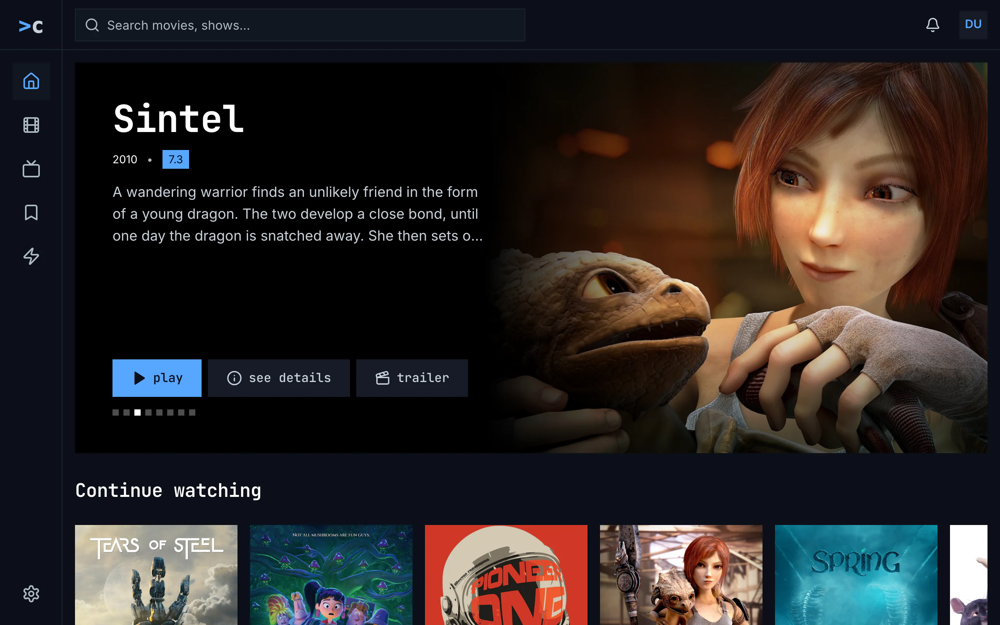

Figure 2.1: The web's frame as deployed on 6 November 2026, on a computer, at
1280 × 800.

1. **Top left: the logo**, “>c”, in a square the height of the bar, without
   the product's name. It leads to home; its tooltip is “Chino — Home”.
2. **The side navigation** down the left edge, 80 px wide: home, movies, shows,
   watchlist and zap as icons alone, a house, a film strip, a television, a
   bookmark and a lightning bolt, each in a 48 px square. The current view,
   home, has its icon in blue on a lighter square. The views' names are their
   tooltips and what a screen reader says, capitalised: “Home”, “Movies”,
   “Shows”, “Watchlist”, “Zap”.
3. **Bottom left: settings**, a gear, pinned at the foot of the side
   navigation. Settings is a view like the others: while it is open, its gear
   is the current one.
4. **The search field** at the left of the top bar, up to 576 px wide and
   square, with the placeholder “Search movies, shows…”.
5. **Top right: the bell and the avatar.** The bell shows no count here; it
   has one only while something is unread. The avatar is the account's
   initials in capitals, “DU”, blue on a grey square; it opens the menu of
   figure 2.4.

The views have no address of their own: the address bar shows only the
watchlist's and the search's, so a reload on movies, shows, zap or settings
opens home. A title's page, a person's page and the account page are shown
without the frame, with no top bar and no side navigation; their own back
arrow leads back.

Figure 2.2 shows the frame on a phone held upright.

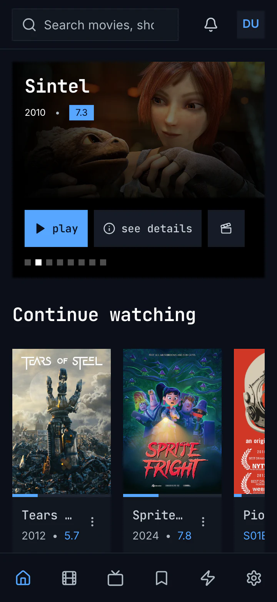

Figure 2.2: The web's frame as deployed on 6 November 2026, on a phone held
upright, at 360 × 780.

1. **Top: the search field** across most of the bar, its placeholder cut off,
   “Search movies, sho”. Narrower than 768 px, the web shows no logo and no
   product's name.
2. **Top right: the bell and the avatar**, as on a computer.
3. **The tabs** along the bottom, 64 px high: six icons alone, home, movies,
   shows, watchlist, zap and settings, each an equal share of the width. The
   current one, home, is blue. Their names are only what a screen reader says,
   as in figure 2.1.

Figure 2.3 shows the frame on a phone held sideways.

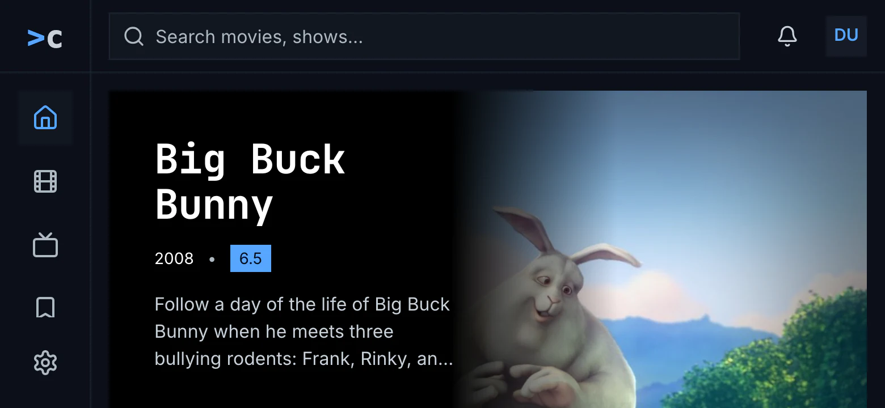

Figure 2.3: The web's frame as deployed on 6 November 2026, on a phone held
sideways, at 780 × 360.

1. **Top: the logo and the search field**, as on a computer: from 768 px wide
   the web has the frame of figure 2.1, and a phone held sideways is 780 px
   wide.
2. **Left: home, movies, shows and watchlist**, with zap out of view below
   them. Where the views don't fit the side navigation's height, their column
   scrolls, and the current view is scrolled into view.
3. **Bottom left: settings**, pinned at the foot, where zap would be.

Figure 2.4 shows the avatar's menu open on a computer.

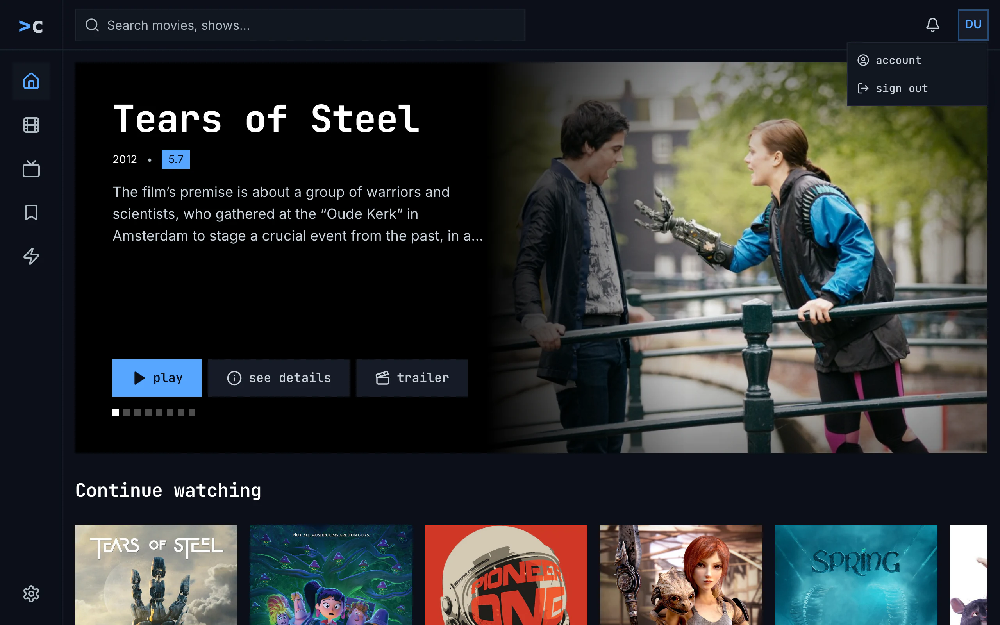

Figure 2.4: The web's avatar menu as deployed on 6 November 2026, on a
computer, at 1280 × 800.

1. **Top right: the avatar**, ringed in blue while the pointer is on it.
2. **The menu** under it: **account**, with a person in a circle, and **sign
   out**, with an arrow leaving a door, in the monospace face. It doesn't say
   who is signed in, and it has no settings. account opens the account page
   ([chapter 16](./settings.md)); sign out signs out at once, without asking,
   at the server's sign-in service too, which then sends the browser back to
   the site.

The menu closes with a click outside it or on the avatar. Esc doesn't close it,
and the arrow keys don't move through it. Figure 2.5 shows it on a phone.

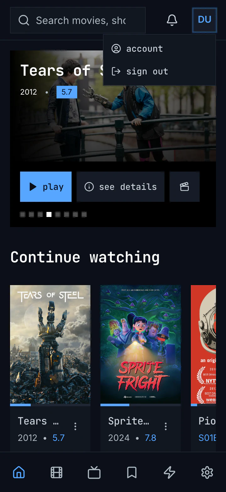

Figure 2.5: The web's avatar menu as deployed on 6 November 2026, on a phone
held upright, at 360 × 780.

1. **The menu** drops down under the avatar, as on a computer, with the same
   two items, over the page.

### 2.2.2 The phone app

The phone app has the web's frame, with downloads among the views. Upright,
narrower than 600 dp, its top bar holds an open search field, “Search movies,
shows…”, 42 dp high, then the bell and the avatar; there is no logo and no
product's name. Along the bottom, the tabs are icons alone, in the web's order:
home, movies, shows, watchlist, zap, downloads and settings. Downloads is there
only in the Android app, and only while the server offers downloads or
something is on the phone, so the iOS app has six tabs. The current tab's icon
is blue, and the tabs' names, “Home” to “Settings”, are only what a screen
reader says.

From 600 dp wide, measured on the window, the app has the web's computer frame:
an 80 dp rail at the left, the logo at its top, the tabs' icons in 48 dp
squares, settings pinned at its foot, and the same top bar, its search field
at most 576 dp wide; there are no tabs at the bottom. A phone held sideways,
some 780 × 360 dp, is wider than 600 dp, so it gets the rail; where the tabs
don't fit the rail's height, they scroll, and the open one is scrolled into
view.

The bell shows only while the server's notifications answer, and opens a screen
of its own; a screen reader calls it “Notices”, or “Notices, 2 unread”. The
avatar has no menu: it opens the account page at once, and it has no name of
its own for a screen reader. A screen opened from a tab, such as a title's
page, the account page or the notifications, covers the whole frame, tabs
included, and has its own top: a back arrow and its name, or on a title's page
back, home and cast. Settings and zap are tabs, so they keep the frame; the
player covers it.

### 2.2.3 Android TV

Android TV has the web's computer frame, and nothing in it opens: a rail at the
left, 80 dp wide and always as narrow, with the logo at its top, then home,
movies, shows, watchlist and zap as icons alone, and settings at its foot; and a
top bar right of the rail with a search field, “Search movies, shows…”, that
opens the search screen, then the bell with its count and the avatar, a circle.
A screen reader names the rail's items “Home”, “Movies”, “Series”, “Watchlist”,
“Zap” and “Settings”: shows is “Series” there, though its screen is headed
“shows”. The bell is “Notices”, or “Notices, 2 unread”.

Left from a screen's first column moves the focus into the rail, onto the
current view's item, and right moves it back. A focused item has the focus ring
outside it and grows by 5 %; the current view's icon is blue on a lighter
square. The avatar opens who's watching ([chapter 3](./start.md)). A title's
page, the player, zap and delete account have no rail and no top bar; a
person's page has both. The frame keeps no safe area: the rail starts at the
screen's left edge and the bar at its top, and only the player and zap keep to
the safe area.

### 2.2.4 Samsung TV

The Samsung TV app has the same frame: a narrow rail at the left with the logo,
home, movies, shows, watchlist and zap as icons alone, and settings at its foot,
named for a screen reader “Home”, “Movies”, “Series”, “Watchlist”, “Zap” and
“Settings”; and a top bar with a search field, “Search movies, shows…”, that
opens the search screen, the bell with its count, and the avatar, a square with
one capital letter, dark on blue, with the account's name beside it. The rail
never opens. The arrow keys move the focus to the nearest item in their
direction, into the rail and out of it, and nothing remembers where the focus
was; a focused item has the blue ring outside it and doesn't grow. The avatar
opens settings. A title's page, the player, zap and delete account have no
frame, and the frame keeps no safe area.

### 2.2.5 Feature by feature

The table compares the four frames feature by feature. “—” is a feature the app
doesn't have.

| Feature | Web | Phone app | Android TV | Samsung TV |
|---|---|---|---|---|
| The views | a side navigation down the left edge, 80 px wide; narrower than 768 px, tabs at the bottom | tabs at the bottom; from 600 dp wide, a rail down the left edge, 80 dp wide | a rail down the left edge, 80 dp wide, always as narrow | a rail down the left edge, always as narrow |
| Their order | home, movies, shows, watchlist, zap, then settings | home, movies, shows, watchlist, zap, downloads, then settings | home, movies, shows, watchlist, zap, then settings | as on Android TV |
| A view in the navigation | its icon alone; its name a tooltip and what a screen reader says, “Home” | its icon alone; its name only for a screen reader | its icon alone; for a screen reader “Home”, and “Series” for shows | as on Android TV |
| The current view | its icon blue on a lighter square; on a phone, its icon blue | the same | the same | the same |
| Settings | a gear at the foot of the side navigation; on a phone, the sixth tab | the last tab, or the foot of the rail | at the foot of the rail | at the foot of the rail, and behind the avatar |
| Zap | a view; on a phone, the fifth tab | a tab, between watchlist and downloads | a view | a view |
| Downloads | — | Android only: a tab while the server offers downloads or something is on the phone | — | — |
| The product's name | the logo, “>c”, at the top of the side navigation; none on a phone | none; the logo at the top of the rail | the logo at the top of the rail | the logo at the top of the rail |
| The top bar | the search field, the bell and the avatar, 64 px high | the same, 64 dp high, its field 42 dp | the search field, the bell and the avatar, right of the rail | the same |
| The search | a square field, “Search movies, shows…”, with suggestions under it as the person types | a field, “Search movies, shows…”; the results take the page while it holds words | a field, “Search movies, shows…”, that opens the search screen | as on Android TV |
| The bell | its count, “99+” past 99; a panel under it; for a screen reader “Notices”, “Notices, 2 unread” | there only while the server's notifications answer; a screen of its own; “Notices, 2 unread” | there once the notifications answer; a screen of its own; “Notices, 2 unread” | there only while the notifications answer; a screen of its own; “Notices, 2 unread” |
| What the avatar opens | a menu with account and sign out | the account page | who's watching | settings |
| The avatar for a screen reader | the button “Account”; the initials inside named by the account's name | no name of its own | no name of its own | the account's name |
| The avatar's menu | account and sign out, without the name or the email address; a click outside or on the avatar closes it, Esc doesn't | — | — | — |
| A phone held sideways | from 768 px wide, the computer's frame; the views scroll in their column, zap out of view | from 600 dp wide, the rail; the tabs scroll in it | — | — |
| A screen opened from a view | a title's page, a person's page and the account page without the frame, each with its own back arrow | covers the frame, tabs included, with its own top | a title's page without the frame; a person's page and the account page in it | a title's page without the frame |
| Screens without the frame | the player, and the screens above | the player, and every screen opened from a tab | the player, zap, a title's page, delete account | the player, zap, a title's page, delete account |
| Zap and the frame | in the frame | in the frame: the top bar and the tabs stay | without the frame | without the frame |
| The rail opening | — | — | never; it has no names | never; it has no names |
| The focus into the rail | — | — | left from a screen's first column, onto the current view; right goes back | the arrow keys, to the nearest item |
| A focused item in the rail | — | — | the focus ring outside it, 5 % larger | the blue ring outside it; nothing grows |
| The safe area | — | — | none for the frame; the player and zap keep 48 × 27 dp | none |
| A view's address | only the watchlist and the search; a reload elsewhere opens home. A title's page, a person's page, the account, the player and a trailer each have one of their own | — | — | — |

## 2.3 The frame on a computer

Figure 2.6 shows the frame on a computer, with movies as the current view. It
is the web's frame as it is built today (figure 2.1): the views as icons alone
in a rail down the left edge, and a top bar with the search, the bell and the
avatar. The target keeps it and changes two things, how the current view is
marked and how the rail and its items are named (2.C2); each view also gets an
address of its own (2.C6).

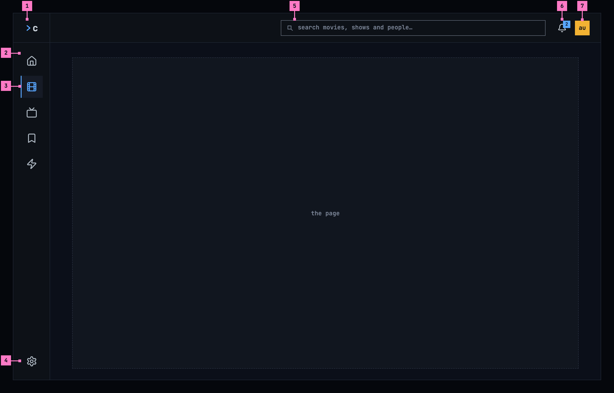

Figure 2.6: The frame on a computer, at 1280 × 800.

1. **The mark**, “>c”: the design system's chevron and the c of chino, in the
   bar's first cell, over the rail. It leads to home; its tooltip, and its name
   for screen readers, is “chino, home”.
2. **The rail**, 80 px wide, down the left edge: the five views, home, movies,
   shows, watchlist and zap, as icons alone, each in a 48 px square: a house, a
   film strip, a television, a bookmark and a lightning bolt. A view's name,
   lowercase, is its tooltip and what a screen reader says: “home”, “movies”,
   “shows”, “watchlist”, “zap”.
3. **The current view**: its icon blue on a lighter square, and a blue bar on
   the square's left edge, so it never shows by colour alone. A screen reader
   says it is the current page.
4. **settings**, a gear, pinned at the rail's foot, apart from the views, and
   named “settings” in the same way. While settings is open, the gear is the
   current one. The avatar's menu has settings as well (figure 2.7).
5. **The search**, the design system's search field, up to 576 px wide, just
   before the bell, where the design system's top bar puts it in every product
   (2.C12), and the only search in the product. Its placeholder says
   what it finds: “search movies, shows and people…”. Typing in it shows the
   results ([chapter 9](./search.md)).
6. **The bell.** Its number counts the notifications the person hasn't read;
   with none unread, the number goes. The bell opens the notifications
   ([chapter 15](./notifications.md)).
7. **The avatar**: a square with the person's initials, dark on one of twelve
   colours ([chapter 3](./start.md)). It opens the menu of figure 2.7.

The page takes the rest, beside the rail and under the bar. The rail is
chino's own, drawn on the design system's colours and sizes. It looks like the
side navigation of the design system's
[app navigation](https://nalet.github.io/design-system/patterns/app-navigation/)
shrunk to its icons, and marks the current view the way that one does, with a
blue bar on its edge. The mark's chevron and the search field are the design
system's. For screen readers the rail is a navigation named “views”, and each
of its items is a link named after its view, its icon left unread.

Every screen but the player keeps the frame: a title's page, a person's page,
settings and the account page open beside the rail and under the bar. A screen
that isn't one of the views, such as a title's page or the account page, marks
none of them as current. Each view, and settings, has an address of its own,
so a reload, a link or the browser's back brings the person back to it, as the
design system's app navigation has it.

This frame is for a computer and a tablet, a screen or a window 600 dp or more
on its short side. One smaller than that, a phone held either way, has the
phone's frame of section 2.4. In a narrower window the search field gets
narrower, and in a wide one it grows to 576 px at most; in a window too low for
the whole rail, the views scroll in their column, with the current one
scrolled into view, and settings stays at the foot. All three are as the web
has them today.

Figure 2.7 shows the avatar's menu open, as the design system's top bar draws
its user menu.

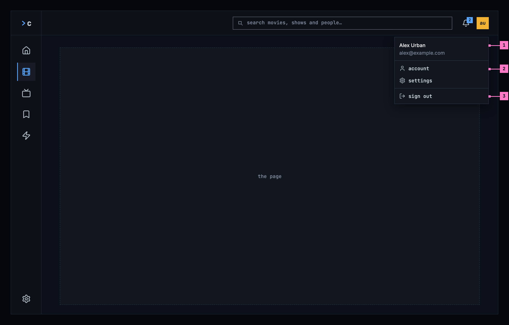

Figure 2.7: The avatar's menu, on a computer.

1. **Who is signed in**: the person's name and, quieter, their email address,
   at the top of the menu.
2. **account** and **settings**, items of the design system's menu, each with
   its icon. They open the screens of [chapter 16](./settings.md). settings
   opens the same screen as the gear at the rail's foot: the design system's
   user menu is the same in every product, and has settings in it.
3. **sign out**, last and set apart under a rule, so nobody presses it by
   accident. It signs out of this server, as chapter 16 describes.

The menu opens under the avatar, its right edge on the avatar's. It closes with
Esc, a click outside it, or a second click on the avatar, and the focus goes
back to the avatar. The arrow keys move between its items. **help** joins it
between settings and sign out once there is a guide for the people watching
(2.C10).

## 2.4 The frame on a phone

The phone has a frame of its own, held upright and held sideways. Figure 2.8
shows it upright and figure 2.10 sideways; section 2.4.3 says what happens when
the phone is turned.

### 2.4.1 Held upright

The bar keeps what every screen needs, and the views move to tabs at the
bottom, in reach of a thumb.

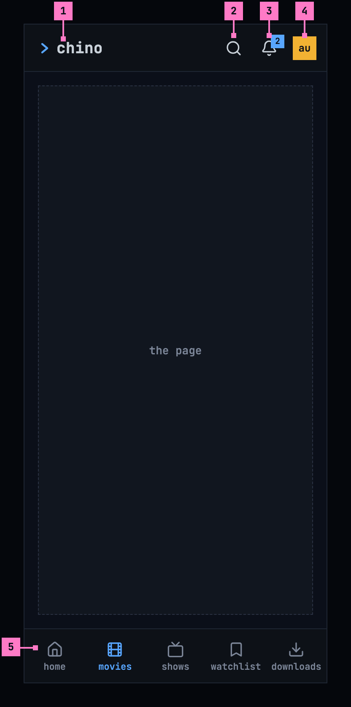

Figure 2.8: The frame on a phone held upright, at 360 × 780 dp.

1. **The product's name**, chino, led by the design system's chevron. It leads
   to home, as the mark “>c” does on a computer.
2. **The search** is an icon. It opens the design system's search field across
   the whole width of the bar, with the keyboard ([chapter 9](./search.md)).
3. **The bell**, as on a computer. On a phone it opens a screen of its own.
4. **The avatar**, as on a computer. Its menu is the one of figure 2.7 and
   opens under it in the same way, within the screen's width.
5. **The tabs**: home, movies, shows, watchlist and downloads, each its icon
   alone, as the apps have them today; a tab's name is what a screen reader
   says. The current tab is blue, with a blue bar on its top edge, so it
   doesn't show by colour alone. Zap, the computer's fifth view,
   starts from home on a phone ([chapter 4](./home.md)), and downloads take its
   place, because the phone keeps titles to watch offline
   ([chapter 13](./downloads.md)).

The downloads tab is there while the server offers downloads or something is on
the phone ([chapter 13](./downloads.md)); without it, the phone has four tabs. A
screen opened from a view, such as settings or a title's page, shows a back
arrow and its name in place of the bar. The tabs stay.

Figure 2.9 shows the web on a phone. It has no downloads, so zap stays the
fifth tab.

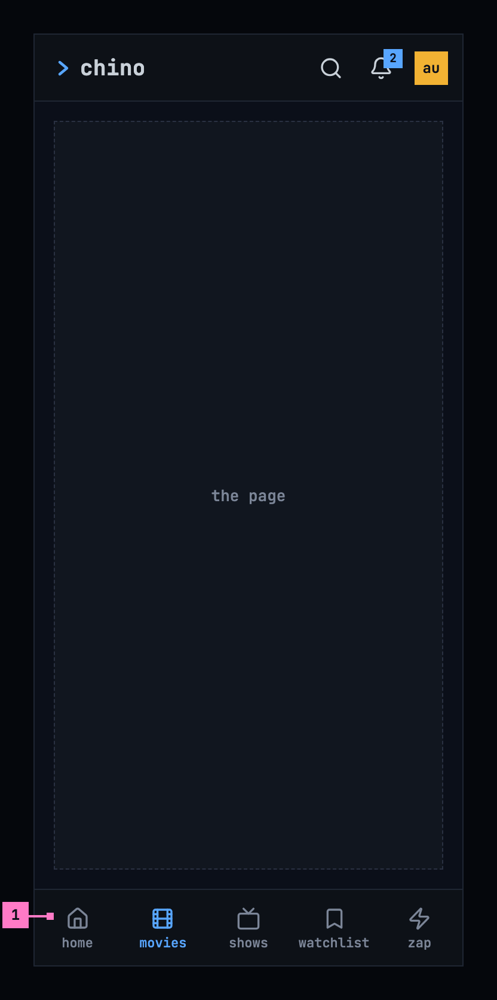

Figure 2.9: The web on a phone held upright, at 360 × 780 dp.

1. **The tabs** of the web on a phone: home, movies, shows, watchlist and zap.
   The rest of the frame is as in figure 2.8.

### 2.4.2 Held sideways

A phone held sideways is wide but low. Its frame keeps the phone's parts where
the person knows them and gives the page the height, as figure 2.10 shows. The
numbers mark what differs from figure 2.8.

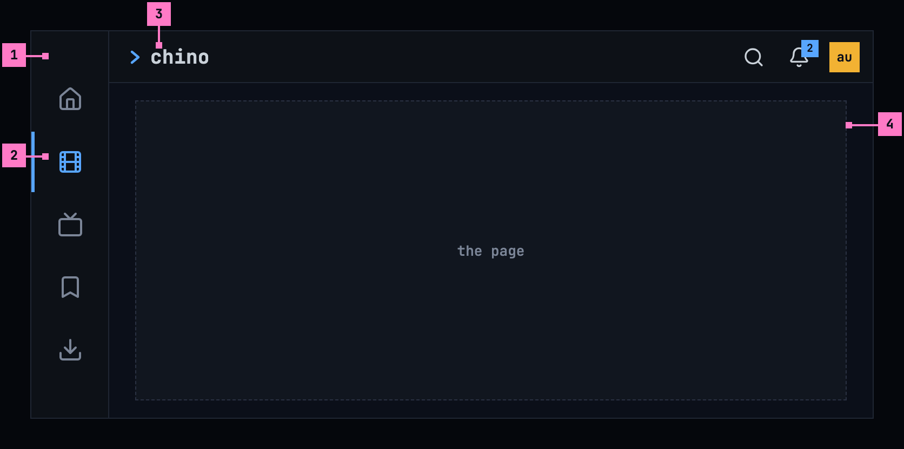

Figure 2.10: The frame on a phone held sideways, at 780 × 360 dp.

1. **The tabs**, as a rail down the left edge, 80 dp wide, each tab 48 dp, as the
   computer's rail: the same tabs in the
   same order, each its icon alone.
2. **The current tab** is blue, with a blue bar on its edge.
3. **The bar**, 48 dp high instead of 56, with the product's name, the search
   icon, the bell and the avatar, as upright.
4. **The page** takes the rest: the whole height under the bar.

This is the target for a phone held sideways: turned, a phone keeps the phone's
frame, however wide it is, because the frame follows the screen's short side,
not its width (section 2.3). Its rail looks like the computer's (figure 2.6),
but it is the phone's tabs moved to the side, and nothing else: no mark at its
top and no settings at its foot, because the product's name stays in the bar
and settings in the avatar's menu, as upright. The web held sideways has the
same rail, with zap in place of downloads. The rail and the bar keep clear of
the camera's cutout and of the phone's navigation bar, on whichever side they
are. A screen opened from a view shows its back arrow and its name in the
slimmer bar, and the rail stays.

Today's apps go by the width instead: the phone app from 600 dp and the web
from 768 px take the computer's frame, so a phone held sideways gets the
computer's rail, with the logo at its top and settings at its foot, beside the
full bar, and the views scroll in it where they don't fit (figure 2.3 and
section 2.2.2).

### 2.4.3 Turning the phone

The frame turns with the phone, and turning it never loses the person's place:
the current tab stays current, a screen opened from a view keeps its back arrow
and its name, and the page stays as it was, scrolled where it was, its filters
set, a menu that was open still open. Turned sideways, the tabs move from the
foot of the screen to the rail at the left and the bar becomes slimmer; turned
upright again, they go back.

## 2.5 The frame on a TV

A TV has no top bar. Figure 2.11 shows the rail on the left, which holds what a
computer has in its bar and its rail, one under the other.

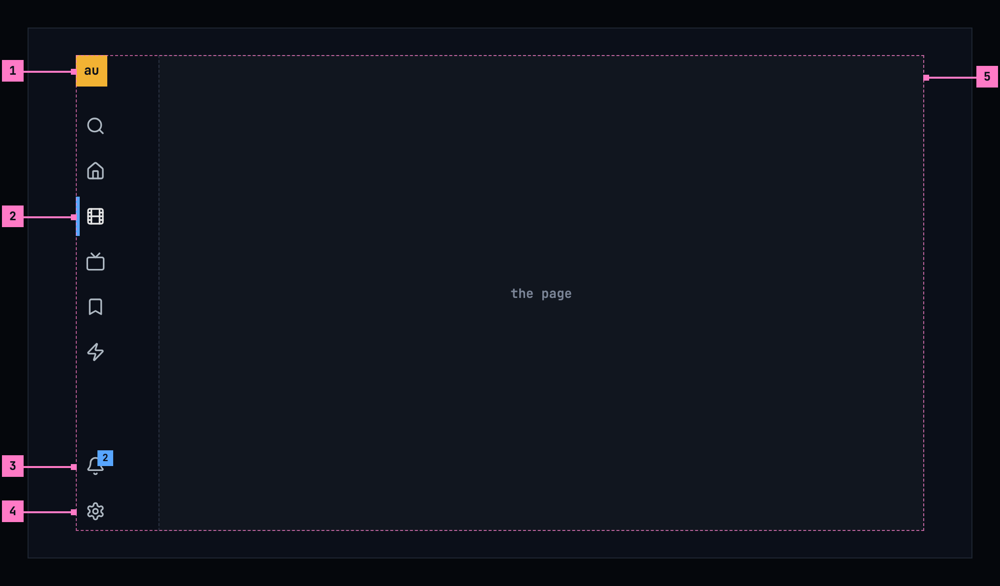

Figure 2.11: The frame on a TV, at 960 × 540 dp.

1. **The avatar**, at the top. It opens who's watching, to switch to another
   account on this TV ([chapter 3](./start.md)).
2. **The views**, under the search: home, movies, shows, watchlist and zap.
   When the focus is on the page, the current view keeps a blue bar on its
   left, so the person always knows where they came from.
3. **The bell**, at the foot. Its count works as on a computer.
4. **settings**, the last item, at the rail's foot as on a computer. On a TV
   it is the only way to settings, because the avatar opens who's watching
   there.
5. **The page**, right of the rail. Everything that matters on it stays inside
   the TV's safe area, the dashed outline: 48 dp from the left and right edges
   and 27 dp from the top and bottom, as the design system's
   [TV focus](https://nalet.github.io/design-system/patterns/tv-focus/) sets
   out. Artwork may run to the edge.

Moving the focus into the rail opens it, with the names beside the icons, as
figure 2.12 shows.

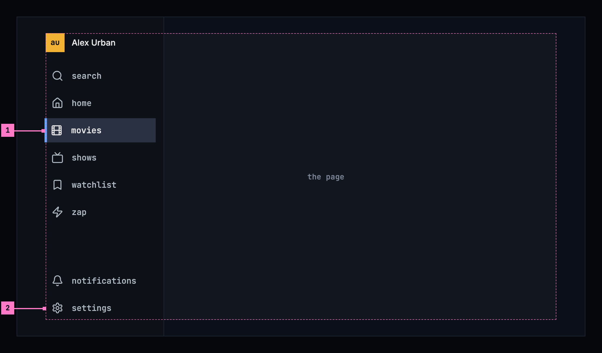

Figure 2.12: The rail opened, on a TV.

1. **The focused item** has the design system's TV focus for a row: the ring
   inside its edge, the lighter focused surface, and 2 % growth. Up and down
   move between the items, and OK opens one. Right, or Back, closes the rail
   and puts the focus back on the page.
2. **The items** keep their order: search, the five views, then notifications
   and settings at the foot. The avatar sits at the top with the person's name.

## 2.6 Changes

Every difference between section 2.2 and the target is one change in the
table. A change names the apps it is built in, what they do today and the
target, with the figure or the section that sets it out; it is built as its row
says, and nothing else changes with it. Each change starts as proposed; once the
owner approves it, it is built, one change at a time. A target that starts with
“Recommended” was an open decision. The bell's count, its name and what it
opens belong to [chapter 15](./notifications.md), what the search finds and its
words to [chapter 9](./search.md), the avatar's look to
[chapter 3](./start.md), and what settings and the account page hold to
[chapter 16](./settings.md).

| No. | Change | Apps | Today | Target | Status |
|---|---|---|---|---|---|
| 2.C1 | The avatar's menu, with settings in it | Web, Phone app | Web: **account** and **sign out**, without the name or the email address and without settings; it closes only with a click outside it or on the avatar, and on a phone it drops down under the avatar. Phone app: no menu; the avatar opens the account page | figure 2.7: one sheet under the avatar, its right edge on the avatar's: the name and, quieter, the email address, then account and settings, items of the design system's menu, and sign out set apart under a rule; the design system's user menu is planned and its menu has no rule yet, so the header and the rule are built on its tokens around its menu's items; Esc, a click outside it or on the avatar closes it, the focus back on the avatar; the arrow keys move between its items; on a phone the same menu opens under the avatar (section 2.4.1); on a computer settings stays at the rail's foot as well (2.C2). Built before 2.C3, which takes settings out of the phone's tabs | proposed |
| 2.C2 | The computer's rail: the current view's bar, and the names lowercase | Web | the views as icons alone in a side navigation down the left edge, 80 px wide, with the logo at its top, “>c” in the monospace face with the “>” in blue, and settings, a gear, at its foot (figure 2.1); the current view's icon blue on a lighter square, so it shows by colour alone; the names capitalised as tooltips and for screen readers, “Home” to “Settings”; the logo's tooltip “Chino — Home” and its name for screen readers “Chino”; the views' column a navigation without a name | figure 2.6: the rail as it is built, with these changes: the current view keeps its blue icon on the lighter square and gets a blue bar on the square's left edge; the names lowercase as tooltips and for screen readers, “home”, “movies”, “shows”, “watchlist”, “zap” and “settings”, the rail a navigation named “views”; the mark “>c”, drawn with the design system's chevron, leads home as today, its tooltip and its name for screen readers “chino, home”. Stays as deployed: the rail's 80 px, its 48 px squares, the icons and their order, settings pinned at the foot and current while it is open, the current view told to screen readers as the current page, the column scrolling where the views don't fit its height, the mark in the cell over the rail, and the top bar beside it, with the search field, up to 576 px wide (just before the bell by 2.C12), the bell and the avatar | proposed |
| 2.C3 | The phone's frame held upright: the bar and five tabs | Web, Phone app | Web: the bar a search field, the bell and the avatar, without the product's name; six tabs, icons alone, zap fifth and settings sixth. Phone app: the same bar; seven tabs on Android and six on iOS, icons alone, zap and settings among them; on Android downloads is left out where the server offers none and nothing is on the phone | figures 2.8 and 2.9: chino led by the design system's chevron, the search icon, the bell and the avatar in the bar; each tab its icon alone, as today, and named for a screen reader: home, movies, shows, watchlist and downloads, the current one blue with a blue bar on its top edge, four without downloads, and on the web zap in place of downloads; settings in the avatar's menu (2.C1); zap from home in the phone app ([chapter 4](./home.md)) | proposed |
| 2.C4 | The phone's frame held sideways | Web, Phone app | by the width: the web from 768 px wide has the computer's frame, its views scrolling in their column on a phone held sideways (figure 2.3); the phone app from 600 dp wide, measured on the window, has an 80 dp rail with the logo, the tabs' icons and settings at its foot, under the upright bar | by the short side: a screen or a window less than 600 dp on its short side has the phone's frame held either way, sideways the tabs as a 80 dp rail at the left, icons alone, and the bar 48 dp high (figure 2.10); 600 dp and more, the computer's frame (section 2.3) | proposed |
| 2.C5 | Every screen in the frame, but the player and zap | Web, Phone app, Android TV, Samsung TV | Web: a title's page, a person's page and the account page without the frame. Phone app: every screen opened from a tab covers the frame, tabs included, with its own top; zap keeps the top bar and the tabs. Android TV, Samsung TV: a title's page has no rail and no bar | every screen inside the frame except the player, and except zap in the phone app and on a TV; on a phone, a screen opened from a view has a back arrow and its name in place of the bar, and the tabs stay (section 2.4.1). This change builds the frame's part and the account page; the screens with a change of their own follow it: a title's page 6.C1, a person's page 7.C1, the phone app's notifications 15.C5 and zap in the phone app 10.C1 | proposed |
| 2.C6 | Web: an address for every view | Web | only the watchlist and the search have an address of their own; a reload on movies, shows, zap or settings opens home | each view and settings with its own address, the rail's items links to them, so a reload, a link or back brings the person to it (section 2.3) | proposed |
| 2.C7 | The TV's rail holds the frame, and opens | Android TV, Samsung TV | a rail of icons alone, with the logo at its top, the five views and settings at its foot, which never opens, and a top bar with the search field, the bell and the avatar; shows named “Series” for a screen reader. Android TV: a focused item has the ring outside it, 5 % larger. Samsung TV: the arrow keys move to the nearest item, and the avatar opens settings | figures 2.11 and 2.12: one rail and no top bar, with the avatar at its top, then search, home, movies, shows, watchlist and zap, the bell and settings at its foot; moving the focus into it opens it with the names, the focused row filled in the focus colour with the ring inside, 2 % larger; up and down move, OK opens, right or back closes it; the current view keeps a blue bar; the avatar opens who's watching (3.C11) | proposed |
| 2.C8 | The TV keeps to the safe area | Android TV, Samsung TV | the rail starts at the screen's left edge and the bar at its top; Android TV keeps the safe area only in the player and zap, the Samsung TV nowhere | everything that matters inside the safe area, 48 dp from the left and right edges and 27 dp from the top and bottom (figure 2.11, part 5) | proposed |
| 2.C9 | The avatar's name for a screen reader | Web, Phone app, Android TV, Samsung TV | Web: the button “Account”, the initials inside it named by the account's name. Phone app, Android TV: no name of its own. Samsung TV: the account's name | “Alex Urban, user menu” on a computer and a phone; on a TV the account's name, “Alex Urban” (section 2.7) | proposed |
| 2.C10 | help in the avatar's menu | Web, Phone app | no help | Recommended: help between settings and sign out, as the design system's top bar has it, once there is a guide for the people watching; until then none, so the menu never offers something with nothing behind it | proposed |
| 2.C11 | The apps take the design system's components | Web, Phone app, Android TV, Samsung TV | Web: its own controls, built by hand on Tailwind, with the design system's colours and faces copied into its Tailwind setup. Phone app, Android TV, Samsung TV: their own controls in the design system's colours | Web: the package `@nalet/design-system` 0.4.0, its stylesheet and its components for every part [section 1.5](./README.md) lists, the same version as the portal's. Phone app, Android TV, Samsung TV: those parts drawn as the package draws them, in its sizes and states. The frame of this chapter stays chino's own | proposed |
| 2.C12 | The search just before the bell | Web | the search field at the left of the top bar, right after the mark, up to 576 px wide | the same field, up to 576 px wide, at the end of the bar just before the bell and the avatar, as the design system's top bar places the search in every product (figure 2.6) | approved |

## 2.7 Words

| Where | Text |
|---|---|
| The product's name | chino |
| The mark on a computer, “>c”: its tooltip and its name for screen readers | chino, home |
| The computer's rail: each item's tooltip and its name for screen readers (on screen, icons alone) | home · movies · shows · watchlist · zap · settings |
| The computer's rail, for screen readers | views |
| The phone's tabs, as a screen reader names them (on screen, icons alone) | home · movies · shows · watchlist · downloads |
| The web's tabs on a phone, as a screen reader names them | home · movies · shows · watchlist · zap |
| The search's placeholder on a computer | search movies, shows and people… ([chapter 9](./search.md), as the design system's top bar words a search) |
| The search on a phone | the icon, named “search” for screen readers; the field it opens says “search…” ([chapter 9](./search.md)) |
| The bell, for screen readers | notifications, 2 unread |
| The avatar, for screen readers | Alex Urban, user menu |
| The avatar on a TV, for screen readers | Alex Urban |
| The avatar's menu | account · settings · sign out |
| The TV's rail | search · home · movies · shows · watchlist · zap · notifications · settings |
