# 4 Home

Section 4.2 describes home as it is deployed today. The sections after it are
the target, home as it is meant to be, and section 4.7 lists every difference
between the two as a numbered change. Only a change the owner has approved is
built, one change at a time; anything no change names stays as it is deployed.

This chapter specifies home, the first screen after signing in. The frame
around it, the rail and the top bar on a computer, the phone's tabs and the
TV's rail, is specified in [chapter 2](./frame.md).

## 4.1 Purpose

Home offers one title to start right away, then what the person is in the
middle of, then what's new in the library. Every app opens on home after
signing in, and the **home** view in the frame brings it back from anywhere.

## 4.2 As deployed

This section says what the four homes do as of 6 November 2026: the web as the
public demo showed it that day, on the same build as production, and the apps
as their code had them that day. The phone app, Android TV and the Samsung TV
are described from their code until screenshots of them are taken. The Samsung
TV app isn't released yet.

### 4.2.1 The web

Figures 4.1 to 4.4 are screenshots of the web's home, signed in as the demo's
viewer. Figure 4.1 shows it on a computer, as it opens.

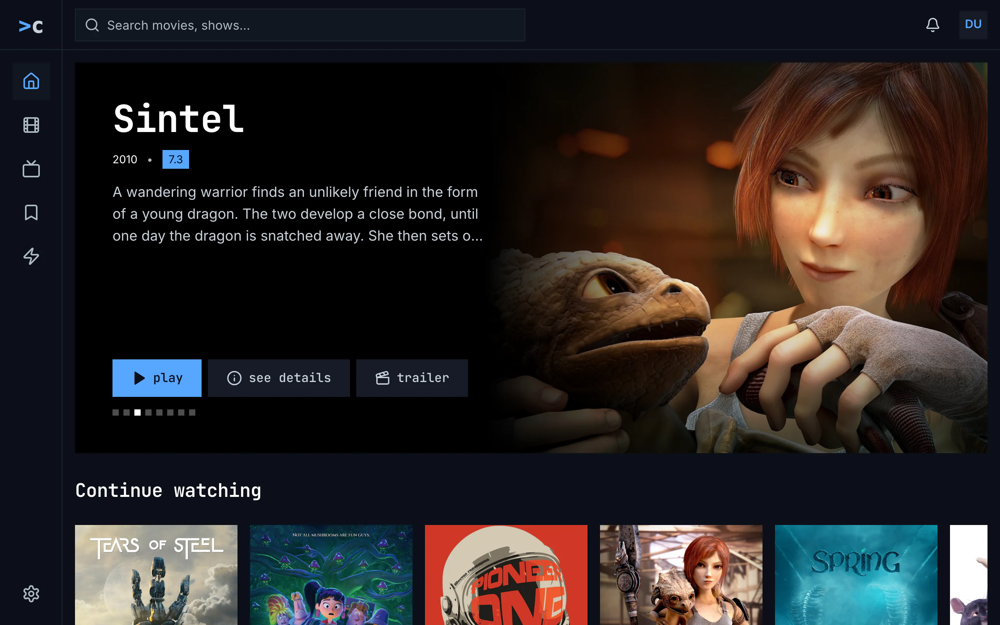

Figure 4.1: The web's home as deployed on 6 November 2026, on a computer, at
1280 × 800.

1. **The frame**: the side navigation down the left, home current, and the top
   bar with the search, the bell and the avatar, as
   [chapter 2](./frame.md) describes them.
2. **The hero**, a black box across the page with the artwork on its right
   half, fading into the black. The name, “Sintel”, is in the monospace face;
   under it come the year and the rating in a blue badge, “2010 • 7.3”, and the
   description, cut after three lines with “…”.
3. **play, see details and trailer**: play blue with a triangle, see details
   with an “i” in a circle, and trailer with a clapperboard, because this
   server plays Sintel's trailer.
4. **The squares**: eight small squares under the buttons, the current one
   white, here the third.
5. **Continue watching**, the first row, its name with a capital, and its
   posters, cut by the window's foot.

Figure 4.2 shows the rows further down, with a card's menu open.

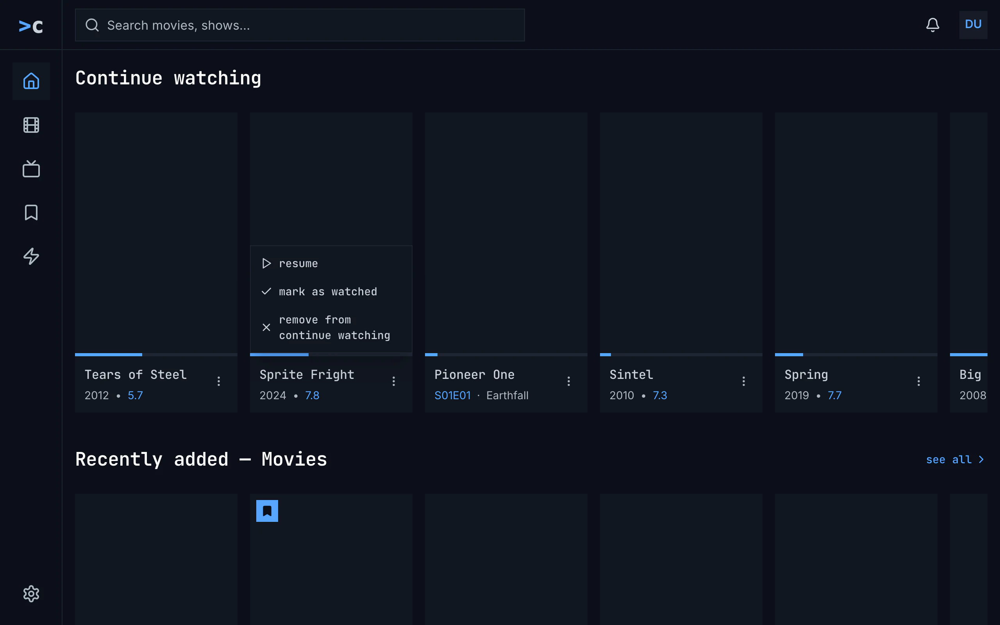

Figure 4.2: The web's home rows as deployed on 6 November 2026, on a computer,
at 1280 × 800, with a card's menu open. The posters were still loading when
the screenshot was taken.

1. **A card**: a 2:3 poster with a blue bar along its foot for how far the
   person got, and under it the name in the monospace face and the year with
   the rating in blue, “2012 • 5.7”. An episode shows its code in blue and its
   own name, “S01E01 · Earthfall”, under its show's name. No card says how much
   is left.
2. **The card's menu**, opened with ⋮ beside the name: **resume**, **mark as
   watched** and **remove from continue watching**, each with its icon.
3. **The arrow** at the row's right end, there while the pointer is on the
   row, moves the row on by a screen's width.
4. **Recently added — Movies**, the next row, with **see all** and a chevron at
   the right of its name; the row also ends with a see all card. A bookmark on
   blue marks a title in the Watchlist.

The viewer's home has three rows: “Continue watching”, “Recently added —
Movies” and “Recently added — Shows”. “Next Up” and “Top rated” have nothing
for it, and a row with nothing in it is left out. Cards are 208 px wide on a
computer and 128 px on a phone. The rows of titles hold up to 20 each, the ones
the person hasn't watched, and their see all opens movies or shows in the
order by title. Figure 4.3 shows home on a phone held upright.

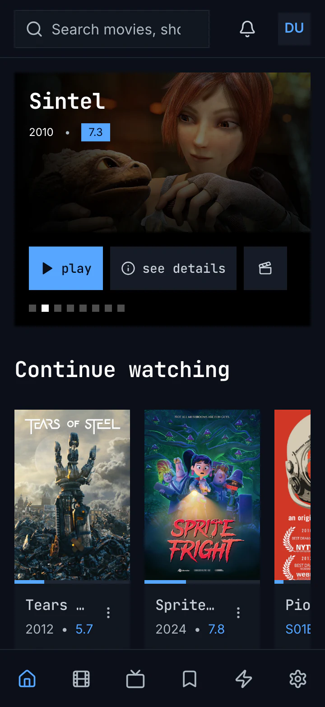

Figure 4.3: The web's home as deployed on 6 November 2026, on a phone held
upright, at 360 × 780.

1. **The top bar**: the search field, its placeholder cut to “Search movies,
   sho”, the bell and the avatar ([chapter 2](./frame.md)).
2. **The hero**: the artwork across the width, the name over it at the top,
   and the year with the rating badge. There is no description.
3. **play, see details and trailer**, trailer as its clapperboard alone, on the
   black under the picture.
4. **The squares**, the current one white.
5. **Continue watching**: two posters and a part of a third, the names cut to
   “Tears …” and “Sprite…”, each with ⋮. Pioneer One shows its episode's code
   in blue.
6. **The tabs**: six icons without names, the sixth settings
   ([chapter 2](./frame.md)).

Figure 4.4 shows another title on a phone held sideways.

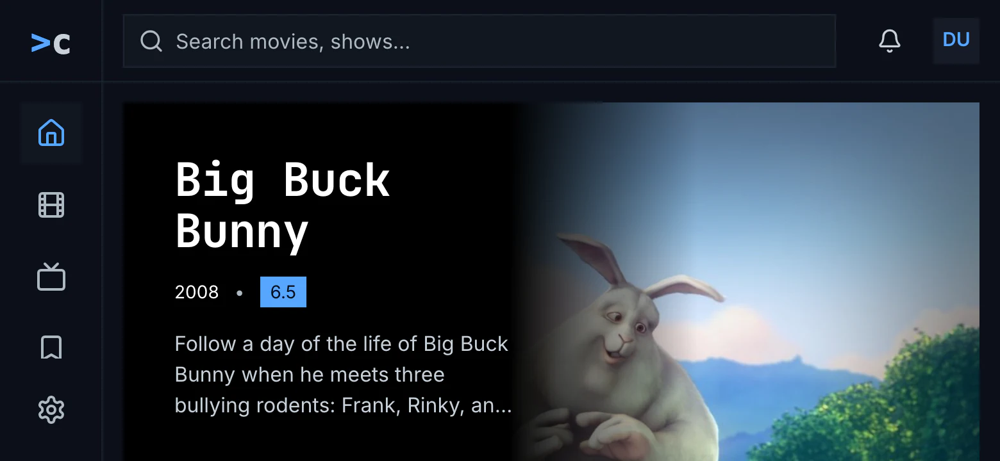

Figure 4.4: The web's home as deployed on 6 November 2026, on a phone held
sideways, at 780 × 360.

1. **The computer's layout**: from 768 px wide the web has the side navigation
   and the computer's hero ([chapter 2](./frame.md)).
2. **The hero** is 460 px tall from 768 px wide, so on a screen 360 px tall it
   shows the name on two lines, the year with the rating and the description,
   and play, see details and trailer are below the screen's foot.

The hero takes up to eight titles with a trailer from the 40 newest movies and
the 40 newest shows, those whose trailer this server plays first, each group in
a random order, watched titles too. It keeps them for an hour and starts at a
random one. Each stays 20 seconds; the pointer or the focus on the hero holds
it, and a swipe, the arrow keys and the squares move it on. A trailer that is
only online shows a screen with a play triangle instead of the clapperboard,
and opens in a new tab. Without a movie the person hasn't watched there is no
hero at all, and a hero whose title has no description says “No description
available.”

While home loads, the design system's spinner turns alone. When every row of
titles fails, home says “couldn't load the movies and shows”, with the reason,
**try again** and **details**, above continue watching. A single row that
fails is left out, and an empty library shows nothing: no hero, no row and no
sentence.

### 4.2.2 The phone app

The phone app's home has the web's hero and rows, with the same names, and
draws the hero's titles the same way. It moves the hero on every 12 seconds,
and only a finger dragging it holds it. The first button is **resume 1:43**,
with **start over** beside it, for a title the person is in, and **play
S01E01** for a show. With no title that has a trailer, there is no hero. Every
card is a 2:3 poster, 128 dp wide, with the web's lines under it, and its menu
opens with a long press; the menu has the web's items. The last three rows end
with a “See all” card. Zap is a tab, not an entry on home.

While home loads, a spinner turns alone. Couldn't load says “couldn't load the
library” with the reason, **try again** and **details**; continue watching
alone can fail in its own place, “couldn't load continue watching”, and the
other rows that fail are left out. An empty library shows nothing. Without the
server, the Android app opens on downloads, and home, opened later, shows “Can't
reach the server. Your downloads still play.” over the rows it last had. From
600 dp wide, as a phone held sideways is, the tabs are a rail, the cards 208 dp
wide, and the hero 500 dp tall with the description and **trailer** with its
name, taller than the screen.

### 4.2.3 Android TV

Android TV's hero shows up to eight movies rated 7 or more that the person
hasn't watched, in the server's order from a random start, trailer or not. It
has **play** and **see details** and no trailer, the focus starts on play, and
it moves on every 12 seconds while the focus isn't in it. The rows have this
chapter's names, in lowercase. Every card is a 2:3 poster 180 dp wide with the
name and the year with the rating. Holding OK opens a card's menu, and the
focused card says “Hold OK for options”. While home loads, “Loading your
library…” stands in the middle; an empty library says “No items yet.”

### 4.2.4 Samsung TV

The Samsung TV's hero takes the same movies as Android TV, with “Play” and
“More Info”, and moves on every 12 seconds while neither has the focus. After
“Continue Watching”, “Next Up”, “Recently added — Movies”, “Recently added —
Shows” and “Top Rated” come up to three rows named after genres. The rows end
without see all, the cards have no menu, and only the watched check marks them.
While home loads, a spinner turns with “Loading library…”. Back on home, it
loads again with the focus on Play.

### 4.2.5 Feature by feature

The table compares the four homes feature by feature. “—” is a feature the app
doesn't have.

| Feature | Web | Phone app | Android TV | Samsung TV |
|---|---|---|---|---|
| The hero's titles | up to 8 with a trailer from the 40 newest movies and the 40 newest shows, those this server plays first, each group in a random order; watched ones too | the same | up to 8 movies rated 7 or more that the person hasn't watched, trailer or not, in the server's order | the same as Android TV |
| Kept | an hour, in the browser's session; a random start each time | an hour, per server and account; a random start | while home is open; a random start | until home opens again; a random start |
| Nothing for the hero | the newest movie the person hasn't watched, without trailer | no hero | the first recently added movie | the first recently added movie, else show |
| Moving on | every 20 s; held by the pointer or the focus; a swipe, the arrow keys, the squares | every 12 s; held only by a finger dragging it; a swipe, the squares | every 12 s; held while the focus is in the hero | every 12 s; held while Play or More Info has the focus |
| Under the name | the year and the rating in a blue badge, “2010 • 7.3” | the same | the same | the same |
| The description | from 768 px wide, three lines | only on the wide hero, from 600 dp | three lines | three lines |
| The buttons | play · see details · trailer | play, or resume 1:43 with start over, or play S01E01 · see details · trailer | play · see details | “Play” · “More Info” |
| trailer | its clapperboard alone below 640 px; a trailer online shows a screen with a play triangle and opens in a new tab | its clapperboard alone below 600 dp | — | — |
| The squares | 8 px, the current one white | 8 dp, the current one white | 8 dp, the current one white | the current one white |
| The rows | “Continue watching”, “Next Up”, “Recently added — Movies”, “Recently added — Shows”, “Top rated” | the same | “continue watching”, “next up”, “recently added movies”, “recently added shows”, “top rated” | “Continue Watching”, “Next Up”, “Recently added — Movies”, “Recently added — Shows”, “Top Rated”, then up to three rows named after genres |
| The cards | 2:3 posters, 208 px wide on a computer, 128 px on a phone | 2:3 posters, 128 dp, from 600 dp 208 dp | 2:3 posters, 180 dp | 2:3 posters |
| Under the poster | the name and the year with the rating in blue, “2012 • 5.7”; an episode “S01E01 · Earthfall” under its show's name | the same | the same | the same; an episode its code alone |
| Time left | — | — | — | — |
| The bar | continue watching | continue watching | continue watching | continue watching |
| Status marks | the Watchlist's bookmark, the watched check | the same; no watched check in the two watching rows | the same | the watched check alone |
| The card's menu | ⋮ beside the name: play or resume · mark as watched or watched · remove from continue watching | a long press; the same items | holding OK, with “Hold OK for options” on the focused card; the same items, in recently added shows the watched one alone | — |
| see all | the last three rows: beside the name, and a card at the end | the last three rows: a “See all” card at the end | the last three rows: a card at the end | — |
| What see all opens | movies or shows in the order by title, the filters at all | the same | the same | — |
| Zap | a tab | a tab | in the rail | in the rail |
| A phone held sideways | the computer's layout; the hero 460 px tall, its buttons below the screen's foot | the rail; the hero 500 dp tall; cards 208 dp | — | — |
| Back on home | — | — | the focus on the card that opened the page | home loads again, the focus on Play |
| Loading | a spinner alone | a spinner alone | “Loading your library…” | a spinner, “Loading library…” |
| Couldn't load | “couldn't load the movies and shows” over continue watching, the reason, try again, details | “couldn't load the library”, the reason, try again, details | the same | “Couldn’t load your library. ” and the error's text; no try again |
| A row that couldn't load | left out | continue watching: “couldn't load continue watching”; any other left out | left out | left out |
| An empty library | nothing | nothing | “No items yet.” | “Your library is empty. Add titles on your server to see them here.” |

## 4.3 Home on a computer

Figure 4.5 shows home on a computer, with the menu of a card in continue
watching open, Elephants Dream's. The hero takes the top of the page, and the
rows follow under it, each scrolling sideways. The hero, its squares and the
rows of cards are chino's own; the buttons and the card's menu are the design
system's.

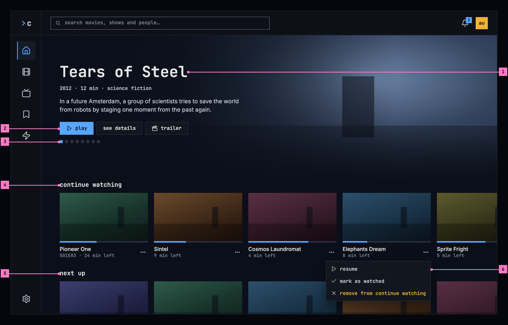

Figure 4.5: Home on a computer, at 1280 × 800.

1. **The hero.** One title over its artwork: its name, then its year, length
   and genre, then a short description. The artwork fills the right side and
   fades into the page on the left, so the words always stand on the page's
   own colour, never on the picture. Section 4.6.1 says which titles the hero
   shows.
2. **play**, **see details** and **trailer**, the design system's buttons at
   their medium size, 34 px high: play is the emphasized one, with its
   triangle, the other two are standard. play plays the title from where the
   person stopped, as resume on its page does, and a show the episode its
   page's first button names; see details opens its title page
   ([chapter 6](./title-actions.md)); trailer plays its trailer, the one this
   server has in the player and one that is only online outside the app, as
   on the title page, with the clapperboard either way. trailer is there only
   when the title has one.
3. **The squares.** Eight titles take turns in the hero. The square of the one
   showing is blue, and choosing another square brings that title.
4. **continue watching.** What the person stopped in the middle of. Each card
   shows a still with a bar for how far the person got, the title's name,
   and the time left. An episode puts its code first: “S01E03 · 24 min left”.
   The menu button at the right of the card's lines, three small squares,
   opens the card's menu (section 4.6.2).
5. **next up.** The next episode of a show whose last episode the person
   finished, by its code and name, “S01E02 · Gran Dillama”. The rows that
   follow it are listed in section 4.6.2.
6. **The card's menu**, open on Elephants Dream: the design system's action
   menu, just under its button and lined up with its right edge, over the
   row below. It lists **resume**, **mark as watched** and **remove from
   continue watching**, the last one in amber and at the end, as the design
   system marks an item that takes something away.

The rows after next up hold posters, as the grid of movies and shows does
([chapter 5](./browse.md)): the poster with its status marks, the name, the
year and the menu button.

## 4.4 Home on a phone

The phone shows home upright and sideways. Figure 4.6 shows it upright and
figure 4.7 sideways. The parts are those of figure 4.5; the numbers mark where
the phone differs, and section 4.4.3 says what happens when the phone is
turned.

### 4.4.1 Held upright

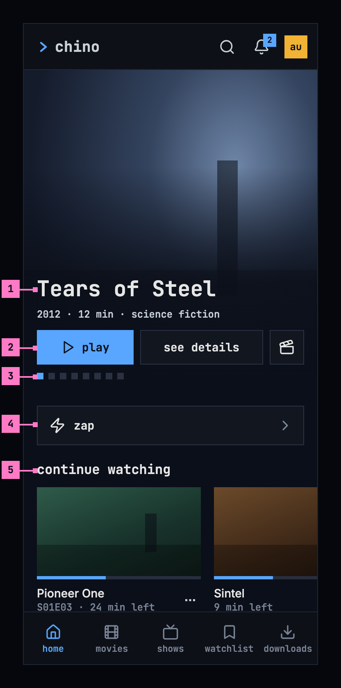

Figure 4.6: Home on a phone held upright, at 360 × 780 dp.

1. **The hero** leaves out the description, which the title page has. The
   artwork fills the width and fades into the page below the name.
2. **play** and **see details**, the design system's buttons at their large
   size, 42 dp high, share the width; **trailer** is the design system's icon
   button, its clapperboard alone, named “trailer” for screen readers.
3. **The squares**, as on a computer. A swipe on the hero brings the next
   title as well.
4. **zap** opens zap ([chapter 10](./zap.md)). The phone app has no zap tab
   ([chapter 2](./frame.md)), so zap starts here, right under the hero.
5. **The rows** show one card and a part of the next, so it's plain that a row
   goes on sideways.

The web on a phone held upright has the layout of figure 4.6 with one
difference: zap is its fifth tab, in place of downloads, so the web leaves out
part 4.

### 4.4.2 Held sideways

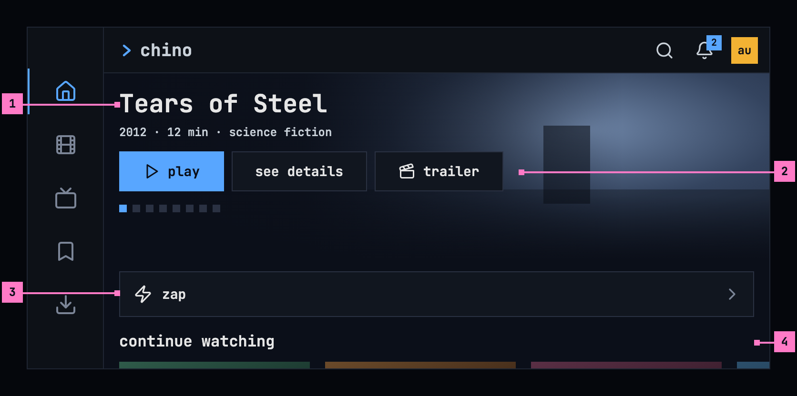

Figure 4.7: Home on a phone held sideways, at 780 × 360 dp.

1. **The hero** keeps to the screen's height, so play, see details and trailer
   show without scrolling: the name, the year, the length and the genre stand
   left of the artwork, on its darkened side, without the description.
2. **trailer** has its name again, as on a computer, because the row has the
   room. The three are the large buttons of figure 4.6.
3. **zap**, right under the hero, as upright.
4. **The rows** follow. A short scroll brings continue watching, whose cards
   keep their upright size, so a row shows more of them.

The tabs run down the left edge as a rail while the phone is sideways
([chapter 2](./frame.md)). The web on a phone held sideways has the layout of
figure 4.7 without part 3.

### 4.4.3 Turning the phone

Turning the phone keeps home where it was: the same title in the hero, with
the rest of its 20 seconds, and the page scrolled to the same row. Upright, the
hero is as wide as the screen with the artwork above the name; sideways, it is
no taller than the screen allows and the words stand left of the artwork. The
cards keep their size, so a row shows more of them sideways. A screen less
than 600 dp wide has the layout of figure 4.6, and from 600 dp, as a phone held
sideways is, that of figure 4.7.

## 4.5 Home on a TV

Figure 4.8 shows home on a TV. The rail is on the left, and the page keeps to
the TV's safe area, the dashed outline in the figure.

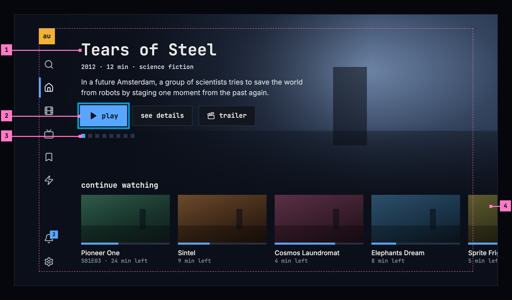

Figure 4.8: Home on a TV, at 960 × 540 dp.

1. **The hero**, as on a computer, with the description, and its buttons at
   the design system's large size, 42 dp high.
2. **The focus.** Home opens with the focus on **play**: the ring sits 2 dp
   outside the button, and the button grows by 5 %, as the design system's
   [TV focus](https://nalet.github.io/design-system/patterns/tv-focus/) sets
   out. Down moves the focus into the rows, up from the rows back to the hero.
3. **The squares** show which title is showing. Left and right on the hero's
   buttons move between the buttons, not between titles.
4. **A row runs past the safe area** to the edge of the screen. Only the
   artwork goes beyond the outline; the focus never does, because the row
   scrolls when the focus reaches the outline.

Holding OK on a card opens its menu (section 4.6.2). Back from a title's page,
home is as it was, with the focus on the card that opened the page.

## 4.6 What home shows

### 4.6.1 The hero

The hero takes eight titles from the newest ones the person hasn't watched,
and only titles that have a trailer: first those whose trailer this server
plays, then those with a trailer online, each group in a random order. It
looks among the 40 newest movies and the 40 newest shows. The app keeps the
eight for an hour, and each time home opens, the hero starts at a random one
of them. Each title stays 20 seconds and then gives way to the next. The hero
doesn't move on while the pointer, the focus or a finger is on it, and with
reduced motion it changes without sliding.

A title without a description shows none. With no title that has a trailer,
the hero shows the newest movie the person hasn't watched, without trailer and
without squares; with nothing the person hasn't watched, home starts with its
rows.

### 4.6.2 The rows

| Row | What it holds | Order |
|---|---|---|
| continue watching | Titles and episodes the person watched for more than 30 seconds and hasn't finished | Last watched first |
| next up | The next episode of each show whose last episode the person finished | Last watched first |
| recently added movies | Movies the person hasn't watched | Newest first |
| recently added shows | Shows the person hasn't finished | Newest first |
| top rated | Movies rated 8 or higher that the person hasn't watched | Highest rated first |

continue watching and next up show stills, 16:9: continue watching with the
bar and the time left, next up with the episode's code and name under its
show's name. The other rows show posters, as movies and shows do
([chapter 5](./browse.md)).

When the server counts a title as finished ([chapter 11](./playback.md)), a
movie leaves continue watching and an episode makes way for the next one in
next up. A card's menu is the design system's action menu. It opens with the
menu button at the right of the card's lines, named after the title for
screen readers, “actions for Sprite Fright”, or by holding OK on a TV, and
offers what [chapter 6](./title-actions.md) lists: **play**, or **resume** for
a title the person is in, and **mark as watched** or **watched**. In continue
watching it also has **remove from continue watching**, last and in amber
(figure 4.5, part 6), which takes the card off without changing what was
watched.

A row holds up to 20 titles. recently added movies, recently added shows and
top rated end with a **see all** card, which opens movies or shows in that
row's order ([chapter 5](./browse.md)); continue watching and next up hold
everything they have and end without one. A row with nothing in it is left
out, and the rows keep their order when one is missing.

## 4.7 Changes

Every difference between section 4.2 and the target is one change in the
table. A change names the apps it is built in, what they do today and the
target, with the figure or the section that sets it out; it is built as its row
says, and nothing else changes with it. Each change starts as proposed; once the
owner approves it, it is built, one change at a time. A target that starts with
“Recommended” was an open decision, or takes away something an app has today.
The frame's own rows, such as zap's tab and the computer's rail, belong to
[chapter 2](./frame.md), and what a card shows under its poster and how its
menu opens, in every row and grid, to [chapter 5](./browse.md).

| No. | Change | Apps | Today | Target | Status |
|---|---|---|---|---|---|
| 4.C1 | The hero leaves out what was watched | Web, Phone app | the 40 newest movies and the 40 newest shows with a trailer, watched ones too | only titles the person hasn't watched (section 4.6.1) | proposed |
| 4.C2 | The TVs' hero: the newest titles with a trailer | Android TV, Samsung TV | up to 8 movies rated 7 or more that the person hasn't watched, trailer or not, in the server's order | section 4.6.1: the newest movies and shows with a trailer, those this server plays first, each group in a random order, kept for an hour | proposed |
| 4.C3 | 20 seconds a title, held while in use | Phone app, Android TV, Samsung TV | every 12 s; the phone app holds it only while a finger drags it | 20 seconds; held while the pointer, the focus or a finger is on the hero (section 4.6.1) | proposed |
| 4.C4 | The hero's line: year, length and genre | Web, Phone app, Android TV, Samsung TV | the year and the rating in a blue badge, “2010 • 7.3” | Recommended: “2012 · 12 min · science fiction”, without the rating (figure 4.5, part 1) | proposed |
| 4.C5 | The current square in blue | Web, Phone app, Android TV, Samsung TV | white | blue (figure 4.5, part 3) | proposed |
| 4.C6 | Web: the hero's buttons, one trailer icon, no empty description | Web | see details has an “i” in a circle; a trailer online shows a screen with a play triangle; a title without a description says “No description available.” | the design system's buttons at their medium size: play emphasized, with its triangle, see details and trailer standard, see details without an icon, the clapperboard for every trailer; a title without a description shows none (figure 4.5, part 2; section 4.6.1) | proposed |
| 4.C7 | The TVs' hero buttons | Android TV, Samsung TV | Android TV: play and see details, no trailer. Samsung TV: “Play” and “More Info”, no trailer | play · see details · trailer, the design system's buttons at their large size, 42 dp, play emphasized (figure 4.8) | proposed |
| 4.C8 | Phone app: play alone on the hero | Phone app | resume 1:43 and start over for a title the person is in, play S01E01 for a show | Recommended: play, which plays from where the person stopped, so the three buttons, the design system's large ones with trailer as its icon button, keep to one row 360 dp wide; resume and start over stay on the title page (figure 4.6) | proposed |
| 4.C9 | Phone app: a hero without a trailer | Phone app | no hero when no title has a trailer | the newest movie the person hasn't watched, without trailer and squares (section 4.6.1) | proposed |
| 4.C10 | The rows' names | Web, Phone app, Samsung TV | “Continue watching”, “Next Up”, “Recently added — Movies”, “Recently added — Shows”, “Top rated”; on Samsung TV “Continue Watching” and “Top Rated” | continue watching · next up · recently added movies · recently added shows · top rated, lowercase in the monospace face (section 4.9) | proposed |
| 4.C11 | continue watching and next up: stills with the time left | Web, Phone app, Android TV, Samsung TV | 2:3 posters with the year and the rating, an episode “S01E01 · Earthfall”, no time left | Recommended: 16:9 stills; continue watching “24 min left”, an episode “S01E03 · 24 min left”; next up “S01E02 · Gran Dillama” (figure 4.5, parts 4 and 5) | proposed |
| 4.C12 | Samsung TV: no genre rows | Samsung TV | up to three rows named after genres after top rated | Recommended: the five rows of section 4.6.2 alone | proposed |
| 4.C13 | Samsung TV: see all, the card's menu and the Watchlist mark | Samsung TV | no see all, no card menu, only the watched check | see all cards at the end of the last three rows; the card's menu on holding OK; the Watchlist's bookmark (section 4.6.2) | proposed |
| 4.C14 | see all opens the row's order | Web, Phone app, Android TV | movies or shows in the order by title | the row's order: newest added, and rating for top rated ([chapter 5](./browse.md)) | proposed |
| 4.C15 | Web: see all as the row's last card alone | Web | see all also at the right of the row's name | Recommended: only the see all card at the row's end (figure 4.5) | proposed |
| 4.C16 | Phone app: zap under the hero | Phone app | zap is a tab, and home has no entry for it | zap's entry under the hero (figure 4.6, part 4), built with chapter 2's change that takes zap off the tabs | proposed |
| 4.C17 | A phone held sideways: the hero keeps to the screen | Web, Phone app | Web: the computer's hero, 460 px tall, its buttons below the screen's foot (figure 4.4). Phone app: the wide hero, 500 dp tall | figure 4.7: no taller than the screen, its buttons in view, no description | proposed |
| 4.C18 | Samsung TV: back on home keeps it | Samsung TV | home loads again, with the focus on Play | home as it was, the focus on the card that opened the page (section 4.5) | proposed |
| 4.C19 | Loading: grey blocks | Web, Phone app, Android TV, Samsung TV | Web, Phone app: a spinner alone. Android TV: “Loading your library…”. Samsung TV: a spinner, “Loading library…” | nothing for 0.4 seconds, then the grey blocks of figure 4.9 | proposed |
| 4.C20 | Couldn't load the library | Web, Samsung TV | Web: “couldn't load the movies and shows”, above continue watching. Samsung TV: “Couldn’t load your library. ” and the error's text, no try again | figure 4.10: the design system's empty state, its couldn't-load kind at the size for a page, in place of the hero and the rows: “couldn't load the library”, the reason by cause, try again, and details as its quiet second button | proposed |
| 4.C21 | A row that couldn't load says so | Web, Phone app, Android TV, Samsung TV | the row is left out; the phone app says “couldn't load continue watching” for that row alone | the row keeps its name, and in place of its cards the design system's empty state at its small size says “couldn't load”, with the reason and try again (section 4.8) | proposed |
| 4.C22 | An empty library says so | Web, Phone app, Android TV, Samsung TV | Web, Phone app: nothing. Android TV: “No items yet.” Samsung TV: “Your library is empty. Add titles on your server to see them here.” | figure 4.11: the design system's empty state, its nothing-yet kind: “no movies or shows yet”, with nothing to press | proposed |

## 4.8 States

Home is drawn in figures 4.5 to 4.8 with everything loaded. Figures 4.9 to
4.11 show the states in between.

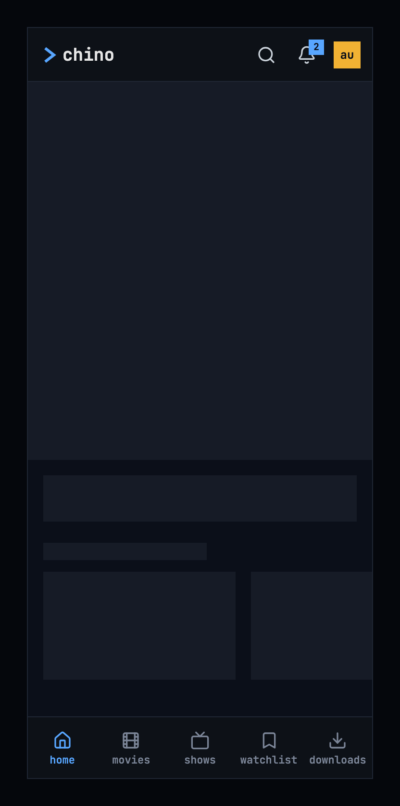

Figure 4.9: Home loading, on a phone.

While home loads, it shows nothing for the first 0.4 seconds, and after that
grey blocks in the shape of the hero, the zap entry and the first row, as the
design system's
[loading and progress](https://nalet.github.io/design-system/patterns/loading-and-progress/)
describes. Figure 4.9 shows them on a phone held upright; a computer, a TV and
a phone held sideways show the same blocks in their own layout.

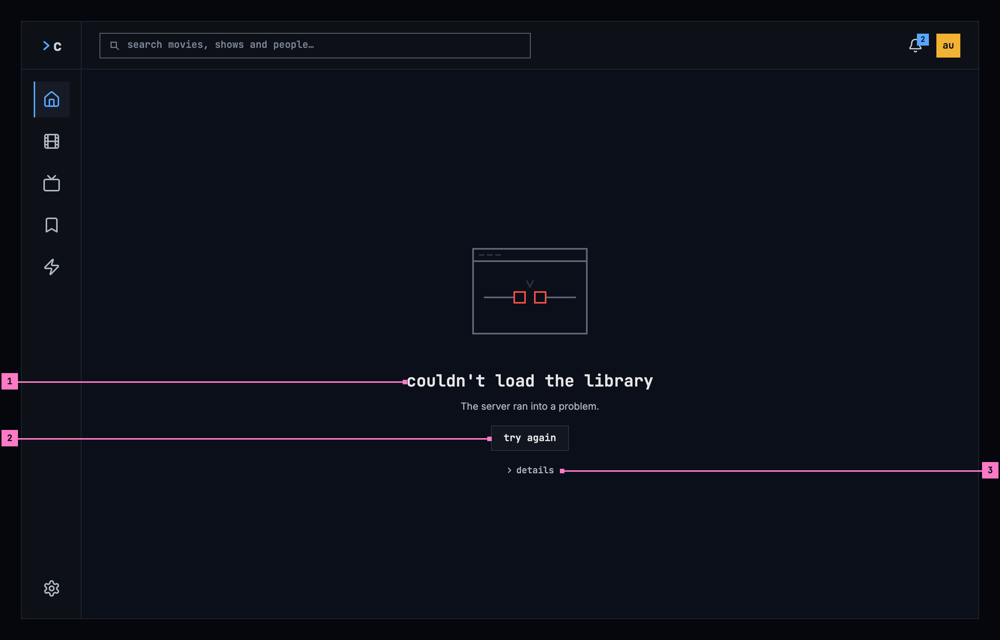

Figure 4.10: Home when nothing could load, on a computer.

1. **What couldn't load, and why**, in the design system's empty state, its
   couldn't-load kind, at the size for a whole page. The title names what is
   missing, and the sentence under it gives the reason as far as the app can
   tell. Figure 4.10 shows the case where the server ran into a problem;
   [chapter 17](./errors.md) lists every cause, its sentence, and the causes
   that have details.
2. **try again**, a standard button, loads home again. The sentence above it
   never repeats what the button says.
3. **details**, under the button: the design system's details toggle, as its
   banner has it (its empty state has none yet, so chino adds it). It opens the
   technical facts of the failure under it, such as the status the server answered with,
   for a bug report or for the people who run the server. It stays closed
   until someone opens it.

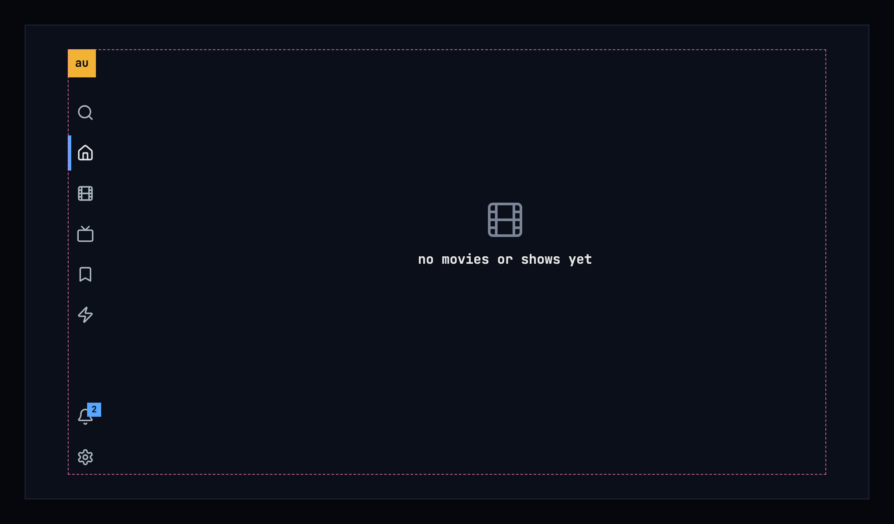

Figure 4.11: Home when the library is empty, on a TV.

When the library has no movies and no shows, home says so in the design
system's empty state, its nothing-yet kind, and offers nothing to press,
because there is nothing the person can do about it from here. Figure 4.11
shows it on a TV.

| State | What home shows |
|---|---|
| Loading | Figure 4.9 |
| Nothing could load | Figure 4.10, with the sentence for the cause |
| One row couldn't load | That row keeps its name, and in place of its cards the design system's empty state at its small size says “couldn't load”, with the reason and **try again**; the other rows show |
| The library is empty | Figure 4.11 |
| The phone app can't reach the server | Home isn't shown: the app opens on downloads, as [chapter 13](./downloads.md) describes |

## 4.9 Words

| Where | Text |
|---|---|
| The hero's line | “2012 · 12 min · science fiction” |
| The hero's buttons | play · see details · trailer |
| The rows | continue watching · next up · recently added movies · recently added shows · top rated |
| The last card of recently added movies, recently added shows and top rated | see all |
| A card in continue watching | “24 min left”, an episode “S01E03 · 24 min left” |
| A card in next up | “S01E02 · Gran Dillama” |
| A card's menu | play · resume · mark as watched · mark as unwatched · remove from continue watching |
| A card's menu button, for screen readers | actions for Sprite Fright, after the card's title |
| The trailer's icon button on a phone, for screen readers | trailer |
| The phone's zap entry | zap |
| Nothing could load | couldn't load the library · The server ran into a problem. · try again · details |
| One row couldn't load | couldn't load · the reason · try again |
| An empty library | no movies or shows yet |
