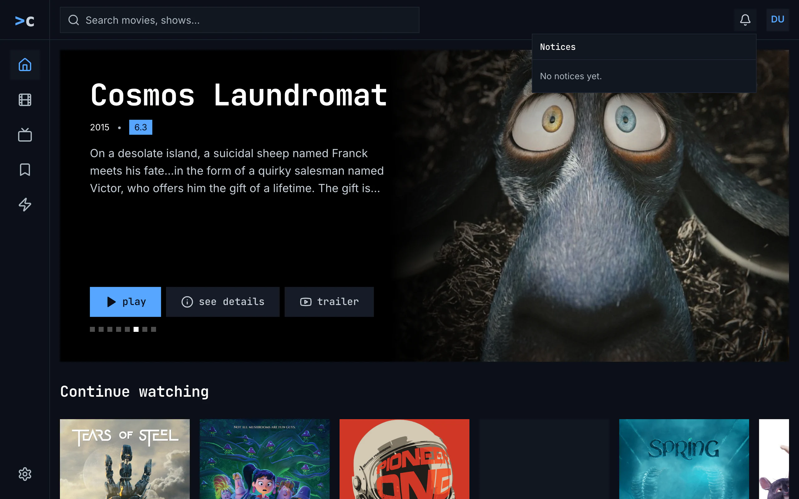
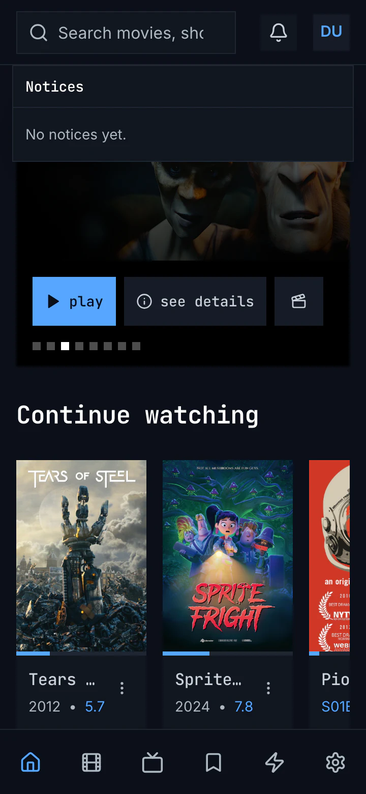
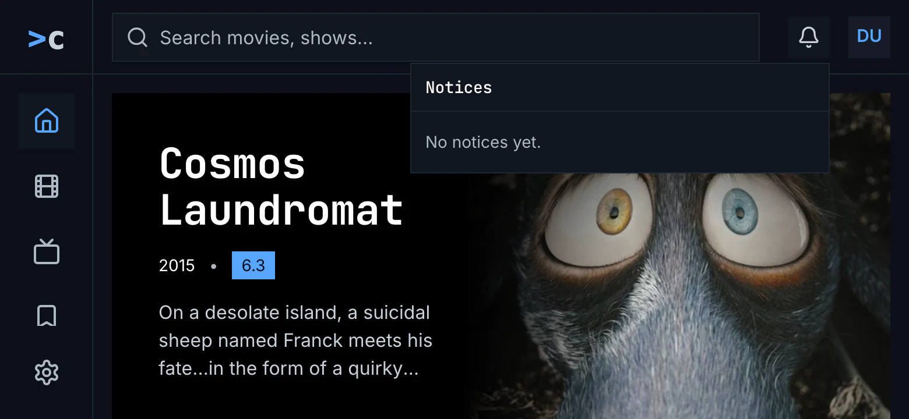
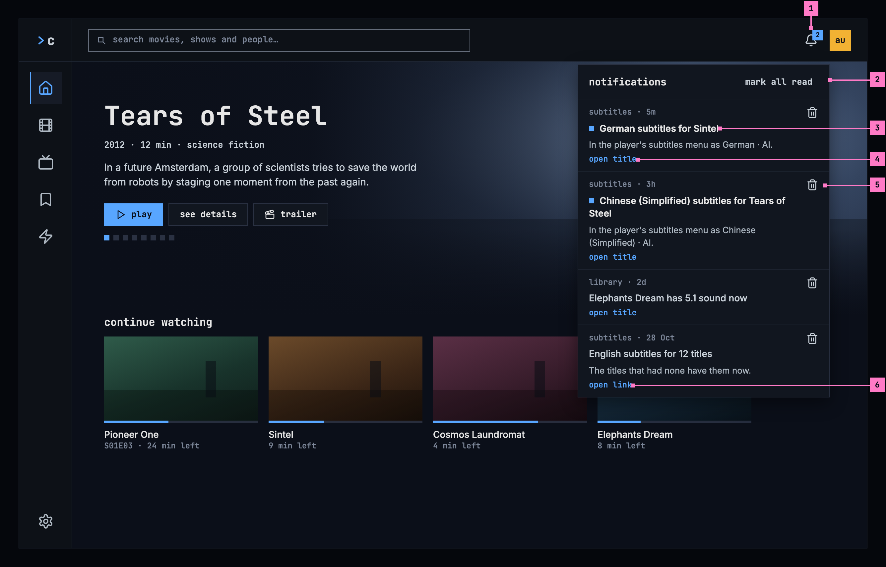
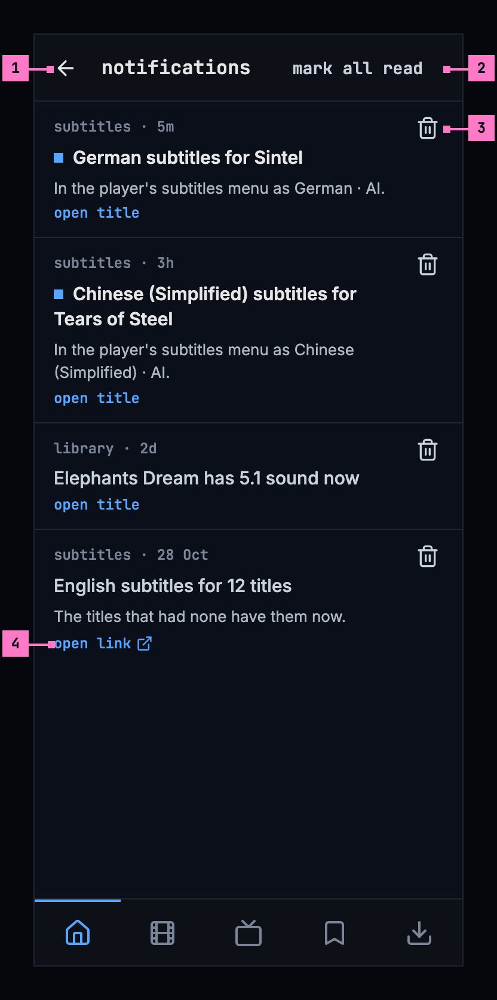
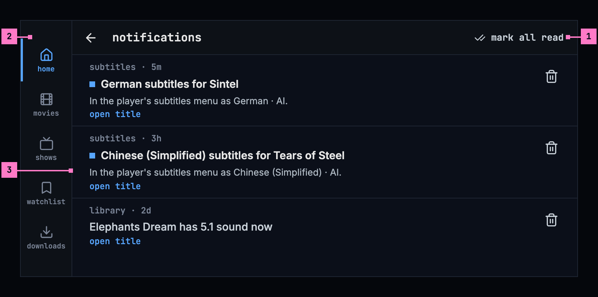
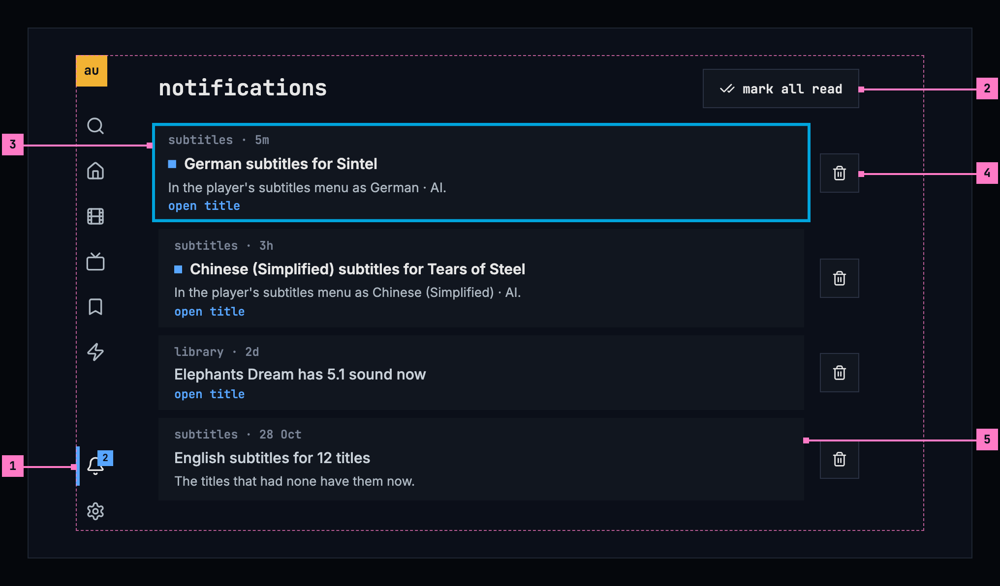
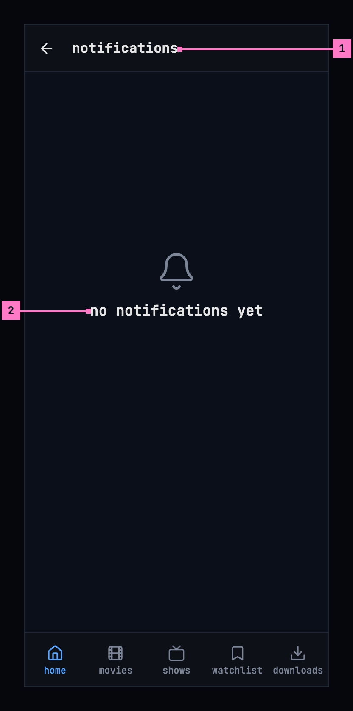
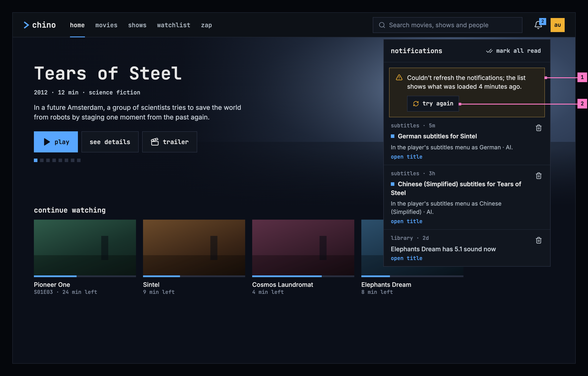
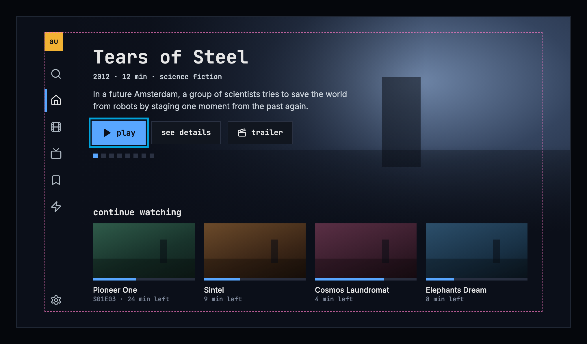

# 15 Notifications

Section 15.2 describes the notifications as they are deployed today. The
sections after it are the target, the notifications as they are meant to be,
and section 15.7 lists every difference between the two as a numbered change.
Only a change the owner has approved is built, one change at a time; anything
no change names stays as it is deployed.

The chapter covers the notifications: the bell in the frame, the list it opens
on a computer, on a phone held either way and on a TV, what a notification
says and where it leads, and how the apps keep the list up to date. The frame
itself, with the bell in the top bar and in the TV's rail, is specified in
[chapter 2](./frame.md).

## 15.1 Purpose

The apps on a server can tell the person something there, for example that
subtitles were made for a title. The bell collects these notifications for the
account signed in: it counts the unread ones, and it opens the list, newest
first. Each notification says whom it is from and how long ago it came, and
opening it leads to what it is about, most often a title's page; one about an
episode opens its show's page at that episode ([chapter 6](./title-actions.md)).

Every app has the bell. On a computer it opens a panel under it, on a phone a
screen of its own, and on a TV, where it sits in the rail, a screen of its own
as well. A server that has no notifications to offer has no bell at all
(section 15.8).

## 15.2 As deployed

This section says what the four apps' notifications do as of 6 November 2026:
the web as the public demo showed it that day, on the same build as
production, and the apps as their code had them that day. The phone app,
Android TV and the Samsung TV are described from their code until screenshots
of them are taken. The Samsung TV app isn't released yet.

### 15.2.1 The web

Figures 15.1 to 15.3 are screenshots of the web's notifications, opened over
home. The demo's account has no notifications, so the list is empty in all
three; what a notification looks like is described from the code after them.
Figure 15.1 shows the panel on a computer.

Figure 15.1: The notifications on the web as deployed on 6 November 2026, on a
computer, at 1280 × 800.

1. **The bell**, at the right of the top bar, beside the avatar, on a darker
   square while its panel is open. It has no count, because nothing is unread.
2. **The panel**, 360 px wide, under the bell, over home: the heading
   “Notices” in the monospace face, capitalised, and under a line, “No notices
   yet.” in the body face. There is no Mark All Read, because nothing is
   unread.
3. **Home under it**, in the frame that [chapter 2](./frame.md) compares: the
   rail on the left with home current, and the top bar with the search field.

Figure 15.2 shows the same on a phone held upright.

Figure 15.2: The notifications on the web as deployed on 6 November 2026, on a
phone held upright, at 360 × 780.

1. **The bell**, on its darker square while the panel is open.
2. **The panel**, across the screen under the top bar, 12 px in from each
   edge, over home: “Notices” and “No notices yet.”, as on a computer. The page
   under it and the tabs stay.
3. **The tabs**: six icons without names, home current.

Figure 15.3 shows it on a phone held sideways.

Figure 15.3: The notifications on the web as deployed on 6 November 2026, on a
phone held sideways, at 780 × 360.

1. **The panel** under the bell, 360 px wide, as on a computer, because the
   screen is 640 px wide or more.
2. **The rail**: home current, then movies, shows and watchlist, and settings
   at the foot. The rail has no room for zap, which is out of sight below
   watchlist.

A notification in the web's list shows whom it is from, the name of the addon
that sent it, and its age on its first line, then its title, bold and white
while it is unread, and its text, with its line breaks kept. An unread one has
a blue line down its left edge, and a screen reader hears “Unread: ” before its
title. Under the text, “Open Title” or “Open” says where it leads, and an X
beside it deletes it, with the tooltip “Delete” and the name “Delete notice:
German subtitles for Sintel”. While any is unread, the panel's head holds “Mark
All Read”. The bell's name for a screen reader is “Notices”, or “Notices, 2
unread”, and its count reads “99+” past 99.

A click on a notification marks it read and loads where it leads as a new
page: its title's page first, an episode's as its show's page at that episode;
else its link, in the same tab, where the link stays on this server. A delete
and mark all read show at once and leave the focus in the panel, and every
change is sent to the server; when the server doesn't make it, the list is
read again. The panel closes with Esc, which puts the focus back on the bell,
with a click outside it, or with the bell.

The ages read “now”, “5m”, “3h” and “2d”, and from a week on the day, “Sep
12”, without a year. The web asks the server for the list as it starts, every
minute while the tab is shown, when it is shown again and when the panel
opens, and the ages move on with each answer. A refresh that fails keeps the
list without a word. A server with no notifications to offer, or one that
doesn't answer for them, has no bell, and signing out forgets the list.

### 15.2.2 The phone app

In the phone app the bell sits in the top bar of every tab, between the search
field and the avatar, with the web's count and names, “Notices” and “Notices, 2
unread”. It isn't shown while the server can't be reached. It opens a screen
of its own over the top bar and the tabs. Back, the heading “Notices” and,
while any is unread, “Mark All Read” in blue are the list's first row, so they
scroll away with it.

A notification has a 2 dp blue line down its left edge while it is unread,
then whom it is from and its age, its title and its text, then “Open Title”
and “Open Link”, both where a notification has a title and a link, and an X in
a 40 dp square, named “Delete Notice”. A tap on a notification marks it read
and opens its title's page, an episode's as its show's page at that episode,
or, without a title, its link in the phone's browser, where the link stays on
this server. From a week on the ages read “12 Sep”, without a year, and while
the screen is open they move on every 30 seconds.

The phone app asks the server as it starts, every minute while it is in front,
when it comes back to the front and when the screen opens. A read, a delete
and mark all read show at once, and when the server doesn't make the change,
the list is read again. Switching to another account or signing out forgets
the list at once. An empty list says “No notices. An addon you use can tell
you something here.” A refresh that fails keeps the list without a word.

### 15.2.3 Android TV

On Android TV the bell sits in a top bar of its own, left of the avatar, on
the screens the rail leads to, not in the rail. The notifications screen keeps
the rail and the top bar, and no item of the rail is current. Its heading is
“notices”, with “mark all read” at its right while any is unread. A
notification is a card: its first line holds a small blue square while it is
unread, whom it is from, its age and, at the line's end, “Open” where it leads
to a title; then its title and its text. A trash can beside it, named “Delete
notice: German subtitles for Sintel”, deletes it.

The focus starts on the notification opened last, back from its title, or else
on the newest. After a delete it moves to the notification now in its place,
and after mark all read to the newest. OK marks a notification read and opens
its title's page, an episode's as its show's page at that episode; a link is
never followed. A read, a delete and mark all read show only once the server
has made them. From a week on the ages read “Sep 12”, without a year.

The app asks the server while a screen with the bell shows, at once and every
minute, but skips an ask within 10 seconds of the last answer, and the
notifications screen asks nothing of its own: it shows the bell's last answer,
up to about 70 seconds old. An empty list says “No notices. An addon you use
can tell you something here.” A refresh that fails keeps the list without a
word.

### 15.2.4 Samsung TV

On the Samsung TV the bell sits in the top bar, after the search field, not in
the rail, and the notifications screen keeps the rail, with no item current,
and the top bar. Its heading is “Notices”, with a bordered “Mark All Read” at
its right while any is unread. A notification shows whom it is from and its
age, “subtitles · 5m”, its title, its text, and “Open” with a chevron where it
leads to a title; an unread one has a blue line down its left edge. Beside it,
“Delete” in red with a trash can deletes it. The corners are square, as
everywhere in the app.

The focus starts on the newest, back from a title as well. After a delete it
moves to the next notification's Delete, or else to the one before's, or else
to the bell; after mark all read it moves to the newest. OK marks a
notification read and opens its title's page, but an episode opens a page of
its own, not its show's. A link is never followed. A change shows at once, and
the list is read again when the server doesn't make it. From a week on the
ages read “12 Sep”, and “30 Dec 2025” in another year. While the screen has no
list yet, a spinner turns over “Loading notices…”; an empty list says “No
notices. An addon you use can tell you something here.” A refresh that fails
keeps the list without a word.

### 15.2.5 Feature by feature

The table compares the four apps' notifications feature by feature. “—” is a
feature the app doesn't have.

| Feature | Web | Phone app | Android TV | Samsung TV |
|---|---|---|---|---|
| Where the bell is | the top bar, beside the avatar | the top bar of every tab, between the search field and the avatar | a top bar of its own, left of the avatar | the top bar, after the search field |
| When there is a bell | once the server says it has notifications to offer | the same, and only while the server can be reached | the same as the web | the same as the web |
| The count | “2”, “99+” past 99, none at 0 | the same | the same | the same |
| The bell's name | “Notices”, “Notices, 2 unread”; its tooltip “Notices” | “Notices”, “Notices, 2 unread” | the same as the phone app | the same as the phone app |
| What it opens | a panel under the bell, 360 px wide; under 640 px, across the screen under the top bar | a screen of its own over the top bar and the tabs | a screen with the rail and the top bar; no rail item current | a screen with the rail and the top bar; no rail item current |
| The heading | “Notices” | “Notices”, scrolling away with the list | “notices” | “Notices” |
| Mark all read | “Mark All Read”, while any is unread | “Mark All Read”, in blue, scrolling away | “mark all read” | “Mark All Read”, bordered |
| The first line | whom from, then the age | the same | a blue square while unread, whom from, the age, “Open” | whom from, “· 5m” |
| An unread one | a blue line down its left edge; “Unread: ” for a screen reader | a 2 dp blue line down its left edge | the blue square before whom from | a 4 px blue line down its left edge |
| Where it leads | “Open Title” or “Open” | “Open Title” and “Open Link”, both where both apply | “Open”, for a title only | “Open” with a chevron, for a title only |
| Delete | an X, tooltip “Delete”, named “Delete notice: …” | an X in a 40 dp square, “Delete Notice” | a trash can, “Delete notice: …” | a red “Delete” with a trash can, named “Delete notice: …” |
| Opening one | read, and the title's page as a new page | read, and the title's page | read, and the title's page | read, and the title's page |
| An episode | its show's page, at that episode | the same | the same | its own page |
| A link | on this server only, in the same tab | on this server only, in the phone's browser | never followed | never followed |
| Ages from a week on | “Sep 12”, no year | “12 Sep”, no year | “Sep 12”, no year | “12 Sep”, “30 Dec 2025” in another year |
| Ages moving on | with each answer, once a minute | every 30 s | every 30 s | every 60 s |
| Asking the server | at once, every minute while shown, when shown again, when the panel opens | at once, every minute in front, on coming back, when the screen opens | every minute while a screen with the bell shows; nothing of the screen's own | at once, every minute while shown, when shown again, when the screen opens |
| A read, a delete, mark all read | at once; read again when refused | at once; read again when refused | only once the server made it | at once; read again when refused |
| Another account, signing out | forgets the list | forgets the list at once | keeps each account's apart | forgets the list at once |
| The TV's focus | — | — | the one opened last, else the newest; after a delete, the one in its place | the newest; after a delete, the next one's Delete |
| Loading | none: no bell before the first answer | none | the heading alone | a spinner, “Loading notices…”, while there is no list |
| None yet | “No notices yet.” | “No notices. An addon you use can tell you something here.” | the same as the phone app | the same as the phone app |
| A refresh that fails | the list stays, without a word | the same | the same | the same |
| The text | plain text, its line breaks kept | the same | the same | the same |

## 15.3 Notifications on a computer

Figure 15.4 shows the panel on a computer, opened over home.

Figure 15.4: The notifications on a computer, at 1280 × 800.

1. **The bell** counts the unread notifications, “2”, and “99+” past 99; with
   none unread, the number goes. For screen readers it is “notifications, 2
   unread”, or “notifications”. A click opens the panel under it, and the app
   asks the server for the list again as it opens.
2. **The panel's head**: the heading **notifications** and, while any is
   unread, **mark all read**, which marks every one read at once.
3. **A notification**: whom it is from, the app's name, and how long ago it
   came, then its title and its text. While it is unread, a small blue square
   stands before its title and the title is brighter; screen readers hear
   “unread” before it.
4. **open title** says where it leads. A click anywhere on the notification
   marks it read and opens the title's page ([chapter 6](./title-actions.md)).
5. **Delete** takes the notification away, without opening it. After a delete
   or **mark all read**, the focus stays in the panel.
6. **open link**: a notification about no title leads to a page of this server,
   which opens in the same tab. One that leads nowhere shows no label, and
   opening it only marks it read.

The panel scrolls when the list is longer than it, and closes with Esc, which
puts the focus back on the bell, with a click outside it, or with a second
click on the bell.

## 15.4 Notifications on a phone

The phone shows the notifications upright and sideways, and the screen turns
with it. Figure 15.5 shows it upright and figure 15.6 sideways. The parts are
those of figure 15.4; the numbers mark where the phone differs, and section
15.4.3 says what happens when the phone is turned.

### 15.4.1 Held upright

Figure 15.5: The notifications on a phone held upright, at 360 × 780 dp.

1. **A screen of its own**, with the back arrow and the heading in its bar. The
   tabs stay ([chapter 2](./frame.md)).
2. **mark all read** sits at the right of the bar.
3. **Delete** is a 48 dp button, beside each notification.
4. **open link** opens the page in the phone's browser.

The web on a phone has the same screen, with its own tabs, and there **open
link** opens the page in the same tab.

### 15.4.2 Held sideways

Figure 15.6: The notifications on a phone held sideways, at 780 × 360 dp.

1. **The bar**, slimmer, with back, the heading and **mark all read** at its
   right.
2. **The tabs**, as a rail down the left edge, as [chapter 2](./frame.md) has
   them on a phone held sideways.
3. **A notification across the width.** Its lines run longer, so most of them
   fit on one and more notifications show at once.

### 15.4.3 Turning the phone

Turning the phone keeps the list as it was: scrolled to the same notification,
with nothing asked of the server again and nothing marked read. Held sideways,
the bar gets slimmer, the tabs move to the rail, and the notifications run
wider; turned back upright, they wrap again under the bar. The web on a phone
turns the same way.

## 15.5 Notifications on a TV

Figure 15.7 shows the notifications on a TV. The parts are those of figure
15.4; the numbers mark where the TV differs.

Figure 15.7: The notifications on a TV, at 960 × 540 dp.

1. **The bell**, at the foot of the rail, with its count. OK on it opens the
   notifications, and the rail marks them as the current view.
2. **mark all read**, right of the heading. Up from the first notification
   reaches it.
3. **The focus** starts on the newest notification or, back from a title, on
   the one that opened it. Up and down move between the notifications, and OK
   opens one.
4. **Delete**, right of each notification: right moves the focus to it. After
   a delete the focus moves to the notification now in its place, and after
   **mark all read** to the newest.
5. **A notification that leads to a page** shows no label: a TV shows no web
   pages, so OK only marks it read.

## 15.6 What notifications do

### 15.6.1 What a notification says

What a notification says is its app's own text, which the server passes on.
The app shows it as plain text, never as markup, with its line breaks kept, and
whatever a notification holds, the worst it can do is not show: it never takes
the top bar or the page down. How long ago it came reads “now”, “5m”, “3h” and
“2d”, and from a week on the day it came, “28 Oct”, with the year when it came
in another year: “12 Sep 2025”. The ages move on while the list is open: “now”
becomes “1m”.

### 15.6.2 Where it leads

A notification leads to one place, so opening it is never a choice:

- **The title it is about**, first: the title's page opens, as it opens
  anywhere in chino, and an episode's as its show's page at that episode. The
  server holds an account to its limit there, so a title above the account's
  limit opens as one that isn't in the library ([chapter 17](./errors.md)).
- **Else its link**, while the link stays on this server: the web opens it in
  the same tab, the phone app in the phone's browser. A link anywhere else is
  never followed, and the notification shows no label then.
- **On a TV**, only the title: a TV follows no link.
- **Neither**: opening the notification only marks it read.

### 15.6.3 Asking the server

The apps ask the server for the list when they start, every minute while they
are shown, as soon as they are shown again, and when the panel or the screen
opens. A read, a delete or **mark all read** shows at once and is sent to the
server. When the server doesn't make the change, the app asks for the list
again and shows it as the server has it.

The notifications belong to the account signed in. Switching to another
account or signing out forgets them at once, so the next person never sees the
last one's.

## 15.7 Changes

Every difference between section 15.2 and the target is one change in the
table. A change names the apps it is built in, what they do today and the
target, with the figure or the section that sets it out; it is built as its row
says, and nothing else changes with it. Each change starts as proposed; once the
owner approves it, it is built, one change at a time. A target that starts with
“Recommended” was an open decision, or takes away something an app has today.
The bell's place in the frame belongs to [chapter 2](./frame.md) as well, and
the banner's wording to [chapter 17](./errors.md).

| No. | Change | Apps | Today | Target | Status |
|---|---|---|---|---|---|
| 15.C1 | The words | Web, Phone app, Android TV, Samsung TV | Web: the bell “Notices” and “Notices, 2 unread”, the heading “Notices”, “Mark All Read”, “Open Title” and “Open”, “Unread: ” before an unread title, delete's tooltip “Delete” and its name “Delete notice: …”. Phone app: “Notices”, “Mark All Read”, “Open Title”, “Open Link”, “Delete Notice”. Android TV: the bell “Notices”, the heading “notices”, “Open”, “Delete notice: …”. Samsung TV: “Notices”, “Mark All Read”, “Open”, “Delete”, “Delete notice: …” | the words of section 15.9: notifications, “notifications, 2 unread”, mark all read, open title, open link, “unread” before an unread title, “delete notification: German subtitles for Sintel” | proposed |
| 15.C2 | No notifications yet | Web, Phone app, Android TV, Samsung TV | Web: “No notices yet.”, in the body face. Phone app, Android TV, Samsung TV: “No notices. An addon you use can tell you something here.” | figure 15.8: the bell's icon and “no notifications yet”, with nothing under it | proposed |
| 15.C3 | A notification's row | Web, Phone app, Android TV, Samsung TV | Web, Phone app: an unread one has a blue line down its left edge, and delete is an X, on the phone in a 40 dp square. Android TV: the blue square stands before whom it is from, and “Open” at the end of that line. Samsung TV: a blue line down the left edge, “Open” with a chevron, and delete a red “Delete” with a trash can | figure 15.4: a small blue square before the title, which is brighter while unread; open title or open link under the text; delete the trash can, a 48 dp button on a phone (sections 15.3, 15.4) | proposed |
| 15.C4 | One place per notification | Phone app | a notification with a title and a link offers both, “Open Title” and “Open Link” | Recommended: the title alone, as the web and the TVs open it (section 15.6.2) | proposed |
| 15.C5 | Phone app: the screen inside the frame | Phone app | the screen covers the top bar and the tabs, and back, the heading and Mark All Read are the list's first row, scrolling away with it | figure 15.5: back and the heading in the bar, mark all read at its right, the tabs staying; held sideways, figure 15.6 | proposed |
| 15.C6 | The web on a phone: a screen of its own | Web | the panel opens across the screen under the top bar, over the page (figure 15.2), and on a phone held sideways under the bell, as on a computer (figure 15.3) | on a phone, a screen whose short side is 600 px or less, held either way: the screen of figures 15.5 and 15.6, with the web's tabs; open link in the same tab (section 15.4) | proposed |
| 15.C7 | The TV: the bell in the rail | Android TV, Samsung TV | the bell sits in a top bar, beside the avatar; on the notifications screen no item of the rail is current | the bell at the rail's foot, with its count, and notifications current in the rail while they show (figure 15.7, [chapter 2](./frame.md)) | proposed |
| 15.C8 | Android TV: changes at once, and the screen asks as it opens | Android TV | a read, a delete or mark all read shows only once the server has made it; opening the screen asks nothing, so it shows the bell's last answer, up to about 70 seconds old | each change shows at once and is sent, and the list is read again when the server doesn't make it; the screen asks the server as it opens (section 15.6.3) | proposed |
| 15.C9 | The ages from a week on | Web, Phone app, Android TV | Web, Android TV: “Sep 12”, without a year. Phone app: “12 Sep”, without a year | “28 Oct”, with the year when it came in another year, “12 Sep 2025”, as the Samsung TV has them (section 15.6.1) | proposed |
| 15.C10 | Couldn't refresh: the banner | Web, Phone app, Android TV, Samsung TV | a refresh that fails keeps the list without a word | figure 15.9: the warning banner with how old the list is and try again, gone as soon as a refresh works (section 15.8) | proposed |
| 15.C11 | Samsung TV: the focus | Samsung TV | back from a title it starts on the newest, not on the notification that opened it; after a delete it moves to the next notification's Delete, or the one before's, or the bell | back from a title, on the one that opened it; after a delete, on the notification now in its place (section 15.5) | proposed |
| 15.C12 | Samsung TV: an episode opens its show | Samsung TV | an episode opens a page of its own | its show's page, at that episode ([chapter 6](./title-actions.md)) | proposed |
| 15.C13 | Samsung TV: no loading state | Samsung TV | while the screen has no list yet, a spinner turns over “Loading notices…” | none: the screen shows the list the bell already has, and the answer updates it in place (section 15.8) | proposed |

## 15.8 States

Figures 15.4 to 15.7 show notifications with two of them unread. Figures 15.8
to 15.10 show the other states.

Figure 15.8: No notifications yet, on a phone.

1. **The bar** holds no **mark all read**: nothing is unread.
2. **“no notifications yet”**, and nothing under it: there is nothing to do
   about it.

Figure 15.9: The notifications couldn't be refreshed, on a computer.

1. **The banner** says that asking again failed and how old the list is:
   “Couldn't refresh the notifications; the list shows what was loaded 4
   minutes ago.” The list under it stays as it was, and the bell keeps its
   count. The banner goes as soon as a refresh works.
2. **try again** asks the server again.

While the panel is closed, a refresh that fails changes nothing on screen, and
the next one follows a minute later.

When the server has no notifications to offer, because none are set up on it,
they don't answer it, or it is older than notifications, there is no bell.
Figure 15.10 shows home on a TV then: settings stays alone at the rail's foot.
On a computer and a phone the top bar holds no bell either, and nothing says
why, because there is nothing the person can do about it.

Figure 15.10: A server without notifications, on a TV.

| State | What the bell and the list show |
|---|---|
| Notifications, some unread | Figures 15.4 to 15.7 |
| None unread | The bell without a number; no **mark all read** |
| No notifications yet | Figure 15.8 |
| Loading | No loading state: the bell appears with the server's first answer, so the list is there when it opens, and asking again updates it in place |
| Couldn't refresh | Figure 15.9 |
| The server has no notifications | Figure 15.10 |
| The phone app can't reach the server | No bell, as [chapter 13](./downloads.md) describes |

## 15.9 Words

| Where | Text |
|---|---|
| The bell | its count, “2”, “99+” |
| The bell, for screen readers | notifications, 2 unread · notifications |
| The panel and the screen | notifications · mark all read |
| A notification | “subtitles · 5m” (whom from · how long ago) · open title · open link |
| How long ago | now · 5m · 3h · 2d · 28 Oct · 12 Sep 2025 |
| An unread notification, for screen readers | unread, before its title |
| Delete, for screen readers | delete notification: German subtitles for Sintel |
| None yet | no notifications yet |
| Couldn't refresh | Couldn't refresh the notifications; the list shows what was loaded 4 minutes ago. · try again |
