# 7 People

Section 7.2 describes the person's page as it is deployed today. The sections
after it are the target, the page as it is meant to be, and section 7.7 lists
every difference between the two as a numbered change. Only a change the owner
has approved is built, one change at a time; anything no change names stays as
it is deployed.

This chapter specifies a person's page: someone who acted in or made the
library's titles, and what of theirs the library has. The frame around it is
specified in [chapter 2](./frame.md).

## 7.1 Purpose

A person's page says who someone is and what else of theirs there is to
watch. It opens from the cast and crew on a title's page
([chapter 6](./title-actions.md)) and from the people that search finds
([chapter 9](./search.md)). Like a title's page, it isn't one of the views: the
frame marks no view as current, and back returns to where it was opened from.

## 7.2 As deployed

This section says what the four apps' person pages do as of 6 November 2026:
the web as the public demo showed it that day, on the same build as
production, and the apps as their code had them that day. The phone app,
Android TV and the Samsung TV are described from their code until screenshots
of them are taken. The Samsung TV app isn't released yet.

### 7.2.1 The web

The web's person page has no frame: no top bar, no side navigation and no
tabs. Figures 7.1 to 7.3 are screenshots of the page of a director the demo's
library has two titles of. Figure 7.1 shows it on a computer.

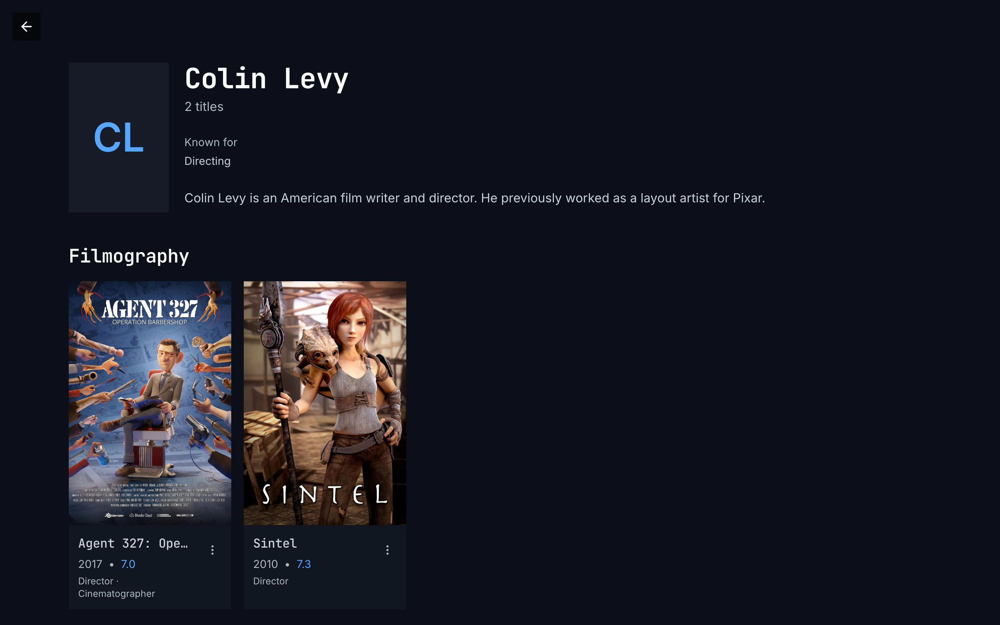

Figure 7.1: A person's page on the web as deployed on 6 November 2026, on a
computer, at 1280 × 800.

1. **Top left: back**, a dark square with an arrow, alone: there is no home.
2. **The photo's place**: the initials, “CL”, in blue in a grey 2:3 frame, 128
   × 192 px. They stand there while the photo loads, and stay where it can't
   be loaded; for someone the catalog has no photo of, they stand in a square
   of 88 px.
3. **The name and the count**: “Colin Levy” in the monospace face, “2 titles”
   under it.
4. **The facts**: “Known for” over “Directing”.
5. **The biography**, whole, because it is short; a long one is cut after six
   lines, with “Read more”.
6. **Filmography**, capitalised, and the titles as cards: the poster, the
   name in the monospace face, cut to one line, “Agent 327: Ope…”, the year
   and the rating in blue, “2017 • 7.0”, the roles capitalised on a line of
   their own, “Director · Cinematographer”, and ⋮, which opens the card's menu.

Figure 7.2 shows the same page on a phone held upright.

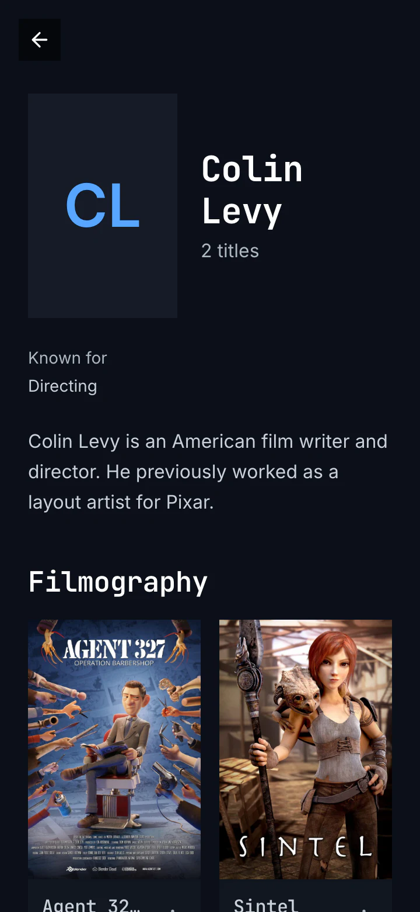

Figure 7.2: A person's page on the web as deployed on 6 November 2026, on a
phone held upright, at 360 × 780.

1. **Back**, alone, at the top left.
2. **The photo's place**, as on a computer, beside the name, which takes two
   lines here, and “2 titles” under it.
3. **The facts and the biography** run the full width under them.
4. **Filmography**, two posters to a line. There are no tabs at the foot.

Figure 7.3 shows it on a phone held sideways.

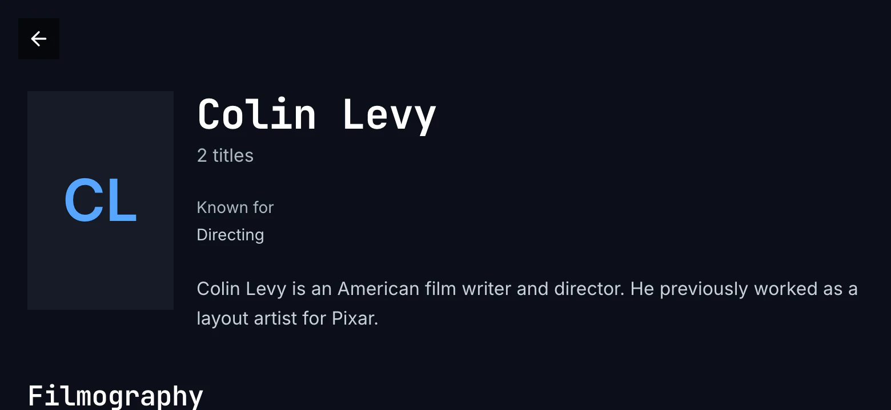

Figure 7.3: A person's page on the web as deployed on 6 November 2026, on a
phone held sideways, at 780 × 360.

1. **Back**, at the top left.
2. **The name, the facts and the biography** stand in a column beside the
   photo's place: from 640 px wide, the page has the computer's layout.
3. **Filmography** starts under them, at the screen's foot.

While the page loads, a spinner turns alone in the middle. A page that
couldn't load says “couldn't load this person”, the reason by cause, **try
again** with a quiet **back** beside it, and the server's answer under
**details**; a person the server doesn't have says “this person isn't in the
library anymore” with **back**, and one the viewer may not see “you don't have
access to this”. A person with no titles in the library says “No titles
available for this person.” under “0 titles”.

### 7.2.2 The phone app

The phone app's person page is a screen of its own, without the tabs: a back
button, a 40 dp square, floats at its top left in every state, and there is no
home. While it loads, a spinner turns. The photo is 2:3, 112 dp wide, and from
600 dp wide 176 dp, with the name, the facts and the biography beside it;
without a photo, a square of initials. The words are the web's: “Known for”,
“Born”, “Read more”, “Show less”, “Filmography”, and “No titles available for
this person.” The titles stand three to a line below 600 dp wide and four on a
phone held sideways, each card with its status marks, the name, the year and
the rating, and the roles capitalised. Couldn't load, removed and no access
have the web's words, with the page's own back.

### 7.2.3 Android TV

The Android TV person page has the rail, with no item lit, and the app's top
bar with its search; back is the remote's. While it loads, “Loading…” stands
beside the rail. The photo is 176 dp wide, 2:3; without one, a 120 dp square
of initials. The name is in the body face. The biography stops after five
lines with **read more**, which opens the whole text over the page with
“▲▼ to scroll · BACK to close”, or “BACK to close” where it fits; back closes
it and puts the focus back on read more. The titles are headed “filmography”
and stand six to a line, the roles capitalised under the year and the rating;
a person with none says “No titles for Derek de Lint.” The code gives the page
no first focus. No access says “you don't have access to this person”.

### 7.2.4 Samsung TV

The Samsung TV person page has the rail and the top bar too, and while it
loads a spinner turns with “Loading…”. The photo is 192 × 288 px; without one,
a 128 px square of initials, which also stand in while the photo loads. The
facts stand three to a line. The biography stops after five lines with “Read
more”, which opens the whole text over the page with the name, “Up / Down to
scroll” and **Close**. The titles, “Filmography”, stand six to a line with the
roles capitalised; with none, the page says “No titles for Derek de Lint.” The
focus starts on the first title, with the page at its top. A page that
couldn't load says “Couldn’t load person” in red, with the error's text, such
as “chino-api 503”, in grey under it, and no button; a removed person and one
the viewer may not see end the same way, with “chino-api 404” and
“chino-api 403”.

### 7.2.5 Feature by feature

The table compares the four person pages feature by feature. “—” is a feature
the app doesn't have.

| Feature | Web | Phone app | Android TV | Samsung TV |
|---|---|---|---|---|
| The frame | none: back alone, a 36 px square on a see-through black; no home | none: back alone, a 40 dp square, in every state; no home, no tabs | the rail with no item lit, and the top bar; no back | the same |
| While it loads | a spinner alone | a spinner, and back | “Loading…” beside the rail | a spinner and “Loading…” |
| The photo | 2:3, 128 × 192 px; the initials in that frame while it loads and where it can't; without one, an 88 px square of initials | 2:3, 112 dp wide, 176 dp from 600 dp; without one, a square of initials | 2:3, 176 dp wide; without one, a 120 dp square | 2:3, 192 × 288 px; without one, a 128 px square |
| The name and the count | “Colin Levy”, “2 titles” | the same | the same; the name in the body face | the same |
| The facts | “Known for”; “Born” with “(age 76)” and the place; “Died” with “(aged 69)”; two to a line | the same | the same | the same, three to a line |
| The biography | cut after six lines; “Read more” and “Show less” in place | the same | cut after five lines; “read more” opens it over the page, “▲▼ to scroll · BACK to close” | cut after five lines; “Read more” opens it over the page with the name, “Up / Down to scroll” and “Close” |
| The titles' heading | “Filmography” | “Filmography” | “filmography” | “Filmography” |
| The marks on a poster | the bookmark on blue for the Watchlist, the check on green for watched | the same | the same | the watched check only |
| Under a poster | the name, “2017 • 7.0”, the roles “Director · Cinematographer”, and ⋮ for the card's menu | the name, the year and the rating, the roles | the same | the same |
| The titles' layout | two to a line below 640 px, then as many of at least 190 px as fit | three to a line below 600 dp, then four, five and six as it widens | six to a line | six to a line |
| No titles | “No titles available for this person.”, under “0 titles” | “No titles available for this person.” | “No titles for Derek de Lint.” | the same |
| Couldn't load | “couldn't load this person”, the reason, try again with a quiet back beside it, details | the same, with the page's back | the same, without back | “Couldn’t load person” in red and the error's text; no button |
| Not there, no access | “this person isn't in the library anymore”, “you don't have access to this”, each with back | the same | the same, but “you don't have access to this person” | the red line with “chino-api 404”, “chino-api 403” |
| The focus | — | — | the code sets none | on the first title, the page at its top |
| Back | the browser's back, or the page's | the page's back; Android's own | the remote's; it closes an open biography first | the same |

## 7.3 A person's page on a computer

Figure 7.4 shows the page of an actor in Tears of Steel. The photo and what the
catalog knows about him take the top of the page, and his titles follow.

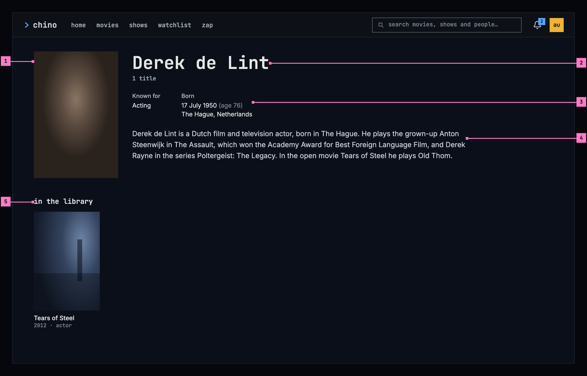

Figure 7.4: A person's page on a computer, at 1280 × 800.

1. **The photo**, in a 2:3 frame like the posters below it. Where the catalog
   has no photo, the initials stand in a square in its place (section 7.6.1).
2. **The name**, and how many of their titles the library has: “1 title”,
   “12 titles”.
3. **The facts**: what they are known for, and when and where they were born.
   Section 7.6.2 lists the facts and how each is written.
4. **The biography.** A long one is cut after six lines, and **read more**
   shows the rest (figure 7.5).
5. **in the library**: their titles, as posters, each with its year and what
   they did on it: “2012 · actor”. Choosing one opens its page
   ([chapter 6](./title-actions.md)).

## 7.4 A person's page on a phone

The phone shows the page upright and sideways. Figure 7.5 shows it upright and
figure 7.6 sideways; section 7.4.3 says what happens when the phone is turned.

### 7.4.1 Held upright

Figure 7.5 shows the same page on a phone held upright. The parts are those of
figure 7.4; the numbers mark where the phone differs.

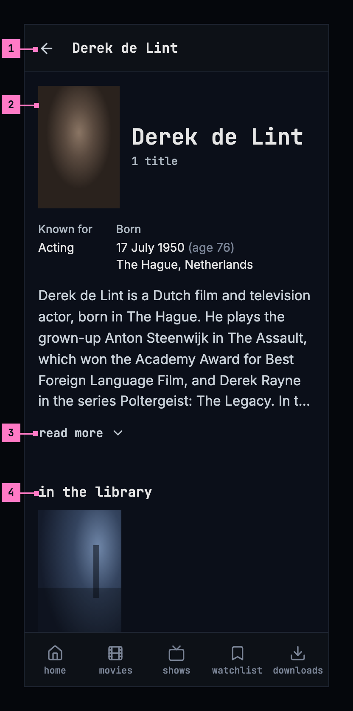

Figure 7.5: A person's page on a phone held upright, at 360 × 780 dp.

1. **The bar** shows a back arrow and the name in place of the top bar, and the
   tabs stay, as on every screen opened from a view ([chapter 2](./frame.md)).
2. **The photo** is smaller and stands beside the name. The facts and the
   biography run the full width under them, the facts two to a line.
3. **read more.** The biography is cut after six lines and ends in “…”.
   **read more**, the design system's quiet button at the large size, with an
   arrow after its word, opens the rest in place, and **show less** cuts it
   again. Neither shows when the whole text fits.
4. **in the library**: the posters three to a line, the size of a poster in
   movies and shows ([chapter 5](./browse.md)).

A screen less than 600 dp wide, as a phone held upright is, has this layout.

### 7.4.2 Held sideways

Figure 7.6 shows the page on a phone held sideways: from 600 dp wide, the page
has the computer's layout at the phone's size. The numbers mark where it
differs from figure 7.5.

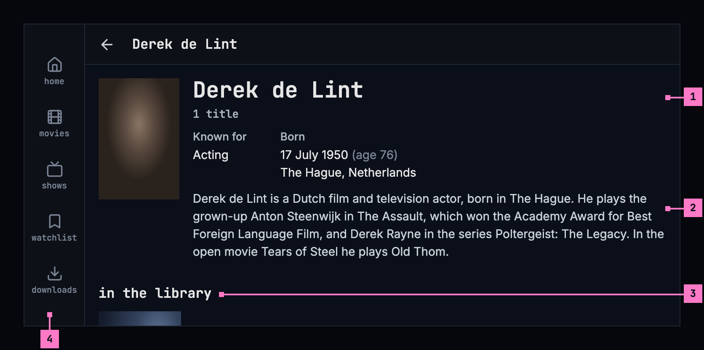

Figure 7.6: A person's page on a phone held sideways, at 780 × 360 dp.

1. **The name, the facts and the biography** stand in a column beside the
   photo, as on a computer, the facts side by side.
2. **The biography** has longer lines, so here it fits in six and has no
   **read more**.
3. **in the library** follows under them. The posters keep the size they have
   upright, so six stand on a line.
4. **The tabs** become a rail down the left edge, and the bar is slimmer, with
   the same back arrow and name ([chapter 2](./frame.md)).

### 7.4.3 Turning the phone

The page turns with the phone and keeps its place: the part the person was
looking at stays in view, and a biography opened with **read more** stays
open.

- **Turned sideways**, the facts and the biography move into the column beside
  the photo, six posters stand on a line, and the tabs become the rail. A
  biography cut upright may fit sideways, and then has no **read more**.
- **Turned back upright**, the facts and the biography run under the photo
  again, three posters stand on a line, and the tabs come back at the foot.

## 7.5 A person's page on a TV

Figure 7.7 shows the page on a TV. The rail stays on the left with no view
current, and the page keeps to the safe area.

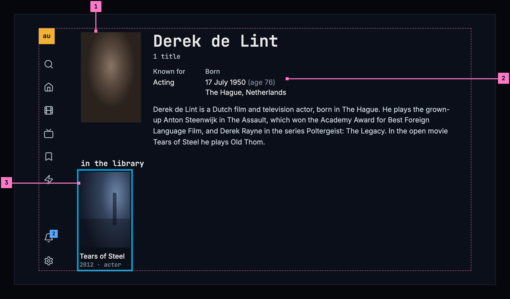

Figure 7.7: A person's page on a TV, at 960 × 540 dp.

1. **The photo and the name**, as on a computer.
2. **The facts** stand side by side, and the biography under them shows five
   lines at most. Where it's cut, **read more** follows it and opens the whole
   text over the page: up and down scroll the text, and back closes it and
   puts the focus back on **read more**.
3. **The focus** starts on the first title, with the page at its top so the
   name and the facts show. The titles stand six to a line. Left and right move
   along a line, down to the next, and up from the first line to **read
   more**, where there is one.

## 7.6 What the page shows

### 7.6.1 The photo

The catalog's photo, framed 2:3 with the face in its upper part. While it loads,
and where the catalog has none, the initials of the name stand in a square
instead, so the page never shows an empty frame.

### 7.6.2 The facts

| Fact | Written as |
|---|---|
| Known for | The work the catalog knows them best for, in its words: “Acting”, “Directing”, “Writing” |
| Born | The date in the device's language, with the age beside it: “17 July 1950 (age 76)”, and the place on the next line: “The Hague, Netherlands” |
| Died | The date, with the age they reached: “3 March 2020 (aged 69)”. Born then leaves out the age |

- A date the catalog has only in part is written as far as it goes: “July
  1950”, “1950”, and without an age.
- A fact the catalog doesn't have is left out. Someone the catalog knows
  nothing about beyond the name has a page with the photo or the initials, the
  name and the titles.

### 7.6.3 The biography

- It is in the language of the device where the catalog has it in that
  language, and in English otherwise.
- A long biography is cut after six lines on a computer and a phone, and after
  five on a TV, and ends in “…”. **read more** shows the rest: in place on a
  computer and a phone, over the page on a TV (section 7.5). It is there only
  when the text is cut.

### 7.6.4 In the library

- **in the library** holds every title of theirs the library has, in the
  order the server gives them, as posters with their status marks
  ([chapter 6](./title-actions.md)).
- Under each poster: the year, then what they did on that title, each role
  once: “2012 · actor”, “2012 · director · writer”. The roles are actor,
  creator, director, writer, producer, composer, cinematographer and editor,
  and any other role by its own name.
- The count under the name counts the same titles.
- With nothing of theirs in the library, the count is left out, and in the
  titles' place the page says “nothing of theirs in the library”.

## 7.7 Changes

Every difference between section 7.2 and the target is one change in the
table. A change names the apps it is built in, what they do today and the
target, with the figure or the section that sets it out; it is built as its
row says, and nothing else changes with it. Each change starts as proposed;
once the owner approves it, it is built, one change at a time. The frame
itself, the top bar, the tabs and the rail, belongs to
[chapter 2](./frame.md).

| No. | Change | Apps | Today | Target | Status |
|---|---|---|---|---|---|
| 7.C1 | The frame on the person page | Web, Phone app | Web: none; back floats alone at the top left, a 36 px square on a see-through black, and there is no home (figure 7.1). Phone app: back floats alone, a 40 dp square; no tabs | the frame of [chapter 2](./frame.md) with no view current, in every state of the page: the top bar on a computer; on a phone the back arrow and the person's name in place of the bar, with the tabs, or the rail held sideways (figures 7.4 to 7.6) | proposed |
| 7.C2 | Loading: grey blocks | Web, Phone app, Android TV, Samsung TV | Web, Phone app: a spinner. Android TV: “Loading…”. Samsung TV: a spinner and “Loading…” | nothing for 0.4 seconds, then grey blocks in the page's shape (figure 7.8) | proposed |
| 7.C3 | The initials in a square | Web | the initials stand in the photo's 2:3 frame while it loads and where it can't be loaded (figure 7.1); without a photo, in a square of 88 px | the initials in a square in the photo's place, while it loads and where there is no photo (section 7.6.1) | proposed |
| 7.C4 | read more and show less | Web, Phone app, Samsung TV | “Read more” and “Show less”, capitalised; Samsung TV: “Read more” | **read more** and **show less**, the design system's quiet buttons, lowercase in the monospace face (section 7.6.3) | proposed |
| 7.C5 | The TV's open biography | Android TV, Samsung TV | Android TV: “▲▼ to scroll · BACK to close”, or “BACK to close”. Samsung TV: the name, “Up / Down to scroll” and **Close** | the whole text over the page with “Press up or down to scroll, and back to close.”; back closes it and the focus goes back to **read more** (section 7.5) | proposed |
| 7.C6 | in the library | Web, Phone app, Android TV, Samsung TV | the titles headed “Filmography”; Android TV: “filmography” | **in the library** (section 7.6.4) | proposed |
| 7.C7 | A title's line: the year and the roles | Web, Phone app, Android TV, Samsung TV | the year and the rating, “2017 • 7.0”, then the roles capitalised on a line of their own, “Director · Cinematographer” | the year and the roles on one line under the name, lowercase: “2012 · actor”, “2012 · director · writer” (section 7.6.4) | proposed |
| 7.C8 | The posters' size | Web, Phone app | Web: two to a line below 640 px, then as many of at least 190 px as fit, three on a phone held sideways. Phone app: three to a line below 600 dp, four on a phone held sideways | the size of a poster in movies and shows: three to a line upright, six held sideways (figures 7.5, 7.6) | proposed |
| 7.C9 | Nothing of theirs in the library | Web, Phone app, Android TV, Samsung TV | Web, Phone app: “No titles available for this person.”, and the web counts “0 titles”. Android TV, Samsung TV: “No titles for Derek de Lint.” | the count left out, and “nothing of theirs in the library” in the titles' place (section 7.6.4) | proposed |
| 7.C10 | Couldn't load, removed and no access, by cause | Web, Android TV, Samsung TV | Web: a quiet back beside try again. Android TV: no access says “you don't have access to this person”. Samsung TV: “Couldn’t load person” in red and the error's text, “chino-api 404” for a removed person too; no button | figures 7.9 to 7.11 and the table of section 7.8, the design system's empty state: its error picture, the reason by cause, try again alone and details; its empty picture with “this person isn't in the library anymore” or “you don't have access to this”, each with back | proposed |
| 7.C11 | Android TV: the focus on the first title | Android TV | the code sets no first focus | the focus starts on the first title, with the page at its top (section 7.5) | proposed |

## 7.8 States

The page is drawn in figures 7.4 to 7.7 with everything loaded. Figures 7.8 to
7.11 show the states in between.

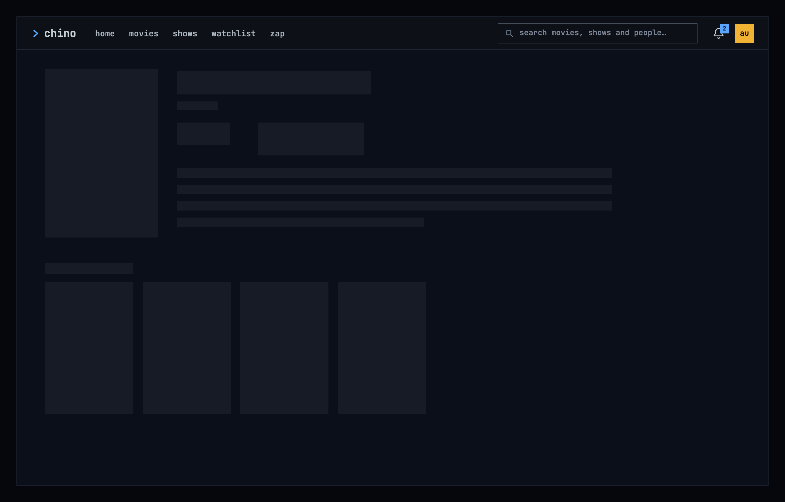

Figure 7.8: A person's page loading, on a computer.

While the page loads, it shows nothing for the first 0.4 seconds, and after
that grey blocks in the shape of the photo, the name, the facts, the biography
and a line of posters, as the design system's
[loading and progress](https://nalet.github.io/design-system/patterns/loading-and-progress/)
describes. Figure 7.8 shows them on a computer; a phone and a TV show the same
blocks in their own layout.

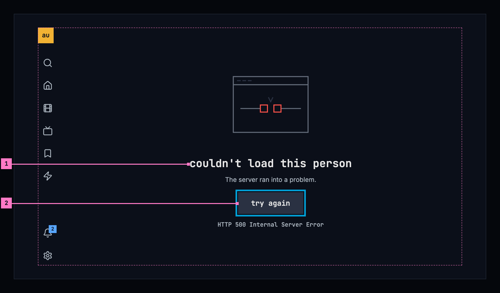

Figure 7.9: A person's page when it couldn't load, on a TV.

1. **What couldn't load, and why**, in the design system's empty state with
   its error picture: “couldn't load this person”, and under it the reason as
   far as the app can tell. Figure 7.9 shows the case where the server ran
   into a problem; [chapter 17](./errors.md) lists every cause and its
   sentence.
2. **try again** loads the page again. It has the focus, so OK is all it
   takes. Under it the server's answer, “HTTP 500 Internal Server Error”,
   stands in the quiet text for the people who fix things, without
   **details** over it: on a TV a disclosure would take the focus from the
   way on, as [chapter 17](./errors.md) sets out.

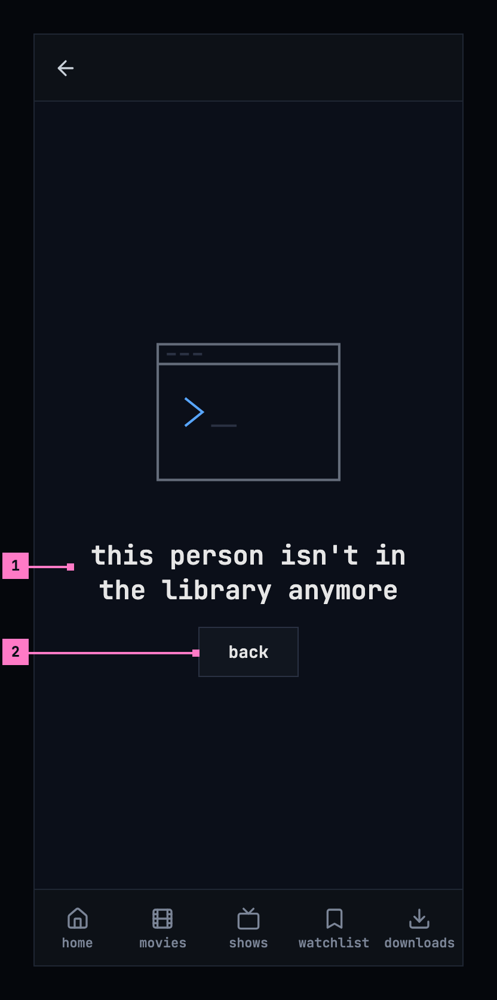

Figure 7.10: A person who isn't in the library anymore, on a phone.

1. **What is true**: “this person isn't in the library anymore”, in the
   design system's empty state with its empty picture, as nothing is there to
   show. Trying again can't bring them back, so the page offers no try again
   and gives no reason.
2. **back** returns to where the page was opened from, or to home when it was
   opened from a link.

Held sideways, as figure 7.11 shows, the same words and **back** stand in the
middle of the page, beside the rail, at the empty state's small size.

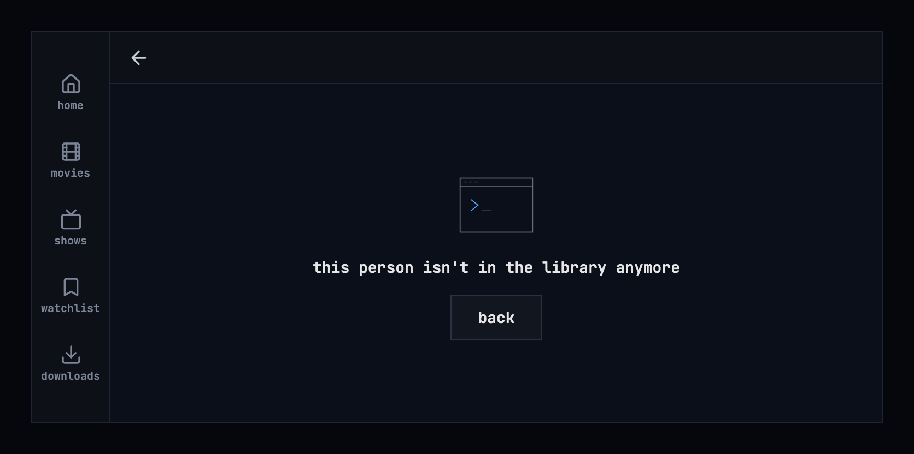

Figure 7.11: A person who isn't in the library anymore, on a phone held
sideways.

| State | What the page shows |
|---|---|
| Loading | Figure 7.8 |
| Couldn't load | Figure 7.9, with the sentence for the cause |
| The person was removed | Figures 7.10 and 7.11 |
| The viewer may not see the page | The empty state of figure 7.10 with “you don't have access to this” and **back** |
| The sign-in has expired | Nothing of its own: the app renews the sign-in and loads the page; only a refused sign-in leads to signing in, and back to the page |
| No photo | The initials (section 7.6.1) |
| Nothing known beyond the name | The photo or the initials, the name and the titles |
| Nothing of theirs in the library | “nothing of theirs in the library” in the titles' place |
| The phone app can't reach the server | Figure 7.9's state, with “Can't reach the server.”: a person's page always needs the server ([chapter 13](./downloads.md)) |

## 7.9 Words

| Where | Text |
|---|---|
| Under the name | 1 title · 12 titles |
| The facts | Known for · Born · Died · (age 76) · (aged 69) |
| The biography | read more · show less |
| The whole biography, open on a TV | Press up or down to scroll, and back to close. |
| The titles | in the library |
| What they did on a title | actor · creator · director · writer · producer · composer · cinematographer · editor |
| Nothing of theirs in the library | nothing of theirs in the library |
| Couldn't load | couldn't load this person · The server ran into a problem. · try again · details |
| Removed | this person isn't in the library anymore · back |
| No access | you don't have access to this · back |
