# 11 The player

Section 11.2 describes the player as it is deployed today. The sections after
it are the target, the player as it is meant to be, and section 11.16 lists
every difference between the two as a numbered change. Only a change the owner
has approved is built, one change at a time; anything no change names stays as
it is deployed.

The chapter covers what the player shows and how its controls work, how a
title resumes and when it counts as finished, the qualities and their names,
the player's menus, the picture, and what the player says when it changes the
quality by itself. Subtitles, and the panel in which people pick the audio and
the subtitles, have [chapter 12](./subtitles.md), and what a screen says when
something couldn't load, by cause, is in [chapter 17](./errors.md).

## 11.1 Purpose

The player plays a movie, an episode or a trailer. It shows the picture as
large as the screen allows and keeps its controls out of the way until they are
wanted. It opens from **play**, **resume** and **start over** on a title's page
([chapter 6](./title-actions.md)), from home ([chapter 4](./home.md)), and from
zap's **watch**, at the scene zap showed ([chapter 10](./zap.md)).

The player has no frame around it: no top bar, no tabs and no rail. Its own
top holds the way back. Every app follows the same rules, so a title resumes
and finishes the same way everywhere.

## 11.2 As deployed

This section says what the four players do as of 6 November 2026: the web as
the public demo showed it that day, on the same build as production, and the
apps as their code had them that day. The phone app, Android TV and the Samsung
TV are described from their code until screenshots of them are taken. The
Samsung TV app isn't released yet.

### 11.2.1 The web

Figures 11.1 to 11.3 are screenshots of the web's player while a title starts.
The picture is black in all three, because the browser that took them couldn't
decode the title's video as it is and the server was still converting it; the
controls are the ones that show while a title plays. Figure 11.1 shows a movie
on a computer.

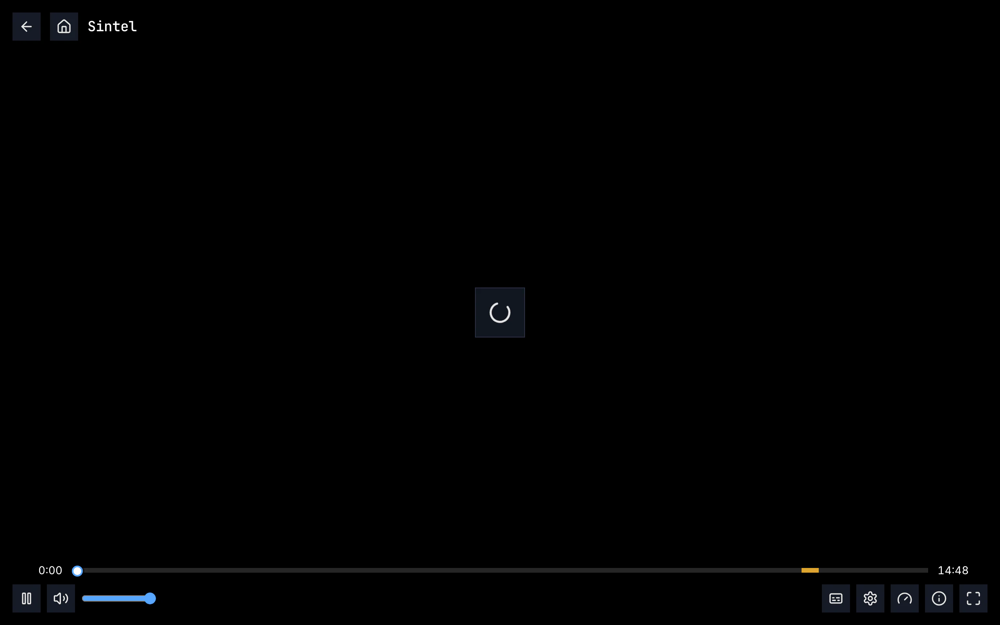

Figure 11.1: The web's player as deployed on 6 November 2026, on a computer, at
1280 × 800.

1. **Top left: back and home**, two dark squares with an arrow and a house,
   then the title, “Sintel”, in the monospace face.
2. **The middle: the loader alone**, a turning arc in a dark square. No line
   says what is loading.
3. **The seek bar** along the bottom, “0:00” on its left and the length,
   “14:48”, on its right, with a round white handle ringed in blue. The amber
   stretch near its end is the credits.
4. **Bottom left: pause and the speaker**, then the volume slider, blue, with a
   round handle.
5. **Bottom right: subtitles, quality, speed, playback info and fullscreen**: a
   caption box, a gear, a gauge, an “i” in a circle and four corners. A movie
   with one audio track has no audio button, and a movie has no previous or
   next episode.

The buttons are 36 × 36 px squares. Their tooltips are capitalised, and some
name what is set: “Back”, “Home”, “Pause”, “Mute”, “Subtitles”, “Quality (High
(1080p))”, “Playback speed (normal)”, “Playback info”, “Fullscreen”.

Figure 11.2 shows the same movie on a phone held upright.

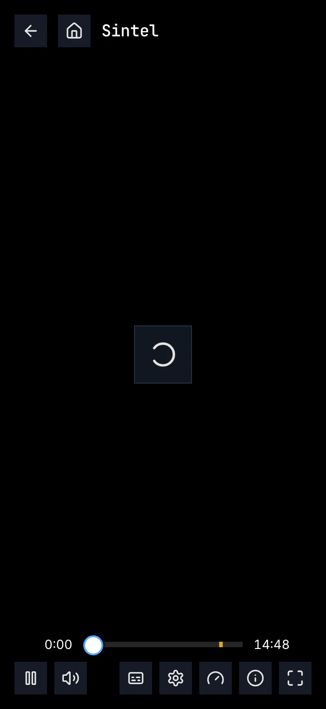

Figure 11.2: The web's player as deployed on 6 November 2026, on a phone held
upright, at 360 × 780.

1. **Top: back, home and the title**, as on a computer.
2. **The middle: the loader alone.**
3. **The seek bar**, shorter, with the credits in amber near its end.
4. **One row of buttons**: pause and the speaker on the left; subtitles,
   quality, speed, playback info and fullscreen on the right. Below 768 px wide
   there is no volume slider, so the speaker only turns the sound off and on.
   The row doesn't wrap: an episode, with previous and next episode, has more
   buttons than 360 px hold.

Figure 11.3 shows another movie on a phone held sideways.

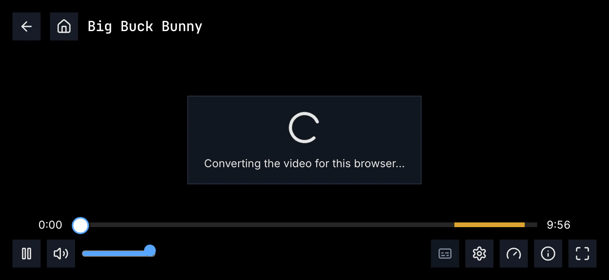

Figure 11.3: The web's player as deployed on 6 November 2026, on a phone held
sideways, at 780 × 360.

1. **The panel in the middle**, the loader with “Converting the video for this
   browser…”: the server converts this title for the browser as it plays, and
   the start has taken more than 5 seconds.
2. **The volume slider** is back, because the screen is 768 px wide or more.
3. **subtitles is dimmed**, as it is for a title with no subtitles to offer.
4. **The credits**, a longer amber stretch at the end of the seek bar.

When a phone, a screen whose short side is 600 px or less, is turned sideways,
the player asks the browser for full screen and to hold the page sideways; it
doesn't go full screen as it opens. It leaves full screen when the page turns
upright again, but where the browser holds the page sideways the page doesn't
turn, so full screen then ends only with **exit fullscreen** or the phone's
back. **fullscreen** itself asks for full screen without turning the page.

What the screenshots can't show, such as the menus, the skip buttons, up next
and what the player says when a title can't be played, is in the table of
section 11.2.5.

### 11.2.2 The phone app

The Android app's player has the web's layout: back, home and the title at the
top, with **cast** at the right while a device that can play is on the network,
and the seek bar and one row of buttons at the bottom. The buttons are 36 dp
circles: play, the speaker, which opens an 88 dp volume slider beside it, the
audio chip with the language's code, there for a title with one track too,
subtitles, speed, quality, previous and next episode, playback info and
fullscreen. The row doesn't wrap, so on a phone 360 dp wide held upright an
episode's buttons don't fit. Held sideways, the system bars hide and a swipe
from the edge brings them back for a moment; **fullscreen** hides them upright
too. Upright the picture always fits; sideways, two fingers spread apart fill
the screen with it.

The controls hide after 4 seconds while the title plays and 8 seconds while it
is paused, and a tap on the picture shows them but never hides them. While a
title starts, a spinner turns alone, without the top, until the server has sent
what to play; then the screen stays black until the first picture, and nothing
shows when the player waits later on. The quality notices come at the bottom.
Up next shows only with **Auto-play next episode** on, and counts down from 5
seconds, a time Settings doesn't offer. Settings has “Auto-skip intros &
recaps” and “Auto-skip credits”, but the player reads neither, so it skips
nothing by itself.

The iOS app adds **picture in picture** and **AirPlay** to the bar, plays the
sound on in the background with the title on the lock screen, and puts its
buttons on two rows when the phone is upright: play, the volume, previous and
next episode and fullscreen, then audio, subtitles, speed, quality, picture in
picture, AirPlay and playback info. Its **fullscreen** turns the player
sideways.

### 11.2.3 Android TV

The Android TV player has the layout of the target (section 11.5): back, home
and the title at the top, then the seek bar and one row: play, the volume, audio,
subtitles, speed, quality, previous and next episode, and playback info. The
buttons are 40 dp squares with capitalised names, “Pause”, “Audio track”,
“Playback speed”. The volume is one focus stop: OK turns the sound off and on,
and ↑ ↓ set the player's own level. subtitles is there for a title without
subtitles too, and its menu then says “No subtitles available”; previous and
next episode are there on every episode, and at a season's ends they do
nothing.

Skipping is a note in the corner: “Skipping intro in 5s” over “Press BACK to
cancel”, on every episode, the first one too. An episode opened by up next or
by the episode buttons starts past its intro instead, whatever the setting,
with “Skipped intro” over “Press BACK to watch from the start”. Up next is the
note “Up next in 5s”, without buttons, and after a movie the first unwatched
title of “more like this” starts. The player goes on by itself only after a
picture showed and 10 seconds played. A title starting says “Preparing…”, then
a spinner turns alone, and a title that can't be played shows the player's
error in red, “Playback failed: ERROR_CODE — message”, with **report this
problem** and no **try again**.

### 11.2.4 Samsung TV

The Samsung TV player has no top. The episode's code and its own name, without
the show's, stand above the seek bar, and every control is in the row under
it: back, back 10 seconds, play or pause, forward 10 seconds and next episode,
then audio, subtitles and quality, quality with a gauge. It has no home,
volume, speed, previous episode or playback info. The buttons are 56 px
squares. The seek bar takes no focus: ← → go back and forward 10 seconds while
the controls are hidden, and fast forward and rewind 30 seconds.

The controls hide after 3.5 seconds while the title plays, and never while it
is paused. Auto-skip counts down from 10 seconds, “Skipping intro in 10…”, with
“Press any key to cancel”, on every episode, and it skips the credits too, on
at first, before the next episode starts at the end. A title starting shows a
spinner with “Preparing your title…” or “Preparing the trailer…” on a darkened
screen, and “Buffering…” while it waits. It shows none of the quality notices.
A title that can't be played says “Playback failed” with the error's text and
**Back**, and **Try again** only for a trailer.

### 11.2.5 Feature by feature

The table compares the four players feature by feature. “—” is a feature the
app doesn't have, and “not found” one its code was searched for and doesn't
have. A ready-made title is one that plays from the server's ready-made
qualities.

| Feature | Web | Phone app | Android TV | Samsung TV |
|---|---|---|---|---|
| The top | back, home and the title | back, home and the title; cast at the right, in a circle | back, home and the title | none: the episode's code and its own name above the seek bar, without the show; back is the first button of the row; no home |
| The buttons | 36 × 36 px squares; tooltips capitalised, some with what is set: “Quality (High (1080p))”, “Next episode: S01E04 — Triangular Diplomacy” | 36 dp circles; names lowercase, with what is set as their state: “subtitles”, “off” | 40 dp squares; names capitalised: “Pause”, “Audio track”, “Playback speed” | 56 px squares; names capitalised: “Rewind 10 seconds”, “Next episode” |
| The row | play, speaker, slider … audio, subtitles, quality (a gear), speed, previous, next, playback info, zoom to fill, fullscreen | play, volume … audio, subtitles, speed, quality, previous, next, playback info, fullscreen; iOS adds picture in picture and AirPlay | play, volume … audio, subtitles, speed, quality, previous, next, playback info | back, back 10 s, play, forward 10 s, next … audio, subtitles, quality (a gauge) |
| A phone, upright and sideways | upright, the same row, wider than 360 px for an episode; turned sideways, it asks for full screen and holds the page sideways | Android: the same row upright, wider than 360 dp for an episode; sideways, the system bars hide. iOS: two rows upright; fullscreen turns it sideways | — | — |
| The volume | the speaker turns the sound off and on; the slider from 768 px wide | the speaker opens an 88 dp slider; the sound goes off only by sliding it down; iOS: a mute button beside the slider | one focus stop: OK turns the sound off and on, ↑ ↓ 5% up or down | — |
| audio | a chip with the language's code, “ENG”, for two tracks or more | the chip, for one track too | an icon, for two tracks or more | an icon, for two tracks or more |
| subtitles | dimmed for a title without subtitles | there without subtitles, its menu “off” alone | there without subtitles, its menu “off” and “No subtitles available” | only for a title with subtitles |
| previous, next episode | only where there is one | only where there is one | both on every episode; at a season's ends they do nothing | next only, on every episode |
| Hiding the controls | after 3 s playing, 8 s paused; held by an open menu | after 4 s, 8 s; held by a menu, a drag and TalkBack's focus | after 4 s, 8 s; held by a menu | after 3.5 s; never while paused |
| A tap on the picture | shows the controls, and hides them when they show | shows them, never hides them | — | — |
| The seek bar | a round handle; intro blue, credits amber, recap green, a sponsor red; chapters as thin ticks | a round handle; intro yellow, credits orange, recap purple; chapters a band | a square handle; intro amber, recap grey, credits red; chapters a green band | a square handle; nothing loaded shown; intro and recap blue, credits amber; chapters a band |
| The still over the seek bar | every title, on hover and during a drag: “Intro · 1:30” | ready-made titles only, while pressed: “Intro · 1:30” | ready-made titles only, while the bar has the focus | ready-made titles only, always while the controls show, without a time |
| Seeking | a click; a drag seeks all along, by touch too | a drag seeks where the finger lets go | ← → 10 s on the focused bar | the bar takes no focus: ← → 10 s with the controls hidden |
| The remote | — | — | OK, ← →, ↑ ↓, back, play, pause; fast forward and rewind 10 s; the subtitles and audio keys open their menus | OK, ← →, ↑, back, play, pause; fast forward and rewind 30 s; ↓ with the controls hidden does nothing; no subtitles or audio key |
| Skip buttons | white: “Skip Intro”, “Skip Recap”; “Skip Credits” only without a next episode | white: “Skip Intro”, “Skip Recap”, “Skip Credits” | “skip intro”, “skip recap”, “skip credits”, focus stops | “Skip Intro” and the others, and “Skip” with the part's name for any other part, a chapter too |
| Auto-skip | the intro only, on an episode of a show played in the last 6 hours: a card, “Binge mode”, “Skipping intro in 3…”, “Skip now”, “Watch intro” | nothing: the setting isn't read | intro and recap on every episode, the first too: “Skipping intro in 5s”, “Press BACK to cancel” | intro and recap on every episode: “Skipping intro in 10…”, “Press any key to cancel” |
| An episode opened from the one before | starts past an intro in its first 2 s, whatever the setting, without a word | — | starts past the intro and a recap next to it, whatever the setting: “Skipped intro”, “Press BACK to watch from the start” | — |
| The credits | “Skip Credits”, only without a next episode | “Skip Credits”, hidden while up next counts down | skipped by themselves with Auto-play next off: “Skipping credits in 5s” | skipped by themselves, on at first: “Skipping credits in 10…” |
| Up next | “UP NEXT”, the name over the code, “Play now (3)”, “Cancel”; counts down only with Auto-play next on | only with Auto-play next on: “Up next”, “Playing next episode in 5s”, “Play now”, “Cancel”, without the name | a note: “Up next in 5s”, “Press BACK to cancel”; no buttons | none: the next episode starts at the end |
| The countdown | 3 s, from Settings | 5 s, fixed | 5 s, from Settings | 10 s, from Settings |
| Without credits | nothing at the end | up next at the later of 20 s before the end and 95% | the next episode starts at the end | the next episode starts at the end |
| A teaser after the credits | plays on: “NEXT EPISODE”, “Next episode in 3s”, “Cancel” | plays on: “Preview playing — jump to the next episode”, “Next episode”, “Dismiss” | plays on: “Next episode ▶ in 5s”, “Press BACK to cancel” | skipped as a recap |
| After a movie | nothing starts | nothing starts | the first unwatched title of “more like this” starts | nothing starts; the player goes back |
| The next episode | warmed from the credits on; no rule before going on | warmed 30 s before the credits or the end; no rule before going on | warmed 30 s before the credits or the end; started by itself only after a picture and 10 s | not warmed; no rule before going on |
| The menus | audio, quality and speed right above their buttons, over the seek bar; subtitles above the whole bar | above the seek bar under their button; round corners | at the bottom right, above the bar | at one fixed place; a check mark; headers in capitals |
| Audio rows | “English” with “AAC · Stereo” beside it, for a ready-made title “MP4A.40.2 · Stereo” | “E-AC-3 · 5.1” under the name; a track it can't play greyed | “E-AC-3 · 5.1” under the name; only tracks it can play | “English”, “English 5.1” |
| Quality rows | ready-made: “Auto · Medium (720p)” first | the qualities, no Auto | ready-made: “Auto · Medium (720p)” first | ready-made: “Auto” first |
| A quality picked | the last picture stays under “Switching to Medium (720p)…” | loaded again where it was | loaded again where it was; the speed back to normal | loaded again where it was |
| The picture | the picture area fitted, its bars cropped; zoom to fill | Android: the picture area fitted, a pinch fills; iOS: the whole frame | the whole frame | the whole frame |
| A title starting | the loader alone | a spinner alone, without the top; then black until the first picture | “Preparing…”, then a spinner alone | a spinner, “Preparing your title…”, on a darkened screen |
| Waiting while it plays | the panel with a line, “Reconnecting…”, “Switching audio…”, “Converting the video for this browser…” and others; a notice, “Stream paused — reconnecting…” | nothing | a spinner alone | a spinner, “Buffering…” |
| The quality changed by itself | at the top, for 4 to 5 s, the four lines of section 11.13, with “the original” where they name Original: “the original couldn't be streamed” | at the bottom, the same lines | at the top, for 6 s, the same lines | — |
| No picture after 20 s | “this title won't start”, “Nothing playable came from the server within 20 seconds.” | not found | not found | not found |
| Couldn't play | a red triangle, “playback failed”, the reason, “Reported automatically as #12.”, try again · back · report a bug | “couldn't play this title”, the reason by cause, try again or back, details, Report a bug | the error in red, “Playback failed: ERROR_CODE — message”, report this problem; no try again | a red glyph, “Playback failed”, the error's text, Back; Try again only for a trailer |
| The title isn't there | “this title isn't in the library anymore” | “This title isn't available to stream yet.” | “This title isn't available to stream yet.” | the error's own text |
| Automatic report | when it gives up, at most 3 a session; its number on the screen | one for each failure shown, with a screenshot; nothing on the screen | one for every player error, recovered ones too; nothing on the screen | — |
| The place saved | every 10 s while playing | every 10 s, on pause and on leaving; only a place that has played; kept offline | every 10 s and on leaving | every 10 s, on leaving and on back; only a place that has played |
| Watched | marked in the credits or at 95%, besides the server's rule: the last 5% or the last 2 minutes, whichever is longer, at most the second half, without the credits | the same | the same | the same |
| Picture in picture, AirPlay, the lock screen | the browser's own picture in picture | iOS: picture in picture, AirPlay, sound in the background, the lock screen's controls; Android: none | — | — |
| Playback info | a dialog: how it plays, the source file, the stream now, its quality changes, what the browser can decode | the dialog without the quality changes | a card at the top right that closes after 8 s | — |

## 11.3 The player on a computer

Figure 11.4 shows the player on a computer, with its controls showing. The
player fills the window; the frame's top bar isn't there.

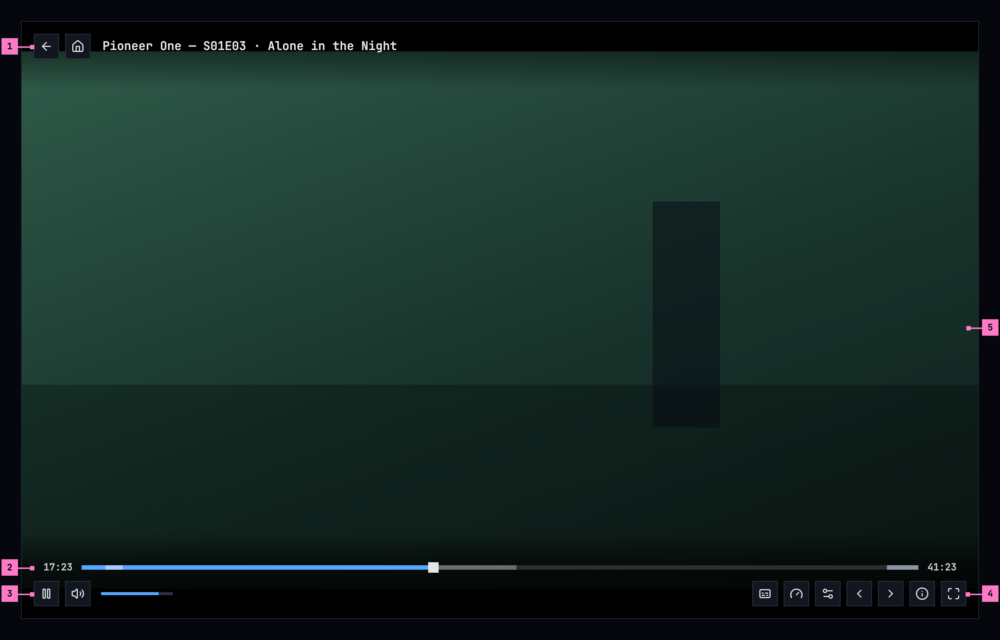

Figure 11.4: The player on a computer, at 1280 × 800, with its controls
showing.

1. **The top: back, home and the title.** back returns to where the player
   was opened from, and home goes to home. The title names what plays: a movie
   by its name, an episode by its show, its code and its name, “Pioneer One —
   S01E03 · Alone in the Night”.
2. **The seek bar.** The time played is on its left and the title's length on
   its right. The bar shows what has played in blue, what is loaded ahead in a
   lighter grey, and the intro, a recap and the credits, where the server knows
   them, as stretches in a lighter tone of the bar under them; where the title
   has chapters, a thin tick marks where each one starts. Its handle is a
   square. Pointing at the bar shows a still of that moment above it, with its
   time and the part's or the chapter's name, “intro · 1:30”; a click or a drag
   seeks there, and a click on a tick starts that chapter.
3. **play or pause, and the volume.** The first button pauses while the title
   plays and plays while it doesn't. The speaker turns the sound off and on
   again, and the slider beside it sets how loud.
4. **The other buttons**, in this order: **audio and subtitles**, where the
   title has two audio tracks or more, or a subtitle to pick, blue with a dark
   icon while a subtitle is on, which opens the audio and subtitles panel
   ([chapter 12](./subtitles.md)); **speed**; **settings**, where its menu has
   something to set, a choice of quality or the timing of a subtitle that is
   on; **previous episode** and **next episode**, for an episode with one
   before or after it; **playback info**, what plays and how it reaches the
   screen (section 11.15); and **fullscreen**. Section 11.10 sets out the
   menus.
5. **The picture**, as large as the window allows, in its middle
   (section 11.11). Where the title has a picture area and filling the window
   would change the picture, **zoom to fill** comes before **fullscreen**.

The buttons are the design system's icon buttons, of its standard kind and
34 × 34 on a computer: squares on a solid surface, their icons alone. Each
one's name is its label, what a screen reader says and what the browser shows
as its tooltip under the pointer; a button with something set adds it after a
comma: “audio and subtitles, English (original), subtitles English”,
“settings, Auto · Medium (720p)”, “next episode, S01E04 · Triangular
Diplomacy”. Section 11.18 lists them. The icon button has no look for “on”, so
**audio and subtitles** takes the emphasized kind, blue, while a subtitle is
on.
Behind the top and the bottom, the picture darkens towards the edge, so no time
and no title stands on the bare picture.

The keyboard works without the controls: space or k plays and pauses, ← and →
go back and forward 10 seconds, ↑ and ↓ set the volume, m turns the sound off
and on, and f is fullscreen. Every key the player answers to shows the
controls, wherever the focus is. Esc closes an open menu or the audio and
subtitles panel, and with neither open it leaves a trailer. With a mouse, a
click on the picture plays or pauses; on a touch screen a tap only shows the
controls (section 11.6).

## 11.4 The player on a phone

The phone plays upright and sideways, and the player turns with it. Figure 11.5
shows it upright and figure 11.6 sideways, as most people watch. The parts are
those of figure 11.4; the numbers mark where the phone differs, and section
11.4.3 says what happens when the phone is turned.

### 11.4.1 Held upright

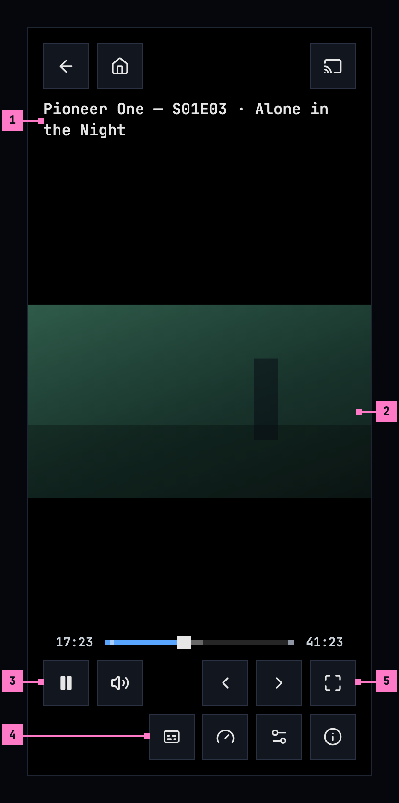

Figure 11.5: The player on a phone held upright, at 360 × 780 dp.

1. **The title** has a line of its own under back, home and cast, and two lines
   where it needs them, so an episode keeps its name.
2. **The picture**, across the width, in the middle. Upright it always fits:
   two fingers spread apart don't fill the screen (section 11.11). A tap on it
   shows the controls, and a tap while they show hides them.
3. **The first row**: play or pause and the volume on the left; previous and
   next episode and fullscreen on the right. While the volume's slider is open,
   it takes the place of previous and next episode, and they come back when it
   closes.
4. **The second row**, at the right: audio and subtitles, speed, settings
   and playback info, those the title has, in the order of figure 11.4. On
   iOS, picture in picture comes after settings.
5. **fullscreen** turns the player sideways and full screen (section 11.4.3).

The buttons go on two rows on a screen less than 600 dp wide, as a phone held
upright is; a tablet keeps one row. On a phone, held either way, they are the
icon button's large size, 42 dp, and stand 6 dp apart, so each keeps a touch
area of 48 dp around it. While the phone is upright its status bar and
navigation bar stay, and the controls keep clear of them.

The web on a phone held upright has the layout of figure 11.5 without cast. Its
speaker turns the sound off and on, the phone's own buttons set the volume, and
**fullscreen** asks the browser for full screen without turning the page.

### 11.4.2 Held sideways

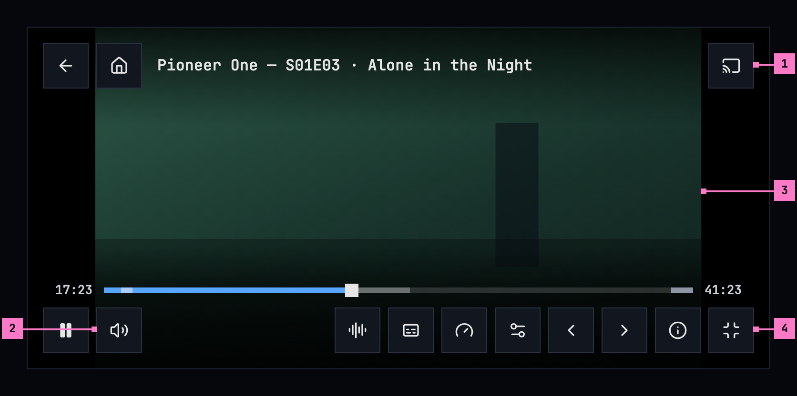

Figure 11.6: The player on a phone held sideways, at 780 × 360 dp.

1. **The cast button**, at the right of the top, where a device that can play
   is on the network ([chapter 14](./casting.md)). On iOS, AirPlay is in its
   place (section 11.12).
2. **The volume.** The speaker opens a slider beside it and closes it again,
   so the bar has room for its buttons; the phone's own buttons set the volume
   as well.
3. **The picture.** A tap on it shows the controls, and a tap on the picture
   while they show hides them. Two fingers spread apart fill the screen with
   the picture and brought together fit it again (section 11.11).
4. **exit fullscreen.** Held sideways the player is full screen, so the last
   button is exit fullscreen, and it turns the player upright.

Held sideways, the player hides the phone's status and navigation bars, and a
swipe from the edge brings them back for a moment. The picture and the controls
keep clear of the camera's cutout and of the navigation bar. On the seek bar, a
touch shows the still of that moment, and the seek happens where the finger
lets go. A menu taller than the room above the bar scrolls within itself.

The web on a phone has the layout of figure 11.6 without cast and without the
slider: there, the speaker turns the sound off and on, held either way, and the
phone's own buttons set the volume.

### 11.4.3 Turning the phone

The player turns with the phone, and turning it never interrupts the title: it
plays on, or stays paused, where it was, with its audio, subtitles, quality and
speed; an open menu stays open at its button, and the audio and subtitles panel
stays open too ([chapter 12](./subtitles.md)).

- **Turned sideways**, the player goes full screen by itself. The phone app
  hides the status and navigation bars. The web asks the browser for full
  screen on a phone, a screen whose short side is 600 px or less, and only when
  the phone is turned, never as the player opens; a tablet or a laptop turned
  sideways stays as it is. The picture fits the screen's height, and filling it
  becomes possible, with two fingers in the app and with **zoom to fill** on
  the web.
- **Turned back upright**, the bars come back and the picture fits the width
  again. A fill ends, because upright the picture always fits, and comes back
  when the phone is turned sideways again during the same title. The web
  leaves the full screen it went into when the phone was turned; it never
  holds the page sideways, so the page can turn back. A full screen someone
  asked for with **fullscreen** stays.
- **fullscreen**, in the phone app held upright, turns the player sideways and
  full screen, and the person turns the phone to follow it. From then on the
  player turns with the phone again: turned back upright, it leaves full
  screen. Held sideways, the button is **exit fullscreen**, and it turns the
  player upright. On the web, **fullscreen** and **exit fullscreen** only ask
  the browser for full screen and leave it, without turning the page.

## 11.5 The player on a TV

Figure 11.7 shows the player on a TV, with its controls showing. It fills the
screen, without the rail.

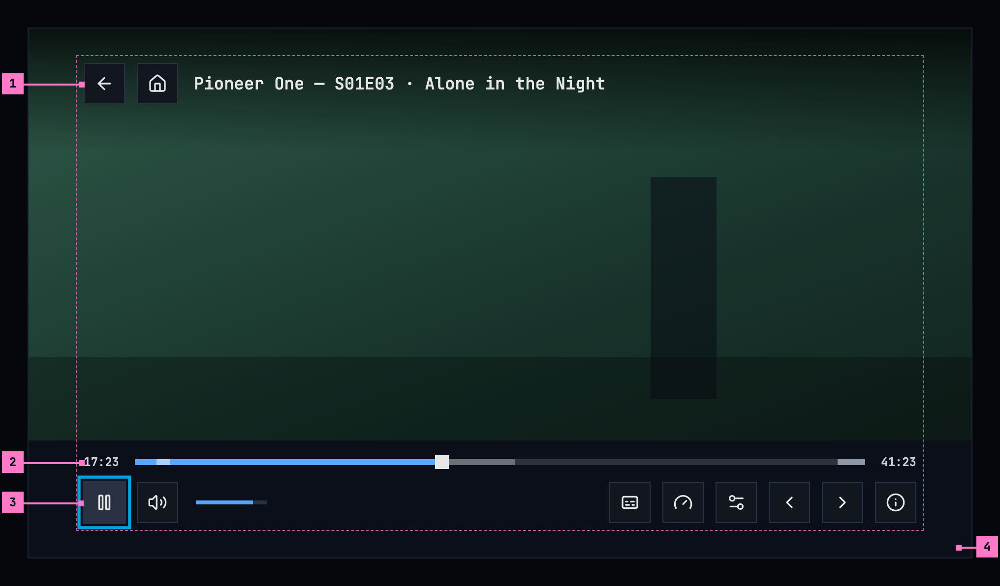

Figure 11.7: The player on a TV, at 960 × 540 dp, with its controls showing.

1. **The top**: back, home and the title, as on a computer.
2. **The seek bar.** With the focus on it, left and right go back or forward
   10 seconds at a time, with the still of that moment above the bar, and the
   title goes on from there.
3. **The focus**, as the design system draws it on a TV: the ring outside the
   button, the button's lighter surface and the button 5% larger. Whenever the
   controls come back, the focus is on play or pause. Left and right move
   along the row, up and down between the row and the seek bar. A menu or the
   audio and subtitles panel that closes gives the focus back to its button.
4. **The band**: one solid surface under the seek bar and the buttons, out to
   the screen's edges. The controls stay inside the safe area, with room for
   the focus ring. The TV has no fullscreen button: it is always full screen.

The buttons are the icon button's large size, 42 dp, and stand 12 dp apart, so
a focused one never touches the next.

The volume is one focus stop, the speaker with its level beside it: OK turns
the sound off and on, and up and down set the player's own level, 5% a press,
so left and right never get caught on a slider. The remote's volume keys set
the TV's own volume, as everywhere on the TV.

The remote works with the controls hidden too. Any key brings them back, and
some keys do more:

| Key | With the controls hidden | With the controls showing |
|---|---|---|
| OK | Pauses or plays | Presses the focused button |
| ← → | Back or forward 10 seconds | Moves the focus; on the seek bar, 10 seconds |
| ↑ ↓ | Only shows the controls | Moves between the seek bar and the row; on the volume, sets how loud |
| back | Leaves the player | Closes an open menu or the panel first; then leaves the player |
| play, pause | Plays or pauses | The same |
| fast forward, rewind | Forward or back 10 seconds | The same |
| The remote's subtitles key, its audio key | Opens the audio and subtitles panel, with the focus in its subtitles column or in its audio column; the controls stay hidden | Opens the panel the same way |

While a card of section 11.8 shows, back is that card's way out first: **watch
the intro** on the auto-skip card, **watch from the start** on the skipped
intro's, and **cancel** on up next.

## 11.6 Showing and hiding the controls

The controls show when a title starts, and whenever the person moves the
mouse, touches the screen or presses a key. They hide again after 3 seconds
while the title plays and after 8 seconds while it is paused. They stay while
a menu is open, while the person drags the seek bar or the volume, and while a
screen reader's focus is on one of them, so it never loses the control it is
on. While the audio and subtitles panel is open they step back, and they come
back when it closes. A tap on the picture while they show hides them; a tap on
the bars, between their buttons too, keeps them. They come and go with a short
fade; the subtitles rise above them while they show and come back down when
they hide ([chapter 12](./subtitles.md)).

## 11.7 Play, resume and a finished title

- A title people stopped part way, more than 30 seconds in, shows **resume
  1:43**, with **start over** beside it.
- A title stopped in its credits, from where the server knows they start,
  counts as **finished**: it shows **play**, from the start, and the watched
  mark. The credits are the part the server marks for the seek bar and for up
  next (section 11.8). Where the server knows no credits, the title's last 5%
  or its last 2 minutes, whichever is longer, count instead; for a short
  title, they never start before its second half.
- The server decides finished, once, from the place the apps save, so every
  app agrees; no app marks a title watched by a rule of its own. Counting from
  the credits keeps a film with long credits from staying unfinished once the
  apps' own rule is gone: a two-hour film's last 5% is 6 minutes, and its
  credits often run longer. Continue watching drops a finished movie and moves
  a finished episode on to the next one.
- Removing a title from continue watching doesn't mark it as watched.

The player saves the place every 10 seconds while the title plays, when it is
paused, and when the player is left or the app goes to the background. It saves
only a place that has really played, never the start of the stream before a
resume has landed, so opening a title and leaving it at once doesn't lose the
place. Without a connection, the phone app keeps the place and sends it later,
with how long ago it was played, so a newer place from another device stays.

A trailer plays in the same player, with the same controls, from its start and
with its sound. It keeps no place, counts as nothing watched, has no subtitles,
no marked parts and no next episode, and at its end the player goes back to the
title.

## 11.8 Skip and up next

Where the server knows a title's intro, its recap and its credits, the player
helps past them. The settings this section names are in
[chapter 16](./settings.md).

### 11.8.1 skip intro, skip recap and skip credits

While the title plays in one of those parts, a button at the bottom right,
above the controls' place, jumps to its end: **skip intro**, **skip recap** or
**skip credits**. It is the design system's standard button, on its solid
surface, there whether the controls show or not, and on a TV it is a focus
stop. Other parts, such as a
chapter, have no skip button. In the credits of an episode that has another
after it, up next takes the place of **skip credits** (section 11.8.3).

### 11.8.2 Auto-skip

With **Auto-skip intros** on, the player skips the intro and the recap by
itself on every episode after the first one watched in a row; the first keeps
them. An episode is watched in a row when another episode of the same show
started playing on the device less than 6 hours before.

- **An intro or a recap on the way.** When the title reaches one, a card takes
  the skip button's place: “Skipping the intro in 3 seconds.” with **skip now**
  and **watch the intro**, or “Skipping the recap in 3 seconds.” with **skip
  now** and **watch the recap**. It counts down from the **Countdown** setting,
  3 seconds unless it was changed, so the person can keep what is about to go.
  At zero the player jumps to the part's end, and where a recap and an intro
  follow each other within 2 seconds, past both in one jump. **watch the
  intro** or **watch the recap** takes the card away and lets the part play.
  The card is the player's own, on the controls' solid surface, and its
  buttons are the design system's. On a TV they are focus stops like the
  controls' ones.
- **An episode that starts with its intro.** Opened from the episode before, by
  up next or by **next episode**, an episode whose intro begins in its first 2
  seconds starts past it, and past a recap next to it, with nothing to count
  down. A card in the skip button's place says “Skipped the intro.”, or
  “Skipped the intro and the recap.”, with **watch from the start**, for 6
  seconds, and that button goes back to 0:00.

With **Auto-skip intros** off, nothing is skipped by itself, however the
episode was opened. The credits are never skipped by themselves: in an episode
with another after it, up next takes their place, and a movie's credits play.

### 11.8.3 Up next

In the credits of an episode that has another after it, a card takes the place
of **skip credits**, as figure 11.8 shows.

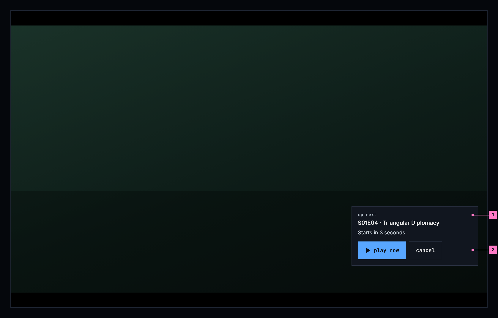

Figure 11.8: Up next, in the credits of an episode, on a computer.

1. **The next episode**, by its code and its name, under the card's heading
   **up next**. With **Auto-play next episode** on, a line counts down,
   “Starts in 3 seconds.”, from the **Countdown** setting (3 seconds unless it
   was changed), and the next episode starts at its end. With the setting off,
   the card has no line and waits.
2. **play now**, the design system's emphasized button, starts the next
   episode at once; **cancel**, its quiet button, lets the credits play on and
   takes the card away. On a TV the card's buttons are focus stops like the
   controls' ones, and back is **cancel**.

### 11.8.4 Going on to the next episode

- **Without credits.** Where the server knows no credits, up next comes at the
  later of 20 seconds before the end and 95% of the episode, so a short episode
  doesn't get it in its first half.
- **A teaser after the credits**, a part the server marks as a preview of the
  next episode or a recap that starts after the credits, plays on under the up
  next card. It is never skipped and never offered **skip recap**. With
  **Auto-play next episode** on, the card counts down over it again, and
  **cancel** lets the teaser play to its end.
- **Only after it has played.** The player starts the next episode by itself,
  at the end of a countdown or at the end of the episode, only once this one
  has shown a picture and played for 10 seconds. Until then up next waits for
  **play now**, so a title that fails at once can't run through a season.
- **Warmed ahead.** From 30 seconds before the credits, or before the end where
  there are none, the player asks the server for the next episode's stream the
  way the next player will ask for it, so its first parts are made when it
  starts.
- **After a movie**, nothing starts by itself.

## 11.9 Quality names

The server names every quality, by one fixed table of heights, so a name means
the same picture size on every title and every installation. The apps show the
name as the server gives it.

A frame's height for naming is its step: its own height, or the height its width
stands for at 16:9, whichever is larger. A scope film of 1920 × 818 is 1080p,
like a 16:9 film of 1920 × 1080, because both are full HD.

| Height | Name |
|---|---|
| 2160p and up | “Ultra (2160p)” |
| 1080p | “High (1080p)” |
| 720p | “Medium (720p)” |
| 480p | “Low (480p)” |
| below 480p | “Lowest (360p)” |
| the title's own picture, as the original had it, not converted | “Original” |

A step up to 10% above a standard height, in a frame no taller than it, or up
to 3% below it, counts as that height. The standard heights are 240, 360, 480,
540, 576, 720, 1080, 1440, 2160 and 4320. So frames cut a little wider or
narrower keep their name: 1916 × 800 and 2048 × 858 are “High (1080p)”. Any
other step takes the name of the table's next lower height, with its own number:
1024 × 576 is “Low (576p)”, 2560 × 1072 is “High (1440p)”, 1666 × 900 is “Medium
(937p)”, and a scope film's 720-line encode, 1728 × 720, is “Medium (972p)”. A
re-encode at the original's size is named by its step like any other.

“Original” is a picture, never a file: every app plays the title's package,
and the original is deleted once its package meets the master spec
([ADR-0015](../../docs/adr/0015-the-package-is-the-master.md)). The server
names a quality “Original” where its video is the original's picture copied
unchanged, at its own size and bit rate, as the package keeps it when the
original's video needed no converting. It isn't the audio setting's
“Original”, the language a title was made in (section 11.14), and the two
never share a list.

## 11.10 The player's menus

People pick a title's audio and its subtitles in one panel, and the player has
two menus for the rest. **audio and subtitles** opens the panel, the title's
audio on the left and its subtitles on the right, over the dimmed picture;
[chapter 12](./subtitles.md) sets it out, both of its columns included.
**settings** opens the settings menu, figure 11.9, and **speed** the speed
menu.

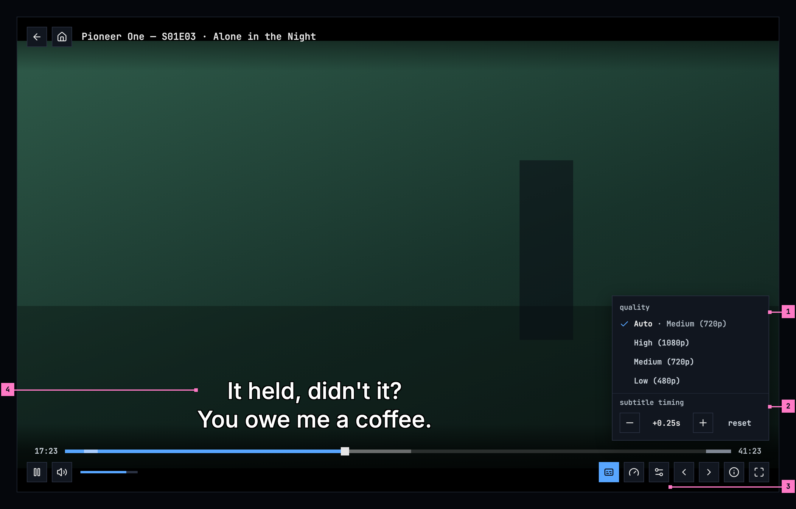

Figure 11.9: The settings menu, on a computer, with its quality and its subtitle
timing.

1. **quality**, where the title has two qualities or more. A title that plays
   from the server's ready-made qualities starts with **Auto**, which picks the
   quality by the connection and names the one playing: “Auto · Medium
   (720p)”. The other rows are the names of section 11.9.
2. **subtitle timing**, while a subtitle made as text is on: **−** and **+**,
   the design system's icon buttons, move the subtitles a quarter of a second
   earlier or later with each press, up to 10 seconds either way, the value
   between them says where they are, “+0.25s”, and **reset**, its quiet
   button, goes back to the subtitles' own timing.
3. **settings**, the sliders, which opened the menu. Without a choice of
   quality and without a subtitle made as text on, the bar has no settings
   button.
4. **The subtitle line**, moved left of the menu, so the menu never hides the
   line it times.

- **One choice each.** **quality** and **speed** are lists of one choice, like
  the panel's columns: the picked row has a check before its name and the
  brighter text, and every row keeps the check's room, so the names line up. A
  pick closes the menu. The speed menu, headed **speed**, offers 0.5x, 0.75x,
  **normal**, 1.25x, 1.5x, 1.75x and 2x.
- **The timing** holds while the title plays, for any subtitle made as text
  that is on, and the next title starts at “0.00s”. A press on **−**, **+** or
  **reset** keeps the menu open, so the line can be watched as it moves. For
  subtitles made as pictures, and while subtitles are off, the menu has no
  timing.
- **The look.** The design system has no menu of one choice: its action menu
  runs commands, and its select opens the device's own list. So the player's
  menus are its own, with the action menu's look: its surface, its thin frame
  and its shadow, square, and rows at least 32 px high in the monospace face,
  lowercase, where a name keeps its case, “High (1080p)”. A header names each
  group, lowercase, in the monospace face: “quality”, “subtitle timing”,
  “speed”. On a phone a row is 48 dp high, for a finger, and on a TV 40 dp,
  with the TV's focus for rows. Controls over the picture sit on a solid
  surface, never on a see-through one.
- **Where they open.** One menu, or the panel, is open at a time. A menu opens
  above the whole control bar, at the end where its button is, so it never
  covers the seek bar, and a press outside it or Esc closes it. On a TV the
  focus goes into the open menu, left and right move between the timing's
  buttons, and back closes it.

A quality picked in the menu keeps the last picture on the screen, under
“Switching to Medium (720p)”, until the new quality's first one, so the screen
never goes black between two qualities; the position and the speed stay.

An open menu never covers the subtitle line. Where it would, the line is
centred in the part of the picture left of the menu, within 80% of that part,
or, where that part is narrower than ten times the text's size, it goes above
the menu, so a menu never hides the line it changes. The audio and subtitles
panel ends above the line's place instead ([chapter 12](./subtitles.md)).

## 11.11 The picture

The player shows a title's picture, not its frame. Many files keep a whole 16:9
frame with the picture inside it and black bars baked in: above and below a
2.39:1 film, at the sides of a 4:3 show. On a screen of another shape the
picture would float in black on all four sides. The server says where the
picture is: the play info's picture area (`pictureArea`), the part of the frame
the picture takes over the whole title, as fractions of the frame's width and
height, so the same for every quality. It leaves it out where it doesn't know,
or where the picture is the whole frame.

- **Fit**, unless the person zooms: the picture as large as the screen allows,
  in its middle. The bars are cropped where they would show; the picture
  never is. Without a picture area, the whole frame fits, as before.
- **The camera's cutout**: held sideways, a phone's cutout or notch takes a
  band at one side. The fitted picture keeps out of a band as wide on both
  sides, so it stays in the middle; only the sides count, so upright, with the
  cutout over the bars at the top, the picture keeps its place. Fill covers
  the band where the app draws there (Android 15 and later; the web where the
  page reaches under the notch). The subtitles keep out of it either way.
- **Fill**: the picture covers the whole screen, its edges cropped. Only on a
  screen wider than tall, and only where it is larger than fit; upright, the
  picture always fits. The web offers it only for a title with a picture area;
  on Android a pinch fills any title.
- **Zooming**: in the Android app, two fingers spread apart fill the screen
  and brought together fit it again; the picture follows them and settles at
  one or the other when they lift, and TalkBack has the same as an action on
  the picture, “zoom to fill” or “zoom to fit”. On the web, the button **zoom
  to fill** beside fullscreen, shown only where fill changes the picture of a
  title with a picture area. The iOS app and the TV fit the whole frame, as
  before: on a 16:9 TV that is the same picture for a letterboxed or a
  pillarboxed title, and a windowboxed one keeps its bars there.
- **Remembered** on the device, for the titles it suits: a fill chosen on one
  title starts the next one filled only where that title has a picture area
  and fill crops at most a tenth of its picture's width and of its height - a
  scope film on a phone held sideways or on a 21:9 screen. Any other title
  starts fitted, and a fill chosen on it is for that title alone.

Subtitles go with the picture ([chapter 12](./subtitles.md)): nothing of them
is ever cropped.

## 11.12 Picture in picture, AirPlay and the lock screen

A title can play on when the person leaves the player.

- **The iOS app** has **picture in picture** in the bar, after settings, blue
  while the title plays in its window, and leaving the app while a title plays
  carries it on in picture in picture by itself. **AirPlay** sits at the right
  of the top, where cast is on Android, and opens the phone's own list of
  screens. With the screen locked, or the app left without picture in picture,
  the sound plays on, and the lock screen shows the title with its artwork, play
  or pause, back and forward 10 seconds, and its place, which can be dragged.
- **The Android app** does the same in Android's way: leaving the app while a
  title plays carries it on in picture in picture, and the lock screen and the
  notification show the title with play or pause and back and forward 10
  seconds.
- **The web** follows the browser's own picture in picture, started from the
  browser, and the subtitles then show as the browser's captions. It has no
  button for it.
- **A TV** has none of these.

While the player is on the screen, the phone and TV apps keep the screen on,
and the TV's screen saver stays away.

## 11.13 When the quality changes by itself

When playback has to step down, the player says what it did and why in a
toast, the design system's neutral one, as figure 11.10 shows. It is news that
needs nothing done, so it leaves by itself after 5 seconds, as every toast
does. The toast stands at the top of the picture, not at the bottom where the
design system puts its toasts, because the controls and the subtitle line are
there. {label} is the quality's name from the table in section 11.9: “Medium
(720p)”, “Low (480p)”. The toast writes its line without a full stop.

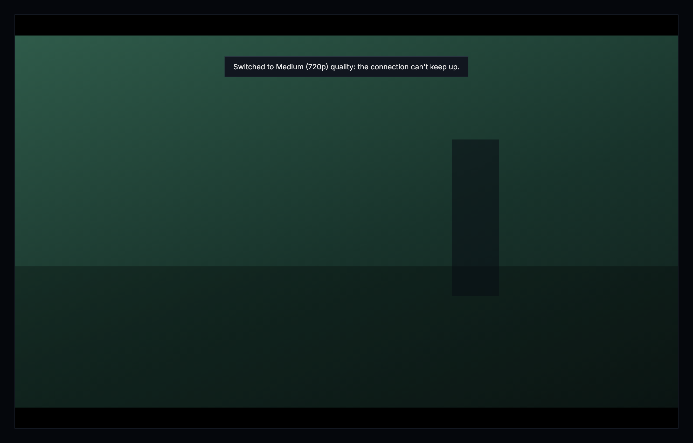

Figure 11.10: The player stepped down, on a computer.

- From Original, the title's own picture, when the connection is too slow:
  “Switched to {label} quality: the connection can't keep up with Original”
- When Original can't be streamed: “Switched to {label} quality: Original
  couldn't be streamed”
- One step down between qualities: “Switched to {label} quality: the
  connection can't keep up”
- When a quality between can't be streamed: “Switched to {label} quality:
  {previous} couldn't be streamed”, {previous} named from the same table:
  “Switched to Low (480p) quality: Medium (720p) couldn't be streamed”

It keeps the position. Status codes go into the playback report, never into
the line.

### 11.13.1 When the stream falters

The player watches that the picture moves while the title plays, and tries to
get it going again before it says anything went wrong:

- **The picture stands still for 8 seconds.** The panel of section 11.17 says
  “Reconnecting”, and the player picks the stream up where it stopped, first
  in place and then by loading it again there. A ready-made title keeps its
  quality, Auto or the one picked. A title the server converts as it plays
  steps down one quality where that doesn't help, and on its lowest quality
  loads again there; a title playing on Original moves to Medium (720p).
  Each step down comes with its notice.
- **Three waits within 30 seconds**, each with the picture standing still, step
  down the same way, at most once every 2 minutes, so the quality never falls
  through every step at once. On **Auto**, the ready-made qualities step down
  by themselves, and a quality the person picked stays picked.
- **A part that can't be decoded** is skipped, “Skipping a part that couldn't
  be played”. Where the browser can't play the format of the title's own
  picture, the web asks the server for one it can: “This browser can't play
  this video's format. Switching to one it can.”
- **Back after a while away.** Where the server no longer accepts the stream
  after a long pause, the player asks for it again once, without a word, and
  plays on where it was. On the web, a tab that was hidden for more than 15
  seconds loads the stream again where it was when it shows again.

Whatever the player loads again goes on from the same position. When nothing
helps, it gives up, with the screen of section 11.17.

## 11.14 The audio setting

Settings has one audio language, “Original” or a language, with this text under
it, the same in every app:

> Titles play with audio in the language you pick here, where they have it.
> With Original, each title plays in the language it was made in. A choice in
> the player applies only to what's playing now.

## 11.15 Playback info

**playback info** opens a panel over the player for the people who fix things:
what plays, and how it reaches the screen. It holds:

- **how it plays**: packaged, passthrough, remux or transcode, by the server's
  name for it, and why the server chose it for this device;
- **the package**, what the server keeps of the title and plays it from: its
  container, its video and its audio;
- **the stream now**: the quality, the encoder, what the stream was made for,
  the position, how much is loaded ahead, and the player's state;
- **quality changes**: the last 16, each with its time, the quality before and
  after, and whether the person picked it, the player stepped down or a stall
  moved it, with the reason;
- **this browser can decode** on the web, **this device can decode** in the
  apps: the formats it can play.

The panel stays until it is closed, with its close button, Esc, or back on a
TV.

## 11.16 Changes

Every difference between section 11.2 and the target is one change in the
table. A change names the apps it is built in, what they do today and the
target, with the figure or the section that sets it out; it is built as its row
says, and nothing else changes with it. Each change starts as proposed; once the
owner approves it, it is built, one change at a time. A target that starts with
“Recommended” was an open decision, or takes away something an app has today.
The settings' own rows, such as the countdown's first value, belong to
[chapter 16](./settings.md), and the audio and subtitles panel and the look of
subtitles to [chapter 12](./subtitles.md).

| No. | Change | Apps | Today | Target | Status |
|---|---|---|---|---|---|
| 11.C1 | The buttons' look and names | Web, Phone app, Android TV, Samsung TV | Web: 36 × 36 px, tooltips capitalised, “Quality (High (1080p))”. Phone app: 36 dp circles, back, home and cast too. Android TV: names capitalised, “Pause”, “Audio track”. Samsung TV: 56 px, names capitalised | the design system's icon buttons, of its standard kind: 34 × 34 px on a computer; 42 dp on a phone, 6 dp apart, so each keeps a touch area of 48 dp; 42 dp on a TV, 12 dp apart; icons alone; lowercase names, the icon button's label, with what is set after a comma, “speed, normal” (sections 11.3 to 11.5, words in section 11.18) | proposed |
| 11.C2 | One audio and subtitles button | Web, Phone app, Android TV, Samsung TV | an audio button and a subtitles button, each with its menu: Web: audio a chip with the language's code, “ENG”, and subtitles a caption box. Phone app: the chip, for a title with one track too, and subtitles. Android TV, Samsung TV: an icon each | one icon button, **audio and subtitles**, the caption box, in their place, in the icon button's emphasized kind, blue, while a subtitle is on, opening the audio and subtitles panel of [chapter 12](./subtitles.md) (figure 11.4, part 4) | proposed |
| 11.C3 | settings in place of quality, with the subtitles' timing | Web, Phone app, Android TV, Samsung TV | quality, a menu of its own, for two qualities or more: Web: a gear, before speed. Samsung TV: a gauge. The subtitles' timing only on the web, in its subtitles menu; the apps have none | **settings**, the sliders, after speed, where it has something to set: its menu with quality and subtitle timing (figure 11.9) | proposed |
| 11.C4 | audio and subtitles only where there is something to pick | Web, Phone app, Android TV, Samsung TV | Web: subtitles dimmed for a title without subtitles, audio for two tracks or more. Phone app: audio for one track too, subtitles with “off” alone. Android TV: subtitles with “off” and “No subtitles available”. Samsung TV: subtitles only with subtitles, audio for two tracks or more | the button only for a title with two audio tracks or more that the device plays, or a subtitle the panel lists ([chapter 12](./subtitles.md)) | proposed |
| 11.C5 | Android TV: previous and next only where there is one | Android TV | both on every episode; at a season's ends they do nothing | previous episode only for an episode with one before it, next episode only for one with one after it (figure 11.4, part 4) | proposed |
| 11.C6 | Web on a phone: no volume slider | Web | the slider shows from 768 px wide, so a phone held sideways mostly has it (figure 11.3) | on a phone, a screen whose short side is 600 px or less, no slider, held either way: the speaker turns the sound off and on (section 11.4.2) | proposed |
| 11.C7 | Upright: two rows and the title on a line of its own | Web, Phone app (Android) | one row, which an episode's buttons make wider than a 360-wide phone; the title on one line, cut. iOS has the two rows already | figure 11.5; while the volume's slider is open, it takes the place of previous and next episode | proposed |
| 11.C8 | The phone app's fullscreen turns the player | Phone app | Android: fullscreen hides the system bars and doesn't turn the player, and held sideways the button still offers fullscreen. iOS: fullscreen turns the player sideways and exit fullscreen upright, but a phone turned sideways by hand still offers fullscreen | upright, fullscreen turns the player sideways, and then it turns with the phone again; held sideways, however it got there, the button is exit fullscreen and turns it upright (section 11.4.3) | proposed |
| 11.C9 | Web: turning a phone back upright leaves full screen | Web | turned sideways, a phone asks for full screen and holds the page sideways, so where the browser holds it, turning back upright doesn't leave full screen | ask for full screen without holding the page sideways; turned back upright, leave only the full screen it went into when the phone was turned, never one asked for with fullscreen (section 11.4.3) | proposed |
| 11.C10 | iOS: AirPlay at the top | Phone app (iOS) | AirPlay and picture in picture sit in the bar after quality; held sideways, playback info comes before previous and next episode | AirPlay at the right of the top, in cast's place; picture in picture after settings; previous, next, playback info and fullscreen as in figure 11.4 (section 11.12) | proposed |
| 11.C11 | Samsung TV: the top and the row | Samsung TV | no top: the code and the episode's name above the seek bar, back the first button of the row; no home, volume, speed, previous episode or playback info; quality with a gauge; the seek bar takes no focus | figure 11.7: back, home and the title with its show at the top; play, the volume, audio and subtitles, speed, settings, previous and next episode and playback info in the row; the seek bar a focus stop | proposed |
| 11.C12 | Samsung TV: no buttons for 10 seconds back and forward | Samsung TV | “Rewind 10 seconds” and “Forward 10 seconds” beside play | Recommended: left out; ← → on the focused seek bar go back and forward 10 seconds, as on Android TV (section 11.5) | proposed |
| 11.C13 | Samsung TV: the remote's keys | Samsung TV | fast forward and rewind 30 seconds; the subtitles and audio keys unused; ↓ with the controls hidden does nothing; back during a countdown leaves the player | the table in section 11.5: 10 seconds, the subtitles and audio keys open the audio and subtitles panel, ↓ shows the controls, back closes a card first | proposed |
| 11.C14 | Showing and hiding the controls | Web, Phone app, Android TV, Samsung TV | Web: a drag and a screen reader's focus don't hold them, and a key shows them only while the focus is in the player. Phone app: 4 s, and a tap never hides them. Android TV: 4 s. Samsung TV: 3.5 s, never while paused | 3 s playing, 8 s paused; held by a menu, a drag and a screen reader's focus; a tap on the picture hides them; any key shows them (sections 11.3, 11.6) | proposed |
| 11.C15 | The seek bar's look | Web, Phone app, Android TV, Samsung TV | Web, Phone app: a round handle. The parts in colours: Web intro blue, credits amber, recap green, a sponsor red; Phone app intro yellow, credits orange, recap purple; Android TV intro amber, recap grey, credits red; Samsung TV intro and recap blue, credits amber, nothing loaded shown. Chapters a band, on Android TV green; on the web, ticks | a square handle; what is loaded in a lighter grey; the parts in a lighter tone of the bar under them; chapters as thin ticks, a click on one starting its chapter (figure 11.4, part 2) | proposed |
| 11.C16 | The still over the seek bar | Web, Phone app, Android TV, Samsung TV | Phone app, Android TV, Samsung TV: for ready-made titles only. Samsung TV: always above the handle, without a time. Web, Phone app: “Intro · 1:30” | a still for every title, while the bar is pointed at, touched or focused, with its time and the part in lowercase, “intro · 1:30” (figure 11.4, part 2) | proposed |
| 11.C17 | Web on a phone: seeking by touch | Web | a touch drag seeks all along, and a press seeks at once | a touch shows the still, and the seek happens where the finger lets go (section 11.4.2) | proposed |
| 11.C18 | The seek bar for a screen reader | Web, Android TV, Samsung TV | Web: “Seek”, with a value from 0 to 100. Android TV, Samsung TV: not found | “seek”, with “17:23 of 41:23”, 10 seconds a step (section 11.18) | proposed |
| 11.C19 | The skip buttons | Web, Phone app, Samsung TV | Web, Phone app: white, “Skip Intro”, “Skip Recap”, “Skip Credits”. Samsung TV: “Skip” with the part's name for any part under the playhead, a chapter too | skip intro, skip recap and skip credits, the design system's standard button, for those three parts only (section 11.8.1) | proposed |
| 11.C20 | Auto-skip counts down, on the episodes in a row | Web, Phone app, Android TV, Samsung TV | Web: the intro only, a card “Binge mode”, “Skipping intro in 3…”, “Skip now”, “Watch intro”. Phone app: nothing skipped. Android TV: intro and recap on every episode, the first too, “Skipping intro in 5s”, “Press BACK to cancel”. Samsung TV: the same, “Skipping intro in 10…”, “Press any key to cancel” | Recommended: section 11.8.2, a card that counts down from the Countdown setting, with skip now and watch the intro, the design system's buttons, from the second episode in a row; an intro and a recap next to it in one jump | proposed |
| 11.C21 | An episode that starts with its intro | Web, Phone app, Android TV, Samsung TV | Web: opened from the one before, it starts past an intro in its first 2 s, whatever the setting, without a word. Android TV: past the intro and a recap next to it, whatever the setting, “Skipped intro”, “Press BACK to watch from the start”. Phone app, Samsung TV: nothing skipped | only with Auto-skip intros on: past the intro and a recap next to it, and “Skipped the intro.” with watch from the start for 6 seconds (section 11.8.2) | proposed |
| 11.C22 | Up next: one card | Web, Phone app, Android TV, Samsung TV | Web: “UP NEXT”, the name over the code, “Play now (3)”, “Cancel”. Phone app: only with Auto-play next episode on, “Up next”, “Playing next episode in 5s”, “Play now”, “Cancel”, without the name, 5 s whatever the setting. Android TV: a note, “Up next in 5s”, “Press BACK to cancel”, no buttons. Samsung TV: none, the next episode starts at the end | figure 11.8, its buttons the design system's, play now emphasized and cancel quiet, counting from the Countdown setting; with Auto-play next episode off, the card without its line, waiting | proposed |
| 11.C23 | Up next without credits | Web, Android TV, Samsung TV | Web: nothing. Android TV, Samsung TV: the next episode starts at the end | the card at the later of 20 seconds before the end and 95% (section 11.8.4) | proposed |
| 11.C24 | The teaser after the credits | Web, Phone app, Android TV, Samsung TV | Web: “NEXT EPISODE”, “Next episode in 3s”, “Cancel”. Phone app: “Preview playing — jump to the next episode”, “Next episode”, “Dismiss”. Android TV: “Next episode ▶ in 5s”, “Press BACK to cancel”. Samsung TV: skipped as a recap | it plays on under the up next card, never with skip recap (section 11.8.4) | proposed |
| 11.C25 | Going on only after a picture and 10 seconds | Web, Phone app, Samsung TV | no such rule; Samsung TV starts the next episode at any end of the stream | section 11.8.4 | proposed |
| 11.C26 | The next episode warmed 30 seconds ahead | Web, Samsung TV | Web: from the credits on. Samsung TV: not warmed | from 30 seconds before the credits, or before the end without them (section 11.8.4) | proposed |
| 11.C27 | No auto-skip of the credits | Android TV, Samsung TV | Android TV: with Auto-play next episode off, “Skipping credits in 5s”. Samsung TV: on at first, “Skipping credits in 10…”, then the next episode | Recommended: the credits are never skipped by themselves; up next takes their place, and a movie's credits play (section 11.8.2). The phone app's unused “Auto-skip credits” switch is chapter 16's | proposed |
| 11.C28 | Nothing starts after a movie | Android TV | the first unwatched title of “more like this” starts, after “Up next in 5s” | Recommended: nothing starts by itself after a movie (section 11.8.4) | proposed |
| 11.C29 | Where the menus open, and their look | Web, Phone app, Android TV, Samsung TV | Web: quality and speed open right above their buttons, over the seek bar, round corners, the picked row blue with a small square. Phone app: above the seek bar under their button, round corners, the same mark. Android TV: at the bottom right, the same mark. Samsung TV: at one fixed place, round corners, a check at the row's end, headers in capitals | settings and speed above the whole bar at their button's end, the player's own menus with the look of the design system's action menu: its surface, thin frame and shadow, square, rows of at least 32 px in its monospace face, lowercase, a name keeping its case, “High (1080p)”; a lowercase header for each group; rows of 48 dp on a phone and 40 dp on a TV; the picked row with a check before it and the brighter text, as in the audio and subtitles panel (section 11.10) | proposed |
| 11.C30 | The audio rows | Web, Phone app, Android TV, Samsung TV, the server | Web: “English” with “AAC · Stereo” beside it, for a ready-made title “MP4A.40.2 · Stereo”, “English 5.1”, “English (2)”. Phone app: “E-AC-3 · 5.1” under the name, a track it can't play greyed with “Not available on this device”. Android TV: “E-AC-3 · 5.1” under the name. Samsung TV: “English 5.1”. No app marks the original or a described track. The server has no data for “(original)”: the catalog keeps no original language per title, and package.json has only a per-track “original” flag, the file's own mark, which releases rarely set; the apps' Original plays the track the file marks as its default, which in a release with two languages is often the dub. A described track is marked in package.json, its audio purpose “description”, but the play info doesn't pass it on | the audio column of [chapter 12](./subtitles.md): the language alone, “English (original)” where the title has audio in more than one language, “English (audio description)”, the channels only where two tracks of one language would read the same, “English (5.1)”, “English (stereo)”; a track the device can't play left out. chino-stream's play info passes on each audio track's purpose from package.json, “description” for a described track, and marks the tracks in the title's original language, which the catalog keeps (change 12.C10) | proposed |
| 11.C31 | The quality menu's Auto | Phone app, Samsung TV | Phone app: the qualities only, no Auto. Samsung TV: “Auto”, without the quality playing | for a ready-made title, Auto first in the settings menu's quality, “Auto · Medium (720p)” (figure 11.9) | proposed |
| 11.C32 | A quality picked keeps the picture and the speed | Phone app, Android TV, Samsung TV | the stream is loaded again where it was, without the last picture held; Android TV also goes back to normal speed | the last picture stays under “Switching to Medium (720p)” until the new quality's first, and the speed stays (section 11.10) | proposed |
| 11.C33 | The subtitle line keeps clear of an open menu | Web, Phone app, Samsung TV | nothing moves the line for an open menu | section 11.10 | proposed |
| 11.C34 | The quality notices: a toast at the top | Web, Phone app, Android TV, Samsung TV | Web: at the top, for 4 to 5 s. Phone app: at the bottom. Android TV: at the top, for 6 s. Samsung TV: none. Where there are notices, each line ends in a full stop, and the lines from Original name it “the original”: “Switched to Medium (720p) quality: the original couldn't be streamed.” | figure 11.10: the design system's toast, neutral, at the top of the picture, for 5 seconds, with the four lines of section 11.13, written as a toast writes them, without a full stop | proposed |
| 11.C35 | Getting the stream going again, by one rule | Phone app, Android TV, Samsung TV | Phone app: a ready-made title tried again in place 3 times, a converted one moved one quality down. Android TV: the same, with a watchdog at 12 s. Samsung TV: the hls.js engine's own recovery, nothing found for AVPlay | section 11.13.1 | proposed |
| 11.C36 | Back after a long pause | Android TV, Samsung TV | not found | section 11.13.1 | proposed |
| 11.C37 | Android: picture in picture and the lock screen | Phone app (Android) | none: no picture in picture, no controls on the lock screen | section 11.12 | proposed |
| 11.C38 | Samsung TV: no screen saver while the player shows | Samsung TV | not found | section 11.12 | proposed |
| 11.C39 | Finished by the server alone, from the credits | Web, Phone app, Android TV, Samsung TV, the server | each app also marks a title watched by itself, in the credits or at 95%, and starts one stopped in its last 60 seconds from the start. The server counts a title finished in its last 5% or its last 2 minutes, whichever is longer, at most its second half, and knows nothing of the credits: without the apps' rule, a film whose credits run longer than its last 5% would stay unfinished | the server's rule alone: the server counts a title finished from the start of its credits, as the analyzer marks them, and where it knows none, from its last 5% or its last 2 minutes, whichever is longer, at most its second half; the apps save the place and show what the server says (section 11.7) | proposed |
| 11.C40 | Saving the place | Web, Android TV, Samsung TV | Web: every 10 s while it plays, only. Android TV: every 10 s and on leaving, without checking that the place has played. Samsung TV: every 10 s, on leaving and on back | also when paused and on leaving, only a place that has played (section 11.7) | proposed |
| 11.C41 | Phone app: a trailer without subtitles | Phone app | a trailer offers its own subtitles | a trailer has none (section 11.7) | proposed |
| 11.C42 | A title starting: the loader with its line | Web, Phone app, Android TV, Samsung TV | Web: the loader alone at once, and without the top until the server grants the stream. Phone app: a spinner alone without the top until the server answers, then black until the first picture. Android TV: “Preparing…”, then a spinner alone. Samsung TV: a spinner, “Preparing your title…”, on a darkened screen | Recommended: figure 11.11, nothing for 0.4 seconds, then the design system's loader, 32 px, with “Loading the episode” under it, without an ellipsis, as the design system writes a loader's line; the top from the start | proposed |
| 11.C43 | Waiting while it plays | Web, Phone app, Android TV, Samsung TV | Web: the panel's lines end in an ellipsis, “Reconnecting…”, and “Stream paused — reconnecting…” shows as a notice while it recovers. Phone app: nothing. Android TV: a spinner alone. Samsung TV: a spinner, “Buffering…” | the panel of figure 11.11, with the line for what the player does, the converting line included, each without an ellipsis, “Reconnecting” (section 11.17) | proposed |
| 11.C44 | A start that hangs gives up after 20 seconds | Web, Phone app, Android TV, Samsung TV | Web: after 20 s on the screen, “this title won't start”, “Nothing playable came from the server within 20 seconds.” The apps: not found | “couldn't play this title” with that sentence, after 20 seconds on the screen (section 11.17) | proposed |
| 11.C45 | Couldn't play: one screen, report a bug under details | Web, Phone app, Android TV, Samsung TV | Web: a red triangle, “playback failed”, report a bug a third button. Phone app: Report a bug a third button. Android TV: the error in red, “Playback failed: ERROR_CODE — message”, report this problem, no try again. Samsung TV: “Playback failed” and the error's text, Back, Try again only for a trailer | Recommended: figure 11.12, the design system's empty state for an error: the sentence by cause, try again or back, report a bug under details | proposed |
| 11.C46 | The automatic report, with its number | Phone app, Android TV, Samsung TV | Phone app: one for each failure shown, nothing on the screen. Android TV: one for every player error, recovered ones too, nothing on the screen. Samsung TV: none | one when the player gives up, “Reported automatically as #12.” on the screen (section 11.17) | proposed |
| 11.C47 | A title that isn't there anymore | Phone app, Android TV, Samsung TV | Phone app, Android TV: “This title isn't available to stream yet.” Samsung TV: the error's own text | “this title isn't in the library anymore”, with back ([chapter 17](./errors.md)) | proposed |
| 11.C48 | Playback info | Web, Phone app, Android TV, Samsung TV | Web: the title as it is kept under “Source file”. Phone app: the web's dialog without the quality changes. Android TV: a card at the top right that closes after 8 seconds. Samsung TV: none | section 11.15, the title as it is kept under **the package** | proposed |

## 11.17 States

The player is drawn in figures 11.4 to 11.7 while a title plays. Figures 11.11
and 11.12 show the states in between.

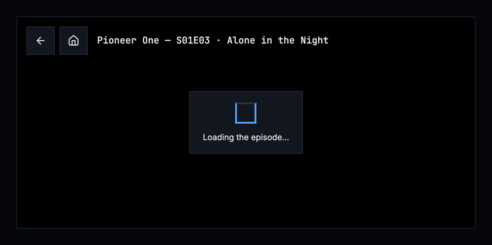

Figure 11.11: A title starting, on a phone.

While a title starts, the player shows nothing for the first 0.4 seconds, and
after that the design system's loader at its size for a player, 32 px, in the
middle, on a solid surface, with one line under it that says what is loading.
The line is written as the design system writes a loader's line, without an
ellipsis: “Loading the episode”, “Loading the movie” or “Loading the trailer”.
The top is there from the start, so back works while it loads. A start the
server converts as it plays says so after 5 seconds, so it doesn't look stuck:
“Converting the video for this browser”, in the apps “Converting the video for
this phone” (“Converting the video for this tablet” on a tablet) or
“Converting the video for this TV”. Later waits use the same panel, with a line
for what the player does: “Reconnecting”, “Switching to Medium (720p)”,
“Switching audio”, “Skipping a part that couldn't be played”, “Trying again”,
and on the web “This browser can't play this video's format. Switching to one
it can.” The picture under the panel isn't dimmed.

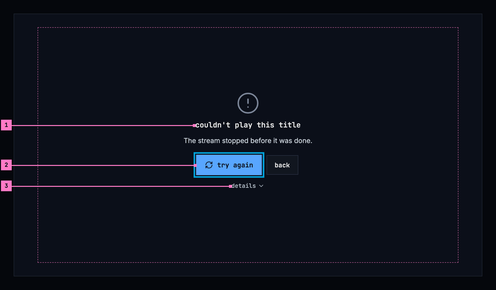

Figure 11.12: A title that couldn't be played, on a TV.

1. **What couldn't happen, and why**, in the design system's empty state for
   an error, with its picture of a line that doesn't connect: the title
   “couldn't play this title”, and the reason by cause under it, here that the
   stream stopped before the title was done. Where the request for the stream
   fails, the sentence is the one [chapter 17](./errors.md) gives for its
   cause; what only playback has, as here, is listed in this chapter's states.
2. **The report the player sent by itself**, with its number, so the person
   knows the people who fix things have it.
3. **try again**, the emphasized button, has the focus and starts the title
   again where it stopped; **back** is the standard one beside it. Where trying
   again can't help, as for a title the server doesn't let the account play,
   **back** is the only button.
4. **details and report a bug.** The details hold the code that tells the
   cases apart, for the people who fix things, in the look of a banner's
   details. On a TV they show without being opened, as
   [chapter 17](./errors.md) has it; on a computer and a phone **details**
   opens them. **report a bug**, a quiet button, comes under them.

When the player gives up, it files one bug report by itself, where the server
takes reports, and the line under the reason gives the report's number. It
files none for a title the server doesn't have, because a link that leads
nowhere isn't a bug, and at most 3 in a session and one for each kind of
failure. **report a bug** opens the dialog of [chapter 16](./settings.md) with
the failure's details in it, for the person's own words; on a TV, its list of
choices.

A title that shows no picture within 20 seconds of the player opening, or of
**try again**, gives up the same way, with “Nothing playable came from the
server within 20 seconds.” Only the time the player is on the screen counts, so
a tab opened in the background isn't taken for a start that hangs.

| State | What the player shows |
|---|---|
| Starting | Figure 11.11 |
| Converting as it plays | After 5 seconds of a start, the line of figure 11.11 says so: “Converting the video for this browser” |
| Waiting while it plays | The panel of figure 11.11 with the line for what it does, over the picture |
| The quality changed by itself | Figure 11.10, with the line of section 11.13 |
| A start that hangs | After 20 seconds without a picture, figure 11.12 with “Nothing playable came from the server within 20 seconds.” |
| Couldn't play | Figure 11.12, with the sentence for the cause and the report's number |
| The title isn't in the library anymore | “this title isn't in the library anymore”, with **back** ([chapter 17](./errors.md)) |
| A trailer that isn't there | “trailer not available”, with a link to the title's trailer online where it has one |
| The browser wouldn't start the title by itself (the web) | **play** in the middle, which starts it with its sound |
| The browser started it without sound (the web) | **unmute** at the top, until it is pressed |

## 11.18 Words

| Where | Text |
|---|---|
| The top | the buttons back · home; the title “Tears of Steel”, an episode “Pioneer One — S01E03 · Alone in the Night” |
| The buttons' names, over them and for a screen reader | play · pause · volume · audio and subtitles · speed · settings · previous episode · next episode · playback info · zoom to fill · zoom to fit · fullscreen · exit fullscreen · picture in picture (iOS); with what is set after a comma: “volume, 80%”, “audio and subtitles, English (original), subtitles English”, “speed, normal”, “settings, Auto · Medium (720p)”, “next episode, S01E04 · Triangular Diplomacy”; the cast button's and AirPlay's are the platform's own ([chapter 14](./casting.md)) |
| The seek bar | “17:23” and “41:23”; over the still “intro · 1:30”, “recap · 0:40”, “credits · 39:50”, or the chapter's name; for a screen reader “seek”, “17:23 of 41:23” |
| The menus' headers | quality · subtitle timing · speed; the panel's are in [chapter 12](./subtitles.md) |
| The menus' rows | Original · Auto · “Auto · Medium (720p)” · the names of section 11.9 · − · + · “0.00s”, “+0.25s”, “−0.50s” · reset · 0.5x · 0.75x · normal · 1.25x · 1.5x · 1.75x · 2x |
| Skip | skip intro · skip recap · skip credits |
| Auto-skip | Skipping the intro in 3 seconds. · Skipping the recap in 3 seconds. · skip now · watch the intro · watch the recap · Skipped the intro. · Skipped the intro and the recap. · watch from the start |
| Up next | up next · “S01E04 · Triangular Diplomacy” · Starts in 3 seconds. · play now · cancel |
| The quality notices | the four lines of section 11.13 |
| Waiting, the loader's line, without an ellipsis | Loading the episode · Loading the movie · Loading the trailer · Converting the video for this browser · Converting the video for this phone · Converting the video for this tablet · Converting the video for this TV · Reconnecting · Switching to Medium (720p) · Switching audio · Skipping a part that couldn't be played · Trying again · This browser can't play this video's format. Switching to one it can. |
| Couldn't play | couldn't play this title · the sentence for the cause · Nothing playable came from the server within 20 seconds. · Reported automatically as #12. · try again · back · details · report a bug |
| A trailer that isn't there | trailer not available |
| The web only | play · unmute |
| Playback info | playback info · how it plays · the package · the stream now · quality changes · this browser can decode · this device can decode |
| The audio setting | the text of section 11.14 |
