# 9 Search

Section 9.2 describes search as it is deployed today. The sections after it
are the target, search as it is meant to be, and section 9.7 lists every
difference between the two as a numbered change. Only a change the owner has
approved is built, one change at a time; anything no change names stays as it
is deployed.

This chapter specifies search: the one search of the library, in the frame,
and what it finds. The frame that holds it is specified in
[chapter 2](./frame.md).

## 9.1 Purpose

Search finds a title or a person by name, from anywhere in the app. There is
one search, always in the same place: the field in the top bar on a computer,
an icon in the top bar on a phone, and the search view at the top of the rail
on a TV. The results show as people type, with no key to press, and lead to a
title's page ([chapter 6](./title-actions.md)) or a person's
([chapter 7](./person.md)).

## 9.2 As deployed

This section says what the four apps' search does as of 6 November 2026: the
web as the public demo showed it that day, on the same build as production,
and the apps as their code had them that day. The phone app, Android TV and
the Samsung TV are described from their code until screenshots of them are
taken. The Samsung TV app isn't released yet. No app searches for episodes
yet: each asks the server for movies and shows only.

### 9.2.1 The web

On the web, search starts in the field at the top of every view
([chapter 2](./frame.md)) and works in two steps: as the person types, a short
list of titles opens under the field, and Enter opens a page of results.
Figures 9.1 to 9.4 are screenshots of both. Figure 9.1 shows the list under the
field on a computer, after the viewer typed “si”.

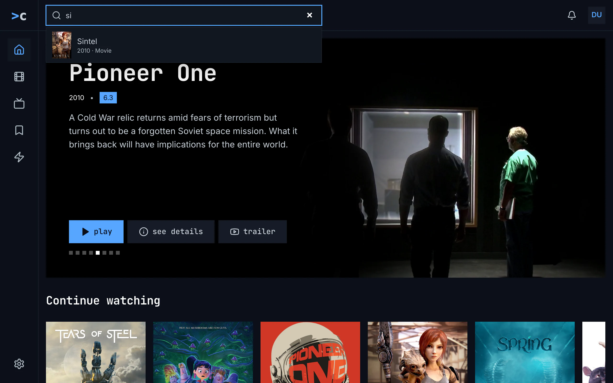

Figure 9.1: The list under the search field on the web as deployed on
6 November 2026, on a computer, at 1280 × 800.

1. **The field**, with “si” typed, framed in blue while it has the focus, and
   the browser's own × at its right, which empties it.
2. **The list under the field**: up to eight movies and shows that match, each
   with a small poster, the name and “2010 · Movie”. It has no people. It
   opens from the second letter, 0.2 seconds after the last key.
3. **The page under the list**, home here, stays as it was; the list covers
   part of it.

↑ and ↓ choose an entry in the list and Enter opens its page; Enter with none
chosen opens the results page, and Esc closes the list and keeps the words.
Figure 9.2 shows the results page for “s” on a computer. Its address holds the
words, so a reload, or back from a result, brings it again.

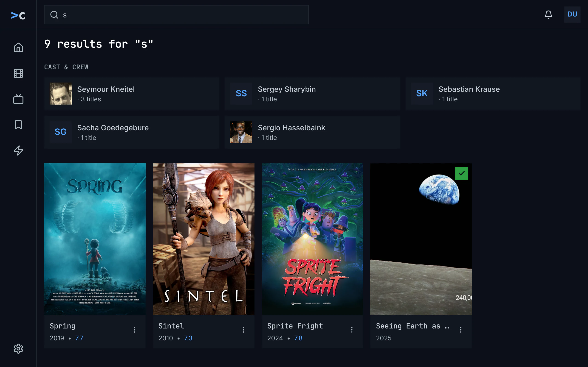

Figure 9.2: The search's results on the web as deployed on 6 November 2026, on
a computer, at 1280 × 800.

1. **The field**, holding the page's words, and on the left the side
   navigation of [chapter 2](./frame.md), with no view current.
2. **The heading**, “9 results for "s"”, in the monospace face. It counts the
   people and the titles together.
3. **CAST & CREW**, in capitals, and the people as cards, three to a line: a
   photo, or the initials in blue, the name, and “· 3 titles”.
4. **The titles**, without a heading, as posters, the server's best match
   first: the name in the monospace face, the year and the rating in blue,
   “2019 • 7.7”, and ⋮, which opens the card's menu. The watched check on
   green marks a title the viewer has seen.

Figure 9.3 shows the same results on a phone held upright.

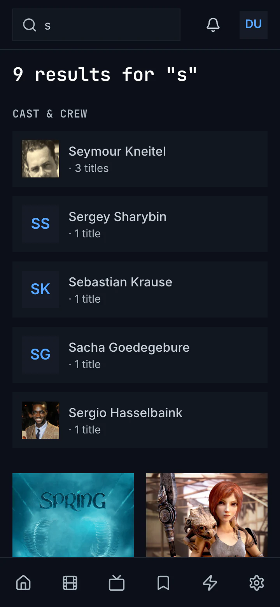

Figure 9.3: The search's results on the web as deployed on 6 November 2026, on
a phone held upright, at 360 × 780.

1. **The field**, always open in the top bar, with the bell and the avatar
   beside it ([chapter 2](./frame.md)).
2. **The heading**, as on a computer.
3. **CAST & CREW**: below 640 px wide, the people stand one under the other.
4. **The titles**, two to a line, under the people.
5. **The tabs** of [chapter 2](./frame.md), none of them current.

Figure 9.4 shows them on a phone held sideways.

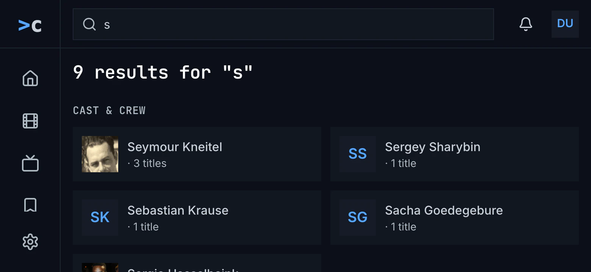

Figure 9.4: The search's results on the web as deployed on 6 November 2026, on
a phone held sideways, at 780 × 360.

1. **The side navigation**, as on a computer, from 768 px wide
   ([chapter 2](./frame.md)).
2. **The heading**, as on a computer.
3. **CAST & CREW**, two to a line from 640 px wide; the titles follow under
   the people.

While the results load, the heading says “Searching for "s"…”. A search that
found nothing says “No results for "s"”, with any buttons an addon on the
server adds under it; one that couldn't be made is headed “couldn't search for
"s"”, with the reason, **try again** and **details**. The results page without
words says “Search the library” and “Type a movie or show title in the search
bar to look it up.” Choosing a view leaves the results, and a screen reader
isn't told how many there are.

### 9.2.2 The phone app

The phone app's field is always open in the top bar, on every tab and at every
width ([chapter 2](./frame.md)). From the first letter, a quarter of a second
after the last key, the results take the page's place under the bar, and the
tabs stay. “Cast & crew” comes first, the people one under the other, each with
a photo or the initials, the name, and “· 1 title” under it. Then comes the
heading, “4 results for "s"”, which counts the titles only, and up to 40
titles in a grid of posters at least 168 dp wide: two to a line on a phone
360 dp wide, three on one held sideways. While it searches, “Searching for
"s"…” stands with a spinner, and for a quarter of a second after each key the
heading keeps the old count with the new words. Where only people match, the
people are followed by “No results for "s"”. A search that couldn't be made
says “Results for "s"”, then “couldn't load the results”, the reason, **try
again** and **details**. × empties the field and gives the tab back; choosing a
tab keeps the results until the field is empty. Back from a result runs the
search again, with its spinner.

### 9.2.3 Android TV

Android TV's search is a view of its own, with the rail and the top bar; on the
other views a field like it in the top bar opens it, and the rail has no search
([chapter 2](./frame.md)). The field takes the focus, and the system's keyboard
types into it. With nothing typed, the view says “Search the library” and
“Type a movie or show title to look it up.” It searches as the person types, a
quarter of a second after the last key: “Searching for “s”…”, then “cast &
crew”, a row of people, and the titles under “4 results for “s””, which counts
the titles, six to a line and up to 60. Where only people match, “0 results
for “s”” and “No matching titles.” follow them; where nothing does, “No results
for “s””, with any buttons an addon adds. A search that failed says “Search
failed” in red with the error's text, and offers no try again. Back closes the
view; back from a result keeps the results, with the focus on the field.

### 9.2.4 Samsung TV

The Samsung TV's top bar has a field that opens the search page; there, the
field is a button that opens the app's own keyboard over the whole screen,
which hides the results while people type. Its keys are rows from 1 to 0, q to
p, a to l with @, z to m with . - /, a row of signs, then wide keys for space,
delete and done, drawn as icons, and the focus starts on 1. With nothing
typed, the page says “Search the library” and “Open the keyboard to look up a
movie or show title.” It searches as people type, as on Android TV, with
“Searching for “s”…”, “Cast & crew” as a row of up to 12 people, and the
titles under “4 results for “s””, six to a line, with only the watched check.
Where only people match, “0 results for “s”” and “No matching titles.” follow
them; a failed search says “Search failed” in red with the error's text, and
offers no try again. Back closes the keyboard, then leaves the page; back from
a result finds the words gone.

### 9.2.5 Feature by feature

The table compares the four apps' search feature by feature. “—” is a feature
the app doesn't have, and “not found” one its code was searched for and
doesn't have.

| Feature | Web | Phone app | Android TV | Samsung TV |
|---|---|---|---|---|
| Where it starts | the field in the top bar ([chapter 2](./frame.md)) | the field, always open in the top bar | its own view, opened from a field in the top bar | its own page, opened from a field in the top bar; there a button opens the keyboard |
| The placeholder | “Search movies, shows…” | the same | the same | the same |
| When it searches | from the second letter, 0.2 s after the last key, the list under the field; the results page only on Enter | from the first letter, 0.25 s after the last key, the results in the page | the same | the same |
| The list under the field | up to eight movies and shows: a small poster, the name, “2010 · Movie”; no people | — | — | — |
| The results' heading | “9 results for "s"”: the people and the titles | “4 results for "s"”: the titles only, under the people | “4 results for “s””, the titles only | the same |
| The people's heading | “CAST & CREW”, in capitals | “Cast & crew” | “cast & crew” | “Cast & crew” |
| A person's card | a photo or the initials, the name, “· 3 titles” | the same | the same | the same |
| The people's layout | three to a line from 1024 px wide, two from 640 px, else one | one under the other | one line | one line |
| The titles | no heading; posters, two to a line below 640 px, then as many of at least 190 px as fit | no heading; posters of at least 168 dp, two at 360 dp | under the count; six to a line | under the count; six to a line, with only the watched check |
| At most | 60 titles, 12 people | 40 titles, 12 people | 60 titles, 12 people | 60 titles, 12 people |
| Episodes | not asked for | not asked for | not asked for | not asked for |
| The order | the server's: one search, the titles ranked together | the same | the same | the same |
| Nothing typed | “Search the library”, “Type a movie or show title in the search bar to look it up.” | the page under the field, as it was | “Search the library”, “Type a movie or show title to look it up.” | “Search the library”, “Open the keyboard to look up a movie or show title.” |
| Loading | “Searching for "s"…” | the same, with a spinner; after each key, the old count with the new words | “Searching for “s”…” | the same |
| Only people match | the people, under “5 results for "s"” | the people, then “No results for "s"” | the people, “0 results for “s””, “No matching titles.” | the same |
| No match | “No results for "s"”, then an addon's buttons | the same | the same | the same |
| Couldn't search | headed “couldn't search for "s"”: the reason, try again, details | “Results for "s"”, then “couldn't load the results”, the reason, try again, details | “Search failed” in red and the error's text; no try again | the same |
| Clearing and leaving | the browser's × empties the field; Esc closes only the list; a view leaves the results | × empties the field and gives the tab back; a tab keeps the results until the field is empty | back closes the view | back closes the keyboard, then the page |
| The / key | not found | — | — | — |
| Back from a result | the results again, from the address | the search again, with its spinner | the results as they were, the focus on the field | the words gone, “Search the library” |
| The keyboard | the computer's, or the phone's own | the phone's own | the system's | the app's own, over the whole screen: 1–0, q–p, a–l and @, z–m and . - /, signs, space, delete, done |
| A screen reader | not told the count | not told | not told | not told |

## 9.3 Search on a computer

Figure 9.5 shows search on a computer, after the person typed one letter.

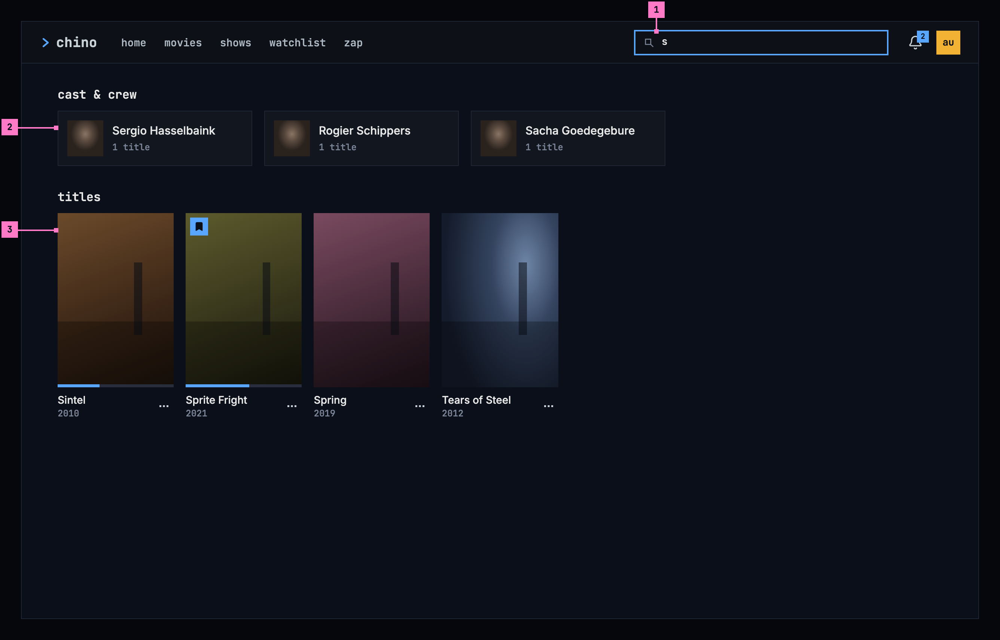

Figure 9.5: Search on a computer, at 1280 × 800.

1. **The field** in the top bar, the design system's input with its search
   mark, framed in blue while it has the focus. Its placeholder says what it
   finds, “search movies, shows and people…”, and the / key puts the focus in
   it from anywhere, except while the person is typing in another field. As
   soon as it holds a letter, the results take the page's place, and no view
   in the bar is current.
2. **cast & crew**: the people whose names match, in one line of cards. A card
   shows the photo, or the initials where the catalog has no photo, the name,
   and how many of their titles the library has: “1 title”. It opens the
   person's page ([chapter 7](./person.md)).
3. **titles**: the movies, shows and episodes that match, in one grid, the best
   match first, whatever its kind. The cards are those of movies and shows
   ([chapter 5](./browse.md)), with their status marks and the button of
   their menu.

Esc in the field empties it and brings back the page the person was on, and so
does choosing a view in the bar. The address holds the words, so a reload, or
back from a result, brings the same results back.

## 9.4 Search on a phone

The phone searches upright and sideways. Figures 9.6 and 9.7 show it upright
and figures 9.8 and 9.9 sideways; section 9.4.3 says what happens when the
phone is turned.

### 9.4.1 Held upright

Figure 9.6 shows what the search icon in the top bar opens
([chapter 2](./frame.md)), before the person types.

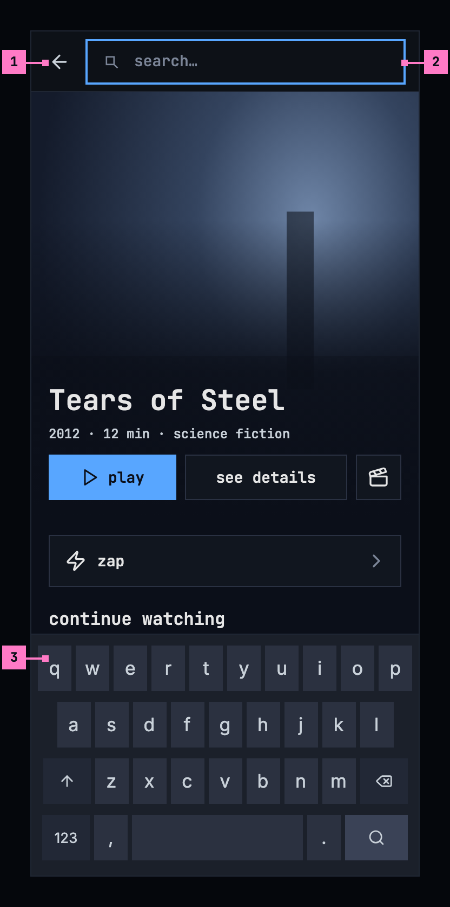

Figure 9.6: The search opened on a phone held upright, at 360 × 780 dp.

1. **The back arrow** closes the search and gives the bar back, with the page
   as it was.
2. **The field**, the design system's input at the large size, takes the
   whole width of the bar, and the focus. Its placeholder is “search…”: at
   320 dp, the narrowest phone, the computer's “search movies, shows and
   people…” would be cut off.
3. **The phone's own keyboard** comes up with the field. Until the first
   letter, the page under the field stays as it was, here home.

Figure 9.7 shows the results. The keyboard's search key has closed the
keyboard, and the results stay.

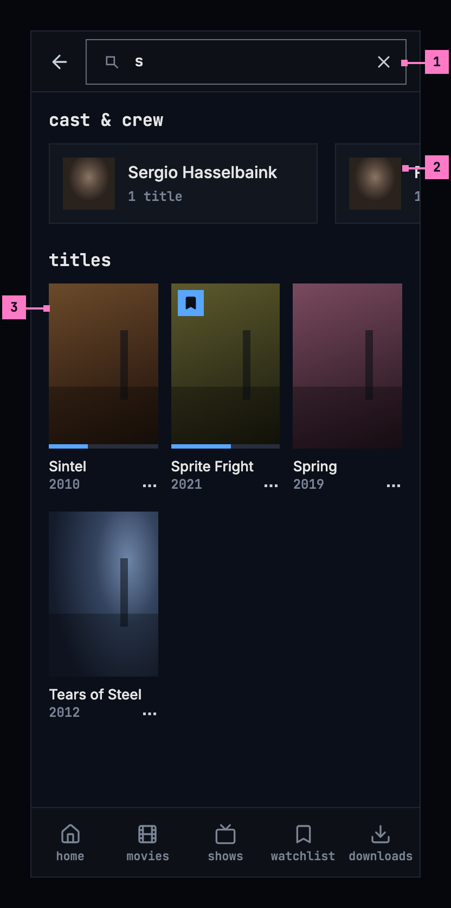

Figure 9.7: Search on a phone held upright, at 360 × 780 dp.

1. **×**, the design system's quiet icon button at the field's end, empties
   the field and brings the page back. The field stays open, with the
   keyboard, for other words.
2. **cast & crew** is one line that scrolls sideways, with a card and a part of
   the next in view, so the people never push the titles far down.
3. **titles**, three to a line, as in movies and shows.

The tabs stay under the results, with none of them current, and a tab closes
the search and opens its view. The web on a phone works as figures 9.6 and
9.7 show, with its own tabs.

### 9.4.2 Held sideways

Figure 9.8 shows the search opened on a phone held sideways, before the person
types. The numbers mark where it differs from figure 9.6.

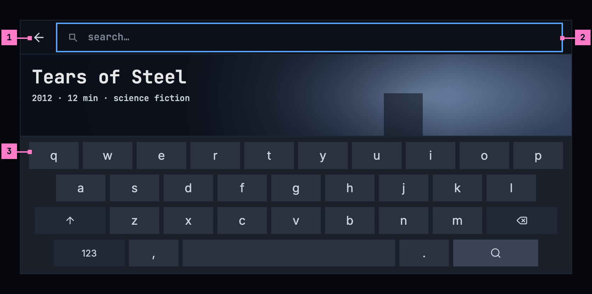

Figure 9.8: The search opened on a phone held sideways, at 780 × 360 dp.

1. **The back arrow**, as upright, in the slimmer bar.
2. **The field** runs across the screen's width: while the keyboard is up, the
   rail goes, as the tabs do upright.
3. **The keyboard** takes the lower half of the screen. In the band above it,
   the page under the field stays as it was.

Figure 9.9 shows the results, with the keyboard closed.

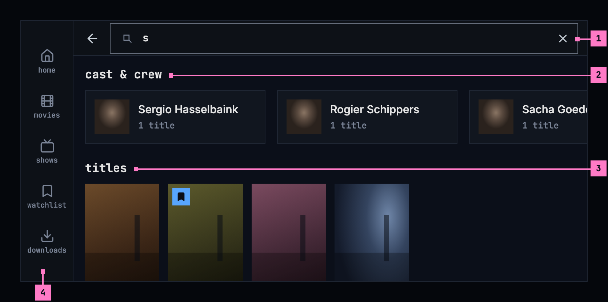

Figure 9.9: Search on a phone held sideways, at 780 × 360 dp.

1. **The field**, in the slimmer bar, with × to empty it.
2. **cast & crew**, one line of cards, with more of them in view.
3. **titles**: the posters keep the size they have upright, so six stand on a
   line; here all four that match.
4. **The tabs** stand as a rail down the left edge while the keyboard is
   closed ([chapter 2](./frame.md)).

### 9.4.3 Turning the phone

The search turns with the phone and keeps everything: the words in the field,
the results, where the person had scrolled to, and the keyboard, up or closed,
as it was.

- **Turned sideways**, the bar gets slimmer, and while the keyboard is closed
  the tabs become the rail. The people's line shows more cards, and six
  posters stand on a line. With the keyboard up, it takes the lower half of
  the screen, and the field keeps the focus.
- **Turned back upright**, the tabs come back at the foot, and three posters
  stand on a line.

## 9.5 Search on a TV

Figure 9.10 shows the search view, opened from the rail, after the person typed
“llam”.

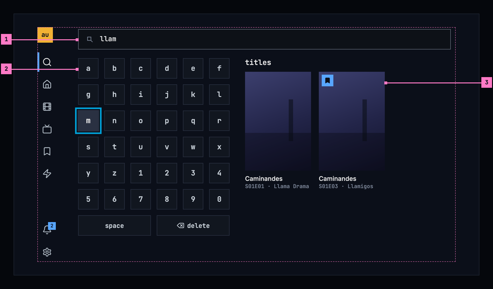

Figure 9.10: Search on a TV, at 960 × 540 dp.

1. **The field**, the design system's input at the large size, shows what is
   typed. It takes no focus of its own: the keyboard types into it.
2. **The keyboard**: the letters a to z and the digits 0 to 9 in six columns,
   then **space** and **delete**. The design system has no keyboard, so the
   keys are chino's own, at the TV's control height, 42 dp, 12 dp apart, in
   the look of its standard buttons, and the focused key has its TV focus. The
   view opens with an empty field and the focus on **a**; OK on a key types
   it. Right from the keyboard's last column goes into the results, left from
   their first column back to the keyboard, and left from the keyboard's first
   column opens the rail.
3. **An episode that matches** shows as its show's card, with the episode
   under the name: “S01E03 · Llamigos”. OK opens the show's page on that
   episode ([chapter 6](./title-actions.md)). Two episodes of one show make two
   cards, as here.

The results sit beside the keyboard, so they change in view as the person
types. Back leaves the search for the view the person came from. The same
keyboard types a list's name on a TV ([chapter 8](./watchlist.md)).

## 9.6 What search finds

### 9.6.1 Matching and order

- Search looks at the names of movies, shows and episodes, and at people's
  names, from the first letter. A quarter of a second after the last key it
  searches again, and the results change in place.
- The titles are one list, ranked together by how well they match: a name
  that is the words typed, then one that begins with them, then one that holds
  them, then one spelled close to them. A title's description counts only when
  no name matches. People are ranked apart, the same way.
- Up to 60 titles and 12 people show, the best first.
- An episode shows as its show's card, with its code and name under the
  show's name, “S01E01 · Llama Drama”. When the show's own name matches as
  well, its card and the episode's are one.
- As the results change, a screen reader says how many there are:
  “3 people, 4 titles”, or “no matches”.

### 9.6.2 Opening a result, and leaving

- A result opens its page: a movie's or a show's page, a show's page on the
  episode that matched, or a person's page. Back returns to the results as
  they were, with the words in the field, and on a TV with the focus on the
  result that was opened.
- Search closes with Esc or a view in the bar on a computer, with the back
  arrow or a tab on a phone, and with back on a TV.

## 9.7 Changes

Every difference between section 9.2 and the target is one change in the
table. A change names the apps it is built in, what they do today and the
target, with the figure or the section that sets it out; it is built as its
row says, and nothing else changes with it. Each change starts as proposed;
once the owner approves it, it is built, one change at a time. A target that
starts with “Recommended” was an open decision. The field's place in the
frame, the phone's search icon and the search on the TV's rail belong to
[chapter 2](./frame.md); the field's placeholder is this chapter's (9.C15).

| No. | Change | Apps | Today | Target | Status |
|---|---|---|---|---|---|
| 9.C1 | The results in the page, as people type | Web | from the second letter, 0.2 seconds after the last key, a list of up to eight movies and shows under the field, without people (figure 9.1); Enter opens the results page, which doesn't change as people type | Recommended: no list under the field; from the first letter, a quarter of a second after the last key, the results take the page's place and change in place (figure 9.5, section 9.6.1). The posters and the people need the room, and the phone and the TV have no other place for them | proposed |
| 9.C2 | Two groups, cast & crew and titles | Web, Phone app, Android TV, Samsung TV | Web: “9 results for "s"”, counting the people and the titles, “CAST & CREW” in capitals, the titles without a heading (figure 9.2). Phone app, Samsung TV: “Cast & crew”, then “4 results for "s"”, counting the titles. Android TV: “cast & crew”, then “4 results for “s”” | the groups **cast & crew** and **titles**, without a line that counts them; a group with nothing found is left out with its heading (figures 9.5, 9.7) | proposed |
| 9.C3 | The people in one line | Web, Phone app, Android TV, Samsung TV | Web: cards three to a line, one below 640 px (figure 9.3). Phone app: one under the other. Every app: “· 1 title” | one line of cards, scrolling sideways on a phone with a card and a part of the next in view; a card says “1 title” (figures 9.5, 9.7) | proposed |
| 9.C4 | The titles' size and number | Web, Phone app | Web: two to a line below 640 px. Phone app: two to a line at 360 dp, three held sideways; at most 40 titles | three to a line upright, six held sideways, at the size of a poster in movies and shows; up to 60 titles and 12 people (figures 9.7, 9.9, section 9.6.1) | proposed |
| 9.C5 | Episodes in search | Web, Phone app, Android TV, Samsung TV | only movies and shows are asked for | an episode as its show's card with the episode under the name, “S01E03 · Llamigos”, opening the show's page on it; one card where the show matched too (figure 9.10, section 9.6.1) | proposed |
| 9.C6 | Loading | Web, Phone app, Android TV, Samsung TV | Web: “Searching for "s"…” as the heading. Phone app: the same with a spinner, and after each key the old count with the new words. Android TV, Samsung TV: “Searching for “s”…” | nothing for 0.4 seconds, then grey blocks; typing on, the results stay with a thin blue line along their top (figure 9.11) | proposed |
| 9.C7 | No matches, and only one group | Web, Phone app, Android TV, Samsung TV | “No results for "s"”, with an addon's buttons; Phone app: also under the people where only people match. Android TV, Samsung TV: where only people match, “0 results for “s”” and “No matching titles.” | the design system's empty state with its search picture: **no matches**, “Nothing in the library fits this search.” and **clear search**, an addon's buttons under them (figure 9.12); where only people or only titles match, that group alone | proposed |
| 9.C8 | Couldn't search | Web, Phone app, Android TV, Samsung TV | Web: headed “couldn't search for "s"”, the reason, try again. Phone app: “Results for "s"”, then “couldn't load the results”, the reason, try again. Android TV, Samsung TV: “Search failed” in red with the error's text; no try again | with nothing shown yet, the design system's empty state with its error picture in the results' place: “couldn't search the library”, the reason by cause and **try again**; with the results of earlier words shown, they stay under the warning banner “Couldn't search for “sp”; it shows the results for “s”.” with **try again**; the words stay in the field (section 9.8) | proposed |
| 9.C9 | Nothing typed | Web, Android TV, Samsung TV | Web, the results page without words: “Search the library”, “Type a movie or show title in the search bar to look it up.” Android TV: “Search the library”, “Type a movie or show title to look it up.” Samsung TV: “Search the library”, “Open the keyboard to look up a movie or show title.” | on a computer and a phone, the page as it was; on a TV, the keyboard with nothing beside it (section 9.8) | proposed |
| 9.C10 | Web: Esc and the / key | Web | Esc closes the list under the field and keeps the words; no key puts the focus in the field | Esc in the field empties it and brings back the page; / puts the focus in the field from anywhere, except while typing in another field (section 9.3) | proposed |
| 9.C11 | Phone app: a tab closes the search | Phone app | choosing a tab keeps the results until the field is empty | a tab closes the search and opens its view; × empties the field and keeps it open, with the keyboard (section 9.4.1) | proposed |
| 9.C12 | Back from a result | Phone app, Android TV, Samsung TV | Phone app: the search runs again, with its spinner. Android TV: the results stay, the focus on the field. Samsung TV: the words are gone | the results as they were, with the words in the field; on a TV the focus on the result that was opened (section 9.6.2) | proposed |
| 9.C13 | The TV's own keyboard beside the results | Android TV, Samsung TV | Android TV: the system's keyboard. Samsung TV: the app's keyboard over the whole screen, hiding the results: 1–0, q–p, a–l and @, z–m and . - /, signs, space, delete and done | Recommended: the app's own keyboard in the page, a to z and 0 to 9 in six columns, then **space** and **delete**, its keys chino's own, as the design system has no keyboard: 42 dp square, 12 dp apart, in the look of its standard buttons, with the results beside it (figure 9.10); the same keyboard types a list's name ([chapter 8](./watchlist.md)) | proposed |
| 9.C14 | A screen reader hears the count | Web, Phone app, Android TV, Samsung TV | not found | “3 people, 4 titles”, or “no matches”, as the results change (section 9.6.1) | proposed |
| 9.C15 | The field's placeholder | Web, Phone app, Android TV, Samsung TV | “Search movies, shows…” in every app; on the web narrower than 768 px it is cut off, “Search movies, sho” | “search movies, shows and people…” on a computer and a TV; “search…” in the phone's field, which opens from the bar's search icon (2.C3, section 9.4.1): lowercase and ending in “…”, as the design system's top bar words a search's placeholder, “search apps…” | proposed |

## 9.8 States

Figures 9.5 to 9.10 show search with results, and before the first letter.
Figures 9.11 and 9.12 show the states in between.

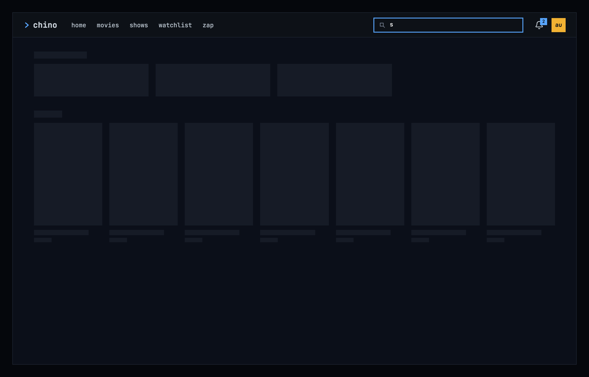

Figure 9.11: Search loading, on a computer.

The first results for new words show nothing for the first 0.4 seconds, and
after that grey blocks in the shape of a line of people and a line of posters,
as the design system's
[loading and progress](https://nalet.github.io/design-system/patterns/loading-and-progress/)
describes. Typing on, the results that are there stay at full strength, with a
thin blue line running along their top until the new ones are in, so the page
doesn't flicker with every key.

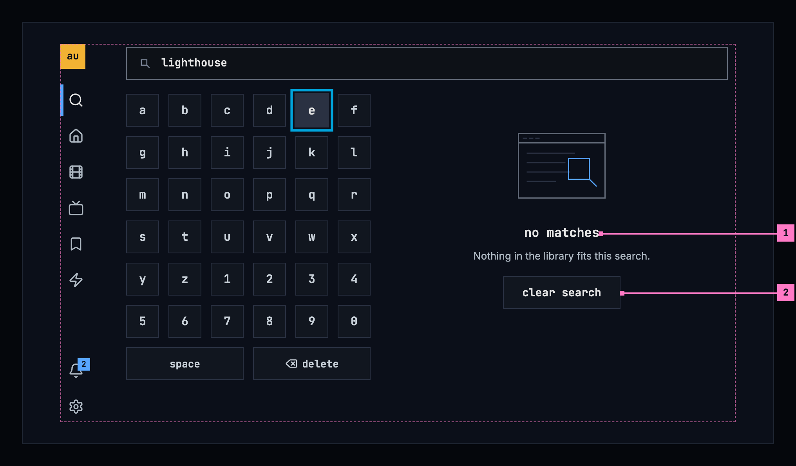

Figure 9.12: A search that matches nothing, on a TV.

1. **no matches**: the design system's empty state with its search picture,
   and “Nothing in the library fits this search.” under it, in the results'
   place. The words stay in the field, so the person can change a letter
   instead of starting over.
2. **clear search**, its standard button, empties the field, the state's one
   way out. On a TV it spares deleting the words key by key, and the focus
   goes to **a**; on a computer and a phone the focus goes to the field.

Where search couldn't be made, what shows follows the design system's
[message handling](https://nalet.github.io/design-system/patterns/message-handling/):
with nothing on the screen yet, the empty state with its error picture takes
the results' place; with the results of earlier words on the screen, they
stay, under a warning banner that says whose results they are.

| State | What search shows |
|---|---|
| Nothing typed | On a computer and a phone, the page as it was (figure 9.6); on a TV, the keyboard with nothing beside it |
| Loading | Figure 9.11 |
| Typing on | The results stay, with a thin blue line running along their top |
| Only people, or only titles, match | That group alone, without the other's heading |
| No matches | Figure 9.12. Where an addon on the server adds buttons for a search that found nothing, they follow under it |
| Couldn't search, with nothing shown yet | The empty state with its error picture in the results' place: “couldn't search the library”, the reason and **try again**; the words stay in the field. [Chapter 17](./errors.md) lists every cause and its sentence |
| Couldn't search for new words, with the results of earlier ones shown | The results stay, under the warning banner “Couldn't search for “sp”; it shows the results for “s”.”, with **try again**; the banner goes once a search works |
| The phone app can't reach the server | The banner of [chapter 13](./downloads.md), and under it the empty state “couldn't search the library” with **try again**, without the sentence, which the banner already says |

## 9.9 Words

| Where | Text |
|---|---|
| The field's placeholder on a computer and a TV | search movies, shows and people… |
| The field's placeholder on a phone | search… |
| The phone's buttons, for screen readers | search · close search · clear search |
| The groups | cast & crew · titles |
| A person's card | Sergio Hasselbaink · 1 title · 4 titles |
| A title's card | the name, and the year: 2010 |
| An episode's card | the show's name, and “S01E01 · Llama Drama” |
| The TV's keyboard | a–z · 0–9 · space · delete |
| What a screen reader says as the results change | 3 people, 4 titles · no matches |
| No matches | no matches · Nothing in the library fits this search. · clear search |
| Couldn't search | couldn't search the library · Can't reach the server. · try again |
| Couldn't search for new words | Couldn't search for “sp”; it shows the results for “s”. · try again |
