# 16 Settings and account

Section 16.2 describes settings and the account as they are deployed today. The
sections after it are the target, the screens as they are meant to be, and
section 16.7 lists every difference between the two as a numbered change. Only
a change the owner has approved is built, one change at a time; anything no
change names stays as it is deployed.

The chapter covers settings and the account: what can be set, who is signed in,
signing out, removing an account from a device, deleting it, and reporting a
bug. The frame around these screens is in [chapter 2](./frame.md); connecting
to a server and signing in are in [chapter 3](./start.md).

## 16.1 Purpose

Settings hold what a person sets once and then forgets: the languages titles
play in, how episodes follow one another, and on a phone how titles download.
The account page says who is signed in, and it is where the person signs out
or deletes the account.

Neither is one of the views. On a computer, settings opens from the gear at
the rail's foot and from the avatar's menu, and the account page from the
avatar's menu ([chapter 2](./frame.md)); on a phone both open from the
avatar's menu, as screens with a back arrow and their name in place of the
bar. On a TV, settings is the last item of the rail, and the account page is
the first row of settings.

A setting applies the moment it changes, as the design system's
[forms and settings](https://nalet.github.io/design-system/patterns/forms-and-settings/)
has it for switches: there is no save button. Settings are kept on the device,
for everyone who watches on it.

## 16.2 As deployed

This section says what the four apps' settings and account pages do as of
6 November 2026: the web as the public demo showed it that day, on the same
build as production, and the apps as their code had them that day. The phone
app, Android TV and the Samsung TV are described from their code until
screenshots of them are taken. The Samsung TV app isn't released yet.

### 16.2.1 The web

Figures 16.1 to 16.6 are screenshots of the web's settings, its account page
and the question before an account is deleted. Figure 16.1 shows settings on a
computer.

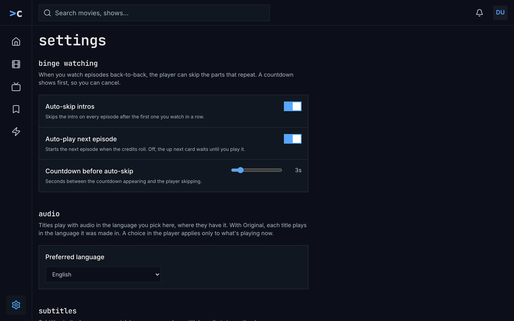

Figure 16.1: The web's settings as deployed on 6 November 2026, on a computer,
at 1280 × 800.

1. **Bottom left: settings in the side navigation**, its gear blue: settings is
   one of the frame's views ([chapter 2](./frame.md)).
2. **binge watching**, the first group, with a line of its own under its name:
   “When you watch episodes back-to-back, the player can skip the parts that
   repeat. A countdown shows first, so you can cancel.”
3. **Auto-skip intros and Auto-play next episode**, two switches, on, each with
   its line: “Skips the intro on every episode after the first one you watch in
   a row.” and “Starts the next episode when the credits roll. Off, the up next
   card waits until you play it.”
4. **Countdown before auto-skip**: a slider from 1 to 15 seconds with the value
   beside it, “3s”, over “Seconds between the countdown appearing and the
   player skipping.”
5. **audio**, with its text under the group's name, then a card with
   **Preferred language**, the browser's own list: “Original”, then every
   language in alphabetical order. English is set until it is changed.

Figure 16.2 shows the end of the same page.

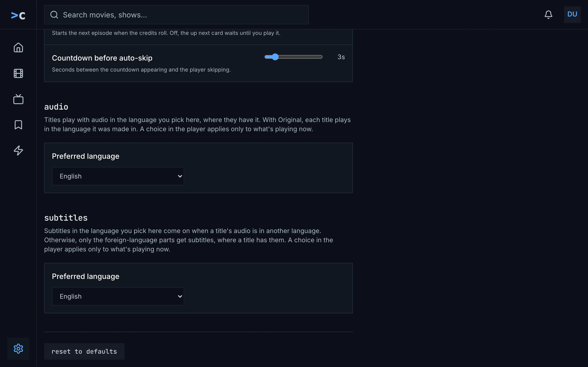

Figure 16.2: The web's settings as deployed on 6 November 2026, further down, on
a computer, at 1280 × 800.

1. **subtitles**, with its text, then **Preferred language**: a list of every
   language, because the demo's server names no subtitle languages; on a server
   that names a few, they are a row of buttons, with “off” first. English is
   set until it is changed.
2. **reset to defaults**, at the page's end, sets every setting back at once,
   without asking.

The demo's server takes no reports, so its settings have no feedback group. On a
server that takes them, feedback comes before reset to defaults, with “Reports
go to the people who run this server, with a screenshot of the page if you
attach one.”, a row named “Report a bug” with “Opens a short form. Crashes and
playback failures are also reported automatically, without a screenshot.”, and
**report a bug**. Settings has no version. While the server's subtitle languages
load, their card shows the loader with “Loading the subtitle languages…”; when
they couldn't load, “couldn't load the subtitle languages”, the reason and
**try again**. The settings are kept in the browser.

Figure 16.3 shows settings on a phone.

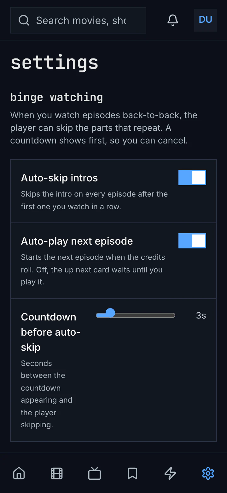

Figure 16.3: The web's settings as deployed on 6 November 2026, on a phone held
upright, at 360 × 780.

1. **The tabs**, with settings the sixth, blue.
2. **Countdown before auto-skip**: its name and its line wrap in a narrow
   column beside the slider.

The rest is as in figure 16.1, the groups one under another. Figure 16.4 shows
the account page on a computer, which **account** in the avatar's menu opens.

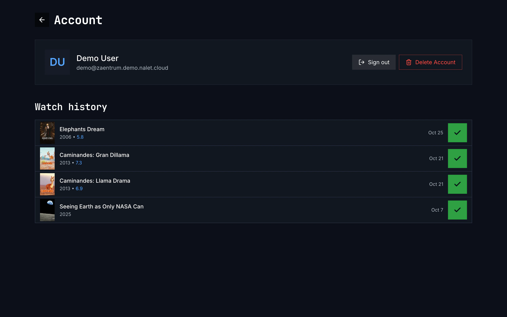

Figure 16.4: The web's account page as deployed on 6 November 2026, on a
computer, at 1280 × 800.

1. **Top left: back and the heading**, “Account”, capitalised. The page has no
   frame: no top bar and no side navigation.
2. **Who is signed in**: the avatar, the name and the email address, as the
   sign-in gives them.
3. **Sign out and Delete Account**, capitalised, in the body face; Delete
   Account red, with a red outline. Sign out signs out at once, without asking,
   at the server's sign-in service too.
4. **Watch history**, capitalised: what the person has finished, newest first,
   up to 60 titles, here four movies, each with its year and its rating; an
   episode stands under its show's name, with its code and its own name. Each
   row has the day it was finished, “Oct 25”, and the watched mark, a dark check
   on green, which takes the title off the list.

Figure 16.5 shows the account page on a phone.

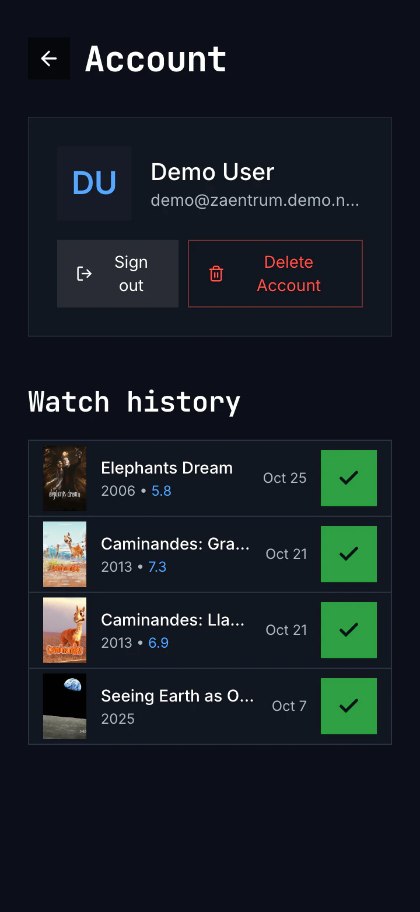

Figure 16.5: The web's account page as deployed on 6 November 2026, on a phone
held upright, at 360 × 780.

1. **Sign out and Delete Account** take a row of their own under the name, each
   half the width, their words on two lines.
2. **The email address** is cut short, with an ellipsis.

Before anything is watched, the history is one line without a heading:
“Nothing watched yet. A movie or an episode shows here once you finish it, or
mark it as watched.” A history that couldn't load shows the same line. Figure
16.6 shows the question before an account is deleted.

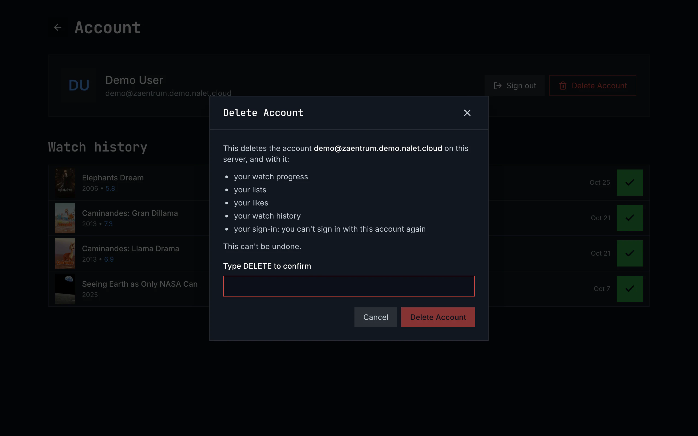

Figure 16.6: The web's delete account dialog as deployed on 6 November 2026, on
a computer, at 1280 × 800.

1. **The title**, “Delete Account”, capitalised, with ✕.
2. **What goes**, the target's list, with the account named by its email
   address “on this server”, without the server's name.
3. **Type DELETE to confirm**: a field, edged in red, for the word.
4. **Cancel**, and **Delete Account** filled red, dimmed until DELETE is typed.

After a deletion the web shows “account deleted”, with “Your account is
deleted, with everything this server kept of you, and you're signed out.” and
**sign in**. A server that refuses shows its reason under “Not Deleted”, one
that deletes no accounts “Deleting your account isn't available on this server
— ask its administrator.” under “Not Available”, and anything else its message
under “Try Again Later”; after the first two, Cancel becomes **Close**.

**report a bug** opens a dialog headed “report a bug”: “What happened?” over a
box, “What were you doing, what did you expect, what happened instead?”, the
player's details under **details** with “Sent with the report.”, then “Attach a
screenshot of the page”, off until it is ticked, which takes the screenshot,
with **retake**, and **cancel** and **send report**. Sent, it says “Thanks for
the report.” and “It went to the people who run this server as #482.”, or “The
people who run this server already have this one. Your details were added to
#482.”; not sent, “Couldn't file the report.” and the reason, or “Bug reporting
is switched off on this server, so this report can't be filed.”

### 16.2.2 The phone app

**Settings** is the last tab, headed “Settings”, and its groups come in this
order, headed in mixed case:

- **Account**: “Your account”, with the email address under it, which opens the
  account page; “Switch account”, with “Switch users or add another account”;
  “Sign out”, with the account's name under it; and “Delete Account” in red,
  with “Delete your account and what this server keeps of it”.
- **Binge watching**: three switches without a line under them, on at first:
  “Auto-skip intros & recaps”, “Auto-skip credits” and “Auto-play next
  episode”. There is no countdown; the player counts 5 seconds. The player
  reads only Auto-play next episode, so it skips nothing by itself.
- **Downloads**, in the Android app where the server offers them: “Download
  quality”, the qualities with what an hour takes at each, the chosen one blue
  with a check mark, Medium (720p) at first, and “Download over Wi-Fi only”, on.
- **Server**: a row, “Change server”, with the server's address under it.
- **Support**, only where the server takes reports: a row “Report a bug”, with
  “Tell the people who run this server. The app's and the device's details go
  with your report.”
- **Audio** and **Subtitles**, last, each with the target's text. Audio offers
  “Original” and eight languages, English at first; subtitles “off”, then the
  server's subtitle languages, or every language where it names none, off at
  first. A field opens its menu under it, in the page, the chosen language blue
  with a small square before it.

There is no version and no reset. **The account page** opens from the avatar
and from Your account: the avatar, the name and the email address with **Sign
out** beside them, and the watch history, up to 60 titles, dated “Jun 12”, each
with the watched mark that takes it off; it has no switch account and no delete
account. While the history loads a spinner turns, and one that couldn't load
reads “Nothing watched yet. A movie or an episode shows here once you finish
it, or mark it as watched.”, as an empty one does.

**Sign out** asks first only where downloads would go or a cast would stop:
“sign out”, “Your 23 downloads, 12.4 GB, are deleted from this phone.”, “Casting
on Living Room TV stops.”, **cancel** and **sign out**; then the app opens
who's watching, or sign in where no account is left. **Remove account**, on
who's watching, always asks: “The 8 downloads of Anna, 2.6 GB, are deleted from
this phone.”, or without downloads “This removes Anna from this phone. You'll
need to sign in again to use the account.” **Change server** asks once the new
server has answered, and only where downloads, anyone's, would go or a cast
would stop, with “Your 31 downloads, 15 GB, are deleted from this phone.”; it
says nothing of the other accounts, and then signs every account out and opens
sign in.

**Delete account**, only in settings, is a dialog headed “delete account”: “This
deletes the account alex@example.com on media.example.com, and with it:”, the
target's list, the downloads' sentence where there are some, and “This can't be
undone.”, with **cancel** and **delete account**, and “Deleting your account…”
while it runs; nothing is typed. Its answers sit under “Not Deleted”, “Not
Available” and “Try Again Later”, with the web's sentences; a deleted account
goes without a word, to who's watching or sign in.

**Report a bug**, from Support or from the player's error, takes the screenshot
before the dialog opens. The dialog is headed “Report a bug”; its box has no
label, only “What went wrong? What did you expect to happen?”, and from the
player it starts with “Playback failed while watching this item.” and the
technical details. “Include screenshot”, with “Attached to the report”, is on
until it is switched off. **Cancel** and **Submit** close it; sent, it says
“Filed bug #482” or “Added to existing bug #482”, and “Thanks — the report
reached the people who run this server.” Not sent, it says “Too many reports
right now — try again in a few minutes.”, “Bug reporting isn't set up on this
server.” or “Couldn't send the report. Check your connection and try again.”

### 16.2.3 Android TV

**Settings** opens from the rail's settings, headed “settings”, and each group's
line sits under its controls:

- **binge watching**, with “Skip recurring parts back-to-back without leaving
  the player. A short countdown gives you a chance to cancel before each skip
  fires.”: “Auto-skip intros & recaps”, “Auto-skip credits” and “Auto-play next
  episode”, each with a line of its own and **on** and **off** buttons, on at
  first, and “Countdown before auto-skip”, − and + from 1 to 15, 5 s at first.
- **audio** and **subtitles**, each with the target's text and a row named
  “Language”. Its menu, “audio language” or “subtitle language”, opens over the
  page, the chosen language blue with a small square: for the audio “Original”,
  then every language, the one set and the TV's own first, English at first;
  for the subtitles “off”, then the server's subtitle languages, or every
  language, off at first.
- **account**, with “See your account and its watch history, sign in to another
  account or add one, or delete your account.”: **see your account**, **switch
  account** and **delete account**.
- **server**: “Connected to media.example.com.” and **change server**.
- **feedback**, only where the server takes reports, with the phone app's line
  and **report a problem**.

There is no version. **The account page**, headed “account” and inside the
frame, shows the avatar, the name and the email address, and the watch history,
up to 60 titles, dated “Jun 12”, without the watched mark: OK on a row opens the
title. It says “Loading your account…” while it loads, “Nothing watched yet.
Watched items appear here once you finish a movie or episode (or mark one
watched on a detail page).” when it is empty, and “couldn't load your watch
history” when it couldn't load. Nothing signs out: an account leaves the TV by
its long press on who's watching ([chapter 3](./start.md)), by delete account,
or with a change of server, which asks nothing and signs every account out.

**Delete account** is a screen of its own, without the frame: the phone app's
words, headed “delete account”, the focus on **cancel**, then **delete
account**, and last “Press BACK to keep your account.”; its answers are the phone app's, and a
deleted account goes without a word. **report a problem** opens a list under
“What's going wrong? Pick the closest match.”, in sentence case: “Playback won't
start”, “Video stutters or freezes”, “Audio out of sync”, “Subtitles wrong or
missing”, “App is slow” and “Something else”. OK on one sends it at once, with
“Sending the report…”, and then says “Filed bug #482” and “Sent to the people
who run this server.”, with **Close**; not sent, the phone app's sentences.

### 16.2.4 Samsung TV

**Settings** opens from the rail's settings and from the avatar, headed
“Settings”, its groups in mixed case, each with a line of its own:

- **Binge watching**: Android TV's rows and lines, each switch one button that
  reads **ON** or **OFF**, and the countdown, “Seconds the countdown stays on
  screen before the player skips. Shorter feels snappier; longer gives more
  time to cancel.”, − and + from 1 to 15, 10 s at first.
- **Audio**, with “Default audio language. Picks the closest matching track on
  each item. Original keeps whatever the source marks as the default track.”:
  nine buttons, “Original”, “English”, “Deutsch”, “Français”, “Español”,
  “Italiano”, “日本語”, “Português” and “Nederlands”, Original at first.
- **Subtitles**, with “Your subtitle language. Subtitles in it come on by
  default when a title's audio is in another language. Off keeps them off by
  default. Forced subtitles, for the lines a title's audio has in another
  language, come on either way.”: “Off” and the same eight, Off at first.
- **Account**, with “Sign in as a different user on this TV, sign out of the
  current one, or delete your account.”: the name and the email address, and
  **Switch account**, **Sign out** and **Delete Account**.
- **Server**: “Connected to media.example.com.”, “Connecting to a different
  server signs out the accounts on this one.” and **Change server**, which signs
  every account out at once, before an address is typed, and asks nothing.
- **Feedback**, whether or not the server takes reports: “Something not
  working? File a bug straight to the dev backlog — no typing needed, device and
  app details ride along automatically.” and **Report a problem**, which opens
  Android TV's list; sent, it says “Filed bug #482” and “Thanks — the report
  landed on the dev backlog.”

There is no version, no account page and no watch history. **Sign out** asks
nothing and takes the account off the TV only: another account becomes the
active one and settings stays, or, with none left, sign in asks for a new code.
**Delete Account** is a screen of its own, without the frame, with Android TV's
words, headed “Delete Account”, the focus on **Cancel**; after a deletion the
next account's home opens, or sign in.

### 16.2.5 Feature by feature

The table compares the four apps feature by feature. “—” is a feature the app
doesn't have.

| Feature | Web | Phone app | Android TV | Samsung TV |
|---|---|---|---|---|
| Where settings opens | the gear at the foot of the side navigation; on a phone, the sixth tab | the last tab | the rail's settings | the rail's settings, and the avatar |
| Its heading | “settings” | “Settings” | “settings” | “Settings” |
| The groups, in order | binge watching, audio, subtitles, feedback, then reset to defaults | Account, Binge watching, Downloads, Server, Support, Audio, Subtitles | binge watching, audio, subtitles, account, server, feedback | Binge watching, Audio, Subtitles, Account, Server, Feedback |
| A group's own line | under binge watching, audio and subtitles | none | under each group's controls | under each group's heading |
| Auto-skip | “Auto-skip intros”, “Skips the intro on every episode after the first one you watch in a row.” | “Auto-skip intros & recaps”, without a line; the player doesn't read it | “Auto-skip intros & recaps”, “Skips the title sequence and any "Previously on…" recap at the top of an episode.” | as on Android TV |
| Auto-skip credits | — | a switch the player doesn't read | “Auto-skip credits”, on | “Auto-skip credits”, on |
| Auto-play next episode | with the target's line | a switch without a line | “Starts the next episode automatically when credits roll.” | as on Android TV |
| The controls | switches | switches | **on** and **off** buttons | one button, **ON** or **OFF** |
| The countdown | “Countdown before auto-skip”, a slider from 1 to 15, 3 s at first | none: the player counts 5 s | − and +, 1 to 15, 5 s at first | − and +, 1 to 15, 10 s at first |
| The audio language | “Preferred language”, the browser's list: Original, then every language in alphabetical order; English at first | Original and eight languages; English at first | “Language”: Original, then every language, the one set and the TV's own first; English at first | nine buttons, each language in its own words; Original at first |
| The subtitle language | “Preferred language”: off, then the server's languages as buttons, or every language as the browser's list; English at first | off, then the server's languages, or every language; off at first | “Language”: off, then the server's languages, or every language; off at first | Off and eight buttons; Off at first |
| The texts under them | the target's | the target's | the target's | its own |
| A language's menu | the browser's own list | under the field, in the page; the chosen one blue with a small square | over the page; the chosen one blue with a small square | buttons, no menu |
| Downloads | — | Android: the qualities with an hour's size, the chosen one blue with a check mark; Download over Wi-Fi only, on | — | — |
| The server | — | a row, “Change server”, with the address under it | “Connected to media.example.com.”, **change server** | the same, with “Connecting to a different server signs out the accounts on this one.” |
| Report a bug in settings | feedback, only where the server takes reports | “Support”, only where the server takes reports | feedback, only where the server takes reports; **report a problem** | Feedback, always; **Report a problem** |
| The version | none | none | none | none |
| Reset to defaults | **reset to defaults**, without asking | — | — | — |
| The account page | “Account”, without the frame, from the avatar's menu | “Account”, from the avatar and Your account | “account”, in the frame, from **see your account** | none |
| Sign out | on the account page and in the avatar's menu; asks nothing; at the sign-in service too | on the account page and in settings; asks where downloads go or a cast stops | none | in settings; asks nothing; the account off the TV only |
| After a sign-out | the sign-in service sends the browser back to the site | who's watching, or sign in | — | another account, settings staying, or sign in |
| Switch account | — | in settings, to who's watching | in settings, to who's watching | in settings: a list over the page |
| Delete account | on the account page, a dialog | in settings, a dialog | in settings, a screen of its own | in settings, a screen of its own |
| Its question | “Delete Account”, the account “on this server”, “Type DELETE to confirm”, a filled red button | “delete account”, the account on media.example.com, the downloads' sentence | “delete account”, the same, “Press BACK to keep your account.”, the focus on cancel | “Delete Account”, the same, the focus on Cancel |
| Its answers | under “Not Deleted”, “Not Available” and “Try Again Later” | the same | the same | the same |
| After a deletion | “account deleted”, with **sign in** | who's watching or sign in, without a word | the same | the next account's home, or sign in |
| The watch history | on the account page: up to 60, “Oct 25”, the watched mark takes a title off | the same, “Jun 12” | up to 60, “Jun 12”; OK opens the title; no mark | — |
| Nothing watched yet | “Nothing watched yet. A movie or an episode shows here once you finish it, or mark it as watched.”, without a heading | the same | “Nothing watched yet. Watched items appear here once you finish a movie or episode (or mark one watched on a detail page).” | — |
| The history couldn't load | it reads as nothing watched | it reads as nothing watched | “couldn't load your watch history” | — |
| Report a bug: the screenshot | off until ticked, then taken of the page under the dialog | taken before the dialog opens, attached unless switched off | none | none |
| Its words | “What happened?”, **cancel**, **send report** | no label, “What went wrong? What did you expect to happen?”, **Cancel**, **Submit** | six choices in sentence case; OK sends | as on Android TV |
| A report sent | “Thanks for the report.”, “It went to the people who run this server as #482.” | “Filed bug #482”, “Thanks — the report reached the people who run this server.” | “Filed bug #482”, “Sent to the people who run this server.” | “Filed bug #482”, “Thanks — the report landed on the dev backlog.” |
| A report not sent | “Couldn't file the report.” and the reason | “Couldn't send the report. Check your connection and try again.”, and two others | the phone app's sentences | the phone app's sentences |
| Remove account's question | — | always; without downloads “This removes Anna from this phone. You'll need to sign in again to use the account.” | always: “You'll need to sign in again to use this account on this TV.” | — |
| Change server | — | asks once the new server has answered, where downloads go or a cast stops; then every account signed out | asks nothing; a new server signs every account out | signs every account out at once, before an address is typed; asks nothing |

## 16.3 Settings

### 16.3.1 On a computer

Figure 16.7 shows settings on a computer, with the gear at the rail's foot
current: the heading, then the groups in two columns, each the design system's
card with the group's name as its title, as its [forms and
settings](https://nalet.github.io/design-system/patterns/forms-and-settings/)
draws a card of settings that apply at once.

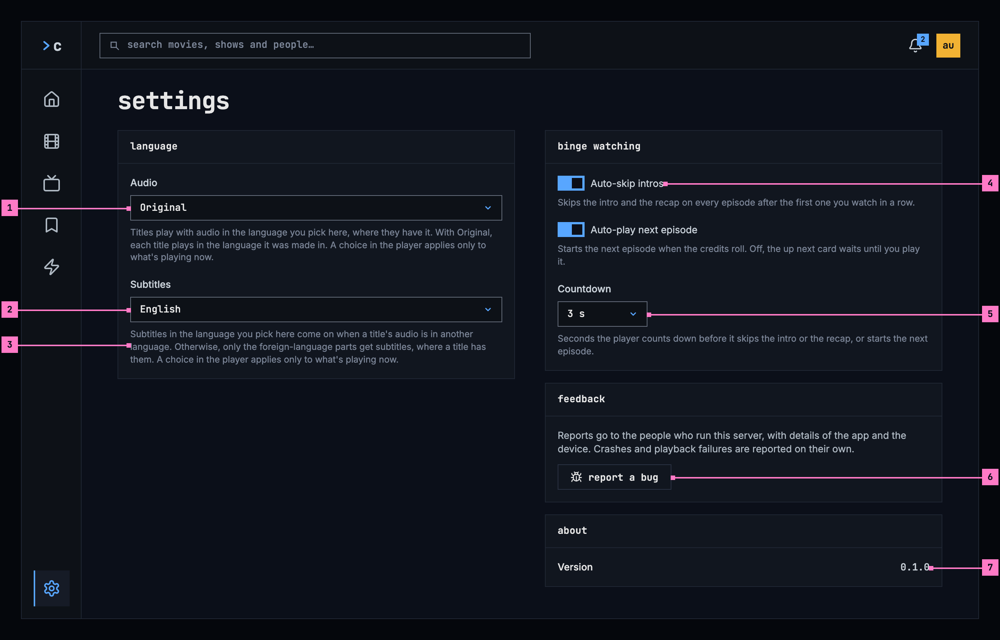

Figure 16.7: Settings on a computer, at 1280 × 800.

1. **Audio**, the design system's select, in a field with its label and its
   hint: the language titles play in, “Original” or a language (section
   16.4.1). Its list is the browser's own.
2. **Subtitles**, a select too: the language subtitles come on in, “off” or one
   of the server's subtitle languages (section 16.4.1).
3. **The text under a setting**, the field's hint, says what it does. The two
   language settings have the same text in every app, the audio's from [chapter
   11](./playback.md) and the subtitles' from [chapter 12](./subtitles.md).
4. **A switch**, the design system's: its track comes before the setting's
   name, and it applies at once, with nothing to save. The line under it says
   what it does (section 16.4.2).
5. **Countdown**, a select of the seconds, from 1 s to 15 s.
6. **report a bug**, a button, only where the server takes reports (section
   16.4.5).
7. **Version**, the app's version (section 16.4.6).

### 16.3.2 On a phone held upright

Figure 16.8 shows settings on a phone, where they open as a screen of their
own. The groups of figure 16.7 come one under the other; the numbers mark what
differs.

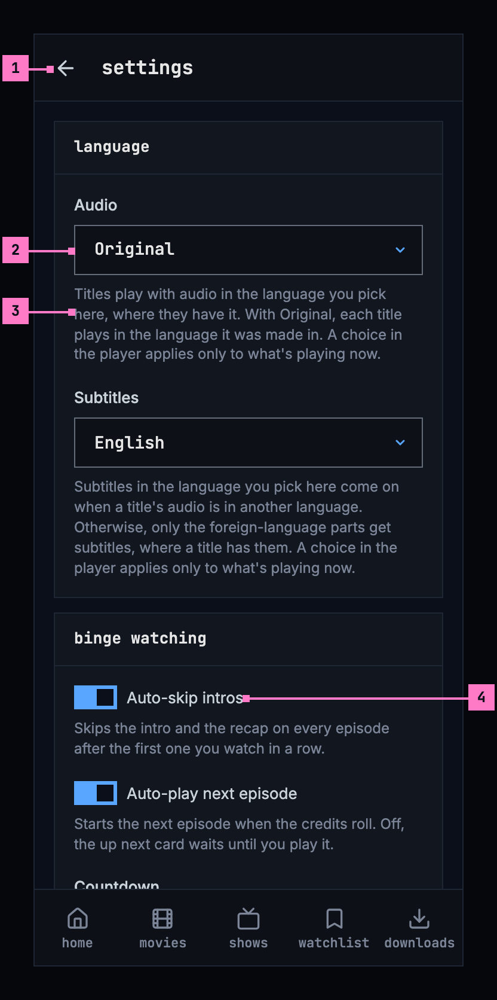

Figure 16.8: Settings on a phone held upright, at 360 × 780 dp.

1. **The back arrow** goes back to the screen settings were opened from. The
   tabs stay, as [chapter 2](./frame.md) describes.
2. **A language field**, the design system's select, 42 dp high on a phone.
   Its list is the phone's own: it opens over the page, with the chosen
   language marked as the phone marks a choice.
3. **The text** under the field, as on a computer.
4. **The switches**, as on a computer, each with its track before its name. A
   tap on the switch or on its name flips it; the area that takes the tap is 48 dp
   high, more than the switch draws.

Figure 16.9 shows the end of the page, which on a phone holds two groups more.

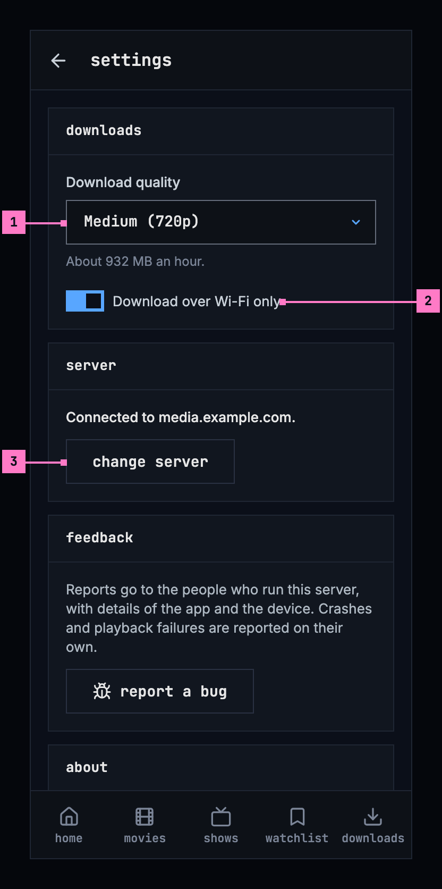

Figure 16.9: Settings on a phone held upright, further down.

1. **Download quality**, the design system's select: the quality titles
   download in. The phone's own list shows each quality with what an hour takes
   at it, “Medium (720p) · about 932 MB an hour”, as
   [chapter 13](./downloads.md) specifies; the field shows the picked quality's
   name, and its hint what an hour takes at it. The group, **downloads**, shows
   only where the phone keeps downloads and the server offers them.
2. **Download over Wi-Fi only**, a switch, on until it is switched off
   ([chapter 13](./downloads.md)).
3. **server**: the server the app is connected to, and **change server**, a
   button (section 16.4.4).

The groups **feedback** and **about** follow, as on a computer. The web on a
phone has the layout of figure 16.8, without downloads and server.

### 16.3.3 On a phone held sideways

Figure 16.10 shows settings on a phone held sideways. The page has room for two
columns, so the groups go in two, as on a computer; the numbers mark what
differs from figure 16.8.

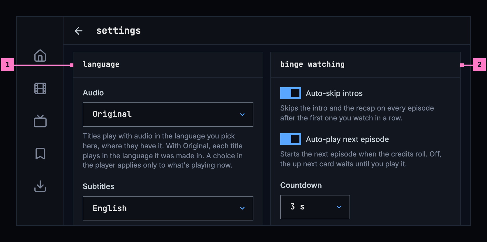

Figure 16.10: Settings on a phone held sideways, at 780 × 360 dp.

1. **language**, alone in the left column, with Audio and Subtitles and their
   texts.
2. **binge watching** heads the right column, and downloads, server, feedback
   and about follow under it, as the computer has its groups; the page
   scrolls.

The tabs are the rail at the left and the bar is slimmer, as on every screen of
a phone held sideways ([chapter 2](./frame.md)). A language field's list is the
phone's own, as upright.

### 16.3.4 On a TV

Figure 16.11 shows settings on a TV, opened from the rail. Right moves the focus
onto the page, and up and down go from setting to setting. On a TV the groups
are sections of the page under the design system's headings, without cards, so
that more of them fits inside the safe area.

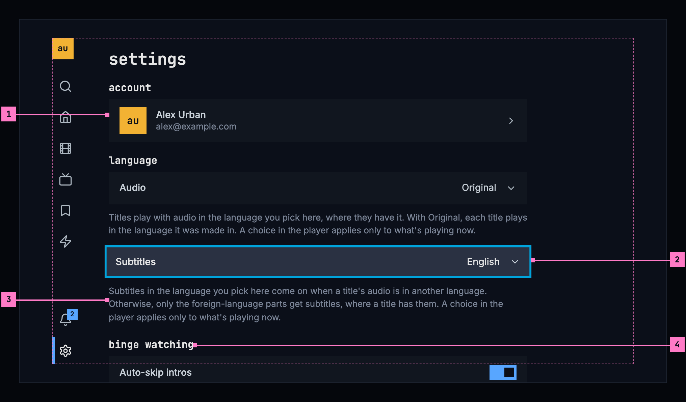

Figure 16.11: Settings on a TV, at 960 × 540 dp.

1. **account**: who is signed in, in a row that takes the focus. OK opens the
   account page (section 16.5.4). A TV has no avatar's menu, so this row is its
   way to the account.
2. **A language**, the design system's select, 42 dp high, shows what is set.
   Focused, it has the TV focus of a row: the ring inside its edge, the lighter
   surface. OK opens the TV's own list over the page, in the look of the
   player's menus, with the setting's language focused, as the design system
   has no list for a TV; picking one closes it, and so does Back.
3. **The text** under the row, as on a computer.
4. **binge watching** and the groups after it follow below. The page scrolls as
   the focus goes down, and OK flips a switch.

A TV has no downloads: server, feedback and about follow binge watching, as on
a phone.

## 16.4 What settings holds

### 16.4.1 Language

Two settings, one for the audio and one for the subtitles. Each has a text
under it that is the same in every app.

**Audio** offers “Original”, then every language by name, as no server names
the languages of its audio. With “Original”, each title plays in the language
it was made in. Its text, from [chapter 11](./playback.md):

> Titles play with audio in the language you pick here, where they have it.
> With Original, each title plays in the language it was made in. A choice in
> the player applies only to what's playing now.

**Subtitles** offers “off”, then the server's subtitle languages, read from its
configuration; a server that names none offers every language by name. Its text, from [chapter 12](./subtitles.md):

> Subtitles in the language you pick here come on when a title's audio is in
> another language. Otherwise, only the foreign-language parts get subtitles,
> where a title has them. A choice in the player applies only to what's playing
> now.

Where every language is offered, the person's own come first: the one set, and
the language of the device or the browser. All the others follow in
alphabetical order. Each language has the name the player's menus give it,
“German”, “Chinese (Simplified)”, and a language set before that the list no
longer has stays in it, so the setting always shows what is set.

While the server's subtitle languages load, the Subtitles field keeps its label
and shows the design system's small loader in its box, as its [loading and
progress](https://nalet.github.io/design-system/patterns/loading-and-progress/)
has it for a field. When they couldn't load, the design system's empty state for
an error takes the box's place, with the reason and **try again** (figure
16.21).

### 16.4.2 Binge watching

| Setting | The line under it | At first |
|---|---|---|
| Auto-skip intros | Skips the intro and the recap on every episode after the first one you watch in a row. | on |
| Auto-play next episode | Starts the next episode when the credits roll. Off, the up next card waits until you play it. | on |
| Countdown | Seconds the player counts down before it skips the intro or the recap, or starts the next episode. | 3 seconds, from 1 to 15 |

Auto-skip intros and Auto-play next episode are the design system's switches,
and Countdown is its select, “1 s” to “15 s”, each with its line as the hint.
What the player skips, its countdown and its up next card are specified in
[chapter 11](./playback.md). An episode that starts with its intro and was
opened from the one before starts past it at once, without a countdown, while
Auto-skip intros is on.

### 16.4.3 Downloads

On a phone, settings hold the download quality and **Download over Wi-Fi
only**, as [chapter 13](./downloads.md) specifies; figure 16.9 shows them. The
group shows only where the phone keeps downloads and the server offers them.

### 16.4.4 Server

The phone and TV apps say which server they are connected to: “Connected to
media.example.com.” **change server** opens the screen of
[chapter 3](./start.md) headed **change server**, with the address of the server
connected now in its field, and **cancel**. Once the new server has answered,
the app asks first where something would be lost (section 16.5.5), then signs
every account on the device out and opens sign in on the new server. The web
has no server group: it belongs to the server it comes from.

### 16.4.5 Report a bug

The group **feedback** shows only when the server takes reports, which its
configuration says. Without it, the group isn't there at all, so the app never
offers a report that goes nowhere. Its text says who receives the reports and
what goes with them: “Reports go to the people who run this server, with
details of the app and the device. Crashes and playback failures are reported
on their own.”

**report a bug** opens the design system's dialog of figure 16.12.

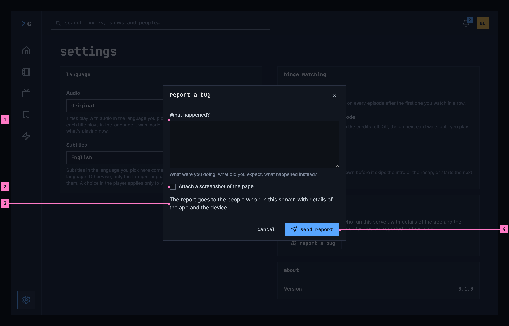

Figure 16.12: Report a bug, on a computer.

1. **What happened?**, the design system's field around its text area, holds
   the person's own words, and the report needs them: sent without any, the
   field's error says “Describe what happened to send the report.” It opens
   empty, with “What were you doing, what did you expect, what happened
   instead?” as its hint, where it stays in view while the person types.
2. **Attach a screenshot of the page**, a checkbox, is off until it is ticked,
   and only the
   tick takes the screenshot: of the screen under the dialog, without the
   dialog. A small preview then shows under the box, with **retake**. On a
   phone it says “Attach a screenshot of the screen”.
3. **Who receives the report**, and what goes with it.
4. **send report**, the dialog's primary button, after **cancel**, the quiet
   one, is busy while the report goes. Then the dialog closes, and the design
   system's toast says it went (figure 16.23).

When the report couldn't be sent, the design system's error banner in the
dialog, over the buttons, says why, by cause, and the words stay: “Couldn't send
the report. Can't reach the server.” A server that has stopped taking reports
since says “Bug reporting is switched off on this server, so this report can't
be sent.”

The same dialog opens from the player when a title won't play
([chapter 17](./errors.md)). What the player knows of the failure is then under
**details** in the dialog: it goes with the report, but never into the box the
person types in.

On a TV, typing with a remote is slow, so the dialog asks for no words. Under
its heading, “What's going wrong? Pick the closest match.”, it lists **playback
won't start**, **video stutters or freezes**, **audio out of sync**,
**subtitles wrong or missing**, **the app is slow** and **something else**; OK
on one sends the report, with that as its title, and the toast of figure 16.23
says it went.

### 16.4.6 About

**about** holds the app's version, so the person can tell the people who run
the server which one they have when something goes wrong.

## 16.5 The account

The account page says who is signed in, holds what ends a sign-in, and lists
what the person has watched. On a computer and a phone, **account** in the
avatar's menu opens it; on a TV, the first row of settings.

### 16.5.1 On a computer

Figure 16.13 shows the account page on a computer.

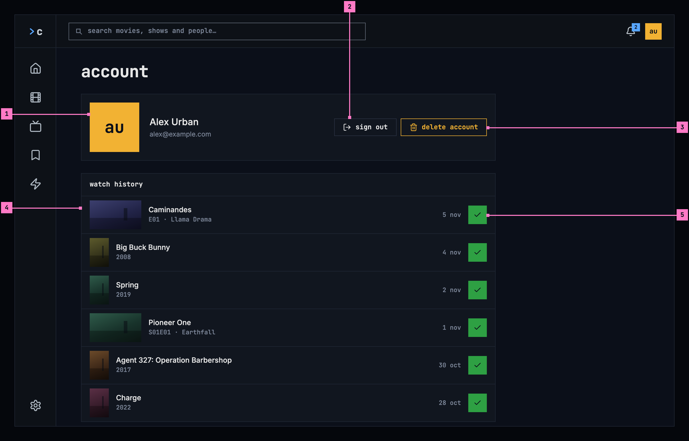

Figure 16.13: The account, on a computer, at 1280 × 800.

1. **Who is signed in**: the avatar ([chapter 3](./start.md)), the name and the
   email address, as the server's sign-in gives them.
2. **sign out**, a button, signs out of this server (section 16.5.5). On the web
   it also ends the sign-in on the server's sign-in page, where the web then
   goes.
3. **delete account** is the design system's amber-outline danger button, as
   it deletes what can't be brought back (section 16.5.6).
4. **watch history**, the design system's card with that title: what the
   person has finished, newest first, up to 60 titles. A movie shows its year,
   an episode its show, its code and its name, and each row the day it was
   finished. A row opens the title page ([chapter 6](./title-actions.md)).
5. **The watched mark**, the title actions' dark check on green
   ([chapter 6](./title-actions.md)), takes a title off the history: it marks
   it as not watched, and the row goes.

### 16.5.2 On a phone held upright

Figure 16.14 shows the account page on a phone. It has the parts of figure
16.13; the numbers mark what differs.

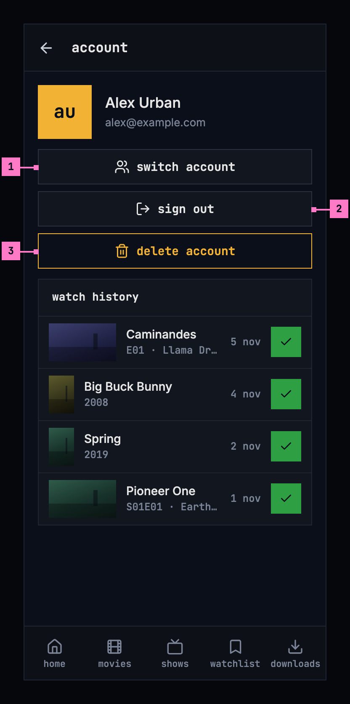

Figure 16.14: The account, on a phone held upright, at 360 × 780 dp.

1. **switch account**, a button across the width like the two under it, opens
   who's watching ([chapter 3](./start.md)), where the phone's other accounts
   are and another one is added.
2. **sign out**, as on a computer, except that on a phone it asks first when
   downloads would go (section 16.5.5).
3. **delete account**, across the width.

### 16.5.3 On a phone held sideways

Figure 16.15 shows the account page on a phone held sideways. It has the parts
of figure 16.14; the numbers mark what differs.

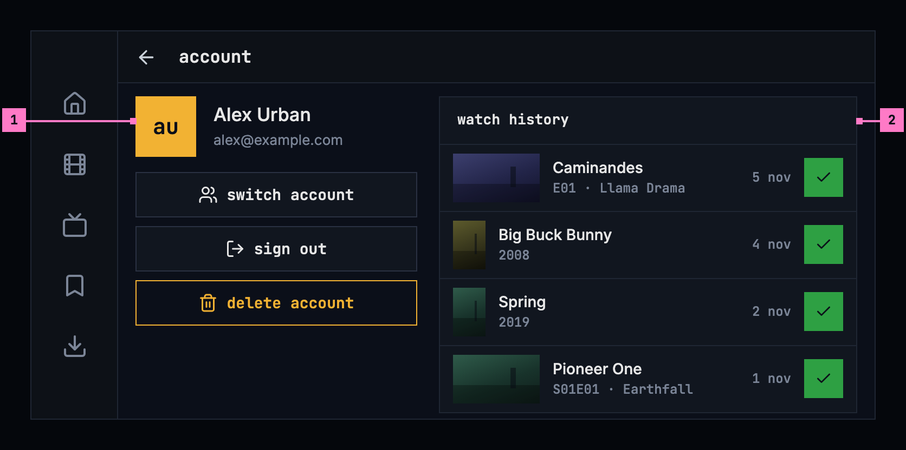

Figure 16.15: The account, on a phone held sideways, at 780 × 360 dp.

1. **Who is signed in and the account's buttons**, switch account, sign out and
   delete account, one under the other in a column of their own at the left.
2. **watch history** takes the rest of the width beside them, and scrolls while
   the account's column stays.

### 16.5.4 On a TV

Figure 16.16 shows the account page on a TV, opened from settings.

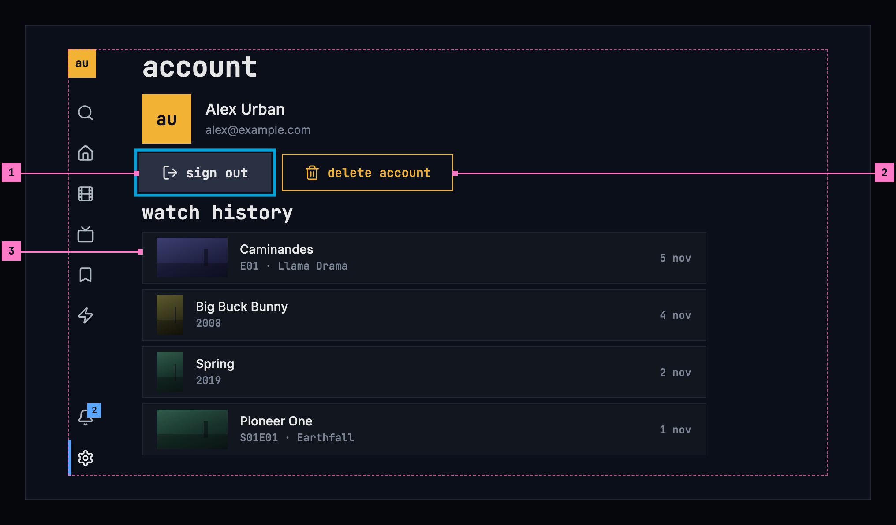

Figure 16.16: The account, on a TV, at 960 × 540 dp.

1. **sign out**, a button, has the focus when the page opens.
2. **delete account**, the danger button, right of it.
3. **The rows of the history** take the focus one by one, and OK opens the
   title page. On a TV, a title leaves the history on its title page, where its
   watched mark is ([chapter 6](./title-actions.md)).

On a TV, the avatar at the top of the rail opens who's watching
([chapter 2](./frame.md)), so the page has no switch account.

### 16.5.5 Sign out, remove account and change server

Three actions take accounts off a device. **sign out** takes the account
signed in now; **remove account**, on who's watching, any account on a phone or
a TV ([chapter 3](./start.md)); **change server** every account. On a phone or
a TV, signing out removes the account from the device just as remove account
does, and signing in again brings it back.

What signing in again doesn't bring back is lost: downloads, a cast that is
running, and the sign-in of another person's account. So each action asks
first when it would lose one of them, in the design system's dialog. Its title
is the action, its sentence says what is lost, and its confirming button
repeats the title as the amber-outline danger button, with **cancel**, the
quiet button, before it, as the design system's
[modal](https://nalet.github.io/design-system/components/modal/) has it. On a
TV the dialog has no ✕ in its header: Back closes it, as it closes every layer
on a TV.

| Action | Asks first when | Its sentence |
|---|---|---|
| sign out | it deletes downloads, or stops a cast | “Your 23 downloads, 12.4 GB, are deleted from this phone.” |
| remove account | always, as the account may be someone else's | “The 8 downloads of Anna, 2.6 GB, are deleted from this phone.”; without downloads, “This removes Anna from this phone. Signing in again brings the account back.” |
| change server | it deletes downloads, stops a cast, or signs out another account than the one signed in now | “All 3 accounts on this phone are signed out, and their 31 downloads, 15 GB, are deleted.”; on a TV, “All 3 accounts on this TV are signed out.” |

The downloads are counted as [chapter 13](./downloads.md) counts them, one
download in the singular: “Your download, 281 MB, is deleted from this phone.”
While a cast is running, the sentence adds “Casting on Living Room TV stops.”
([chapter 14](./casting.md)). On a tablet, the sentences say “tablet”.

Figure 16.17 shows the question before a sign-out on a phone.

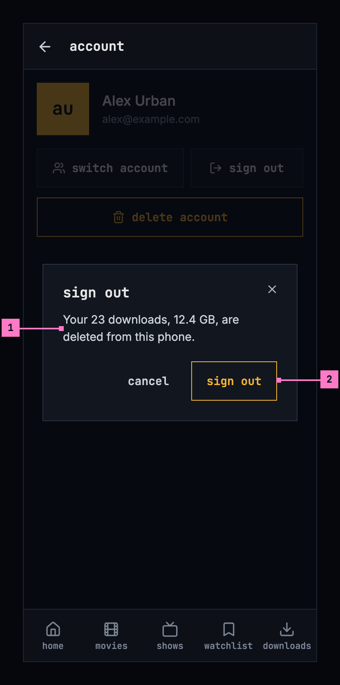

Figure 16.17: Sign out, on a phone.

1. **What is lost**: the account's downloads on this phone.
2. **sign out**, the danger button, repeats the title. While it runs it is busy
   and the dialog stays: a cast stops first, with its position written for the
   account.

After a sign-out, the app opens who's watching when other accounts remain on
the device, and sign in when none does ([chapter 3](./start.md)). The web goes
to the server's sign-in page.

Figure 16.18 shows the question before an account is removed on a TV.

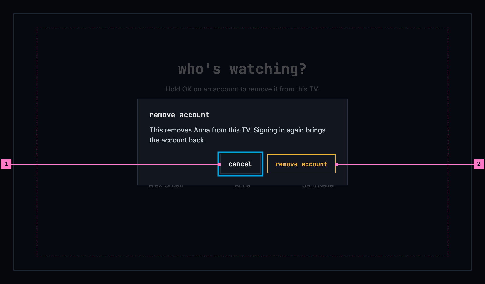

Figure 16.18: Remove account, on a TV.

1. **The focus starts on cancel**, so a stray OK keeps the account.
2. **remove account** takes the account off who's watching at once.

Figure 16.19 shows the question before a change of server on a phone.

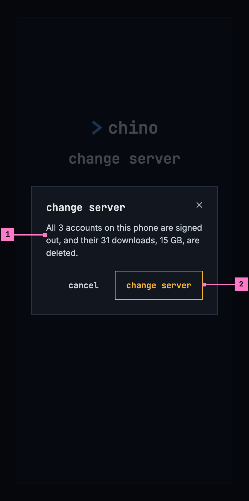

Figure 16.19: Change server, on a phone.

1. **It is asked once the new server has answered**, so a mistyped address
   changes nothing. What goes is every account on this phone and their
   downloads.
2. **change server** signs them out, deletes the downloads, and opens sign in on
   the new server.

### 16.5.6 Delete account

**delete account** deletes the account on the server: the person's watch
progress, lists, likes and watch history there, and the sign-in itself. It
can't be undone, so it always asks first, in the dialog of figure 16.20.

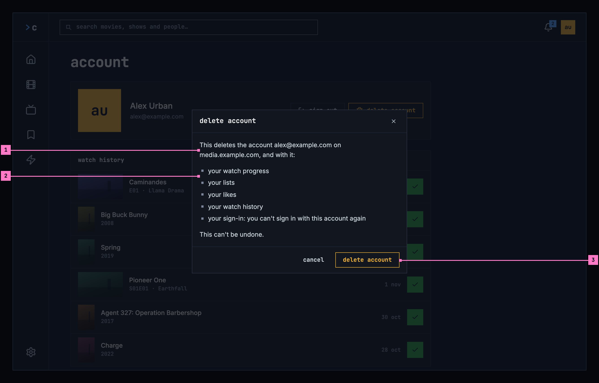

Figure 16.20: Delete account, on a computer.

1. **The account and the server, by name**, so nobody deletes the wrong one.
2. **What goes**, one line each.
3. **delete account**, the danger button, repeats the title, and is busy while
   the server deletes.

On a phone with downloads, the dialog adds “Your 23 downloads, 12.4 GB, are
deleted from this phone.” before “This can't be undone.” On a TV it is a dialog
too, and the focus starts on cancel. The server's answer decides what follows:

| The server | The dialog |
|---|---|
| Deleted the account | It closes, and the account is signed out. The web says so on a screen of its own, “account deleted”, with **sign in**; the phone and TV apps open who's watching or sign in, with the toast “Account deleted”. |
| Refused, with its reason | The reason in the design system's error banner in the dialog. **delete account** goes, and **cancel** becomes **close**. |
| Doesn't delete accounts from the apps | Figure 16.22, with **close**. |
| Didn't answer, or failed | “Couldn't delete the account, so nothing was deleted.” and the reason in the error banner, with **delete account** to try again. |

## 16.6 Turning the phone

Settings and the account turn with the phone and keep the person's place: the
page scrolled to the same group, a language list that was open still open, a
question still asked. Upright, the groups are one column and the account's
buttons stand under its name; sideways, the groups go in two columns and the
account's buttons stand beside its history (figures 16.10 and 16.15).

## 16.7 Changes

Every difference between section 16.2 and the target is one change in the
table. A change names the apps it is built in, what they do today and the
target, with the figure or the section that sets it out; it is built as its row
says, and nothing else changes with it. Each change starts as proposed; once the
owner approves it, it is built, one change at a time. A target that starts with
“Recommended” was an open decision, or takes away something an app has today.
Where settings and the account open from belongs to [chapter 2](./frame.md)
(2.C1 to 2.C5), and what the player does with the binge watching settings to
[chapter 11](./playback.md).

| No. | Change | Apps | Today | Target | Status |
|---|---|---|---|---|---|
| 16.C1 | The groups, their order and their headings | Web, Phone app, Android TV, Samsung TV | Web: binge watching, audio, subtitles, feedback, then reset to defaults, the first three with a line under the heading. Phone app: Account, Binge watching, Downloads, Server, Support, Audio, Subtitles, in mixed case. Android TV: binge watching, audio, subtitles, account, server, feedback, each with a line under its controls. Samsung TV: Binge watching, Audio, Subtitles, Account, Server, Feedback, in mixed case, each with a line | figures 16.7 to 16.11: language, binge watching, downloads (phone), server (phone and TV), feedback, about, lowercase, without a line of a group's own; each group the design system's card with its name as the title, on a TV a section under the design system's heading; on a TV the account row first; on a computer and on a phone held sideways, two columns. The phone app's Account group goes with 16.C12 | proposed |
| 16.C2 | The language settings: their names, texts and menus | Web, Phone app, Android TV, Samsung TV | Web: the groups audio and subtitles, their texts above the cards, each field named “Preferred language”, the browser's own list; a server's few subtitle languages a row of buttons. Phone app: a field opens its menu under it, in the page, the chosen language blue with a small square before it. Android TV: rows named “Language”, their menus headed “audio language” and “subtitle language”. Samsung TV: buttons, each language in its own words, “Deutsch”, “日本語”, and texts of its own, “Default audio language. …” | figures 16.7, 16.8 and 16.11: one group, language, with Audio and Subtitles, each the design system's select in a field with its label and its text as the hint (section 16.4.1); on the web and the phone its list is the browser's or the phone's own; on a TV the TV's own list over the page, in the look of the player's menus, the chosen language blue with the small square, as the design system has no list for a TV | proposed |
| 16.C3 | The languages offered, and their order | Web, Phone app, Samsung TV | Web: Original or off, then every language in alphabetical order. Phone app: Original and eight languages for the audio. Samsung TV: Original or Off and the same eight, for both | section 16.4.1: Original, then the person's own languages, the one set and the device's or the browser's, then every other in alphabetical order, each named as the player's menus name it; for the subtitles off, then the server's subtitle languages, or every language where it names none | proposed |
| 16.C4 | Binge watching: three settings with their lines | Web, Phone app, Android TV, Samsung TV | Web: Auto-skip intros' line without the recap; the countdown a slider, “Countdown before auto-skip”, “3s”, over “Seconds between the countdown appearing and the player skipping.” Phone app: “Auto-skip intros & recaps”, “Auto-skip credits” and “Auto-play next episode”, without lines, and no countdown. Android TV: the same three as on and off buttons with lines of their own, and “Countdown before auto-skip”, 5 s at first. Samsung TV: the same as one ON or OFF button each, the countdown 10 s at first | the table in section 16.4.2: Auto-skip intros and Auto-play next episode as the design system's switches, Countdown as its select, 1 s to 15 s, 3 s at first, each with its line as the hint; no Auto-skip credits. The player's side is chapter 11's (11.C20, 11.C22, 11.C27) | proposed |
| 16.C5 | Downloads: the picked quality | Phone app | the chosen quality's row blue, with a check mark | the design system's select (figure 16.9): its list the phone's own, each quality with what an hour takes at it, in the words of [chapter 13](./downloads.md); the field shows the picked quality's name, and its hint what an hour takes at it, “About 932 MB an hour.” | proposed |
| 16.C6 | The server group | Phone app, Samsung TV | Phone app: a row, “Change server”, with the server's address under it. Samsung TV: “Connected to media.example.com.”, then “Connecting to a different server signs out the accounts on this one.” and **Change server** | “Connected to media.example.com.” and **change server**, a button (figure 16.9) | proposed |
| 16.C7 | The feedback group | Web, Phone app, Android TV, Samsung TV | Web: “Reports go to the people who run this server, with a screenshot of the page if you attach one.”, a row “Report a bug” with “Opens a short form. Crashes and playback failures are also reported automatically, without a screenshot.” Phone app: “Support”, a row “Report a bug” with “Tell the people who run this server. The app's and the device's details go with your report.” Android TV: that line, and **report a problem**. Samsung TV: always there, “Something not working? File a bug straight to the dev backlog — …”, **Report a problem** | feedback, only where the server takes reports, with “Reports go to the people who run this server, with details of the app and the device. Crashes and playback failures are reported on their own.” and **report a bug**, a button (figure 16.7, section 16.4.5) | proposed |
| 16.C8 | about, with the version | Web, Phone app, Android TV, Samsung TV | no app shows its version | **about**, with Version and the app's version (figure 16.7, section 16.4.6) | proposed |
| 16.C9 | Web: no reset to defaults | Web | **reset to defaults** at the page's end sets every setting back at once, without asking | Recommended: left out, as no other app has it: a setting is set back by hand, and a stray press loses nothing | proposed |
| 16.C10 | Report a bug: the dialog | Web, Phone app | Web: the instruction “What were you doing, what did you expect, what happened instead?” the box's placeholder; sent, the dialog says “Thanks for the report.” and “It went to the people who run this server as #482.”; not sent, “Couldn't file the report.” and the reason, or “Bug reporting is switched off on this server, so this report can't be filed.” Phone app: the screenshot taken before the dialog opens and attached until “Include screenshot” is switched off; the box without a label, “What went wrong? What did you expect to happen?”, from the player with its error in it; **Cancel** and **Submit**; sent, “Filed bug #482” or “Added to existing bug #482” and “Thanks — the report reached the people who run this server.” | figures 16.12 and 16.23: the design system's dialog: What happened?, a text area in a field, empty, with “What were you doing, what did you expect, what happened instead?” as its hint, as the design system puts an instruction in the hint and not in the placeholder; Attach a screenshot of the page, a checkbox off until ticked, the screenshot taken then; the player's details under **details** and never in the box; **cancel** and **send report**; sent, the dialog closes and the design system's toast says “Report sent as #482”, or “Already reported as #482, your details added”, as it confirms with a toast and not with a dialog that only says it went; not sent, “Couldn't send the report.” and the reason in an error banner in the dialog (section 16.4.5) | proposed |
| 16.C11 | Report a bug on a TV | Android TV, Samsung TV | headed “report a problem” (Samsung TV “Report a problem”), the choices in sentence case, “Playback won't start”, “App is slow”; sent, “Filed bug #482”, then “Sent to the people who run this server.” (Android TV) or “Thanks — the report landed on the dev backlog.” (Samsung TV), and **Close** | **report a bug**, with “What's going wrong? Pick the closest match.” and the choices of section 16.4.5 in lowercase, **playback won't start** to **something else**; sent, the toast of figure 16.23 | proposed |
| 16.C12 | The account page on a computer and a phone | Web, Phone app | Web: “Account”, “Sign out” and “Delete Account” capitalised in the body face, Delete Account in a red outline, “Watch history”, dates such as “Oct 25”. Phone app: **Sign out** beside the name; switch account and delete account only in settings' Account group, with “Your account” and “Sign out” | figures 16.13 and 16.14: **account**, the design system's heading; **sign out**, and on a phone **switch account**, its buttons, across the width on a phone; **delete account** its danger button, amber-outlined; **watch history** its card with that title, dates such as “5 nov”; settings without an account group | proposed |
| 16.C13 | The account on a TV | Android TV, Samsung TV | Android TV: settings' account group with **see your account**, **switch account** and **delete account**; the account page without buttons; nothing signs out. Samsung TV: settings' Account group with the name, **Switch account**, **Sign out** and **Delete Account**; no account page and no watch history; after a sign-out another account becomes active and settings stays | figures 16.11 and 16.16: the account row first in settings; the account page with **sign out**, a button, focused, **delete account**, the danger button, and the watch history; switching from the avatar ([chapter 3](./start.md)); after a sign-out, who's watching or sign in (section 16.5.5) | proposed |
| 16.C14 | The questions before an account leaves a device | Phone app, Android TV, Samsung TV | Phone app: remove account without downloads, “This removes Anna from this phone. You'll need to sign in again to use the account.”; change server asked only where downloads go or a cast stops, with “Your 31 downloads, 15 GB, are deleted from this phone.”, and nothing of the other accounts. Android TV: remove account, “You'll need to sign in again to use this account on this TV.”; change server asks nothing. Samsung TV: change server signs every account out at once, before an address is typed, and asks nothing | the table in section 16.5.5, each question the design system's dialog, its confirming button the danger button and **cancel** the quiet one before it: “This removes Anna from this phone. Signing in again brings the account back.”, on a TV without the ✕ and with the focus on cancel (figure 16.18); change server from the screen of [chapter 3](./start.md), asked once the new server has answered, where downloads, a cast or another account's sign-in would go (figure 16.19). One change with 13.C5 | proposed |
| 16.C15 | Delete account: one dialog, by name, with nothing to type | Web, Phone app, Android TV, Samsung TV | Web: headed “Delete Account”, the account by its email address “on this server”, “Type DELETE to confirm”, the button filled red. Phone app: only in settings. Android TV, Samsung TV: a screen of its own without the frame, ending in “Press BACK to keep your account.”, the Samsung TV's headed “Delete Account”. The apps: a deleted account goes without a word | figure 16.20: the design system's dialog **delete account**, the account and the server by name, what goes, its amber-outline danger button, nothing to type; on a TV a dialog without the ✕, with the focus on cancel; after a deletion the toast “Account deleted” in the apps (section 16.5.6) | proposed |
| 16.C16 | Delete account's answers | Web, Phone app, Android TV, Samsung TV | each answer under a heading of its own: “Not Deleted” with the server's reason or “This server won't delete your account.”; “Not Available” with “Deleting your account isn't available on this server — ask its administrator.”; “Try Again Later” with the server's message, “Your account couldn't be deleted right now (HTTP 500).”, “The server couldn't be reached.” or “Another account is signed in now. Open Delete Account again.” | the table in section 16.5.6: the reason in the design system's error banner in the dialog; “This server doesn't delete accounts from the apps. Ask the people who run it.” (figure 16.22); “Couldn't delete the account, so nothing was deleted.” and the reason by cause ([chapter 17](./errors.md)) | proposed |
| 16.C17 | delete account only where the server deletes accounts | Web, Phone app, Android TV, Samsung TV, the server | delete account is offered on every server; a server says it deletes none only when it is asked to delete one | Recommended: the server says in its configuration whether it deletes accounts, as it says whether it takes reports, and the apps offer delete account only where it does | proposed |
| 16.C18 | The settings' first values | Web, Phone app, Android TV, Samsung TV | until the person picks: Web: audio English, subtitles English. Phone app, Android TV: audio English, subtitles off. Samsung TV: audio Original, subtitles off | Recommended: audio **Original**, and subtitles in the device's or the browser's language where the server offers it, else **off**, in every app; so a title made in another language comes with subtitles, and one in the person's language without (section 16.4.1, [chapter 12](./subtitles.md)) | proposed |
| 16.C19 | Loading and couldn't load | Web, Phone app, Android TV | Web: the subtitle languages load under the loader with “Loading the subtitle languages…”; the watch history loads under the loader, and one that couldn't load reads as nothing watched; nothing watched is a line without a heading. Phone app: the history under a spinner, and one that couldn't load reads as nothing watched. Android TV: “Loading your account…”, and “Nothing watched yet. Watched items appear here once you finish a movie or episode (or mark one watched on a detail page).” | the table in section 16.8: grey blocks in the shape of the history while it loads, the design system's small loader in the Subtitles field while its languages load; the design system's empty states: **nothing watched yet** over “A movie or an episode shows here once you finish it, or mark it as watched.”, and for an error “couldn't load your watch history”, the reason and **try again** | proposed |

## 16.8 States

Settings and the account are drawn in figures 16.7 to 16.20 with everything
loaded. Figures 16.21 to 16.23 show the states that matter most.

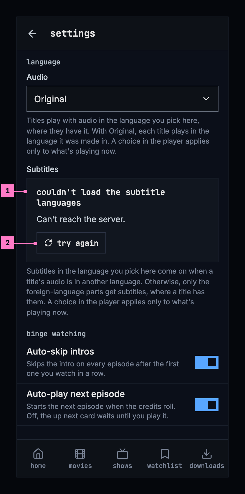

Figure 16.21: The subtitle languages couldn't load, on a phone.

1. **What couldn't load, and why**, the design system's empty state for an
   error, at its small size, in the place of the field's box, by cause
   ([chapter 17](./errors.md)). The rest of settings works, as it is kept on
   the phone.
2. **try again** asks the server again.

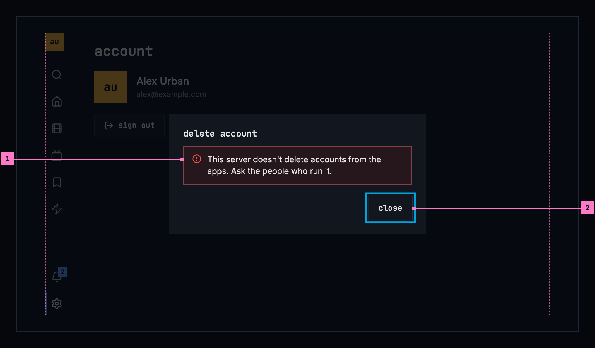

Figure 16.22: The server doesn't delete accounts, on a TV.

1. **Why the account is still there**, in the design system's error banner
   inside the dialog.
2. **close** has the focus. Asking again would change nothing, so delete
   account is gone.

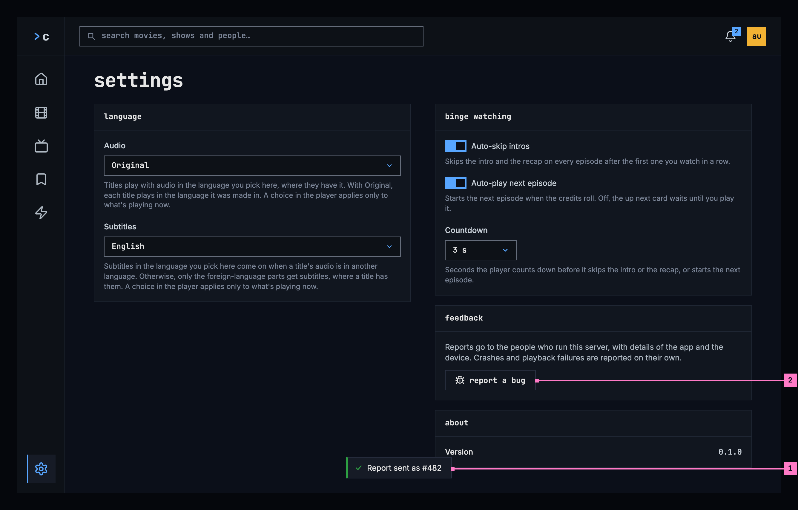

Figure 16.23: The report was sent, on a computer.

1. **The toast**, the design system's, once the dialog has closed: “Report sent
   as #482”, the report's number as the people who run the server file it.
   When they already have the same report, it says “Already reported as #482,
   your details added”. It leaves after five seconds, as a toast does.
2. **report a bug**, where the focus goes back as the dialog closes.

| State | What the screen shows |
|---|---|
| The subtitle languages load | The Subtitles field's label, and the design system's small loader in its box |
| They couldn't load | Figure 16.21 |
| The watch history loads | Grey rows in the shape of the history |
| Nothing watched yet | The design system's empty state in the history's place: “nothing watched yet”, and “A movie or an episode shows here once you finish it, or mark it as watched.” |
| The watch history couldn't load | The design system's empty state for an error: “couldn't load your watch history”, the reason and **try again** |
| A question's action runs | Its danger button is busy, and the dialog stays until it is done |
| A report is being sent | **send report** is busy |
| The report was sent | Figure 16.23 |
| A report without words | The field's error: “Describe what happened to send the report.” |
| A report couldn't be sent | “Couldn't send the report.” and the reason in an error banner; the words stay |
| The server stopped taking reports | “Bug reporting is switched off on this server, so this report can't be sent.” in an error banner in the dialog |
| The account is deleted | Section 16.5.6: “account deleted” on the web, the toast “Account deleted” in the phone and TV apps |
| The server refused to delete it | Its reason in an error banner, and **close** |
| The server doesn't delete accounts | Figure 16.22 |
| Deleting failed | “Couldn't delete the account, so nothing was deleted.” and the reason, with **delete account** |

## 16.9 Words

| Where | Text |
|---|---|
| Settings | settings · account (TV) · language · binge watching · downloads · server · feedback · about |
| Language | Audio · Original · Subtitles · off · the two texts in section 16.4.1 |
| Binge watching | Auto-skip intros · Skips the intro and the recap on every episode after the first one you watch in a row. · Auto-play next episode · Starts the next episode when the credits roll. Off, the up next card waits until you play it. · Countdown · Seconds the player counts down before it skips the intro or the recap, or starts the next episode. · 1 s to 15 s · 3 s |
| Downloads | Download quality · Medium (720p) · About 932 MB an hour. · in the phone's list: Medium (720p) · about 932 MB an hour · Download over Wi-Fi only ([chapter 13](./downloads.md)) |
| Server | Connected to media.example.com. · change server |
| Feedback | Reports go to the people who run this server, with details of the app and the device. Crashes and playback failures are reported on their own. · report a bug |
| About | Version · 0.1.0 |
| The subtitle languages couldn't load | couldn't load the subtitle languages · Can't reach the server. · try again |
| The account | account · switch account · sign out · delete account · watch history · 5 nov |
| An empty history | nothing watched yet · A movie or an episode shows here once you finish it, or mark it as watched. |
| The history couldn't load | couldn't load your watch history · try again |
| Report a bug | report a bug · What happened? · What were you doing, what did you expect, what happened instead? · Attach a screenshot of the page · Attach a screenshot of the screen (phone) · retake · The report goes to the people who run this server, with details of the app and the device. · details · cancel · send report · Describe what happened to send the report. |
| A report sent | Report sent as #482 · Already reported as #482, your details added |
| A report not sent | Couldn't send the report. · Bug reporting is switched off on this server, so this report can't be sent. |
| Report a bug on a TV | What's going wrong? Pick the closest match. · playback won't start · video stutters or freezes · audio out of sync · subtitles wrong or missing · the app is slow · something else |
| The questions | sign out · remove account · change server · cancel · the sentences in section 16.5.5 · Casting on Living Room TV stops. |
| Delete account | delete account · This deletes the account alex@example.com on media.example.com, and with it: · your watch progress · your lists · your likes · your watch history · your sign-in: you can't sign in with this account again · This can't be undone. · close |
| Its answers | This server doesn't delete accounts from the apps. Ask the people who run it. · Couldn't delete the account, so nothing was deleted. · Account deleted · account deleted · Your account is deleted, with everything this server kept of you, and you're signed out. · sign in |
