# 3 Getting started

Section 3.2 describes getting started as it is deployed today. The sections
after it are the target, the screens as they are meant to be, and section 3.7
lists every difference between the two as a numbered change. Only a change the
owner has approved is built, one change at a time; anything no change names
stays as it is deployed.

The chapter covers the screens before the first title: connecting to a server,
signing in, and choosing who's watching. They come before the frame of
[chapter 2](./frame.md), so they have no top bar, no tabs and no rail.

## 3.1 Purpose

The phone and TV apps work with any chino server, so a newly installed app
knows none. It asks for the server's address, checks it, and signs in there. On
a phone or a TV that several people share, each of them signs in once, and the
app asks who's watching when it starts.

The web needs no “add a server”: it comes from its own server, the one at its
address. It signs in on that server's own sign-in page, which chino doesn't
draw, and opens on home. A computer therefore has none of the screens in this
chapter, and the figures show the phone app and the TV apps.

Where an app opens depends on what the device has:

| The device has | The app opens on |
|---|---|
| No server | connect to a server (section 3.3) |
| A server, and no account | sign in (section 3.4) |
| One account | home ([chapter 4](./home.md)) |
| Two accounts or more | who's watching (section 3.5) |
| A server that doesn't answer (phone app) | downloads ([chapter 13](./downloads.md)), after who's watching when the phone has several accounts |

## 3.2 As deployed

This section says what the four apps do before the first title as of
6 November 2026: the web as the public demo showed it that day, on the same
build as production, and the apps as their code had them that day. The phone
app, Android TV and the Samsung TV are described from their code until
screenshots of them are taken. The Samsung TV app isn't released yet.

### 3.2.1 The web

The web has none of this chapter's screens. When nobody is signed in, it shows
the chino icon over “Signing you in…” for a moment and goes to the server's
sign-in page, which the server draws, not chino. Figure 3.1 shows the demo's.

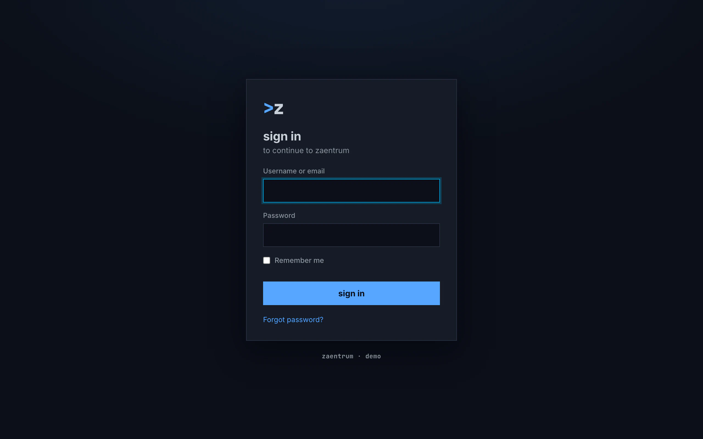

Figure 3.1: The server's sign-in page, as the web opened it on the demo on
6 November 2026, on a computer, at 1280 × 800.

1. **The middle: the server's own page**, in the look of the platform the demo
   runs on, with its mark, “>z”, and its words, “sign in” and “to continue to
   zaentrum”. Each installation has a sign-in page of its own.
2. **Username or email and Password**, the fields this sign-in service asks
   for, with “Remember me”, then **sign in** and “Forgot password?”.
3. **The foot**: “zaentrum · demo”, the installation's name.

After the sign-in, the browser comes back to the web, which opens home,
whatever page its address named, a title's page from a link too; only a sign-in
the server refused later goes back to the page the person was on. A sign-in
that fails shows the chino icon over “couldn't sign you in”,
the reason by its kind, “Can't reach the sign-in service.”, “The sign-in
service didn't accept the request.” or “The sign-in didn't finish.”, then
**sign in again** and **home**, and the error's own text under **details**. A
sign-in renews itself before it runs out and when the tab is shown again,
without a screen. The avatar is the picture the sign-in gives the account, or
else the initials, the first letters of the first two words of the name, in
capitals, blue on a grey square.

### 3.2.2 The phone app

**Where it opens.** Without a server, on connect to a server; with a server and
no account signed in, on sign in; with one account, on home; with two or more,
on who's watching. The Android app checks the server as it starts: where it
doesn't answer, it opens on downloads, after who's watching where there are
several accounts. The iOS app doesn't check.

**Connect to a server** is headed “Connect to your server”, with “Enter the
address of your Chino server.” under it. The field has no label and no hint,
only the placeholder “https://media.example.com”. **Connect** turns into
**Connecting…**, greyed, with a spinner under it, while the address is checked,
and under it “Recent” lists up to five servers the phone was connected to. From
settings the screen is headed “Change server”, with **Cancel** as a link under
the button. A build with a server built in would offer “Use …”; no released
build has one. The screen is one column in the middle, at most 480 dp wide,
held either way.

**The check** tries https and then http, and asks three questions: whether the
server says it is chino, whether it says where its sign-in is, and whether that
sign-in answers. It says: “Couldn't reach that server. Check the address and
that it's online.”, “That address responded, but it doesn't look like a Chino
server.”, “Server reachable, but it didn't return its configuration
(/api/config).”, “Couldn't read the login provider's configuration (OIDC
discovery failed).” or “This app connects over HTTPS only; plain http works
just for localhost. Use the server's https:// address.” An untrusted
certificate reads as no answer.

**Sign in** is headed “Chino” in blue, with “Movies and series — sign in to
media.example.com.”, then **Sign in** and the link **Change server**. Before it
offers sign in, the app checks the server again, for 4 seconds at most, with a
spinner in place of the button. Signing in opens the server's sign-in page in
the browser; meanwhile a spinner takes the place of the buttons. A failure shows
in red the sign-in service's own description of it, or the app's own words,
“authorization failed”, “token exchange failed”, with **Try again** and
**Change server**.

**Who's watching** is headed “Who's watching?”, over “Tap to switch. Tap ✕ to
remove an account from this phone.” The avatars are squares of 88 dp, the
account used last first, with a blue frame round the current one, in a grid of
tiles at least 110 dp wide, and from 600 dp wide at least 160 dp. The ✕ is a
28 dp square. **Add account** turns into **Signing in…** with a spinner. A
switch asks nothing; when the account switched from was casting, the cast
stops, with the toast “Stopped casting on Living Room TV.” Removing an account
always asks first ([chapter 16](./settings.md)).

**The avatar** is a square with the initials in capitals, the first letters of
the first two words of the name, on one of twelve colours picked by the email
address. Where the account has an email address, the app looks a picture up
from an outside service by a hash of it and shows it over the initials.

### 3.2.3 Android TV

**Where it opens.** Without a server, on connect to a server; without an
account, on sign in; with two accounts or more, on who's watching, every time it
starts; with one, on home. It asks the server nothing as it starts.

**Connect to a server** has the phone app's words in lowercase headings and
buttons: “connect to your server”, “Enter the address of your Chino server.”,
the placeholder “https://media.example.com”, **connect** and **connecting…**,
and **recent** with up to five addresses without their https://. The field has
the focus, and OK opens the TV's keyboard, whose go key connects. From settings
the screen is headed “change server” and adds **cancel**. **The check** asks the
phone app's questions, and on a TV also whether the sign-in offers signing in
with a code; it says the phone app's first three sentences, “Secure connection
failed — the server's certificate isn't trusted.”, and “This server's login
provider doesn't support TV sign-in (device flow).”, which it also says when the
sign-in doesn't answer.

**Sign in** is headed “Connect your Chino account”. A picture code on white,
220 dp, stands on the left; on the right “Scan with your phone — or visit:”,
the address as the server sends it, with its https://, “and enter this code:”,
and the code, one letter to a box; under them “Waiting for confirmation…”.
Nothing takes the focus while it waits, and there is no change server. A
failure says “The code expired.”, “Sign-in was cancelled.”, “The server ran into
a problem.”, “The server didn't accept the sign-in.”, “Can't reach the server.”,
“The server's answer couldn't be read.” or “Sign-in failed.”, with **try
again**, which asks for a new code, and under all but the first two the error's
code under **details**.

**Who's watching** is headed “who's watching?”, over “Long-press an account to
remove it.” The avatars are circles of 120 dp, the one used last first and
focused; **add account**, a plus on a square, opens sign in. Holding OK on an
account asks “remove account”, with “You'll need to sign in again to use this
account on this TV.” and **cancel** and **remove account**. The avatar has the
phone app's initials, colours and picture from an outside service, in a circle.

### 3.2.4 Samsung TV

**Where it opens.** Without a server, on connect to a server; without an active
account, on sign in, which asks for a code at once; with one account or more, on
the home of the active one. It asks the server nothing as it starts.

**Connect to a server** has the phone app's heading, sentence and placeholder.
The field has no focus as the screen opens; OK on it opens a keyboard of the
app's own, titled “Server address”, which covers the screen and types lowercase
only, and its done key connects. **Connect** turns into **Connecting…** with a
spinner, and is dimmed while the field is empty. A list of recent servers and a
change server variant are in the code, but neither shows: the app keeps no
list, and settings' change server signs out without opening the screen
([chapter 16](./settings.md)). **The check** asks Android TV's questions, with
time limits of 6 and 8 seconds, and says its sentences but the certificate's;
anything else reads as no answer.

**Sign in** is headed “Sign in”, without a picture code: “On your phone or
computer, open”, the address as the server sends it, “and enter this code:”,
the code one letter to a box, and “Waiting for you to sign in…”. There is no
change server. A failure says “The code expired. Please try again.”, “Sign-in
was cancelled.”, “Sign-in failed:” with the sign-in service's error code, or the
error's own text, in red, with **Try again**, which has the focus.

**Who's watching** is in the code, but nothing opens it. Settings' **Switch
account** lists the accounts over the page instead, the current one marked
“current”; OK on one switches to it, and its **Add account** goes to home
without signing in. **The avatar** is a square with one capital letter, the
name's first, dark on blue for every account.

### 3.2.5 Feature by feature

The table compares the four apps feature by feature. “—” is a feature the app
doesn't have.

| Feature | Web | Phone app | Android TV | Samsung TV |
|---|---|---|---|---|
| Without a server | — | connect to a server | connect to a server | connect to a server |
| With two accounts or more | — | who's watching | who's watching, at every start | the active account's home |
| A server that doesn't answer at the start | — | Android: downloads; iOS: not checked | not checked | not checked |
| Connect's heading | — | “Connect to your server”; from settings “Change server” | “connect to your server”; “change server” | “Connect to your server” |
| The sentence under it | — | “Enter the address of your Chino server.” | the same | the same |
| The field | — | no label, no hint; the placeholder “https://media.example.com” | the same, with the focus | the same, without the focus |
| The keyboard | — | the phone's | the TV's; its go key connects | the app's own, lowercase only; done connects |
| The button | — | **Connect**, **Connecting…**, a spinner under it | **connect**, **connecting…** | **Connect**, **Connecting…** with a spinner |
| Recent servers | — | “Recent”, up to five | **recent**, up to five, without https:// | never shown |
| The check | — | is it chino, where is its sign-in, does the sign-in answer | the same, and does it sign in with a code | the same as Android TV, with time limits |
| Its sentences | — | five, from “Couldn't reach that server. Check the address and that it's online.” | five, with the certificate's and “This server's login provider doesn't support TV sign-in (device flow).” | four: Android TV's but the certificate's |
| An untrusted certificate | — | reads as no answer | “Secure connection failed — the server's certificate isn't trusted.” | reads as no answer |
| Signing in | the server's page in the same tab | the server's page in the browser | a code, on another device | a code, on another device |
| Sign in's heading | — | “Chino” in blue, over “Movies and series — sign in to media.example.com.” | “Connect your Chino account” | “Sign in” |
| Before sign in | — | the server checked again, 4 s at most, with a spinner | — | — |
| While it runs | “Signing you in…” under the chino icon | a spinner in place of the buttons | a spinner, then the code | a spinner, then the code |
| The picture code | — | — | on white, 220 dp | none |
| The address | — | — | as the server sends it, with https:// | as the server sends it |
| Waiting | — | — | “Waiting for confirmation…” | “Waiting for you to sign in…” |
| change server on sign in | — | **Change server**, a link | none | none |
| A failed sign-in | “couldn't sign you in”, the reason by kind, sign in again · home, details | the service's description in red, Try again · Change server | seven sentences by cause, try again, details | “The code expired. Please try again.”, “Sign-in failed:” and the error's code, Try again |
| Who's watching's heading | — | “Who's watching?”, over “Tap to switch. Tap ✕ to remove an account from this phone.” | “who's watching?”, over “Long-press an account to remove it.” | not shown |
| The accounts | — | squares, 88 dp, the current one in a blue frame | circles, 120 dp, the last used focused | a list over settings |
| Removing an account | — | the ✕, a 28 dp square; it always asks | holding OK; it always asks | — |
| add account | — | **Add account**, then **Signing in…** | **add account**, to sign in | **Add account** goes to home without signing in |
| The avatar | a square: the sign-in's picture, or the initials in capitals, blue on grey | a square: the initials in capitals on one of twelve colours, a picture from an outside service over them | a circle, as the phone app | a square: one capital letter, dark on blue |

## 3.3 Connect to a server

### 3.3.1 On a phone held upright

Figure 3.2 shows the first screen of a newly installed phone app: one field,
one button.

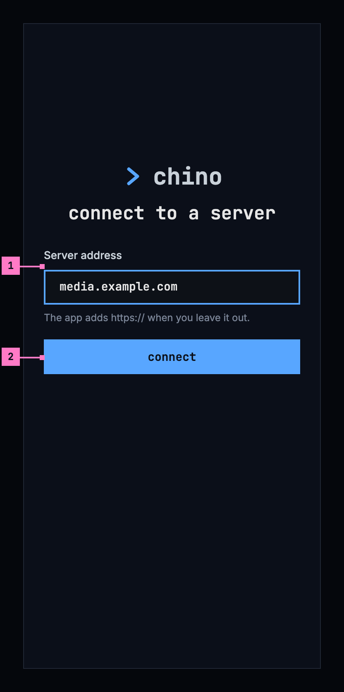

Figure 3.2: Connect to a server, on a phone held upright, at 360 × 780 dp.

1. **Server address.** The address of the server, as the people who run it
   gave it out: “media.example.com”. https:// can be left out, and the hint
   under the field says so. The field has the focus when the screen opens, so
   the keyboard comes up at once (the figure leaves it out), and the keyboard's
   go key works like connect.
2. **connect** checks the address (section 3.3.4). When a chino server answers
   there, the app keeps it and goes on to sign in (section 3.4).

Under **connect**, a list headed **recent** offers the servers this device was
connected to before, one press each; a newly installed app has none. Changing
the server later, from settings ([chapter 16](./settings.md)), opens this
screen headed **change server**, with the server connected now in the field and
**cancel** under connect.

### 3.3.2 On a phone held sideways

Figure 3.3 shows the same screen on a phone held sideways. It has the parts of
figure 3.2; the numbers mark what differs.

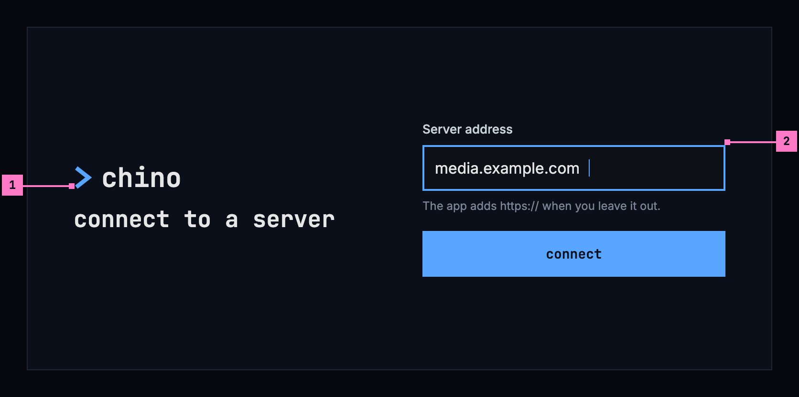

Figure 3.3: Connect to a server, on a phone held sideways, at 780 × 360 dp.

1. **The product's mark and the heading** take the left half, so the screen
   keeps its height for the field.
2. **The field, its hint and connect** take the right half, with **recent**
   under connect where the phone has one; the half scrolls where it is taller
   than the screen.

With the keyboard up, the field stays in view above it, and the keyboard's go
key works like connect.

### 3.3.3 On a TV

Figure 3.4 shows the same screen on a TV. It has the parts of figure 3.2; the
numbers mark what differs.

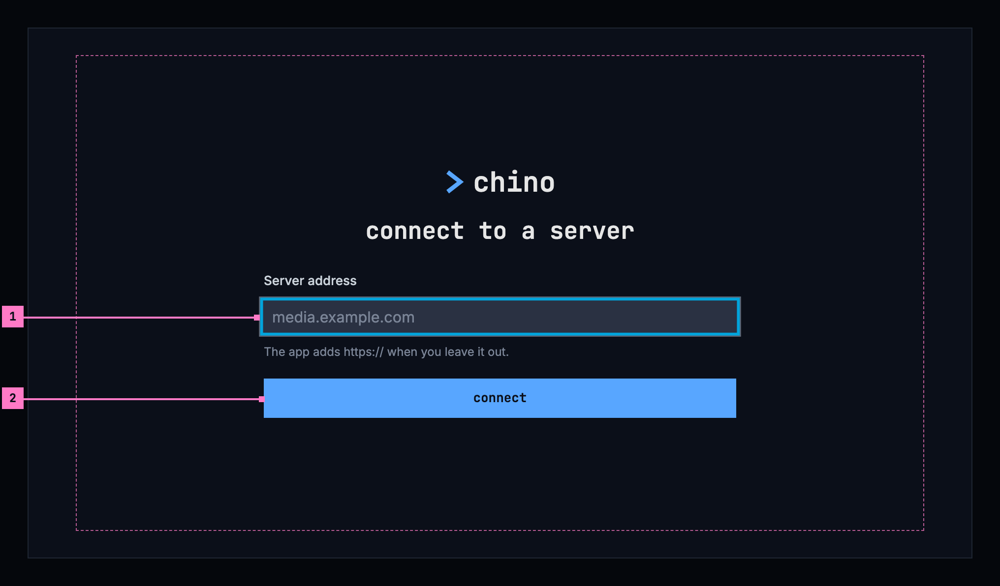

Figure 3.4: Connect to a server, on a TV, at 960 × 540 dp.

1. **The field has the focus** when the screen opens. OK opens the TV's
   keyboard, and its enter key works like connect. Until something is typed,
   the field shows “media.example.com” in the dim colour of a placeholder, as an
   example.
2. **connect**, down from the field. The column keeps to the middle of the
   screen, well inside the safe area.

### 3.3.4 The check

**connect** asks the address three questions, in order: does a chino server answer
there; does it say how to sign in; and does its sign-in answer. On a TV the
last question is whether its sign-in offers signing in with a code (section
3.4.3). While the check runs, connect is busy and the field waits, as figure
3.11 shows. Until the check passes, nothing changes: on a change of server, the
old one stays.

When the check fails, the field says why in place of its hint and keeps the
address, so a typing mistake is fixed in place, and connect tries again (figure
3.12). On a TV the focus goes back to the field. The reasons:

| What the check finds | The field says |
|---|---|
| Nothing answers at the address | No server answers at this address. |
| Something answers, but it isn't a chino server | This address answers, but it isn't a chino server. |
| The server's certificate isn't trusted, where the app can tell | The server's certificate isn't trusted, so the app won't connect to it. |
| The server doesn't say how to sign in | The server answered, but didn't say how to sign in. |
| The server's sign-in doesn't answer | The server's sign-in can't be reached. |
| On a TV, the server's sign-in offers no code | This server's sign-in doesn't offer signing in on a TV. |

When the check passes, the app keeps the server, adds it to recent, and opens
sign in: figure 3.5 on a phone, figure 3.7 on a TV. A change of server first
asks what [chapter 16](./settings.md) describes, where accounts or downloads
would go.

## 3.4 Sign in

### 3.4.1 On a phone held upright

Figure 3.5 shows sign in on a phone. The app doesn't ask for a password itself:
it hands over to the server's own sign-in page in the browser, so the person
signs in the way that server is set up for.

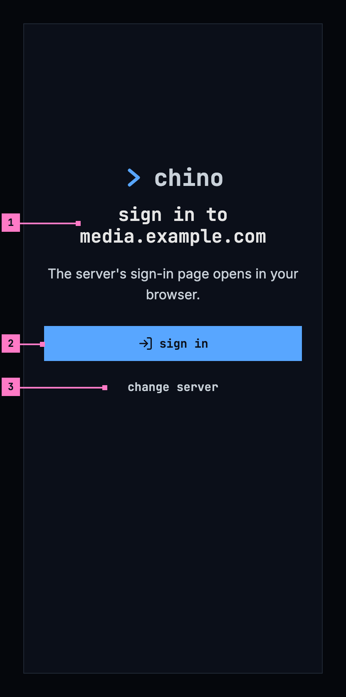

Figure 3.5: Sign in, on a phone held upright, at 360 × 780 dp.

1. **The server's name** is in the heading, so the person sees where they sign
   in before a page opens. The sentence under it says what happens next.
2. **sign in** opens the server's sign-in page in the browser, and is busy
   while the page is open. When the person has signed in, the browser hands
   back to the app, which opens home ([chapter 4](./home.md)) as the new
   account. When they close the page without signing in, the screen is as it
   was.
3. **change server** opens figure 3.2 again, for an address that turned out to
   be the wrong one. It asks nothing, as nobody is signed in yet.

Before it offers **sign in**, the app asks the server for its sign-in once
more, so that a server whose sign-in changed since it was added is followed.
Meanwhile the button is busy, for 4 seconds at most; a server that doesn't
answer in that time doesn't hold the sign-in up.

### 3.4.2 On a phone held sideways

Figure 3.6 shows sign in on a phone held sideways. It has the parts of figure
3.5; the numbers mark what differs.

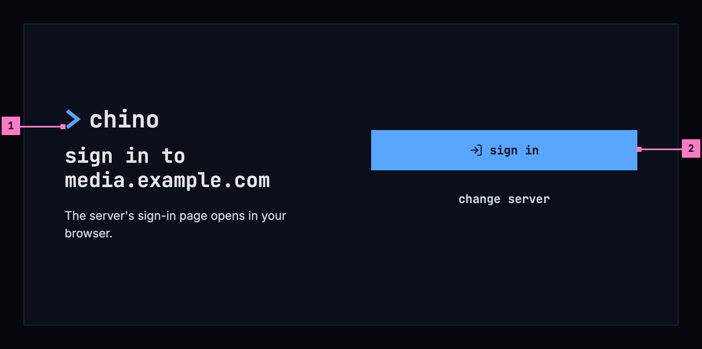

Figure 3.6: Sign in, on a phone held sideways, at 780 × 360 dp.

1. **The heading and its sentence** take the left half, under the product's
   mark.
2. **sign in and change server** take the right half, level with the heading.

### 3.4.3 On a TV

A TV has no browser to sign in with, and typing a password with a remote is
slow. So the TV shows a code, and the person signs in on their phone or a
computer. Figure 3.7 shows it.

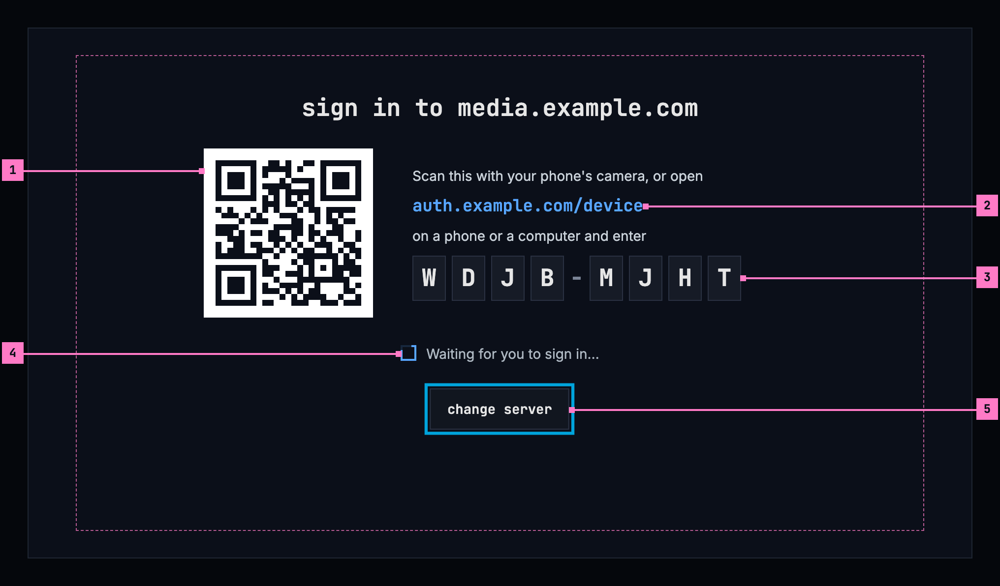

Figure 3.7: Sign in with a code, on a TV, at 960 × 540 dp.

1. **The picture code.** A phone's camera reads it and opens the server's
   sign-in page with the code already filled in. It is dark on white, as
   cameras read it best, with a white margin round it.
2. **The address**, for typing on another device: the page of the server's
   sign-in that takes codes, without its https://.
3. **The code**, each letter in a box of its own, large enough to read from
   across the room.
4. **Waiting.** The screen moves on by itself once the sign-in is done, to home
   as the new account. Nothing needs pressing on the TV.
5. **change server** is the only thing to focus, so it has the focus. When the
   screen opens from who's watching to add an account (section 3.5), it has no
   change server, and Back goes back to who's watching.

A code holds as long as the server's sign-in allows. When it runs out, the
screen says “The code expired.”, with **try again**, which asks for a new one.

### 3.4.4 On the web

The web signs in on the server's own sign-in page, which chino doesn't draw;
figure 3.1 shows the demo's. When nobody is signed in, the web goes there by
itself, showing only “Signing you in…” on the way, and comes back to the page
it left. When the sign-in fails, the web says “couldn't sign you in”, the reason
from section 3.8, and offers **sign in**.

A sign-in that has expired renews itself on every device, without a screen.
Only when the server refuses it does the app open sign in again, for the same
account, and return to where the person was afterwards
([chapter 17](./errors.md)).

## 3.5 Who's watching

A phone or a TV that several people share keeps an account for each of them, so
each signs in once. The app asks who's watching when it starts with two
accounts or more. On a phone, the account page's **switch account** opens it
too ([chapter 16](./settings.md)); on a TV, the avatar at the top of the rail
([chapter 2](./frame.md)). What an account sees is its own: its continue
watching, its watchlist, and on a phone its downloads
([chapter 13](./downloads.md)).

### 3.5.1 On a phone held upright

Figure 3.8 shows who's watching on a phone with three accounts.

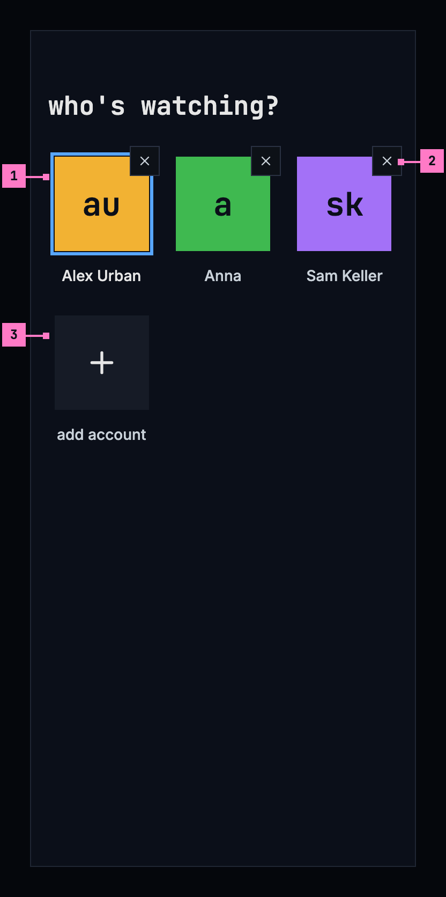

Figure 3.8: Who's watching, on a phone held upright, at 360 × 780 dp.

1. **An account**: its avatar and its name. A tap opens home as that account.
   The accounts come in the order they were last used, and the one used last
   has a blue frame round its avatar.
2. **✕** removes the account from this phone, after asking, as
   [chapter 16](./settings.md) describes. It reacts to a touch anywhere in the
   48 dp square round it, larger than the square it draws.
3. **add account** opens the server's sign-in page, as sign in does in figure
   3.5. Once the person has signed in, the new account opens home.

A switch asks nothing. When the account switched from is casting, the cast
stops and a toast says so ([chapter 14](./casting.md)).

### 3.5.2 On a phone held sideways

Figure 3.9 shows who's watching on a phone held sideways. It has the parts of
figure 3.8; the numbers mark what differs.

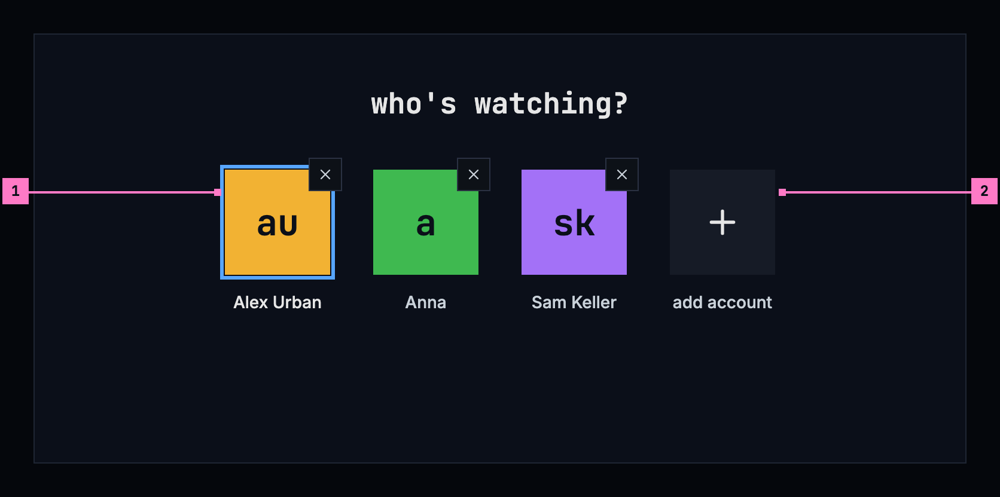

Figure 3.9: Who's watching, on a phone held sideways, at 780 × 360 dp.

1. **The accounts in one row**, as many as fit, six on a phone held sideways;
   more go onto a row under it, and the page scrolls.
2. **add account**, at the end of the accounts, as upright.

### 3.5.3 On a TV

Figure 3.10 shows who's watching on a TV. It has the parts of figure 3.8; the
numbers mark what differs.

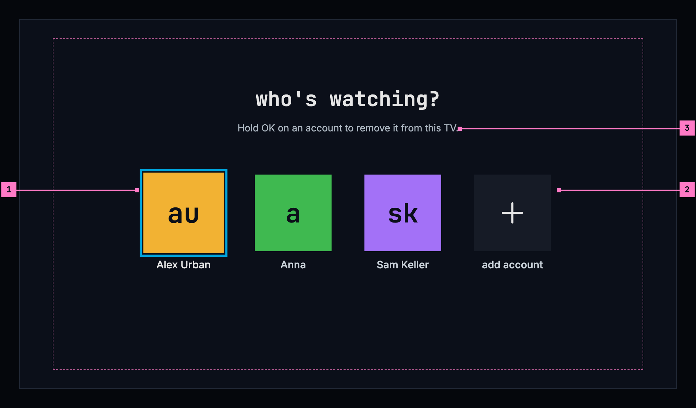

Figure 3.10: Who's watching, on a TV, at 960 × 540 dp.

1. **The focus starts on the account used last**, so the most common choice is
   one press of OK. Left and right move between the accounts.
2. **add account** opens sign in with a code, as in figure 3.7.
3. **The line under the heading** says how to remove an account, because
   holding OK can't be seen. It opens the same question as the phone's ✕.

### 3.5.4 The avatar

An account is shown by its avatar everywhere: in the top bar, in the rail, in
the avatar's menu and on who's watching. It is a square with the account's
initials, the first letters of the first two words of its name, lowercase in
the monospace face, dark on one of twelve colours: “Alex Urban” is **au**,
“Anna” is **a**. The colour comes from the account's email address, or from its
name when it has none, the same way in every app, so an account keeps its
colour on every device. The avatar shows no picture: no app asks an outside
service for one (3.C13).

## 3.6 Turning the phone

The three screens turn with the phone, and turning it loses nothing: the
address typed stays in the field, with the focus and the keyboard; a check that
runs goes on; and the browser's sign-in page, while it is open, turns on its own
and hands back to the app as upright. Upright, each screen is one column in the
middle. Sideways, connect to a server and sign in put the product's mark and the
heading in the left half and the rest in the right (figures 3.3 and 3.6), and
who's watching puts its accounts in one row (figure 3.9).

## 3.7 Changes

Every difference between section 3.2 and the target is one change in the
table. A change names the apps it is built in, what they do today and the
target, with the figure or the section that sets it out; it is built as its row
says, and nothing else changes with it. Each change starts as proposed; once the
owner approves it, it is built, one change at a time. A target that starts with
“Recommended” was an open decision, or takes away something an app has today.
The questions before an account is removed or the server changed, and the
account page's **switch account**, belong to [chapter 16](./settings.md), and
what happens when the server refuses a sign-in later, to
[chapter 17](./errors.md).

| No. | Change | Apps | Today | Target | Status |
|---|---|---|---|---|---|
| 3.C1 | Connect to a server: its words and the field | Phone app, Android TV, Samsung TV | headed “Connect to your server” (Android TV “connect to your server”), with “Enter the address of your Chino server.” under it; the field without a label and without a hint, the placeholder “https://media.example.com”; on the Samsung TV the field without the focus as the screen opens | figure 3.2: headed connect to a server, with no sentence; the field labelled Server address, with the hint “The app adds https:// when you leave it out.”, focused as the screen opens; on a TV the placeholder “media.example.com” (figure 3.4) | proposed |
| 3.C2 | connect busy while the check runs | Phone app, Android TV, Samsung TV | the button greyed with **Connecting…** (Android TV **connecting…**); the phone app's spinner under the buttons, the Samsung TV's in the button | figure 3.11: the field dimmed, connect busy with the design system's square loader before its name, which stays; nothing for the first 0.4 seconds; a second press does nothing | proposed |
| 3.C3 | The check's reasons | Phone app, Android TV, Samsung TV | other sentences, from “Couldn't reach that server. Check the address and that it's online.” to “This server's login provider doesn't support TV sign-in (device flow).” (section 3.2.5); in the phone app and on the Samsung TV an untrusted certificate reads as no answer | the six sentences of the table in section 3.3.4, the certificate's wherever the app can tell | proposed |
| 3.C4 | The phone held sideways | Phone app | connect to a server and sign in one column in the middle, at most 480 dp wide, held either way; who's watching's tiles at least 160 dp wide from 600 dp wide | figures 3.3, 3.6 and 3.9: the product's mark and the heading in the left half, the rest in the right; the accounts in one row, as upright, as many as fit (section 3.6) | proposed |
| 3.C5 | Samsung TV: recent servers | Samsung TV | the list is in the code, but the app keeps no servers, so it never shows | **recent**, the servers this TV was connected to before, under connect (section 3.3.1) | proposed |
| 3.C6 | Sign in on a phone | Phone app | headed “Chino” in blue, with “Movies and series — sign in to media.example.com.”; a spinner takes the buttons' place while the server is checked again and while the page is open; **Change server** a link | figure 3.5: headed sign in to media.example.com, with “The server's sign-in page opens in your browser.”; **sign in** busy, for 4 seconds at most while the server is asked again, and while the page is open; **change server** a quiet button | proposed |
| 3.C7 | Sign in on a TV | Android TV, Samsung TV | Android TV: “Connect your Chino account”, “Scan with your phone — or visit:”, the address with its https://, “and enter this code:”, “Waiting for confirmation…”; nothing to focus. Samsung TV: “Sign in”, no picture code, “On your phone or computer, open”, “and enter this code:”. Neither has change server | figure 3.7: sign in to media.example.com, the picture code, “Scan this with your phone's camera, or open”, the address without https://, “on a phone or a computer and enter”, the code a letter to a box, the loader with “Waiting for you to sign in…”; **change server** with the focus, except where the screen opened from who's watching | proposed |
| 3.C8 | A failed sign-in says why, by cause | Web, Phone app, Android TV, Samsung TV | Web: “couldn't sign you in”, the reason, **sign in again** and **home**. Phone app: the sign-in service's own description in red, or “authorization failed”, with **Try again** and **Change server**. Android TV: seven sentences, **try again** and details. Samsung TV: “The code expired. Please try again.”, “Sign-in failed:” with the error's code, or the error's own text, with **Try again** | the reasons of the table in section 3.8: on a phone the error banner of figure 3.13, “Couldn't sign you in.” and the reason, with **details** holding the service's own error, and **sign in** to try again; on a TV “couldn't sign you in”, the reason and **try again** in place of the codes, with the focus; on the web “couldn't sign you in”, the reason and **sign in** | proposed |
| 3.C9 | Web: back to the page the address named | Web | after the first sign-in the web opens home, whatever page its address named, a title's page from a link too; only a sign-in the server refused later goes back to its page | back to the page it left, on every sign-in (section 3.4.4) | proposed |
| 3.C10 | Who's watching: its words and the ✕ | Phone app, Android TV | Phone app: “Who's watching?” over “Tap to switch. Tap ✕ to remove an account from this phone.”, **Add account**; the ✕ answers a touch only in its 28 dp square. Android TV: “Long-press an account to remove it.” | figures 3.8 and 3.10: **who's watching?** alone on a phone, and on a TV over “Hold OK on an account to remove it from this TV.”; **add account**; the ✕ answers a touch anywhere in the 48 dp square round it | proposed |
| 3.C11 | Samsung TV: who's watching | Samsung TV | nothing opens it: with two accounts or more the app opens on the active one's home, and settings' **Switch account** lists the accounts over the page, its **Add account** going to home without signing in | figure 3.10, at the start with two accounts or more and from the avatar at the top of the rail ([chapter 2](./frame.md)); **add account** opens sign in with a code (figure 3.7) | proposed |
| 3.C12 | The avatar's look | Web, Phone app, Android TV, Samsung TV | Web: the initials in capitals, blue on grey. Phone app: the initials in capitals on one of twelve colours. Android TV: the same in a circle. Samsung TV: the name's first letter in capitals, dark on blue for every account | section 3.5.4: a square, the initials lowercase in the monospace face, dark on one of twelve colours from the email address, the same way in every app | proposed |
| 3.C13 | No picture in the avatar | Web, Phone app, Android TV | Web: the picture the sign-in gives the account. Phone app, Android TV: a picture looked up from an outside service by a hash of the email address, over the initials | Recommended: initials only, so that no app tells an outside service which accounts it has (section 3.5.4) | proposed |

## 3.8 States

Figures 3.2 to 3.10 show the screens at rest. Figures 3.11 to 3.13 show the
states in between that matter most.

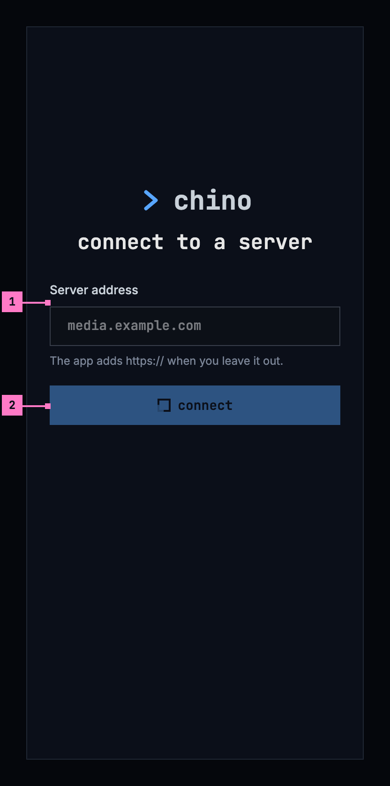

Figure 3.11: Checking the address, on a phone.

1. **The field waits** while the check runs, its address dimmed.
2. **connect is busy**: the design system's square loader before its name,
   which stays, as
   [loading and progress](https://nalet.github.io/design-system/patterns/loading-and-progress/)
   has it. For the first 0.4 seconds nothing changes; a second press does
   nothing.

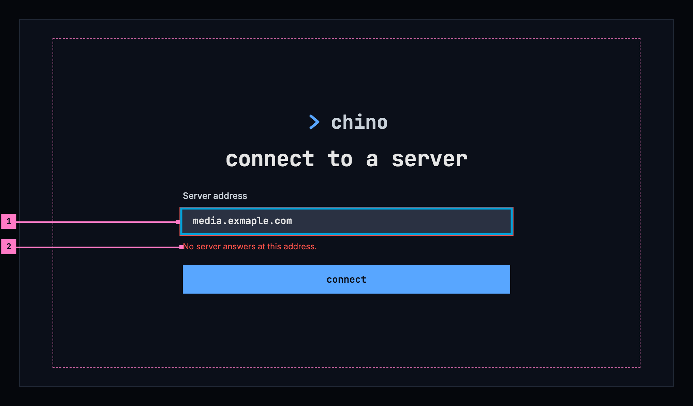

Figure 3.12: No server answers at the address, on a TV.

1. **The field keeps the address**, with a red edge, and has the focus again,
   so the typing mistake, here “exmaple”, is fixed in place.
2. **The reason**, in place of the hint, from the table in section 3.3.4.
   connect tries again.

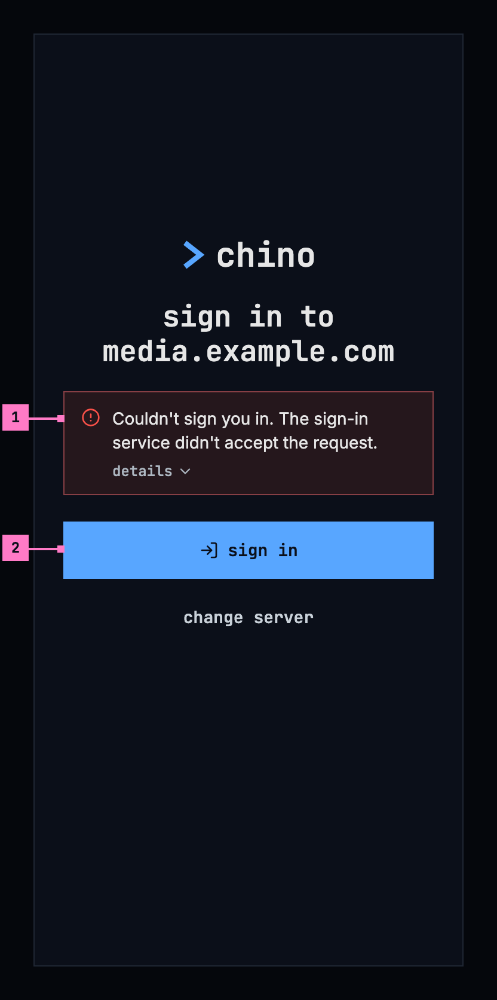

Figure 3.13: The sign-in was refused, on a phone.

1. **What went wrong**, in an error banner over the buttons: “Couldn't sign you
   in.” and the reason. **details** opens the sign-in service's own error, for
   the people who run the server.
2. **sign in** tries again. Nothing else on the screen changes.

A sign-in that fails says why, by cause, in every app:

| Why the sign-in failed | The reason |
|---|---|
| The sign-in service doesn't answer | Can't reach the sign-in service. |
| The sign-in service refused the sign-in | The sign-in service didn't accept the request. |
| The sign-in didn't come back whole | The sign-in didn't finish. |
| The server refused the sign-in just made | The server didn't accept your sign-in. |
| The server ran into a problem (TV) | The server ran into a problem. |
| The code ran out (TV) | The code expired. |
| The sign-in was turned down on the other device (TV) | Sign-in was cancelled. |

| State | What the screen shows |
|---|---|
| Checking the address | Figure 3.11 |
| The check fails | Figure 3.12, with the reason from section 3.3.4 |
| Asking the server for its sign-in, before sign in | sign in is busy, for 4 seconds at most |
| The browser's sign-in page is open (phone) | sign in is busy |
| Asking for a code (TV) | Grey blocks in the shape of the picture code and the code |
| Waiting for the other device (TV) | Figure 3.7: the loader and “Waiting for you to sign in…” |
| The sign-in failed | Figure 3.13 on a phone. On a TV, “couldn't sign you in”, the reason and **try again** in place of the codes, with the focus on try again. On the web, “couldn't sign you in”, the reason and **sign in** |
| Switching to another account | The account's tile is busy until the switch is done |
| The phone app can't reach the server | Who's watching works without it, and opens the account's downloads ([chapter 13](./downloads.md)) |

## 3.9 Words

| Where | Text |
|---|---|
| Connect to a server | connect to a server · Server address · The app adds https:// when you leave it out. · connect · recent |
| The same screen, from settings | change server · cancel |
| The check | the six reasons in section 3.3.4 |
| Sign in on a phone | sign in to media.example.com · The server's sign-in page opens in your browser. · sign in · change server |
| Sign in on a TV | sign in to media.example.com · Scan this with your phone's camera, or open · auth.example.com/device · on a phone or a computer and enter · Waiting for you to sign in… · change server · try again |
| A failed sign-in | Couldn't sign you in. · couldn't sign you in (TV and web) · the seven reasons in section 3.8 · details · sign in · try again (TV) |
| The web on its way to sign in | Signing you in… |
| Who's watching | who's watching? · add account · Hold OK on an account to remove it from this TV. |
| The ✕ on a phone, for screen readers | remove account |
| An account's tile, for screen readers | its name: Alex Urban |
