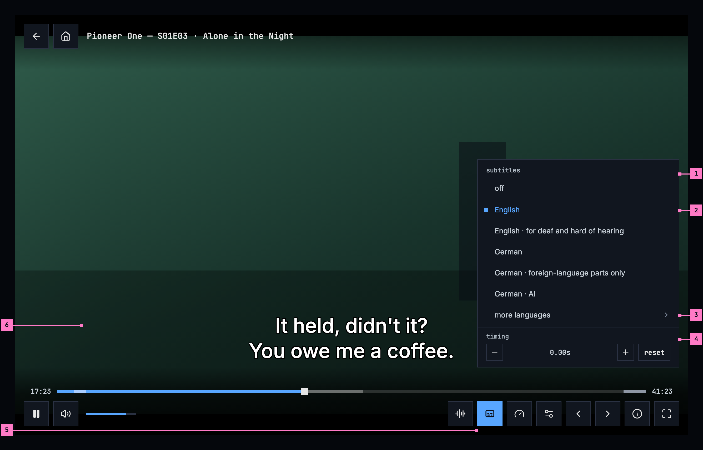
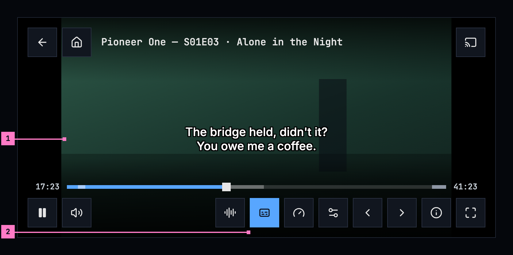
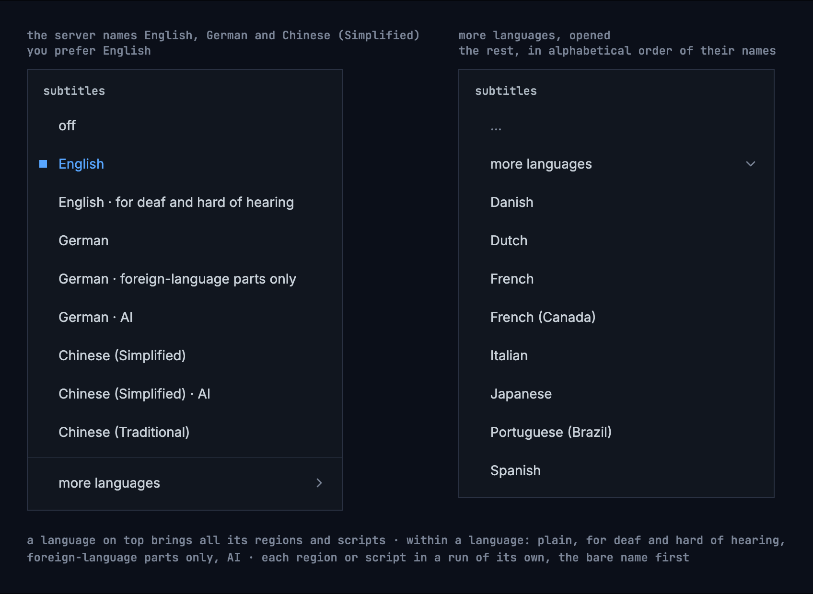

# 12 Subtitles

> **Not in the new form yet.** This chapter's figures show the target, not
> what is deployed today. Where today's apps differ, its “Today's apps”
> section says so. The screens as deployed and the numbered changes follow,
> as [chapter 11](./playback.md) already has them.

This chapter specifies subtitles: how they look over the picture, the
subtitles menu in the player, what switches on by itself, and the setting. The
player around them is specified in [chapter 11](./playback.md).

## 12.1 Purpose

Subtitles are read in a second, over a moving picture, sometimes from across the
room. They are plain and steady: the same look for every title, covering as
little of the picture as they can, and only one at a time. The web, the TV and
the phone apps show them the same way.

## 12.2 Subtitles on a computer

Figure 12.1 shows subtitles on a computer, with the player's controls showing
and the subtitles menu open.

Figure 12.1: Subtitles and their menu, on a computer, at 1280 × 800.

1. **The header and off.** The menu is headed **subtitles**, and **off** comes
   first. Both stay where they are while the list under them scrolls, so off
   is always a press away.
2. **The list**: the person's language and the server's languages, each
   language's tracks together, in the order of section 12.6. The picked row is
   blue, with the small square before it.
3. **more languages** opens the rest in place, under it, in alphabetical order
   of their names.
4. **timing**: **−** and **+** move the subtitles a quarter of a second earlier
   or later with each press, up to 10 seconds either way, and the value
   between them says where they are, “+0.25s”. **reset** goes back to the
   subtitles' own timing. It holds while the title plays, and it works on
   subtitles made as text; for subtitles made as pictures, and while subtitles
   are off, its buttons are dimmed.
5. **subtitles** in the control bar, blue while subtitles are on. Its name, for
   a screen reader, says which: “subtitles, English”, or “subtitles, off”.
6. **The line**, centred at the foot of the picture. While the controls show,
   it rises above them, as here (section 12.5).

The menu opens above the whole control bar, at its right end, so it never
covers the seek bar. On a short screen the list scrolls, never the header or
**off**, and it always shows at least one whole row.

## 12.3 Subtitles on a phone

Figure 12.2 shows subtitles on a phone held sideways, with the controls showing.
The parts are those of figure 12.1; the numbers mark where the phone differs.

Figure 12.2: Subtitles over the controls, on a phone held sideways, at
780 × 360 dp.

1. **The line** is small, because its size follows the picture's height, and
   it rises above the seek bar while the controls show.
2. **subtitles**, blue while subtitles are on. Its menu opens above the bar as
   on a computer; held sideways, where the screen leaves little room above the
   bar, the list scrolls while the header and **off** stay.

The phone's own caption preferences win over the look where someone has set
them (section 12.5).

## 12.4 Subtitles on a TV

Figure 12.3 shows subtitles on a TV, with the controls hidden.

Figure 12.3: Subtitles on a TV, at 960 × 540 dp, with the controls hidden.

1. **The line**: white with a black outline, 5.33% of the picture's height,
   centred 8% above its foot. Italics stay: here the first line is a voice
   from off screen.
2. **The safe area.** On a TV the line keeps inside it, whatever the picture.

The remote's subtitles key opens the menu, with the controls or without them.
Its rows are focus rows, with the ring inside the row; **more languages** opens
in place, and back closes the menu, the focus going back to **subtitles**. The
TV reads the caption preferences set on the TV itself.

## 12.5 The look

- **White text with a black outline**, with no box behind it.
- **Its size follows the picture**: 5.33% of the picture's height.
- **The device's own sans-serif font**, so every language has its letters,
  Chinese, Japanese and Korean included.
- **Centred at the bottom**, inside the picture, 8% above its bottom edge; at
  most two lines where the text allows, within 80% of the picture's width. On a
  TV, it stays inside the safe area.
- **One look for every text subtitle.** Colours, sizes, boxes, fonts and
  positions that come inside a plain text subtitle are ignored. Italics stay,
  because they mean something: a voice from off screen, a song, a thought.
  Ruby, the small readings above Japanese and Chinese characters, stays too.
- **Styled subtitles keep their own look.** A subtitle made with its own styles
  and fonts (ASS) is drawn as it was made, with the fonts the title carries, as
  [ADR-0015](../../docs/adr/0015-the-package-is-the-master.md) decides: the package keeps
  every subtitle as it is. An app that can't draw styled subtitles yet shows
  the plain copy the package keeps beside them, in the look above.
- **One subtitle at a time.**
- **Out of the controls' way**: while the player's controls show, the line moves
  up above them, and back down when they hide, at the controls' own pace.
- **The picture is what shows of it.** Where the player crops a file's black
  bars or fills the screen (the picture, in [chapter 11](./playback.md)), the
  size, the margin and the width go by the frame as it shows on the screen.
- **Subtitles made as pictures (PGS) stay on the picture**, where the file
  puts them, scaled with it. One in a bar that is cropped moves up onto the
  picture (or down, from a top bar), keeping the gap it had to the frame's
  edge, at most a text line's 8%; one wider than what shows is made smaller in
  its own shape. None is ever cut off the screen, and where nothing is
  cropped, none moves.

When someone has set caption preferences on the device, under accessibility,
those win over this look: for example a box behind the text. The TV and the
phone apps read them; a web page can't, so the web app always shows this look.

Figure 12.4 shows the look with its guides, and the same line above the
controls.

Figure 12.4: A subtitle with the controls hidden, with its guides, and the same
line above the controls.

## 12.6 The menu

The menu is headed “subtitles”. It is a menu of one choice, like the player's
other menus ([chapter 11](./playback.md)). In this order:

1. **off**
2. **the person's preferred subtitle language**, when the title has it
3. **the server's other subtitle languages**, read from its configuration
4. **more languages**, when the file brings others; it opens the rest, in
   alphabetical order of their names

The menu never lists every track a file brings. A title can carry a hundred;
the menu shows the languages that matter to the person, and “more languages”
opens the rest.

When the server names no subtitle languages, the languages that matter are the
person's own: the subtitle setting's language, the audio setting's language when
it isn't “Original”, and the language of the device or the browser. Everything
else is under “more languages”, as when the server names its languages.

A language's tracks stay together, AI ones included, and a language with its
region or script counts as that language: “Chinese (Simplified) · AI” follows
“Chinese”. So a language on top, named by the server or by the person with or
without a region or script, brings all of its tracks there: a server that names
Chinese (Simplified) shows “Chinese (Traditional)” in the Chinese block too, not
under “more languages”.

Within a language: the plain track first, then “for deaf and hard of hearing”,
then “foreign-language parts only”, then “AI”. A language with regions or
scripts gives each of them a run of its own, the bare name first and the others
in alphabetical order: “Chinese”, “Chinese (Simplified)”, “Chinese (Simplified)
· AI”, “Chinese (Traditional)”. Names follow the [word list](./words.md):

- “English · for deaf and hard of hearing”
- “German · foreign-language parts only”
- “Chinese (Simplified) · AI”

Tracks that would read the same show once: one inside the file before one the
server adds, otherwise the first in the file. They are never numbered, as in
“English (2)”. Words in a file's label that only name the language again (“Deutsch”, “中文”) are
dropped; words that add something stay (“English · Commentary”). Subtitles
stored as pictures inside a file aren't offered.

Figure 12.5 shows the menu with the server's languages on top, and with more
languages opened.

Figure 12.5: The subtitles menu with the server's languages on top, and with
more languages opened.

Under the list, **timing** moves the subtitles in time, as part 4 of
figure 12.1 sets out.

## 12.7 What switches on by itself

- **The preferred subtitle language**, when the audio is in another language.
- **“foreign-language parts only” in the audio's language**, because it
  translates the lines the audio doesn't.
- **Nothing else.** Subtitles in the audio's own language are the person's
  choice, made in the menu.

The rule compares with the audio that is playing, never with the preferred audio
language. A choice in the menu lasts for what is playing now; the next title
follows the setting again. Figure 12.6 shows the rule as a title starts.

Figure 12.6: What switches on by itself as a title starts.

## 12.8 The setting

Settings has one subtitle language, “off” or a language, with this text under
it, the same in every app. The languages offered are the server's subtitle
languages, read from its configuration like the menu's, never a list fixed in
the app; a server that names none offers every language by name.

> Subtitles in the language you pick here come on when a title's audio is in
> another language. Otherwise, only the foreign-language parts get subtitles,
> where a title has them. A choice in the player applies only to what's playing
> now.

## 12.9 For the builders

- Android (Media3): a subtitle view with embedded styles and embedded font sizes
  switched off, a fractional text size of 0.0533, and a caption style of white
  text, a black outline, and a transparent background and window. When the
  system's caption settings are switched on, it takes the user's style and text
  size instead. The safe area comes from a bottom margin and the 80% width, not
  from padding the view. Switching embedded styles off also drops italics, so
  the apps keep italic spans themselves. Ruby survives the switch, but Media3's
  own drawing leaves the readings out, so the apps draw them themselves. The
  view sits over the player's frame, not inside it: the frame is drawn scaled
  and moved to fit its picture, the subtitle view is laid out at what shows of
  it, and a PGS picture is placed there by the same rule as the web's.
- Web: an overlay the app draws instead of the browser's own captions, one track
  at a time: white, no background, an outline drawn with text shadows in eight
  directions, a font size relative to the picture's height. It keeps `<i>` and
  `<ruby>` from the cue and drops every other style. PGS pictures are drawn one
  by one onto a canvas over the player, each where the picture's transform and
  the rule above put it.
- Language names come from the platform in their standard form, the language
  first and the region or script in brackets: “Portuguese (Brazil)”, “English
  (Guam)”, “Chinese (Simplified)”. On the web that is `Intl.DisplayNames` with
  `languageDisplay: 'standard'`; its default gives “Brazilian Portuguese”.

## 12.10 States

Subtitles have no screens of their own; the player's states are in
[chapter 11](./playback.md). What subtitles do in the cases between:

| State | What shows |
|---|---|
| The title has no subtitles | The control bar has no subtitles button |
| A file's subtitles made as pictures inside it | Not offered (section 12.6) |
| A subtitle that can't be loaded | The title plays on without it |
| The device has caption preferences | They win over the look (section 12.5) |
| The controls show | The line rises above them (figure 12.2) |
| The player crops the bars or fills the screen | The line goes by what shows of the picture (section 12.5) |
| Zap | No subtitles on a card ([chapter 10](./zap.md)) |

### 12.10.1 Open

- **A title without subtitles.** The web dims the subtitles button, the phone
  app and Android TV keep it with a menu of **off** alone, and the Samsung TV
  app leaves it out. Recommendation: leave it out, as the Samsung TV app does,
  because a dimmed button can't say why and a menu with nothing to pick costs a
  press ([chapter 11](./playback.md), change 11.C4).

## 12.11 Words

| Where | Text |
|---|---|
| The menu's header | subtitles |
| The menu's first row | off |
| The menu's rows | “English”, “English · for deaf and hard of hearing”, “German · foreign-language parts only”, “Chinese (Simplified) · AI”, “English · Commentary” |
| The way to the rest | more languages |
| The timing | timing · − · + · “0.00s”, “+0.25s”, “−0.50s” · reset |
| The button's name, for a screen reader | subtitles, with the subtitle on, “English”, or “off” |
| The setting | the text of section 12.8; its first choice “off” |

## 12.12 Today's apps

| App | What differs from this chapter |
|---|---|
| Web | A title without subtitles dims the subtitles button. **more languages**' arrow points down, and up once it is open. |
| Phone app | The menu has no timing. A title without subtitles keeps the button, with a menu of **off** alone. |
| Android TV | The menu has no timing. **more languages**' arrow points down, and up once it is open. A pick says so at the top for a moment: “Subtitles: English”, “Subtitles off”. |
| Samsung TV | The line sits in a dark box at one fixed size, a fixed distance above the foot of the screen, higher while the controls show. The menu is headed “Subtitles”, starts with “Off”, and names every track by its language and what its label in the file adds, numbering repeats (“English 2”), without **more languages**; it has no timing. |
