# 12 Subtitles

Section 12.2 describes subtitles and the audio and subtitles menus as they are
deployed today. The sections after it are the target, subtitles and the
audio and subtitles panel as they are meant to be, and section 12.12 lists
every difference between the two as a numbered change. Only a change the
owner has approved is built, one change at a time; anything no change names
stays as it is deployed.

The chapter covers how subtitles look over the picture, the panel in which
people pick a title's audio and its subtitles, what switches on by itself, and
the setting. The player around them, with its control bar and its other menus,
is in [chapter 11](./playback.md).

## 12.1 Purpose

Subtitles are read in a second, over a moving picture, sometimes from across the
room. They are plain and steady: the same look for every title, covering as
little of the picture as they can, and only one at a time. The web, the TV and
the phone apps show them the same way.

People pick what they hear and what they read in one place, the audio and
subtitles panel. One press opens it, each track is named by its language and
the few words that tell it from the others, and a pick shows at once.

## 12.2 As deployed

This section says what the four apps do as of 6 November 2026: the web as the
public demo showed it that day, on the same build as production, and the apps
as their code had them that day. The phone app, Android TV and the Samsung TV
are described from their code until screenshots of them are taken. The Samsung
TV app isn't released yet.

### 12.2.1 The web

Figures 12.1 to 12.6 are screenshots of the web's player playing Tears of
Steel, which has subtitles in 18 languages and one audio track. The demo's
server names no subtitle languages, and the subtitle setting, at its first
value, and the browser's language are both English. Figure 12.1 shows the
subtitles menu as it opens, on a computer.

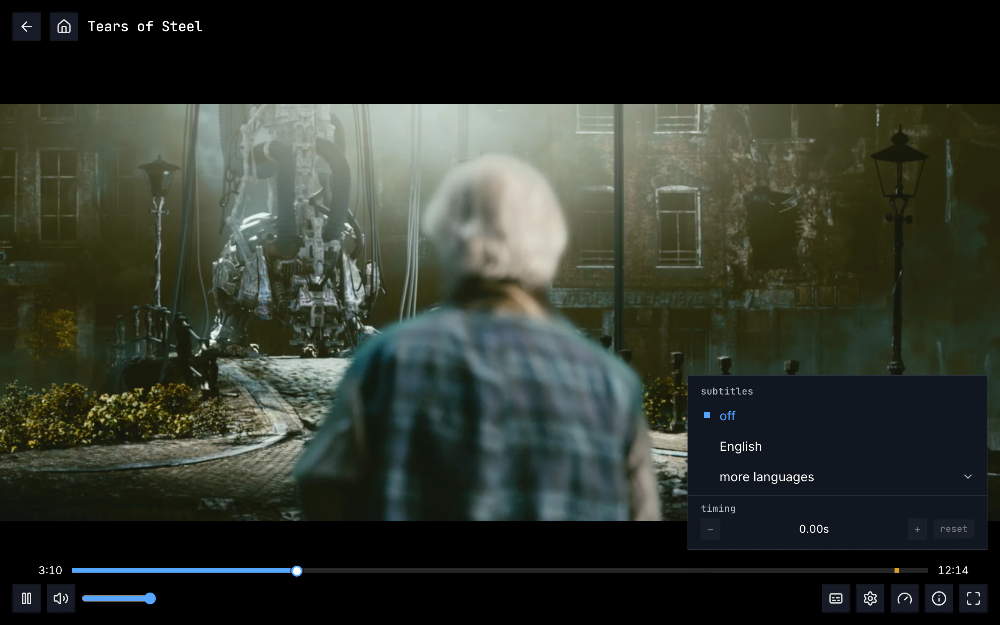

Figure 12.1: The web's subtitles menu as deployed on 6 November 2026, on a
computer, at 1280 × 800.

1. **The top of the menu: the header and off.** “subtitles” in the monospace
   face, and **off** under it, picked: blue, with a small filled square before
   it. The audio is English, the language the subtitle setting names, so no
   subtitle came on by itself.
2. **English**, the only language on top. As the server names no languages,
   the top holds the person's own: the subtitle setting's, the audio setting's
   and the browser's, here English all three.
3. **more languages**, with an arrow pointing down at its right end, holds the
   other 17.
4. **timing**, at the foot under a line: a minus, “0.00s”, a plus and
   **reset**, all dimmed while subtitles are off.
5. **The bottom right: the subtitles button**, a caption box, the first of five
   before the gear, the gauge, the “i” in a circle and the four corners. The
   menu stands above the whole control bar, the seek bar included, at its right
   end, 384 px wide.

A pick turns that subtitle on in place of the one that was, and the menu stays
open; a click outside it or Esc closes it. Figure 12.2 shows **more
languages** opened.

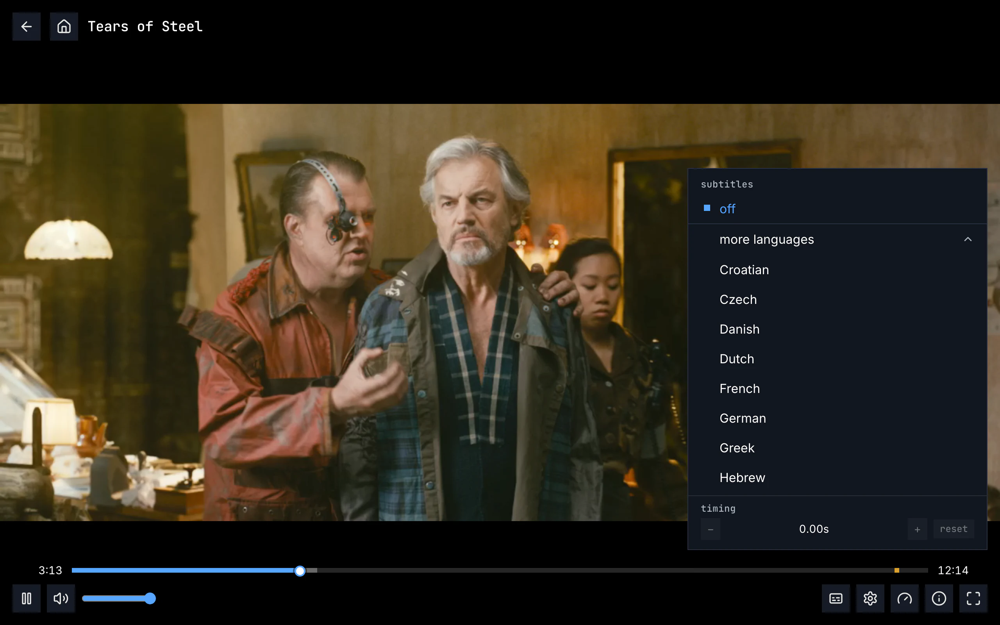

Figure 12.2: The web's subtitles menu with more languages opened, as deployed
on 6 November 2026, on a computer, at 1280 × 800.

1. **off**, with the header, stays at the top, above a line: the list under it
   scrolls.
2. **more languages**, its arrow now pointing up, at the top of the list: the
   list has scrolled to it, and English is above it, out of view.
3. **The other languages, in alphabetical order of their names**: “Croatian”,
   “Czech”, “Danish”, “Dutch”, “French”, “German”, “Greek”, “Hebrew” and on.
   The files call them “Deutsch” or “Français”; the menu names them in English.
4. **timing** stays at the foot.

Figure 12.3 shows the menu on a phone held upright.

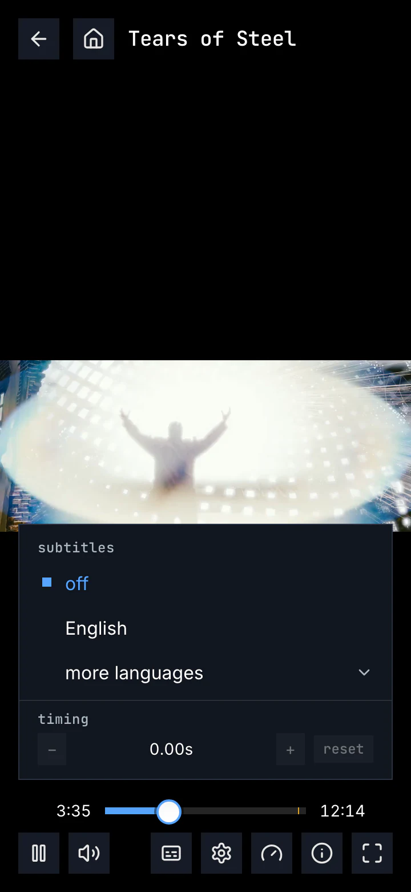

Figure 12.3: The web's subtitles menu as deployed on 6 November 2026, on a phone
held upright, at 360 × 780.

1. **The picture**, across the width in the middle, with black above and below
   it.
2. **The menu**, as wide as the screen but for 16 px at each side, over the
   foot of the picture: off, English, more languages and timing, as on a
   computer.
3. **The subtitles button**, the third in the row, after pause and the speaker.

Figure 12.4 shows it on a phone held sideways, where the screen is 360 px high.

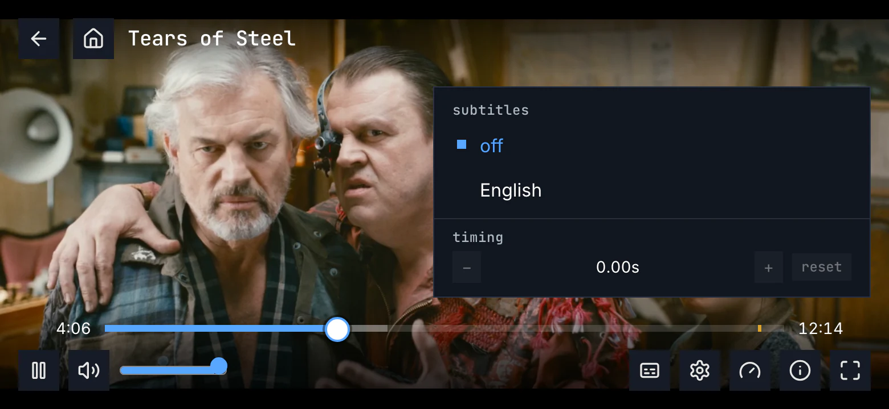

Figure 12.4: The web's subtitles menu as deployed on 6 November 2026, on a phone
held sideways, at 780 × 360.

1. **The header and off**, at the top of the menu, below the height of back
   and home.
2. **One row of the list**, “English”. A screen this short leaves room for one
   row, and the list scrolls a row at a time; **more languages** is under
   English, out of view.
3. **timing**, under the list, just above the seek bar.

Figures 12.5 and 12.6 show a subtitle on the picture. Figure 12.5 shows it with
the controls hidden.

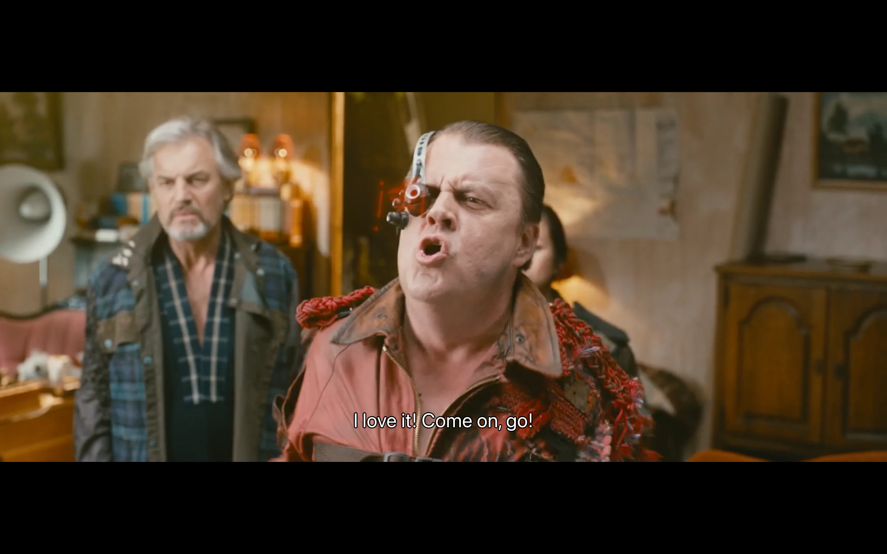

Figure 12.5: An English subtitle as deployed on 6 November 2026, on a computer,
at 1280 × 800, with the controls hidden.

1. **The line**, “I love it! Come on, go!”: white, with a thin black outline and
   no box, centred near the foot of the picture, inside it. Its size follows
   the picture's height.
2. **The black bars** above and below the picture: the film is wider than the
   window, and the line stays on the picture, not in the bar.

On a computer the controls fit into the bar under a picture this wide, so the
line stays where it is when they show. Figure 12.6 shows a phone held sideways,
where the picture reaches the controls.

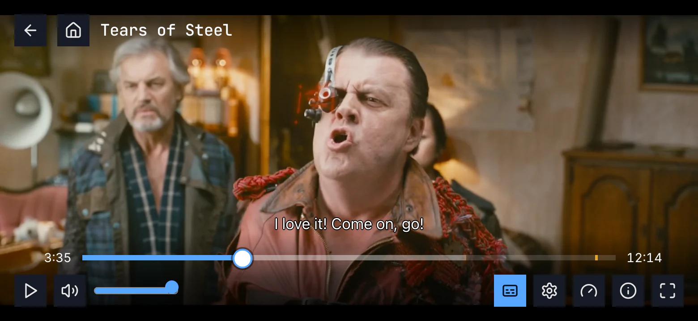

Figure 12.6: The same subtitle as deployed on 6 November 2026, on a phone held
sideways, at 780 × 360, with the controls showing.

1. **The line** has risen above the seek bar while the controls show, and it
   comes back down when they hide.
2. **The subtitles button is blue**, its caption box dark, while a subtitle is
   on.

What the screenshots can't show comes from the code. No title on the demo has
two audio tracks, so its audio menu doesn't appear there. The web shows the
audio button, a chip with the language's code, “ENG”, only for a title with two
audio tracks or more. Its menu, headed “audio”, opens right above the button,
over the seek bar, with round corners. Each row is the language, “English”,
with the codec as the server names it and the channels beside it in a smaller
grey, “AAC · Stereo”, for a ready-made title “MP4A.40.2 · Stereo”; a 5.1 track
reads “English 5.1”, and two that still read the same “English (2)”.
A pick closes the menu and shows “Switching audio…” until the new track plays.
A title without subtitles has its subtitles button dimmed, as
[chapter 11](./playback.md) shows. Of the subtitles made as pictures, the web
draws PGS, those of a Blu-ray, onto a canvas over the player. It has no way to
draw VobSub, those of a DVD, and leaves them out of the menu, as it does any
other picture format. A styled subtitle shows as the plain copy the package
keeps beside it, in the one look. A web page can't read the device's caption
preferences, so the web always shows its own look.

### 12.2.2 The phone app

The Android app's subtitles menu is a card 320 dp wide with round corners,
above the seek bar under its button, at most 420 dp high, and it scrolls where
it is longer. It is headed “subtitles” and starts with “off”, then the
languages on top as on the web, then **more languages**, whose arrow points
right, and down once it is open. The picked row is blue and a little bolder,
with a small square before it, and a long name wraps to a second line. A pick
closes the menu. It has no timing. A title without subtitles keeps the
subtitles button, and its menu holds “off” alone.

The audio button is a chip with the language's code, there for a title with
one track too. Its menu, “audio”, has the codec and the channels under each
name, “E-AC-3 · 5.1”, and lists a track the phone can't play greyed, with “Not
available on this device”. A pick closes it. The line is white with a black
outline and no box, sized by the picture, as section 12.8 has it, and the
phone's caption preferences win where someone has set them. Of the subtitles
made as pictures, it draws PGS: it loads the track's .sup file beside the
stream, keeps it on the phone's storage rather than in memory, and reads it
with a reader of its own, which hands each picture to the player's PGS decoder
at its time. ADR-0015 has this as in testing. A VobSub track is listed but
shows nothing, as the player has no decoder for it.

The iOS app's subtitles menu lists every track in the order they come, without
**more languages**, and a subtitle made as pictures, PGS or VobSub, is listed
greyed, with “Not available on” and the device's name: it draws neither. Its
picked row has a round dot.

### 12.2.3 Android TV

The menus open at the bottom right, above the control bar.
The subtitles menu is headed “subtitles”: “off”, the languages on top, and
**more languages**, whose arrow points down, and up once it is open. The
subtitles button is there for a title without subtitles too, and its menu then
says “No subtitles available” under “off”. The rows are focus rows, the menu
opens on the subtitle that is on, and the picked row is blue with a small square
before it. A pick closes the menu and says so at the top of the screen for a
moment: “Subtitles: English”, “Subtitles off”. It has no timing.

The audio button is there for two tracks or more; its menu, “audio”, has the
codec and the channels under each name, “E-AC-3 · 5.1”, lists only the tracks
the TV can play, and a pick says “Audio: English • E-AC-3 • 5.1” at the top.
The remote's subtitles key and audio key open their menus. While a menu is
open, the subtitle line moves out of its way, left of it or above it. The TV's
caption preferences win over the look. Of the subtitles made as pictures, it
draws PGS as the phone app does, from the track's .sup file with a reader of
its own, in testing too; a VobSub track goes to the player, which has no
decoder for it, so it shows nothing.

### 12.2.4 Samsung TV

The menus open at one fixed place at the right, above the control bar, with
round corners and headers in capitals, “AUDIO”, “SUBTITLES”. The subtitles
menu starts with “Off” and lists every track, the server's ones first and then
the file's own, each by its language and what its label adds, in brackets:
“English (SDH)”, “German (Forced)”, “German (AI)”; two that would read the same
are numbered, “English”, “English 2”. The picked row is in the accent colour
with a check at its end; the focused row turns white with black text, and the
focus starts on the first row, not on the picked one. A pick closes the menu.
It has no timing. The subtitles button is there only for a title with
subtitles, and the audio button for two tracks or more, its rows “English” and
“English 5.1”.

The line sits in a dark box, at one size, 5rem above the foot of the screen
and 17rem while the controls show, and the cue's markup is dropped, italics
included. The TV's own caption settings weren't found in the code. On a TV the
app plays through the TV's own player, which draws no subtitles made as
pictures, so PGS and VobSub are both left out. The browser engine it falls back
to, and uses off the TV, draws PGS and leaves VobSub out too.

### 12.2.5 Feature by feature

The table compares the four apps feature by feature. “—” is a feature the app
doesn't have, and “not found” one its code was searched for and doesn't have.

| Feature | Web | Phone app | Android TV | Samsung TV |
|---|---|---|---|---|
| The buttons | audio: a chip, “ENG”, for two tracks or more; subtitles: a caption box | the audio chip for one track too; subtitles | audio: an icon, for two tracks or more; subtitles | audio: an icon, for two tracks or more; subtitles |
| A title without subtitles | the subtitles button dimmed | the button, its menu “off” alone | the button, its menu “off” and “No subtitles available” | no subtitles button |
| Where the subtitles menu opens | above the whole bar, at its right end, 384 px wide | above the seek bar under its button, 320 dp wide, round corners | at the bottom right, above the bar | at one fixed place at the right, above the bar, round corners |
| Its header and first row | “subtitles”, “off” | “subtitles”, “off” | “subtitles”, “off” | “SUBTITLES”, “Off” |
| Its order | off; the setting's language and the server's languages, or the person's own where the server names none; more languages with the rest | Android: as the web; iOS: every track in the order they come | as the web | every track, the server's first, then the file's own |
| more languages | an arrow down, up once open; the list scrolls to it | an arrow right, down once open | an arrow down, up once open | — |
| A kind of track | “English · for deaf and hard of hearing”, “German · foreign-language parts only”, “Chinese (Simplified) · AI” | the same | the same | “English (SDH)”, “German (Forced)”, “German (AI)” |
| Two that read the same | shown once | shown once | shown once | numbered: “English 2” |
| The picked row | blue, a small filled square before it | blue and bolder, a small square; iOS a round dot | blue, a small square | in the accent, a check at its end |
| A pick | the menu stays open | the menu closes | the menu closes; “Subtitles: English” at the top | the menu closes |
| On a TV, the focus as it opens | — | — | on the subtitle that is on | on the first row |
| Timing | in the menu: −, “0.00s”, +, reset; 0.25 s a press, up to 10 s either way | — | — | — |
| Picture subtitles: PGS, from a Blu-ray | drawn, on a canvas over the player | Android: drawn, from the .sup file by a reader of its own; iOS: listed greyed, “Not available on” and the device's name | drawn, as the phone app does | left out on the TV's own player |
| Picture subtitles: VobSub, from a DVD | left out | Android: listed, shows nothing; iOS: listed greyed, “Not available on” and the device's name | shows nothing: the player has no decoder for it | left out |
| Styled subtitles | the plain copy | the plain copy | the plain copy | the plain copy |
| The look | white, a black outline, no box; 5.33% of the picture's height, 8% above its foot, within 80% of its width | the same | the same, inside the safe area | a dark box, one size, 5rem above the foot of the screen |
| Italics and ruby | kept | kept | kept | dropped |
| The line and the controls | rises above them | rises above them | rises above them | 17rem high while they show |
| The line and an open menu | the menu may cover it | the menu may cover it | moves left of the menu or above it | the menu may cover it |
| The device's caption preferences | can't be read by a web page | win over the look | win over the look | not found |
| The remote's subtitles and audio keys | — | — | open their menus | not used |
| What comes on by itself | the setting's language when the audio is in another; else the foreign-language parts in the audio's language | the same | the same | the same |
| Off, picked in the menu | everything off, the foreign-language parts too | the same | the same | the same |
| The audio menu | “audio”, over the seek bar, round corners | “audio”, above the seek bar, round corners | “audio”, at the bottom right | “AUDIO”, at the fixed place |
| Audio rows | “English” with “AAC · Stereo” beside it, for a ready-made title “MP4A.40.2 · Stereo”; “English 5.1”; “English (2)” | the name over “E-AC-3 · 5.1”; a track it can't play greyed, “Not available on this device” | the name over “E-AC-3 · 5.1”; only tracks it can play | “English”, “English 5.1” |
| The original track, a described track | not marked | not marked | not marked | not marked |
| An audio pick | the menu closes; “Switching audio…” | the menu closes | the menu closes; “Audio: English • E-AC-3 • 5.1” at the top | the menu closes |
| The subtitle setting's text | the text of section 12.10 | the same | the same | “Your subtitle language. Subtitles in it come on by default when a title's audio is in another language. Off keeps them off by default. Forced subtitles, for the lines a title's audio has in another language, come on either way.” |

## 12.3 The panel on a computer

Figure 12.7 shows the audio and subtitles panel on a computer, opened with
**audio and subtitles** on the player's control bar ([chapter 11](./playback.md)).
It is the one place to pick what a title plays in: the player has no audio menu
and no subtitles menu besides it.

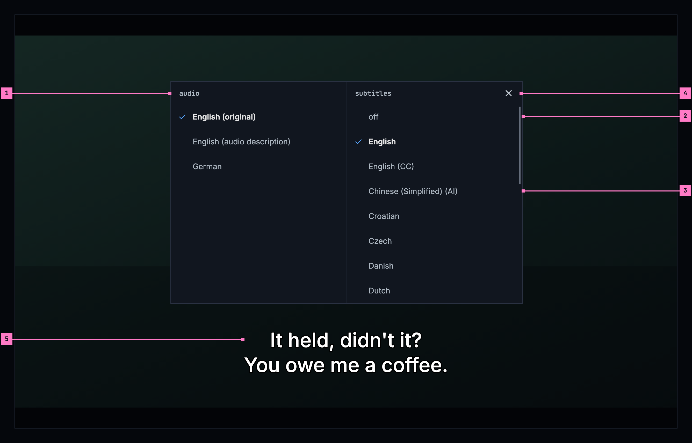

Figure 12.7: The audio and subtitles panel on a computer, at 1280 × 800.

1. **audio**, the left column: the title's audio tracks, each by its language
   (section 12.6). The one that plays has a check before it and the brighter
   text: here English, the language the film was made in, “English
   (original)”. “English (audio description)” is the same film with a voice
   that describes the picture.
2. **subtitles**, the right column: **off** first, then the person's
   languages, then every other language in alphabetical order of their names,
   in one list (section 12.7). Here the person picked English.
3. **The tags**, short and in brackets: “(CC)” for subtitles that also describe
   the sounds and name who speaks, “(AI)” for subtitles the server made. A
   column longer than the panel scrolls within itself, under its heading.
4. **close**, the design system's icon button, of its quiet kind, at the
   panel's top right.
5. **The line**, at its place at the foot of the picture and as bright as ever:
   the panel ends above it, so a pick shows in the line at once.

- **Opening and closing.** **audio and subtitles** opens the panel in the
  middle of the screen, over the picture, which dims. The title plays on under
  it, or stays paused. While the panel is open the player's top and control bar
  step back, and they come back when it closes. **close**, Esc and a click on
  the dimmed picture close it, and the focus goes back to **audio and
  subtitles**.
- **A pick.** A row picks its track at once, and the panel stays open, so the
  audio and the subtitles can be set in one go and each pick is heard or read
  before the panel closes. A new audio track keeps the place; a subtitle that
  came on by itself follows it (section 12.9). Nothing else says what was
  picked: the check does.
- **The rows.** The picked row of each column has a check before its name, the
  same check as in the player's menus ([chapter 11](./playback.md)), and the
  brighter text; every other row keeps the check's room, so the names line up.
  The headings, **audio** and **subtitles**, are in the monospace face, in
  lowercase; the rows are names, in the body face, 48 px high, and a name too
  long for its column wraps to a second line. The panel is the player's own,
  in the design system's colours; of the design system's components it has
  only the icon button, as close.
- **Its size.** Two columns of 340 px, as tall as the longer one needs, up to
  the room above the line's place; a longer column scrolls within itself, its
  heading staying.
- **The keyboard and a screen reader.** While the panel is open the arrow keys
  move in it, as on a TV: up and down within a column, left and right to the
  other column's picked row. Enter or space picks the focused row, and Esc
  closes the panel; the player's own keys wait until it is closed. For a screen
  reader each column is a group of one choice named by its heading, and each row
  says its name and whether it is picked.

The subtitles' timing isn't in the panel: it is in the player's settings menu,
with the quality ([chapter 11](./playback.md)).

## 12.4 The panel on a phone

The phone shows the panel held either way. Figure 12.8 shows it upright, where
two columns don't fit, and figure 12.9 sideways; section 12.4.3 says what
happens when the phone is turned with the panel open. The web on a phone has the
same panel, held either way.

### 12.4.1 Held upright

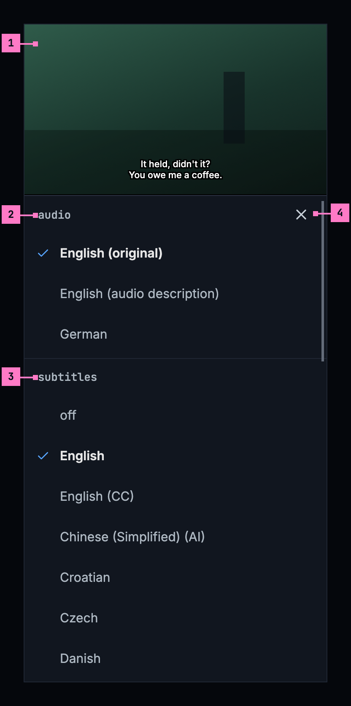

Figure 12.8: The audio and subtitles panel on a phone held upright, at
360 × 780 dp.

1. **The picture** moves to the top of the screen while the panel is open, its
   subtitle line with it, so a pick shows there at once.
2. **audio**, the first list, under the picture.
3. **subtitles**, the second list, under the audio's. The two lists scroll as
   one, their headings with them.
4. **close**, the design system's icon button at its large size, 42 dp, at the
   right of the first heading. A tap on the picture and the phone's back close
   the panel too, and the picture goes back to the middle.

Upright, two columns don't fit 360 dp, so the lists stand one under the other in
the order of the computer's columns, with the same rows, 48 dp high. The
headings' rows are 48 dp high too, so the close button keeps a touch area of
48 dp around it, as the player's buttons do. The panel
fills the screen under the picture, and the phone's status bar and navigation
bar stay, with the panel clear of them.

### 12.4.2 Held sideways

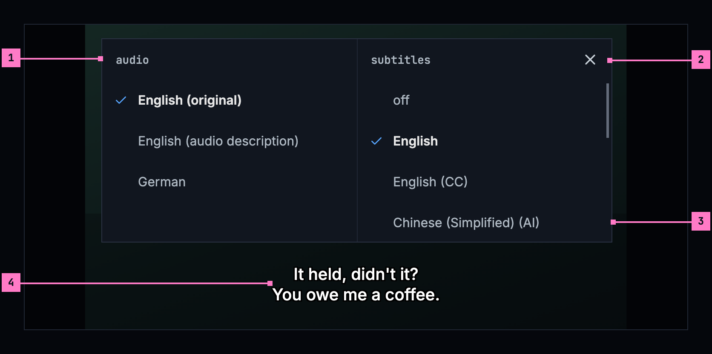

Figure 12.9: The audio and subtitles panel on a phone held sideways, at
780 × 360 dp.

1. **The two columns** of figure 12.7, 300 dp each, over the dimmed picture.
2. **close**, the design system's icon button at its large size, at the
   panel's top right. A tap on the dimmed picture and the phone's back close
   the panel too.
3. **A column longer than the panel** scrolls within itself, under its heading:
   the screen leaves room for four rows above the line.
4. **The line**, at the foot of the picture under the panel: the panel ends
   above it.

Held sideways, the panel keeps clear of the camera's cutout, as the picture does
([chapter 11](./playback.md)).

### 12.4.3 Turning the phone

The panel turns with the phone and stays open, with its picks and the place each
list was scrolled to. Turned upright, the columns become the two lists under the
picture, and the picture moves to the top; turned sideways, the lists become the
two columns over the dimmed picture. The title plays on, as it does with the
panel closed ([chapter 11](./playback.md)).

## 12.5 The panel on a TV

Figure 12.10 shows the panel on a TV, with the focus moved one row down from the
subtitle that is on.

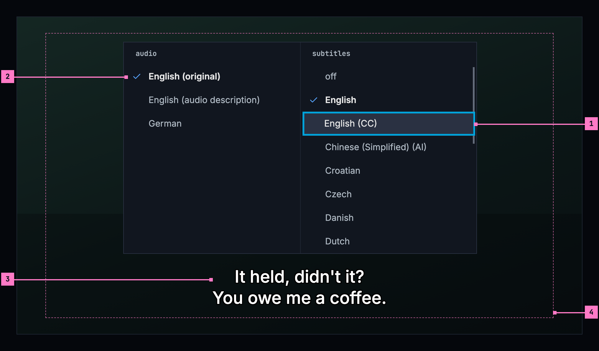

Figure 12.10: The audio and subtitles panel on a TV, at 960 × 540 dp.

1. **The focus**, on “English (CC)”: the ring inside the row, the lighter
   surface, the row a little larger and its text the brightest, as everywhere on
   the TV. OK picks it, and the panel stays open.
2. **The picked rows**, one in each column, with the check and the brighter
   text. The focus and the pick never share a mark: the ring moves, the check
   stays where the pick is.
3. **The line**, at its place under the panel.
4. **The safe area.** The panel, its focus ring and the line keep inside it.

The remote's subtitles key opens the panel with the focus on the picked row of
the subtitles column, and its audio key on the picked row of the audio column;
**audio and subtitles** on the control bar opens it on the subtitles column,
which most titles have a choice in. Up and down move within a column and stop
at its ends; left and right move to the other column's picked row. back closes
the panel and gives the focus back to **audio and subtitles**; where a key of
the remote opened it over hidden controls, they stay hidden. The TV has no
close button, as back is the way out everywhere on the TV. Rows are 40 dp high,
and the panel stays inside the safe area, with room for the focus ring.

## 12.6 The audio column

The audio column lists the title's audio tracks this device can play, in the
order the title has them. A track the device can't play is left out, never
greyed. Each track is named by its language, as the
[word list](./words.md) writes it, “German”, “Portuguese (Brazil)”, a track
without dialogue “No dialogue”, and one in no language the apps know by what the
file calls it, else “Unknown”. A few short tags follow the name in brackets, a
comma between two:

- **“(original)”** marks the language the title was made in: the track the
  audio setting's **Original** would play ([chapter 11](./playback.md)), and
  every other track in that language but a described one. It shows only where the
  title has audio in more than one language; a title in one language needs no
  mark.
- **“(audio description)”** marks a track with a voice that describes the
  picture for people who can't see it, as the file marks it.
- **The channels**, “(5.1)”, “(7.1)”, “(stereo)”, “(mono)”, show only where two
  tracks of one language would read the same without them, and then on both:
  “English (5.1)” and “English (stereo)”.
- **What the file calls a track** tells two apart that still read the same,
  “English (Commentary)”; where it says nothing, their place does, “English
  (2)”.

So a title made in English with a German dub reads “English (original)” and
“German”; one in English alone, served with its 5.1 track beside its stereo
one, “English (5.1)” and “English (stereo)”; and the same with the dub “English
(original, 5.1)”, “English (original, stereo)” and “German”. Nothing else is
said of a track: no codec, and no channels where they tell nothing apart. A
title with one audio track shows it alone, picked, so the panel always says what
plays.

## 12.7 The subtitles column

The subtitles column is one list of one choice, in this order:

1. **off**
2. **the person's languages**: the subtitle setting's language, the audio
   setting's language when it isn't “Original”, and the device's or the
   browser's language, each once, in that order
3. **every other language** the title has subtitles in, in alphabetical order
   of their names

The list has no **more languages**: it holds every subtitle the title offers,
and it scrolls where it is long. The person's languages come first, so the
subtitles most people pick are a press or two from **off**.

A language's tracks stay together, the ones the server made included, and a
language with its region or script counts as that language: “Chinese
(Simplified) (AI)” follows “Chinese”. So a person's language, named with or
without a region or script, brings all of its tracks to the top: a device set to
Chinese (Traditional) brings “Chinese (Simplified)” with it. Within a language,
the plain track comes first, then “(CC)”, then the ones the server made. A
language with regions or scripts gives each of them a run of its own, the bare
name first and the others in alphabetical order: “Chinese”, “Chinese
(Simplified)”, “Chinese (Simplified) (AI)”, “Chinese (Traditional)”.

A track is named by its language, as the [word list](./words.md) writes it,
with short tags in brackets after it:

- **“(CC)”** for subtitles that also describe the sounds and name who speaks:
  “English (CC)”;
- **“(AI)”** for subtitles the server made: “German (AI)”; both together,
  “English (CC, AI)”;
- **what a file's label adds**, in brackets as the file writes it: “English
  (Commentary)”, “Chinese (Cantonese)”. Words that only name the language again,
  “Deutsch”, “中文”, are dropped.

Tracks that would read the same show once: one inside the file before one the
server adds, otherwise the first in the file. They are never numbered, as in
“English (2)”.

Some tracks aren't listed at all:

- **The foreign-language parts.** A track that covers only the lines in another
  language than the audio's comes on by itself where it is needed
  (section 12.9), so it is never a row of its own.
- **A subtitle this device can't draw**, as an audio track it can't play isn't
  listed either.
- **Subtitles made as pictures in a title that has no package yet**, which
  plays from its original: the server hands out an original's own subtitles
  only as text, and a picture is none. They are listed once the title is
  packaged.

Subtitles made as pictures, PGS from a Blu-ray and VobSub from a DVD, are
otherwise listed like any other. The package keeps every one as pictures, each
in a file of its own, as
[ADR-0015](../../docs/adr/0015-the-package-is-the-master.md) decides, and the
server lists it with its format and hands it out. Once a title's original is
deleted, they are often its only subtitles.

The picked row has the check and the brighter text. **off** is picked when no
listed subtitle is on, the foreign-language parts showing or not. A title
without subtitles, whose panel opens for its audio, shows **off** alone;
[chapter 11](./playback.md) says when the button is there.

## 12.8 The look

- **White text with a black outline**, with no box behind it.
- **Its size follows the picture**: 5.33% of the picture's height.
- **The device's own sans-serif font**, so every language has its letters,
  Chinese, Japanese and Korean included.
- **Centred at the bottom**, inside the picture, 8% above its bottom edge; at
  most two lines where the text allows, within 80% of the picture's width. On a
  TV, it stays inside the safe area.
- **One look for every text subtitle.** Colours, sizes, boxes, fonts and
  positions that come inside a plain text subtitle are ignored. Italics stay,
  because they mean something: a voice from off screen, a song, a thought.
  Ruby, the small readings above Japanese and Chinese characters, stays too.
- **Styled subtitles keep their own look.** A subtitle made with its own styles
  and fonts (ASS) is drawn as it was made, with the fonts the title carries, as
  [ADR-0015](../../docs/adr/0015-the-package-is-the-master.md) decides: the
  package keeps every subtitle as it is. An app that can't draw styled
  subtitles yet shows the plain copy the package keeps beside them, in the look
  above.
- **One subtitle at a time.**
- **Out of the controls' way**: while the player's controls show, the line moves
  up above them, and back down when they hide, at the controls' own pace.
- **Clear of the panel and the menus.** The audio and subtitles panel ends
  above the line's place, and an open menu of the player moves the line out of
  its way ([chapter 11](./playback.md)), so neither hides the line it changes.
- **The picture is what shows of it.** Where the player crops a file's black
  bars or fills the screen (the picture, in [chapter 11](./playback.md)), the
  size, the margin and the width go by the frame as it shows on the screen.
- **Subtitles made as pictures (PGS, VobSub) stay on the picture**, where the
  file puts them, scaled with it. One in a bar that is cropped moves up onto the
  picture (or down, from a top bar), keeping the gap it had to the frame's
  edge, at most a text line's 8%; one wider than what shows is made smaller in
  its own shape. None is ever cut off the screen, and where nothing is
  cropped, none moves.

When someone has set caption preferences on the device, under accessibility,
those win over this look: for example a box behind the text. The TV and the
phone apps read them; a web page can't, so the web app always shows this look.

Figure 12.11 shows subtitles on a TV, with the controls hidden.

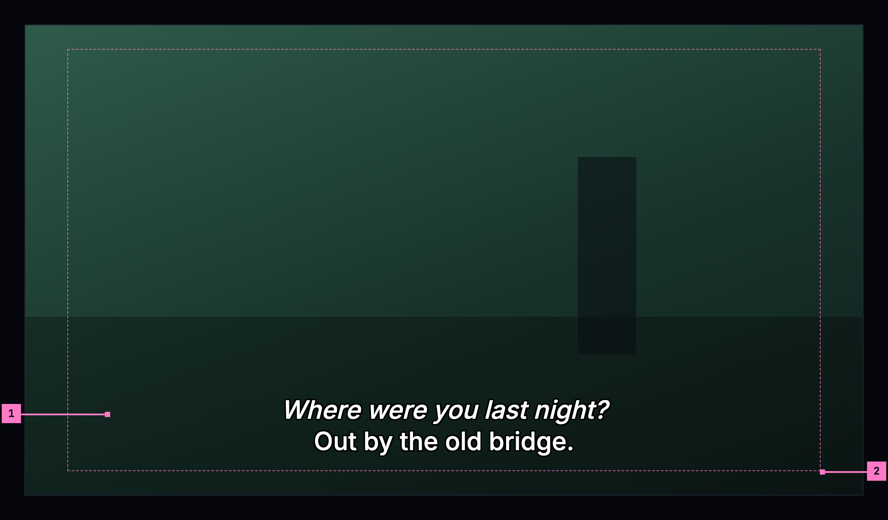

Figure 12.11: Subtitles on a TV, at 960 × 540 dp, with the controls hidden.

1. **The line**: white with a black outline, 5.33% of the picture's height,
   centred 8% above its foot. Italics stay: here the first line is a voice
   from off screen.
2. **The safe area.** On a TV the line keeps inside it, whatever the picture.

Figure 12.12 shows the look with its guides on a phone held sideways, where the
picture, 640 × 360 dp, stands in the middle of the screen, and in a second
screen below, the same line with the controls showing.

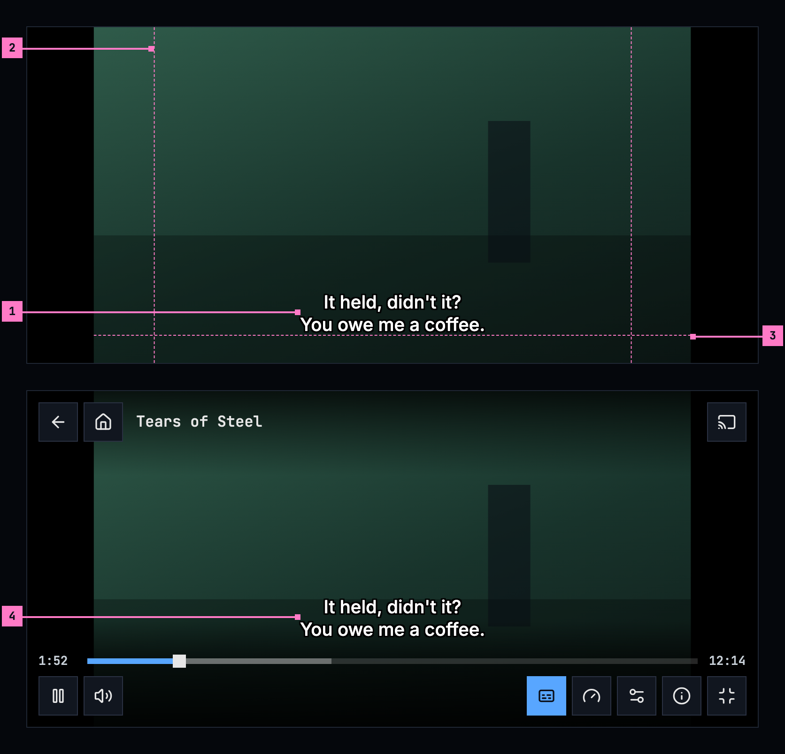

Figure 12.12: A subtitle with the controls hidden, with its guides, and the same
line above the controls, on a phone held sideways.

1. **The line**: white with a black outline and no box, 5.33% of the picture's
   height, here 19 dp, on at most two lines.
2. **80% of the picture's width**, between the two upright guides: the line
   keeps within it, measured on the picture, not on the screen with its black
   bars.
3. **8% above the picture's bottom edge**, the guide under the line: the line
   is centred on the picture, its foot on the guide.
4. **The same line with the controls showing**: it has risen above the seek
   bar, and it comes back down when they hide, at the controls' own pace. The
   buttons are the design system's icon buttons, as in
   [chapter 11](./playback.md).

## 12.9 What switches on by itself

- **The subtitle setting's language**, when the audio playing is in another
  language: its first track in the subtitles column's order, the setting's
  region or script first, so a setting of Chinese (Traditional) turns on
  “Chinese (Traditional)” where the title has it.
- **Otherwise, the foreign-language parts in the audio's language**, where the
  title has them, because they translate the lines the audio doesn't.
- **Nothing else.** Subtitles in the audio's own language are the person's
  choice, made in the panel.

The rule compares with the audio that is playing, never with the preferred audio
language, and it is made again when the audio changes. A pick in the panel lasts
for what is playing now. A picked subtitle stays, whatever the audio. **off**
leaves the dialogue without subtitles, and the foreign-language parts in the
audio's language still come on by themselves, following the audio, because
without them those lines can't be understood. The next title follows the
setting again. Figure 12.13 shows the rule as a title starts.

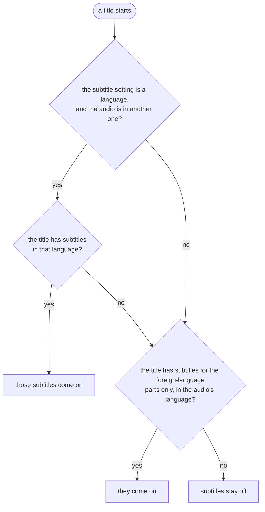

Figure 12.13: What switches on by itself as a title starts.

## 12.10 The setting

Settings has one subtitle language, “off” or a language, with this text under
it, the same in every app. The languages offered are the server's subtitle
languages, read from its configuration, never a list fixed in the app; a server
that names none offers every language by name.

> Subtitles in the language you pick here come on when a title's audio is in
> another language. Otherwise, only the foreign-language parts get subtitles,
> where a title has them. A choice in the player applies only to what's playing
> now.

## 12.11 For the builders

- Android: the player's subtitle view with embedded styles and embedded font
  sizes switched off, a fractional text size of 0.0533, and a caption style of
  white text, a black outline, and a transparent background and window. When the
  system's caption settings are switched on, it takes the user's style and text
  size instead. The safe area comes from a bottom margin and the 80% width, not
  from padding the view. Switching embedded styles off also drops italics, so
  the apps keep italic spans themselves. Ruby survives the switch, but the
  player's own drawing leaves the readings out, so the apps draw them
  themselves. The view sits over the player's frame, not inside it: the frame is
  drawn scaled and moved to fit its picture, the subtitle view is laid out at
  what shows of it, and a PGS or VobSub picture is placed there by the same
  rule as the web's.
- Web: an overlay the app draws instead of the browser's own captions, one track
  at a time: white, no background, an outline drawn with text shadows in eight
  directions, a font size relative to the picture's height. It keeps `<i>` and
  `<ruby>` from the cue and drops every other style. PGS and VobSub pictures are
  drawn one by one onto a canvas over the player, each where the picture's
  transform and the rule above put it. The overlay sits above the panel's
  dimming, so the line keeps its brightness while the panel is open.
- Language names come from the platform in their standard form, the language
  first and the region or script in brackets: “Portuguese (Brazil)”, “English
  (Guam)”, “Chinese (Simplified)”. On the web that is `Intl.DisplayNames` with
  `languageDisplay: 'standard'`; its default gives “Brazilian Portuguese”.
- The audio tags: “(original)” goes on the tracks the play info marks as in the
  title's original language, which the catalog keeps (change 12.C10). Until
  the server has it, nothing tells the original apart: the apps play the track
  the file marks as its default for **Original**, often the dub in a release
  with two languages, and package.json's per-track “original” flag is the
  file's own mark, which releases rarely set. “(audio description)” goes by
  each audio track's purpose, “description” for a described track, which
  package.json has and chino-stream's play info doesn't pass on yet and has to
  (change 11.C30); a track's name that says “Audio description” counts too.
- “(CC)” goes on the tracks the apps call “for deaf and hard of hearing”
  today: a label that says so, SDH, CC or hard of hearing, or on Android the
  stream's mark of a track that describes the sounds.

## 12.12 Changes

Every difference between section 12.2 and the target is one change in the
table. A change names the apps it is built in, what they do today and the
target, with the figure or the section that sets it out; it is built as its row
says, and nothing else changes with it. Each change starts as proposed; once the
owner approves it, it is built, one change at a time. A target that starts with
“Recommended” takes away something an app has today. The control bar's one
button is change 11.C2 of [chapter 11](./playback.md), the timing in the
settings menu 11.C3, and the audio column's names 11.C30; the setting's own
rows, such as its first value, belong to [chapter 16](./settings.md).

Once a title's original is deleted, its package is all there is
([ADR-0015](../../docs/adr/0015-the-package-is-the-master.md)), and subtitles
made as pictures are then often the title's only subtitles: an app that can't
draw PGS or VobSub shows such a title without any. So the changes that draw
them come first: 12.C7 for PGS, 12.C9 for VobSub, and 14.C4 for a title cast
to a TV ([chapter 14](./casting.md)).

| No. | Change | Apps | Today | Target | Status |
|---|---|---|---|---|---|
| 12.C1 | One panel for the audio and the subtitles | Web, Phone app, Android TV, Samsung TV | an audio menu and a subtitles menu, each at its own button: Web: the subtitles menu above the whole bar (figure 12.1), the audio menu over the seek bar, round corners. Phone app: round cards above the seek bar. Android TV: at the bottom right. Samsung TV: at one fixed place, headers in capitals. The picked row blue with a square (Samsung TV: a check at its end). A pick closes the menu, but in the web's subtitles menu; Android TV then says “Subtitles: English” or “Audio: …” at the top. Samsung TV's focus starts on the first row | the panel of sections 12.3 to 12.5: two columns, audio and subtitles, over the dimmed picture, on a phone held upright the two lists under the picture at the top; the controls step back while it is open; the picked row with a check and the brighter text; a pick applies at once, the panel stays open and nothing else says what was picked; close, the design system's icon button, Esc, a press on the dimmed picture or back closes it; it ends above the subtitle line; on a TV the focus starts on the picked row of the column, left and right move between the columns | proposed |
| 12.C2 | The subtitles column: one list, the person's languages first | Web, Phone app, Android TV, Samsung TV | Web, Phone app (Android), Android TV: off, the setting's language and the server's languages, or the person's own where the server names none, then more languages with the rest (figure 12.2). iOS: off, then every track in the order they come. Samsung TV: Off, then every track, the server's first | off, the person's languages, then every other language in alphabetical order of their names, in one list without more languages; the server's languages don't change the order (section 12.7) | proposed |
| 12.C3 | Short tags for the subtitles' kinds | Web, Phone app, Android TV, Samsung TV | Web, Phone app, Android TV: “English · for deaf and hard of hearing”, “German · AI”, “English · Commentary”. Samsung TV: what the label adds in brackets, “English (SDH)”, “German (AI)”, and two that read the same numbered, “English 2” | “English (CC)”, “German (AI)”, “English (CC, AI)”, “English (Commentary)”, never numbered (section 12.7). The word list of [chapter 18](./words.md) changes with it: “(CC)” in place of “for deaf and hard of hearing”, “(AI)” in brackets in place of “· AI”, and “foreign-language parts only” no longer a row's name | proposed |
| 12.C4 | The foreign-language parts: not listed, and on with off | Web, Phone app, Android TV, Samsung TV | listed as rows, “German · foreign-language parts only” (Samsung TV: “German (Forced)”); a person's off turns them off too | not listed; in the audio's language they come on by themselves whenever no listed subtitle is on, off included, and follow the audio (section 12.9) | proposed |
| 12.C5 | iOS: a subtitle it can't draw is left out | Phone app (iOS) | a subtitle made as pictures, PGS or VobSub, is listed, greyed, with “Not available on” and the device's name | Recommended: left out, as the web and the Samsung TV leave out what they can't draw (section 12.7); drawing them is changes 12.C7 and 12.C9 | proposed |
| 12.C6 | Samsung TV: the one look | Samsung TV | the line in a dark box, one size, 5rem above the foot of the screen and 17rem while the controls show; the cue's markup dropped, italics too; the TV's caption settings not found | section 12.8: white with a black outline and no box, 5.33% of the picture's height, 8% above its foot, within 80% of its width and the safe area; italics and ruby kept; the TV's caption settings win | proposed |
| 12.C7 | PGS drawn on iOS and Samsung TV | Phone app (iOS), Samsung TV | iOS: PGS not drawn, listed greyed. Samsung TV: left out on the TV's own player; only the browser engine it falls back to draws it. The web, the Android app and Android TV draw it | drawn on the picture, as section 12.8 says and ADR-0015 decides | proposed |
| 12.C8 | Styled subtitles drawn as they were made | Web, Phone app, Android TV, Samsung TV | every app shows the plain copy the package keeps beside a styled subtitle, in the one look | drawn as made, with the fonts the title carries (section 12.8), as ADR-0015 decides; the plain copy only in an app that can't draw them yet | proposed |
| 12.C9 | VobSub drawn on every app | Web, Phone app, Android TV, Samsung TV | no app draws VobSub. Web, Samsung TV: left out. Phone app: Android lists it and shows nothing, iOS lists it greyed. Android TV: handed to the player, which has no decoder for it, so it shows nothing | drawn on the picture, as section 12.8 says and ADR-0015 decides, from the two files the server hands out for each VobSub track, its .idx and its .sub | proposed |
| 12.C10 | An original language for every title | the server | the catalog keeps no original language per title, and package.json has only a per-track “original” flag, the file's own mark, which releases rarely set. So nothing tells the original audio from a dub; the apps' Original plays the track the file marks as its default, which in a release with two languages is often the dub | the catalog keeps each title's original language, the one it was made in, and chino-stream's play info marks the audio tracks in that language; the tag “(original)” (11.C30 of [chapter 11](./playback.md)) and the audio setting's Original (16.C18 of [chapter 16](./settings.md)) go by it | proposed |

## 12.13 States

Subtitles have no screens of their own; the player's states are in
[chapter 11](./playback.md). What subtitles and the panel do in the cases
between:

| State | What shows |
|---|---|
| The title has one audio track and no subtitles the panel lists | The control bar has no audio and subtitles button |
| The title has no subtitles, and two audio tracks or more | The subtitles column holds **off** alone |
| The title has one audio track | The audio column shows it alone, picked, without a tag (section 12.6) |
| A subtitle for the foreign-language parts only | Not listed; it comes on by itself (section 12.9) |
| A subtitle this device can't draw | Not listed (section 12.7) |
| A subtitle made as pictures, PGS or VobSub | Listed like any other, and drawn on the picture (section 12.8) |
| A title without a package yet, its original's subtitles made as pictures | Not listed until the title is packaged (section 12.7) |
| A subtitle that can't be loaded | The title plays on without it |
| The panel is open | The picture dims, the controls step back, and the line keeps its place and its brightness (section 12.3) |
| The device has caption preferences | They win over the look (section 12.8) |
| The controls show | The line rises above them (figure 12.12) |
| The player crops the bars or fills the screen | The line goes by what shows of the picture (section 12.8) |
| Zap | No subtitles on a card ([chapter 10](./zap.md)) |

## 12.14 Words

| Where | Text |
|---|---|
| The control bar's button | audio and subtitles; for a screen reader with what is set after a comma, “audio and subtitles, English (original), subtitles English”, “audio and subtitles, German, subtitles off” |
| The panel's headings | audio · subtitles |
| The panel's close button, for a screen reader | close |
| The audio rows | “English”, “English (original)”, “English (audio description)”, “English (5.1)”, “English (stereo)”, “English (original, 5.1)”, “English (Commentary)”, “English (2)”, “No dialogue”, “Unknown” |
| The subtitles column's first row | off |
| The subtitles rows | “English”, “English (CC)”, “German (AI)”, “English (CC, AI)”, “Chinese (Simplified) (AI)”, “English (Commentary)” |
| The timing, in the player's settings menu | subtitle timing · − · + · “0.00s”, “+0.25s”, “−0.50s” · reset ([chapter 11](./playback.md)) |
| The setting | the text of section 12.10; its first choice “off” |
