# 6 The title page

Section 6.2 describes the title page as it is deployed today. The sections
after it are the target, the page as it is meant to be, and section 6.9 lists
every difference between the two as a numbered change. Only a change the owner
has approved is built, one change at a time; anything no change names stays as
it is deployed.

This chapter specifies a title's page: what it shows of a movie and of a show,
and what people can do there. The frame around it is specified in
[chapter 2](./frame.md), and the player it starts in [chapter 11](./playback.md).

## 6.1 Purpose

A title's page tells people what a title is and lets them act on it: play it,
add it to a list, mark it as watched, like it, and on a phone download it. It
opens from every card of a title: on home ([chapter 4](./home.md)), in movies
and shows ([chapter 5](./browse.md)), in the watchlist
([chapter 8](./watchlist.md)) and in search ([chapter 9](./search.md)), from a
notification about it ([chapter 15](./notifications.md)), and from the similar
titles at the foot of another title's page. Its people lead on to their own
pages ([chapter 7](./person.md)).

The page isn't one of the views, so the frame marks no view as current. Back
returns to where the person came from.

## 6.2 As deployed

This section says what the four apps' title pages do as of 6 November 2026:
the web as the public demo showed it that day, on the same build as
production, and the apps as their code had them that day. The phone app,
Android TV and the Samsung TV are described from their code until screenshots
of them are taken. The Samsung TV app isn't released yet.

### 6.2.1 The web

The web's title page has no frame: no top bar, no side navigation and no tabs.
Figures 6.1 to 6.6 are screenshots of it. Figure 6.1 shows the top of a
movie's page on a computer, for a movie the viewer stopped part way.

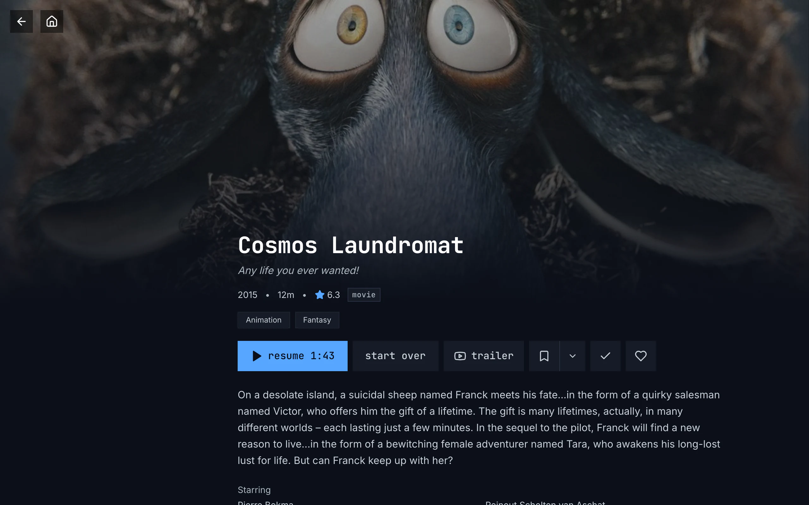

Figure 6.1: A movie's page on the web as deployed on 6 November 2026, on a
computer, at 1280 × 800.

1. **Top left: back and home**, two dark squares with an arrow and a house,
   standing on the picture.
2. **The still**, across the width and dimmed, fading into the page's colour
   from its middle down. The name, the facts and the genres stand on its
   faded foot.
3. **The poster's place**, left of the name, still empty: the poster fades in
   once it has loaded, and nothing stands in for it until then.
4. **The name, the tagline and the facts**: “Cosmos Laundromat” in the
   monospace face, the tagline, “Any life you ever wanted!”, in italics, then
   “2015 • 12m • ★ 6.3” and the kind, “movie”, in a thin frame. The genres
   follow as chips, in the catalog's words: “Animation”, “Fantasy”.
5. **The row**: “resume 1:43” in blue, then “start over”; “trailer” with a
   video site's logo, because this trailer opens online; add to list in two
   parts, a bookmark and ⌄; watched, a check; and liked, a heart.
6. **The description**, whole, and under it “Starring”, at the window's foot.

Figure 6.2 shows the same page scrolled down to its people and the titles like
it.

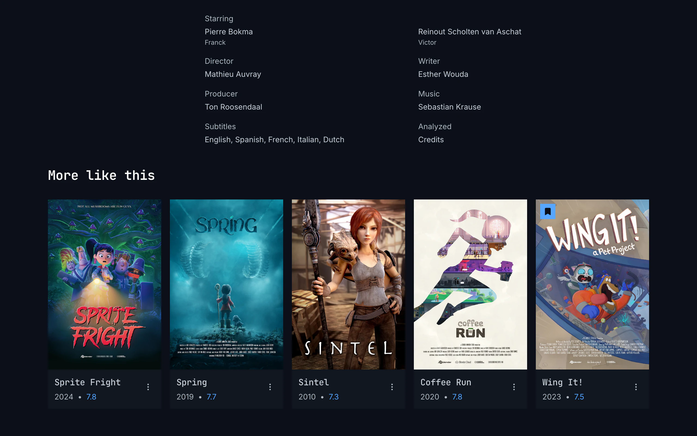

Figure 6.2: The foot of a movie's page on the web as deployed on 6 November
2026, on a computer, at 1280 × 800.

1. **Starring**, a label in the body face, and the actors two to a line, each
   name over the part: “Pierre Bokma”, “Franck”.
2. **The crew**, two to a line, each role under its label: “Director”,
   “Writer”, “Producer”, “Music”.
3. **Subtitles**, the languages in the order of the title's tracks: “English,
   Spanish, French, Italian, Dutch”.
4. **Analyzed**, the parts the server found in the title, here “Credits”.
5. **More like this**, capitalised, and a row of posters. Under each poster
   stand the name in the monospace face, the year and the rating in blue,
   “2024 • 7.8”, and ⋮, which opens the card's menu; the bookmark on blue at
   the top left of “Wing It!” says it is in the Watchlist.

Figure 6.3 shows a movie's page on a phone held upright.

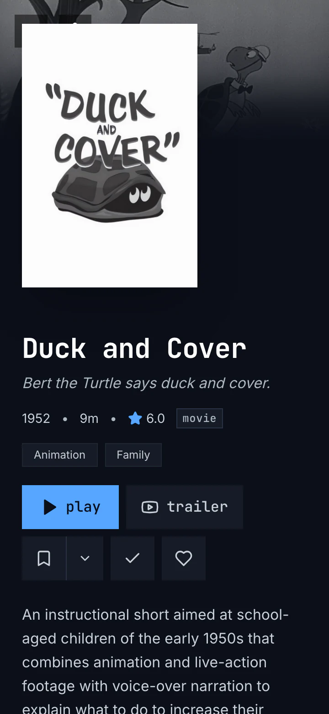

Figure 6.3: A movie's page on the web as deployed on 6 November 2026, on a
phone held upright, at 360 × 780.

1. **Back and home**, under the poster: only their top edges show. The
   poster covers them, so they can't be tapped.
2. **The poster**, 192 px wide, above the name.
3. **The name, the tagline, the facts and the genres**, as on a computer:
   “1952 • 9m • ★ 6.0”, “movie”, “Animation”, “Family”.
4. **The row wraps**: play and trailer on the first line; add to list,
   watched and liked on the second.
5. **The description**, under the row. There are no tabs at the foot.

Below 768 px wide the poster stands above the name, 192 px wide; from 768 px
it stands beside it, 256 px wide, so a phone held sideways has the computer's
layout, as figure 6.4 shows on a show's page.

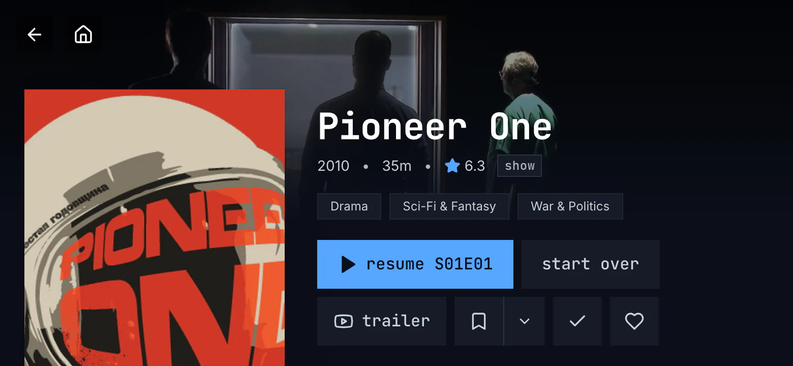

Figure 6.4: A show's page on the web as deployed on 6 November 2026, on a phone
held sideways, at 780 × 360.

1. **Back and home**, on the picture, clear of the poster.
2. **The poster**, 256 px wide, beside the name.
3. **A show's facts**: “2010 • 35m • ★ 6.3” and “show”; a show has a length,
   as the catalog gives it. The genres follow: “Drama”, “Sci-Fi & Fantasy”,
   “War & Politics”.
4. **The row**: “resume S01E01” names the episode it plays, and “start over”
   plays that episode from its beginning; trailer, add to list, watched and
   liked wrap to a second line.

Figure 6.5 shows the same show's page scrolled to its episodes, on a computer.

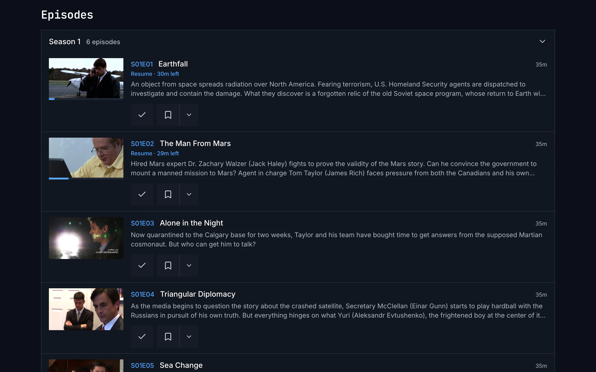

Figure 6.5: A show's episodes on the web as deployed on 6 November 2026, on a
computer, at 1280 × 800.

1. **Episodes**, capitalised, and the season's header: “Season 1” and
   “6 episodes”, with a chevron that closes the season. The first season
   starts open.
2. **An episode row**: the still, 160 px wide, with a blue bar as far as the
   viewer got; the code in blue, “S01E01”, the name, “Earthfall”, and at the
   right the length, “35m”.
3. **The time left**, “Resume · 30m left”, in blue, and the description, cut
   after two lines with “…”.
4. **The row's actions line**: watched first, a check, then add to list, a
   bookmark and ⌄, 48 px high like the title row's controls. Anywhere else, a
   click on the row plays the episode.

Figure 6.6 shows the same episodes on a phone held upright.

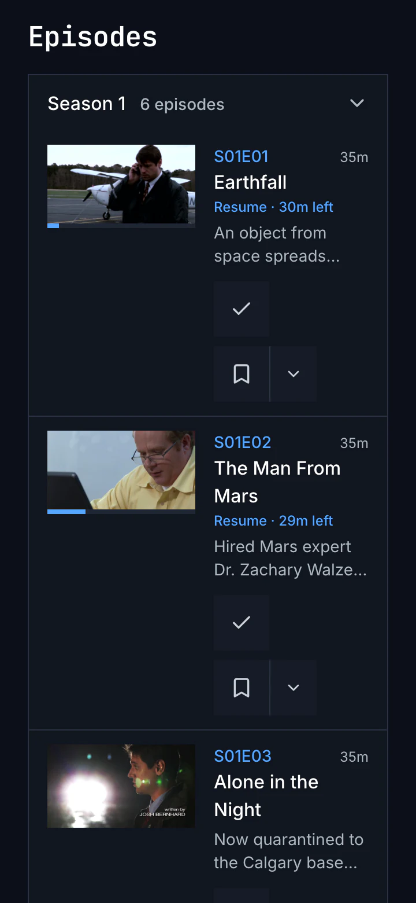

Figure 6.6: A show's episodes on the web as deployed on 6 November 2026, on a
phone held upright, at 360 × 780.

1. **The season**, as on a computer, across the page.
2. **The still**, 128 px wide, beside the text: the code and the length on
   one line, the name under them on up to two lines.
3. **The time left and the description**, the description cut after two
   lines.
4. **The actions line**, in the narrow column beside the still: watched and
   add to list stand one under the other.

What the screenshots can't show, such as the page while it loads, the list
picker, a page opened on an episode and a page that couldn't load, is in the
table of section 6.2.5.

### 6.2.2 The phone app

The phone app's title page is a screen of its own, without the tabs. A bar
that doesn't scroll holds back and home, 40 dp squares side by side, and on
Android the cast button at the right while a device that can play is on the
network. The bar isn't there while the page loads, when a spinner turns alone,
nor when the page couldn't load; iOS has no system back, so there that screen's
only way on is try again. Below 600 dp wide the poster, 192 dp, stands above
the name; from 600 dp it stands beside it, and the name and the facts rise onto
the still's faded foot. The facts are the web's, but the kind is in capitals,
“MOVIE” or “SERIES”, the rating is cut to one decimal rather than rounded, and
there is no age rating.

The row has the web's controls, sizes and words, and on Android **download**
comes last: “download · 1.4 GB”. A show's row has none: each open season
offers “download 2 more episodes · 724 MB”, every episode has its own, and
“3 of 8 downloaded” stands under the row once some are on the phone; iOS has no
downloads yet. Under the description come the web's labels; the subtitles keep
the server's order, name their kind, “English · for deaf and hard of hearing”,
and are cut after two lines. More like this shows no status marks. The seasons
come in the server's order, which puts season 0 first, as “Season 0”, and all
of them start closed, except the season of an episode the page was opened on;
a season of one says “1 episode”. An episode's actions line is add to list,
watched, then its download. Without a connection, a downloaded title's page is
built from what is on the phone, under “Can't reach the server. Your downloads
still play.”

### 6.2.3 Android TV

The Android TV title page has no rail and nothing at its top; the remote's back
leaves it. While it loads, “Loading…” stands in the middle. The still fades out
before the poster's row, so no words stand on it, and the poster, 200 dp,
stands beside the name. The row's words are lowercase, as on the web, at 33 dp
high and about 22 dp apart; the list picker opens over the page with “New
list…” as its first row, and a trailer online shows a video site's logo. The
facts are the web's, with the rating in the TV's language, “7,4” on a German
TV, the kind “movie” or “series”, and no age rating. The description stops
after four lines.

“starring” is a row of cards with the initials, never a photo, one for every
actor. The crew's labels are lowercase, “director”, “writers”; “subtitles”
lists the languages alphabetically and cuts them after three lines, “+12 more”;
there is no Analyzed. The seasons come in the server's order, so season 0
first, as “Season 0”, and the first listed is the one that opens; one episode
is “1 episodes”. A watched episode's name isn't dimmed, a length past an hour
reads “75m”, and the actions are watched, then add to list. A page opened on an
episode opens its season, puts the focus on its row, tinted with a blue bar at
its left, and names that episode in the first button. The code gives the page
no first focus; back from a person's or another title's page puts the focus on
the card that opened it. A page that couldn't load offers **try again** and no
back, and no access says “you don't have access to this title”.

### 6.2.4 Samsung TV

The Samsung TV title page has no rail and nothing at its top either. While it
loads, a spinner turns with “Loading…”. The top half of the page stands on the
still, and the poster, 308 × 462 px, beside the name. The kind is in capitals,
“MOVIE”, “SERIES” or “EPISODE”, and there is no age rating. The row's words
are capitalised: “Play”, “Resume 1:43”, “Start over”, “Trailer”, and on a show
“Play S01E01” or “Resume S01E03”. Add to list is one button, a “+” that turns
into a check on green and puts the title in the default list, with no list
picker; there is no liked, and watched is an eye. A focused plain button turns
white, and the focus ring is the accent's blue rather than the focus colour.
The focus starts on play.

The description is whole, or “No description available.”; “Starring” is a row
of cards with the initials, the crew stand in three columns, the subtitles
keep the tracks' order and aren't cut, and “Analyzed” follows them. More like
this shows no watched marks. The seasons come in order with season 0 last, as
“Specials”, and only the first starts open; one episode is “1 episodes”. An
episode row has no bar and no time left, and only its watched toggle, an eye
named “Mark episode as watched”; a file of several episodes is a row per
episode. An episode opened from continue watching or a notification gets a
page of its own, without seasons. Back from another page or from the player
loads the page again, with the focus on play. A page that couldn't load says
one line in red, such as “Could not load this title: chino-api 503.”, with no
button; a removed title and one the viewer may not see end the same way, with
“chino-api 404” and “chino-api 403”.

### 6.2.5 Feature by feature

The table compares the four title pages feature by feature. “—” is a feature
the app doesn't have, and “not found” one its code was searched for and
doesn't have.

| Feature | Web | Phone app | Android TV | Samsung TV |
|---|---|---|---|---|
| The frame | none: back and home float over the still, 36 px squares on a see-through black; on a phone held upright the poster covers them | a bar of its own with back and home side by side, and cast on Android; no tabs; no bar while loading or when it couldn't load | none: no rail, no back, no home | none: no rail, no back, no home |
| While it loads | a spinner alone | a spinner alone | “Loading…” in the middle | a spinner and “Loading…” |
| The still | 21:9, at most 60% of the window's height, dimmed; the name, the facts and the genres stand on its faded foot | at most 60% of the page's height; from 600 dp wide the name and the facts stand on it | 560 dp tall, faded before the poster's row | 60% of the screen's height, dimmed; the top half of the page stands on it |
| The poster | below 768 px wide 192 px, above the name; from 768 px 256 px, beside it; its place empty until it has loaded | 192 dp; below 600 dp above the name, from 600 dp beside it | 200 dp, beside the name | 308 × 462 px, beside the name |
| The length | “12m”, “1h 32m”; a show has one where the catalog gives it, “35m” | the same | the same | the same |
| The rating | “★ 6.3”, rounded | cut to one decimal, not rounded | one decimal in the TV's language, “7,4” on a German TV | “★ 6.3” |
| The age rating | a badge in the board's words: “FSK 12”, “PG-13”, “16+” | not found | not found | not found |
| The kind | “movie”, “show” | “MOVIE”, “SERIES” | “movie”, “series” | “MOVIE”, “SERIES”, “EPISODE” |
| The genres | chips under the facts, in the catalog's words: “Sci-Fi & Fantasy” | chips | chips | chips |
| play, resume | “play”; past 30 s, “resume 1:43” and “start over” | the same | the same | “Play”, “Resume 1:43”, “Start over” |
| A show's first button | “resume S01E01” or “play S01E02”: the show's first row in continue watching, else S01E01 | the same | the same; without a row, the server's next episode | “Play S01E01”, “Resume S01E03” |
| trailer | “trailer”: one of the server's plays in the player, with a clapperboard; one online opens in a new tab, with a video site's logo | a clapperboard either way | a clapperboard, or the video site's logo for one online | “Trailer”, a clapperboard or the video site's logo |
| Add to list | two parts: the bookmark for the Watchlist, ⌄ for the list picker, under the control | the same; the picker from the bottom | the same; the picker over the page | one button, a “+” that turns into a check on green; it uses the default list; no picker |
| A new list from the picker | “new list…” opens a name field in the picker | “New list…”, a field and a check | “New list…”, the first row, then a field | — |
| Watched, liked | a check, dark on green; a heart, dark on red | the same | the same | an eye, a check on green; no liked |
| The row's controls | 48 px high, 8 px apart, square, wrapping between controls | 48 dp, 8 dp apart | 33 dp high, about 22 dp apart; the ring in the focus colour | about 36 dp high, the toggles 33 dp; a focused plain button white, the ring in the accent's blue |
| download | — | Android: last in a movie's row, “download · 1.4 GB”; a season's “download 2 more episodes · 724 MB”; “3 of 8 downloaded” under a show's row. iOS: none | — | — |
| The description | whole; without one, “No description available.” | whole; nothing without one | four lines at most; nothing without one | whole; without one, “No description available.” |
| Starring | a label, two names to a line, each over the part; “Full cast (12)” and “Show less” for more than 8 | the same; three to a line where the text column is 600 dp wide | “starring”, a row of cards with the initials, never a photo; every actor | “Starring”, a row of cards with the initials; every actor |
| The crew | “Director”, “Writers”, “Music”, two to a line | the same | lowercase: “director”, “writers” | capitalised, in three columns |
| Subtitles | “Subtitles”: the languages in the tracks' order | the tracks' order, with their kind; cut after two lines | “subtitles”: alphabetical; “+12 more” after three lines | the tracks' order, whole |
| Analyzed | “Intro · Credits · Recap”, the parts found | the same | not found | the same |
| More like this | “More like this”, up to 12 posters with their marks and menus, a row that scrolls | “More like this”, up to 12, no marks | “more like this”, up to 12, with their marks | “More like this”, up to 12, no watched mark |
| The seasons | “Episodes”; season 0 hidden while there are numbered seasons; the first open; “Season 1”, “6 episodes”, “1 episodes” | “Episodes”; the server's order, season 0 first as “Season 0”; all closed; “1 episode” | “episodes”; season 0 first as “Season 0”; the first open; “1 episodes” | “Episodes”; season 0 last, “Specials”; the first open; “1 episodes” |
| An episode row | the bar; “S01E01” in blue, the name, “35m”; “Resume · 30m left”; two lines of description; a watched name dimmed | the same | the same; past an hour “75m”; a watched name not dimmed | no bar, no time left; a watched name not dimmed |
| Its actions | watched, then add to list; on a phone stacked beside the still | add to list, watched, then the download | watched, then add to list, at the row's end | watched alone, an eye |
| A file of several episodes | one entry: “S03E18–21”, “4 episodes · one file” | the same | the same | a row per episode |
| Opened on an episode | the show's page, the season open, the row scrolled to and outlined in blue; the first button names the show's own episode | the same; the row tinted and outlined in blue | the same; the row tinted with a blue bar at its left and focused; the first button names that episode | the episode's own page, without seasons |
| The focus | — | — | the code sets none at first; back from a page puts it on the card that opened it | on play at first; back loads the page again, the focus on play |
| Back from the player | the browser's back: the page as the browser kept it, brought up to date, or loaded again | brought up to date after half a second, without a spinner | brought up to date | loaded again |
| Couldn't load | “couldn't load this title”, the reason, try again with a quiet back beside it, details | the same, without back: the screen has no bar | the same, without back | one red line, “Could not load this title: chino-api 503.”; no button |
| Not there, no access | “this title isn't in the library anymore”, “you don't have access to this”, each with back | the same | the same, but “you don't have access to this title” | the red line with “chino-api 404”, “chino-api 403” |
| The episodes couldn't load | “couldn't load the episodes”, the reason, a quiet try again | nothing: the episodes are left out | nothing | nothing |
| Without a connection | — | a downloaded title's page from the phone, under “Can't reach the server. Your downloads still play.”; any other title couldn't load | — | — |

## 6.3 A movie's page

### 6.3.1 On a computer

Figure 6.7 shows a movie's page on a computer, for a movie the person hasn't
started. The page scrolls as a whole; the figure shows its top.

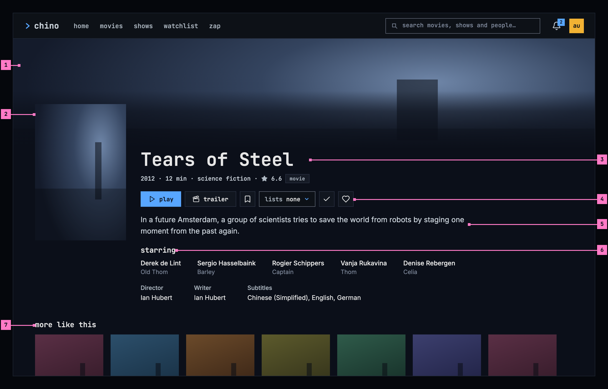

Figure 6.7: A movie's page on a computer, at 1280 × 800.

1. **The still.** A picture from the title fills the width under the top bar
   and fades into the page's colour before the first words, so nothing is
   ever written on the picture.
2. **The poster**, beside the name, reaching up into the still.
3. **The name and its facts**: the year, the length, the genres, the rating
   and the kind, movie or show, in the design system's badge. A tagline,
   where the catalog has one, goes under the name. Section 6.8.1 lists the
   facts.
4. **The title row**: **play**, the design system's emphasized button, then
   **trailer**, add to list with **lists**, watched and liked, its standard
   buttons, icon buttons and multi select, all at its medium size, 34 px
   high. Section 6.5 specifies them. **trailer** is there only when the title
   has a trailer.
5. **The description.** A title without one goes straight on to the people;
   no sentence says that it's missing.
6. **The people**: **starring**, the actors with the parts they play, then the
   crew by role and the languages of the subtitles. A name opens that
   person's page. Section 6.8.2 has the rules.
7. **more like this**: titles that share genres and people with this one, as
   posters (section 6.8.3). Choosing one opens its page.

### 6.3.2 On a phone held upright

Figure 6.8 shows the same page on a phone held upright. The parts are those of
figure 6.7; the numbers mark where the phone differs.

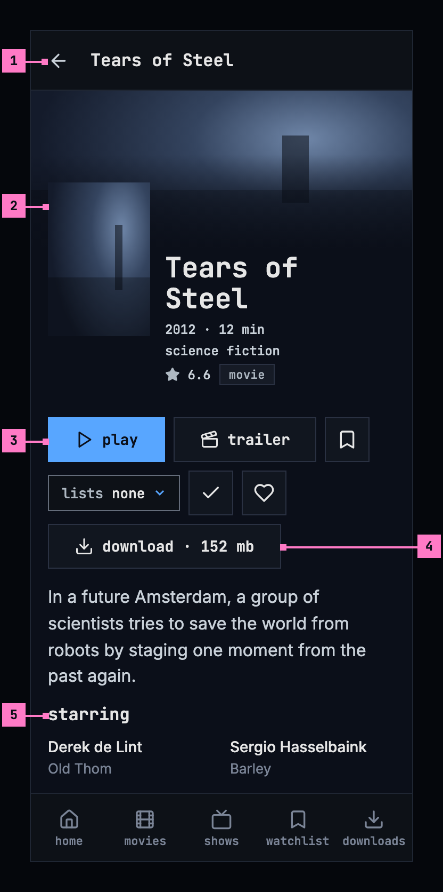

Figure 6.8: A movie's page on a phone held upright, at 360 × 780 dp.

1. **The bar** shows a back arrow and the title's name in place of the top
   bar, as every screen opened from a view does ([chapter 2](./frame.md)), and
   the tabs stay. While a TV to cast to is on the network, the cast button
   joins the bar on the right ([chapter 14](./casting.md)).
2. **The poster** is smaller and stands beside the name, so the title row is
   in view without scrolling. The name and the facts wrap where they must,
   the facts onto three lines here, in their order, and a fact is never split
   between two.
3. **The title row**, at the design system's large size, 42 dp high, wraps
   where the phone is too narrow for it, a control as a whole.
4. **download** comes last in the row, with the size the download will take:
   **download · 152 mb**. Once it starts, the control shows how the download
   stands ([chapter 13](./downloads.md)).
5. **The people** stand two to a line.

A screen less than 600 dp wide, as a phone held upright is, has this layout.
The web on a phone has the layout of figure 6.8 with its own tabs
([chapter 2](./frame.md)) and without download.

### 6.3.3 On a phone held sideways

Figure 6.9 shows the page on a phone held sideways: from 600 dp wide, the page
has the computer's layout at the phone's size. The numbers mark where it
differs from figure 6.8.

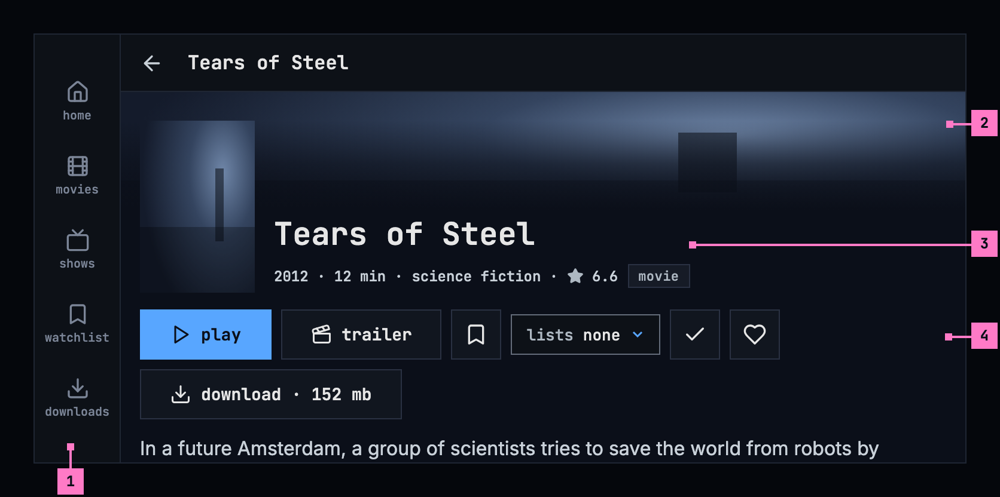

Figure 6.9: A movie's page on a phone held sideways, at 780 × 360 dp.

1. **The tabs** become a rail down the left edge, and the bar is slimmer, with
   the same back arrow and name ([chapter 2](./frame.md)).
2. **The still** is a band across the top, faded into the page's colour before
   the name, as on a computer.
3. **The name and the facts** stand beside the poster, which keeps its size,
   and the facts fit on one line.
4. **The title row** runs under the poster, on as few lines as the width
   allows, **download** last: at the large size, here on two.

The description follows the row, and the people stand three to a line. The web
on a phone held sideways has the same layout, with its own tabs as the rail
([chapter 2](./frame.md)) and without download.

### 6.3.4 Turning the phone

The page turns with the phone, and turning it changes only the layout, as
figures 6.8 and 6.9 show. The page stays at the part the person was looking
at, a season that is open stays open, an open list picker or card menu stays
open, and a download goes on.

- **Turned sideways**, the tabs become the rail and the bar gets slimmer. The
  still becomes a band, the facts get one line and the row as few as it
  needs, and the people stand three to a line. A show's episodes take the
  computer's layout (section 6.4.3).
- **Turned back upright**, the tabs come back at the foot, the facts and the
  row wrap again, and the people stand two to a line.

### 6.3.5 On a TV

Figure 6.10 shows the page on a TV, as it opens. The rail stays on the left
with no view current, and the page keeps to the safe area.

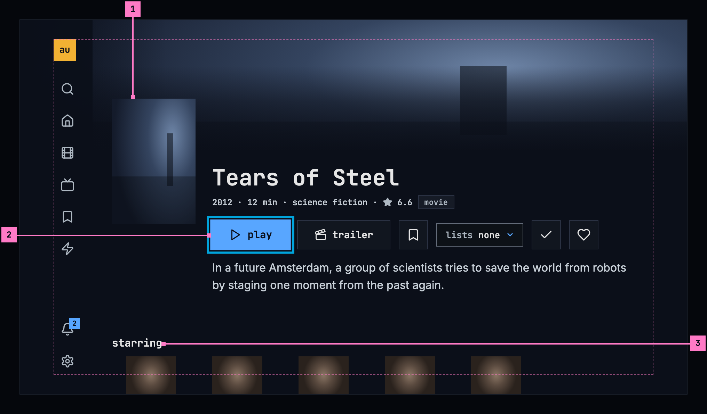

Figure 6.10: A movie's page on a TV, at 960 × 540 dp.

1. **The poster and the name** sit low enough for the still to show above
   them. The words stand on the page's colour, as on a computer.
2. **The focus** starts on **play**, or on **resume** for a title stopped part
   way. The row's controls are the design system's large ones, 42 dp high,
   12 dp apart, so a focused control can grow and show its ring without
   touching the next, as the design system's TV focus draws it. Left and
   right move along the row; down moves to the people, then to a show's
   episodes and to more like this; up from there brings the top of the page
   back.
3. **starring** is a row of cards, one per actor: the photo, or the initials
   where the catalog has no photo, then the name and the part. The row runs on
   past the safe area to the screen's edge, as home's rows do. The crew
   follows, a line per role, and every name takes the focus.

The description shows four lines at most and ends in “…” where it's cut. The
subtitle languages take three lines at most and count the rest: “Arabic,
Chinese, English, +12 more”. Back from a person's page or from another title's
page puts the focus on the card or the name that opened it, with the page
scrolled as it was.

## 6.4 A show's page

A show's page has the parts of a movie's page, and under the people, its
episodes, season by season. Its first button plays an episode and names it
(section 6.6), and its row has no download: episodes download from their rows
and their season. Figures 6.11 to 6.14 show the page scrolled down to the
episodes, for a show the person is in the middle of: the first two episodes
finished, the third stopped part way.

### 6.4.1 On a computer

Figure 6.11 shows the episodes on a computer.

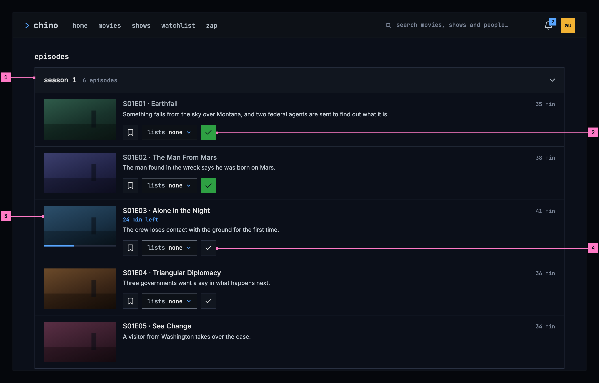

Figure 6.11: A show's page on a computer, scrolled to its episodes, at
1280 × 800.

1. **The season**, under **episodes**: its name and how many episodes it
   holds. The header opens and closes the season; section 6.7.1 says which
   seasons start open.
2. **A finished episode.** Its name is dimmed, and its watched toggle is on,
   the check dark on green.
3. **The episode the person is in.** The bar on its still shows how far they
   got, and “24 min left” under the name says how much is left.
4. **The episode's actions**: add to list and watched, in the title row's
   order and at its height, under the description. Nothing is drawn on the
   still (section 6.5.4). The rest of the row plays the episode, from where
   the person stopped.

### 6.4.2 On a phone held upright

Figure 6.12 shows the same part of the page on a phone held upright. It
differs from figure 6.11 in what a phone keeps to watch offline.

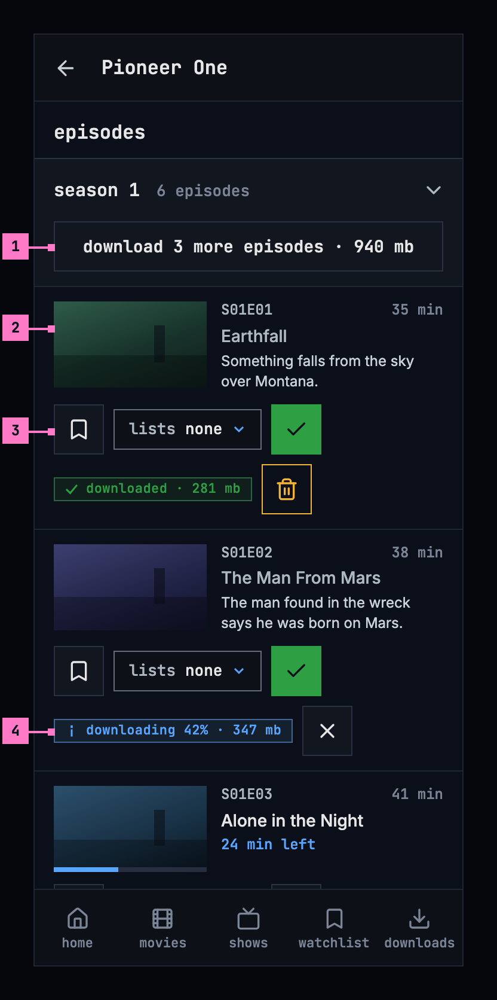

Figure 6.12: A show's page on a phone held upright, scrolled to its episodes,
at 360 × 780 dp.

1. **The season's download**, under its header, takes the season's episodes
   that aren't on the phone or on their way yet, all at once: here
   **download 3 more episodes · 940 mb**, in the words of
   [chapter 13](./downloads.md), a standard button the width of the page.
2. **The episode row.** The still, then the episode's code and length on one
   line, and its name with the column to itself, on up to two lines, so it's
   never cut to a word.
3. **The actions line** runs under the still and the text: add to list,
   watched, and the episode's own download, at the title row's large size,
   wrapping between controls, never inside one.
4. **A download on its way** shows how far it is in the design system's
   status, “downloading 42% · 347 mb”, with the cross to cancel it beside it;
   a downloaded episode shows its size the same way, with the bin to delete
   it, the design system's danger icon button.

Under the title row, a show that is partly on the phone says how far:
“1 of 6 downloaded” ([chapter 13](./downloads.md)).

### 6.4.3 On a phone held sideways

Figure 6.13 shows the episodes on a phone held sideways. The rows take the
computer's layout of figure 6.11, and the season's download stays.

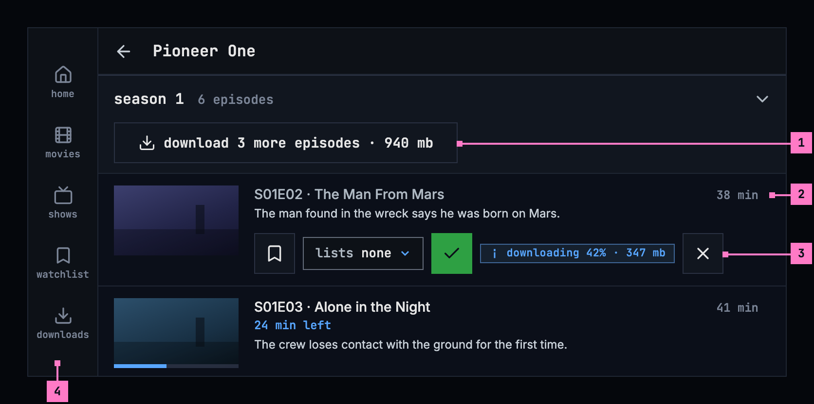

Figure 6.13: A show's page on a phone held sideways, scrolled to its episodes,
at 780 × 360 dp.

1. **The season's download**, under its header, as upright.
2. **The episode row**: the still, then the code and the name on one line with
   the length at its end, and the description under them.
3. **The actions line** runs under the text, beside the still, as on a
   computer: add to list, watched and the episode's own download.
4. **The rail**, as on a movie's page (figure 6.9).

Turning the phone works as section 6.3.4 sets out.

### 6.4.4 On a TV

Figure 6.14 shows the episodes on a TV, with the focus on the episode the
person is in.

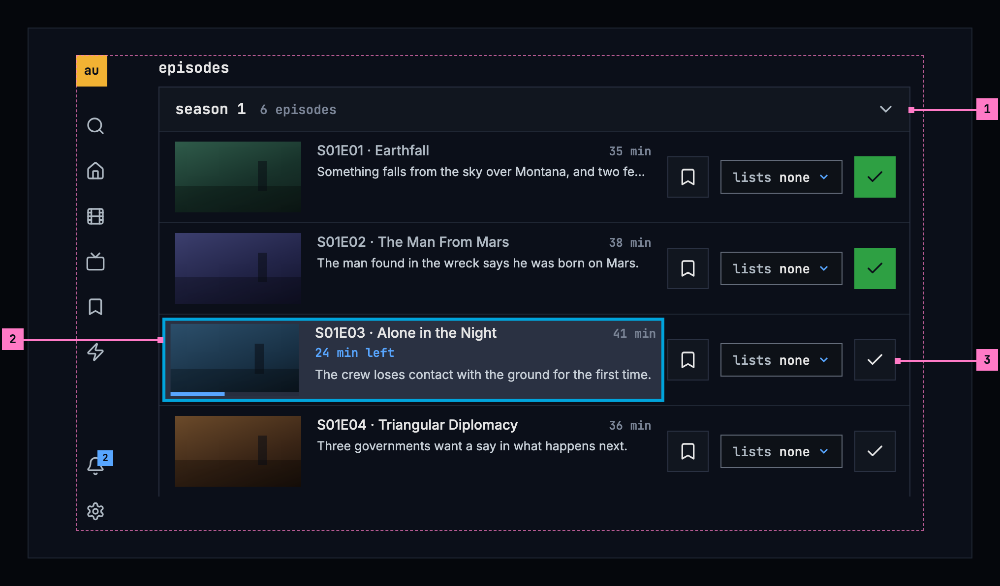

Figure 6.14: A show's page on a TV, the focus on an episode, at 960 × 540 dp.

1. **The season's header** is a row the focus can take; OK opens and closes
   the season.
2. **The focused episode.** The episode is one focus stop, a row with the
   ring inside its edge, 2 % larger. OK plays it, from where the person
   stopped.
3. **The actions** sit at the row's end, each a focus stop of its own: right
   from the row reaches add to list's bookmark, then **lists**, then
   watched.

## 6.5 The actions

A title's page offers what people can do with it: play it, add it to a list,
mark it as watched, like it, download it. These actions look and behave the
same on every screen and in every app, so people never wonder whether a
smaller button does something else.

### 6.5.1 The row

On a title's page, in this order:

**play**, or **resume 1:43** and **start over** · **trailer** · add to list ·
watched · liked · **download**

Figure 6.15 shows the row on a movie in three states, at the phone's size,
where the row has **download**.

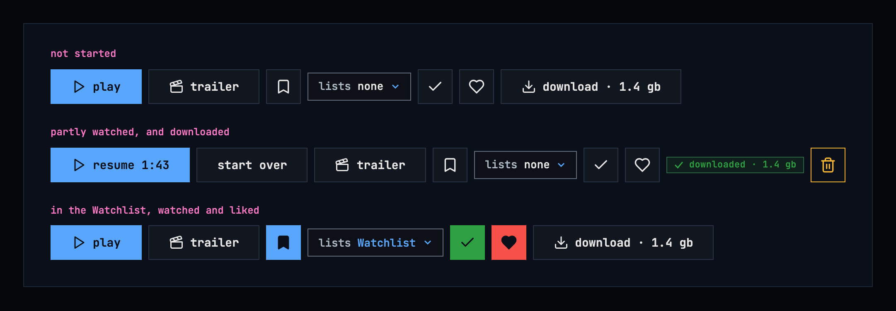

Figure 6.15: The row on a movie: not started; partly watched and downloaded;
in the Watchlist, watched and liked.

- The row is chino's own layout of the design system's controls. **play**, or
  **resume**, is its emphasized button, the next step; **start over**,
  **trailer** and **download** are standard buttons; add to list's bookmark,
  watched and liked are standard icon buttons; **lists** is its multi select
  (section 6.5.2).
- Every control in the row has the height of the design system's size for
  the screen: the medium size, 34 px, on a computer, and the large size,
  42 dp, on a phone, a tablet and a TV, with 8 dp between controls and 12 dp
  on a TV. On a phone and a tablet each control's touch area is
  48 × 48 dp, reaching past the control where it is smaller.
- On a TV a focused control shows the design system's
  [TV focus](https://nalet.github.io/design-system/patterns/tv-focus/), with
  the same controls in the same order.
- When the row wraps, a control wraps as a whole.
- **resume 1:43** says where the title picks up, and **start over** plays it
  from its beginning. A title stopped within its last minutes is finished
  and shows **play** again ([chapter 11](./playback.md)).
- **trailer** plays the trailer this server has, in the app's player; a title
  whose trailer is only online opens it outside the app. Its icon is the
  clapperboard either way.
- **download** is in the phone app only, and not when the server has turned
  downloads off ([chapter 13](./downloads.md)).

### 6.5.2 Add to list

Two controls side by side, as far apart as the row's others, 8 dp, and 12 dp
on a TV:

- **The bookmark**, the design system's icon button, shows and toggles the
  Watchlist: an outlined bookmark when the title isn't in it, a dark one on
  blue when it is. It never touches other lists.
- **lists**, the design system's multi select, says which lists hold the
  title: “none”, the list's name where one does, “Watchlist”, or how many,
  “2 chosen”, in blue once there is one. It opens the list picker, a box for
  each list, ticked where the list holds the title. Ticking a box puts the
  title in that list at once, and clearing one takes it out: that's where a
  title leaves other lists. **clear lists**, the multi select's own, takes it
  out of every list.
- **create list**, under the lists, opens the dialog that starts a new list
  with the title in it ([chapter 8](./watchlist.md)). The multi select has no
  place of its own for it, so it is a quiet button between the lists and
  **clear lists**.
- The multi select comes in the medium size only, so in the row of 42 dp
  controls on a phone and a TV, **lists** is 34 dp high, centred on the row.
- On a TV they are two focus stops, each with its own ring.

Figure 6.16 shows the two controls off and on, and the picker open.

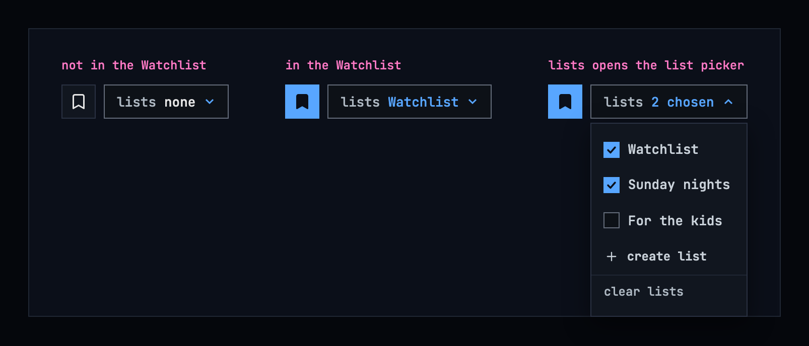

Figure 6.16: Add to list off and on, and the list picker, open.

The picker opens under **lists** on a computer and a phone, as the design
system's multi select does, and over the page on a TV, where back closes it.
The design system has no list for a TV, so there the picker is the app's own,
with the same boxes, **create list** and **clear lists**.

### 6.5.3 On and off

Labels and icons on a filled colour are dark.

| Control | Off | On |
|---|---|---|
| Add to list | an outlined bookmark on the plain surface | a dark bookmark on blue: in the Watchlist |
| Watched | an outlined check on the plain surface | a dark check on green |
| Liked | an outlined heart on the plain surface | a dark heart on the design system's red |

Each meaning has one icon and one colour, on buttons and on cards alike: the
bookmark on blue for the Watchlist, the check on green for watched, the heart
on red for liked. The design system's icon button has no on state, so this on
look is chino's own: the icon button filled with its meaning's colour.

The names screen readers announce say the state: “add to Watchlist” and “in
your Watchlist”, “mark as watched” and “watched”, “like” and “liked”.
**lists** is named by its words, “lists 2 chosen”, as the multi select is.

### 6.5.4 Nothing on artwork

No button is drawn over a poster or a still. Over a picture, a button's
contrast depends on the picture, and a smaller variant would look like a
different button. Figure 6.17 shows the two places where this matters most.

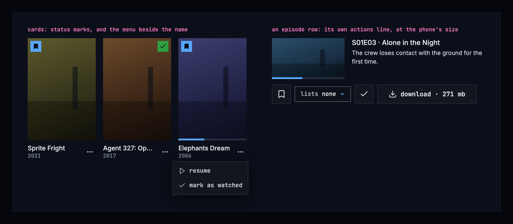

Figure 6.17: Cards with their status marks, and an episode row with its own
actions line.

- **Episode rows** carry their actions in the row's own actions line, at the
  title row's height and in its order: add to list, watched, download.
- **Cards** in a grid show only status marks, drawn as in the table of
  section 6.5.3: the Watchlist bookmark on blue, the watched check on green,
  and the progress bar. Actions live on the title's page, or in a card's menu
  where it has one.
- **A card's menu** is the design system's action menu. Its button, three
  small squares, stands at the right of the card's lines under the poster,
  and the menu opens under it; on a TV the menu opens when OK is held on the
  card. It offers **play**, or **resume** for a title the person is in, and
  **mark as watched**, or **mark as unwatched** while the mark is on, which
  takes it off: a menu item says what it does, as the design system's menus do. On home's continue watching it also offers **remove from continue
  watching** ([chapter 4](./home.md)).

## 6.6 Play on a show

A show isn't played itself: its episodes are. So a show's first button plays
an episode, and names it by its code, which keeps its capitals:

| The show | The first button |
|---|---|
| Nothing watched yet | **play S01E01** |
| An episode partly watched | **resume S01E03** and **start over**, which plays S01E03 from its beginning |
| The last episode watched was finished | **play S01E02**, the next one |
| Every episode finished | **play S01E01** |

Figure 6.18 shows the row in the first three cases, at the computer's size.
The code keeps its capitals inside the lowercase button, as the design system
keeps a name's.

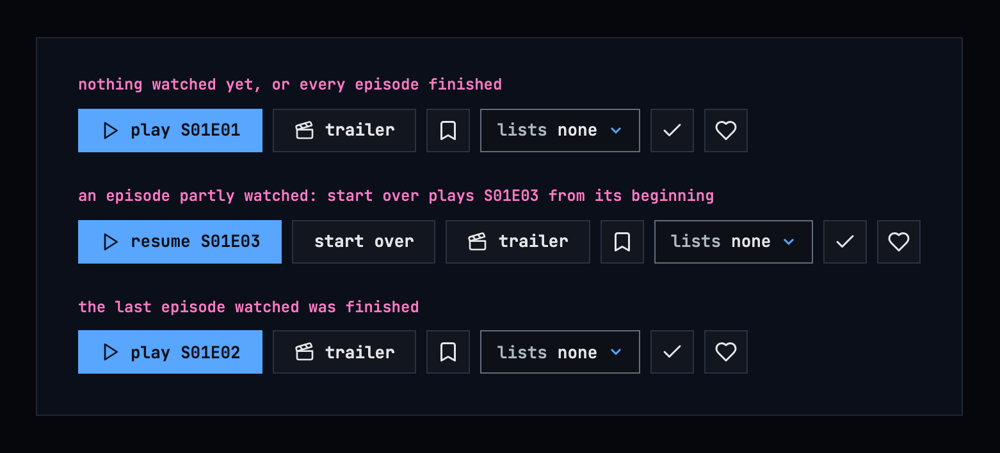

Figure 6.18: The row on a show: nothing watched yet; an episode partly watched;
the last episode watched finished.

- The episode's position shows in its row below (figure 6.11), not in the
  button. The rest of the row is the same as on a movie, without download.
- S01E01 is the first episode of the first numbered season; the specials count
  only when a show has nothing else.
- A file that holds several episodes is named for all of them:
  **play S03E18–19** (section 6.7.3).
- A page opened on one of its episodes (section 6.7.4) names that episode
  until the person plays on: **resume S01E03** where it was stopped part way,
  else **play S01E05**. After that, the table above applies again.

## 6.7 Seasons and episodes

### 6.7.1 The seasons

- The numbered seasons come first, in order. Season 0 comes last, under
  **specials**: the specials, and any episode the catalog has no season number
  for.
- The first numbered season starts open, or the specials when they are all
  there is; a page opened on an episode opens that episode's season instead
  (section 6.7.4). The others start closed, and each stays open or closed
  while the person is on the page, also back from the player.
- A season's header gives its name and how many episodes it holds:
  **season 1** and “6 episodes”, or “1 episode”.

### 6.7.2 The episode row

- An episode row shows, in this order: the still, with a bar where the person
  stopped; the code and the name, “S01E03 · Alone in the Night”; the length,
  “41 min”; “24 min left” for an episode stopped part way; the description, in
  two lines at most; and the actions line.
- The time left is rounded up, so the last half minute is “1 min left”.
- A finished episode's name is dimmed, and its watched toggle is on.
- The row plays the episode, from where the person stopped, else from its
  beginning. The actions line is apart from it: none of its controls plays.
- The actions line has the title row's order: add to list · watched ·
  download. It runs under the description on a computer and on a phone held
  sideways, under the still and the text on a phone held upright, and at the
  row's end on a TV.

### 6.7.3 A file that holds several episodes

A file that holds several episodes is one thing to play, so it is one entry: a
box around the episodes it holds, named for them, “S03E18–21”, and as long as
the file. Under the name it says “4 episodes · one file” and lists each
episode by its number and name. None of them plays on its own, because the
file doesn't say where one ends. The bar, the watched mark, add to list and the
download are the file's.

### 6.7.4 Opened on an episode

An episode has no page of its own. Opening one, from a card in continue
watching or next up, from a notification or from search, opens its show's
page with that episode's season open and the page scrolled to its row. The
row is marked as where the person came from: with a blue outline on a
computer and a phone, and on a TV with a blue bar along its left edge, as the
design system's
[TV focus](https://nalet.github.io/design-system/patterns/tv-focus/) marks it.
On a TV the focus starts on that row.

## 6.8 What the page shows

### 6.8.1 The facts

The facts follow the name, in one line where it fits, in this order:

- **the year**: “2012”;
- **the length**: “12 min”, “1 h 32 min”; a show has none;
- **the genres**: “science fiction”, “drama”;
- **the rating** with a star, as the catalog has it, rounded to one decimal:
  “6.6”;
- **the age rating**, where the catalog has one, as a badge in the words of
  the board that gave it: “FSK 12”, “PG-13”, an age alone as “12+”;
- **the kind**, as a badge: “movie” or “show”.

A fact the catalog doesn't have is left out, with its dot.

### 6.8.2 The people

- **starring** lists the actors in the order the catalog bills them, each with
  the part they play. An actor credited for two parts is listed once, with
  both: “Old Thom / Narrator”.
- On a computer and a phone the first six actors show, and
  **full cast (12)** shows the rest; **show less** hides them again. A cast at
  most two longer than six shows whole: a button that hides two names saves
  nothing. A TV has the row of cards of figure 6.10 instead.
- **The crew** follows, a role at a time, each under its label: Created by,
  Director (Directors for several), Writer, Producer, Music, Cinematography,
  Editor, then any other role by its name.
- **Subtitles** names the languages the title has subtitles in, each once, in
  alphabetical order: “Chinese (Simplified), English, German”.
- A name opens the person's page ([chapter 7](./person.md)) when the catalog
  has a page for them; a name without one is plain text. On a TV it still
  takes the focus, so a row can be walked from end to end.

### 6.8.3 More like this

**more like this** holds up to 12 titles that share genres and people with
this one, as the server ranks them, as posters with their status marks
(section 6.5.4). A title with nothing like it has no such row.

### 6.8.4 Back from the player

Back on the page from the player, the page doesn't load again. It keeps what
it shows and quietly brings up to date what playing changed: the first
button, the bars and the watched marks.

## 6.9 Changes

Every difference between section 6.2 and the target is one change in the
table. A change names the apps it is built in, what they do today and the
target, with the figure or the section that sets it out; it is built as its
row says, and nothing else changes with it. Each change starts as proposed;
once the owner approves it, it is built, one change at a time. A target that
starts with “Recommended” was an open decision, or takes away something an app
has today. The frame itself, the top bar, the tabs and the rail, belongs to
[chapter 2](./frame.md), the downloads' own words to
[chapter 13](./downloads.md), and the dialog that creates a list to
[chapter 8](./watchlist.md).

| No. | Change | Apps | Today | Target | Status |
|---|---|---|---|---|---|
| 6.C1 | The frame on the title page | Web, Phone app, Android TV, Samsung TV | Web: none; back and home float over the still, and on a phone held upright the poster covers them (figure 6.3). Phone app: a bar of its own with back and home, no tabs, and no bar while the page loads or when it couldn't load. Android TV, Samsung TV: no rail, nothing at the top | the frame of [chapter 2](./frame.md) with no view current, in every state of the page: the top bar on a computer; on a phone the back arrow and the title's name in place of the bar, with the tabs, or the rail held sideways; on a TV the rail (figures 6.7 to 6.10). The page has no home button of its own | proposed |
| 6.C2 | Loading: grey blocks | Web, Phone app, Android TV, Samsung TV | Web, Phone app: a spinner alone. Android TV: “Loading…”. Samsung TV: a spinner and “Loading…” | nothing for 0.4 seconds, then grey blocks in the page's shape (figure 6.19) | proposed |
| 6.C3 | No words on the still | Web, Phone app, Samsung TV | Web: the name, the tagline, the facts and the genres stand on the still's dimmed foot (figure 6.1). Phone app: the same from 600 dp wide. Samsung TV: the top half of the page stands on it | the still fades into the page's colour before the first words; only the poster reaches up into it (figure 6.7, parts 1 and 2) | proposed |
| 6.C4 | Upright: the poster beside the name | Web, Phone app | below 768 px (Web) or 600 dp (Phone app) wide, the poster, 192 wide, stands above the name (figure 6.3) | below 600 dp wide, the poster 96 dp wide beside the name, the facts on up to three lines, the row in view without scrolling (figure 6.8) | proposed |
| 6.C5 | Sideways: the computer's layout at the phone's size | Web, Phone app | Web: from 768 px the computer's layout, the poster 256 px beside the name and the row beside it, wrapping (figure 6.4). Phone app: from 600 dp the poster, 192 dp, beside the name and the row | from 600 dp wide, figure 6.9: the still a band, the poster 96 dp beside the name, the facts on one line, the row under them on as few lines as fit, the people three to a line; the episodes as in figure 6.13; turning the phone as section 6.3.4 says | proposed |
| 6.C6 | The facts line | Web, Phone app, Android TV, Samsung TV | the length “12m”, “1h 32m”, and a show has one; the genres as chips in the catalog's words, “Sci-Fi & Fantasy”. Phone app: the kind “MOVIE”, “SERIES”, the rating cut, no age rating. Android TV: the kind “movie”, “series”, the rating in the TV's language, “7,4”, no age rating. Samsung TV: “MOVIE”, “SERIES”, “EPISODE”, no age rating | section 6.8.1: one line, “2012 · 12 min · science fiction · ★ 6.6”, then the age rating and the kind, “movie” or “show”, as the design system's badges; “1 h 32 min”; a show without a length; the genres as words in the line; the rating rounded, with a point | proposed |
| 6.C7 | trailer with the clapperboard | Web, Android TV, Samsung TV | a trailer online shows a video site's logo | the clapperboard, whatever plays the trailer (section 6.5.1) | proposed |
| 6.C8 | Android TV: the row at 42 dp | Android TV | the row's controls 33 dp high, about 22 dp apart | the design system's large buttons and icon buttons, 42 dp high, 12 dp apart, add to list as section 6.5.2 has it (figure 6.10, part 2) | proposed |
| 6.C9 | Samsung TV: the title row | Samsung TV | the words capitalised: “Play”, “Resume 1:43”, “Start over”, “Trailer”; add to list a “+” turning into a check on green, using the default list, with no picker; no liked; watched an eye; a focused plain button white, the ring in the accent's blue | section 6.5: the design system's large buttons and icon buttons, the words lowercase; the bookmark and **lists** with the list picker; liked; watched a check, dark on green when on; the design system's TV focus, the ring in the focus colour | proposed |
| 6.C10 | The list picker: the design system's multi select, and its way to a new list | Web, Phone app, Android TV | add to list in two parts that touch, the bookmark and ⌄, which opens a list of checks. Web: under the control; “new list…” opens a name field inside it. Phone app: from the bottom; “New list…”, a field and a check. Android TV: over the page; “New list…” is the first row, then a field | the bookmark, the design system's icon button, and beside it **lists**, its multi select: “lists none”, “lists Watchlist”, “lists 2 chosen”; its panel of boxes under it on a computer and a phone, with **clear lists**, and the app's own picker over the page on a TV; **create list**, a quiet button under the lists, opens the dialog of [chapter 8](./watchlist.md), and the title goes into the new list at once (section 6.5.2, figure 6.16) | proposed |
| 6.C11 | The description | Web, Samsung TV | without one, “No description available.”; Samsung TV: never cut | without one, nothing in its place; on a TV four lines at most, ending in “…” (sections 6.3.1, 6.3.5) | proposed |
| 6.C12 | starring, the crew and the subtitles | Web, Phone app, Android TV, Samsung TV | Web, Phone app: “Starring” a label, “Full cast (12)”, “Show less”; the subtitles in the tracks' order, and in the Phone app with their kind, “English · for deaf and hard of hearing”, cut after two lines. Android TV: the crew's and the subtitles' labels lowercase, “director”, “subtitles”. Samsung TV: the subtitles in the tracks' order, whole | section 6.8.2: **starring** a heading, **full cast (12)** and **show less**; the crew's labels as field labels, “Director”, “Subtitles”; the languages each once, alphabetical, without their kind; on a TV three lines and “+12 more” | proposed |
| 6.C13 | TV: the starring cards with photos | Android TV, Samsung TV | the cards show the initials, never a photo | the photo, or the initials where the catalog has none (figure 6.10, part 3) | proposed |
| 6.C14 | No Analyzed fact | Web, Phone app, Samsung TV | “Analyzed”: “Intro · Credits · Recap”, the parts the server found | Recommended: left out; the page says what the title is, and the player shows those parts on its seek bar ([chapter 11](./playback.md)) | proposed |
| 6.C15 | The headings and the season's words | Web, Phone app, Android TV, Samsung TV | Web: “Episodes”, “Season 1”, “1 episodes”, “More like this”. Phone app: “Episodes”, “Season 1”, “More like this”. Android TV: “Season 1”, “Season 0”, “1 episodes”. Samsung TV: “Episodes”, “Season 1”, “Specials”, “1 episodes”, “More like this” | **episodes**, **season 1**, **specials**, **more like this**, lowercase in the monospace face; “6 episodes”, “1 episode” (section 6.11) | proposed |
| 6.C16 | The seasons: specials last, the first numbered season open | Web, Phone app, Android TV | Web: season 0 hidden while the show has numbered seasons. Phone app: the server's order, season 0 first, every season closed. Android TV: season 0 first, and the first listed open | Recommended: section 6.7.1, the numbered seasons first, season 0 last and closed as **specials**, so nothing in the library is out of reach; the first numbered season open; the repeats season 0 holds fixed in the catalog | proposed |
| 6.C17 | More like this with the status marks | Phone app, Samsung TV | Phone app: the posters without their marks. Samsung TV: without the watched mark | posters with their status marks (section 6.8.3) | proposed |
| 6.C18 | The episode row's words and look | Web, Phone app, Android TV, Samsung TV | Web, Phone app: “35m” and “Resume · 30m left”. Android TV: the same, “75m” past an hour, and a watched episode's name not dimmed. Samsung TV: no bar and no time left, a watched name not dimmed | section 6.7.2: “41 min”, “1 h 12 min”, “24 min left” rounded up, the bar on the still, a finished episode's name dimmed | proposed |
| 6.C19 | The actions line in the title row's order | Web, Android TV | watched, then add to list; on the web on a phone the two stand one under the other beside the still (figure 6.6) | add to list · watched · download, under the description on a computer and held sideways, under the still and the text across the row held upright, at the row's end on a TV (section 6.7.2, figure 6.12) | proposed |
| 6.C20 | Samsung TV: the episode row's actions and files | Samsung TV | only the watched toggle, an eye; a file of several episodes is a row per episode | add to list and watched at the row's end (figure 6.14); a file of several episodes as one entry (section 6.7.3) | proposed |
| 6.C21 | Opened on an episode, the first button names it | Web, Phone app | the first button names the episode the show's page plays anyway, not the one it was opened on | that episode until the person plays on: **resume S01E03** where it was stopped part way, else **play S01E05** (section 6.6) | proposed |
| 6.C22 | Samsung TV: an episode opens its show's page | Samsung TV | an episode from continue watching or a notification opens a page of its own, without seasons | its show's page, that season open, the row marked with the blue bar and the focus on it (section 6.7.4) | proposed |
| 6.C23 | TV: where the focus starts and where it comes back | Android TV, Samsung TV | Android TV: the code sets no first focus. Samsung TV: back from another page or from the player loads the page again, the focus on play | the focus starts on **play** or **resume**; back puts it on the card or the name that opened a page, the page scrolled as it was; back from the player keeps the page (sections 6.3.5, 6.8.4) | proposed |
| 6.C24 | Couldn't load, removed and no access, by cause | Web, Android TV, Samsung TV | Web: a quiet back beside try again. Android TV: no access says “you don't have access to this title”. Samsung TV: one red line, “Could not load this title: chino-api 503.”, also for 404 and 403; no button | figures 6.20 to 6.22 and the table of section 6.10, the design system's empty state: its error picture, the reason by cause, try again alone and details; its empty picture with “this title isn't in the library anymore” or “you don't have access to this”, each with back | proposed |
| 6.C25 | The episodes that couldn't load say so | Phone app, Android TV, Samsung TV | the episodes are left out without a word | the design system's empty state at its small size in their place: “couldn't load the episodes”, the reason and **try again**, the rest of the page as it is (section 6.10) | proposed |

## 6.10 States

The title page is drawn in figures 6.7 to 6.14 with everything loaded.
Figures 6.19 to 6.22 show the states in between.

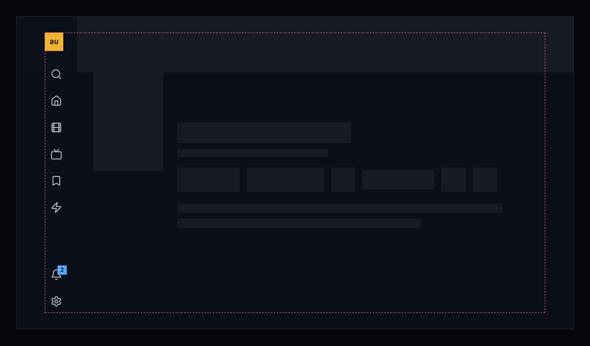

Figure 6.19: The title page loading, on a TV.

While the page loads, it shows nothing for the first 0.4 seconds, and after
that grey blocks in the shape of the still, the poster, the name, the facts,
the row and the description, as the design system's
[loading and progress](https://nalet.github.io/design-system/patterns/loading-and-progress/)
describes. Figure 6.19 shows them on a TV; a computer and a phone show the same
blocks in their own layout.

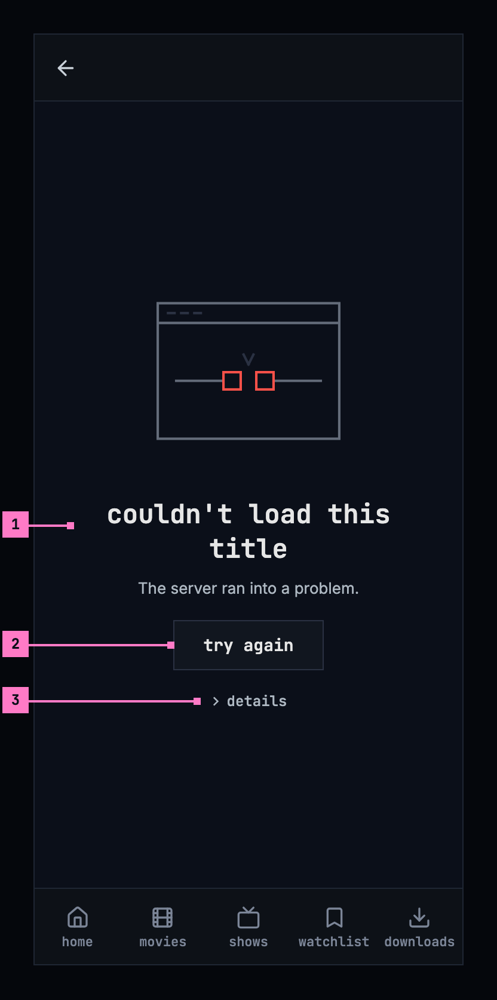

Figure 6.20: The title page when it couldn't load, on a phone.

1. **What couldn't load, and why**, in the design system's empty state with
   its error picture: “couldn't load this title”, and under it the reason as
   far as the app can tell. Figure 6.20 shows the case where the server ran
   into a problem; [chapter 17](./errors.md) lists every cause and its
   sentence.
2. **try again** loads the page again. It takes the focus first.
3. **details** opens the server's answer, such as “HTTP 503 Service
   Unavailable”, for the people who fix things. The design system's empty
   state has no details of its own, so they are the banner's details, under
   the button.

Held sideways, as figure 6.21 shows, the same words stand in the middle of the
page, beside the rail and under the slimmer bar, at the empty state's small
size, so **try again** and **details** stay in view.

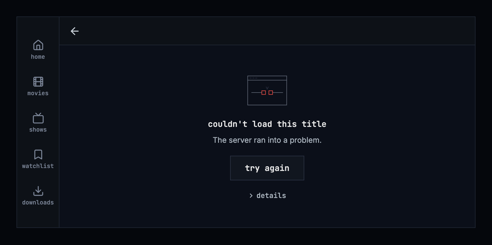

Figure 6.21: The title page when it couldn't load, on a phone held sideways.

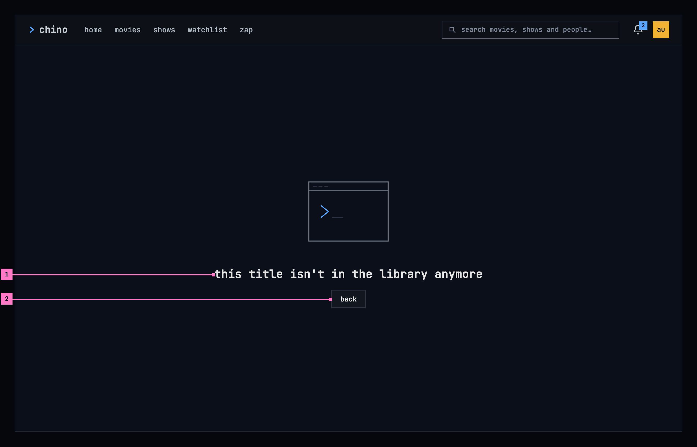

Figure 6.22: A title that isn't in the library anymore, on a computer.

1. **What is true**: “this title isn't in the library anymore”, in the
   design system's empty state with its empty picture, as nothing is there to
   show. Trying again can't bring it back, so the page offers no try again and
   gives no reason.
2. **back** returns to where the person came from, or to home when they came
   straight to the page, from a link.

| State | What the page shows |
|---|---|
| Loading | Figure 6.19 |
| Couldn't load | Figures 6.20 and 6.21, with the sentence for the cause |
| The title was removed | Figure 6.22 |
| The person may not see it | The empty state of figure 6.22 with “you don't have access to this” and **back** |
| The sign-in has expired | Nothing of its own: the app renews the sign-in and loads the page; only a refused sign-in leads to signing in, and back to the page |
| A show's episodes couldn't load | The rest of the page; in the episodes' place, the empty state at its small size: “couldn't load the episodes”, the reason and **try again** |
| No description, no people, nothing like it | Each part is left out, and nothing says it's missing |
| The phone app can't reach the server | A downloaded title's page is built from what is on the phone, with the banner on top ([chapter 13](./downloads.md)); any other title's page is figure 6.20 without the sentence, which the banner says |

## 6.11 Words

| Where | Text |
|---|---|
| The title row | play · resume 1:43 · start over · trailer · download · 152 mb |
| A show's first button | play S01E01 · resume S01E03 · start over · play S03E18–19 |
| The row's icon buttons, for screen readers | add to Watchlist · in your Watchlist · mark as watched · watched · like · liked |
| The list picker | lists · none · Watchlist · 2 chosen · create list · clear lists |
| A card's menu | play · resume · mark as watched · mark as unwatched · remove from continue watching |
| The facts | 2012 · 12 min · 1 h 32 min · science fiction · 6.6 · FSK 12 · 12+ · movie · show |
| The people | starring · full cast (12) · show less · Created by · Director · Directors · Writer · Writers · Producer · Producers · Music · Cinematography · Editor · Editors · Subtitles |
| Subtitle languages on a TV, when they don't fit | “Arabic, Chinese, English, +12 more” |
| The episodes | episodes · season 1 · specials · 6 episodes · 1 episode |
| An episode row | S01E03 · Alone in the Night · 41 min · 24 min left |
| A file of several episodes | S03E18–21 · 4 episodes · one file |
| Similar titles | more like this |
| The phone's downloads | download · 152 mb · download 3 more episodes · 940 mb · 1 of 6 downloaded, and the statuses of [chapter 13](./downloads.md) |
| Couldn't load | couldn't load this title · The server ran into a problem., or the sentence of another cause ([chapter 17](./errors.md)) · try again · details |
| The episodes couldn't load | couldn't load the episodes |
| Removed | this title isn't in the library anymore · back |
| No access | you don't have access to this · back |
