# 8 Watchlist and lists

Section 8.2 describes the watchlist as it is deployed today. The sections after
it are the target, the watchlist as it is meant to be, and section 8.9 lists
every difference between the two as a numbered change. Only a change the owner
has approved is built, one change at a time; anything no change names stays as
it is deployed.

This chapter specifies the watchlist: the Watchlist, the list every account
has, and the lists people make of their own, with how a list is created,
renamed and deleted. A title goes into a list on its page, with the add-to-list
control of [chapter 6](./title-actions.md). The frame around the view is
specified in [chapter 2](./frame.md).

## 8.1 Purpose

The watchlist keeps what people mean to watch, and lets them sort it into
lists of their own, such as one for Sunday nights or one for the kids.
**watchlist** in the frame opens it. The view is named after the list it
starts with, the Watchlist, and shows every list as a row; a list opens on its
own with all of its titles.

## 8.2 As deployed

This section says what the four apps' watchlists do as of 6 November 2026: the
web as the public demo showed it that day, on the same build as production,
and the apps as their code had them that day. The phone app, Android TV and the
Samsung TV are described from their code until screenshots of them are taken.
The Samsung TV app isn't released yet.

### 8.2.1 The web

Figures 8.1 to 8.4 are screenshots of the web's watchlist, signed in as the
demo's viewer, whose Watchlist holds one title and who has no list of its own.
Figure 8.1 shows it on a computer.

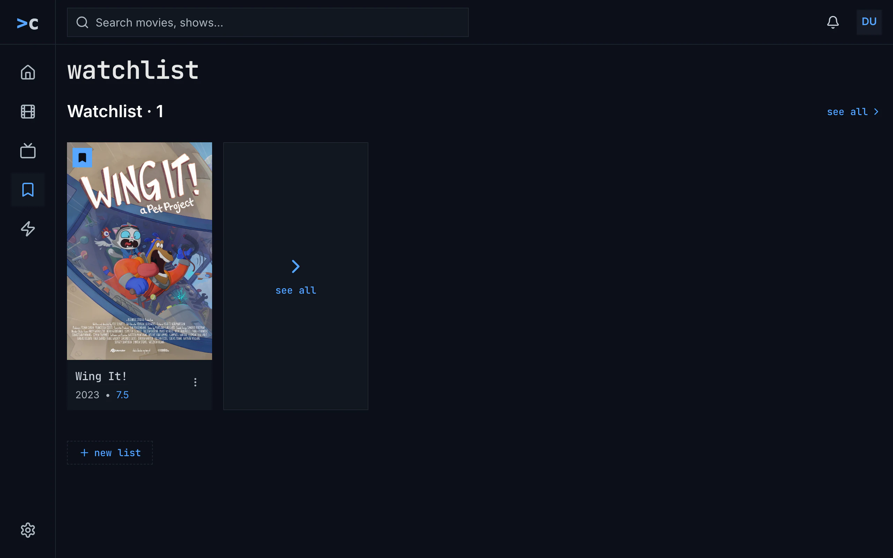

Figure 8.1: The web's watchlist as deployed on 6 November 2026, on a computer,
at 1280 × 800.

1. **The heading**, “watchlist”, lowercase in the monospace face.
2. **The row's name**, “Watchlist · 1”, in the body face. It opens the list,
   and so does **see all** with its chevron at the right of the line.
3. **A card**, as in movies: the poster with the Watchlist's bookmark on blue
   at its top left, the name in the monospace face, “2023 • 7.5”, and ⋮.
4. **The see all card**, a box as tall as a poster with a chevron and “see all”
   in blue, at the row's end.
5. **+ new list**, blue in the monospace face, in a dashed outline after the
   rows. It opens a name field in its own place, with “List name” in it, a
   check to create the list and a cross to cancel.

Figure 8.2 shows the Watchlist opened from its row.

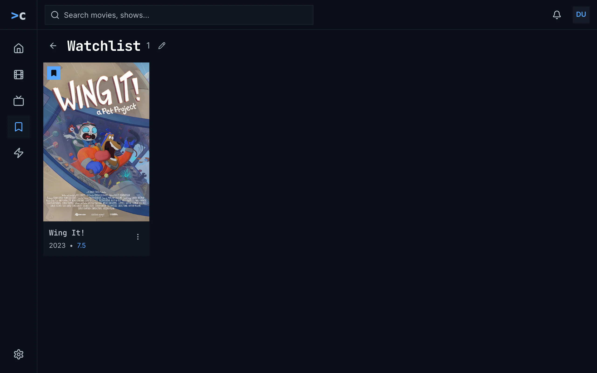

Figure 8.2: The Watchlist opened, as deployed on 6 November 2026, on a
computer, at 1280 × 800.

1. **The back arrow**, named “Back to Watchlist”.
2. **The heading**, the list's name, “Watchlist”, with its count alone, “1”.
3. **The pencil**, “Rename list”, there for the Watchlist too. It turns the
   heading into a field, with a check, “Save name”, and a cross, “Cancel”. A
   list of the person's own also has a bin, “Delete list”.
4. **The grid**, as in movies: two posters to a line on a phone.

Figure 8.3 shows the watchlist on a phone held upright.

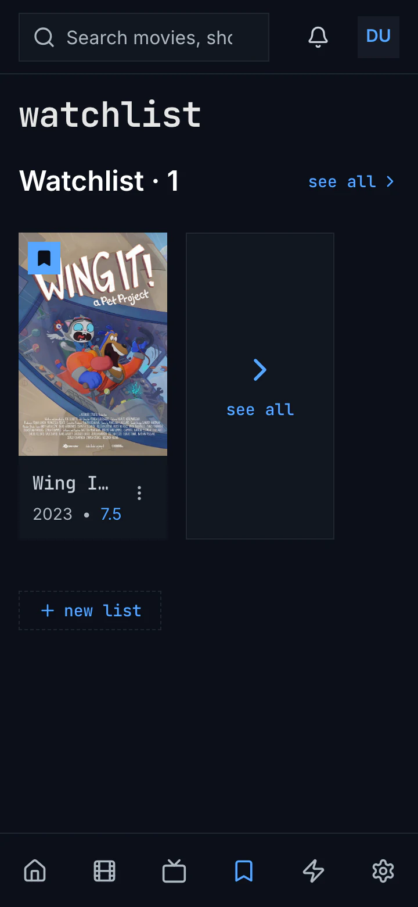

Figure 8.3: The web's watchlist as deployed on 6 November 2026, on a phone held
upright, at 360 × 780.

1. **The row's name** with **see all** at its right, as on a computer.
2. **The row**: the one card, its name cut to “Wing I…”, and the see all card.
3. **+ new list**, under the rows.

Figure 8.4 shows it on a phone held sideways.

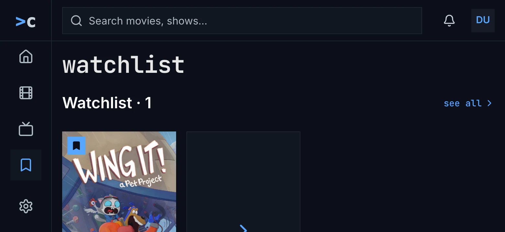

Figure 8.4: The web's watchlist as deployed on 6 November 2026, on a phone held
sideways, at 780 × 360.

1. **The computer's layout**, with the side navigation, from 768 px wide
   ([chapter 2](./frame.md)).
2. **The row** starts near the screen's foot, so its cards are cut.

The Watchlist's row comes first, then the person's own lists in the order they
were created, and a row holds the 12 titles added last, the newest first. An
empty row says “Save titles with the + button on any movie or show.”, though a
title's page has a bookmark and no + button, and a row that couldn't load says
“couldn't load this list” with the reason and **try again**. An empty name in
the new list's field says “Enter a name”, and a name the server refuses, one
already taken or one more list than an account may have, says “request failed
(409)”, because the web doesn't read the server's answer. The new list's row
comes at the end, empty.

Deleting asks with the browser's own question, “Delete "Sunday nights"? Its
items will be removed from the list.”, and goes back to the rows. An empty list
says “This list is empty.” over “Add titles from a movie or show page to see
them here.” A saved episode has a card of its own, named after the episode,
“Earthfall”, with “S01E01 · Earthfall” under it. An opened list has no address
of its own, so back from a title's page goes to the rows. While the lists load,
the spinner turns alone under the heading, and couldn't load says “couldn't
load your watchlists” with the reason, **try again** and **details**.

### 8.2.2 The phone app

The phone app's heading is “Watchlist”, with its capital. Its rows have the
web's names, “Watchlist · 5”, and end with a “See all” card, and its cards have
no menu. A “New list” chip with a + follows the rows. It opens a dialog, “New
list”, with “List name” in its field and “Cancel” and “Create”, the last one
greyed while the name is empty. A name it can't take gets a red line under the
field: “A list with that name already exists.”, “You've reached the maximum
number of lists.”, “Enter a name between 1 and 60 characters.” or “Couldn't
save the list. Try again.” Rename, “Rename list” with “Save”, and delete are
icons on the person's own lists only. Deleting asks “Delete “Sunday nights”?”
with “This removes the list and everything in it. Titles stay in your other
lists.” and a red “Delete”. An opened list counts its titles as “· 4” beside its
name. A row that couldn't load, with nothing shown before, turns the whole view
into “couldn't load your watchlists”.

### 8.2.3 Android TV

Android TV's heading is “your lists”, with “new list” at its end. A row's name,
“Watchlist · 5”, takes the focus, and OK opens the list. The name dialog,
“new list” or “rename list”, has “List name…” in its field and “Press the
on-screen Done key to save, BACK to cancel.” under it, over the system's
keyboard, and no buttons; it closes as Done is pressed, and a name the server
refuses is lost without a word. Every list has “rename list”, the Watchlist
too. Deleting asks with “cancel”, which has the focus, and “delete list” in
the amber outline: ““Sunday nights” is deleted, with the 4 titles saved in it.
They stay in the library and in your other lists.” An opened list has “back”,
“· 4” beside its name, and “4 saved” under its grid. While the lists load,
“Loading your lists…” stands in the middle.

### 8.2.4 Samsung TV

The Samsung TV's heading is “Your lists”, with a “New list” chip beside it, and
the Watchlist's row says “DEFAULT” beside its name. A name is typed on a
keyboard that covers the screen, headed “New list” or “Rename list”, with
lowercase letters, digits and signs. An opened list has “Back”, “Rename”, the
Watchlist too, and “Delete”, which deletes at once without asking. Failures
say “Couldn't create that list.”, “Couldn't rename that list.”, “Couldn't delete
that list.” and “Couldn't load your lists.”, the last one without **try
again**.

### 8.2.5 Feature by feature

The table compares the four apps feature by feature. “—” is a feature the app
doesn't have.

| Feature | Web | Phone app | Android TV | Samsung TV |
|---|---|---|---|---|
| The heading | “watchlist” | “Watchlist” | “your lists” | “Your lists” |
| The rows | one per list, the Watchlist first, then by creation | the same | the same | in the server's order, which is the same |
| A row's name | “Watchlist · 1” in the body face; it opens the list | “Watchlist · 5”; it opens the list | “Watchlist · 5”, a focus stop; OK opens the list | “Watchlist · 5” and “DEFAULT”, a focus stop |
| A row's titles | the 12 added last, the newest first | the same | the same | the same |
| see all | beside the row's name, and a card at its end | a “See all” card | a “see all” card | a “See all” card |
| The cards | as in movies, with ⋮ | no menu | no menu | no menu |
| A saved episode | its own card: “Earthfall”, “S01E01 · Earthfall” | its own card: its name and its code | its own card: its name, its code and the year with the rating | its own card: its name and its code |
| A new list | “+ new list” after the rows: a field in its place, “List name”, a check and a cross | “New list” after the rows: a dialog, “List name”, “Cancel”, “Create” | “new list” beside the heading: a dialog, “List name…”, the system's keyboard, no buttons | “New list” beside the heading: a keyboard over the screen |
| A name it can't take | “Enter a name”; refused by the server, “request failed (409)” | the button greyed while the name is empty; a red line under the field, by cause | an empty name closes the dialog; a refused one is lost without a word | an empty name does nothing; “Couldn't create that list.” |
| Rename | a pencil, the Watchlist too: a field in the heading's place | a pencil, the person's own lists: “Rename list”, “Save” | “rename list”, the Watchlist too | “Rename”, the Watchlist too |
| Delete | a bin, the person's own lists: the browser's question | a bin, the person's own lists: “Delete “Sunday nights”?”, a red “Delete” | “delete list”, the person's own lists: the question, cancel first | “Delete”, the person's own lists: at once |
| An opened list | the arrow, the name, the count alone, “1” | the arrow, the name, “· 4” | “back”, the name, “· 4”, and “4 saved” under the grid | “Back”, the name, “· 4” |
| Back from a title's page | the rows: the list has no address | the list | the list | the rows |
| An empty row | “Save titles with the + button on any movie or show.” | the same | the Watchlist: “Add titles with the bookmark on a movie's or a show's page.”; a list of the person's own: “Add titles with the arrow beside the bookmark on a movie's or a show's page.” | “Save titles with the + button on any movie or show.” |
| An empty list | “This list is empty.”, “Add titles from a movie or show page to see them here.” | the Watchlist: “Add titles with the bookmark on a movie's or a show's page.”; a list of the person's own: “Add titles with the arrow beside the bookmark on a movie's or a show's page.” | ““For the kids” is empty. Save titles with the + button on any movie or show.” | the same as Android TV |
| Loading | a spinner alone | a spinner alone | “Loading your lists…”; a row “Loading…” | a spinner, “Loading your lists…”; a row “Loading…” |
| Couldn't load | “couldn't load your watchlists”, the reason, try again, details | the same, also when one row couldn't load | the same; a row that couldn't load looks empty | “Couldn't load your lists.”, no try again; a row that couldn't load looks empty |
| A row that couldn't load | “couldn't load this list”, the reason, try again | the whole view's couldn't load | looks empty | looks empty |

The server keeps a name between 1 and 60 bytes, not characters, so a name
with accents ends before 60 characters, and refuses a name the account already
has, whatever the capitals, and a 51st list.

## 8.3 The watchlist on a computer

Figure 8.5 shows the watchlist on a computer, with the Watchlist and a list
called Sunday nights. The heading and the buttons are the design system's;
the rows of posters, their cards and the see all card are chino's own.

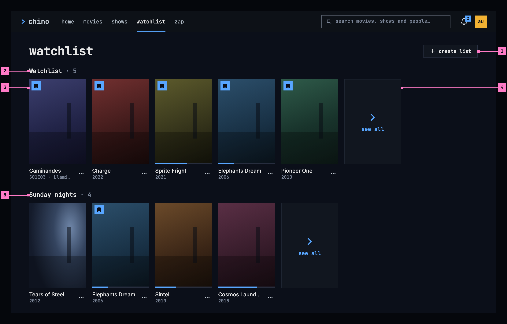

Figure 8.5: The watchlist on a computer, at 1280 × 800.

1. **create list**, a standard button with a plus at the end of the heading's
   line, starts a list of the person's own (section 8.7.1).
2. **The row's name**: the list's name and how many titles it holds,
   “Watchlist · 5”. Choosing it opens the list (section 8.6).
3. **A card**, as in movies and shows ([chapter 5](./browse.md)), with its
   status marks and its menu button, the design system's action menu. An
   episode shows as its show's card, with the episode under the name:
   “S01E03 · Llamigos”. Choosing it opens the show's page on that episode
   ([chapter 6](./title-actions.md)).
4. **see all**, the row's last card, opens the list, as the row's name does.
5. **A list of the person's own** follows the Watchlist, in a row of its own.
   The bookmark on a card means the Watchlist in every row, so Elephants Dream
   carries it in Sunday nights too.

The Watchlist's row comes first, then the person's lists in the order they
were created. A row holds the 12 titles added last, the newest first.

## 8.4 The watchlist on a phone

The phone shows the watchlist upright and sideways. Figure 8.6 shows it
upright and figure 8.7 sideways. The parts are those of figure 8.5; the
numbers mark where the phone differs, and section 8.4.3 says what happens when
the phone is turned.

### 8.4.1 Held upright

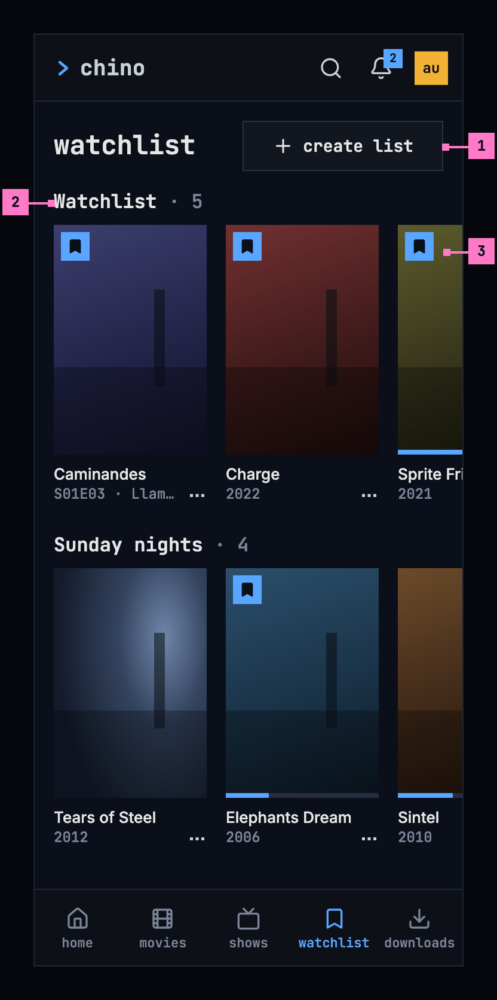

Figure 8.6: The watchlist on a phone held upright, at 360 × 780 dp.

1. **create list**, the design system's button at its large size, 42 dp high,
   stays at the end of the heading's line, in reach without scrolling past
   the lists.
2. **The rows** come one under the other, as on a computer.
3. **A row** shows two cards and a part of the next, so it's plain that it
   goes on sideways.

The web on a phone held upright has the layout of figure 8.6, with its own
tabs ([chapter 2](./frame.md)).

### 8.4.2 Held sideways

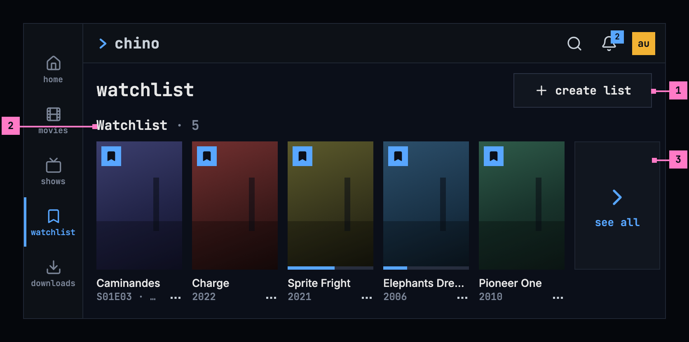

Figure 8.7: The watchlist on a phone held sideways, at 780 × 360 dp.

1. **create list**, the large button at the end of the heading's line, as
   upright.
2. **The row's name**, with the row right under it.
3. **A row** shows five smaller cards and its see all card, so a whole card,
   its name and its year too, shows under the heading. The next row starts
   under the screen's foot.

The tabs run down the left edge as a rail while the phone is sideways
([chapter 2](./frame.md)). The web on a phone held sideways has the layout of
figure 8.7.

### 8.4.3 Turning the phone

Turning the phone keeps the watchlist where it was: the same row at the top of
the screen, each row scrolled sideways as far as before, and an open list, a
dialog or the typing in a dialog's field as they were. Upright, a row has
cards 128 dp wide; sideways they are smaller, 104 dp, so a whole card fits
under the heading. On a phone the menu button stands beside the year, so the
name keeps the card's whole width, as in movies ([chapter 5](./browse.md)).

## 8.5 The watchlist on a TV

Figure 8.8 shows the watchlist on a TV, with the focus on the first card.

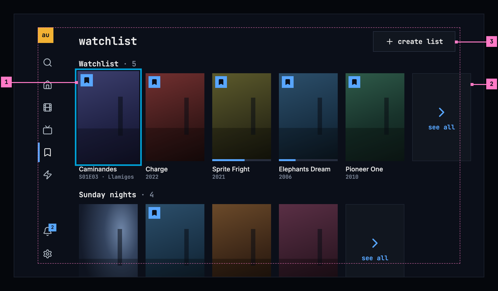

Figure 8.8: The watchlist on a TV, at 960 × 540 dp.

1. **The focus** on a card, the ring 2 dp outside the poster and the card 5 %
   larger. Right from the rail lands on the first card of the Watchlist's row.
   Left and right move along a row, up and down from row to row; a row's name
   takes the focus too, and OK on it opens the list.
2. **A row runs past the safe area** to the edge of the screen, as home's rows
   do ([chapter 4](./home.md)). The row scrolls when the focus reaches the
   outline, so the focus never leaves it.
3. **create list**, the large button, at the top inside the safe area. Up
   from the first row reaches it.

Holding OK on a card opens its menu, as in movies and shows.

## 8.6 A list

Figure 8.9 shows one of the person's lists, Sunday nights, opened from its
row.

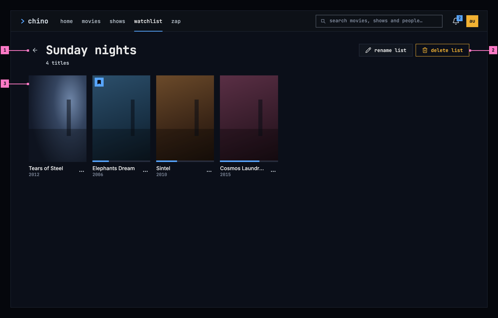

Figure 8.9: A list on a computer: Sunday nights.

1. **The back arrow**, the design system's quiet icon button, named “back”
   for screen readers, returns to the watchlist. The heading is the list's
   name as the person wrote it, in the design system's heading, which keeps
   its capitals, and the line under it counts its titles: “4 titles”,
   “1 title”.
2. **rename list** and **delete list** (section 8.7), the design system's
   buttons: rename list a standard one, delete list its danger button with
   the amber outline, as every action that deletes has.
3. **The grid** holds all of the list's titles, the one added last first, laid
   out as the grid of movies ([chapter 5](./browse.md)).

The Watchlist opens the same way, without rename list and delete list. It is
the list every account has, and the bookmark on every title's page and every
card's mark refer to it by name ([chapter 6](./title-actions.md)), so it
keeps its name and can't be deleted.

A title leaves a list on its page: the bookmark takes it out of the
Watchlist, and the list picker out of the person's own lists
([chapter 6](./title-actions.md)). Back from the page, the list shows without
it, scrolled as it was. On the web, an opened list has an address of its own,
so back, a reload and a shared link open it again.

## 8.7 Creating, renaming and deleting a list

### 8.7.1 Creating a list

Figure 8.10 shows the dialog that **create list** opens, the design system's
dialog over the dimmed page, after the person tried a name they already use.

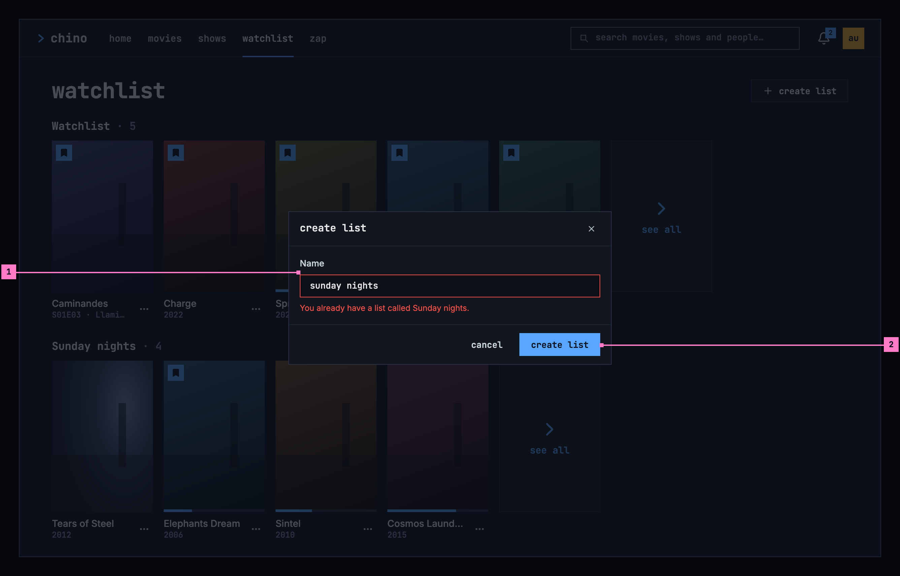

Figure 8.10: Creating a list, with a name already taken, on a computer.

1. **Name**, the design system's field, takes the list's name. It is checked
   when the person presses create list, not while they type, as the design
   system's forms check. A name already in use gets “You already have a list
   called Sunday nights.” under the field, in red, and an empty one “Give the
   list a name.”; the field keeps what was typed, its border turns red, and
   the focus goes back to it.
2. **create list**, the dialog's emphasized button, creates the list and
   closes the dialog, and the list's row appears at the end of the watchlist,
   empty. Enter in the field does the same, and create list is never dimmed.
   **cancel**, a quiet button, closes the dialog and creates nothing, and so
   do the close button in the dialog's corner, Esc and a press beside the
   dialog.

The list picker on a title's page ([chapter 6](./title-actions.md)) starts a
list with the same dialog, and the title goes into the new list at once. On a
TV, the name is typed on the keyboard that search uses ([chapter 9](./search.md)),
under the field, and back is cancel.

### 8.7.2 Renaming a list

**rename list** opens the same dialog, headed **rename list**, with the list's
name in the field and **rename list** to confirm. The new name shows at once,
in the list's row and in the list picker.

### 8.7.3 Deleting a list

Deleting asks first, in the design system's dialog, because a deleted list
can't be brought back. Figure 8.11 shows the question.

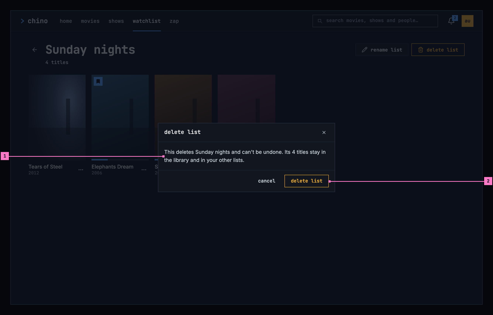

Figure 8.11: Deleting a list, on a computer.

1. **What goes, and what stays**: “This deletes Sunday nights and can't be
   undone. Its 4 titles stay in the library and in your other lists.” A list
   of one title says “Its title stays in the library and in your other
   lists.”, and an empty list leaves the second sentence out.
2. **delete list**, the design system's danger button with the amber outline,
   repeats the dialog's title and comes last; **cancel**, a quiet button,
   comes before it. The dialog opens with the focus on its close button, as
   the design system's dialog does, so a stray Enter or OK deletes nothing.

After the delete, the watchlist shows again without the list's row, and on a
TV the focus is on **create list**.

### 8.7.4 Names and limits

- A name has 1 to 60 characters, and spaces at its ends are left out. The
  field takes no more than 60.
- No two of an account's lists share a name, whatever the capitals:
  “sunday nights” is taken while there is a Sunday nights.
- An account has at most 50 lists, the Watchlist among them. Past that, the
  dialog says so in the design system's error banner at its top: “You have
  as many lists as an account can have. Delete one first.”
- A save that fails for another reason keeps the dialog open with what was
  typed, and says why in an error banner at its top: “Couldn't create the
  list.” or “Couldn't rename the list.”, then the cause's sentence of
  [chapter 17](./errors.md), with the status under the banner's details.

## 8.8 What a list holds

- A list holds movies, shows and episodes, the one added last first, and a
  title can be in several lists at once.
- The count beside a row's name and under a list's heading counts the titles
  the list holds.
- The lists belong to the account, so they are the same in every app: a title
  added on a phone is in the watchlist on the TV.

## 8.9 Changes

Every difference between section 8.2 and the target is one change in the
table. A change names the apps it is built in, what they do today and the
target, with the figure or the section that sets it out; it is built as its row
says, and nothing else changes with it. Each change starts as proposed; once the
owner approves it, it is built, one change at a time. A target that starts with
“Recommended” was an open decision, or takes away something an app has today.
What a card shows under its poster is [chapter 5](./browse.md)'s, and the list
picker on a title's page is [chapter 6](./title-actions.md)'s.

| No. | Change | Apps | Today | Target | Status |
|---|---|---|---|---|---|
| 8.C1 | The view's heading | Phone app, Android TV, Samsung TV | Phone app: “Watchlist”. Android TV: “your lists”. Samsung TV: “Your lists” | watchlist, the design system's heading (figure 8.5) | proposed |
| 8.C2 | The row's name | Web, Samsung TV | Web: “Watchlist · 1” in the body face. Samsung TV: “DEFAULT” beside the Watchlist's name | the list's name in the monospace face, the count quieter, “Watchlist · 5”, without a label (figure 8.5, part 2) | proposed |
| 8.C3 | see all, the row's last card | Web, Phone app, Samsung TV | Web: see all also at the right of the row's name. Phone app, Samsung TV: “See all” | Recommended: the row's name and the see all card at its end, lowercase (figure 8.5, parts 2 and 4) | proposed |
| 8.C4 | create list, and its dialog | Web, Phone app, Android TV, Samsung TV | Web: “+ new list” in a dashed outline after the rows, a field in its place with a check and a cross. Phone app: a “New list” chip after the rows, a dialog “New list” with “Create”. Android TV: “new list” beside the heading, a dialog without buttons over the system's keyboard. Samsung TV: “New list” beside the heading, a keyboard over the whole screen, lowercase letters only | create list, the design system's standard button with a plus, at the end of the heading's line; the design system's dialog of figure 8.10, with Name, its field, cancel, a quiet button, and create list, the emphasized one; on a TV the keyboard search uses, under the field (section 8.7.1) | proposed |
| 8.C5 | A name the dialog can't take | Web, Phone app, Android TV, Samsung TV | Web: “Enter a name”, and a refused name “request failed (409)”. Phone app: create list greyed while the name is empty; “A list with that name already exists.”, “You've reached the maximum number of lists.”, “Enter a name between 1 and 60 characters.”, “Couldn't save the list. Try again.” Android TV: an empty name closes the dialog, a refused one is lost without a word. Samsung TV: an empty name does nothing; “Couldn't create that list.”, “Couldn't rename that list.” on the rows | checked when create list is pressed, the dialog open with what was typed: under the field, as the design system's field shows an error, “Give the list a name.”, “You already have a list called Sunday nights.”; at the dialog's top, in an error banner, “You have as many lists as an account can have. Delete one first.” or “Couldn't create the list.” with the cause's sentence (section 8.7.4) | proposed |
| 8.C6 | Renaming in the same dialog | Web, Phone app, Android TV, Samsung TV | Web: the heading turns into a field, with a check, “Save name”. Phone app: “Rename list” with “Save”. Android TV: “rename list” without buttons. Samsung TV: the keyboard, “Rename list” | the dialog of figure 8.10 headed rename list, the name in its field, rename list to confirm, the emphasized button (section 8.7.2) | proposed |
| 8.C7 | The Watchlist keeps its name | Web, Android TV, Samsung TV, the server | the Watchlist can be renamed: the web's pencil, Android TV's “rename list”, Samsung TV's “Rename”; the server renames it | Recommended: no rename list on the Watchlist, and the server refuses to rename it (section 8.6) | proposed |
| 8.C8 | Deleting asks in plain words | Web, Phone app, Android TV, Samsung TV | Web: the browser's own question, “Delete "Sunday nights"? Its items will be removed from the list.” Phone app: “Delete “Sunday nights”?”, “This removes the list and everything in it. Titles stay in your other lists.”, a red “Delete”. Android TV: ““Sunday nights” is deleted, with the 4 titles saved in it. They stay in the library and in your other lists.” Samsung TV: deletes at once, without asking | figure 8.11: the design system's dialog, delete list its danger button, last, cancel a quiet button before it, the focus on the dialog's close button; “This deletes Sunday nights and can't be undone. Its 4 titles stay in the library and in your other lists.” | proposed |
| 8.C9 | An opened list: its count and its buttons | Web, Phone app, Android TV, Samsung TV | Web: the count alone, “1”, and icons to rename and delete. Phone app: “· 4” and icons. Android TV: “back”, “· 4”, and “4 saved” under the grid. Samsung TV: “Back”, “· 4”, “Rename”, “Delete” | figure 8.9: the back arrow, the design system's quiet icon button; “4 titles” under the name; rename list and delete list, its buttons with their words, delete list its danger button | proposed |
| 8.C10 | Where titles come from | Web, Phone app, Android TV, Samsung TV | “Save titles with the + button on any movie or show.” in the empty rows of the web, the phone app and Samsung TV, and in Android TV's and Samsung TV's empty lists, though a title's page has no + button; the web's empty list “This list is empty.”, “Add titles from a movie or show page to see them here.”; the phone app and Android TV: “Add titles with the bookmark on a movie's or a show's page.” | the sentences of section 8.10: “Add titles with the bookmark on a title's page.”, “Add titles with the arrow beside the bookmark on a title's page.”, “nothing in Sunday nights yet” | proposed |
| 8.C11 | An empty watchlist | Web, Phone app, Android TV, Samsung TV | the Watchlist's row with its empty line | figure 8.12: the design system's empty state, its nothing-yet kind, while the Watchlist is empty and the person has no list of their own | proposed |
| 8.C12 | A saved episode: its show's card | Web, Phone app, Android TV, Samsung TV | the episode's own card, named after the episode; under it “S01E01 · Earthfall” on the web, its code in the apps | the show's card with the episode under the name, “S01E03 · Llamigos”, which opens the show's page on that episode (figure 8.5, part 3) | proposed |
| 8.C13 | The card's menu in the lists | Phone app, Android TV, Samsung TV | the cards in the rows and the lists have no menu | the card's menu of [chapter 5](./browse.md), the design system's action menu, on every card (figure 8.5) | proposed |
| 8.C14 | An opened list's own address | Web, Samsung TV | an opened list has none: back from a title's page goes to the rows | back from a title's page shows the list, scrolled as it was; on the web an address of its own (section 8.6) | proposed |
| 8.C15 | Loading: grey blocks | Web, Phone app, Android TV, Samsung TV | Web, Phone app: a spinner alone. Android TV: “Loading your lists…”. Samsung TV: a spinner with it. Both: a row “Loading…” | grey blocks in the shape of two rows (section 8.10) | proposed |
| 8.C16 | Couldn't load: the lists, or one row | Phone app, Android TV, Samsung TV | Phone app: “couldn't load your watchlists” for the whole view when one row couldn't load. Android TV, Samsung TV: a row that couldn't load looks empty. Samsung TV: “Couldn't load your lists.”, without try again | figure 8.13, the design system's empty state, its couldn't-load kind, when the lists couldn't load; a row that couldn't load keeps its name, and in place of its cards the empty state at its small size says “couldn't load this list”, with the reason and try again (section 8.10) | proposed |
| 8.C17 | The server counts characters | the server | 1 to 60 bytes, so a name with accents ends before 60 characters | 1 to 60 characters, as the field counts them (section 8.7.4) | proposed |

## 8.10 States

The watchlist is drawn in figures 8.5 to 8.9 with everything loaded. Figures
8.12 and 8.13 show two of the states in between.

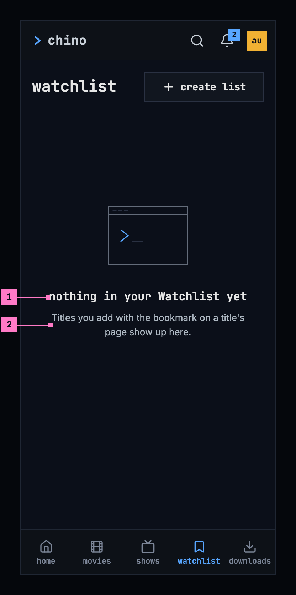

Figure 8.12: An empty watchlist, on a phone.

1. **nothing in your Watchlist yet**: the design system's empty state, its
   nothing-yet kind, when the Watchlist is empty and the person has no list of
   their own. The Watchlist keeps its capital in the title, as a name does,
   where the design system writes the rest in lowercase.
2. **Where titles come from.** The sentence names the bookmark on a title's
   page. There is nothing to press here, because a title is added on its
   page; **create list** stays, for a list of the person's own.

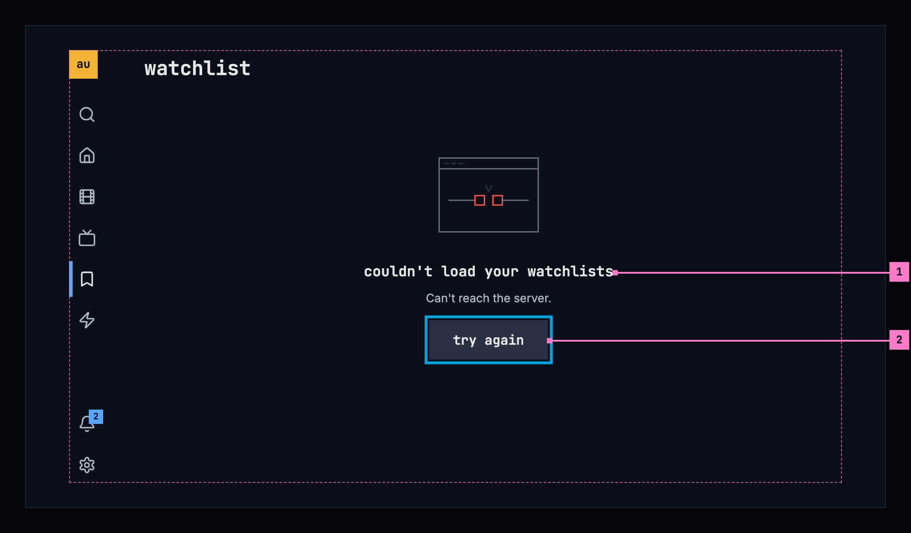

Figure 8.13: The watchlist when the lists couldn't load, on a TV.

1. **What couldn't load, and why**, in the design system's empty state, its
   couldn't-load kind: “couldn't load your watchlists”, and the reason under
   it; here the server didn't answer. [Chapter 17](./errors.md) lists every
   cause and its sentence.
2. **try again**, a standard button at its large size, takes the focus first
   and loads the lists again. create list comes back with them.

| State | What the watchlist shows |
|---|---|
| Loading | Nothing for the first 0.4 seconds, then grey blocks in the shape of two rows, a name over a line of posters, like the blocks of figure 5.12 ([chapter 5](./browse.md)) |
| The Watchlist empty, and no list of the person's own | Figure 8.12 |
| The Watchlist empty beside other lists | Its row keeps its name, and in place of its cards the design system's empty state at its small size says “nothing in your Watchlist yet” over “Add titles with the bookmark on a title's page.” |
| A list of the person's own that is empty | Its row shows the same small empty state, “nothing in Sunday nights yet” over “Add titles with the arrow beside the bookmark on a title's page.”; opened, the list shows it at the usual size under its heading. The list's name keeps its capitals |
| The lists couldn't load | Figure 8.13, with the sentence for the cause |
| One row couldn't load | That row keeps its name, and in place of its cards the design system's small empty state, its couldn't-load kind, says “couldn't load this list”, with the reason and **try again**; the other rows show |
| An opened list couldn't load | The design system's empty state, its couldn't-load kind, under the heading: “couldn't load this list”, the reason and **try again** |
| Asking again failed | The watchlist stays as it was, under the design system's warning banner, as [chapter 17](./errors.md) has it: “Couldn't refresh your watchlists; it shows what was loaded 4 minutes ago.”, with **try again** |
| The list was deleted on another device | The list's view goes back to the watchlist, which no longer has its row |
| The phone app can't reach the server | The banner of [chapter 13](./downloads.md), with the lists the phone loaded under it as they were; with none, figure 8.13 without the sentence, which the banner already says |

## 8.11 Words

| Where | Text |
|---|---|
| The view | watchlist · create list |
| A row's name | Watchlist · 5 · Sunday nights · 4 |
| The last card of a row | see all |
| A card | the name, the year and the menu button, named after the title for screen readers, “actions for Sintel”; an episode: the show's name and “S01E03 · Llamigos” |
| An empty row | nothing in your Watchlist yet · nothing in Sunday nights yet · Add titles with the bookmark on a title's page. · Add titles with the arrow beside the bookmark on a title's page. |
| A list | the back arrow, named “back” for screen readers · Sunday nights · 4 titles · 1 title · rename list · delete list |
| Creating and renaming | create list · rename list · Name · cancel · the dialog's close button, named “close” for screen readers |
| A name the dialog can't take | Give the list a name. · You already have a list called Sunday nights. |
| At the dialog's top | You have as many lists as an account can have. Delete one first. · Couldn't create the list. · Couldn't rename the list. · and the cause's sentence |
| Deleting | delete list · This deletes Sunday nights and can't be undone. Its 4 titles stay in the library and in your other lists. · Its title stays in the library and in your other lists. · cancel |
| Empty | nothing in your Watchlist yet · Titles you add with the bookmark on a title's page show up here. · nothing in Sunday nights yet |
| Couldn't load | couldn't load your watchlists · couldn't load this list · Can't reach the server. · try again |
| Asking again failed | Couldn't refresh your watchlists; it shows what was loaded 4 minutes ago. · try again |
