# 10 Zap

Section 10.2 describes zap as it is deployed today. The sections after it are
the target, zap as it is meant to be, and section 10.8 lists every difference
between the two as a numbered change. Only a change the owner has approved is
built, one change at a time; anything no change names stays as it is
deployed.

The chapter covers zap, the screen that zaps through the library like channels
on a television: its card on a computer, on a phone held either way and on a
TV, what zap plays and from where in a title, its light, and its states. The
frame around it is specified in [chapter 2](./frame.md), and the player that
**watch** opens in [chapter 11](./playback.md).

## 10.1 Purpose

Zap is for the evening when nobody knows what to watch. Each card drops the
person into a random scene of a movie or an episode they haven't watched, with
its sound, and the next card comes with a swipe, a scroll or a key. When a
scene catches them, **watch** goes on from that very moment in the player.

Zap opens from the **zap** view: in the rail on a computer, as the web's
fifth tab on a phone, from the entry under the hero on the phone app's home
([chapter 4](./home.md)), and from the rail on a TV.

## 10.2 As deployed

This section says what the four apps' zap does as of 6 November 2026: the web
as the public demo showed it that day, on the same build as production, and
the apps as their code had them that day. The phone app, Android TV and the
Samsung TV are described from their code until screenshots of them are taken.
The Samsung TV app isn't released yet.

### 10.2.1 The web

Figures 10.1 to 10.3 are screenshots of the web's zap a few seconds after it
opened. Figure 10.1 shows it on a computer, while the first card's clip is
still starting.

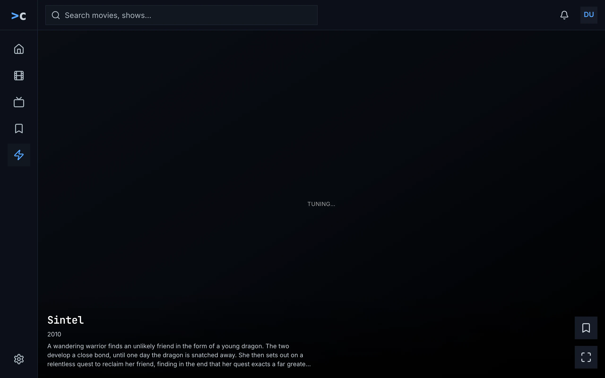

Figure 10.1: Zap on the web as deployed on 6 November 2026, on a computer, at
1280 × 800.

1. **The frame**: a rail down the left edge with the product's mark at its
   top, then home, movies, shows, watchlist and zap as icons alone, zap in blue
   on a darker square, and the settings gear at its foot; along the top, the
   search field, “Search movies, shows...”, the bell and the avatar.
   [Chapter 2](./frame.md) sets out the frame.
2. **“TUNING…”**, small and spaced out, in the middle of a dark card: the clip
   hasn't shown its first frame yet. The card has no backdrop and no light,
   only a dark wash, because it came from the server's ready pool, which sends
   no backdrop (below).
3. **The foot**: the title, “Sintel”, in the monospace face, the year, “2010”,
   and no rating, which the ready pool doesn't send either, then three lines of
   the overview, cut with “...”.
4. **Save over watch**, at the right edge: a bookmark and four corners, each a
   48 × 48 square on a solid surface. Their names, which are their tooltips as
   well, are “add to Watchlist” and “Watch”.

Figure 10.2 shows zap on a phone held upright, with the same card's clip
playing.

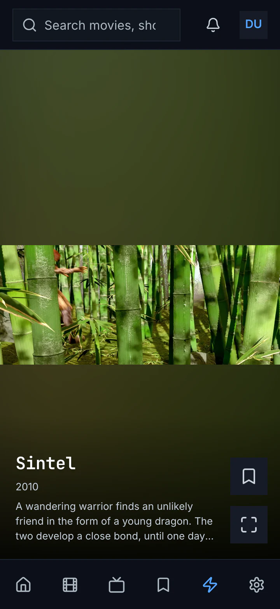

Figure 10.2: Zap on the web as deployed on 6 November 2026, on a phone held
upright, at 360 × 780.

1. **The top bar**: the search field, cut to “Search movies, sho”, the bell and
   the avatar, without the product's name.
2. **The light**, green here: the clip's own colours, blurred and dimmed, in
   the room above and below the clip.
3. **The clip**, across the width, in the middle of the card. Sintel's picture
   is wider than 16:9, so it shows whole, with the light above and below it
   too.
4. **The foot**, as on a computer: the title, the year without a rating, three
   lines of the overview, and save over watch.
5. **The tabs**: six icons without names, home, movies, shows, watchlist, zap
   in blue, and settings.

Figure 10.3 shows another card, on a phone held sideways.

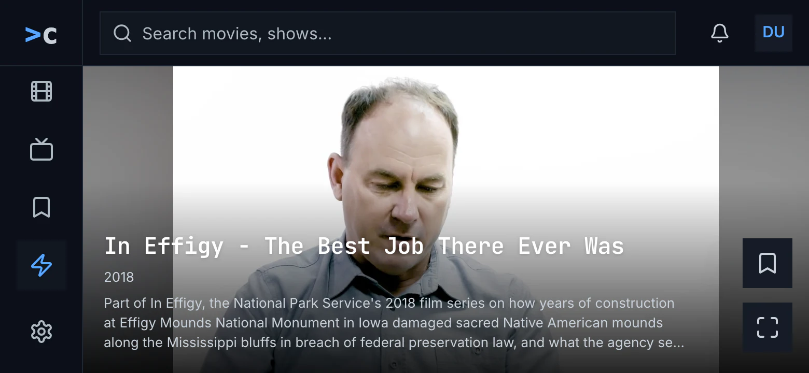

Figure 10.3: Zap on the web as deployed on 6 November 2026, on a phone held
sideways, at 780 × 360.

1. **The frame of figure 10.1**, because the screen is 768 px wide or more.
   The rail has no room for all its icons, so it scrolls and keeps zap, the
   current one, in view; home is out of sight above it.
2. **The clip**, as high as the card, in the middle, and the light, grey here,
   in the bands beside it.
3. **The foot**: the title on one line, the year and three lines of the
   overview, over the lower third of the clip.
4. **Save over watch**, at the right edge, in the light beside the clip.

The web asks the server's ready pool for its cards first: eight titles the
server keeps ready to start at a random scene, the same for everyone, each
card handed out twice. Those cards carry no backdrop, no poster and no rating.
The first of them are checked against the titles the person has watched only
where that list has come in before them, and the pool's later cards aren't
checked at all. When the pool has nothing, the web picks from its own lists:
the 30 best-rated movies, the 30 newest shows and the 30 newest episodes,
unwatched and ready-made only, and a file that holds several episodes only as
its first. A show is never among the ready-made titles, so its episodes come,
not the show.

The scene is the pool's pick or the web's own, both random between a tenth and
four fifths of the way through, never in the first minute or the last minute
and a half; the web's own pick keeps between the end of the intro and the
start of the credits where the server knows them. The first card from the
web's own lists always starts 35% of the way in. A title of two and a half
minutes or less never asks for its clip: its card stays on its backdrop, with
“TUNING…”.

A card that was left is dropped, so scrolling back doesn't bring it again. The
session learns from what the person does, with the weights of section 10.6.1,
but the web's own picks weigh only a title's kind, and the pool's cards don't
follow what it learned at all.

Zap plays with sound. Where the browser refuses sound until something on the
page was pressed, the card plays without it and shows **unmute** in the
middle, as the target has it. A card shows no subtitles, and its own light
fades in over 0.7 seconds. A clip that can't be played gives up without a
word: the card keeps its backdrop, “TUNING…” goes on pulsing, and the next
swipe moves on. **watch**, or a click anywhere on the card, loads the player as
a new page at the second the clip has reached, and back from it loads zap
anew, with new cards.

While zap loads, a spinner turns alone. When neither the movies nor the shows
could be loaded, zap says “couldn't load the movies and shows” with the reason
and **try again**, and when there is nothing to play, “nothing to zap yet”
with “Zap plays the movies and shows you haven't watched yet.”, both as the
target has them.

### 10.2.2 The phone app

In the phone app zap is the fifth tab, after watchlist, inside the top bar and
the tabs, and home has no zap entry. Android's back on
zap leaves the app, because nothing is behind the tab to go back to. Leaving
the tab, typing a search or opening another screen, the player too, ends the
session, and coming back starts a new one.

On Android the card is the web's: the light, sampled once a second into 16 × 9
colours and eased over 1.8 seconds; the clip at 16:9, whole, in the middle;
and the foot, with the title on two lines at most, the year, the rating cut to
one decimal, 7.86 as “★ 7.8”, three lines of the overview, and save over
watch, 48 dp squares named “add to Watchlist” or “in your Watchlist”, and
“Watch”. A tap anywhere is watch. Until the first frame the backdrop stands in
the clip's place and fades out over 0.35 seconds, and a card's own light fades
in over 0.6 seconds. Zap plays with sound and has no mute. A swipe up brings
the next card and a swipe down the one before: the card just before goes on
where it was paused, and one further back starts from where it began.

On a phone, a screen whose smallest width is under 600 dp, zap holds the phone
upright while it shows, and the phone turns freely again once zap is left. A
tablet turns, and a card there less than 400 dp high keeps its title to one
line and leaves out the overview. On iOS zap doesn't hold the phone upright,
but every card is a black box saying “iOS preview — coming soon”: no clip, no
sound and no light.

The phone app takes the 30 best-rated movies and the 30 newest shows,
unwatched and ready-made only; a show is never ready-made itself, so only
movies come, and no episode. A title of two and a half minutes or less is left
out. Every session opens on the same card: the best-rated title zap may play,
35% of the way in, warmed 1.2 seconds after the app starts. The other cards'
scenes are random as on the web, without the intro and the credits. The
session learns as the web's does and picks by a title's kind alone.

A clip that can't be played leaves its card on the backdrop, and the next
swipe moves on. Nothing turns a card's subtitles off: its player is left to
its defaults. While zap loads, a spinner turns over “Tuning in…”. When the
lists couldn't be loaded, and when nothing is left, zap says “Nothing to zap
right now”, without **try again**. Without a connection the tab stays and says
the same.

### 10.2.3 Android TV

On Android TV zap is the rail's fifth view, and it fills the screen without the
rail; back goes home. The picture fills the screen, without a light. When zap
opens, and on ▲ and ▶, the info shows on a solid band at the foot for a
minute: the title with the Watchlist chip, “add to Watchlist” or “in your
Watchlist”; the year, the rating cut to one decimal and up to three genres,
“Drama · Mystery”; three lines of the overview; and the keys as plain text,
“OK · watch from here”, “▼ / CH+ next”, “CH- back”, “▲ info”, “◀ mute”,
“▶ Watchlist”. A channel change hides it.

▼ and CH+ bring the next channel, and CH− the one before, from where it began;
on the first channel CH− only hides the info. ◀ turns the sound off and on, and
the hint says “◀ unmute” while it is off; the mute holds from channel to
channel. ▶ adds the title to the Watchlist or takes it out. OK opens the player
at the second the channel has reached, and back from the player returns to
zap, to the same channel, from where it began.

Android TV takes what the phone app takes, movies in fact, opens every session
on the same channel and picks the scenes the same way, but a title of two and
a half minutes or less plays from the smaller of half its length and one
minute. Until the first frame the backdrop fills the screen, without a word. A
channel that can't be played is skipped, at most six in a row. Subtitles are
off, forced ones too. While zap loads it says “Loading…”; when the lists
couldn't be loaded, and when nothing is left, “Nothing left to zap. Come back
later.”

### 10.2.4 Samsung TV

On the Samsung TV zap is the rail's fifth view, and it fills the screen; back
goes to the screen zap was opened from. The info lies on a dark gradient at the
foot, not on a band: the title with a chip, “Save”, or “Saved” in green; an
episode's code in blue, the year, the rating and up to three genres; three
lines of the overview; and the keys on one line, “OK Watch from here ▼ / CH+
Next CH- Back ▲ Info ◀ Mute ▶ Save”. It shows when zap opens and on ▲ and ▶,
for a minute.

The keys do what Android TV's do, but ◀ mutes the TV's own sound, and zap
leaves it muted when it closes. The Samsung TV takes movies, shows and
episodes, 30 of each, unwatched, ready-made or not, shuffled, and learns
nothing. It picks the scene as Android TV does. Until the first frame the
title's poster fills the screen, with “TUNING…” pulsing. A channel that can't
be played is meant to be skipped, at most six in a row, but the skip never
comes: the channel stays on its poster with “TUNING…” until ▼. OK opens the
player at the second the channel has reached, and back from the player starts
zap anew. While zap loads it says “Tuning in…”; when the lists couldn't be
loaded, and when nothing is left, “Nothing left to zap. Come back later.”

### 10.2.5 Feature by feature

The table compares the four apps' zap feature by feature. “—” is a feature the
app doesn't have. A ready-made title is one that plays from the server's
ready-made qualities, so it starts at once.

| Feature | Web | Phone app | Android TV | Samsung TV |
|---|---|---|---|---|
| Where it is | a view of the rail on a computer; the fifth of six tabs on a phone | the fifth tab, after watchlist; no entry on home | the fifth view of the rail | the fifth view of the rail |
| The frame around it | the top bar, and the rail or the tabs | the top bar and the tabs, or the side rail from 600 dp wide | none: zap fills the screen | none: zap fills the screen |
| Back | the browser's | leaves the app | home | the screen zap was opened from |
| Held sideways | turns, with a computer's frame from 768 px wide | Android: upright only, on a phone under 600 dp; iOS turns | — | — |
| The card | the clip at 16:9, whole, over its light; the foot; save over watch | the same; iOS: a black box, “iOS preview — coming soon” | the picture full screen, no light; the info on a band | the picture full screen, no light; the info on a gradient |
| A short card | the same foot | under 400 dp high: the title on one line, no overview | — | — |
| The rating | “★ 7.4”, rounded; none on the ready pool's cards | cut: 7.86 is “★ 7.8” | cut, as on the phone | rounded |
| An episode's code | in blue, before the year | — (no episodes) | — (no episodes) | in blue, before the year |
| Genres | — | — | up to three, after the rating | up to three, after the rating |
| Save | a 48 × 48 square, “add to Watchlist”, “in your Watchlist” | the same | ▶; the chip “add to Watchlist”, “in your Watchlist” | ▶; the chip “Save”, “Saved” in green |
| Watch | a square with four corners, “Watch”; a click anywhere | the same, “Watch”; a tap anywhere | OK | OK |
| The next card | the wheel, a swipe | a swipe up | ▼ or CH+ | ▼ or CH+ |
| The card before | — (a card left is dropped) | a swipe down: the card just before goes on where it was paused | CH−, from where it began | CH−, from where it began |
| The sound | on; **unmute** where the browser blocks it | on; no mute | ◀ mutes; “◀ unmute” | ◀ mutes the TV's own sound, not set back when zap closes |
| The TV's info | — | — | when zap opens, on ▲ and ▶, for a minute | the same |
| The TV's keys | — | — | “OK · watch from here”, “▼ / CH+ next”, “CH- back”, “▲ info”, “◀ mute”, “▶ Watchlist” | “OK Watch from here ▼ / CH+ Next CH- Back ▲ Info ◀ Mute ▶ Save” |
| The titles | the server's ready pool first; else 30 movies, 30 shows, 30 episodes, unwatched, ready-made only | 30 movies, 30 shows, unwatched, ready-made only: movies in fact | the same as the phone app | 30 movies, 30 shows, 30 episodes, unwatched, ready-made or not |
| Watched titles | the ready pool's cards checked only at the start, if at all | left out | left out | left out |
| A file of several episodes | its first episode only | — | — | not handled |
| Titles of 2½ minutes or less | stay on their backdrop, with “TUNING…” | left out | played from the smaller of half and one minute | the same as Android TV |
| The scene | 10% to 80%, not the first minute or the last 1½; within intro and credits where known | the same, from the length alone | the same as the phone app | the same as the phone app |
| The first card | from its own lists, 35% of the way in | the same title each session, 35% of the way in | the same as the phone app | random |
| Learning | saving 2, watching 1.5, to the end 1, 8 s or more 0.5, 2 to 8 s −0.3, under 2 s −1; the pick by kind alone | the same | the same | none |
| Until the first frame | the backdrop, “TUNING…” pulsing; the light in 0.7 s | the backdrop, fading out over 0.35 s; the light in 0.6 s | the backdrop | the poster, “TUNING…” pulsing |
| A clip that can't play | the card stays, “TUNING…” pulsing on | the card keeps its backdrop | skipped, at most six in a row | meant to be skipped; stays on “TUNING…” |
| Subtitles | none, forced ones too | the player's defaults | none, forced ones too | none |
| Watch, and back | a new page at the second reached; back loads zap anew | the player at the second reached; back starts a new session | the player at the second reached; back to the same channel | the player at the second reached; back starts zap anew |
| Loading | a spinner alone | a spinner, “Tuning in…” | “Loading…” | “Tuning in…” |
| Couldn't load | “couldn't load the movies and shows”, the reason, try again | “Nothing to zap right now” | “Nothing left to zap. Come back later.” | the same as Android TV |
| Nothing to zap | “nothing to zap yet”, “Zap plays the movies and shows you haven't watched yet.” | “Nothing to zap right now” | “Nothing left to zap. Come back later.” | the same as Android TV |
| No connection | — | the tab stays, “Nothing to zap right now” | — | — |

## 10.3 Zap on a computer

Figure 10.4 shows zap on a computer. One card fills the page beside the rail
and under the top bar, and the next card waits below it. The card is chino's
own, the owner's design, the same on a computer and a phone; a phone held
sideways only shortens its foot (section 10.4.2).

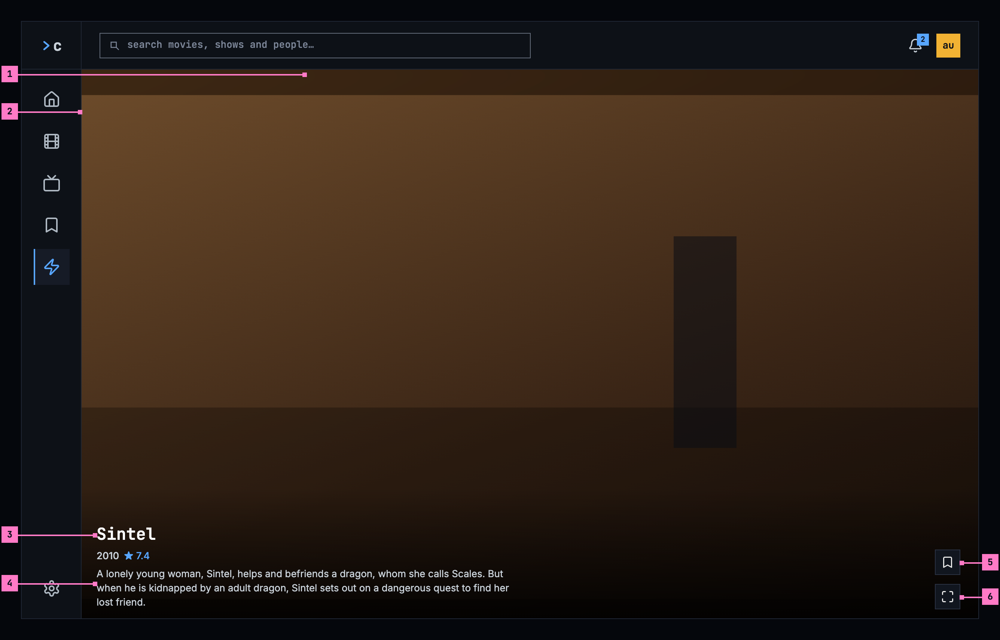

Figure 10.4: Zap on a computer, at 1280 × 800.

1. **The light.** The card's background is the clip's own light: a small copy
   of its picture, blown up, blurred and dimmed, so the card reads as full
   screen while the clip plays whole. At 1280 × 800 the clip takes almost the
   whole card, and the light shows as a strip above and below it; in a wider
   window it fills the sides. Section 10.7 says how it moves.
2. **The clip.** The scene plays whole, at 16:9, in the middle of the card: as
   wide as the card where the card is taller than 16:9, as high as the card
   where it is wider. It plays with sound.
3. **The title, the year and the rating**, small and close together. The
   rating has one decimal, rounded. An episode's code comes before the year:
   “S01E03”.
4. **Three lines of the overview**, cut short at the end of the third.
5. **Save, the bookmark**, the design system's icon button. It adds the title
   to the Watchlist or takes it out again, as the main part of add to list
   does on a title's page ([chapter 6](./title-actions.md)), and shows which
   as that does: an outlined bookmark, and a dark one on blue while the title
   is in the Watchlist. It touches no other list.
6. **watch**, the maximize icon, an icon button too. It opens the player at the
   scene that plays, at the second it has reached.

The two buttons are of the standard kind, with its solid surface, their icons
alone, 34 px square on a computer, one over the other at the card's right
edge, and the foot of the column sits on the text's bottom line.
Their names, for a screen reader and as the browser's tooltip, are **add to
Watchlist** or **in your Watchlist**, and **watch**. A click anywhere else on
the card is **watch** as well.

The mouse wheel, or a swipe on the touchpad, brings the next card; scrolling
back brings the card before again, and its scene plays again from where the
card began. Nothing else is on the card: no zap wordmark, no hint such as “tap
to watch · swipe up”, no genres and no mute button. Zap plays with sound, and
the device's own volume is its mute.

A browser may refuse a page's sound until the person has pressed something on
it. Zap then plays the card without sound and shows **unmute** in the middle
of the card: a button of the standard kind, the muted speaker before its word.
One press brings the sound back for every card after it. While the browser
allows the sound, **unmute** never shows.

## 10.4 Zap on a phone

The phone plays zap upright and sideways, and zap turns with it. Figure 10.5
shows it upright and figure 10.6 sideways. The parts are those of figure 10.4;
the numbers mark where the phone differs, and section 10.4.3 says what happens
when the phone is turned.

In the phone app, zap is a screen of its own: it covers the top bar and the
tabs, and the phone's back returns to home, where its entry is. A swipe up
brings the next card and a swipe down the card before, its scene again from
where the card began. A tap anywhere is **watch**.

### 10.4.1 Held upright

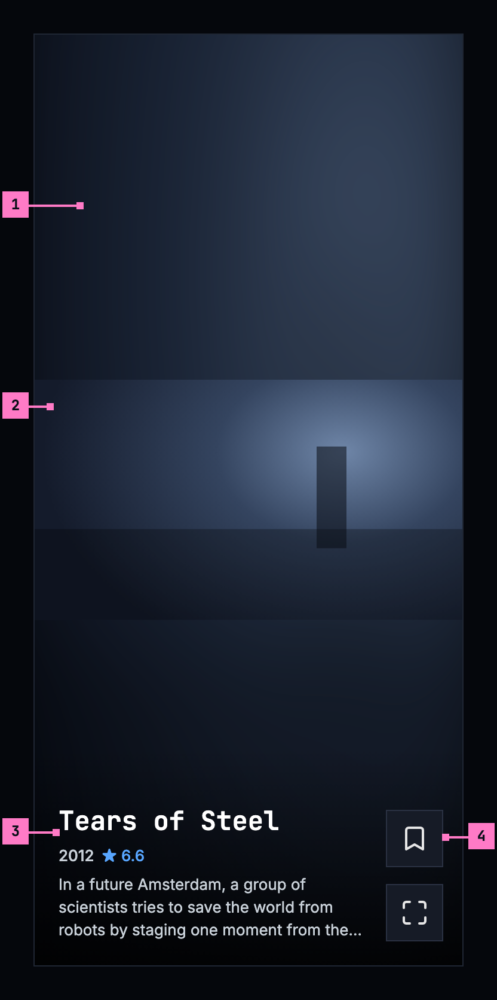

Figure 10.5: Zap on a phone held upright, at 360 × 780 dp.

1. **The light** fills most of the card. The phone is upright, so the clip
   takes the card's width, and the light the room above and below it.
2. **The clip**, the phone's full width, in the middle of the card.
3. **The foot**, as on a computer: the title, the year and the rating, and
   three lines of the overview, on the light.
4. **Save over watch**, at the right edge, the foot of the column on the
   text's bottom line. On a phone the icon buttons take the design system's
   large size, 42 dp, and each answers to a touch in the 48 dp square around
   it.

Upright, the phone's status bar and navigation bar stay, and the card keeps
clear of them.

The web on a phone held upright shows the same card inside its frame: the top
bar above it, and the tabs below it with **zap** current
([chapter 2](./frame.md)). Where the browser blocks the sound, it shows
**unmute** as in section 10.3.

### 10.4.2 Held sideways

Figure 10.6 shows the card of figure 10.5 with the phone turned.

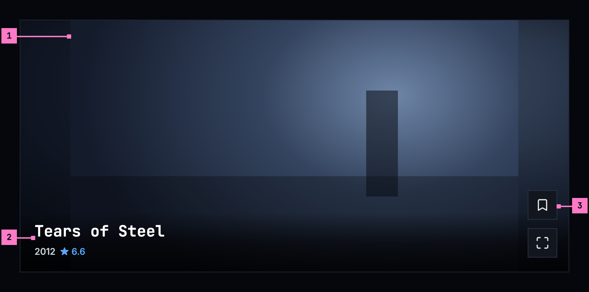

Figure 10.6: Zap on a phone held sideways, at 780 × 360 dp.

1. **The clip**, as high as the screen, in the middle, and the light in the
   bands beside it, 70 dp each on a phone 780 dp wide.
2. **The foot, on one line.** On a card less than 400 dp high the title keeps
   to one line, over the year and the rating, and the overview is left out, so
   the foot covers no more than the scene's lower edge. Its scrim is no taller
   than the text.
3. **Save over watch**, at the right edge as upright, here in the light beside
   the clip.

Held sideways, zap hides the phone's status and navigation bars, as the player
does, and a swipe from the edge brings them back for a moment. The clip and
the buttons keep clear of the camera's cutout. The cards still come from
below: a swipe up brings the next one, whichever way the phone is held.

The web on a phone held sideways keeps its frame, as
[chapter 2](./frame.md) draws it sideways, and the card of figure 10.6 fills
the rest.

### 10.4.3 Turning the phone

Zap turns with the phone, and turning it never interrupts the card: the scene
plays on from the second it has reached, with its sound, and the light goes on
following it. The cards before and after it stay as they were.

- **Turned sideways**, the clip grows to the screen's height, the foot keeps to
  one line, and the phone app hides the status and navigation bars.
- **Turned back upright**, the bars come back, the clip takes the width again,
  and the overview returns under the title.
- **Neither way is held.** Zap never keeps the phone upright or sideways, and
  **watch** opens the player, which turns with the phone as
  [chapter 11](./playback.md) sets out.

## 10.5 Zap on a TV

Figure 10.7 shows zap on a TV. Zap fills the screen, without the rail. On a
16:9 TV the clip fills the screen, so there is no card around it and no light,
only the scene. Until a channel's first frame, the title's backdrop fills the
screen, without a word.

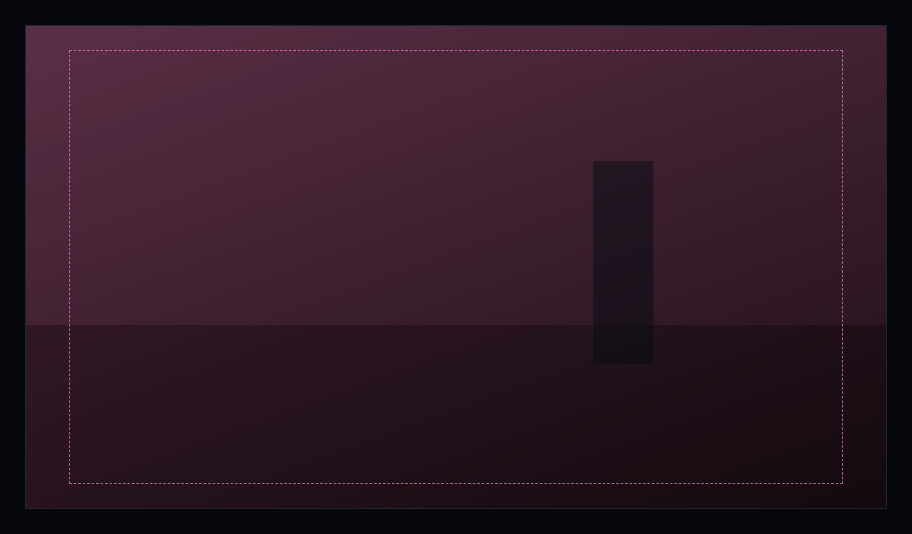

Figure 10.7: Zap on a TV, the scene alone, at 960 × 540 dp.

When zap opens, and whenever the person presses up, the info shows at the foot
of the screen, as in figure 10.8; right shows it too, with the Watchlist's
change. It fades after a minute, and a channel change hides it: the next
channel starts without it.

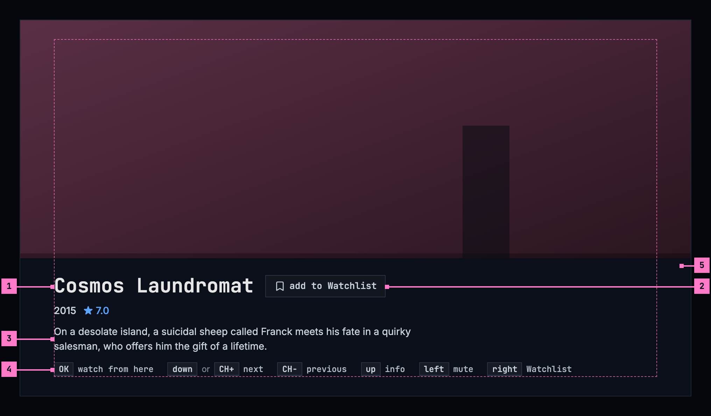

Figure 10.8: The TV's info, at 960 × 540 dp.

1. **The title, the year and the rating.** An episode's code comes before the
   year, as on a computer.
2. **The Watchlist chip**: **add to Watchlist** with an outlined bookmark, or
   **in your Watchlist** with a dark one on blue. Right on the remote adds the
   title or takes it out, and shows the info, so the change is seen. The chip
   is chino's own, not a button: it only shows the state and takes no focus.
3. **The overview**, three lines at most.
4. **The keys**, each the design system's key cap, then what it does. The
   arrow keys are named in words, up, down, left and right, as the design
   system writes keys, and “or” joins two keys that do the same. While the
   sound is off, the left key says **unmute**.
5. **The band**: one solid surface under the info, out to the screen's edges,
   so no word stands on the picture. The info itself keeps inside the safe
   area.

Nothing on the TV takes the focus, so the remote's keys work at once:

| Key | What it does |
|---|---|
| down or CH+ | The next channel. The info hides. |
| CH− | The channel before, its scene again from where it began. The info hides. |
| up | Shows the info. |
| left | Turns zap's sound off, and on again. It stays off from channel to channel, until zap closes. |
| right | Adds the title to the Watchlist, or takes it out. |
| OK | **watch from here**: the player, at this scene. |
| back | Home. |

A title that can't be played is skipped, and the next channel starts by
itself. Zap skips at most six in a row, so a run of titles that won't play
can't spin through the library; after the sixth it stays where it is until the
person moves on.

## 10.6 What zap plays

### 10.6.1 The titles

Zap takes the movies and the episodes the person hasn't watched, and only those
that start at once, from the qualities the server has made ahead, without
waiting for the server to convert them. A show comes as its episodes, each a
card of its own with its code. A title comes at most once in a session, and a
file that holds several episodes comes once, as its first episode. When every
title has had its card, no next card comes, and the last one stays.

Zap learns from what the person does in a session and picks the next cards by
it. What the person does counts for the title's kind, its genres and its cast:

| What the person does | How much it counts |
|---|---|
| Saves the title | 2 |
| Watches it | 1.5 |
| Stays on its card to the end of the title | 1 |
| Stays on its card 8 seconds or more | 0.5 |
| Passes the card after 2 to 8 seconds | −0.3 |
| Passes the card within 2 seconds | −1 |

A title whose kind, genres or cast count for the person comes sooner. Still,
60 of every 100 cards are picked at random, so the feed never settles on one
kind of title. What zap learned ends with the session.

The first card is a random pick like every other, its scene too. An app that
warms the first card ahead, so that it starts at once, picks it as it warms
it, and picks again for the next session.

### 10.6.2 The scene

Every card starts at a new place, picked at random: never in the first minute,
never in the last minute and a half, and between the end of the intro and the
start of the credits where the server knows them. Within that stretch it lands
between a tenth and four fifths of the way through, so the scene is neither
the opening nor the end. A card visited again plays its scene again, from
where the card began. A title of two and a half minutes or less has no such
stretch and is left out.

### 10.6.3 What zap leaves alone

Zapping changes nothing about what the person watched. A card doesn't count as
watched, doesn't go into continue watching ([chapter 4](./home.md)) and doesn't
move where a title resumes. Only **watch** does, because it opens the player,
and the player keeps the place from there ([chapter 11](./playback.md)). Zap
keeps its session while the player shows: back from the player returns to the
card that was watched, its scene again from where the card began, and the cards
seen stay seen.

A card shows no subtitles, not even those that would come on by themselves in
the player ([chapter 12](./subtitles.md)): it is a glimpse of a scene. **watch**
brings them, as the player picks them.

## 10.7 The light

The light follows the clip calmly, like a room lit by a television. The clip
is sampled once a second and averaged to a coarse grid of 16 × 9 colours, so
no detail of the picture is left in it, and the light eases towards each sample
over about 1.8 seconds. A cut in the clip is a slow drift on the card, never a
flicker. The light's layers are opaque, so a fade never lets the black behind
them through, and one veil dims them all, so the clip stays the brightest thing
on the card.

Until the clip's first frame, the title's backdrop stands in the clip's place
and is the light, so a card that is starting never shows a black box, and
nothing is written on it. The scene fades in over the backdrop, and the card's
own light over the backdrop's, in 0.6 seconds.

## 10.8 Changes

Every difference between section 10.2 and the target is one change in the
table. A change names the apps it is built in, what they do today and the
target, with the figure or the section that sets it out; it is built as its row
says, and nothing else changes with it. Each change starts as proposed; once the
owner approves it, it is built, one change at a time. A target that starts with
“Recommended” chooses between what the apps do, or takes away something an app
has today. The frame around zap, the web's rail and tabs among it, belongs to
[chapter 2](./frame.md), and home's zap entry to [chapter 4](./home.md).

| No. | Change | Apps | Today | Target | Status |
|---|---|---|---|---|---|
| 10.C1 | The phone app: zap a screen of its own, opened from home | Phone app | zap is the fifth tab, inside the top bar and the tabs; home has no zap entry; Android's back on zap leaves the app | zap opens from the entry under home's hero ([chapter 4](./home.md)) and covers the top bar and the tabs; the phone's back returns to home (section 10.4); the tabs themselves are [chapter 2](./frame.md)'s | proposed |
| 10.C2 | Zap turns with the phone | Phone app (Android) | on a phone, a screen whose smallest width is under 600 dp, zap holds the phone upright while it shows | zap turns: sideways, figure 10.6, the clip as high as the screen, the foot on one line, the status and navigation bars hidden; turning never interrupts the card (sections 10.4.2, 10.4.3) | proposed |
| 10.C3 | iOS: the cards play | Phone app (iOS) | every card is a black box saying “iOS preview — coming soon”: no clip, no sound, no light | the cards of figures 10.5 and 10.6, as on Android | proposed |
| 10.C4 | Web: a short card leaves out the overview | Web | the foot keeps three lines of the overview at any height; on a phone held sideways they cover the lower third of the clip (figure 10.3) | on a card less than 400 px high, the title on one line over the year and the rating, no overview, and a scrim no taller than the text (figure 10.6) | proposed |
| 10.C5 | Going back brings the card before | Web, Phone app | Web: a card that was left is dropped, so scrolling back doesn't bring it again. Phone app: the card just before goes on from where it was paused | the card before comes back, and its scene plays again from where the card began (sections 10.3, 10.6.2) | proposed |
| 10.C6 | Save and watch, and the rating | Web, Phone app, Android TV | Web, Phone app: save and watch are 48 × 48 squares, and watch is named “Watch”. Phone app, Android TV: the rating is cut to one decimal, 7.86 showing “★ 7.8” | save and watch the design system's icon buttons of the standard kind, 34 px on a computer and 42 dp on a phone, where each answers to a touch in a 48 dp square (figures 10.4, 10.5); watch named “watch”; the rating rounded to one decimal, “★ 7.9” (section 10.3) | proposed |
| 10.C7 | Web: every card has its backdrop and its rating | Web | the server's ready pool, which the web asks first for its cards, sends no backdrop, poster or rating: until its first frame such a card is a dark wash, and its foot never shows a rating (figure 10.1) | every card has the title's backdrop, as its light until the first frame, and its rating where the title has one (sections 10.3, 10.7) | proposed |
| 10.C8 | Web: only titles the person hasn't watched | Web | the ready pool's first cards are checked against the titles watched only where that list came in before them, and its later cards not at all | no card of a title the person has watched (section 10.6.1) | proposed |
| 10.C9 | Movies and episodes | Phone app, Android TV, Samsung TV | Phone app, Android TV: the 30 best-rated movies and the 30 newest shows, ready-made only, and a show is never ready-made, so only movies come. Samsung TV: movies, shows and episodes, 30 of each, ready-made or not, so a show itself can be a card | the movies and the episodes the person hasn't watched, ready-made only, a file of several episodes once, as its first; an episode with its code before the year (sections 10.3, 10.6.1) | proposed |
| 10.C10 | Short titles left out | Web, Android TV, Samsung TV | Web: a title of two and a half minutes or less stays on its backdrop with “TUNING…”, its clip never asked for. Android TV, Samsung TV: such a title plays from the smaller of half its length and one minute | left out of the feed (section 10.6.2) | proposed |
| 10.C11 | The scene between the intro and the credits | Phone app, Android TV, Samsung TV | the scene is picked from the title's length alone | between the end of the intro and the start of the credits where the server knows them, as the web does (section 10.6.2) | proposed |
| 10.C12 | The first card at random | Web, Phone app, Android TV | Web: the first card from its own lists starts 35% of the way in. Phone app, Android TV: every session opens on the same card, the best-rated title zap may play, 35% of the way in | Recommended: the first card is a random pick like every other, its scene too; an app that warms it ahead picks it as it warms it (section 10.6.1) | proposed |
| 10.C13 | The pick follows what zap learned | Web, Phone app, Android TV, Samsung TV | Web, Phone app, Android TV: the session learns from genres, cast and kind, but picks the next card by its kind alone, and the web's ready-pool cards not by it at all. Samsung TV: nothing is learned; the feed is shuffled | the next cards picked by the learned kind, genres and cast, with the table of section 10.6.1, 60 of every 100 still at random | proposed |
| 10.C14 | Back from the player returns to the session | Web, Phone app, Samsung TV | Web: watch loads the player as a new page, and back loads zap anew, with new cards. Phone app: opening the player ends the session, and back starts a new one. Samsung TV: back from the player starts zap anew | Recommended: zap keeps its session while the player shows; back returns to the card that was watched, from where it began, as Android TV does (section 10.6.3) | proposed |
| 10.C15 | Phone app: no subtitles on a card | Phone app (Android) | the card's player is left to its defaults: nothing turns its subtitles off | subtitles off on every card, forced ones too, as on the web and Android TV (section 10.6.3) | proposed |
| 10.C16 | A starting card: the backdrop, without a word | Web, Samsung TV | Web: “TUNING…” pulses in the middle until the first frame, and goes on pulsing on a card that can't be played; the card's own light fades in over 0.7 seconds. Samsung TV: the poster, not the backdrop, with “TUNING…” pulsing | the backdrop alone until the first frame, then the scene, and the card's light in 0.6 seconds (section 10.7); a card that can't be played keeps its backdrop (section 10.9) | proposed |
| 10.C17 | The TV's info and keys | Android TV, Samsung TV | Android TV: up to three genres after the rating; the keys as plain text, “OK · watch from here”, “▼ / CH+ next”, “CH- back”, “▲ info”, “◀ mute”, “▶ Watchlist”. Samsung TV: the info on a gradient, not a band; the chip “Save” or “Saved”, in green; genres; the keys on one line, “OK Watch from here ▼ / CH+ Next CH- Back ▲ Info ◀ Mute ▶ Save” | figure 10.8: the band, the chip “add to Watchlist” or “in your Watchlist”, no genres, and each key as the design system's key cap before its word, the arrow keys in words, “down”, “up”, “left”, “right”, as the design system writes keys, not “▼ ▲ ◀ ▶”, as section 10.10 has them | proposed |
| 10.C18 | Samsung TV: back, the mute, and a channel that can't be played | Samsung TV | back goes to the screen zap was opened from; ◀ mutes the TV's own sound, and leaving zap leaves it muted; a channel that can't be played is meant to be skipped, but the skip never comes, and it stays on its poster with “TUNING…” until ▼ | back goes home; zap's mute ends when zap closes; a channel that can't be played is skipped, at most six in a row (section 10.5) | proposed |
| 10.C19 | Loading: grey blocks | Web, Phone app, Android TV, Samsung TV | Web: a spinner alone. Phone app: a spinner over “Tuning in…”. Android TV: “Loading…”. Samsung TV: “Tuning in…” | figure 10.9: nothing for 0.4 seconds, then grey blocks in the shape of a card, as the design system's loading pattern has them for a page (section 10.9) | proposed |
| 10.C20 | Couldn't load, apart from nothing to zap | Phone app, Android TV, Samsung TV | a list that fails counts as empty, and nothing offers to try again: Phone app “Nothing to zap right now”; Android TV, Samsung TV “Nothing left to zap. Come back later.”, said for both | figure 10.10, the design system's empty state for an error, “couldn't load the movies and shows” with the sentence for the cause and **try again**; figure 10.11, its nothing-yet kind, “nothing to zap yet”, only when nothing is left to play (section 10.9) | proposed |
| 10.C21 | Phone app without a connection | Phone app | the zap tab stays and says “Nothing to zap right now” | zap isn't offered: the app opens on downloads, and home with its zap entry isn't shown ([chapter 13](./downloads.md)) | proposed |

## 10.9 States

Zap is drawn in figures 10.4 to 10.8 with a card playing. Figures 10.9 to 10.11
show the states in between.

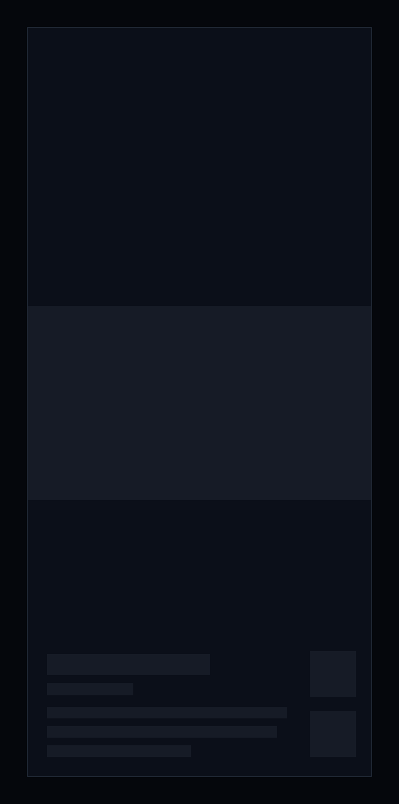

Figure 10.9: Zap loading, on a phone.

While zap picks its first cards, it shows nothing for the first 0.4 seconds,
and after that grey blocks in the shape of a card, as the design system's
loading pattern has them for a page: the clip in the middle, the title, the
year and the overview at the foot, and the squares of the two buttons beside
them. A computer and a TV show the same blocks in their own layout, and a
phone held sideways in the layout of figure 10.6.

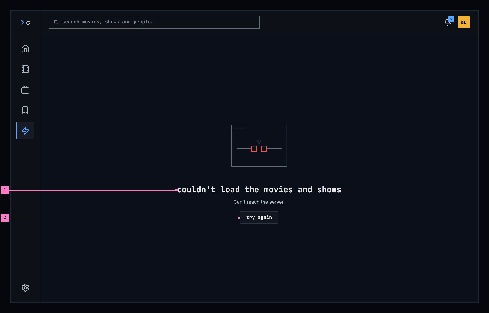

Figure 10.10: Zap when the titles couldn't load, on a computer.

1. **What couldn't load, and why**, the design system's empty state for an
   error, at its large size, in the card's place. Zap builds its cards from
   the library's movies and shows, so the title names those, and the sentence
   under it gives the reason as far as the app can tell. Figure 10.10 shows the
   case where the server didn't answer; [chapter 17](./errors.md) lists every
   cause and its sentence.
2. **try again**, a button of the standard kind, asks for the titles again.

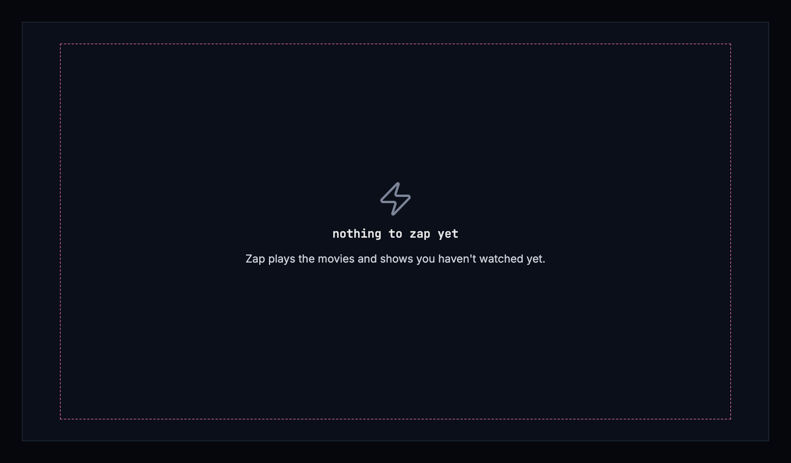

Figure 10.11: Nothing to zap, on a TV.

When the library has no title zap can play, zap says so and says what it
plays, so the person can tell why, with the design system's empty state of the
nothing-yet kind. It offers nothing to press; back returns home. Figure 10.11
shows it on a TV.

| State | What zap shows |
|---|---|
| Loading | Figure 10.9 |
| A card starting | The title's backdrop in the clip's place, as its light, without a word (section 10.7) |
| The titles couldn't load | Figure 10.10, with the sentence for the cause |
| Nothing to zap | Figure 10.11 |
| A title that can't be played | On a computer and a phone, the card keeps its backdrop and the next swipe moves on; on a TV, zap skips it (section 10.5) |
| A title too short for a scene | Left out (section 10.6.2) |
| Every title has had its card | No next card; the last one stays (section 10.6.1) |
| The browser blocked the sound | **unmute** in the middle of the card (section 10.3) |
| The phone app can't reach the server | Zap isn't offered: the app opens on downloads, and home with its zap entry isn't shown ([chapter 13](./downloads.md)) |

## 10.10 Words

| Where | Text |
|---|---|
| The view | zap |
| The card's buttons, for a screen reader and as the browser's tooltip | add to Watchlist · in your Watchlist · watch |
| The card's foot | “2010 ★ 7.4”, an episode “S01E03 2010 ★ 7.1” |
| Where the browser blocked the sound | unmute |
| The TV's Watchlist chip | add to Watchlist · in your Watchlist |
| The TV's keys, each key in its key cap | OK watch from here · down or CH+ next · CH− previous · up info · left mute, while muted unmute · right Watchlist |
| The titles couldn't load | couldn't load the movies and shows · Can't reach the server. · try again |
| Nothing to zap | nothing to zap yet · Zap plays the movies and shows you haven't watched yet. |
