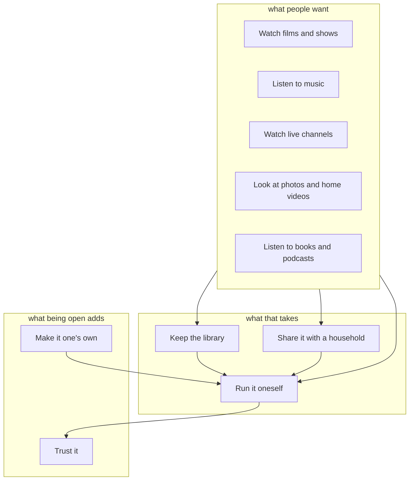

# What zaentrum is for

zaentrum is for a household that owns films, shows and music and wants to enjoy
them on every screen it has, from a server it runs itself. And it is open:
anyone can run it, look into it, change it and add to it.

Everything else in the specification follows from that, one step at a time:

1. **What people want.** To watch their films and shows, to listen to their
   music. These are the goals the platform exists for.
2. **What that takes.** To watch a film, the platform has to know the film: so
   a library has to be kept. A household is several people: so they have to be
   told apart. And somebody has to run it. These goals exist only because the
   first ones do.
3. **What being open adds.** Anyone can add what the platform leaves out, and
   anyone can check that it does what it says.
4. **How well.** Each goal has qualities: what "well" means for it, what
   measures that, what it is today, and the target.
5. **What the platform does for it.** The [capabilities](../capabilities/README.md):
   every area of them is for one goal, and so is every
   [expectation](../capabilities/expectations.md).
6. **What does it.** The components of the [architecture](../architecture/README.md)
   that serve those capabilities.

So a capability is there because a goal needs it, and a goal is met when what
is expected of it is there and its qualities reach their targets.

On the site the goals are also a [map](https://zaentrum.github.io/spec/goals/map/):
a band for each kind of goal, a card for each goal, and in it a tile for each
group of capabilities that is for it, coloured by how much of it is built,
whether it holds a capability nothing serves yet, or how deep it is specified.
Pointing at a goal draws the goals it needs and the goals that need it.

> **Written by hand, counted by a program.** The goals are
> [goals.csv](./goals.csv) and their qualities [qualities.csv](./qualities.csv);
> the picture, the tables and the numbers on this page are computed from them
> and from the two layers below. A check fails when an area, an expectation or
> a quality is for no goal, or a goal has nothing below it.

## How to read it

A goal is one of three kinds:

| Kind | Means |
|---|---|
| what people want | what a household does with its media: the reason the platform exists |
| what that takes | what has to be there for it: it serves no one by itself |
| what being open adds | what an open product owes the people who run, check and extend it |

An arrow in the picture leads from a goal to a goal it **needs**: watching
needs a library, a library needs a platform that runs.

A **quality** is one sentence of what a goal has to be met with, its kind after
ISO/IEC 25010, what measures it, and what it is **today**: a number where one
was measured, the plain fact where the documentation or the code states it,
“not measured” otherwise. A **target** that is not set is the owner's to set;
until then nothing says whether today is good enough.

## The cascade

<!-- generated: cascade -->

<!-- end: cascade -->

## The goals

<!-- generated: goals -->
| Goal | Is | Needs | Expected of it | Capabilities | Qualities |
|---|---|---|---|---|---|
| [Watch films and shows](#watch-films-and-shows) | what people want | [Keep the library](#keep-the-library), [Share it with a household](#share-it-with-a-household), [Run it oneself](#run-it-oneself) | 14: 9 partly, 4 not there, 1 not checked | 142 in 15 areas, 13 served by nothing | 5, 0 with a target |
| [Listen to music](#listen-to-music) | what people want | [Keep the library](#keep-the-library), [Share it with a household](#share-it-with-a-household), [Run it oneself](#run-it-oneself) | 1: 1 not there | 1 in 1 area | — |
| [Watch live channels](#watch-live-channels) | what people want | [Keep the library](#keep-the-library), [Share it with a household](#share-it-with-a-household), [Run it oneself](#run-it-oneself) | 1: 1 not there | 1 in 1 area | — |
| [Look at photos and home videos](#look-at-photos-and-home-videos) | what people want | [Keep the library](#keep-the-library), [Share it with a household](#share-it-with-a-household), [Run it oneself](#run-it-oneself) | 1: 1 not there | 1 in 1 area, 1 served by nothing | — |
| [Listen to books and podcasts](#listen-to-books-and-podcasts) | what people want | [Keep the library](#keep-the-library), [Share it with a household](#share-it-with-a-household), [Run it oneself](#run-it-oneself) | 1: 1 not there | 1 in 1 area, 1 served by nothing | — |
| [Keep the library](#keep-the-library) | what that takes | [Run it oneself](#run-it-oneself) | 12: 1 there, 5 partly, 5 not there, 1 decided otherwise | 50 in 3 areas, 10 served by nothing | 4, 0 with a target |
| [Share it with a household](#share-it-with-a-household) | what that takes | [Run it oneself](#run-it-oneself) | 11: 1 there, 5 partly, 5 not there | 13 in 1 area, 6 served by nothing | 2, 0 with a target |
| [Run it oneself](#run-it-oneself) | what that takes | [Trust it](#trust-it) | 12: 2 there, 6 partly, 4 not there | 54 in 4 areas, 11 served by nothing | 5, 0 with a target |
| [Make it one's own](#make-it-ones-own) | what being open adds | [Run it oneself](#run-it-oneself) | 4: 2 there, 1 partly, 1 not there | 11 in 1 area, 1 served by nothing | 1, 0 with a target |
| [Trust it](#trust-it) | what being open adds | — | — | — | 4, 0 with a target |
<!-- end: goals -->

<!-- generated: by-goal -->
## Watch films and shows

A household watches the films and shows it owns, on every screen it has. It needs: [Keep the library](#keep-the-library), [Share it with a household](#share-it-with-a-household), [Run it oneself](#run-it-oneself).

- **Expected of it:** [14 expectations](../capabilities/expectations.md#watch-films-and-shows): 9 partly, 4 not there, 1 not checked.
- **Capabilities:** [Connecting and signing in](../capabilities/chino.md#connecting-and-signing-in) (18), [The frame](../capabilities/chino.md#the-frame) (7), [Home](../capabilities/chino.md#home) (11), [Movies and shows](../capabilities/chino.md#movies-and-shows) (11), [The title page](../capabilities/chino.md#the-title-page) (11), [People](../capabilities/chino.md#people) (2), [Watchlist and lists](../capabilities/chino.md#watchlist-and-lists) (11), [Search](../capabilities/chino.md#search) (7), [Zap](../capabilities/chino.md#zap) (9), [The player](../capabilities/chino.md#the-player) (21), [Subtitles](../capabilities/chino.md#subtitles) (9), [Downloads and offline](../capabilities/chino.md#downloads-and-offline) (5), [Casting](../capabilities/chino.md#casting) (5), [Notifications](../capabilities/chino.md#notifications) (5), [Settings and account](../capabilities/chino.md#settings-and-account) (10).
- **Served by:** `chino-web`, `chino-mobile`, `chino-androidtv`, `chino-tizen`, `portal-api`, `chino-api`, `chino-stream`, `katalog-api`.

| It has to | Quality | Measured by | Today | Target | Says so |
|---|---|---|---|---|---|
| A title starts soon after it is chosen | performance efficiency | seconds from play to the first picture, on each kind of device | not measured | not set | — |
| A title plays through without stalling | reliability | stalls in an hour of playing | not measured; the apps send how playback went, and no page shows it | not set | — |
| It plays on the screens a household owns | compatibility | the kinds of device with an app, and where each is had | the web, Android and iOS phones and tablets, Android TV and Samsung TVs; none from a public store | not set | [The apps](../../docs/releases.md#the-apps) |
| It speaks the household's languages | interaction capability | the languages of the apps and the consoles | English | not set | — |
| People who see or hear less can use it | interaction capability | the accessibility level the apps meet | none is stated, and no app is checked with a screen reader | not set | — |

## Listen to music

It listens to the music it owns. It needs: [Keep the library](#keep-the-library), [Share it with a household](#share-it-with-a-household), [Run it oneself](#run-it-oneself).

- **Expected of it:** [1 expectation](../capabilities/expectations.md#listen-to-music): 1 not there.
- **Capabilities:** [Music](../capabilities/platform.md#music) (1).
- **Served by:** `katalog-api`.

No quality is stated for it yet.

## Watch live channels

It watches live channels, and what it recorded of them. It needs: [Keep the library](#keep-the-library), [Share it with a household](#share-it-with-a-household), [Run it oneself](#run-it-oneself).

- **Expected of it:** [1 expectation](../capabilities/expectations.md#watch-live-channels): 1 not there.
- **Capabilities:** [Live channels](../capabilities/platform.md#live-channels) (1).
- **Served by:** no component yet.

No quality is stated for it yet.

## Look at photos and home videos

It looks at its own photos and home videos. It needs: [Keep the library](#keep-the-library), [Share it with a household](#share-it-with-a-household), [Run it oneself](#run-it-oneself).

- **Expected of it:** [1 expectation](../capabilities/expectations.md#look-at-photos-and-home-videos): 1 not there.
- **Capabilities:** [Photos and home videos](../capabilities/platform.md#photos-and-home-videos) (1).
- **Served by:** no component yet.

No quality is stated for it yet.

## Listen to books and podcasts

It listens to audiobooks and podcasts, and reads books. It needs: [Keep the library](#keep-the-library), [Share it with a household](#share-it-with-a-household), [Run it oneself](#run-it-oneself).

- **Expected of it:** [1 expectation](../capabilities/expectations.md#listen-to-books-and-podcasts): 1 not there.
- **Capabilities:** [Audiobooks, podcasts and books](../capabilities/platform.md#audiobooks-podcasts-and-books) (1).
- **Served by:** no component yet.

No quality is stated for it yet.

## Keep the library

To watch or listen, the platform has to know what the household owns: take it in, describe it, and make it ready to play on every device. It needs: [Run it oneself](#run-it-oneself). Needed by: [Watch films and shows](#watch-films-and-shows), [Listen to music](#listen-to-music), [Watch live channels](#watch-live-channels), [Look at photos and home videos](#look-at-photos-and-home-videos), [Listen to books and podcasts](#listen-to-books-and-podcasts).

- **Expected of it:** [12 expectations](../capabilities/expectations.md#keep-the-library): 1 there, 5 partly, 5 not there, 1 decided otherwise.
- **Capabilities:** [The catalog](../capabilities/catalog.md#the-catalog) (22), [The library and its originals](../capabilities/catalog.md#the-library-and-its-originals) (14), [Preparing titles to play](../capabilities/catalog.md#preparing-titles-to-play) (14).
- **Served by:** `zaentrum-portal`, `portal-api`, `katalog-manager-ui`, `chino-api`, `live-worker`, `katalog-api`, `katalog-manager`, `zae`.

| It has to | Quality | Measured by | Today | Target | Says so |
|---|---|---|---|---|---|
| A new file is ready to watch without work | functional suitability | steps by hand from a file's arrival to a title that plays | one: a scan, started by hand | not set | [Getting content in](../../docs/self-hosting.md#getting-content-in) |
| A title is recognised for what it is | functional suitability | the share of titles matched without a hand | not measured | not set | — |
| Nothing of the library is lost | reliability | what a dead disk costs | the bundled databases: up to a day, by their daily dumps; the files: what their storage keeps | not set | [zaentrum-operator, README.md](https://github.com/zaentrum/zaentrum-operator/blob/main/operator/README.md#backups-of-the-bundled-postgres-specbackup) |
| A title keeps the picture and the sound that matter | functional suitability | what a package keeps of its original | every track in stereo, 5.1 where turned on, HDR10 or HLG; originals stay unless set to go | not set | [0015 the package is the master](../../docs/adr/0015-the-package-is-the-master.md) |

## Share it with a household

A household is several people: each signs in, sees what they may, and keeps a place, lists and a history of their own. It needs: [Run it oneself](#run-it-oneself). Needed by: [Watch films and shows](#watch-films-and-shows), [Listen to music](#listen-to-music), [Watch live channels](#watch-live-channels), [Look at photos and home videos](#look-at-photos-and-home-videos), [Listen to books and podcasts](#listen-to-books-and-podcasts).

- **Expected of it:** [11 expectations](../capabilities/expectations.md#share-it-with-a-household): 1 there, 5 partly, 5 not there.
- **Capabilities:** [People and roles](../capabilities/portal.md#people-and-roles) (13).
- **Served by:** `zaentrum-portal`, `portal-api`, `chino-api`.

| It has to | Quality | Measured by | Today | Target | Says so |
|---|---|---|---|---|---|
| A child sees only what it may | security | ways around a rating cap | one: switching accounts on a shared device asks for nothing | not set | — |
| Someone who forgot a password is back in soon | interaction capability | who resets it, and how | an admin, in the identity provider's console | not set | [First run](../../docs/self-hosting.md#first-run) |

## Run it oneself

Somebody runs it: installs it, makes it reachable, keeps it up to date, backs it up, and learns when it fails. It needs: [Trust it](#trust-it). Needed by: [Watch films and shows](#watch-films-and-shows), [Listen to music](#listen-to-music), [Watch live channels](#watch-live-channels), [Look at photos and home videos](#look-at-photos-and-home-videos), [Listen to books and podcasts](#listen-to-books-and-podcasts), [Keep the library](#keep-the-library), [Share it with a household](#share-it-with-a-household), [Make it one's own](#make-it-ones-own).

- **Expected of it:** [12 expectations](../capabilities/expectations.md#run-it-oneself): 2 there, 6 partly, 4 not there.
- **Capabilities:** [The portal's home](../capabilities/portal.md#the-portals-home) (6), [Apps, spaces, tiles and extensions](../capabilities/portal.md#apps-spaces-tiles-and-extensions) (5), [Running the platform](../capabilities/portal.md#running-the-platform) (19), [Installing and configuring](../capabilities/platform.md#installing-and-configuring) (24).
- **Served by:** `zaentrum-portal`, `portal-api`, `chino-api`, `chino-stream`, `live-worker`, `katalog-api`, `katalog-manager`, `katalog-ingest`, `zaentrum-operator`, `zae`.

| It has to | Quality | Measured by | Today | Target | Says so |
|---|---|---|---|---|---|
| Someone who has not seen it installs it in an evening | flexibility | time from nothing to a film on the TV | not measured; a TV or a phone needs a name and an https certificate of one's own first | not set | [A. One-command appliance](../../docs/self-hosting.md#a-one-command-appliance) |
| It runs on the machine a household has | flexibility | the processors it runs on, and the memory it takes | amd64 alone; no smallest machine is named | not set | [Appliance](../../docs/prerequisites.md#appliance) |
| An update never leaves it broken | reliability | what follows an update that fails | the platform checks itself after each update; nothing says how one is undone | not set | [updating](../../docs/updating.md) |
| After a dead disk it is back, with little lost | reliability | time and loss to a working platform on another machine | the bundled databases restore into the install that made them; there is no way to another machine | not set | [zaentrum-operator, README.md](https://github.com/zaentrum/zaentrum-operator/blob/main/operator/README.md#backups-of-the-bundled-postgres-specbackup) |
| Whoever runs it learns of a failure before the household does | reliability | how a failure reaches them | it is shown in the portal to whoever looks; nothing is sent | not set | — |

## Make it one's own

The platform leaves things out on purpose; anyone adds them as an addon, without changing the platform. It needs: [Run it oneself](#run-it-oneself).

- **Expected of it:** [4 expectations](../capabilities/expectations.md#make-it-ones-own): 2 there, 1 partly, 1 not there.
- **Capabilities:** [Addons](../capabilities/portal.md#addons) (11).
- **Served by:** `chino-web`, `chino-mobile`, `chino-androidtv`, `chino-tizen`, `zaentrum-portal`, `portal-api`, `chino-api`, `zaentrum-operator`, `zae`.

| It has to | Quality | Measured by | Today | Target | Says so |
|---|---|---|---|---|---|
| What an addon builds on stays as it is | compatibility | the promise on the platform's interfaces | none: the platform is at version 0, its resource at v1alpha1 | not set | [releases](../../docs/releases.md) |

## Trust it

Anyone can see what it does, check it, change it, and count on it staying open. Needed by: [Run it oneself](#run-it-oneself).

- **Expected of it:** nothing is listed yet.
- **Capabilities:** no area of the capability model is for it yet.

| It has to | Quality | Measured by | Today | Target | Says so |
|---|---|---|---|---|---|
| A security hole can be reported in private | security | a policy that says where and how | none in any repository | not set | — |
| Every image can be traced to the source it was built from | security | signatures, a record of each build, a list of what an image holds | none of the three | not set | — |
| What the apps send stays with whoever runs the server | security | what leaves the apps for anyone else | nothing to their publisher; an avatar service, a font service and Google Cast are called | not set | [What the apps send](../../docs/releases.md#what-the-apps-send) |
| A stranger can change it and have the change taken in | maintainability | a guide to contributing, and tests that run on every change | tests in the services' repositories; a guide in the operator's alone | not set | — |
<!-- end: by-goal -->

## The files

| File | Written by | Holds |
|---|---|---|
| [goals.csv](./goals.csv) | hand | one row a goal: its kind, the goals it needs, why it is one |
| [qualities.csv](./qualities.csv) | hand | one row a quality: its goal, its kind, what measures it, today, the target, where it is said |
| the picture and the tables of this page | `scripts/capabilities.py` | never edited by hand |

An area's goal is in [areas.csv](../capabilities/areas.csv), an expectation's
in [expectations.csv](../capabilities/expectations.csv).
