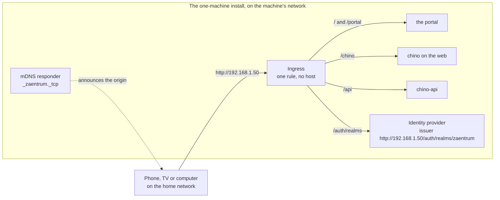

# Reaching it at home

This page specifies how the phones, TVs and computers of a household reach a
zaentrum that runs on one machine at home, with no domain name and no
certificate of the household's own: the address the platform answers at, how
people sign in there without https, where each app allows that and where it
refuses, and how the one-machine install announces itself so that the apps find
it. It also says what stays outside the home, and what stays as it is for an
install with a name and a certificate. The reasons, and the paths not taken,
are in [ADR-0016](../../docs/adr/0016-reaching-it-at-home.md).

The section As built describes what the platform does today. The sections after
it are the target, and the section Changes lists every difference between the
two as a numbered change. Only a change the owner has approved is built, one
change at a time; anything no change names stays as it is built.

## Purpose

A household that has not seen zaentrum before installs it on one machine and
wants a film on the TV the same evening. It owns no domain name and no
certificate, and it has not set up its router. Today that household gets as far
as the machine itself: no phone, no TV and no other computer can sign in.

This chapter is for whoever installs the platform, and for every person at home
who then opens it. It serves the goal “Run it oneself” (`run` in
[the goals](../goals/README.md)) and its quality “Someone who has not seen it
installs it in an evening” (`in-an-evening`), which today reads “a TV or a
phone needs a name and an https certificate of one's own first”.

It covers the capabilities `reach-on-home-network`, the server's side of
`find-server-on-network` (the apps' side is in
[chino, chapter 3](../chino/start.md)), `reach-from-outside`, and the home side
of `set-public-host` and `provide-certificates`.

Four terms are used throughout.

| Term | Meaning |
|---|---|
| The origin | The address everything of the platform is under, without a path: `http://192.168.1.50`. A platform has one. |
| Plain http | http without https: nothing is encrypted, and nothing proves which server answers. |
| A home address | An address only a home network reaches. The section Home addresses lists them. |
| The one-machine install | The whole platform in one container, the appliance of [self-hosting](../../docs/self-hosting.md#a-one-command-appliance). |

## As built

This section says what the code at each repository's main branch does as of
15 November 2026. Nothing in it was run: it is read from the code, and, where it
says so, from the documentation and the source of the identity provider and of
Kubernetes.

### The one-machine install

The one-machine install is one container: a single-node k3s (Kubernetes
1.31.5), the operator's install, and one `Zaentrum` resource that k3s applies
as it starts.

- **Its network.** The documented command, `docker run -d --privileged
  --restart unless-stopped --name zaentrum -p 80:80
  ghcr.io/zaentrum/appliance:latest`, names no network. The container is on
  Docker's own bridge network, behind the machine, with port 80 published. It
  sees its own address on that bridge, not the machine's.
- **Its host.** The resource sets `spec.hostname: zaentrum.localhost`. From
  that one field the chart derives the Ingress's host, the issuer
  `http://zaentrum.localhost/auth/realms/zaentrum` and the identity provider's
  `KC_HOSTNAME`. `identity.issuerScheme` keeps its default, `http`.
- **Inside the cluster.** The start script writes a DNS entry that leads the
  host to the ingress, so that the services check a token at the issuer a
  browser signed in at. The entry follows the environment variable
  `STUBE_ISSUER_HOST`, and is for `zaentrum.localhost` when that is not set.
  `network.issuerHostAliasIP`, the field a cluster install uses for the same
  end, is not set.
- **Another host** is set in two places that have to agree: `spec.hostname`,
  patched by hand, and `STUBE_ISSUER_HOST`, given when the container is
  created. When k3s applies the resource's file again, it puts
  `zaentrum.localhost` back. The identity provider reads its host as its pod
  starts (`KC_HOSTNAME`, from a ConfigMap), and nothing restarts it when the
  host changes: a new host reaches it at its next restart.
- **The first run** asks nothing. The start script prints “Zaentrum is up —
  open http://zaentrum.localhost”.
- **Its test.** The image's workflow boots the container as documented and
  asks four pages at `zaentrum.localhost` on the build machine itself. Nothing
  reaches it at another address.

### When a phone tries

The machine is at 192.168.1.50 on the home network, and a phone is on the same
network.

1. **The phone's browser, at the machine's address.** `http://192.168.1.50`
   answers 404. Docker hands the request to the ingress, whose one rule is for
   the host `zaentrum.localhost`.
2. **The address as the platform's host.** Setting `spec.hostname` to
   `192.168.1.50` doesn't help. The chart writes the address as the host of the
   Ingress's rule, and Kubernetes refuses an Ingress whose host is an IP
   address (“must be a DNS name, not an IP address”, in its validation at
   1.31.5). The platform then has no route at all.
3. **A name the phone can resolve**, set in both places. The portal's page
   loads, and the sign-in can't start. The sign-in library makes a check value
   (PKCE) with `crypto.subtle`, which a browser offers only on https and on
   `localhost`. The portal shows “sign-in failed: Crypto.subtle is available
   only in secure contexts (HTTPS).”, and the catalog console the same. chino
   shows “couldn't sign you in” and “The sign-in didn't finish.”, with that
   message under details.
4. **The phone app on Android.** The address ends at “Couldn't reach that
   server. Check the address and that it's online.” The app tries https, where
   nothing answers, and then http, which Android refuses for this app.
5. **The phone app on iOS.** The app tries https alone. An address typed with
   `http://` ends at “This app connects over HTTPS only; plain http works just
   for localhost. Use the server's https:// address.”
6. **The TV apps.** Android TV does as the phone app on Android, with the same
   sentence. The Samsung TV app tries https and then http, to any address.
   Whether a TV lets the plain-http request through was not checked. Either
   way the app says the same sentence: the ingress answers 404, as in step 1.

### The identity provider

- **What it is.** Keycloak 26.0.7 (`keycloak.image`). The realm `zaentrum` is
  imported from the chart at the first start. A Job, `zaentrum-realm`, writes
  the clients' return addresses, their flows and their mappers into a realm
  that exists. Neither touches how the realm treats plain http afterwards.
- **Plain http, by the address a request comes from.** The import sets
  `sslRequired: external`. By Keycloak's documentation and its source at
  26.0.7, the realm then accepts plain http from this machine, from a private
  IPv4 address (10.0.0.0/8, 172.16.0.0/12, 192.168.0.0/16), from a link-local
  address and from an IPv6 unique local address. Any other address gets “HTTPS
  required”: a page with HTTP 400 at sign-in, and HTTP 403 where an app
  exchanges a code.
- **Which address that is.** Keycloak takes the address the ingress passes on
  (`KC_PROXY_HEADERS: xforwarded`). The ingress of the one-machine install
  (Traefik 2.11.18, as k3s packages it) passes on the address its own
  connection comes from, never one a request claims. Its Service has
  Kubernetes' default policy for traffic from outside the cluster, and by
  Kubernetes' documentation a request then reaches the ingress with an address
  of the cluster's in place of its own. That is a private address. So as built
  the rule lets every plain-http request through, wherever it comes from.
- **Cookies.** The documentation of this repository says that Keycloak marks
  its sign-in cookies `Secure` over plain http too, so that only a `localhost`
  name can sign in. Keycloak 26.0.7 does that for `localhost` names alone. By
  its release notes for 26.0.0 (“Removal of legacy cookies”) and its source, a
  plain-http address that is not `localhost` gets the cookies without `Secure`
  and with `SameSite=Lax`. The documentation's statement was read off the https
  demo and the `localhost` install. Neither statement was tried on a home
  address.
- **Its own consoles.** Since 26.0 Keycloak's JavaScript library, which its
  admin console and its account console are built on, needs https or
  `localhost`. The admin console isn't on the origin by default: it answers
  through a port-forward at `http://localhost:8080`. No app links to the
  account console.

### The web apps today

| App | Signs in with | What else needs https or `localhost` |
|---|---|---|
| chino on the web | oidc-client-ts 3.5.0, through react-oidc-context 3.3.1 | `crypto.randomUUID()` in the player and in zap, which then can't open; the fingerprint of an automatic bug report (`crypto.subtle`), which is then not filed; the service worker, which the app registers only where the browser has one |
| The portal | the same two | copying an invite link (the page selects the link instead, to copy by hand) |
| The catalog consoles (one image, at `/katalog` and `/katalog-manage`) | the same two | nothing |

portal-api takes the platform's origin to be `https://` and the resource's
host, whatever the scheme is. It writes addon buttons' and notices' links with
it, so on a plain-http origin they lead nowhere. The setup checklist's step
**Devices** is done only on https; on plain http it says that phones and TVs
sign in over https only.

### The phone and TV apps today

| App | The system's setting | The app's own rule | A plain-http server |
|---|---|---|---|
| Phone app, Android | `network_security_config.xml`: `cleartextTrafficPermitted="false"` for every host, the system's certificate authorities | none: plain http is tried for any address; the sign-in library (AppAuth 0.11.1) exchanges the code over https only | “Couldn't reach that server. Check the address and that it's online.” |
| Phone app, iOS | `NSAllowsLocalNetworking: false`, with one exception, `localhost` | plain http to `localhost` and `127.0.0.1` alone | “This app connects over HTTPS only; plain http works just for localhost. Use the server's https:// address.” |
| Android TV | as the phone app on Android | none | as the phone app on Android |
| Samsung TV | `config.xml` names no access rule and no content security policy; it asks for the internet privilege | none: https, then http, for any address | not checked on a TV |

The apps' targets are Android API level 36 (phone) and 35 (TV), and iOS 15. The
comment beside the iOS setting says the system's rule doesn't cover IP
addresses. By Apple's documentation that holds up to iOS 16: from iOS 17 the
system refuses plain http to an IP address unless `NSAllowsLocalNetworking` is
on, or the address is listed.

### Finding the server today

Nothing announces a server on the network, and no app looks for one: every app
asks for an address. The one-machine install couldn't announce itself as it is
started today. An mDNS announcement stays on the network it is sent on, which
for this container is Docker's bridge, not the home network.

### A name and a certificate today

An install with a name of its own and a certificate signs in from every device
today. The fields are `spec.hostname`, and either `spec.tls` (a Secret, or a
cert-manager issuer) or `identity.issuerScheme: https` with https ended in
front of the platform; `network.issuerHostAliasIP` leads the services to that
issuer inside the cluster. The one-machine install takes five steps to get
there, described only in the image's own README: the container is created anew
with port 443 and `STUBE_ISSUER_HOST`, the certificate goes in as a Secret, and
`spec.hostname` and `spec.tls` are patched.

## The home profile

The home profile is one way a platform is reached: one origin, plain http, at
a home address. It is profile B1 of
[ADR-0008](../../docs/adr/0008-single-origin-deployment-profiles.md) (the
machine's address) and its profile C (a `.local` name), made to work.

- **One origin.** `http://192.168.1.50`: http, port 80, no path of its own.
  Everything is under it by path, as today: `/portal`, `/chino`, `/katalog`,
  `/katalog-manage`, `/api` and `/auth`. The issuer is
  `http://192.168.1.50/auth/realms/zaentrum`.
- **A home address.** The origin's host is a private or link-local IPv4
  address, or a `.local` name. An address takes no certificate: https needs a
  name (section With a name and a certificate of one's own).
- **Nothing of the household's own.** No domain name, no certificate, no DNS,
  no router setup.
- **The default of the one-machine install.** Started as the documentation
  says, the one-machine install finds the machine's address and answers there
  (section The address).
- **A cluster install** takes the profile when `spec.hostname` is such an
  address or name and `identity.issuerScheme` is `http`. It is never its
  default, and it announces nothing.

Where `spec.hostname` is an IPv4 address, the Ingress's rule names no host,
because Kubernetes allows none that is an address. The paths are the same. Such
an Ingress answers every request no other Ingress names, so it is for a cluster
whose ingress serves this platform alone, as the one-machine install's does.

The path of a request in the home profile:

The other profiles of ADR-0008 stay as they are built. Profile A, this machine
only at `http://zaentrum.localhost`, is what the one-machine install does where
it can't find a home address. Profile D, a name and a certificate, is the way
to https. Profile B2, a public name that leads to a private address, is not
made to work: its name is no home address.

## Home addresses

Plain http is used with a home address, and with nothing else.

| A home address | Which |
|---|---|
| A private IPv4 address | 10.0.0.0/8, 172.16.0.0/12, 192.168.0.0/16 |
| A link-local address | 169.254.0.0/16, and fe80::/10 |
| An IPv6 unique local address | fc00::/7 |
| A name of the home network | a name whose last part is `local`, such as `zaentrum.local` |
| This device | 127.0.0.0/8, ::1, `localhost`, and a name under `.localhost` |

Nothing else is a home address: no public address, no address of the shared
range 100.64.0.0/10, and no other name, also not one that leads to a private
address. A name is checked as it is written, never by what it resolves to.

Each part of the platform applies the rule to the address it deals with.

| Who | Checks | Where that is no home address |
|---|---|---|
| The phone app, Android TV, Samsung TV | the address of the server, and the address of its sign-in | the app uses https alone, and says why when nothing answers there (section The phone and TV apps) |
| The web apps | the address of their own page | the app starts no sign-in over plain http, and says why (section The web apps) |
| The bundled identity provider | the address a request comes from | it refuses the sign-in over plain http, with the platform's sentence (section Signing in) |
| The one-machine install | the address it is about to answer at | it answers on this machine only (section The address) |

## The address

The one-machine install has one value for where it is reached: a host. The
origin, the routes and the issuer all come from it, so they can't disagree.

### Where the value comes from

In this order:

1. **`ZAENTRUM_ADDRESS`**, an environment variable given when the container is
   created (`-e ZAENTRUM_ADDRESS=192.168.1.50`). While it is set, it is the
   address at every start. `STUBE_ISSUER_HOST`, the variable the start script
   read before, is read the same way where `ZAENTRUM_ADDRESS` is not set.
2. **The address kept in the install**: the file
   `/var/lib/rancher/k3s/zaentrum/address`, one line, in the volume that holds
   the cluster.
3. **At the first start**, with neither: the address the start script finds.
   It keeps it in that file.

The start script finds an address this way. It takes the IPv4 address of the
interface that carries the machine's default route, when two things hold: the
container is on the machine's network (that interface is not one end of a
virtual pair a container runtime made), and the address is private (10.0.0.0/8,
172.16.0.0/12 or 192.168.0.0/16). Otherwise it takes `zaentrum.localhost`.

| The value | The origin | Who reaches it |
|---|---|---|
| A private or link-local IPv4 address | `http://192.168.1.50` | every device on the home network |
| A `.local` name | `http://zaentrum.local` | the devices that resolve `.local` names; the one-machine install answers for the name itself (section Finding the server) |
| `localhost`, or a name under `.localhost` | `http://zaentrum.localhost` | this machine only, as built |
| Any other name | `https://media.example.org`, once `spec.tls` names a certificate; until then plain http at that name, where nobody signs in | as built (section With a name and a certificate of one's own) |
| Anything else: a public address, an IPv6 address, a value with `http://`, a port or a path | none | refused, with a sentence of section Words |

A value the start script refuses changes nothing: the address kept in the
install stays, and with none kept the install answers at
`http://zaentrum.localhost`.

### What the value sets

- **The resource.** The start script sets `spec.hostname` to the host before
  the platform starts, and again whenever the value changes, so that nothing
  puts an older host back. It writes the host into the resource's file in
  k3s's manifest directory, as the image has that file today; once the image
  keeps no such file ([Installing and updating](./install.md)), it sets that
  one field of the resource. From `spec.hostname` the operator derives the
  Ingress, the issuer and `KC_HOSTNAME`, and its realm Job the clients' return
  addresses, as built. No other field is set: `identity.issuerScheme` keeps
  `http`.
- **Inside the cluster.** The services have to reach the issuer at the origin.
  For a name, the start script writes the DNS entry it writes today. For an
  address the cluster's node doesn't hold (the container on Docker's own
  network), it names the address on the ingress's Service as an external
  address, so that a request to it stays inside.
- **The address a request comes from.** The start script sets the ingress's
  Service to keep it (`externalTrafficPolicy: Local`, in the configuration k3s
  takes for its bundled ingress), so that the identity provider sees it.
- **Announcing**, where the section Finding the server says so.

### The origin stays

The origin never changes by itself. Once it is kept in the install, a start
doesn't look for another address.

The machine can lose the address: a router may hand it another one. The start
script checks at each start, and every 60 seconds after, that the machine still
holds the origin's address (on the machine's network only). When it doesn't,
the script says so in the container's log, once, and stops announcing. Nothing
else changes: when the address comes back, every device works as before. The
first-run text asks for the address to be reserved in the router.

### Changing it

`zaentrum-address` is a command in the container.

| Command | What it does |
|---|---|
| `zaentrum-address` | prints the origin, where the value comes from, and whether the install is announced |
| `zaentrum-address 192.168.1.60` | checks the value as the table above does, keeps it, and sets what the value sets, without a restart; on the machine's network it refuses an address the machine doesn't hold |
| `zaentrum-address auto` | finds the machine's address again, as at the first start, and keeps it |

While `ZAENTRUM_ADDRESS` is set, the command changes nothing and says so. A new
origin is a new issuer: everyone signs in again, and every phone and TV app is
given the new address (change server, [chino, chapter 16](../chino/settings.md)).
The identity provider restarts with the new host: the operator's chart makes a
change of host restart it, which today it doesn't.

### What the machine needs

The home profile is for a machine that runs its containers itself: a Linux
machine with Docker or Podman. The container is started on the machine's
network (`--network host`), by the container runtime's own command or by the
install command of [Installing and updating](./install.md). That takes:

- ports 80 and 443 free for the ingress, and 6443 and 10250, which k3s opens
  for itself (its API and its node agent);
- where the machine has a firewall of its own: TCP port 80 and UDP port 5353
  let in, and the rules k3s's documentation names for its own traffic.

Where Docker runs containers apart from the machine's own network interfaces,
as its desktop edition does, or where the container is kept on Docker's own
network by choice, it is started with port 80 published (`-p 80:80`) and the
machine's address given as `ZAENTRUM_ADDRESS`. The container can't find that
address there; whoever starts it can. The install then answers at the address
and is not announced. Started with neither, it answers on this machine only,
as built.

## Signing in

The bundled identity provider signs people in over plain http at a home
address as it is shipped. What has to hold:

| Setting | Where | Value | Today | Change |
|---|---|---|---|---|
| The image | `keycloak.image` | `quay.io/keycloak/keycloak:26.0.7` | the same | none; what follows is that version's behaviour, and a newer image is checked against this table before it is taken |
| `sslRequired` of the realm `zaentrum` | the realm import | `external` | the same | the realm Job writes `external` where it reads `none` |
| `KC_HOSTNAME` | the chart, from `spec.hostname` and the scheme | `http://192.168.1.50/auth` | derived the same way | none |
| `KC_HTTP_ENABLED`, `KC_HOSTNAME_STRICT` | the chart | `true`, `false` | the same | none |
| `KC_PROXY_HEADERS` | the chart | `xforwarded` | the same | none; the ingress passes on the address a request comes from (section The address) |
| The sign-in cookies | Keycloak itself | without `Secure`, with `SameSite=Lax`, at a plain-http address that is not `localhost` | Keycloak 26.0.7's own behaviour | nothing to set |
| The refusal's sentence | the sign-in theme `zaentrum` | the sentence of section Words | Keycloak's “HTTPS required” | the theme carries the sentence (`httpsRequiredMessage`) |

- **From a home address**, a person signs in on the sign-in page as on https:
  the form, the first administrator's change of password, and the page a TV's
  code is typed into are all pages the identity provider makes itself.
- **From any other address**, the identity provider refuses plain http: the
  sign-in page shows the sentence of section Words with HTTP 400, and an app
  that exchanges a code gets HTTP 403. This is Keycloak's rule for
  `sslRequired: external`. It holds where the identity provider sees the
  address a request comes from.
- **`sslRequired` is never `none`.** With `none`, a sign-in over plain http
  would be taken from anywhere.
- **Keycloak's own consoles** don't run on a plain-http origin outside
  `localhost`. The admin console keeps answering through the port-forward at
  `http://localhost:8080`, as built. `identity.exposeAdminConsole: true` puts
  it on the origin, where it doesn't start on the home profile.
- **An external identity provider** (`identity.mode: external`) has its own
  rules. The apps apply the rule of section Home addresses to its address as
  they do to the bundled one's.

## The web apps

chino on the web, the portal and the catalog consoles work on a plain-http
origin at a home address: sign-in, and every screen. Each thing a browser
offers only on https or `localhost` has a named way without it.

| What the browser doesn't offer there | Used by | On plain http |
|---|---|---|
| `crypto.subtle`, for the check value of a sign-in (PKCE, SHA-256) | all three | the app's own SHA-256, in its code, made available as `crypto.subtle.digest` for `SHA-256` before the sign-in library runs; nothing else of `crypto.subtle` is added; its tests use the standard's example values |
| `crypto.randomUUID()` | chino: the player, zap | an identifier of the same form made from `crypto.getRandomValues()`, which every page has |
| `crypto.subtle`, for a bug report's fingerprint | chino | the same SHA-256 |
| A service worker | chino | none runs: the page is asked of the server at each load, as its server already serves it; no notice of a new version shows, and nothing is kept for a start without the network |
| The clipboard | the portal: an invite link | the link is selected, to copy by hand, as built |

Two rules hold in all three.

1. **The page's own address.** Where the page is on plain http and its host is
   no home address, the app starts no sign-in. It shows a page of its own,
   titled **can't sign in here**, with the sentence of section Words and no
   button. In the portal and the catalog consoles it is the design system's
   empty state of its error kind, at its large size. A page of the portal
   that takes a password without a sign-in, the invite page today, follows the
   same rule.
2. **On https nothing changes.** The app's own SHA-256 and identifiers are used
   only where the browser offers none.

The portal's web server adds one thing. Where the origin's host is an IPv4
address, the Ingress answers every name the machine is reached by, and a
sign-in under another name would be refused. So the portal's web server answers
a request whose host is not the origin's with a redirect (HTTP 302) to the same
path at the origin, for every path but `/healthz`. The chart gives it the
origin as `PUBLIC_ORIGIN`. `http://localhost` on the machine itself and
`http://zaentrum.local` then lead to the origin. Where the origin's host is a
name, nothing is redirected.

portal-api takes the platform's origin from `PUBLIC_ORIGIN` too, with its
scheme, for the links it writes for addon buttons and notices.

## The phone and TV apps

Each app allows plain http to a home address, and to nothing else. The systems'
settings can't carry that rule everywhere: Android's network security
configuration takes names, not address ranges, and iOS takes ranges only from
iOS 17. So the system's setting lets plain http through, and the app itself
decides.

### The rule in each app

1. **An address a person enters** is tried over https first, as built. It is
   tried over plain http only when its host is a home address. Where https
   doesn't answer and plain http is not allowed, the field says the first
   sentence of section Words.
2. **The server's sign-in.** The address the server names for its sign-in
   (`oidcIssuer` in `GET /api/config`) follows the same rule. Where it is plain
   http and no home address, the app doesn't connect, and the field says the
   second sentence.
3. **Every request after that.** The app's clients (for the API, the images,
   the player, the titles kept on the phone, and the exchange of a sign-in's
   code) refuse a plain-http request to a host that is no home address.
4. **A server found on the network** is treated as an address a person entered
   (section Finding the server).

The rule is the table of section Home addresses, on the host as it is written.
In the phone app it is one function in the code Android and iOS share. The two
sentences join the reasons the check of an address gives
([chino, chapter 3](../chino/start.md)), and take the place of the phone app's
sentence about https today.

### What each system needs

| App | The system's setting | Today | Target |
|---|---|---|---|
| Phone app, Android | `network_security_config.xml`, the base configuration | `cleartextTrafficPermitted="false"` | `cleartextTrafficPermitted="true"`; the certificate authorities stay the system's; the debug build needs no file of its own |
| Phone app, Android | the sign-in library's connections | AppAuth's own, https only | connections that follow the rule, so that the code is exchanged at a plain-http home address |
| Phone app, iOS | `NSAppTransportSecurity` | `NSAllowsLocalNetworking: false`, an exception for `localhost` | `NSAllowsLocalNetworking: true`; `NSAllowsArbitraryLoads` stays `false` |
| Phone app, iOS | `NSLocalNetworkUsageDescription` | none | the sentence of section Words, which iOS shows when it asks whether the app may use the local network |
| Android TV | `network_security_config.xml` | as the phone app | as the phone app |
| Samsung TV | `config.xml` | no access rule | unchanged; should a TV need an access rule to reach a plain-http address, it is `<access origin="*" subdomains="true"/>` |

A build for Android that targets API level 37 or later needs the system's
permission for the local network (`ACCESS_LOCAL_NETWORK`) before it connects to
a home address. Today's targets, 36 and 35, need none.

On a TV, signing in with a code shows the sign-in's address as the server
sends it, which on the home profile starts with the machine's address.

## Finding the server

The one-machine install announces itself on the home network by mDNS, so that
an app can list the servers it finds instead of asking for an address.

### What is announced

| Part | Value |
|---|---|
| Service type | `_zaentrum._tcp`, in the domain `local` |
| Instance name | `zaentrum`; with a second install on the network, the usual renaming gives `zaentrum (2)` |
| Host | `zaentrum.local`, with the machine's IPv4 address; where that name is taken, `zaentrum-2.local` |
| Port | 80; 443 where the origin is https |
| Text record | `txtvers=1`; `origin=http://192.168.1.50`, the platform's origin; `path=/`, the path the platform is under |

The announcement follows the rules of mDNS and DNS-based service discovery
(RFC 6762 and RFC 6763): it checks the names are free before it uses them,
answers questions for them, and says goodbye when it stops. It is on IPv4.

### When

The one-machine install announces itself when all of this holds:

- the container is on the machine's network;
- the origin is not a `localhost` name;
- the machine holds the origin's address (for an origin that is an address);
- `ZAENTRUM_ANNOUNCE` is not `off`. The variable is given when the container is
  created; its values are `on` and `off`, and `on` is the default.

Where the origin is a `.local` name, that name is the announced host. Should
another machine already answer to it, the install is not announced under
another name: it says so in its log, and the name has to be changed.

A responder built into the one-machine image does this. The start script
starts it and stops it.

A cluster install announces nothing. Its address is entered in each app.

### What an app may rely on

- `origin`, followed by `path`, is the address to connect to, as if a person
  had entered it. The app checks it as it checks any address
  ([chino, chapter 3](../chino/start.md)), and applies the rule of section Home
  addresses to it: a plain-http origin that is no home address is not listed.
- An announcement proves nothing. Anyone on the network can send one. The list
  shows the origin's host beside the name, and the person chooses.
- The web needs no list: it is opened at its server's address.
- Two systems ask something of an app that looks for servers. iOS wants the
  service type named in the app's `NSBonjourServices`. Android, for a build
  that targets API level 37 or later, wants the local network permission, or
  the system's own picker of a found service. What the apps show is chapter
  3's.

## Outside the home

The home profile ends at the home. Its origin is a home address, which leads
nowhere from outside; the apps and the web apps use plain http with a home
address alone; and the identity provider refuses a sign-in over plain http
from an address that is not private.

A household that wants its platform outside has two ways.

1. **A name and a certificate of its own**, as built (the next section).
2. **An addon that brings a tunnel.** The platform runs no service of its own
   for this, and none is part of it. What it offers such an addon is what it
   offers every addon, and the rule of this chapter:

| The addon | What the platform offers it | What follows |
|---|---|---|
| makes a device that is away a member of the home network, so that the device reaches the origin's own address | a workload in the platform's namespace that connects outwards ([an addon chart](../../docs/extending/charts.md#3-guardrails)), and a setup checklist for its own sign-in | nothing of the platform changes: the origin, the sign-in and the apps' rule stay, because the address is the same home address |
| publishes the platform under a public https name of its own | the same; and the platform's host, `spec.hostname`, with `identity.issuerScheme: https` | that name becomes the platform's one origin, for the home's devices too, and the plain-http origin goes |

The platform offers neither kind a second origin beside the first, and no
workload on the machine's network or with a network device of its own: an
addon's chart is refused both. A tunnel that needs either is installed on the
machine, beside the platform.

## With a name and a certificate of one's own

Nothing changes for an install with a name and a certificate. It is the way to
https at home too.

| What | As built, and kept |
|---|---|
| The host | `spec.hostname`, a name that leads to the platform from every device |
| The certificate | `spec.tls.secretName`, a Secret the admin brings, or `spec.tls.issuerRef`, a cert-manager issuer that writes it; or https ended in front of the platform, with `identity.issuerScheme: https` |
| Inside the cluster | `network.issuerHostAliasIP`, so that the services reach the https issuer |
| The apps | https at any address, with a certificate the device trusts; the Android apps trust the system's certificate authorities |
| The `TLS` condition | says how the host is served, and what is wrong with a certificate |

The one-machine install gets there with the same value as the home profile:
`zaentrum-address media.example.org` sets the host and the entry inside the
cluster together, where today two places have to agree. The certificate goes in
as a Secret and `spec.tls` names it, as built. On the machine's network port
443 is already open, so the container isn't created anew.

## What plain http costs

The home profile trades encryption for having nothing to set up. The
documentation, the first run's text and the setup checklist say so in these
terms:

- **Anyone on the home network can read what crosses it**: a guest on the
  Wi-Fi, or a device that somebody else controls. That includes every password
  as it is typed, the first administrator's too, and what each person watches.
  Such a device can also change what crosses, or answer in the server's place.
- **It stays inside the home.** The origin is a home address, and nothing of
  the platform uses plain http with any other.
- **The browser says “Not secure”**, and it is right.
- **Some things a browser offers only on https are missing**: the section The
  web apps lists them.
- **A household that wants https at home** gives the platform a name and a
  certificate.

## The sign-in pages and the mails

- **Which language.** A sign-in page speaks the language the app named when it
  sent the person there, else the first of the browser's languages the
  platform ships, else English. The page lists the shipped languages at the
  foot of its card, each by its own name; the one it speaks is not a link.
- **The bundled identity provider.** The realm has the shipped languages
  switched on, with English as its default. The page the platform's theme
  draws takes every word from message files the chart builds from the message
  catalogue, one for each language, and tells the browser its language. The
  pages the theme doesn't draw (the code a TV shows, a forgotten password, an
  error) and the mails the identity provider sends are the provider's own, in
  its own words for the same language.
- **An identity provider the platform doesn't run.** The apps name their
  language to it; the pages and the mails are that provider's.
- **A mail of the platform** is written by the service that sends it, from the
  message catalogue, in the language of the person it goes to: the language the
  account chose; for someone without an account, the language of whoever
  causes the mail; else English.

## Changes

Every difference between the section As built and the target is one change in
the table. A change names where it is built, what is there today and the
target, with the section that sets it out; it is built as its row says, and
nothing else changes with it. Each change starts as proposed. A target that
starts with “Recommended” holds a choice that is the owner's, or takes away
something an app does today. ADR-0016 names a short trial that comes before
N.C1 to N.C12.

| No. | Change | Where | Today | Target | Status |
|---|---|---|---|---|---|
| N.C1 | An address as the platform's host | Operator | the chart writes `spec.hostname` as the host of the Ingress's rule, and Kubernetes refuses a host that is an IP address, so a platform whose host is an address has no route; the identity provider reads the host as its pod starts and nothing restarts it when the host changes; the `TLS` condition says of plain http that a browser signs in only on a localhost name | where `spec.hostname` is an IPv4 address the Ingress's rule names no host, with the same paths, and a name keeps its host rule (section The home profile); the identity provider's Deployment carries the host in its own definition, so that a change of host restarts it; the chart gives the portal's web server and portal-api the origin it derives, as `PUBLIC_ORIGIN`; the `TLS` condition has the reason `HomeNetwork` for plain http at a home address, and its sentences are those of section Words | approved |
| N.C2 | A sign-in over plain http is refused from outside, in the platform's words | Operator | the realm is imported with `sslRequired: external` and nothing keeps it so; where it refuses plain http, it shows Keycloak's own page, “HTTPS required” | the realm Job writes `sslRequired: external` where it reads `none`; the sign-in theme `zaentrum` carries the sentence of section Words as `httpsRequiredMessage`; nothing else of the identity provider is set (section Signing in) | approved |
| N.C3 | chino on the web on plain http | Web | on an http page that isn't `localhost` the sign-in can't start, because the sign-in library needs `crypto.subtle`, and the page shows “couldn't sign you in”; the player and zap call `crypto.randomUUID()`, which such a page lacks; automatic bug reports aren't filed | section The web apps: the app's own SHA-256 for the sign-in's check value and for a bug report's fingerprint, and identifiers from `crypto.getRandomValues()`, each only where the browser offers none; before a sign-in, plain http at a host that is no home address shows **can't sign in here** with the sentence of section Words | approved |
| N.C4 | The portal on plain http | Portal | on an http page that isn't `localhost` the portal shows “sign-in failed: Crypto.subtle is available only in secure contexts (HTTPS).”; its web server answers every host alike | section The web apps: the app's own SHA-256 for the sign-in's check value where the browser offers none; before a sign-in, and on a page that takes a password without one, plain http at a host that is no home address shows the design system's empty state **can't sign in here**; the web server redirects a request for another host to the origin (HTTP 302, every path but `/healthz`) where `PUBLIC_ORIGIN` names an origin whose host is an IPv4 address | approved |
| N.C5 | The catalog consoles on plain http | Catalog console | on an http page that isn't `localhost` both consoles show “sign-in failed: Crypto.subtle is available only in secure contexts (HTTPS).” | section The web apps: the app's own SHA-256 for the sign-in's check value where the browser offers none; before a sign-in, plain http at a host that is no home address shows the design system's empty state **can't sign in here** | approved |
| N.C6 | The platform's origin with its scheme, and the devices step | Server, Portal | portal-api takes the origin to be `https://` and the resource's host, so addon buttons' and notices' links are https on a plain-http platform; the setup checklist's **Devices** is done on https alone | portal-api takes the origin from `PUBLIC_ORIGIN`, and as today where it is not set; `GET /api/portal/setup` answers `devices.home: true` and the state done where the origin is plain http at a home address that is not this device's own, and the step says the sentences of section Words | approved |
| N.C7 | The phone app on Android reaches a home address | Phone app | Android refuses plain http for the whole app (`cleartextTrafficPermitted="false"`), the app's own rule allows it for any address, and the sign-in library exchanges the code over https alone; a plain-http server reads “Couldn't reach that server. Check the address and that it's online.” | section The phone and TV apps: `cleartextTrafficPermitted="true"` with the system's certificate authorities; the rule of section Home addresses in the check of an address, for the server's sign-in and in every client; the code exchanged over a connection that follows the rule; the two sentences of section Words | approved |
| N.C8 | The phone app on iOS reaches a home address | Phone app | `NSAllowsLocalNetworking: false` with an exception for `localhost`, and the app's own rule allows plain http to `localhost` and `127.0.0.1` alone; it says “This app connects over HTTPS only; plain http works just for localhost. Use the server's https:// address.” | section The phone and TV apps: `NSAllowsLocalNetworking: true`; the same rule as on Android, from the shared code; `NSLocalNetworkUsageDescription` with the sentence of section Words; the two sentences of section Words in place of today's | approved |
| N.C9 | Android TV reaches a home address | Android TV | Android refuses plain http for the whole app, and the app has no rule of its own; a plain-http server reads “Couldn't reach that server. Check the address and that it's online.” | section The phone and TV apps: `cleartextTrafficPermitted="true"` with the system's certificate authorities; the rule in the check of an address, for the server's sign-in and in every client; the two sentences of section Words | approved |
| N.C10 | The Samsung TV app keeps plain http to home addresses | Samsung TV | the app tries https and then plain http for any address, with no rule; `config.xml` names no access rule | Recommended: the rule of section The phone and TV apps in the check of an address and for the server's sign-in, with the two sentences of section Words; `config.xml` unchanged, unless a TV needs the access rule that section names; the other choice leaves the app trying plain http to any address | approved |
| N.C11 | The one-machine install answers at the machine's address | Images | the image's resource names `zaentrum.localhost`; another host is patched into the resource by hand, and put back when k3s applies its file again; the start script reads `STUBE_ISSUER_HOST` for the DNS entry inside the cluster alone; the container, on Docker's own network, sees no address of the machine; the ingress's Service hides the address a request comes from, so the identity provider's rule refuses nobody | section The address, in the one-machine image (`deploy/allinone` of zaentrum-operator): one value, from `ZAENTRUM_ADDRESS`, the file kept in the install, or found at the first start on the machine's network; it sets the resource's host, the way to the origin inside the cluster and the ingress's `externalTrafficPolicy` together; the command `zaentrum-address`; the check every 60 seconds; the lines of section Words; the image's workflow also boots it on the runner's own network and signs in at the runner's address from outside the container | approved |
| N.C12 | The one-machine install announces itself | Images | nothing announces a server; on Docker's own network an announcement doesn't reach the home network | Recommended: section Finding the server: a responder in the one-machine image announces `_zaentrum._tcp` with the origin and the path, on by default (`ZAENTRUM_ANNOUNCE`); the other choice is off by default | approved |
| N.C13 | The doctor's words for a home address | CLI | `zae doctor` warns “instance is plain http” on any plain-http address, and where a sign-in loses its cookies it says the identity provider marks them `Secure` and that nobody can sign in over plain http | the lines of section Words: plain http at a home address passes; plain http at any other address warns, and names the apps' and the identity provider's refusal; the sentence about `Secure` cookies goes | approved |
| N.C14 | The documentation says how a home is reached | Docs | [self-hosting](../../docs/self-hosting.md#a-one-command-appliance), [prerequisites](../../docs/prerequisites.md#dns--tls), [troubleshooting](../../docs/troubleshooting.md#8-sign-in-fails-over-plain-http-cookie-not-found) and [operator](../../docs/operator.md) say plain http signs in on `localhost` alone, because of `Secure` cookies; the one-machine install's steps to a name and a certificate are in the image's README alone | self-hosting's first section gives the command on the machine's network with a named volume, the first run, `ZAENTRUM_ADDRESS`, `zaentrum-address`, what the machine needs, what plain http costs in the words of that section, and the steps to a name and a certificate; prerequisites and operator say https is needed outside a home address; troubleshooting's entry 8 names the causes that remain; the limit `https-to-sign-in`, and the note at the head of ADR-0008, are rewritten once the changes are built | approved |
| N.C15 | The sign-in pages and the mails in the person's language | Operator | the chart's theme draws the sign-in page with its words typed into the template, in English; the other pages of a sign-in (the code a TV shows, a forgotten password, an error) are the identity provider's own; the realm has no languages switched on, so all of them are English; the platform sends no mail | the section The sign-in pages and the mails, and ADR-0023, parts 3 and 4: in the bundled mode the realm has the shipped languages switched on, English its default; the theme's page takes every word from message files the chart builds from the message catalogue, one a language, says its language in `lang`, and lists the languages by their own names at the foot of its card; a page speaks the language the app named (`ui_locales`), else the browser's, else English; the pages the theme doesn't draw and the identity provider's mails are the provider's own, in its words for that language; a mail the platform sends is written from the message catalogue in the language of the person it goes to: the account's choice, else the language of whoever causes the mail, else English; with an identity provider the platform doesn't run, `ui_locales` is passed and nothing more | approved |

## States

| State | Where | What happens, and what is shown |
|---|---|---|
| The first start, on the machine's network, a private address found | the one-machine install's log | the platform answers at the address; the four lines of section Words: where it answers, what plain http means, to reserve the address, how to change it |
| The first start, on Docker's own network, no address given | the log | as built, at `http://zaentrum.localhost`; a line says how phones and TVs reach it |
| The first start, the machine's address is not private | the log | at `http://zaentrum.localhost`; a line says why |
| An address given that the start script refuses | the log | nothing changes; a line names the value and why |
| The machine no longer holds the origin's address | the log | one line; announcing stops; the origin stays; one line when the address is back |
| The `.local` name of the origin is taken | the log | one line; nothing is announced |
| `zaentrum-address`, no value | the command | three lines: the origin, where the value comes from, whether it is announced |
| `zaentrum-address` with a value it takes | the command | one sentence; the identity provider restarts; everyone signs in again |
| `zaentrum-address` with a value it refuses | the command | one sentence, by reason: not a home address or a name; not an address of this machine; given with `ZAENTRUM_ADDRESS`; not an address or a name at all |
| A page on plain http at a home address | the web apps | every screen as on https; the browser's own “Not secure”; no service worker |
| A page on plain http at a host that is no home address | the web apps | **can't sign in here**, the sentence, no button; no sign-in starts |
| The portal opened under another name of the machine, the origin an address | the portal | the same path at the origin |
| chino or a catalog console opened under another name of the machine | chino on the web, the catalog consoles | the page loads; the identity provider refuses the sign-in's return address, in its own words, as built |
| An address entered in an app: https doesn't answer, and it is no home address | Phone app, Android TV, Samsung TV | the field's error, the first sentence; the address stays in the field |
| The server's sign-in is plain http at no home address | Phone app, Android TV, Samsung TV | the field's error, the second sentence |
| A sign-in over plain http from an address that is not private | the sign-in page | the sentence, with HTTP 400; no form |
| The devices step, the home profile | the portal's setup checklist | done; the two sentences |
| The devices step, this machine only | the setup checklist | to do; the sentence |
| The devices step, plain http at a host that is no home address | the setup checklist | to do; the sentence |
| The `TLS` condition, plain http at a home address | the platform's resource | `False`, reason `HomeNetwork` |
| The `TLS` condition, plain http at any other host | the platform's resource | `False`, reason `PlainHTTP`, as built, with the new sentence |
| `zae doctor`, plain http at a home address | the command | the check `tls` passes |
| `zae doctor`, plain http at any other address | the command | the check `tls` warns |

## Words

Addresses and names in these texts are examples: each text shows the
installation's own.

| Where | Text |
|---|---|
| An app, an address entered: nothing answers over https, and it is no home address | “No server answers at this address over https. Without https, the app connects only to an address on a home network.” |
| An app, the server's sign-in is plain http at no home address | “This server signs in without https at an address outside a home network, so the app won't sign in there.” |
| The web apps, plain http at a host that is no home address | “can't sign in here” · “Signing in without https works only at an address on a home network, and this is not one. Open the server at its https address.” |
| The sign-in page, plain http from an address that is not private | “Signing in without https works only from a home network. From anywhere else, open the server at its https address.” |
| iOS, asking whether the app may use the local network | “chino uses the local network to find your server and to play from it.” |
| The log, the home profile | “zaentrum answers at http://192.168.1.50, for every device on this home network.” · “It uses no https: anyone on this network can read what crosses it, passwords included.” · “Keep this machine at 192.168.1.50: reserve the address in your router.” · “To change the address, run zaentrum-address in this container.” |
| The log, this machine only, on Docker's own network | “zaentrum answers at http://zaentrum.localhost, on this machine only.” · “For phones and TVs, start the container on the machine's network (--network host), or give it the machine's address (ZAENTRUM_ADDRESS).” |
| The log, the machine's address is not private | “This machine's address, 203.0.113.7, is not a private one. Without https zaentrum serves a home network alone, so it answers at http://zaentrum.localhost, on this machine only.” |
| The log, an address refused | “ZAENTRUM_ADDRESS is 203.0.113.7, which is not a private address, a .local name or a name of your own. zaentrum keeps answering at http://192.168.1.50.” |
| The log, the address lost, and back | “This machine no longer has the address 192.168.1.50, where zaentrum answers. Give it that address back in your router, or run zaentrum-address auto in this container. After a change of address everyone signs in again.” · “This machine has the address 192.168.1.50 again.” |
| The log, the `.local` name taken | “Another machine on this network answers to zaentrum.local, so this one is not announced.” |
| `zaentrum-address`, no value | “answers at   http://192.168.1.50” · “address      kept in this install”, or “address      given with ZAENTRUM_ADDRESS” · “announced    yes, as zaentrum”, or “announced    no” |
| `zaentrum-address`, a value taken | “zaentrum now answers at http://192.168.1.60. Everyone signs in again, and every app is given the new address.” |
| `zaentrum-address`, a value refused | “203.0.113.7 is not a private address, a .local name or a name of your own.” · “This machine has no address 192.168.1.60. It has 192.168.1.50.” · “The address is given with ZAENTRUM_ADDRESS when the container is created, so it can't be changed here.” · “That is neither an address nor a name.” |
| The setup checklist, **Devices**, the home profile | “Phones and TVs on your home network sign in at 192.168.1.50.” · “It uses no https: anyone on that network can read what crosses it, passwords included.” |
| The setup checklist, **Devices**, this machine only | “zaentrum.localhost answers on this machine only. For phones and TVs, start the server at the machine's address on your home network.” |
| The setup checklist, **Devices**, plain http at a host that is no home address | “media.example.org answers without https and is not an address on a home network, so phones and TVs won't sign in. Give it a certificate, or use the machine's private address.” |
| The `TLS` condition, reason `HomeNetwork` | “the platform answers over plain http at http://192.168.1.50, a home address: devices on the home network sign in there, and nothing outside it does” |
| The `TLS` condition, reason `PlainHTTP` | “the platform answers over plain http at http://media.example.org, which is no home address: the apps refuse it, and the sign-in refuses a device that is not on a private address; give it a certificate with spec.tls” |
| `zae doctor`, the check `tls`, a home address | “plain http at a home address: for the home network alone” |
| `zae doctor`, the check `tls`, any other plain-http address | “plain http at an address outside a home network” · fix: “serve it over https: the apps refuse this address, and the sign-in refuses a device that is not on a private address” |
