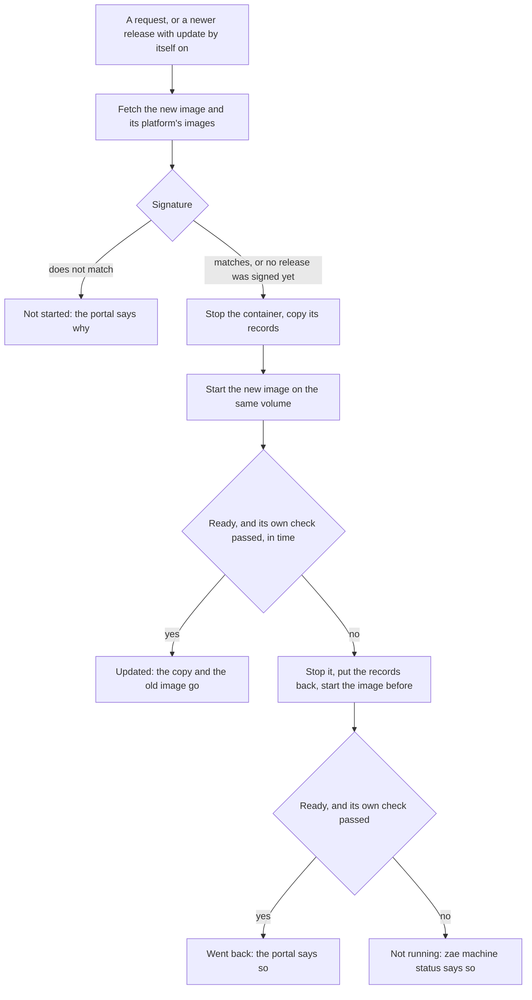

# Installing and updating

This page specifies how zaentrum gets onto the machine a household has, and how
it stays current there: the processors its images run on, the encoders its
workers use, the smallest machine it is checked on, the command that installs
it, how the first administrator is made, and how an install is updated, on one
machine and in a cluster. How the machine is then reached and signed in to from
the home's phones and TVs is in [Reaching it at home](./home.md); this page
says nothing of addresses, names or certificates. The reasons, and the paths
not taken, are in [ADR-0017](../../docs/adr/0017-the-household-machine.md).

The section As built describes what the platform does today. The sections after
it are the target, and the section Changes lists every difference between the
two as a numbered change. Only a change the owner has approved is built, one
change at a time; anything no change names stays as it is built.

## Purpose

Somebody runs zaentrum: installs it, is the first to sign in, and keeps it up
to date. This page is for that person, and for whoever builds what that person
uses. It serves the goal [Run it oneself](../goals/README.md#run-it-oneself)
and three of its qualities.

| Quality | Today | What this page adds |
|---|---|---|
| It runs on the machine a household has (`household-machine`) | amd64 alone; no smallest machine is named | amd64 and arm64; the graphics chips of NVIDIA, Intel and AMD; a smallest machine, named and checked at every release |
| Someone who has not seen it installs it in an evening (`in-an-evening`) | a container command that checks nothing, then a password read from the cluster with a second command | one command that checks the machine first and ends with a setup code; the first page a browser opens makes the administrator |
| An update never leaves it broken (`safe-update`) | the platform checks itself after an update; nothing undoes one that fails | on one machine an update that fails its check is undone, and the portal says so |

It covers the capabilities `run-on-arm`, `encode-on-other-gpus`,
`choose-encoder`, `create-first-admin`, `update-operator`, and one clean-up
each in `choose-databases`, `choose-identity` and `configure-pipeline`.

Four terms are used throughout.

| Term | Meaning |
|---|---|
| The one-machine install | The whole platform in one container on one machine. The code and the documentation call it the appliance ([self-hosting](../../docs/self-hosting.md#a-one-command-appliance)). |
| The platform's resource | The `Zaentrum` object the operator reads: one install, one resource. Its fields are written `spec.…`, what the operator reports `status.…`. |
| A release | One version, `vX.Y.Z`, of every image at once ([releases](../../docs/releases.md)). |
| The platform's own check | `zae doctor --sign-in`, which the operator runs after every update and reports in `status.verification`. |

## As built

This section says what the code at each repository's main branch does as of
15 November 2026. It is read from the code and the documentation. Two things
were run: the chart was rendered with `helm template` to add up what its
workloads ask for, and the registries were asked which processors each image is
published for and how large the layers of the release v0.4.0 are.

### Two ways to install

- **In a cluster.** A cluster admin applies the operator's install manifest
  once, then one platform's resource for each install. The operator renders
  the platform from the chart it embeds
  ([operator](../../docs/operator.md)).
- **On one machine.** One command of the container runtime starts the
  one-machine install: `docker run -d --privileged --restart unless-stopped
  --name zaentrum -p 80:80 ghcr.io/zaentrum/appliance:latest`. The image is
  k3s 1.31.5, a single-node Kubernetes, with three manifests in the folder k3s
  applies as it starts: the namespace, the operator's install and one
  platform's resource. Its start script starts k3s and waits. The operator in
  it brings the platform up as in any cluster.
- **The container is privileged**, because k3s mounts file systems, manages
  control groups and runs containers of its own.
- **The resource the image starts** asks for the bundled identity provider, a
  library of 50 GiB, the media pipeline with `pipeline.encoder: cpu`, one
  packager, and updates by hand. An image built from main follows the `edge`
  channel and runs the operator's `latest`. A release's image pins
  `spec.version` to its release and runs that release's operator.
- **The command checks nothing and says nothing.** It prints the container's
  id and returns before the platform exists. The first start then pulls every
  image.
- **A container started this way is alone with its data.** The data is in a
  volume the image declares; a new container gets a new, empty one. With the
  whole k3s state on a named volume and a fixed host name from the first
  start, a new container finds its platform again
  ([persistence](../../docs/self-hosting.md#persistence)).

### Processors

Every image the platform runs is published for amd64 alone: for each, the
registry holds amd64 and nothing else. The one exception is `zae`, the CLI's
image, which the platform's own check runs: it is built for amd64 and arm64.

| Image | What ties it to amd64 |
|---|---|
| `chino-api` | its Dockerfile compiles with `GOARCH=amd64`; its workflow names no platform, so it builds the runner's, amd64 |
| `katalog-api`, `katalog-ingest`, `katalog-manager`, `portal-api` | the workflow names no platform; the Go program is compiled for whatever processor the build runs on |
| `chino-web`, `zaentrum-portal`, `katalog-manager-ui` | the workflow names no platform; the web app in it is the same for every processor |
| `operator` | its workflow builds `linux/amd64`, with a comment that arm64 comes later |
| `chino-stream` | a prebuilt FFmpeg 7.1 archive for Linux on x86-64, pinned with its checksum, on NVIDIA's CUDA runtime image |
| `transcoder` | the same archive, on the same base |
| `live-worker` | the shared-library archive of the same FFmpeg build for x86-64, and a Go toolchain for x86-64, each pinned with its checksum; the worker links the media libraries |
| `analyzer` | the packaging program for x86-64, `packager-linux-x64` of version 3.4.2 |
| `packager` | the same program |
| `appliance`, the one-machine image | its workflow builds `linux/amd64`, with the same comment, and starts the image once, on an amd64 runner |
| `operator-bundle`, `operator-catalog` | built for `linux/amd64` |
| `subtitler` | a translation program published for x86-64 with CUDA alone; the chart does not run it |

What these images are built on is published for arm64 too: the Go, Node,
nginx, Python and Ubuntu base images, the CUDA runtime images of version
12.3.2, the distroless base, k3s 1.31.5, and the PostgreSQL, Valkey, Kafka and
Keycloak images the chart names. The FFmpeg archive's release holds an archive
for Linux on arm64 beside the one the images pin, with libx264 and libx265 in
it, and the packaging program's release holds `packager-linux-arm64`. The
Python packages the workers pin have wheels for arm64.

### Encoders

A title is encoded in three places: by the transcoder before it plays, and by
the live worker or chino-stream while it does.

- **The setting.** `spec.pipeline.encoder` takes `gpu`, the default, and
  `cpu`.
- **What the chart asks of a node.** With `gpu` the transcoder runs only on a
  node labelled `nvidia.com/gpu.present: "true"`, tolerates the taint
  `nvidia.com/gpu`, and asks for one `nvidia.com/gpu`, the resource NVIDIA's
  device plugin offers. With `cpu` it asks a node for nothing and gets
  `ENCODER=cpu`. A pod that asks for a resource no node offers is never
  started.
- **The transcoder decides again.** Its own setting, `ENCODER`, takes `auto`
  (its default), `nvenc` and `cpu`. On `auto` it encodes one black frame with
  each NVENC encoder as it starts, takes NVENC for the codec that opened and
  the CPU's encoder for the other, writes which into its log, and reports its
  HEVC encoder to the catalog with the rules it runs with. So a resource that
  says `gpu` still encodes on the CPU where the GPU does not open.
- **The live worker has a switch of its own.** It runs only where
  `spec.liveWorker.enabled` says so. With `spec.liveWorker.gpu.enabled`, the
  default, the chart places it as the transcoder and sets
  `LIVE_WORKER_HW=cuda`, which the worker then requires. Without it the chart
  sets `none`, and video is encoded with libx264. The worker's code also knows
  `auto` (CUDA, else the CPU), which the chart never sets, and a Mac's encoder,
  for a test of its plumbing when the program runs on macOS itself. Its status
  (`GET /v1/status`) names each worker process's backend.
- **chino-stream** encodes with its own ffmpeg wherever the live worker does
  not. It reads `USE_NVENC`, which the chart sets to `false`: it encodes with
  libx264.
- **`spec.features.gpu`** is read by no template. It changes nothing.
- **The one-machine install passes no graphics device on.** Its command names
  none, its image holds no NVIDIA runtime, no driver for another chip and no
  device plugin, and its resource says `cpu`. The documentation says it
  encodes in software.
- **No worker uses VA-API**, the interface Intel and AMD graphics chips are
  reached through on Linux, and no image holds a driver for it. The FFmpeg
  build the images pin is made with VA-API and holds its encoders for H.264
  and HEVC. The archive of the same release for arm64 is made without it.
- **The setup checklist reads another field.** portal-api's setup document
  reports `spec.features.gpu` and counts the nodes that offer
  `nvidia.com/gpu`, which its role may not read on a plain install. The portal
  and `zae setup` say that the transcoder needs an NVIDIA GPU, whatever the
  encoder setting says.

The encoders and their options, as the code passes them:

| Worker | Encoder | Options |
|---|---|---|
| transcoder | `hevc_nvenc` | preset `p5`; variable bit rate at constant quality 23, with the rendition's maximum rate (for a title at its own size, its cap) and twice that as buffer; reference B-frames `middle`; spatial adaptive quantisation; a lookahead of 20 frames; profile Main, or Main 10 above 8 bits |
| transcoder | `h264_nvenc` | the same, with profile High |
| transcoder | `libx265` | preset `medium`, constant rate factor 24, the same maximum rate; Main or Main 10 |
| transcoder | `libx264` | preset `medium`, constant rate factor 23, the same maximum rate; High |
| live worker | `h264_nvenc` | preset `p5`; constant bit rate at the rung's rate; High, level 4.0; one keyframe at the segment's start and none at scene cuts |
| live worker | `libx264` | preset `veryfast`, tuned `zerolatency`; High, level 4.0; no keyframes at scene cuts |
| chino-stream | `libx264` | preset `veryfast`, tuned `zerolatency`, a constant rate factor for each quality; High, level 4.0 |
| chino-stream | `h264_nvenc` | preset `p5`, constant quality 23; never used, as the chart sets `USE_NVENC` to `false` |

### What a machine has to give

The chart states what each workload asks of a node (its requests) and the
most it may take (its limits). Added up for the workloads that run all the
time:

| Install | Workloads | Requests: CPU | Requests: memory | Limits: CPU | Limits: memory |
|---|---:|---:|---:|---:|---:|
| The chart's defaults: the pipeline off | 13 | 0.72 cores | 2.0 GiB | 7.4 cores | 8.1 GiB |
| The one-machine install's resource: the pipeline on the CPU, one packager | 17 | 2.27 cores | 5.1 GiB | 19.9 cores | 24.4 GiB |
| The same with the live worker on the CPU | 18 | 2.77 cores | 6.1 GiB | 23.9 cores | 32.4 GiB |
| The chart's defaults with the pipeline on: an NVIDIA GPU, two packagers | 17 | 3.27 cores | 7.1 GiB | 23.9 cores | 28.4 GiB |

- The database server and the cache state neither a request nor a limit. They
  are not in the sums.
- The operator asks for 0.05 cores and 64 MiB beside them. k3s's own
  documentation names 2 cores and 2 GB as the least for a server, before any
  workload.
- The transcoder's limit is 4 cores and 8 GiB: as much memory as the whole
  machine the documentation of the image has in mind.
- The images of the release v0.4.0 for a one-machine install are 3.4 GiB of
  compressed layers, each layer counted once: 2.1 GiB without the pipeline's
  workers and 1.3 GiB for them.
- The release's workflow starts the one-machine image on a runner with 4 cores
  and 16 GB of memory, and waits at most 25 minutes for the platform to be
  ready and then for its own check to pass. Nothing holds it to less.
- The image's own README says that the machine “wants four cores and 8 GiB”.
  This repository's documentation names no smallest machine, and nothing
  checks one.

### The first administrator

- **With the bundled identity provider** a new realm is imported with one
  account for a person, `admin`. It holds the platform's admin role and the
  identity provider's own `realm-admin` role. Its password is a one-time
  password of 24 characters, which the operator generates into the Secret
  `zaentrum-keycloak-admin`, key `realm-admin-password`. The identity provider
  asks for a new password at the first sign-in.
- **Whoever installs reads the password from the cluster.** The
  `SecretsGenerated` condition of the resource says where it is. On one
  machine that is a second command: the container runtime's `exec`, then
  `kubectl`, then a decoding.
- **The first page a browser opens is the sign-in page.** Nothing on it says
  which name to use or where the password is.
- **After the sign-in** the portal's home page shows the setup checklist to
  admins until one marks it done ([settings and setup](../portal/settings.md)).
- **Further people** are added on the portal's People page and get an invite
  link. Its page is opened without signing in; the person chooses a password,
  presses **Sign In**, and types the password again on the sign-in page.
- **`admin` is not a person like the others.** An account that holds a role of
  the identity provider's own is changed in the identity provider's console,
  not on the People page.
- **With an external identity provider** none of this exists: the first
  administrator is whoever holds the admin role there.

### Updating

- **The platform's images.** The operator reads the channel document and
  reports a newer release in `status.availableUpdate`. On the portal's
  operator console an admin presses **update to …**, which pins
  `spec.version` to that release (`POST /api/portal/operator/apply-update`);
  `zae platform update --apply` does the same. With `spec.update.mode: auto`
  the operator moves by itself.
- **The platform checks itself.** After every update that leaves the platform
  ready, the operator runs the platform's own check as a Job: the published
  routes, the issuer, a sign-in as a test account, and reads of the platform
  as its web apps make them, among them the master playlist of one packaged
  title. The result is in `status.verification`. It is a reading. It never
  moves the platform's phase, it is not tried again by itself, and nothing
  undoes an update whose check failed.
- **The operator itself, in a cluster,** is updated outside the platform: by
  the cluster's operator lifecycle manager, or by a cluster admin who applies
  the next release's install manifest. The portal and `zae platform
  controller` show which operator runs, how it was installed and whether a
  newer one exists. They never change it, for the reasons
  [updating the operator](../../docs/updating-the-operator.md#why-the-product-will-not-do-it-for-you)
  gives.
- **The order is left to the reader.** In a cluster the operator offers a
  release as soon as the channel names it, and with `auto` moves to it,
  whatever version the operator itself is. The documentation asks admins to
  install a release's operator together with the release, because the chart
  is the operator's.
- **A one-machine install made from a release hears of no update.** Its
  resource pins a version, and the operator never reads the channel for a
  pinned version.
- **A one-machine install is updated by replacing its container** with one
  from a newer image, by hand. That keeps the platform only on a named volume
  under a fixed host name. The image's manifests are in k3s's folder, inside
  that volume, so the volume keeps the operator's install the first image
  brought until someone copies a newer one over it. When the resource's file
  is copied too, k3s applies it again, in the manner of `kubectl apply`, and
  puts back what the file says: the image's README names the host an admin
  had changed.
- **Nothing is signed.** No workflow signs an image, and the operator's
  repository builds its images with the build's record switched off.

### Settings that do nothing, and what the documentation leaves out

- **`databases.mode: single`.** The documentation says it shares one database
  between the services. The chart asks only whether the mode is `external`,
  so `single` renders exactly as `perApp`. The resource's schema takes any
  text.
- **`identity.loginTheme`.** The operator passes it to the chart, and no
  template reads it. The realm import always names the theme `zaentrum`, the
  one theme the chart lays out. The documentation says that an empty value
  gives the identity provider's default theme, which is not so.
- **`spec.pipeline`.** The reference of the resource in
  [operator](../../docs/operator.md#zaentrum-cr-spec-reference) has no section
  for it. The documentation names one of its seven fields,
  `pipeline.surroundAudio`, in a decision record.
- **`features.gpu` in the documentation.** Three pages tell the reader to set
  it for NVENC. It does nothing; `pipeline.encoder` decides.

## Processors

Every image the platform publishes is one tag for two processors,
`linux/amd64` and `linux/arm64`. A machine pulls the tag and gets the image
for its own processor. Nothing else about tags changes.

How each kind of image is built:

- **A program compiled to one file** (the Go services and the operator). The
  build stage runs on the build's own processor and compiles for the target's:
  `GOOS` and `GOARCH` come from the build's `TARGETOS` and `TARGETARCH`.
  Nothing is emulated.
- **A web app.** It is built once, on the build's processor. Only the image
  that serves it is made for each processor.
- **A worker with media programs** (chino-stream, transcoder, live-worker,
  analyzer, packager). It is built on a runner of each processor and the two
  are joined under one tag, because these images install packages and, for
  the live worker, compile against the media libraries.

What changes in each image:

| Image | What changes |
|---|---|
| `chino-api` | compiles for the target's processor in place of `GOARCH=amd64`; the workflow builds both |
| `katalog-api`, `katalog-ingest`, `katalog-manager`, `portal-api`, `operator` | the build stage runs on the build's processor and compiles for the target's; the workflow builds both |
| `chino-web`, `zaentrum-portal`, `katalog-manager-ui` | the web app is built once; the serving image is made for both |
| `zae` | nothing: it is built for both today |
| `chino-stream`, `transcoder` | on arm64 the FFmpeg archive for Linux on arm64 of the same dated release, with its own checksum |
| `live-worker` | on arm64 the shared-library archive of the same release and the Go toolchain for arm64, each with its own checksum |
| `analyzer`, `packager` | on arm64 `packager-linux-arm64` of the same version |
| `appliance`, `operator-bundle`, `operator-catalog` | built for both; the one-machine image is started on a runner of each processor |
| `subtitler` | stays amd64: its translation program exists for x86-64 with CUDA alone |

Rules that go with it:

- **Tests on both.** Each worker's own tests run on a runner of each
  processor before its image is published. They cover the CPU's encoders,
  which is what an ARM machine uses.
- **A release holds both or is not finished.** The step that waits for a
  release's images passes only when every image holds both processors under
  the release's tag.
- **On arm64 the workers encode on the CPU.** The FFmpeg archive for arm64 is
  made without VA-API, the images hold the drivers for Intel and AMD chips on
  amd64 alone, and the one-machine install offers no render device on arm64.
  So `auto` (section Encoders) gives `cpu` there. The encoders of ARM boards
  are reached through other interfaces than the two this page names, and are
  not built by these changes. An NVIDIA GPU on an ARM node is used as on any
  node; no release check covers it.
- **What an ARM machine lacks** is what any machine without an NVIDIA GPU
  lacks today: an original in Dolby Vision profile 5 is not reshaped and
  keeps its step failed, and no subtitles are made, because the subtitler
  needs such a GPU.
- **32-bit ARM is not built.** The bundled identity provider and the event
  broker are published for amd64 and arm64 alone.

## Encoders

One setting of the platform's resource says where titles are encoded, before
they play and while they do: `spec.pipeline.encoder`.

| Value | What the workers' pods are given | What a worker encodes with |
|---|---|---|
| `auto`, the default | the first device a node offers, looked for in this order: an NVIDIA GPU, a render device, none | the first encoder that opens, in the same order, down to the CPU's |
| `nvenc` | an NVIDIA GPU; the pods wait for a node that offers one | NVENC, as built with `gpu` |
| `vaapi` | a render device; the pods wait for a node that offers one | VA-API |
| `cpu` | nothing | libx264 and libx265, with no probe |
| `gpu` | as `nvenc` | the old name of `nvenc`, read as `nvenc`, so that a resource written before keeps its meaning |

A resource that names no encoder gets `auto`. Today it gets `gpu`, and its
transcoder waits for an NVIDIA GPU that may never come; with `auto` it encodes
on the CPU where there is none.

A **render device** is the device Linux gives a graphics chip for work without
a screen, `/dev/dri/renderD128` and upwards. **VA-API** is the interface the
chips of Intel and AMD encode through on it. It is a library with a driver for
each maker; the library and the drivers have to be in the worker's image.

### The operator looks first

A pod sees only the devices its node hands it, and a pod that asks for a
device no node offers is never started. So a worker cannot look by itself: the
operator looks, and gives the workers' pods a device that is there.

- **What it reads.** At every pass the operator reads what each node can
  hand out. An NVIDIA GPU is the resource `nvidia.com/gpu`, at least 1. A
  render device is the resource `spec.pipeline.vaapi.resource` names, at
  least 1. The operator's role gains reading nodes, and nothing else.
- **With `auto`** it takes the first of the two a node offers, else none. It
  moves from one answer to another only after the nodes have given the new
  answer for 10 minutes without a break, so a device plugin that restarts does
  not restart an encode.
- **With `nvenc` or `vaapi`** it asks for that device whether a node offers
  it or not.
- **What it says.** `status.encoder` holds four fields: `setting`, what the
  resource says, with `gpu` written as `nvenc`; `device`, what the pods are
  given, `nvenc`, `vaapi` or `cpu`; `resource`, the resource they ask for, or
  nothing; `reason`, one line, such as “no node offers nvidia.com/gpu or
  zaentrum.io/render”.

Two fields name the render device. Both are for a cluster; the one-machine
install needs neither.

| Field | Values | Default | Meaning |
|---|---|---|---|
| `spec.pipeline.vaapi.resource` | a resource's name | `zaentrum.io/render` | the resource a node offers a render device as. The default is what the one-machine install offers. A cluster admin who runs a device plugin names its resource here, such as `gpu.intel.com/i915` |
| `spec.pipeline.vaapi.group` | a group's number | 0: none | the group that may open the device on the nodes; the workers' pods get it as a supplementary group |

### What the workers' pods get

| Device | Transcoder | Live worker, where `spec.liveWorker.enabled` |
|---|---|---|
| An NVIDIA GPU | as built with `gpu`: the node label, the toleration, one `nvidia.com/gpu`, preset `p5` and constant quality 23 | as built: placed as the transcoder, one `nvidia.com/gpu`; `LIVE_WORKER_HW=cuda`, or `auto` where the setting is `auto` |
| A render device | one unit of the render resource, the group where one is named, and `ENCODER=auto` | one unit of the render resource and the group; `LIVE_WORKER_HW=vaapi`, or `auto` where the setting is `auto` |
| None | `ENCODER=cpu`, as built | `LIVE_WORKER_HW=none`, as built |

- `spec.liveWorker.gpu.enabled: false` keeps its meaning: the live worker gets
  no device, whatever the encoder setting. Its `nodeSelector` and
  `tolerations` apply with an NVIDIA GPU, as built.
- The analyzer tolerates the NVIDIA taint where the device is an NVIDIA GPU,
  as built.
- **chino-stream gets no device and no new encoder.** It encodes with libx264
  as the chart has it today, and stops encoding as the live worker takes its
  place ([ADR-0013](../../docs/adr/0013-live-rungs-safety-net.md)).

### What a worker does with it

- **The transcoder's `auto`** tries, for HEVC and for H.264 each, NVENC, then
  VA-API, then takes the CPU's encoder. A pod with a render device alone fails
  the NVENC probe at once and goes on. `ENCODER` takes `vaapi` beside the
  three values it has.
- **A worker never stops the pipeline over an encoder.** The transcoder falls
  back to the CPU where its device's encoder does not open, as it does today
  with NVENC, and says so. The live worker falls back only where it runs on
  `auto`; with a device named in the resource it is not ready, and its status
  says why, as it does today with `cuda`.
- **`LIVE_WORKER_HW`** takes `vaapi` beside the values it has, and its `auto`
  tries CUDA, then VA-API, then the CPU.

### Encoding through VA-API

The transcoder:

- **It is the CPU's path with another last step.** A source is decoded,
  scaled and tone-mapped as on the CPU. The frames are then handed to the
  device and encoded by `hevc_vaapi` or `h264_vaapi`. Nothing else is done on
  the device.
- **The device** is the first of `/dev/dri/renderD*`, in the order of their
  names, whose probe passes; `VAAPI_DEVICE` names one instead.
- **The probe**, at the start, is one black frame of 256 × 144 through each
  encoder, as the NVENC probe is, and a second one in 10 bits for HEVC. A
  device without 10-bit HEVC leaves sources above 8 bits to libx265.
- **The master stays the master.** An encode meets the rules of
  [ADR-0015](../../docs/adr/0015-the-package-is-the-master.md): the source's
  size, Main or Main 10, a constant quality with the title's cap as its
  maximum rate. VA-API's name for that is the quality-defined variable bit
  rate, and a driver may lack it. Where the device's driver lacks it for a
  codec, the transcoder takes the CPU's encoder for that codec. The quality
  number is set by the trial ADR-0017 asks for.
- **Every encode is checked as today.** One that fails its check is made
  again on the CPU, as a run on a GPU that fails is today.
- **What it says.** `/readyz` gains `encoder`: the encoder for HEVC and for
  H.264, the backend (`nvenc`, `vaapi`, `cpu` or `mixed`), and why a device
  was passed over. The rules it reports to the catalog name the HEVC encoder
  as today, now also `hevc_vaapi`.
- **What VA-API does not bring.** Decoding on the device, tone mapping on the
  device, and the reshaping of Dolby Vision profile 5, which needs a Vulkan
  device the images hold a driver for with NVIDIA alone.

The live worker:

- **A rung's segment is encoded by `h264_vaapi`** at the rung's bit rate,
  constant, High at level 4.0, with one keyframe at the segment's start and
  none at scene cuts: the rules of the NVENC path.
- **The segment's boundaries are the package's**, checked as today.
- **Decoding and scaling** happen on the device where its driver can, with
  the frames staying in its memory, and on the CPU otherwise. HDR is
  tone-mapped on the CPU where the driver has no tone mapper, as the worker
  does today without a Vulkan device.
- **The bar is real time**: a segment of each rung is made in less time than
  it plays. ADR-0017's trial shows it before this is built.
- **What it says.** A worker process's `backend` in `GET /v1/status` is
  `vaapi`.

The images of the transcoder and the live worker hold the VA-API library and
the drivers for Intel and AMD chips, on amd64. The FFmpeg build they pin
holds the two encoders today (section As built); the trial of ADR-0017 shows
that they open a device with the drivers in the image.

### On one machine

The one-machine install offers what the machine has, without a setting.

- **An NVIDIA GPU.** The machine needs NVIDIA's driver and NVIDIA's container
  toolkit, which is what lets a container use the GPU at all. `zae machine
  install` then gives the container the GPUs. The image holds the programs of
  NVIDIA's container runtime, which k3s finds as it starts. When the
  container was given a GPU, the start script starts NVIDIA's device plugin
  and gives its node the label the chart looks for,
  `nvidia.com/gpu.present: "true"`.
- **A render device.** The container holds the machine's render devices
  already, being privileged. Where there is one, on amd64, the start script
  makes the devices readable and writable inside the container, and starts a
  device plugin that offers them as `zaentrum.io/render`. On arm64 it starts
  none.
- **Each device is offered 4 times**, so that the transcoder and the live
  worker share one chip.
- **The image's resource names no encoder**, so `auto` applies: an NVIDIA
  GPU, else a render device, else the CPU.
- **No worker's pod is privileged.** A pod gets a device from a device plugin
  and in no other way.

### What is ruled out

- **A Mac's graphics chip.** On a Mac a container runs in a Linux virtual
  machine, and the container runtime hands that machine no encoder of the
  Mac's. A Mac with an ARM processor runs the platform on its CPU.
- **A worker's pod with all of the node's rights**, to reach a device without
  a device plugin. The transcoder reads files nobody has vetted.

### The setup checklist

The checklist's **Processing** step says where titles are encoded, from what
the platform reports and not from a field nothing reads.

- portal-api's setup document carries `processing.encoder`: `setting` and
  `device` from `status.encoder`, `reason`, and `inUse`, the encoder the
  transcoder last reported to the catalog (`nvenc`, `vaapi` or `cpu`), with
  `reportedAt`. The fields `gpu`, `gpuNodes` and `gpuNote` go.
- The step is to do when the resource names `nvenc` or `vaapi` and the
  transcoder reports the CPU, and when a pod waits for a device no node
  offers. With `auto` it is never to do over an encoder.
- The portal and `zae setup` say it in the words of the section Words. No
  sentence says that the transcoder needs an NVIDIA GPU.

## The smallest machine

The smallest machine zaentrum is installed on:

| | The smallest machine |
|---|---|
| Processor | amd64 or arm64, 4 cores |
| Memory | 8 GB |
| Disk | 40 GB free, beside the library |
| System | Linux, with a container runtime that can run a privileged container |

- **What it is for.** On it the platform runs idle and plays one packaged
  title. That is what every release is checked for.
- **What it is not for.** A title that has to be encoded on the CPU can take
  hours there, and the encode may take more memory than the machine has: the
  transcoder's limit is 8 GiB. The check does not show such an encode. A
  household whose files need encoding wants a graphics chip the platform can
  use, or more memory.
- **No smaller footprint is promised.** The numbers of the section As built
  stay as they are. If the check does not pass on this machine, the machine
  named here becomes larger; the platform is not cut to fit.
- **The disk**, as it adds up: the images of two versions side by side during
  an update, the databases (their claim asks for 10 GiB), their backups
  (5 GiB), and the cache for encodes made while playing (at most 5 GiB).

### The release check

The workflow that builds the one-machine image runs the check, once on a
runner of each processor, for every release and after every build of main.

1. It installs with `zae machine install`, with the container held to 4 CPUs
   and 7 GiB of memory, without swap. The eighth gigabyte is the operating
   system's. It does not hold the disk: a runner's disk is what it is, so the
   workflow lifts that one check with `--force`.
2. It waits for the platform to be ready, 25 minutes at most, and for its own
   check to pass.
3. It makes a test clip of two minutes itself, H.264 with stereo sound, puts
   it into the library, starts a scan with the service account the chart's
   own scan job uses, and waits until the clip is packaged, 20 minutes at
   most.
4. It runs the platform's own check again. With a packaged title, the check
   plays it: it reads the master playlist, the playlist of the first video
   rendition and its first 10 segments, each answered within 6 seconds.
5. It fails when a check failed, or when the kernel stopped a process of the
   container for memory.

A release is not finished while the check fails on either processor. The
check runs on Linux, on fast processors: it shows that the memory and the
cores are enough, not that a slow processor is fast enough.

## The install command

`zae machine install` installs the one-machine install. The documentation's
command stays one line: the install script of `zae` takes the word `machine`
and runs `zae machine install` once `zae` is in place.

| Command | What it does |
|---|---|
| `zae machine install` | checks the machine, asks, starts the container, adds the updater, waits, and prints where the platform answers and the setup code |
| `zae machine status` | prints the version, the container's state, the updater's last run, and the setup code while the first-run page is open |
| `zae machine update` | looks for an update and applies it (section Updating one machine) |
| `zae machine remove` | removes the updater and the container; the volume stays unless `--data` is given, and then it asks again |

The commands are for Linux and macOS. They need the right to use the
container runtime, and on Linux, for the updater, the rights of root.

### What it checks

Before it changes anything, the command checks the machine against the
section The smallest machine, and prints one line for each check.

| Check | Passes when | Otherwise |
|---|---|---|
| Processor | amd64 or arm64 | refuses |
| Cores | 4 or more | refuses; goes on with `--force`, and says so |
| Memory | 7.5 GiB or more, as the system reports an 8 GB machine | refuses; goes on with `--force` |
| Disk | 40 GB free where the container runtime keeps its data | refuses; goes on with `--force` |
| Container runtime | `docker`, else `podman`, answers and may start a privileged container | refuses |
| Control groups | the system accounts for memory by container | refuses, and names the switch; a Raspberry Pi has it off until told |
| Ports | the ports the container needs are free, as [Reaching it at home](./home.md) lists them | refuses, and names the port |
| A container or volume named `zaentrum` | there is none | refuses, and names `zae machine status` |
| Graphics | an NVIDIA GPU the container runtime can hand on, or a render device | says what it found; never refuses |

The release check runs with Docker. Podman is not part of it.

### What it does

1. It names the version: the release the `stable` channel names, or the
   release given with `--version`. It installs releases only; an image built
   from main is started with the container runtime's own command, as today.
2. It asks, unless `--yes` is given. Without a terminal it needs `--yes`.
3. It fetches the image, and checks its signature as the updater does
   (section Updating one machine).
4. It starts the container: privileged, restarted unless stopped, named
   `zaentrum`, under the host name `zaentrum`, with the k3s state on the
   volume `zaentrum`, and with the GPUs where the check found an NVIDIA GPU.
   Its network and its address are as [Reaching it at home](./home.md) sets
   them. Arguments after `--` go to the container runtime as they are.
5. It keeps what it did in `/etc/zaentrum/machine.json`, on a Mac in
   `machine.json` in the folder `zae` keeps its sign-ins in: the image, the
   version, and the arguments. Every later container of this install is
   started from that file, so an update changes the image and nothing else.
6. Where the system has systemd, it adds the updater's two units and turns
   the timer on. Elsewhere, and with `--no-updater`, it adds none and says
   that `zae machine update` updates by hand.
7. It waits for the platform to be ready, 45 minutes at most, with a line
   every 30 seconds, and then for its own check, 15 minutes at most.
8. It prints where the platform answers, in the lines the start script wrote,
   then the setup code and what it is for.

It ends with 0 when the platform runs and passed its check, with 1 when the
machine failed a check or the platform did not get there in time, and with 2
when it was called wrongly. A container that is slow to start is left
running.

The container runtime's own command still starts the image, as today. It adds
no updater and prints no code; `zae machine status` shows the code then
(section The first administrator).

## The first administrator

With the bundled identity provider, the first administrator is made in the
browser. With an external one, nothing changes: the first administrator is
whoever holds the admin role there, and there is no first-run page.

### The setup code

- **What it is.** 12 characters from an alphabet of 32, the digits and the
  capital letters without I, L, O and U, written in three groups of four:
  `K7QM-2XWD-9FHT`. The first-run page takes it in any case, with or without
  the hyphens, and reads the letter O as the digit 0 and I or L as 1.
- **Who makes it.** The operator, once for each install, as it makes the
  platform's other secrets: the Secret `zaentrum-setup`, key `code`, in the
  platform's namespace. A plain Helm install renders it as it renders the
  others, and its notes say where the code is. Where the platform's secrets
  are made outside (`secrets.external`), this one is made there too.
- **Who gets it.** portal-api, as `PORTAL_SETUP_CODE`. Nothing else reads it.
- **Where a person finds it.** `zae machine install` prints it, and `zae
  machine status` prints it while the first-run page is open, also for a
  container the container runtime's own command started under the documented
  name. In a cluster, the `SecretsGenerated` condition says where it is, never
  what it is, and a cluster admin reads the Secret.
- **What it is for.** Without it, the first person on the network to open the
  platform would become its administrator.

### A realm without a first account

A new realm is imported without the account `admin`. Nothing else of the
import changes. The Secret `zaentrum-keycloak-admin` keeps the identity
provider's own first account, which the operator's Jobs sign in with, and no
longer gets a one-time password for a person.

An install whose realm exists keeps its accounts, `admin` among them, and
never shows the first-run page.

### When the page is open

The first-run page is open while all of this holds:

- the identity provider is the bundled one, and portal-api can manage its
  people;
- portal-api has a setup code;
- no enabled person holds the admin role;
- the page was never used on this install.

It is used once. After that it stays closed, also when every administrator is
later removed; an account is then made in the identity provider's console, as
today.

### The routes

Both routes work without a sign-in.

| Route | Takes | Answers |
|---|---|---|
| `GET /api/portal/first-run` | nothing | `{"open": true, "install": "machine", "passwordPolicy": {…}}` while the page is open; `install` is `machine` or `cluster`, and the policy is the one the invite page gets. Otherwise `{"open": false}`. Where no person holds the admin role and only a secret is missing, it adds `"reason"`: `no-code` without a setup code, `no-people` where portal-api cannot manage the realm's people |
| `POST /api/portal/first-run` | `{"code": "…", "name": "…", "username": "…", "password": "…"}`, at most 4 KiB | 201 with `{"username": "alex"}` |

What `POST` answers otherwise:

| Status | Body | When |
|---|---|---|
| 404 | `{"error": "closed"}` | the page is not open |
| 429 | `{"error": "locked", "retryAfterSeconds": 900}` | 5 wrong codes were sent; for 15 minutes every try is refused, a right code too |
| 403 | `{"error": "code", "triesLeft": 3}` | the code is wrong |
| 400 | `{"error": "name", "message": "…"}`, or `username`, or `password` | a field breaks a rule; the message says which. This does not count as a try |
| 503 | `{"error": "unavailable"}` | the identity provider did not answer |

What `POST` does with a right code:

1. It checks the name, the username and the password by the rules the People
   page and the invite page have today: a name of 1 to 100 characters; a
   username of 3 to 64 lower-case letters, digits and `. _ -`; the realm's
   password rules.
2. It makes the person in the realm, enabled, with the user role and the
   admin role, and sets the password. Where the identity provider refuses the
   password, it removes the person again and answers 400.
3. It records, in its own database, that the page was used, when, and for
   which username. Two requests at the same moment make one administrator:
   the second gets 404.

The count of wrong codes is kept in portal-api's database, so a restart does
not clear it. The code is compared in constant time and written into no log.

### The page

While the page is open, the portal shows it wherever it would otherwise send
a person to the sign-in page. Its address is `/portal/first-run`.

It is the design system's form, alone on the page under the product's name,
as the invite page is today:

- the title **set up zaentrum**, and one sentence that says what the page
  does;
- **setup code**, with a hint that says where the code is, by the kind of
  install;
- **name**, what the apps call the person;
- **username**, what the person signs in with. It is filled in from the name
  as the person types it, in lower case, with a dot for each space and without
  the characters a username may not hold, until the person changes it;
- **password** and **password again**, with the realm's rules under them, as
  the invite page lists them;
- the emphasized button **create administrator**.

### After the page

- **The page signs the person in**, in the same browser, without asking for
  the password again. It asks the sign-in page for its form and sends it the
  username and the password the person has just typed, as the browser would,
  and takes the answer through the portal's ordinary sign-in.
- **Where that does not work**, for whatever reason, the page opens the
  ordinary sign-in page with the username filled in, and the person types the
  password once more.
- **Then the portal's home page opens**, with the setup checklist above its
  tiles, as today for any administrator until one marks it done.
- **The first administrator is a person like any other.** The People page
  lists and changes the account. It holds no role of the identity provider's
  own; that console is reached as the documentation says today, with the
  identity provider's own first account.

## Updating one machine

On one machine an update is a new image: the operator, the resource's schema,
k3s and the platform's images of one release together. The machine fetches
it, starts it in place of the old one, and goes back if the platform's own
check does not pass.

Four parts make it: the image, the updater, the request and the report, and
the operator console.

Only releases are served: an install on the `stable` channel. An image built
from main follows `latest` inside the container, as today, and gets no
updater.

### The image

- **Its manifests are outside the volume**, in `/opt/zaentrum/manifests`. At
  every start the start script puts the namespace and the operator's install
  into k3s's folder, so the operator, the resource's schema and the
  operator's rights are the image's.
- **The resource is the install's own.** The start script creates the
  platform's resource only when the namespace has none. From then on it sets
  single fields of it and never applies a whole file again, so what an admin
  changed stays. No file of the resource stays in k3s's folder; one an older
  image left there is removed, which removes nothing from the cluster.
- **A release's image sets the version.** Once the operator of the image is
  the one that runs, the start script sets `spec.version` to the image's
  release. It sets nothing else. Where [Reaching it at home](./home.md) has
  the start script set the host, it sets that one field the same way.
- **The image carries two more things**: `/opt/zaentrum/images.txt`, one
  line for each image its platform can run, and the `zae` of its release at
  `/usr/local/bin/zae`.

### The updater

The updater is `zae machine update`, on the machine itself, outside the
container. `zae machine install` adds two systemd units:
`zaentrum-update.service`, which runs it once, and `zaentrum-update.timer`,
which starts the service 2 minutes after the machine starts and 1 minute
after each run has ended. A machine without systemd, and a Mac, has no timer:
there the command is run by hand, and does the same.

What one run does:

1. **It reads the install.** Through the container runtime it reads the
   platform's resource: the channel, whether updates come by themselves, the
   request, the version that runs, and the result of the platform's own
   check. It reads the channel document at most once an hour, and at once for
   a request.
2. **It decides.** It updates for a request it has not answered yet. It
   updates by itself when `spec.update.mode` is `auto`, which it is only
   where an admin turned it on, the channel names a release newer than the
   one that runs, that release did not fail here before, and the machine's
   clock is between 03:00 and 05:00. Otherwise it writes its report and ends.
3. **It takes one thing from the platform: a version.** The version has to be
   a release's name, newer than the one that runs, and its image has to
   exist. The image's name comes from `/etc/zaentrum/machine.json`, never
   from the platform.
4. **It makes room.** It needs 10 GB free and twice the size of the bundled
   database's files. With less it does not start, and says so.
5. **It fetches** the new image, and then, into the platform that still runs,
   every image `images.txt` of the new image names. 60 minutes at most.
6. **It checks the signature** (below).
7. **It stops the container**, and copies what an update may rewrite into
   `before-update` in the volume: the cluster's own record
   (`server/db`, `server/token`, `server/manifests`) and the files of the
   bundled database (the folder of the claim `postgres-data`). Both are
   copied while nothing runs, and are good to start from, as after a power
   cut.
8. **It starts the new image** on the same volume, with the arguments of
   `machine.json`.
9. **It waits**, 30 minutes at most, for the platform to be ready on the new
   version, and then, 15 minutes at most, for the platform's own check to
   pass. A check that could not reach a result is asked for once more.
10. **When both came**, it removes the copy and the old image, on Linux puts
    the new image's `zae` in place of itself, and reports the update.
11. **When one did not come**, it goes back: it stops the new container, puts
    the copy back, starts the image before, and waits the same way. It
    reports that it went back, with the checks that failed. It does not try
    that release again by itself; a request tries it again.
12. **When going back did not work either**, the platform does not run. The
    portal cannot say so. `zae machine status` does, and names the updater's
    log.

More rules:

- **One run at a time.** A second run ends at once.
- **A run that was cut off** by a restart of the machine is taken up by the
  next one where it stopped. Past its time, it goes back.
- **A report is corrected.** Every run reads the platform anew. A platform
  that came up after all, on either version, is reported as it is.
- **What the platform wrote to the library** between the start of the new
  version and the going back stays. The databases go back to what they were.
- **The event broker's log** is lost with the container, as at every new
  container today.
- **Where the platform's own check is switched off**, the platform being
  ready decides alone, and the report says that nothing was checked.

### The signature

- **Where a release is signed, the updater checks it.** It verifies the
  image against the project's identity: the workflow of the operator's
  repository that built the release, at the release's tag. An image whose
  signature does not match is not started.
- **No release is signed today.** Until one is, the updater starts an
  unsigned image and reports `signature: none`.
- **Once is for good.** After the updater has verified one signed release, it
  starts no unsigned image again.
- Signing the images is not built by this page's changes.

### The request and the report

- **The request** is the annotation `zaentrum.io/update-request` on the
  platform's resource: a version, an `@`, and the moment it was asked,
  `v0.5.0@2026-11-15T20:14:05Z`. portal-api writes it. A value the updater's
  report does not name yet is a request waiting.
- **The report** is the ConfigMap `zaentrum-machine` in the platform's
  namespace, key `report`, one JSON document the updater writes at every run.
  It is also kept on the machine, in `/var/lib/zaentrum/update.json`.

| Field of the report | Holds |
|---|---|
| `checkedAt` | when the updater last ran |
| `timer` | whether a timer runs the updater on this machine |
| `running` | the version that runs |
| `available` | a newer release the channel names, or nothing |
| `state` | `idle`, `fetching`, `updating`, `checking` or `going-back` |
| `request` | the request last answered |
| `last` | the last update tried: `result` (`updated`, `went-back`, `not-started`, `not-running`), `from`, `to`, `startedAt`, `finishedAt`, `reason`, `checks` (the name and the detail of each check that failed, 5 at most), `signature` (`verified` or `none`) |
| `skipped` | the releases that failed here and are not tried again by themselves |

portal-api, on a one-machine install:

- `POST /api/portal/operator/apply-update` writes the request, for the
  release the report names as available, in place of pinning `spec.version`.
  It answers 409 unless the updater is `running`, with the sentence of the
  section Words.
- A change of `version` through `PATCH /api/portal/operator` is refused with
  409: on one machine a version comes with its image.
- `GET /api/portal/operator` carries `machine`: `updater`, `byItself`, and
  the report's fields. `updater` is `running` where a timer runs it and the
  report is younger than 2 hours, `silent` where a timer runs it and the
  report is older, `by-hand` where the report names no timer, and `none`
  without a report.
- The switch for updates by themselves writes `spec.update.mode`, as today.

The chart lets portal-api read that one ConfigMap, and nothing else new.

### The operator console

On a one-machine install the **platform** card of the operator console shows
the machine's updates. `zae platform status` prints the same facts. `zae
platform update --apply --wait` asks for the update and follows the report:
it waits while the portal does not answer, and ends with 0 when the update is
done and with 1 when the machine went back or the update did not start.

- **The version** that runs, as the design system's status.
- **A release on offer**: its version and the emphasized button **update
  now**. It opens the design system's dialog, which says what happens, with
  the emphasized button **update** and the quiet button **cancel**.
- **The switch update by itself**, with the hours under it.
- **The last update**: when it was done; or a banner of the error kind when
  the machine went back, with the checks that failed under **details**, and
  the standard button **try again**, which asks for the same release once
  more; or a banner of the warning kind when an update did not start, with
  the reason.
- **No updater**, or one that is run by hand: a banner of the information
  kind that says how to update by hand, and no button.
- There is no select for the channel and none for the update mode, and no
  card for the operator's own controller: on one machine it comes with the
  image.

While the container is replaced the portal does not answer. The page shows
the design system's state for a server it cannot reach, and reads again by
itself every 10 seconds.

### What is ruled out

- **The container runtime's socket inside the platform.** A service that
  holds it can start any container with any right on the machine. It would
  hand the machine to that service and to whoever breaks into it. The updater
  is outside for that reason, and the platform can ask it for one thing: a
  newer release.
- **A container that watches the others and replaces them.** It needs the
  same socket.
- **The operator replacing its own image.** What does the replacing would be
  what is replaced.

## Updating in a cluster

A cluster keeps its way. The operator is installed and updated outside the
platform: by the cluster's operator lifecycle manager, or by a cluster admin
who applies the release's install manifest. The portal and `zae platform
controller` show what runs and name that way; nothing in the platform walks
it. The platform's images are updated as today.

One rule is added, so that a release's images never run under an older
release's chart:

- An operator that is itself a release (`status.controller.version` is a
  release's name) does not move to a release newer than itself: not for one
  press, and not by itself.
- It still reports the release in `status.availableUpdate`, and sets the
  condition `ReleaseOperator` to false, with the operator's version the
  release needs.
- portal-api refuses `apply-update` with 409 while that condition is false.
  The console shows the sentence of the section Words in place of the button,
  and `zae platform update --apply` prints it.
- A version an admin pins by hand is applied as today.
- An operator built from main, which is no release, behaves as today.

## Settings that go, and the documentation

### The database mode

`databases.mode` takes `perApp` and `external`, and the resource's schema says
so. `single` goes from the schema, the chart's comments and the documentation.
The operator renders a stored resource that still says `single` as `perApp`,
as today, and the release notes tell such an install to say `perApp`.

### The sign-in theme

`identity.loginTheme` goes from the resource, the chart's values and the
documentation. The sign-in pages keep the one theme the chart lays out. A
resource that still sets the field is refused by a strict apply; the release
notes say so.

Taking the field away is less work than wiring it up, and it leaves nothing
that promises more than the chart does. The chart holds one theme. Wiring the
field up needs the realm import to take it and the realm Job to write it into
a realm that exists, for a field with one useful value.

### The pipeline's fields

The documentation names every field of `spec.pipeline`, in a section of its
own in the reference of the resource:

| Field | Values | Default | Meaning |
|---|---|---|---|
| `pipeline.encoder` | `auto`, `nvenc`, `vaapi`, `cpu` | `auto` | where titles are encoded (section Encoders). As built: `gpu` and `cpu`, default `gpu` |
| `pipeline.vaapi.resource`, `pipeline.vaapi.group` | a resource's name; a group's number | `zaentrum.io/render`; none | the render device in a cluster (section Encoders) |
| `pipeline.ladder` | rungs separated by commas, each `source` or a height such as `720p`, with a codec (`hevc`, `h264`) and a maximum rate (`2500k`, `3M`) if wanted | empty: one rendition a title | the renditions a title gets; `source:hevc` is HEVC alone. Every rung is stored beside the library |
| `pipeline.extraLadder` | as the ladder | empty: 720p and 480p in H.264 | the renditions of a title's extras |
| `pipeline.segmentSeconds` | 1 to 30 | empty: 6 | the length of a segment, and so the distance between keyframes |
| `pipeline.surroundAudio` | `off`, `eac3`, `ac3` | empty: `off` | a 5.1 rendition of each surround track beside the stereo one |
| `pipeline.hlsSubtitles` | `true`, `false` | `false` | whether the master playlist names the text subtitles; off, the apps draw the subtitle files themselves |
| `pipeline.preferredLanguages` | a list of language codes | empty: the catalog's order | the order that picks a package's default sound |

The section says two things of all of them: an empty field keeps the worker's
own default, and a change reaches new packages only.

The documentation also stops naming `features.gpu` for NVENC. The pages that
tell the reader to set it name `pipeline.encoder` in its place, and the
reference says that `features.gpu` changes nothing.

## Changes

Every difference between the section As built and the target is one change in
the table. A change names where it is built, what is there today and the
target, with the section that sets it out; it is built as its row says, and
nothing else changes with it. Each change starts as proposed. A target that
starts with “Recommended” holds a choice that is the owner's.

Some changes wait for others. I.C5, I.C6, I.C7 and I.C16 wait for the trials
ADR-0017 names. I.C13 needs I.C12, and I.C14 needs I.C13. I.C11 needs I.C3,
I.C9 and I.C10. I.C16 needs I.C9 and I.C15, I.C17 needs I.C16, and I.C18
needs I.C17.

| No. | Change | Where | Today | Target | Status |
|---|---|---|---|---|---|
| I.C1 | The images without media programs, for amd64 and arm64 | Images | chino-api's Dockerfile compiles with `GOARCH=amd64`; the image workflows of chino-api, katalog-api, katalog-ingest, katalog-manager, portal-api, chino-web, zaentrum-portal and katalog-manager-ui name no platform and build the runner's, amd64; the operator's builds `linux/amd64` | each of these images, and the operator's, is one tag for `linux/amd64` and `linux/arm64`: a Go program is compiled on the build's processor for the target's, a web app is built once and its serving image made for both; the tags stay as they are (section Processors) | approved |
| I.C2 | The worker images, for amd64 and arm64 | Images | the images of chino-stream, transcoder and live-worker fetch an FFmpeg archive for x86-64, live-worker a Go toolchain for x86-64, analyzer and packager the packaging program for x86-64; their workflows build amd64 | each is one tag for both processors, built on a runner of each and joined; on arm64 it holds the FFmpeg archive for arm64 of the same dated release, the Go toolchain for arm64 and `packager-linux-arm64` of the same version, each checked against its own checksum; each worker's tests run on both processors; on arm64 the workers encode on the CPU (section Processors) | approved |
| I.C3 | The one-machine image for both processors, started on both | Images | the workflow builds the one-machine image for `linux/amd64` and starts it once, on an amd64 runner; the operator's bundle and catalog are built for `linux/amd64`; a release waits until every image has its tag | the one-machine image, the bundle and the catalog are built for both processors; the workflow starts the one-machine image on a runner of each; the release's wait passes only when every image of the release holds both processors under its tag (section Processors) | approved |
| I.C4 | The encoder setting takes auto, nvenc, vaapi and cpu | Operator | `spec.pipeline.encoder` takes `gpu`, the default, and `cpu`; the chart asks a node for an NVIDIA GPU or for nothing; the live worker has a switch of its own; the operator may not read nodes; the resource's status says nothing of the encoder | `spec.pipeline.encoder` takes `auto`, the default, `nvenc`, `vaapi` and `cpu`, and reads `gpu` as `nvenc`; with `auto` the operator reads what the nodes offer and gives the transcoder and the live worker the first device there is, changing its answer only after 10 minutes; `spec.pipeline.vaapi.resource` and `spec.pipeline.vaapi.group` name the render device; `status.encoder` says the setting, the device and why; the operator's role gains reading nodes (section Encoders) | approved |
| I.C5 | The transcoder encodes through VA-API | Server, Images | the transcoder encodes with NVENC or with libx264 and libx265; `ENCODER` takes `auto`, `nvenc` and `cpu`; its image holds no VA-API driver | transcoder: `ENCODER` takes `vaapi` too, and `auto` tries NVENC, then VA-API, then the CPU's encoder, for each codec; a VA-API encode is the CPU's path with `hevc_vaapi` or `h264_vaapi` as its last step, at a constant quality under the title's cap; a device without 10-bit HEVC leaves those sources to libx265; an encode that fails its check is made again on the CPU; `/readyz` and the rules reported to the catalog name the encoder; the image holds the VA-API library and the drivers for Intel and AMD chips. Built only once the trial of ADR-0017 has set the rate control and its quality number (section Encoders) | approved |
| I.C6 | The live worker encodes through VA-API | Server, Images | the live worker encodes with `h264_nvenc` on a CUDA device or with libx264; `LIVE_WORKER_HW` takes `cuda`, `auto` and `none` | live-worker: `LIVE_WORKER_HW` takes `vaapi` too, and `auto` tries CUDA, then VA-API, then the CPU; a rung's segment is encoded by `h264_vaapi` at the rung's bit rate, with the boundaries and the one keyframe the NVENC path has; a worker process's status names the backend `vaapi`; the image holds the library and the drivers as the transcoder's does. Built only once the trial of ADR-0017 has shown a rung made in real time (section Encoders) | approved |
| I.C7 | A graphics device reaches the one-machine install | Images, Operator | the one-machine image holds no NVIDIA runtime and no device plugin, its resource says `encoder: cpu`, and the documentation says it encodes in software | the one-machine image holds the programs of NVIDIA's container runtime and, when the container was given a GPU, starts NVIDIA's device plugin and labels its node as the chart expects; where it holds render devices it starts a device plugin that offers them as `zaentrum.io/render`; each device is offered 4 times; its resource names no encoder. Recommended: the render device's plugin is a second program in the operator's image; the other choice is an existing generic device plugin, pinned by its digest. Built only once the trials of ADR-0017 have passed (section Encoders) | approved |
| I.C8 | The setup checklist reads the encoder | Server, Portal, CLI | portal-api's setup document reports `spec.features.gpu`, which no template reads, and counts the nodes that offer an NVIDIA GPU, which its role may not read; the portal and `zae setup` say that the transcoder needs an NVIDIA GPU whatever the encoder setting | portal-api: the Processing step carries `encoder`, with the setting, the device and the reason of `status.encoder` and the encoder the transcoder last reported to the catalog, in place of `gpu`, `gpuNodes` and `gpuNote`; the step is to do when a named encoder is not the one in use; the portal and `zae setup` say where titles are encoded, in the words of the section Words (section Encoders) | approved |
| I.C9 | The install command | CLI | the one-machine install is started with the container runtime's own command, which checks nothing, prints the container's id and returns before the platform exists; started as documented first, a new container loses the platform | `zae machine install` checks the machine, asks, starts the container on a named volume under a fixed host name, adds the updater's units where the system has systemd, waits until the platform is ready and has passed its own check, and prints where it answers and the setup code; `zae machine status` and `zae machine remove` show and remove what it made; the install script of `zae` takes the word `machine` and runs it (section The install command) | approved |
| I.C10 | The platform's own check plays what it finds | CLI | `zae doctor --sign-in` reads the master playlist of one packaged title and no further | the same check also reads the playlist of the title's first video rendition and its first 10 segments, each answered within 6 seconds, and fails when one is missing; without a packaged title it is skipped, as today (section The smallest machine) | approved |
| I.C11 | The smallest machine is a release check | Images, Docs | the release's workflow starts the one-machine image on a runner with 4 cores and 16 GB and waits for it to be ready and to pass its own check; this repository's documentation names no smallest machine | on a runner of each processor the workflow installs with `zae machine install` in a container held to 4 CPUs and 7 GiB without swap, adds a test clip of two minutes, waits until it is packaged, runs the platform's own check, and fails when a check failed or the kernel stopped a process for memory; a release is not finished while it fails; the documentation names the smallest machine: 4 cores, 8 GB of memory, 40 GB of free disk, amd64 or arm64 (section The smallest machine) | approved |
| I.C12 | A setup code, and a realm without a first account | Operator | the realm import makes the account `admin` with the identity provider's `realm-admin` role and a one-time password, which the operator generates into the Secret `zaentrum-keycloak-admin` and whoever installs reads with a cluster command | the operator generates the Secret `zaentrum-setup` with a `code` of 12 characters, a plain Helm install renders it, and the chart hands it to portal-api as `PORTAL_SETUP_CODE`; a new realm is imported without `admin`; the `SecretsGenerated` condition and the chart's notes say where the code is; an install whose realm exists keeps its accounts (section The first administrator) | approved |
| I.C13 | The first-run routes | Server | portal-api makes no account for someone who has not signed in, except through an invite an administrator sent; the first sign-in is as the account the realm import made | portal-api: `GET /api/portal/first-run` says whether the first-run page is open, and `POST /api/portal/first-run` takes the code, a name, a username and a password and makes the first administrator, once; 5 wrong codes close it for 15 minutes; it is open only with the bundled identity provider, while no enabled person holds the admin role and it was never used (section The first administrator) | approved |
| I.C14 | The first-run page | Portal | the first page a browser opens is the sign-in page, which says nothing of the account `admin` or its one-time password | while the first-run page is open the portal shows it in place of the sign-in page: the code, a name, a username and a password twice, in the design system's form; then it signs the person in in the same browser and opens the home page with the setup checklist; where that sign-in cannot be completed it opens the sign-in page with the username filled in (sections The first administrator, States and Words) | approved |
| I.C15 | The one-machine image keeps the install's own resource | Images | the image's manifests are in k3s's folder inside the volume: a newer image's operator install is not seen until it is copied over by hand, and k3s applies the image's resource again when its file changes, putting the image's values back | the image keeps its manifests outside the volume; at every start it puts its namespace and its operator's install into k3s's folder, creates the resource only when the namespace has none, and from then on sets single fields of it: a release's image sets `spec.version` to its release once its operator runs, and nothing else; no file of the resource stays in k3s's folder; the image holds the list of its platform's images and the `zae` of its release (section Updating one machine) | approved |
| I.C16 | The updater | CLI | a one-machine install is updated by replacing the container by hand, and nothing undoes an update that fails | `zae machine update`, run by a systemd timer one minute after its last run: for a request, or by itself between 03:00 and 05:00 where asked to, it fetches the new image and its platform's images, checks the signature, stops the container, copies its records, starts the new image on the same volume, and waits for the platform to be ready and to pass its own check; where they do not come it puts the records back, starts the image before and says so; it writes its report into the cluster. Built only once the trial of ADR-0017 has shown the going back across a Kubernetes version (section Updating one machine) | approved |
| I.C17 | The update request and the updater's report | Server, Operator | on a one-machine install made from a release portal-api hears of no newer release, and its update route pins `spec.version` | portal-api, on a one-machine install: `POST /api/portal/operator/apply-update` writes the annotation `zaentrum.io/update-request` in place of pinning a version, a change of the version is refused, and `GET /api/portal/operator` carries `machine`, read from the updater's report in the ConfigMap `zaentrum-machine`; the chart lets portal-api read that one ConfigMap (section Updating one machine) | approved |
| I.C18 | Updates on the operator console of one machine | Portal, CLI | the operator console shows **update to …** where the operator found a release, the selects **channel** and **updates**, and a card that says the controller is updated outside the platform | on a one-machine install the console's platform card shows the version, the release on offer with **update now** and its dialog, the switch **update by itself**, and the last update: done, undone with the checks that failed, or not started with the reason; no select for the channel or the mode, and no controller card; `zae platform status` and `zae platform update --apply --wait` say the same (sections Updating one machine, States and Words) | approved |
| I.C19 | A release waits for its operator | Operator, Server, Portal | in a cluster the operator offers a release, and with updates by themselves moves to it, whatever version the operator itself is; the documentation asks admins to install a release's operator with the release | Recommended: an operator that is itself a release moves to no release newer than itself, for one press or by itself; the condition `ReleaseOperator` names the operator the release needs, portal-api refuses `apply-update` meanwhile, and the console shows the sentence of the section Words in place of the button; a version pinned by hand is applied as today; the other choice is to leave the order to the documentation, as today (section Updating in a cluster) | approved |
| I.C20 | The database mode single goes | Operator, Docs | `databases.mode` takes any text; `single` is documented as one shared database and renders exactly as `perApp` | the resource's schema takes `perApp` and `external` alone; the operator renders a stored resource that still says `single` as `perApp`, as today; the chart's comments and the documentation drop `single`, and the release notes tell an install that says it to say `perApp` (section Settings that go, and the documentation) | approved |
| I.C21 | The setting identity.loginTheme goes | Operator, Docs | `spec.identity.loginTheme` is passed to the chart and read by no template; the realm import always names the theme `zaentrum`; the documentation says an empty value gives the identity provider's default theme | Recommended: the field goes from the resource, the chart's values and the documentation, and the sign-in pages keep the one theme the chart lays out; the release notes say that a resource which still sets it is refused by a strict apply; the other choice is to have the realm import and the realm Job write it, for a chart that holds one theme (section Settings that go, and the documentation) | approved |
| I.C22 | The documentation names every field of spec.pipeline | Docs | the reference of the resource has no section for `spec.pipeline`; the documentation names one of its fields, `pipeline.surroundAudio`, and three of its pages tell the reader to set `features.gpu`, which no template reads, for NVENC | the reference of the resource has a section `spec.pipeline` with every field, its values, its default and what a change reaches, as the table under The pipeline's fields has them (section Settings that go, and the documentation); the pages that tell the reader to set `features.gpu` name `pipeline.encoder` in its place, and the reference says that `features.gpu` changes nothing | approved |

## States

The install command:

| State | What happens, and what is shown |
|---|---|
| Checking | one line for each check: what was checked, what was found, the verdict |
| A check failed that `--force` does not lift | the check's sentence; nothing is changed; the command ends with 1 |
| The machine is below the smallest one, with `--force` | the check's sentence and the warning; the command goes on |
| Asking | what will be made, then the question; anything but yes ends the command with nothing changed |
| No updater on this system | one sentence in what will be made; the install goes on |
| Fetching, starting, waiting | one line for each step; while waiting, a line every 30 seconds with how many parts are ready |
| Ready, and the check passed | where the platform answers, the setup code, and what the code is for |
| Not ready in time | the sentence; the container keeps running; the command ends with 1 |
| Ready, and the check failed | the sentence with the first failed check; the command ends with 1 |
| Already installed | the sentence that names `zae machine status` |

The first-run page:

| State | What the page shows |
|---|---|
| Asking whether it is open | nothing for 0.4 seconds, then grey blocks in the shape of the form |
| Open | the form |
| A secret is missing on this install | the title and the sentence for it; no form |
| A field breaks a rule | the field's own sentence under it; the code is not sent |
| The code is wrong | the sentence under **setup code**, with how many tries are left; the other fields stay |
| Locked | the sentence, with the minutes left; the button is off until then |
| The server can't be reached | the design system's banner of the error kind and **try again**; the fields stay |
| Made, signing in | the form gives way to one line |
| Made, and the sign-in could not be completed | the ordinary sign-in page, with the username filled in |
| Closed by someone else meanwhile | the sentence and the emphasized button **sign in** |
| Closed | the page is not shown: its address opens the sign-in page |

The platform card of the operator console, on a one-machine install:

| State | What the card shows |
|---|---|
| Up to date | the version, the sentence, and when the updater last looked |
| A release on offer | the version on offer and **update now** |
| Asked, the updater not started yet | the sentence; no button |
| Fetching | the sentence; the platform still answers |
| The container is replaced | the page can't reach the server, and reads again every 10 seconds |
| Updated | the sentence with the day and the time |
| Went back | a banner of the error kind: the sentence, **details** with the checks that failed, **try again** |
| Did not start | a banner of the warning kind: the sentence with the reason, by cause |
| No updater, or one run by hand | a banner of the information kind: the sentence; no button |
| The updater is silent | a banner of the warning kind: the sentence with when it last ran |
| The platform does not run after a failed going back | nothing in the portal; `zae machine status` on the machine says it |

The platform card in a cluster, with I.C19:

| State | What the card shows |
|---|---|
| A release on offer, the operator is that release or newer | **update to …**, as today |
| A release on offer, the operator is older | the sentence in place of the button |

The **Processing** step of the setup checklist:

| State | What the step shows |
|---|---|
| The pipeline is off | optional; the sentence without a word of a GPU |
| On, the encoder in use is the one set, or the setting is `auto` | done; the sentence for the encoder in use |
| On, `nvenc` or `vaapi` is set and the transcoder encodes on the CPU | to do; the sentence, with the worker's reason |
| On, a worker waits for a device no node offers | to do; the sentence that names the device |
| On, the transcoder has not reported yet | starting, as today |

## Words

Versions, addresses, numbers and names in these texts are examples: each text
shows the installation's own. A label is in lower case, in the monospace face
on a screen; a sentence ends with a full stop.

The install command and the machine's commands:

| Where | Text |
|---|---|
| `zae machine install`, the checks' labels | “processor” · “cores” · “memory” · “disk” · “containers” · “control groups” · “ports” · “graphics” |
| The checks' verdicts | “ok” · “too little” · “missing” · “found” · “none” |
| A check failed: the processor | “This machine's processor is armv7l. zaentrum runs on amd64 and arm64.” |
| A check failed: cores, memory, disk | “This machine has 2 cores. zaentrum needs 4.” · “This machine has 3.7 GiB of memory. zaentrum needs 8 GB.” · “The disk the containers are kept on has 12 GB free. zaentrum needs 40 GB, beside the library.” |
| Going on with `--force` | “Going on with less than zaentrum needs. It may not start.” |
| A check failed: the container runtime | “No container runtime was found. Install Docker, then run this command again.” · “The container runtime can't start a privileged container, which zaentrum needs. Run this command as root.” |
| A check failed: control groups | “This system keeps no account of memory for containers. Turn the memory controller of control groups on, then run this command again.” |
| A check failed: a port | “Port 80 is in use on this machine, and zaentrum needs it. Stop what uses it, then run this command again.” |
| Already installed | “A container named zaentrum is on this machine already. zae machine status shows it.” |
| What will be made | “zaentrum v0.5.0 will run in a container named zaentrum and keep its data in the volume zaentrum.” · “An updater is added: zaentrum-update.timer.” · “No updater is added: this system has no systemd. zae machine update updates it by hand.” · “The graphics chip of this machine will be used for encoding.” |
| The question | “Install zaentrum v0.5.0 on this machine? [y/N]” |
| The steps | “Fetching the image.” · “Starting zaentrum.” · “Waiting for zaentrum: 9 of 17 parts are ready.” · “zaentrum is checking itself.” |
| Ready | “zaentrum v0.5.0 runs on this machine.” · the lines of the start script that say where it answers ([Reaching it at home](./home.md)) · “Setup code: K7QM-2XWD-9FHT” · “The first page asks for this code, then for the first administrator's name and password.” |
| Not ready in time | “zaentrum was not ready after 45 minutes. It is still starting. zae machine status shows where it is.” |
| Ready, and the check failed | “zaentrum runs, and its own check failed: playback: the first segment of a packaged title did not answer. zae machine status shows every check.” |
| `zae machine status`, its labels | “version” · “state” · “answers at” · “updater” · “last update” · “setup code” |
| `zae machine status`, the platform does not run | “The update to v0.5.0 failed, and going back to v0.4.0 failed too. zaentrum is not running. The updater's log: journalctl -u zaentrum-update.” |
| `zae machine update`, by hand | “v0.4.0 is the newest release. Nothing to do.” · “Updating to v0.5.0.” · “Updated to v0.5.0.” · the console's sentences for an update that went back or did not start |
| `zae machine remove` | “Remove zaentrum from this machine? Its data stays in the volume zaentrum. [y/N]” · with `--data`: “Remove zaentrum and delete its data: the library in the volume, the catalog and every account? This can't be undone. [y/N]” |

The first-run page:

| Where | Text |
|---|---|
| The window's title | “set up · zaentrum” |
| The title and the sentence under it | “set up zaentrum” · “This server is new. Whoever fills in this page becomes its first administrator.” |
| The fields | “setup code” · “name” · “username” · “password” · “password again” |
| The hint under the setup code, on one machine | “On the machine, zae machine status shows it.” |
| The hint under the setup code, in a cluster | “It is in the Secret zaentrum-setup, in the platform's namespace.” |
| The hints under the name and the username | “What the apps call you.” · “What you sign in with: letters a to z, digits, and . _ - between them.” |
| Under the passwords | the realm's rules, as the invite page lists them: “At least 8 characters.” · “Not your username.” |
| The button | “create administrator” |
| A field breaks a rule | the sentences the People page and the invite page have for a name, a username and a password · “The two passwords differ.” |
| The code is wrong | “That is not the setup code. 3 tries are left.” · “That is not the setup code. 1 try is left.” |
| Locked | “Too many wrong codes. Try again in 15 minutes.” |
| A secret is missing on this install | “This server has no setup code, so its first administrator can't be made here. Whoever installed it adds the Secret zaentrum-setup.” · “This server can't make accounts yet, so its first administrator can't be made here. Whoever installed it adds the Secret zaentrum-people.” |
| Closed by someone else meanwhile | “This server has its administrator already.” · “sign in” |
| Made, signing in | “Your account is made. Signing you in.” |
| The server can't be reached | “Can't reach the server.” · “try again” |
| The `SecretsGenerated` condition, with the bundled identity provider | “the setup code for the first administrator is in Secret zaentrum-setup, key code” |

The operator console:

| Where | Text |
|---|---|
| One machine, up to date | “v0.4.0 is the newest release.” · “Looked 12 minutes ago.” |
| A release on offer | “v0.5.0 is out.” · “update now” |
| The dialog | “update to v0.5.0?” · “zaentrum stops while it updates, and whatever is playing stops with it. If v0.5.0 does not pass its check, this machine goes back to v0.4.0.” · “update” · “cancel” |
| The switch | “update by itself” · “A new release is installed between 03:00 and 05:00 by this machine's clock. Whatever plays then stops.” |
| Asked | “The update to v0.5.0 starts within a minute.” |
| Fetching | “Fetching v0.5.0. zaentrum keeps running until everything is here.” |
| Updated | “Updated to v0.5.0 on 15 November 2026 at 03:12.” |
| Went back | “The update to v0.5.0 did not pass its check and was undone. This machine runs v0.4.0 again.” · “zaentrum does not try v0.5.0 again by itself.” · “details” · “try again” |
| Did not start, by cause | “The update to v0.5.0 did not start: the disk has 9 GB free, and this update needs 15 GB.” · “The update to v0.5.0 did not start: its image could not be fetched.” · “The update to v0.5.0 did not start: its image is not signed by the project.” |
| No updater | “This machine has no updater. To update it, run zae machine update on it.” |
| The updater is silent | “The updater last ran on 14 November 2026 at 21:40. On the machine, zae machine status says why.” |
| `apply-update` refused, the updater is not running | “This machine's updater is not running, so the update can't start from here. On the machine, run zae machine update.” |
| A change of the version refused, on one machine | “On one machine a version comes with its update. Use update now.” |
| In a cluster, the operator is older than the release | “v0.5.0 is out. It needs the operator v0.5.0, and this cluster runs v0.4.0. Once a cluster admin has applied the operator's install manifest for v0.5.0, the update starts here.” |
| The condition `ReleaseOperator`, false | “v0.5.0 needs the operator v0.5.0; this operator is v0.4.0” |

The encoder:

| Where | Text |
|---|---|
| `status.encoder.reason` | “a node offers nvidia.com/gpu” · “a node offers zaentrum.io/render” · “no node offers nvidia.com/gpu or zaentrum.io/render” · “set in the resource” |
| The setup checklist, Processing, the pipeline off | “Files play as they are. The media pipeline prepares each title once, so that it plays on every device.” |
| Processing, by the encoder in use | “Titles are encoded on the NVIDIA graphics card.” · “Titles are encoded on the graphics chip.” · “Titles are encoded on the processor. A title that can't be copied as it is can take hours.” |
| Processing, a named encoder is not the one in use | “The encoder is set to nvenc, and titles are encoded on the processor: the graphics card did not open.” · “The encoder is set to vaapi, and titles are encoded on the processor: the graphics chip did not open.” |
| Processing, a worker waits for a device | “The transcoder waits for an NVIDIA graphics card, and no machine here offers one. Set spec.pipeline.encoder to auto to encode on what there is.” · “The transcoder waits for a graphics chip, and no machine here offers one. Set spec.pipeline.encoder to auto to encode on what there is.” |
| Turning the pipeline on: the dialog's line for the encoder | “Titles will be encoded on the NVIDIA graphics card.” · “Titles will be encoded on the graphics chip.” · “Titles will be encoded on the processor. A title that can't be copied as it is can take hours.” |
